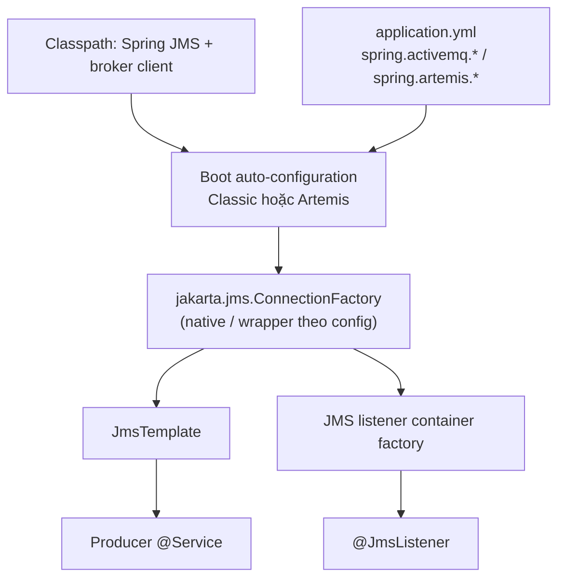

# ConnectionFactory tự cấu hình và trường hợp cần bean tùy chỉnh

> **Chương:** Spring Boot  
> **Phạm vi:** Spring Boot 3.x, Spring JMS, `jakarta.jms.ConnectionFactory`, Apache ActiveMQ Classic và ActiveMQ Artemis. Mục tiêu là hiểu **Spring Boot tạo và chọn ConnectionFactory như thế nào**, khi nào chỉ cần cấu hình property, và khi nào phải tự khai báo bean.  
> **Quy ước:** Các ví dụ dùng Spring Boot 3.x/Jakarta Messaging. Chọn phiên bản dependency cụ thể theo BOM của ứng dụng; không trộn các client `javax.jms` cũ vào ví dụ này.

## 1. Vì sao phải hiểu cơ chế tự cấu hình?

Một dịch vụ Spring Boot gửi và nhận lệnh qua JMS:

```java
@Service
public class OrderPublisher {
    private final JmsTemplate jmsTemplate;

    public OrderPublisher(JmsTemplate jmsTemplate) {
        this.jmsTemplate = jmsTemplate;
    }

    public void publish(String json) {
        jmsTemplate.convertAndSend("orders.commands", json);
    }
}
```

`JmsTemplate` cần một `ConnectionFactory` để mở kết nối và session tới broker. Trong ứng dụng dùng starter phù hợp, **Spring Boot thường tạo bean này** từ classpath và các thuộc tính `spring.activemq.*` hoặc `spring.artemis.*`. Bạn không phải viết `@Bean ConnectionFactory` chỉ để điền URL, username và password.

Vấn đề thường xuất hiện khi dự án thêm một `@Bean ConnectionFactory` “cho chủ động”: mặc dù kết nối vẫn có thể hoạt động, Spring Boot có thể **rút lui khỏi phần tạo ConnectionFactory mặc định**, khiến property đã khai báo không còn điều khiển factory đang dùng. Nếu vô tình tạo hai factory, `JmsTemplate` và `@JmsListener` còn có thể sử dụng **khác broker**.

Bài này trả lời ba câu hỏi:

1. **Ai tạo ConnectionFactory?** Auto-configuration của Boot hay một bean do ứng dụng khai báo?
2. **Property thực sự tác động đến bean nào?** Broker URL, caching, pooling, listener settings có những tầng khác nhau.
3. **Tùy chỉnh ở tầng nào?** Chỉ thay listener container, bọc native factory, hay tạo hai factory độc lập?

## 2. Đường đi của các bean khi không tùy chỉnh



Trong phạm vi Spring Boot 3.x, cần phân biệt:

- **Native/provider ConnectionFactory:** do thư viện Classic hoặc Artemis cung cấp, hiểu transport URL và các setting riêng của broker.
- **Spring caching/pooling wrapper:** bao quanh native factory, quản lý việc tái sử dụng tài nguyên. Bean được inject có thể là wrapper chứ không phải class native.
- **`JmsTemplate`:** client helper tạo `Connection`/`Session` từ factory khi gửi, không quyết định broker URL nếu đã được inject factory.
- **Listener container factory:** tạo và cấu hình các container làm việc cho `@JmsListener`: concurrency, transaction, destination type, error handling.
- **`DefaultJmsListenerContainerFactoryConfigurer`:** thành phần Spring Boot hỗ trợ mang cấu hình mặc định của Boot vào listener container factory tùy chỉnh.

Các bean có quan hệ phụ thuộc, **không đồng nghĩa** với việc Spring Boot luôn tạo đủ tất cả trong mọi classpath. Cơ chế điều kiện (`@ConditionalOnClass`, `@ConditionalOnMissingBean` và số lượng bean có thể chọn) quyết định thành phần nào thực sự xuất hiện.

### 2.1. Khi nào Spring Boot tạo bean mặc định?

Về mặt thiết kế, auto-configuration cho Classic/Artemis chỉ hoạt động khi:

1. Có các thư viện Spring JMS và provider client tương thích trên classpath.
2. Module auto-configuration của Spring Boot tương ứng được áp dụng và không bị loại trừ.
3. Các điều kiện tạo factory không bị **bean do ứng dụng định nghĩa trước** làm cho không còn phù hợp.
4. Các điều kiện phụ thuộc cấu hình/broker mode được thỏa mãn.

Boot sử dụng cơ chế **back off**: khi ứng dụng cung cấp một bean `jakarta.jms.ConnectionFactory` phù hợp, phần tự tạo provider ConnectionFactory thường **không tạo thêm bản mặc định**.

Cần đọc đúng giới hạn của kết luận này:

- Boot **nhường quyền tạo ConnectionFactory** không đồng nghĩa **tắt toàn bộ Spring JMS auto-configuration**.
- Khi chỉ có một ConnectionFactory khả dụng và không có `JmsTemplate` do ứng dụng tạo, Boot thường vẫn có thể tạo `JmsTemplate` dùng factory đó.
- Nếu tồn tại nhiều ConnectionFactory, các bean tự cấu hình đòi hỏi **một candidate rõ ràng** có thể không được tạo hoặc chọn nhầm nếu bạn thiếu `@Primary`/`@Qualifier`; khi đó nên cấu hình template và listener factory tường minh.
- Điều kiện chính xác có thể khác theo version Spring Boot. Đừng phán đoán từ tên class; hãy xem **Condition Evaluation Report** của ứng dụng thực tế.

### 2.2. Đừng nhầm Spring Boot 3.x với client JMS của Boot 2.x

Spring Boot 3.x dùng **Jakarta Messaging**:

```java
import jakarta.jms.ConnectionFactory;
import jakarta.jms.Message;
import jakarta.jms.Session;
```

Các client ActiveMQ Classic 5.x cũ sử dụng `javax.jms.*` không tự trở thành `jakarta.jms.*` chỉ vì thêm Spring Boot starter. Chúng là **hai namespace API khác nhau**, gây lỗi biên dịch/runtime hoặc điều kiện auto-config không khớp nếu trộn classpath.

Với Spring Boot 3.x, hãy dùng starter và dependency management phù hợp của Boot; không chèn thủ công một client `javax.jms` cũ vì thấy cùng tên class `ActiveMQConnectionFactory`. Cần xác minh artifact/phiên bản nào cung cấp Jakarta API và tính tương thích broker.

## 3. Trường hợp 1 — ActiveMQ Artemis: chỉ dùng property là đủ

### 3.1. Dependency

Trong dự án đã dùng Spring Boot BOM hoặc `spring-boot-starter-parent`:

```xml
<dependency>
  <groupId>org.springframework.boot</groupId>
  <artifactId>spring-boot-starter-artemis</artifactId>
</dependency>
```

Không đặt version riêng cho starter nếu đã để BOM Spring Boot quản lý. Đảm bảo không thêm đồng thời starter Classic nếu ứng dụng chỉ sử dụng Artemis; hai provider cùng hiện diện sẽ làm việc suy luận auto-configuration khó hơn.

### 3.2. `application.yml` cho Artemis native broker

```yaml
spring:
  artemis:
    mode: native
    broker-url: tcp://localhost:61616
    user: app_orders
    password: $${ARTEMIS_PASSWORD}
  jms:
    cache:
      enabled: true
      session-cache-size: 5
    listener:
      concurrency: 2
      max-concurrency: 5

app:
  messaging:
    orders-queue: orders.commands
```

**Đặc điểm:**

- `spring.artemis.mode=native` yêu cầu kết nối broker bên ngoài, tránh vô tình chọn chế độ embedded khi classpath có các thư viện hỗ trợ broker nhúng.
- `spring.artemis.broker-url` xác định địa chỉ Artemis theo giao thức native mà client được chọn hỗ trợ.
- User/password nên lấy từ secret/env thay vì ghi giá trị thật vào repository.
- `spring.jms.cache.*` nói về lớp cache do Spring JMS/Boot quản lý trong cấu hình tương ứng; nó **không** phải tham số mạng của Artemis.
- `spring.jms.listener.*` điều chỉnh listener container mặc định. Đây không phải lý do tự thay thế `ConnectionFactory`.

**Điều kiện chạy:** broker ở `localhost:61616` phải đang hoạt động, protocol/acceptor tương thích, tài khoản có quyền send/consume và queue `orders.commands` có thể được tạo hoặc đã được provision. `localhost` bên trong Docker container là chính container đó, không phải mặc nhiên host hay container broker khác.

### 3.3. Producer và consumer tối thiểu

```java
import org.springframework.jms.annotation.JmsListener;
import org.springframework.jms.core.JmsTemplate;
import org.springframework.stereotype.Service;

@Service
public class OrdersMessaging {
    private final JmsTemplate jmsTemplate;

    public OrdersMessaging(JmsTemplate jmsTemplate) {
        this.jmsTemplate = jmsTemplate;
    }

    public void send(String orderJson) {
        jmsTemplate.convertAndSend("orders.commands", orderJson);
    }

    @JmsListener(destination = "orders.commands")
    public void receive(String orderJson) {
        // Validate schema, xử lý nghiệp vụ và chỉ hoàn tất khi thành công.
        System.out.println("Order received: " + orderJson);
    }
}
```

Ở đây Spring Boot có thể cung cấp `JmsTemplate` và listener container factory mặc định. Nếu project cần xử lý JSON thành DTO, thêm `MessageConverter` thích hợp hoặc parse/validate tại consumer; **MessageConverter không phải ConnectionFactory**, nên không cần thay connection factory chỉ để thay cách serialize body.

### 3.4. Nếu dùng ActiveMQ Classic thay vì Artemis

Dùng starter dành cho Classic:

```xml
<dependency>
  <groupId>org.springframework.boot</groupId>
  <artifactId>spring-boot-starter-activemq</artifactId>
</dependency>
```

Và cấu hình:

```yaml
spring:
  activemq:
    broker-url: tcp://localhost:61616
    user: app_orders
    password: $${ACTIVEMQ_PASSWORD}
  jms:
    cache:
      enabled: true
      session-cache-size: 5
```

**Không dùng `spring.artemis.*` để cấu hình Classic**, và không dùng `spring.activemq.*` để mong Artemis native client tự đọc. Mặc dù broker Artemis có thể hỗ trợ OpenWire, **client protocol phải khớp**: Classic JMS client nói OpenWire, còn Artemis native JMS client nói Artemis Core.

Trong Classic, URI `failover:(tcp://broker-a:61616,tcp://broker-b:61616)` có thể được đưa thẳng vào `spring.activemq.broker-url`; vì vậy **chỉ cần failover URI chưa phải lý do bắt buộc viết custom bean**.

## 4. Điều chỉnh bằng property hay tạo bean: quy tắc quyết định

| Yêu cầu | Cách ưu tiên | Có cần `@Bean ConnectionFactory`? |
|---|---|---|
| Đổi broker URL, username, password | `spring.activemq.*` hoặc `spring.artemis.*` | **Không** |
| Đổi số session cache | `spring.jms.cache.*` khi Boot quản lý cache | **Không** |
| Đổi concurrency listener | `spring.jms.listener.*` hoặc listener container factory riêng | **Không** |
| Đổi queue/topic của listener | `@JmsListener`/listener factory, destination name | **Không** |
| Đổi JSON converter | `MessageConverter` | **Không** |
| Classic cần failover transport URI | Đặt failover URI vào property | **Thường không** |
| Nhà cung cấp cần native tuning không được Boot expose | Cấu hình native factory rồi bọc khi cần | **Có thể cần** |
| Hai broker/credential/protocol độc lập | Hai bean ConnectionFactory **có tên** + template/listener factory tường minh | **Có** |
| Dùng JNDI hoặc ConnectionFactory do app server cấp | Cấu hình JNDI hoặc bean từ JNDI | **Có thể**, tùy môi trường |
| Dùng credential hoặc TLS policy cấp động theo tổ chức | Tích hợp custom provider/wrapper, secret rotation | **Có thể**, cần xác minh lifecycle |
| Thay transaction/ACK mode listener | Listener container factory (không thay native factory) | **Không** |

**Nguyên tắc:** chỉ thay ConnectionFactory nếu vấn đề thuộc **nguồn kết nối hoặc chính sách tạo Connection/Session**. Vấn đề của listener, serializer hay nghiệp vụ phải sửa ở tầng của chúng.

## 5. Trường hợp 2 — Tùy chỉnh listener mà vẫn giữ ConnectionFactory do Boot tạo

Một nhu cầu phổ biến: listener xử lý queue `orders.commands` cần transaction và concurrency `2–5`. Không nên thay bean native factory vì lý do này.

```java
import jakarta.jms.ConnectionFactory;

import org.springframework.boot.autoconfigure.jms
        .DefaultJmsListenerContainerFactoryConfigurer;
import org.springframework.context.annotation.Bean;
import org.springframework.context.annotation.Configuration;
import org.springframework.jms.annotation.EnableJms;
import org.springframework.jms.config.DefaultJmsListenerContainerFactory;

@Configuration(proxyBeanMethods = false)
@EnableJms
public class OrdersListenerConfiguration {

    @Bean("ordersListenerFactory")
    DefaultJmsListenerContainerFactory ordersListenerFactory(
            ConnectionFactory connectionFactory,
            DefaultJmsListenerContainerFactoryConfigurer configurer) {

        DefaultJmsListenerContainerFactory factory =
                new DefaultJmsListenerContainerFactory();

        // Giữ phần cấu hình mặc định từ Spring Boot
        // trước khi ghi đè những chính sách cụ thể của listener.
        configurer.configure(factory, connectionFactory);

        factory.setConcurrency("2-5");
        factory.setSessionTransacted(true);
        factory.setPubSubDomain(false); // Queue, không phải Topic.

        return factory;
    }
}
```

Dùng bean listener factory đã khai báo:

```java
@JmsListener(
    destination = "orders.commands",
    containerFactory = "ordersListenerFactory"
)
public void handleOrder(String json) {
    processOrder(json); // Hàm nghiệp vụ của ứng dụng.
}
```

Trong trường hợp này:

- `ConnectionFactory` vẫn có thể do Boot auto-configure từ `application.yml`.
- `DefaultJmsListenerContainerFactoryConfigurer` kế thừa các setting mặc định phù hợp thay vì vô tình bỏ qua Boot configuration.
- `sessionTransacted=true` chỉ kiểm soát transaction của **JMS Session**. Nó không tự gộp transaction JDBC của database nghiệp vụ vào cùng transaction.
- Nếu handler ném exception, transaction JMS có thể rollback theo container semantics; cần kiểm thử retry/redelivery trong môi trường thật.

**Lưu ý phiên bản:** API `DefaultJmsListenerContainerFactoryConfigurer` trong namespace `org.springframework.boot.autoconfigure.jms` được trình bày theo Spring Boot 3.x. Với Boot khác major, xác minh package và availability trong dependency đang dùng.

## 6. Trường hợp 3 — Viết ConnectionFactory tùy chỉnh cho Artemis native tuning

Giả sử ứng dụng cần kiểm soát **consumer window size** của native Artemis client, nhưng phiên bản Spring Boot được chọn không cung cấp property thuận tiện để biểu diễn đúng chính sách. Khi đó có thể định nghĩa factory rõ ràng rồi (nếu cần) bọc bằng Spring `CachingConnectionFactory`.

### 6.1. Custom bean: native factory bên trong, cache bên ngoài

```java
import jakarta.jms.ConnectionFactory;

import org.apache.activemq.artemis.jms.client.ActiveMQConnectionFactory;
import org.springframework.beans.factory.annotation.Value;
import org.springframework.context.annotation.Bean;
import org.springframework.context.annotation.Configuration;
import org.springframework.jms.connection.CachingConnectionFactory;

@Configuration(proxyBeanMethods = false)
public class ArtemisConnectionConfiguration {

    @Bean
    ConnectionFactory jmsConnectionFactory(
            @Value("${app.jms.broker-url}") String brokerUrl,
            @Value("${app.jms.user}") String username,
            @Value("${app.jms.password}") String password) {

        ActiveMQConnectionFactory nativeFactory =
                new ActiveMQConnectionFactory(
                        brokerUrl, username, password);

        // Native Artemis tuning; kiểm chứng giá trị với workload.
        nativeFactory.setConsumerWindowSize(1024 * 1024);

        CachingConnectionFactory cache =
                new CachingConnectionFactory(nativeFactory);
        cache.setSessionCacheSize(10);
        cache.setCacheProducers(true);
        cache.setCacheConsumers(false);

        return cache;
    }
}
```

Property dành riêng cho custom bean:

```yaml
app:
  jms:
    broker-url: tcp://localhost:61616
    user: app_orders
    password: $${ARTEMIS_PASSWORD}
```

**Điểm cực kỳ quan trọng:** khi bạn đã chủ động đăng ký một bean `jakarta.jms.ConnectionFactory`, phần auto-configuration tạo native ConnectionFactory của Boot **thường sẽ back off**. Do đó:

- `app.jms.*` ở ví dụ là property **do chính ứng dụng đọc**, không phải tên property mặc định của Boot.
- Thay `spring.artemis.broker-url` trong `application.yml` **không làm bean bên trên tự đổi URL** nếu constructor đang đọc `app.jms.broker-url`.
- `spring.jms.cache.session-cache-size` **không tự điều khiển** một `CachingConnectionFactory` bạn tạo bằng tay và đã set cứng `10`.
- `JmsTemplate` và listener auto-configuration vẫn có thể dùng factory custom này nếu nó là candidate phù hợp và bạn chưa thay chúng.
- Native factory cần cùng hệ `jakarta.jms` với Boot 3.x; không chèn nhầm Artemis/Classic client `javax.jms`.

### 6.2. Vì sao bọc cache phải có chủ đích?

`CachingConnectionFactory` của Spring có thể tái sử dụng Connection, Session và producer theo cấu hình, giảm overhead tạo session khi dùng `JmsTemplate`. Tuy nhiên:

- Số session được cache **không** chính là giới hạn số session active tối đa hoặc kích thước thread pool.
- Cache consumer có thể tạo hành vi khó suy luận với selector, durable subscriptions hoặc lifecycle, vì thế ví dụ đặt `cacheConsumers=false`.
- Một wrapper giúp tối ưu không có nghĩa tất cả resource nên được cache/pool đồng thời.
- Nếu dùng `JmsPoolConnectionFactory` của thư viện pooled-jms, phải hiểu quan hệ với Spring caching; **tránh chồng nhiều tầng cache/pool một cách vô ý**.
- Khi tự tạo custom factory, bạn chịu trách nhiệm kiểm tra lifecycle, TLS, reconnect, version compatibility, timeout và đóng tài nguyên phù hợp.

Nếu yêu cầu chỉ là tăng số session cache lên 10 và không cần native tuning, cách **đơn giản hơn** là giữ Boot auto-config và đặt:

```yaml
spring:
  jms:
    cache:
      session-cache-size: 10
```

Đừng dùng bean tùy chỉnh chỉ để lặp lại hành vi có sẵn trong properties.

### 6.3. Classic cũng có thể custom, nhưng đừng dùng sai provider

Với ActiveMQ Classic, factory native thuộc package `org.apache.activemq.ActiveMQConnectionFactory`, URI điển hình:

```text
failover:(tcp://broker-a:61616,tcp://broker-b:61616)?randomize=false
```

Đây là **Classic OpenWire failover URI**, không phải cú pháp chung của Artemis native. Nếu chỉ cần URI này, thường chỉ cần đặt nó vào `spring.activemq.broker-url`. Chỉ viết bean nếu có tuning/native TLS/provider extension không thể giải quyết sạch bằng properties.

## 7. Trường hợp 4 — Hai broker: hai ConnectionFactory và wiring tường minh

Một service cần đọc lệnh từ Artemis broker **orders** và ghi audit vào Artemis broker **audit**. Hai connection độc lập, credential khác nhau. Không nên tạo một `ConnectionFactory` duy nhất rồi thay URL động trên shared object.

### 7.1. Cấu hình hai endpoint

```yaml
app:
  jms:
    orders:
      broker-url: tcp://orders-broker:61616
      user: orders_app
      password: $${ORDERS_BROKER_PASSWORD}
    audit:
      broker-url: tcp://audit-broker:61616
      user: audit_app
      password: $${AUDIT_BROKER_PASSWORD}
```

### 7.2. Hai bean ConnectionFactory, template và listener container

```java
import jakarta.jms.ConnectionFactory;

import org.apache.activemq.artemis.jms.client.ActiveMQConnectionFactory;
import org.springframework.beans.factory.annotation.Qualifier;
import org.springframework.beans.factory.annotation.Value;
import org.springframework.context.annotation.Bean;
import org.springframework.context.annotation.Configuration;
import org.springframework.jms.annotation.EnableJms;
import org.springframework.jms.config.DefaultJmsListenerContainerFactory;
import org.springframework.jms.core.JmsTemplate;

@Configuration(proxyBeanMethods = false)
@EnableJms
public class MultiBrokerJmsConfiguration {

    @Bean("ordersConnectionFactory")
    ConnectionFactory ordersConnectionFactory(
            @Value("${app.jms.orders.broker-url}") String url,
            @Value("${app.jms.orders.user}") String user,
            @Value("${app.jms.orders.password}") String password) {
        return new ActiveMQConnectionFactory(url, user, password);
    }

    @Bean("auditConnectionFactory")
    ConnectionFactory auditConnectionFactory(
            @Value("${app.jms.audit.broker-url}") String url,
            @Value("${app.jms.audit.user}") String user,
            @Value("${app.jms.audit.password}") String password) {
        return new ActiveMQConnectionFactory(url, user, password);
    }

    @Bean("ordersJmsTemplate")
    JmsTemplate ordersJmsTemplate(
            @Qualifier("ordersConnectionFactory")
            ConnectionFactory connectionFactory) {
        return new JmsTemplate(connectionFactory);
    }

    @Bean("auditJmsTemplate")
    JmsTemplate auditJmsTemplate(
            @Qualifier("auditConnectionFactory")
            ConnectionFactory connectionFactory) {
        return new JmsTemplate(connectionFactory);
    }

    @Bean("ordersListenerFactory")
    DefaultJmsListenerContainerFactory ordersListenerFactory(
            @Qualifier("ordersConnectionFactory")
            ConnectionFactory connectionFactory) {

        DefaultJmsListenerContainerFactory factory =
                new DefaultJmsListenerContainerFactory();
        factory.setConnectionFactory(connectionFactory);
        factory.setPubSubDomain(false);
        factory.setSessionTransacted(true);
        factory.setConcurrency("1-3");
        return factory;
    }
}
```

Dùng tường minh:

```java
import org.springframework.beans.factory.annotation.Qualifier;
import org.springframework.jms.annotation.JmsListener;
import org.springframework.jms.core.JmsTemplate;
import org.springframework.stereotype.Service;

@Service
public class OrderBridge {
    private final JmsTemplate auditJmsTemplate;

    public OrderBridge(
            @Qualifier("auditJmsTemplate")
            JmsTemplate auditJmsTemplate) {
        this.auditJmsTemplate = auditJmsTemplate;
    }

    @JmsListener(
        destination = "orders.commands",
        containerFactory = "ordersListenerFactory"
    )
    public void consume(String command) {
        auditJmsTemplate.convertAndSend(
                "audit.events", command);
    }
}
```

**Cảnh báo về transaction:** hai broker khác nhau không tự có transaction phân tán. Ví dụ trên chỉ minh họa **đường đi của các bean**. Nếu việc send audit thành công nhưng commit nhận orders thất bại, message có thể được giao lại và audit bị gửi trùng. Với nghiệp vụ cần đáng tin cậy, dùng idempotency/outbox/transaction coordinator thích hợp thay vì xem method bridge là exactly-once.

### 7.3. Tại sao không inject theo type chung?

Khi có hai bean `ConnectionFactory` và hai bean `JmsTemplate`:

```java
// Mơ hồ: có hai JmsTemplate!
public OrderBridge(JmsTemplate template) { ... }
```

Spring có thể báo lỗi không chọn được bean (`NoUniqueBeanDefinitionException`), hoặc nếu một bean được chọn bằng `@Primary` thì code không rõ ràng về broker đích. Với nhiều broker, dùng:

- `@Qualifier("ordersConnectionFactory")` và `@Qualifier("auditConnectionFactory")` cho factory.
- `@Qualifier("ordersJmsTemplate")`/`@Qualifier("auditJmsTemplate")` cho template.
- `containerFactory="ordersListenerFactory"` cho listener.
- `@Primary` **chỉ** khi thực sự có một broker mặc định được tổ chức quy định; không dùng để che wiring mơ hồ.

**Lưu ý:** trong ví dụ nhiều broker, listener factory được cấu hình **trực tiếp**, không gọi `DefaultJmsListenerContainerFactoryConfigurer`. Như vậy các mặc định `spring.jms.listener.*` không tự động được kế thừa. Nếu muốn dùng cấu hình chung, áp dụng configurer có chủ đích hoặc cấu hình rõ các thuộc tính trong factory.

## 8. Điều kiện bean: các lỗi thường làm cấu hình trông đúng nhưng chạy sai

### 8.1. “Tôi đặt `spring.artemis.broker-url` nhưng app vẫn kết nối broker cũ”

Nguyên nhân có thể:

1. Một `@Bean ConnectionFactory` của ứng dụng đã thay thế tự cấu hình.
2. Bean tùy chỉnh đọc `app.jms.broker-url` hoặc hardcode URL khác.
3. Bean factory được tạo trong một `@Configuration` của thư viện dùng chung.
4. Một `@Primary` hoặc `@Qualifier` khiến `JmsTemplate` dùng factory không như dự định.
5. Profile/env khác ghi đè property đúng từ `application.yml`.

**Cách kiểm tra:** xem tên và class bean `ConnectionFactory`, nguồn property đang có hiệu lực, Condition Evaluation Report, rồi kiểm tra endpoint ở connection thực.

### 8.2. “Vì sao không có `ConnectionFactory`?”

Kiểm tra:

- Đã thêm đúng **starter** và classpath client chưa?
- Spring Boot major có cùng API `jakarta.jms` với client không?
- Có loại trừ JMS/ActiveMQ/Artemis auto-configuration không?
- Có kích hoạt broker mode không phù hợp, ví dụ embedded khi chỉ mong native?
- Có trộn cả Classic và Artemis starter mà không biết provider nào được chọn?
- Có profile, test slice hoặc cấu hình condition khiến auto-configuration không áp dụng?

Không giải quyết vấn đề bằng cách ngẫu nhiên khai báo thêm một factory rồi không kiểm tra nguyên nhân. Điều đó có thể khiến cấu hình ngày càng khó bảo trì.

### 8.3. “Có factory nhưng không có `JmsTemplate` hoặc `@JmsListener` không chạy”

Kiểm tra **tầng cao hơn factory**:

- Có Spring JMS và điều kiện tạo `JmsTemplate` không?
- Có **một candidate** ConnectionFactory rõ ràng không?
- Có ai đã định nghĩa `JmsTemplate` riêng và làm Boot back off không?
- `@JmsListener` được Spring quản lý, annotation infrastructure/`@EnableJms` có hoạt động không?
- Tên listener container factory đúng không? Destination/selector/credential phù hợp chứ?
- Listener có bị lỗi connect/TLS/auth nhưng ứng dụng vẫn startup không?

Không nên quy mọi lỗi listener về native ConnectionFactory; listener container có lifecycle và settings riêng.

### 8.4. Trùng lớp cache/pool

Một kiểu cấu hình khó quan sát:

```text
Boot caching wrapper
    -> custom CachingConnectionFactory
        -> pooled-jms factory
            -> provider native factory
```

Khi mỗi tầng đều giữ session/connection, shutdown và pool limit khó hiểu. Không cài thêm `pooled-jms` rồi bật pooling/caching từ nhiều nơi mà không có lý do và load test rõ ràng.

Trong cấu hình mặc định, hãy ưu tiên **một chiến lược tái sử dụng tài nguyên có chủ đích**: Boot JMS cache theo properties, hoặc pool nếu workload cần và library/Boot version hỗ trợ; tránh một lớp wrapper không cần thiết.

## 9. Kiểm chứng ứng dụng thực sự inject factory nào

### 9.1. Bật condition report khi chẩn đoán

Một cách tạm thời:

```text
java -jar app.jar --debug
```

Hoặc bật log cho Spring Boot auto-configuration theo môi trường. Condition Evaluation Report cho biết auto-configuration nào phù hợp/không phù hợp và lý do. Nếu Actuator đã được dùng, endpoint `conditions` cũng có thể hỗ trợ kiểm tra theo chính sách bảo mật của ứng dụng.

**Không bật công khai các endpoint actuator nhạy cảm trong production chỉ để debug.** Chúng có thể lộ cấu trúc ứng dụng hoặc cấu hình; chỉ mở cho người vận hành được xác thực.

### 9.2. In bean name và runtime type trong môi trường thử nghiệm

Thêm cấu hình tạm thời:

```java
import jakarta.jms.ConnectionFactory;
import org.springframework.boot.ApplicationRunner;
import org.springframework.context.ApplicationContext;
import org.springframework.context.annotation.Bean;
import org.springframework.context.annotation.Configuration;
import org.springframework.jms.core.JmsTemplate;

@Configuration(proxyBeanMethods = false)
public class JmsWiringInspector {

    @Bean
    ApplicationRunner logJmsBeans(ApplicationContext context) {
        return args -> {
            context.getBeansOfType(ConnectionFactory.class)
                    .forEach((name, bean) ->
                        System.out.println(
                            "ConnectionFactory bean=" + name
                            + ", type=" + bean.getClass().getName()));

            context.getBeansOfType(JmsTemplate.class)
                    .forEach((name, bean) ->
                        System.out.println(
                            "JmsTemplate bean=" + name
                            + ", factoryType="
                            + bean.getConnectionFactory()
                                  .getClass().getName()));
        };
    }
}
```

**Cách diễn giải:**

- Nếu thấy `org.springframework.jms.connection.CachingConnectionFactory`, bean đã được **wrap**; không thể chỉ từ class này biết ngay provider bên trong.
- Nếu thấy hai factory beans, phải kiểm tra template/listener dùng cái nào.
- Tên bean và type chỉ xác minh **wiring tại Spring Context**, chưa xác minh kết nối network thành công hoặc quyền queue/topic.
- Đừng in broker password, token hoặc raw property chứa secret.

Có thể dùng `ApplicationContext` trong `@SpringBootTest` để assert số lượng/tên bean, nhưng **đừng chỉ assert bean tồn tại rồi coi integration test đã PASS**.

### 9.3. Kiểm thử kết nối và routing riêng

Đề xuất hai tầng kiểm thử:

| Tầng | Thiết lập | Tiêu chí |
|---|---|---|
| **Context test** | `@SpringBootTest` load cấu hình test | Có đúng số bean ConnectionFactory/JmsTemplate và listener factory, đúng qualifier |
| **Integration test** | Broker Classic/Artemis chạy thật hoặc Testcontainers phù hợp | Send/receive đến đúng destination, authentication/TLS đúng, timeout/reconnect/transaction hoạt động |

Ví dụ assertions ở context test:

```java
// Pseudocode JUnit + AssertJ; context được inject bởi Spring Test.
assertThat(context.getBeansOfType(ConnectionFactory.class))
        .containsKey("ordersConnectionFactory")
        .containsKey("auditConnectionFactory");
assertThat(context.getBeansOfType(JmsTemplate.class))
        .containsKey("ordersJmsTemplate")
        .containsKey("auditJmsTemplate");
```

Khi chạy integration test multi-broker, nên dùng **hai broker thực sự khác nhau**, không trỏ cả hai factory vào cùng một URL rồi tuyên bố wiring đúng.

## 10. Production checklist cho ConnectionFactory

| Câu hỏi | Kết quả cần xác minh |
|---|---|
| Đang dùng Classic hay Artemis? | Starter, provider client và protocol khớp |
| Spring Boot 3.x có phụ thuộc `jakarta.jms` đồng bộ? | Không trộn `javax.jms` cũ vào wiring |
| Có custom `@Bean ConnectionFactory` không? | Nếu có, biết rõ tại sao Boot back off |
| URL và credentials lấy từ đâu? | Profile/env/secrets rõ ràng, không lộ password |
| Factory được cache/pool mấy tầng? | Một chính sách có chủ đích và được load test |
| Listener có dùng đúng factory? | Listener container factory được chọn tường minh khi cần |
| Có nhiều broker không? | Bean name/qualifier và templates riêng; không phụ thuộc may rủi vào `@Primary` |
| Concurrency được cấu hình ở đâu? | Listener container, không nhầm với số cache sessions |
| Transaction được cấu hình ở đâu? | Session/container hoặc transaction manager; không tự coi business DB là cùng transaction |
| Failover/TLS có đúng với provider? | URI, CA/certificate, reconnect policy được kiểm thử |
| Shutdown/restart có sạch không? | Connection/pool đóng đúng, listener ngừng nhận và phục hồi ổn định |
| Điều kiện auto-config đã được kiểm tra? | Condition report và runtime beans khớp thiết kế |

## 11. Bài tập tình huống

**Bài 1 — Không cần custom:** Dịch vụ Artemis chỉ muốn đổi URL sang `tcp://artemis-prod:61616`, tăng cache sessions lên 8 và listener concurrency lên 4. Viết `application.yml` mà không khai báo `@Bean ConnectionFactory`.

**Bài 2 — Bean làm property bị bỏ qua:** Developer khai báo:

```java
@Bean
ConnectionFactory connectionFactory() {
    return new ActiveMQConnectionFactory(
            "tcp://127.0.0.1:61616");
}
```

nhưng vận hành đổi `spring.artemis.broker-url` sang broker mới. Giải thích vì sao setting có thể không tác động đến factory thực tế và đưa ra hai cách sửa.

**Bài 3 — Không sửa factory khi chỉ muốn listener transaction:** Dự án cần listener nhận từ queue với `concurrency=3-6` và transacted session. Nên thêm bean gì, có nên sử dụng `DefaultJmsListenerContainerFactoryConfigurer` không?

**Bài 4 — Multi-broker:** Ứng dụng có hai factory `ordersConnectionFactory` và `auditConnectionFactory`. Một bean `JmsTemplate` inject theo type báo mơ hồ. Sửa bằng bean names/qualifiers như thế nào, và cấu hình `@JmsListener` ra sao?

**Bài 5 — Namespace mismatch:** Ứng dụng Spring Boot 3.x thêm một thư viện client ActiveMQ Classic cũ triển khai `javax.jms.ConnectionFactory`. Vì sao class này không thể thay thế trực tiếp `jakarta.jms.ConnectionFactory`? Nêu hướng chọn dependency đúng.

**Bài 6 — Hai commit:** Trong listener nhận orders, ứng dụng gửi audit tới broker thứ hai rồi xử lý DB. Vì sao chỉ thêm `@Transactional` không thể mặc nhiên bảo đảm cả ba việc nhận JMS, gửi JMS khác broker và ghi DB commit nguyên tử?

### Gợi ý lời giải ngắn

1. Dùng `spring.artemis.broker-url`, `spring.jms.cache.session-cache-size` và `spring.jms.listener.concurrency`; kiểm tra giá trị concurrency phù hợp số consumer/session.
2. Bean tự khai báo làm native factory auto-config back off; xóa bean để dùng Boot hoặc chuyển bean sang đọc property ứng dụng có chủ đích.
3. Tạo `DefaultJmsListenerContainerFactory` riêng và dùng configurer để giữ các mặc định Boot trước khi override.
4. Tạo `ordersJmsTemplate`/`auditJmsTemplate` tường minh, inject `@Qualifier`; listener chỉ định `containerFactory` đúng broker.
5. Hai namespace Java API khác nhau; dùng starter/client Jakarta-compatible tương ứng BOM của Boot 3.x.
6. Mỗi JMS broker và DB có transaction boundary riêng; cần thiết kế outbox/idempotency hoặc giao dịch phân tán đã cấu hình, không suy diễn từ một annotation.

## 12. Tài liệu tham khảo

- [Spring Boot Reference — JMS](https://docs.spring.io/spring-boot/reference/messaging/jms.html): auto-configuration, Classic/Artemis starters, caching/pooling và listener properties.
- [Spring Boot API — DefaultJmsListenerContainerFactoryConfigurer](https://docs.spring.io/spring-boot/api/java/org/springframework/boot/autoconfigure/jms/DefaultJmsListenerContainerFactoryConfigurer.html): cách kế thừa cấu hình listener do Boot chuẩn bị (đối chiếu version).
- [Spring Framework — JMS](https://docs.spring.io/spring-framework/reference/integration/jms.html): `JmsTemplate`, container và transaction.
- [Spring Framework — Annotation-driven Listener Endpoints](https://docs.spring.io/spring-framework/reference/integration/jms/annotated.html): `@JmsListener` và `@EnableJms`.
- [ActiveMQ Artemis — JMS/Jakarta Messaging](https://artemis.apache.org/components/artemis/documentation/latest/using-jms.html): client và broker connection.
- [ActiveMQ Classic — Failover Transport](https://activemq.apache.org/components/classic/documentation/failover-transport-reference): Classic failover URI và lưu ý retry.

**Kết luận:** Với một broker và nhu cầu thông thường, **ưu tiên Spring Boot auto-configured ConnectionFactory** qua starter và properties. Chỉ viết `@Bean ConnectionFactory` khi có yêu cầu native/provider chưa biểu diễn được, factory cấp từ môi trường đặc biệt hoặc **nhiều broker độc lập**. Khi đã tự khai báo, phải quản lý rõ **thứ tự ưu tiên bean, qualifier, cache/pool và wiring của JmsTemplate/@JmsListener** — vì cấu hình nhìn có vẻ đúng trong `application.yml` chưa chứng minh runtime đang dùng factory đó.
