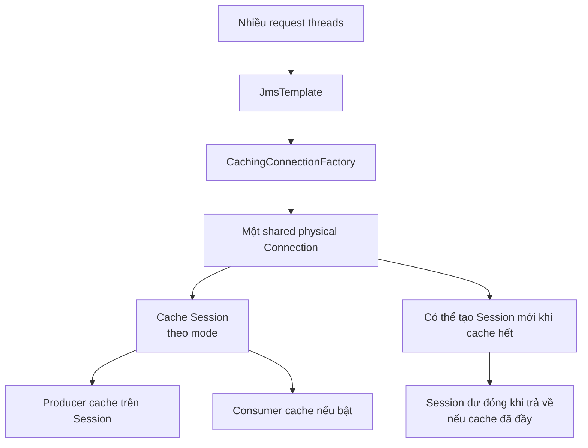
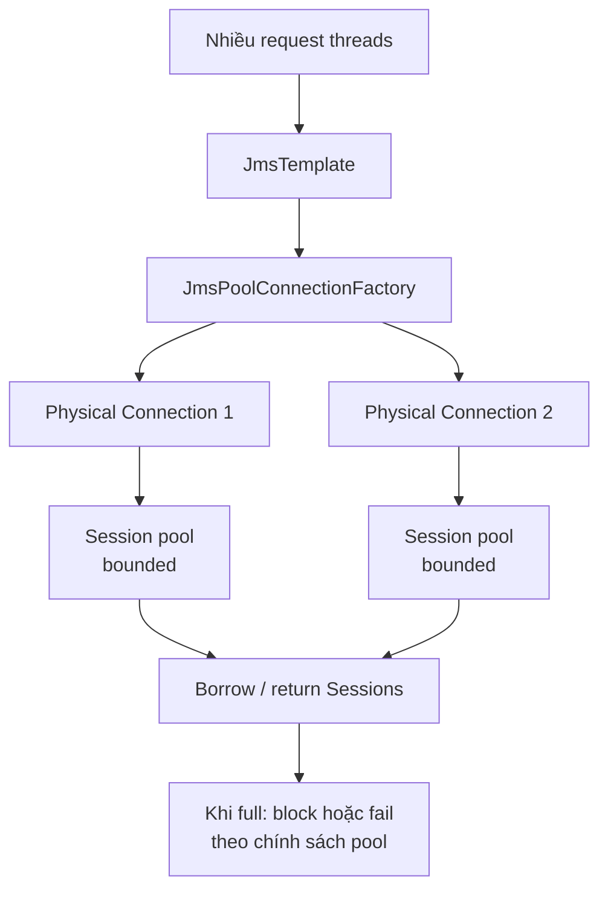

# Phân biệt CachingConnectionFactory với JmsPoolConnectionFactory

> **Chương:** Spring Boot  
> **Phạm vi:** Kết nối JMS từ Spring Boot tới Apache ActiveMQ Classic hoặc Artemis, tập trung vào `org.springframework.jms.connection.CachingConnectionFactory` và `org.messaginghub.pooled.jms.JmsPoolConnectionFactory` (thư viện `pooled-jms`).  
> **Mục tiêu:** Nắm rõ Connection, Session, producer và consumer được giữ/tái sử dụng ra sao; hiểu cache khác pool ở giới hạn tài nguyên và xử lý concurrency; cấu hình đúng trong Spring Boot, tránh double caching và chọn cách quản lý phù hợp cho `JmsTemplate`, `@JmsListener` và transaction.

## 1. Một lỗi capacity planning thường gặp

Dịch vụ thanh toán có 50 HTTP threads gọi `JmsTemplate.convertAndSend(...)` đồng thời. Team đã đặt:

```yaml
spring:
  jms:
    cache:
      enabled: true
      session-cache-size: 5
```

Họ nghĩ rằng cấu hình trên nghĩa là **“tối đa năm JMS Session đang hoạt động”**. Đây là kết luận **sai**.

Với `CachingConnectionFactory`, `sessionCacheSize=5` là **sức chứa cache các Session có thể tái sử dụng** cho từng loại Session/acknowledgment mode, **không phải semaphore giới hạn số Session đồng thời**. Khi cache hết Session rảnh, Spring vẫn có thể tạo Session mới từ Connection dùng chung; nếu cache đã đầy khi Session được trả về thì Session dư sẽ được đóng. Số Session được tạo trong đợt spike có thể lớn hơn năm.

Với `JmsPoolConnectionFactory`, cấu hình khác hẳn:

```yaml
spring:
  activemq:
    pool:
      enabled: true
      max-connections: 2
      max-sessions-per-connection: 8
```

Trong mô hình pool này, ta có **giới hạn Connections vật lý** và **giới hạn Sessions cho mỗi Connection**. Khi số Session đồng thời chạm mức pool hỗ trợ, borrower mới phải **chờ hoặc nhận lỗi** theo cấu hình pool; nó không âm thầm mở vô hạn Session như một cache tái sử dụng đơn thuần.

**Kết luận mở đầu:** `CachingConnectionFactory` tối ưu **tái sử dụng** một Connection và các resource JMS; `JmsPoolConnectionFactory` vừa tái sử dụng vừa áp **capacity bound/backpressure** cho nhiều Connection/Session.

## 2. Hai sơ đồ tài nguyên

### 2.1. Spring `CachingConnectionFactory`



- Spring `CachingConnectionFactory` mở rộng mô hình `SingleConnectionFactory`: nhiều lời gọi logic chia sẻ **một underlying Connection**.
- Nó cache `Session` và, khi cấu hình cho phép, cache `MessageProducer`/`MessageConsumer` gắn với Session.
- `Session.close()` được intercept trên wrapper: nếu còn chỗ, Session được trả lại cache; nếu không, underlying Session được đóng.
- Nếu không có Session rảnh, nó có thể **tạo mới**. `sessionCacheSize` **không phải maxConcurrency**.
- Một broker connection lỗi sẽ ảnh hưởng tới toàn bộ Session dùng Connection đó; wrapper có thể reset/reconnect theo cấu hình, nhưng không làm transport tự miễn lỗi.

### 2.2. `JmsPoolConnectionFactory` từ pooled-jms



- Pooled-jms tạo/quản lý một tập Connection vật lý thay vì cố định một Connection dùng chung.
- Mỗi Connection có số Session tối đa do `maxSessionsPerConnection` kiểm soát.
- `maxConnections` đặt giới hạn số Connection vật lý trong pool; giới hạn số Session lý thuyết thường liên quan tới tích của hai tham số, nhưng số Session thật sự có thể thấp hơn do phân phối tài nguyên và hành vi pool.
- `close()` trên logical pooled Connection/Session thường **trả resource về pool**, không đồng nghĩa đóng socket vật lý ngay.
- Pool tái sử dụng producer theo cơ chế thư viện, nhưng **không coi consumer là tài nguyên có thể reuse an toàn như producer trong mọi trường hợp**; các consumer/subscription có vòng đời và trạng thái nhận riêng.

## 3. So sánh theo hành vi, không chỉ tên class

| Khía cạnh | `CachingConnectionFactory` | `JmsPoolConnectionFactory` |
|---|---|---|
| Thư viện | Spring Framework JMS | MessagingHub `pooled-jms` |
| Mục tiêu chính | Cache resource JMS trên shared Connection | Pool Connections/Sessions để kiểm soát reuse và concurrency |
| Connection vật lý | Thông thường một shared Connection | Tối đa theo `maxConnections` |
| Session | Cache theo ack mode; có thể tạo thêm ngoài cache | Borrow/return trong giới hạn mỗi pooled Connection |
| Cache size có phải hard limit? | **Không** | Giới hạn Session/Connection **có tính ràng buộc** |
| Khi hết Session rảnh | Có thể tạo Session mới | Block hoặc fail theo pool policy |
| Producer | Có thể cache theo Session/destination, mặc định thường bật | Có cơ chế pooled producer phù hợp thư viện |
| Consumer | Có thể cache nếu bật; lưu ý selector, durable subscription, lifecycle | Consumer không được pooling theo cùng cách cache consumer của Spring |
| Connection failover | Single shared Connection phải được reset/recover | Pool phải loại bỏ/recreate tài nguyên lỗi |
| Shutdown | `resetConnection()`/destroy wrapper theo Spring | Gọi `stop()` hoặc lifecycle close tương ứng của pool |
| Sizing | `sessionCacheSize` là số Session **giữ lại** | `maxConnections` và `maxSessionsPerConnection` là capacity bounds |
| Điển hình phù hợp | `JmsTemplate` send volume vừa/ổn định, single broker Connection | Nhiều send threads, muốn giới hạn socket/Session rõ |
| Không phù hợp nếu | Cần hard cap resource nhưng chỉ đặt sessionCacheSize | Pool cấu hình quá nhỏ cho listener concurrency hoặc blocking không giới hạn |

**Cả hai đều không làm một JMS `Session` thành thread-safe.** Session được mượn/tái sử dụng **tuần tự** giữa các thread; không lưu Session thành singleton rồi gọi đồng thời. Wrapper chỉ giúp cấp phát và trả lại theo lifecycle đúng khi dùng qua Spring/JMS API.

## 4. Điều gì được cache trong `CachingConnectionFactory`?

Đối tượng này là một tiện ích của Spring Framework. Các tính năng đáng chú ý:

- **Shared Connection:** kết nối thật được tái sử dụng giữa các lời gọi.
- **Session cache:** Session được tái sử dụng khi caller đóng logical Session.
- **Producer cache:** khi `cacheProducers=true`, producer trong một cached Session có thể được reuse theo destination và cách cấu hình.
- **Consumer cache:** khi `cacheConsumers=true`, consumer trong cached Session có thể được giữ, với cảnh báo cho subscription và selector.
- **Connection recovery:** Spring `SingleConnectionFactory`/`CachingConnectionFactory` có thể reset Connection khi gặp JMS exception theo policy; ứng dụng vẫn phải xử lý send/commit outcome không xác định.

### 4.1. `sessionCacheSize` được tính theo mode

Session cache không phải một bucket duy nhất hoàn toàn đồng nhất. Các Session có thể khác nhau theo:

- `AUTO_ACKNOWLEDGE`;
- `CLIENT_ACKNOWLEDGE`;
- `DUPS_OK_ACKNOWLEDGE`;
- transacted Session.

`CachingConnectionFactory` duy trì cache theo Session creation mode/acknowledgment configuration. Vì vậy số Session **giữ lại** có thể lớn hơn một `sessionCacheSize` duy nhất khi ứng dụng sử dụng nhiều mode. Đừng đo tổng Session ở broker rồi suy ngay “cache sai”.

Ví dụ minh họa:

```text
sessionCacheSize = 4

Có thể có cache cho:
  AUTO_ACKNOWLEDGE   -> giữ tới 4 Session
  SESSION_TRANSACTED -> giữ tới 4 Session

Và các Session tạm được tạo khi concurrent demand vượt cache.
```

Đây là mô hình để tính capacity, **không** phải cam kết broker luôn có đúng tám Sessions. Tài nguyên thực phụ thuộc nhu cầu, đối tượng đã được tạo và cách wrapper được dùng.

### 4.2. `close()` trên Session không nhất thiết đóng tài nguyên thật

Với raw ConnectionFactory:

```java
Session s = connection.createSession(false, Session.AUTO_ACKNOWLEDGE);
try {
    // send / receive
} finally {
    s.close(); // Thường đóng underlying Session.
}
```

Với `CachingConnectionFactory`, cùng một `close()` trên Session proxy có thể trả Session đó vào cache để lời gọi sau dùng lại.

Đây là lý do `JmsTemplate` phối hợp tốt với cache: mỗi operation lấy và trả resource theo lifecycle Spring, không cần application giữ một raw Session trong field. Nhưng cache chỉ hoạt động đúng khi code **đóng/trả Session** theo hợp đồng.

### 4.3. Khi nào không nên cache consumer?

Consumer không giống producer: nó có **trạng thái nhận**, selector, subscription identity, durable/non-durable lifecycle và quyền sở hữu Session. Cache consumer có thể giữ subscription sống giữa những lời gọi ngắn của `JmsTemplate.receive()`.

Hệ quả có thể gồm:

- Một non-durable Topic subscription được giữ sống lâu hơn người viết code dự định.
- Thay selector hoặc destination liên tục sẽ tạo/giữ nhiều consumer resource.
- Consumer được giữ có thể tiếp tục nằm trong mô hình dispatch/prefetch, làm khó quan sát message đang giữ.
- Khi dùng durable subscription, giữ consumer đang hoạt động có thể cản trở lifecycle unsubscribe/reconnect từ client khác.

Nếu ứng dụng chủ yếu **gửi**, thường có thể dùng:

```java
CachingConnectionFactory cache =
    new CachingConnectionFactory(rawConnectionFactory);
cache.setSessionCacheSize(8);
cache.setCacheProducers(true);
cache.setCacheConsumers(false);
```

Không có nghĩa `cacheConsumers=false` luôn tốt cho mọi workload; nếu nhận ngắn hạn thường xuyên, cần đo chi phí tạo consumer và semantics Topic/durable subscription trước khi quyết định.

### 4.4. Spring listener container thường tự có cơ chế caching

`DefaultMessageListenerContainer` có cấu hình caching của chính nó (`CACHE_NONE`, `CACHE_CONNECTION`, `CACHE_SESSION`, `CACHE_CONSUMER`, `CACHE_AUTO`). Nó có thể duy trì consumer/Session suốt vòng đời worker nhận message.

Đây là **một lớp khác** với `CachingConnectionFactory` bên ngoài. Không chồng nhiều cache chỉ vì “càng nhiều cache càng nhanh”; phải hiểu resource nào do container giữ, resource nào do ConnectionFactory proxy giữ, và khi lỗi/restart có reset đúng hay không.

## 5. `JmsPoolConnectionFactory`: capacity, borrow/return và backpressure

Pool là công cụ quản lý **số lượng tài nguyên được mở**. Hai tham số chính:

```text
maxConnections = 3
maxSessionsPerConnection = 16

Trong điều kiện phân phối lý tưởng:
  tối đa khoảng 3 physical Connections
  và 16 Sessions trên mỗi physical Connection

Không suy ra mọi ứng dụng sẽ luôn mở 48 Sessions:
  mở theo nhu cầu, policies của pool và trạng thái broker.
```

### 5.1. Khi tất cả Session đang được mượn

Giả sử có tổng capacity đủ cho 12 Session đồng thời; 12 worker giữ Session vì đang đợi broker hoặc DB, worker thứ 13 muốn gửi:

- Nếu `blockIfSessionPoolIsFull=true`, pool có thể **chờ** tới khi borrower trả Session.
- Nếu cấu hình cho phép giới hạn thời gian chờ, borrower có thể nhận **lỗi khi quá timeout**.
- Nếu `blockIfSessionPoolIsFull=false`, có thể lỗi ngay khi capacity đầy.
- Nếu borrower leak Session hoặc tác vụ bị mắc vô hạn, pool có thể **cạn dù broker vẫn khỏe**.

Điểm này là khác biệt quan trọng với cache Spring: cache hết chỗ **không mặc nhiên** làm caller phải đợi vì hết slot.

**Hệ quả thực tế:** Bounded pool tạo backpressure, nhưng nếu cấu hình blocking vô hạn thì một sự cố khiến nhiều request HTTP treo chờ Session. Pool size và timeout phải phù hợp timeout từ API gateway, thời gian gửi JMS, số worker listener và khả năng DB.

### 5.2. Session pool không có nghĩa dùng chung một Session đồng thời

Pooled Session được một caller **mượn độc quyền trong thời gian lease** rồi trả về. Không đưa một pooled Session vào singleton:

```java
// SAI: lưu raw Session lấy từ pool ở singleton rồi cho nhiều thread dùng.
private Session sharedSession;
```

Điều này phá mô hình lease, có thể làm trộn transaction state và gây race. Hãy dùng `JmsTemplate`, listener container hoặc giữ Session trong phạm vi một task rồi đóng trong `finally`.

### 5.3. Producer và consumer trong pool không đối xứng

Producer có thể tái sử dụng thuận tiện vì nó chủ yếu gửi, với các thuộc tính phải được reset theo hợp đồng thư viện. Consumer có selector, listener callback, prefetch, durable subscription và mối liên hệ với một Session cụ thể; pooling consumer xuyên các lượt mượn dễ làm sai trạng thái.

Vì vậy đừng mặc định `JmsPoolConnectionFactory` sẽ cache consumer giống `CachingConnectionFactory` với `cacheConsumers=true`. Với `@JmsListener`, **listener container** mới là nơi quản lý vòng đời MessageConsumer liên tục.

### 5.4. Idle Connections và recovery

Pool có thể có idle timeout và kiểm tra kết nối theo tính năng/phiên bản của `pooled-jms`. Nhưng:

- Connection đang active có thể hỏng do network/broker failover.
- Những Session được trả về pool sau lỗi phải bị invalidate/recreate đúng.
- Broker failover không bảo đảm một transaction đang chạy sẽ tiếp tục như chưa có lỗi.
- Send/commit exception có thể có **unknown outcome** từ phía producer; pool không giải quyết idempotency.

**Pool tốt giúp giảm chi phí tạo kết nối và giữ capacity; pool không thay transaction/retry policy.**

## 6. Cấu hình Spring Boot với `CachingConnectionFactory`

Ví dụ dành cho **Spring Boot 3.x**, dùng đúng một JMS broker/provider và các thuộc tính cấu hình hiện hành của nhánh đó. Với bản khác, kiểm tra configuration metadata/tài liệu Boot tương ứng.

Giả sử chọn Artemis native client:

```yaml
spring:
  artemis:
    mode: native
    broker-url: tcp://127.0.0.1:61616

  jms:
    cache:
      enabled: true
      session-cache-size: 8
      producers: true
      consumers: false
```

**Ý nghĩa:**

1. `spring.artemis.mode=native` cho client Artemis kết nối tới broker ngoài bằng cấu hình broker URL.
2. `spring.jms.cache.enabled=true` yêu cầu Boot sử dụng caching wrapper trong đường auto-configuration phù hợp.
3. `session-cache-size=8` là cache capacity, **không phải max Session active**.
4. `producers=true` cho phép cache producer khi resource phù hợp.
5. `consumers=false` chủ ý không giữ consumer trong cache của `CachingConnectionFactory`. Với listener container, kiểm tra caching level của chính container.

Khi ứng dụng tự khai báo `ConnectionFactory` bean hoặc cùng lúc bật pool, đường auto-config có thể thay đổi: **đừng chỉ đọc YAML mà không kiểm tra kiểu bean thực tế được inject** vào `JmsTemplate` và listener container.

### 6.1. Cấu hình trên ActiveMQ Classic

Nếu dùng **ActiveMQ Classic**, thay nhóm broker:

```yaml
spring:
  activemq:
    broker-url: tcp://127.0.0.1:61616
  jms:
    cache:
      enabled: true
      session-cache-size: 8
      producers: true
      consumers: false
```

Giữ đúng starter/client version hỗ trợ namespace Spring Boot đang dùng. Spring Boot 3/Jakarta Messaging dùng `jakarta.jms`; client Classic 5.x cũ dựa trên `javax.jms` có thể không tương thích với các API Jakarta được framework mong đợi. Không chỉ đổi broker URL mà quên dependency.

### 6.2. Khai báo thủ công khi cần kiểm soát

Với một raw `jakarta.jms.ConnectionFactory` tương thích Spring Boot 3, Spring có thể tạo wrapper:

```java
import jakarta.jms.ConnectionFactory;
import org.springframework.jms.connection.CachingConnectionFactory;

// rawFactory là provider ConnectionFactory đã cấu hình sẵn.
CachingConnectionFactory caching =
    new CachingConnectionFactory(rawFactory);
caching.setSessionCacheSize(8);
caching.setCacheProducers(true);
caching.setCacheConsumers(false);
```

Nếu cấu hình bean thủ công, chỉ có **một owner** quản lý wrapper và underlying factory/connection lifecycle. Đừng khai báo bean wrapper rồi lại để một auto-config khác bọc wrapper lần thứ hai. Cách ít cấu hình trùng nhất là chọn **Boot properties hoặc Java config thủ công**, không đồng thời áp hai nguồn một cách vô ý.

## 7. Cấu hình Spring Boot với `JmsPoolConnectionFactory`

Pooled-jms là một dependency riêng, thường được cung cấp qua artifact:

```xml
<dependency>
  <groupId>org.messaginghub</groupId>
  <artifactId>pooled-jms</artifactId>
</dependency>
```

Khi dùng Spring Boot dependency management/BOM tương thích, version có thể được quản lý; nếu không, phải chọn phiên bản `pooled-jms` tương ứng với `jakarta.jms` hoặc `javax.jms` và Java/Spring hiện tại. **Không dùng Maven dependency thiếu version nếu project không có BOM quản lý nó.**

### 7.1. Với Artemis ở Spring Boot 3.x

```yaml
spring:
  artemis:
    mode: native
    broker-url: tcp://127.0.0.1:61616
    pool:
      enabled: true
      max-connections: 4
      max-sessions-per-connection: 16

  jms:
    cache:
      enabled: false
```

Mục tiêu của cấu hình này là dùng pooled-jms để cấp resource, **không chồng thêm Spring ConnectionFactory cache** lên pool khi chưa có lý do cụ thể. Trong Boot khi pooled-jms có trên classpath và pool được bật, phải kiểm tra Boot đã chọn đúng pooled factory và không bị custom `ConnectionFactory` bean can thiệp.

### 7.2. Với ActiveMQ Classic

```yaml
spring:
  activemq:
    broker-url: tcp://127.0.0.1:61616
    pool:
      enabled: true
      max-connections: 4
      max-sessions-per-connection: 16

  jms:
    cache:
      enabled: false
```

**Chỉ chọn một provider cho ứng dụng minh họa.** Nếu dùng cả Classic và Artemis, hãy cấu hình rõ hai named ConnectionFactory và `JmsTemplate`/listener factory tương ứng; đừng kỳ vọng auto-config tự quyết đúng khi có nhiều factories.

### 7.3. Wiring pool thủ công

Với Artemis client phù hợp Jakarta Messaging và bản pooled-jms tương ứng:

```java
import org.apache.activemq.artemis.jms.client.ActiveMQConnectionFactory;
import org.messaginghub.pooled.jms.JmsPoolConnectionFactory;

ActiveMQConnectionFactory raw =
    new ActiveMQConnectionFactory("tcp://127.0.0.1:61616");

JmsPoolConnectionFactory pool = new JmsPoolConnectionFactory();
pool.setConnectionFactory(raw);
pool.setMaxConnections(4);
pool.setMaxSessionsPerConnection(16);
pool.setBlockIfSessionPoolIsFull(true);

// Trong Spring, đặt bean pool có destroyMethod="stop"
// và quản lý lifecycle raw Artemis factory theo owner tương ứng.
```

Code này minh họa **factory setup**, chưa là một Spring `@Configuration` hoàn chỉnh. Trong ứng dụng thật, dùng managed bean và constructor/dependency injection; không tạo một pool mới cho **mỗi HTTP request**. Một pool chỉ có ích khi resource được reuse đủ lâu, và phải gọi shutdown đúng lúc ứng dụng dừng.

### 7.4. Không đặt hai wrapper nối tiếp tùy tiện

```text
Không khuyến nghị mặc định:

Raw provider factory
   -> JmsPoolConnectionFactory
      -> CachingConnectionFactory
         -> JmsTemplate
```

Việc chồng wrapper có thể làm một lớp giữ Session/Connection logic trong thời gian dài, khiến capacity và thời điểm trả resource cho pool khó đoán. Ví dụ outer cache giữ Session nên inner pool có thể thấy nó vẫn đang leased; nhìn vào `maxSessionsPerConnection` và `sessionCacheSize` riêng lẻ sẽ khó giải thích connection usage.

**Khuyến nghị cơ bản:** một primary connection management strategy cho producer path. Nếu cần cả caching và pooling vì yêu cầu đặc biệt, phải test broker connection/session counts và thực sự hiểu mỗi lớp đóng/trả resource ra sao.

## 8. `JmsTemplate`: đường gửi synchronous và concurrency

`JmsTemplate` là một component của Spring được thiết kế để tái sử dụng giữa thread sau khi cấu hình xong. Ví dụ:

```java
import org.springframework.jms.core.JmsTemplate;
import org.springframework.stereotype.Service;

@Service
public class OrderEventPublisher {
    private final JmsTemplate jmsTemplate;

    public OrderEventPublisher(JmsTemplate jmsTemplate) {
        this.jmsTemplate = jmsTemplate;
    }

    public void publish(String orderId) {
        jmsTemplate.convertAndSend("orders.process", orderId);
    }
}
```

Một bean singleton `OrderEventPublisher` có thể được gọi đồng thời từ nhiều HTTP requests mà không lưu một JMS Session singleton. `JmsTemplate` mượn resource, thao tác, rồi cleanup/trả resource theo ConnectionFactory/framework transaction context.

### 8.1. Khi `CachingConnectionFactory` gặp đột biến 100 requests

Giả sử `sessionCacheSize=8`, 100 requests đồng thời đều gọi `convertAndSend`:

- Tám Session trong cache không phải một giới hạn tuyệt đối.
- Nếu toàn bộ Session rảnh đã được mượn, Spring có thể tạo Session mới từ shared Connection.
- Sau khi requests kết thúc, chỉ số Session được giữ trong cache bị giới hạn theo mode/cache; Session dư được đóng.
- Spike có thể tạo ra nhiều Session/producer ngắn hạn, tăng overhead broker/client.

Nếu mục tiêu là **không bao giờ vượt một capacity được định trước**, chỉ chọn `sessionCacheSize=8` không đáp ứng yêu cầu. Cần pool có bound, application semaphore hoặc queue nội bộ có backpressure.

### 8.2. Khi `JmsPoolConnectionFactory` gặp cùng spike

Giả sử pool `maxConnections=2`, `maxSessionsPerConnection=8`:

- Số Sessions đồng thời được cho mượn bị ràng buộc bởi capacity của pool.
- Caller vượt capacity chờ hoặc lỗi, tùy `blockIfSessionPoolIsFull` và timeout.
- Latency p99 có thể tăng ở **thời gian chờ mượn Session**, trước cả thời gian network/broker send.
- Tuning nên kết hợp max HTTP concurrency, broker capacity, producer send timeout và bounded business SLA.

Nếu người vận hành chỉ đo `JmsTemplate.convertAndSend` tổng thời gian mà không quan sát pool borrow wait, họ dễ đổ nhầm lỗi cho broker.

### 8.3. Transaction của `JmsTemplate` là một chủ đề riêng

`JmsTemplate` có thể chạy trong JMS transaction do Spring quản lý hoặc sử dụng Session transacted theo cấu hình. Nhưng:

- `convertAndSend()` chạy bên trong transaction có thể chưa đồng nghĩa JMS commit hoàn tất ngay tại cuối method.
- `@Transactional` do JDBC/JPA transaction manager quản lý **không tự** tạo transaction nguyên tử giữa database và broker.
- Pooled/cached ConnectionFactory không thay đổi phạm vi transaction; chúng chỉ quản lý resource.
- Nếu producer cần DB update + JMS event bền vững, xét transactional outbox hoặc JTA/XA thực sự; đừng giả định pool/caching cung cấp exactly-once.

Đây là lý do test end-to-end phải bao gồm **send success, transaction commit, broker persistence và idempotent consumer** theo yêu cầu nghiệp vụ.

## 9. `@JmsListener`: listener container có lifecycle riêng

Một ví dụ listener:

```java
import org.springframework.jms.annotation.JmsListener;
import org.springframework.stereotype.Component;

@Component
public class OrderWorker {
    @JmsListener(destination = "orders.process", concurrency = "3-6")
    public void onMessage(String orderId) {
        processIdempotently(orderId);
    }

    private void processIdempotently(String orderId) {
        // Ghi side effect trong DB với khóa idempotency thích hợp.
    }
}
```

Các consumer/listener đồng thời phải có **Session riêng**; JMS Session không thread-safe. `DefaultMessageListenerContainer` có cơ chế khởi tạo và quản lý Session/Consumer cho mỗi lane, cũng như recovery khi connection lỗi.

### 9.1. Vì sao pool có thể bị “khóa” bởi listener?

Listener hoạt động lâu dài thường giữ một Session/Consumer trong nhiều lần xử lý; nó không mượn Session vài mili giây rồi trả lại như một `JmsTemplate` send ngắn.

Ví dụ:

```text
Pool configured:
  maxConnections=1
  maxSessionsPerConnection=4

Listener:
  concurrency=4
  -> có thể giữ đủ 4 Session dài hạn.

JmsTemplate producer:
  cần Session thứ 5
  -> có thể block/fail vì pool đầy.
```

Đây không phải broker từ chối nhận send; **application đã hết capacity pool**. Để tránh producer bị starvation:

- Tăng capacity có đo đạc, hoặc
- Dùng ConnectionFactory/pool riêng cho **producer** và **listener** nếu thực sự cần cô lập quota, hoặc
- Để listener container quản lý resource phù hợp không gây giữ hết Session pool.

Phải tính số listeners, max concurrency, số destinations và số active producer tasks cùng lúc. Đừng chỉ nhân concurrency của một annotation.

### 9.2. DMLC caching so với ConnectionFactory caching

`DefaultMessageListenerContainer` hỗ trợ cache level, ví dụ `CACHE_CONSUMER` sẽ giữ Session và consumer theo lifecycle của invoker/container; `CACHE_NONE` yêu cầu lấy lại resources thường xuyên hơn.

Nếu đã có một pooled factory, thêm caching ở listener container có thể vẫn có lý do hiệu năng, nhưng phải hiểu session lease được giữ trong bao lâu. Với JTA/external transaction manager, kiểu resource enlistment/recovery và cache level cần theo hợp đồng container; không sử dụng cache cố định mà không kiểm chứng enlistment.

**Mục tiêu vận hành:** một listener lane sở hữu một Session tại một thời điểm; broker connection/session counts phù hợp concurrency; khi stop/restart, consumer thực sự được đóng và durable subscriptions không bị duplicate ngoài ý muốn.

### 9.3. Session transacted và rollback qua listener container

Nếu nghiệp vụ không được phép auto-ack trước khi handler hoàn thành, có thể cấu hình Spring listener container dùng JMS transaction cục bộ:

```java
import jakarta.jms.ConnectionFactory;
import org.springframework.boot.autoconfigure.jms.DefaultJmsListenerContainerFactoryConfigurer;
import org.springframework.context.annotation.Bean;
import org.springframework.context.annotation.Configuration;
import org.springframework.jms.config.DefaultJmsListenerContainerFactory;

@Configuration
public class ListenerConfiguration {

    @Bean
    DefaultJmsListenerContainerFactory jmsListenerContainerFactory(
            ConnectionFactory connectionFactory,
            DefaultJmsListenerContainerFactoryConfigurer configurer) {

        DefaultJmsListenerContainerFactory factory =
            new DefaultJmsListenerContainerFactory();
        configurer.configure(factory, connectionFactory);
        factory.setSessionTransacted(true);
        factory.setConcurrency("3-6");
        return factory;
    }
}
```

Với local JMS transaction, container thường commit khi listener hoàn thành bình thường và rollback khi handler ném exception. Điều này **không** gộp database transaction vào JMS transaction. Nếu DB commit thành công nhưng JMS commit lỗi, message có thể redeliver: xử lý idempotent theo event ID.

Nếu dự án đã dùng JTA/XA transaction manager, không thêm local transaction config mà chưa đánh giá sự tương tác với global transaction.

## 10. Các loại tài nguyên cần sizing: không chỉ Connections

| Tài nguyên | Có thể tăng bởi | Dấu hiệu nghẽn |
|---|---|---|
| Connection vật lý | `maxConnections`, số application instances, nhiều factories | Socket/FD/TLS session, reconnect storm |
| Session active | HTTP concurrent sends, listener concurrency, request/reply, transactions dài | Pool borrow wait/timeout, broker session count |
| Producer | Số Session và destination gửi, cache/pool policy | Producer create/close overhead, broker routing pressure |
| Consumer | Listener concurrency, nhiều queues/topics, caching selector | Consumer count, prefetched/in-flight messages, subscription ownership |
| JVM heap | Producer buffers, consumer prefetch/window, cached Sessions | GC, OOM, latency |
| Broker memory/storage | Backlog, persistence, paging, unacked messages | Broker flow control, queue age |
| Database | Handler concurrency từ listeners, transaction duration | Connection pool exhaustion, lock contention |

### 10.1. Phân biệt cap connection, cap Session và cap message rate

Một pool giới hạn Session không trực tiếp giới hạn **messages/second**. Một Session có thể gửi rất nhiều message tuần tự; một transaction có thể giữ Session lâu nếu chờ DB hoặc external API. Muốn bảo vệ broker khỏi đột biến publish, cần thêm:

- Rate limiter/bounded work queue trước JMS send.
- Timeout của request và pool borrow.
- Producer flow control/broker resource limits.
- Circuit breaker có chú ý kết quả gửi/commit chưa rõ.
- Metrics cho success/unknown outcome và retries có idempotency.

### 10.2. Gợi ý sizing theo concurrency thật

Giả sử một instance có tối đa:

- 12 gửi đồng thời ở peak HTTP;
- 6 consumer sessions của listener;
- 2 sessions dành cho tác vụ retry/admin.

Nếu **dùng chung một pool**, cần cân nhắc ít nhất khoảng 20 Session slots đồng thời, cộng biên độ đo thực tế. Ví dụ `maxConnections=2` và `maxSessionsPerConnection=12` cho capacity lý thuyết 24 Sessions, nhưng thực tế còn phân phối giữa Connections, listener lease và idle behavior.

**Không đưa số 24 thành cấu hình “chuẩn”.** Kích thước pool tối ưu còn phụ thuộc broker socket limits, disk latency, DB pool, message size và transaction duration. Nếu dùng hai factory/pool riêng, tính capacity cho producer và consumer riêng và theo dõi tổng socket budget của application.

### 10.3. Timeout tầng nào có thể gây treo?

Một request gửi JMS có thể chờ tại:

1. Application semaphore/rate limiter.
2. Pool `borrowSession` khi capacity đầy.
3. Broker connection/transport.
4. Producer flow control (broker đợi memory/storage).
5. JMS transaction commit và persistent journal sync.

Vì vậy phải đo latency theo pha và đặt timeout/phương án hủy phù hợp. Giảm `maxSessionsPerConnection` tạo backpressure nhưng không tự đảm bảo API HTTP hoàn tất trước deadline.

## 11. Kiểm chứng class thực tế mà Spring Boot đang inject

Một trong những lỗi phổ biến nhất là **YAML có `pool.enabled=true` nhưng application vẫn dùng một factory khác** do custom bean hoặc dependency/auto-config path.

Một phép kiểm tra đơn giản khi khởi động:

```java
import jakarta.jms.ConnectionFactory;
import org.springframework.boot.ApplicationRunner;
import org.springframework.context.annotation.Bean;
import org.springframework.context.annotation.Configuration;
import org.springframework.jms.core.JmsTemplate;

@Configuration
class JmsFactoryInspection {

    @Bean
    ApplicationRunner inspectJmsFactory(
            ConnectionFactory connectionFactory, JmsTemplate jmsTemplate) {

        return args -> {
            System.out.println("Injected ConnectionFactory: "
                + connectionFactory.getClass().getName());
            System.out.println("JmsTemplate ConnectionFactory: "
                + jmsTemplate.getConnectionFactory().getClass().getName());
        };
    }
}
```

Khi factory được proxy/transaction-wrap, class bên ngoài có thể là wrapper khác. Nếu cần biết raw provider, kiểm tra chuỗi wrapper theo API Spring/documentation, không cast mù sang `JmsPoolConnectionFactory` hay `CachingConnectionFactory`.

Ngoài log class, quan sát ở broker sau load test:

- Physical Connection count có đúng kỳ vọng không?
- Session count tăng vượt `sessionCacheSize` có phải cache behavior hợp lệ?
- Pool có block/fail khi hết capacity không?
- Consumer count có khớp listener concurrency không?
- Connection/Session count có trở về trạng thái ổn định sau spike/shutdown không?

**Không dùng mỗi class name để kết luận pool hoạt động đúng.** Load test và metrics mới xác minh được runtime behavior.

## 12. Bộ bài tập thực hành có đối chứng

Dùng broker ActiveMQ Classic hoặc Artemis test, mỗi lần chỉ một provider phù hợp với Spring Boot version. Tạo queue `orders.process`, bật monitoring Connections/Sessions/Consumers và dùng payload nhỏ, có `eventId` để chống side effect trùng. Không chạy concurrency stress trên broker production.

### Bài A — Chứng minh `sessionCacheSize` không phải max Session

1. Dùng `CachingConnectionFactory` với `sessionCacheSize=2`.
2. Tạo 20 tác vụ `JmsTemplate.send` đồng thời; cho tác vụ giữ Session đủ lâu trong một bài test kiểm soát (ví dụ dùng `execute(SessionCallback)` có latch để giữ lease tạm).
3. Theo dõi số Session active trên broker trong lúc 20 tác vụ chờ cùng barrier.
4. Thả barrier; cho mọi task kết thúc và trả Session.
5. Đo số Session giữ lại ở trạng thái idle sau khi tác vụ kết thúc.

**PASS:** có thể thấy Session active vượt hai trong spike, trong khi cache không giữ vô hạn Sessions sau khi tasks trả resource. Điều này chứng minh cache size không phải giới hạn concurrency.

**An toàn test:** mọi latch phải có timeout để tránh deadlock. Nếu dùng `SessionCallback`, không chia sẻ một Session object đồng thời giữa tasks.

### Bài B — Chứng minh pool thực sự giới hạn Session

1. Dùng `JmsPoolConnectionFactory`: `maxConnections=1`, `maxSessionsPerConnection=2`.
2. Bật `blockIfSessionPoolIsFull=true` cùng borrow timeout hữu hạn phù hợp phiên bản pooled-jms.
3. Cho hai worker mượn Session rồi giữ tại barrier test.
4. Worker thứ ba cố mượn Session.
5. Quan sát worker thứ ba chờ hoặc timeout; trả một Session rồi thử lại.

**PASS:** capacity bị ràng buộc; không mở thêm Sessions ngoài giới hạn khi full. Đo cả borrow wait duration và số Connection vật lý.

### Bài C — `@JmsListener` chiếm hết Session slots

1. Dùng chung pool với cap nhỏ, ví dụ một Connection/hai Session.
2. Tạo listener `concurrency=2` nhận message liên tục hoặc chờ lâu.
3. Gửi một `JmsTemplate.convertAndSend` trong cùng ứng dụng.
4. Quan sát send có chờ Session vì listener đang giữ hai lease không.
5. Tách pool producer/listener hoặc tăng capacity có kiểm soát, thử lại.

**PASS:** phân biệt pool starvation với broker routing/memory issue; cấu hình mới không gây treo vô hạn.

### Bài D — Producer cache và consumer cache

1. Với Spring cache, chạy benchmark `cacheProducers=true` và `false` cùng số messages/Session mode.
2. Kiểm tra producer creation overhead và latency; giữ các biến khác không đổi.
3. Bật/tắt `cacheConsumers` trong môi trường topic test có non-durable subscription.
4. Quan sát consumer/subscription count và resource lifetime sau mỗi lượt `receive`.
5. Kiểm tra không có subscriber giữ sống ngoài ý muốn khi dùng consumer cache.

**PASS:** giải thích được khác biệt cache producer với cache consumer; không dùng cache consumer vô điều kiện.

### Bài E — Spring transactions và redelivery

1. Dùng listener container local JMS transaction `sessionTransacted=true`.
2. Consumer ghi DB idempotent rồi ném exception ở một lần thử để buộc JMS rollback.
3. Quan sát redelivery theo policy broker/client và số business effects.
4. Chạy lại với `CachingConnectionFactory` và `JmsPoolConnectionFactory` theo cùng cấu hình transaction.
5. So sánh kết quả chức năng; đo resource usage riêng.

**PASS:** cả hai connection management strategy vẫn phải tôn trọng transaction/ack; không có double business effect.

### Bài F — Shutdown và broker failover

1. Đang có 10 sends và các listener hoạt động, dừng ứng dụng có kiểm soát.
2. Đối chiếu số Connection/Session/Consumer giảm về mức không còn client trên broker.
3. Trong test riêng, restart broker giữa send/commit để tạo unknown outcome.
4. Quan sát cách cache reset hoặc pool tái tạo resource khi broker phục hồi.
5. Retry theo `eventId` ổn định, kiểm tra không nhân đôi side effect.

**PASS:** không leak; lỗi transport không bị âm thầm coi là gửi thất bại chắc chắn; có retry/idempotency.

### Bài G — So sánh workload thực

Chạy benchmark với ba kịch bản:

- **Cache:** `sessionCacheSize=8`.
- **Pool nhỏ:** `maxConnections=1`, `maxSessionsPerConnection=8`.
- **Pool lớn hơn:** `maxConnections=2`, `maxSessionsPerConnection=16`.

Tại mỗi mốc 1, 8, 16, 32, 64 concurrent requests, đo:

| Variant | Concurrent requests | Physical connections | Peak active Sessions | Borrow wait p95 | Send p95 | Errors / timeouts |
|---|---:|---:|---:|---:|---:|---|
| Caching, cache=8 | 1 | | | N/A | | |
| Caching, cache=8 | 32 | | | N/A | | |
| Pool 1×8 | 32 | | | | | |
| Pool 2×16 | 32 | | | | | |
| Pool 2×16 | 64 | | | | | |

**PASS:** lựa chọn được cấu hình dựa trên latency, resource count, broker health và giới hạn concurrency, không chỉ theo throughput cao nhất. Đối với cache, mục “Borrow wait” không tương đương pool borrow; cần đo overhead tạo Session nếu có.

## 13. Troubleshooting theo triệu chứng

| Triệu chứng | Khả năng nguyên nhân | Bước kiểm tra |
|---|---|---|
| `sessionCacheSize=5` mà broker thấy 30 Sessions | Cache size là số giữ lại, không phải giới hạn Session active | Stress test và đếm Sessions sau khi load giảm |
| `JmsTemplate` đột nhiên chậm dù broker ổn | Pool chạm Session cap, caller đang chờ borrow | Pool metrics, stack traces và borrow timeout |
| Listener hoạt động nhưng producer bị block | Long-lived listener Sessions chiếm pool | Concurrency listener so với maxSessionsPerConnection |
| Topic subscriber vẫn active sau lời gọi receive | Cache consumer giữ Session/Consumer | Kiểm tra `cacheConsumers` và listener container |
| Nhiều Connections dù dùng cache | Có nhiều cache wrappers/app instances/factories | Kiểm kê bean topology và physical connections |
| Pool không giới hạn theo YAML | Boot chưa dùng pooled factory; bean override hoặc thiếu dependency | In factory bean class, kiểm tra auto-config và BOM |
| Pool đầy dù ít HTTP traffic | Session leak, listener Sessions giữ lâu, transaction treo | Thread dumps, active/idle Sessions, lease lifecycle |
| Sau failover send exception nhưng message vẫn có | Broker commit thành công trước khi reply mất | Unknown outcome, idempotent retry theo eventId |
| Gửi message bị lặp sau restart | Retry không bảo toàn eventId hoặc consumer không idempotent | DB unique eventId, outbox/reconciliation |
| `@JmsListener` không tăng throughput dù pool lớn | Cấu hình concurrency/DB bottleneck/consumer prefetch | Đo callback concurrency và DB connection pool |
| Đã tắt `spring.jms.cache` nhưng Sessions còn được reuse | Pooled-jms hoặc container cache riêng | Kiểm tra lớp factory/container thực tế |
| Bean `ConnectionFactory` bị tạo hai lần | Tự cấu hình wrapper cộng Boot auto-config | Chọn một strategy, xác định primary factory |

## 14. Quy tắc chọn và checklist production

### 14.1. Chọn theo yêu cầu thực tế

| Yêu cầu | Lựa chọn ban đầu | Lý do |
|---|---|---|
| Ứng dụng Spring Boot nhỏ, chủ yếu gửi với tải vừa | `CachingConnectionFactory` | Cấu hình ít, reuse tốt qua shared Connection |
| HTTP publisher tải cao và cần chặn concurrency JMS | `JmsPoolConnectionFactory` | Có cap Connections/Sessions, tạo backpressure |
| Có nhiều long-lived listeners | Listener container quản lý consumer, sizing factory phù hợp | Không để listener chiếm hết Sessions dành cho producer |
| Cần cô lập ngân sách cho publisher và listener | Hai factory/pool có owner và metrics riêng | Ngăn resource starvation chéo |
| Nhiều destination/subscription/selector ngắn hạn | Tránh consumer cache vô điều kiện | Giảm giữ consumer và subscription ngoài ý muốn |
| HA/failover yêu cầu cao | Cấu hình client reconnect + kiểm thử cả cache/pool | Không wrapper nào thay được recovery/idempotency |
| DB + JMS cần tính nguyên tử nghiệp vụ | Outbox/idempotency hoặc XA/JTA khi có lý do | Cache/pool không gộp hai transactions |

### 14.2. Checklist

- [ ] Đã phân biệt **cache capacity** và **pool concurrency cap**.
- [ ] Đã biết Spring Boot thực sự inject `CachingConnectionFactory` hay `JmsPoolConnectionFactory`.
- [ ] Chỉ một broker/client namespace phù hợp trên đường auto-config; dùng `jakarta.jms` cho Spring Boot 3.
- [ ] Không chồng hai wrappers mà chưa kiểm thử resource lifecycle.
- [ ] `sessionCacheSize` được hiểu là số Session giữ lại theo creation mode, không phải max active.
- [ ] Pool có `maxConnections`, `maxSessionsPerConnection` và cơ chế block/fail/timeout khi full.
- [ ] Không chia sẻ raw `Session`/`MessageProducer`/`MessageConsumer` đồng thời giữa thread.
- [ ] `cacheConsumers` được quyết định theo vòng đời subscription, không chỉ theo benchmark send.
- [ ] Listener concurrency và DMLC cache được tính vào pool Session capacity.
- [ ] Producer và listener có đủ headroom, tránh pool starvation.
- [ ] `JmsTemplate` không bị tùy biến mutable configuration trong lúc đa luồng.
- [ ] Transaction owner rõ ràng; local JMS transaction không tự bao DB transaction.
- [ ] Broker failover, unknown send outcome, retry, idempotency và DLQ đã được diễn tập.
- [ ] Có metrics Connections, active/idle Sessions, borrow wait, send latency, listener concurrency, backlog.
- [ ] Có graceful shutdown đóng pool/cache/underlying factory theo đúng thứ tự.

## 15. Nguồn tham khảo và câu hỏi ôn tập

### Nguồn chính thức

1. [Spring Framework — CachingConnectionFactory Javadoc](https://docs.spring.io/spring-framework/docs/current/javadoc-api/org/springframework/jms/connection/CachingConnectionFactory.html): Session cache, producer/consumer caching và connection lifecycle.
2. [Spring Framework — SingleConnectionFactory Javadoc](https://docs.spring.io/spring-framework/docs/current/javadoc-api/org/springframework/jms/connection/SingleConnectionFactory.html): shared Connection và quản lý recovery.
3. [Spring Framework — JMS Integration](https://docs.spring.io/spring-framework/reference/integration/jms.html): `JmsTemplate`, `DefaultMessageListenerContainer`, transaction và cache level.
4. [Spring Boot — JMS](https://docs.spring.io/spring-boot/reference/messaging/jms.html): auto-configuration cho ActiveMQ Classic/Artemis, cache và pooled connection.
5. [MessagingHub pooled-jms](https://github.com/messaginghub/pooled-jms): `JmsPoolConnectionFactory` và các tham số pool.
6. [Jakarta Messaging Specification](https://jakarta.ee/specifications/messaging/3.1/): Connection/Session/threading và transaction semantics.

### Tự kiểm tra

1. Tại sao `sessionCacheSize=5` không ngăn được 50 tasks tạo tới 50 Session đồng thời?
2. Nếu listener giữ 8 Session, pool chỉ cho tối đa 8, chuyện gì xảy ra khi publisher muốn mượn Session?
3. Vì sao `CachingConnectionFactory` có thể giữ non-durable subscriber lâu hơn dự kiến?
4. Khi `session.commit()` trả exception sau broker failover, pool có giúp xác nhận message chắc chắn chưa được gửi không?
5. Tại sao tăng `maxConnections` không đảm bảo listener throughput tăng nếu DB pool đang cạn?

> **Kết luận:** `CachingConnectionFactory` là chiến lược **tái sử dụng bằng cache** trên shared Connection, còn `JmsPoolConnectionFactory` là chiến lược **pool có giới hạn** cho Connection/Session. Cả hai đều cần quản lý lifecycle, concurrency, transaction và failover; lựa chọn phải dựa trên **số resource đang giữ, thời gian mượn, áp lực tải và yêu cầu backpressure**, không phải vì tên “cache” hay “pool” nghe tối ưu hơn.
