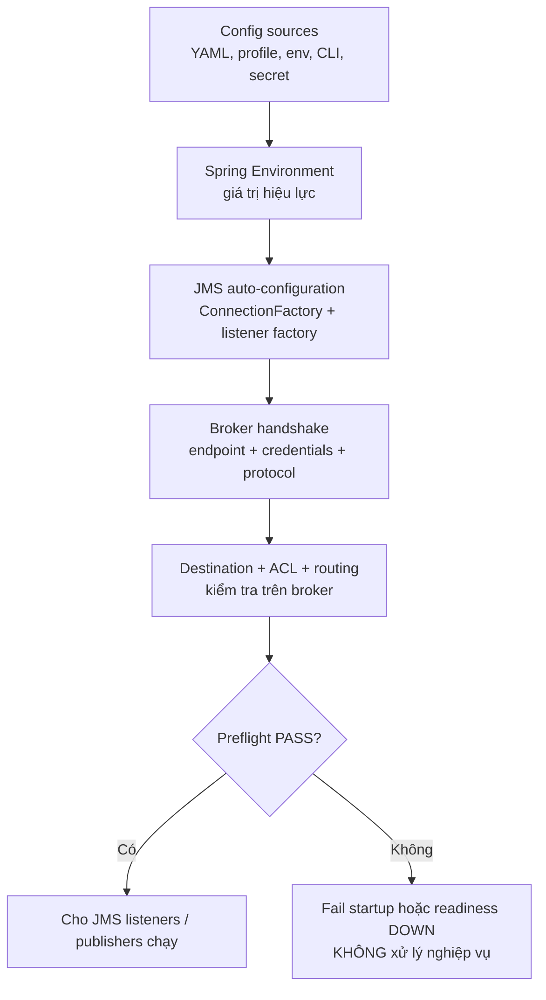
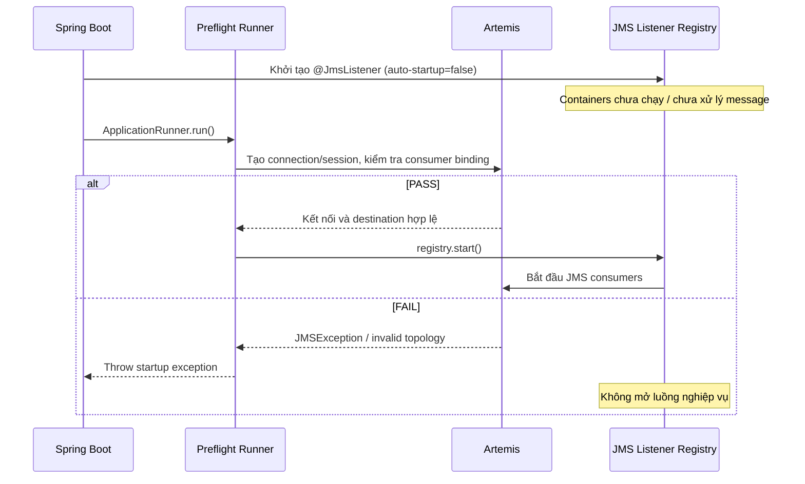

# Xác minh cấu hình hiệu lực và kết nối trước khi chạy luồng nghiệp vụ

> **Chương:** Spring Boot  
> **Trọng tâm:** Kiểm tra **cấu hình thực sự được Spring Boot sử dụng**, bean JMS đã được tự cấu hình, broker/queue/permission có sẵn và cơ chế chặn luồng nghiệp vụ cho đến khi các điều kiện bắt đầu được xác nhận. Ví dụ chính dùng **Spring Boot 3.x + Jakarta Messaging + ActiveMQ Artemis**; phần riêng chỉ ra thay đổi cần thiết nếu dùng **ActiveMQ Classic**.

## 1. Một ứng dụng “STARTED” vẫn có thể gửi và nhận sai chỗ

Giả sử Order Worker chạy trong hai môi trường:

- **Local:** Artemis ở `tcp://127.0.0.1:61616`, queue `lab.boot.orders`.
- **Staging:** broker riêng, credentials và chính sách address/queue khác local.

Developer sửa `application.yml` để dùng staging, nhưng container vẫn nhận biến môi trường `SPRING_ARTEMIS_BROKER_URL` từ deployment cũ. Spring Boot khởi động thành công, thậm chí HTTP endpoint trả 200, trong khi JMS listener kết nối **nhầm broker**. Một tình huống khác: đúng broker nhưng sai queue, và Artemis đang bật **auto-create-queues** nên consumer vô tình tạo queue rỗng; không có exception nào báo rằng luồng nghiệp vụ đang dùng sai destination.

Hai lỗi đó có chung nguyên nhân: chỉ xác minh file cấu hình hoặc startup log, **không xác minh cấu hình hiệu lực và topology broker** trước khi cho producer/consumer chạy.



Trong bài này, **preflight** là phép kiểm tra có cấu trúc chạy **trước khi luồng nghiệp vụ JMS hoạt động**. Nó cần đủ mạnh để phát hiện sai môi trường, sai bean/provider và queue không tồn tại, nhưng không được **ACK nhầm message nghiệp vụ**, tạo queue ngoài ý muốn hoặc gửi event thật chỉ để test.

### 1.1. Các mức xác minh phải tách biệt

| Mức | Điều cần xác minh | Ví dụ bằng chứng | Điều **chưa** được chứng minh |
|---|---|---|---|
| 1. **Configuration** | Profile, property source và giá trị cuối đã được bind | `Environment`, `/actuator/configprops` được bảo vệ | Broker thật sự truy cập được |
| 2. **Bean/wiring** | Spring chọn đúng JMS client và `ConnectionFactory`; listener factory không khởi động sớm | Bean type, condition evaluation | Network/auth/protocol hoạt động |
| 3. **Connection** | Kết nối tới đúng broker, handshake/credentials thành công | Tạo connection/session thực hoặc health indicator | Queue/ACL/routing đúng |
| 4. **Topology/permissions** | Address, queue, routing type, durable flag và quyền của principal | Management API/JMX, thử tạo consumer/browse có kiểm soát | End-to-end send/receive đã chạy |
| 5. **Isolated round trip** | Producer gửi marker vào **queue probe riêng**, consumer nhận đúng marker | Correlation ID + broker metrics + ACK | Nghiệp vụ thực/DB đã thành công |
| 6. **Business readiness** | Cho luồng nghiệp vụ chạy **chỉ sau** preflight; theo dõi sự cố sau startup | Listener registry, readiness endpoint, logs | Broker không bao giờ hỏng sau đó |

**Nguyên tắc:** health check báo broker đang chạy không thay cho việc xác minh đúng **destination**, **quyền** và **đường xử lý nghiệp vụ**. Đặc biệt, `Session.createQueue("...")` chỉ tạo một đối tượng destination trong JMS API; nó **không đủ để khẳng định** queue vật lý đã tồn tại trên Artemis.

## 2. Đầu tiên: chọn đúng starter cho Artemis hoặc ActiveMQ Classic

Trong Spring Boot 3.x, JMS API dùng namespace `jakarta.jms`. Artemis và Classic có các client và cấu hình tự động riêng. Hai URL cùng dùng cổng `61616` **không bảo đảm** giao thức client tương thích; cần kiểm tra acceptor/connector của broker.

| Thành phần | ActiveMQ **Artemis** | ActiveMQ **Classic** |
|---|---|---|
| Starter Spring Boot 3.x | `spring-boot-starter-artemis` | `spring-boot-starter-activemq` |
| Nhóm property | `spring.artemis.*` | `spring.activemq.*` |
| URI ví dụ | `spring.artemis.broker-url=tcp://127.0.0.1:61616` | `spring.activemq.broker-url=tcp://127.0.0.1:61616` |
| Client thường dùng | Artemis client, Core trên native acceptor | Classic client, OpenWire trên connector |
| JMS namespace trong Spring Boot 3 | `jakarta.jms.*` | Starter/client phải tương thích `jakarta.jms.*`; không lấy tùy ý Classic client `javax.jms` cũ |
| Broker topology | Address + queue + routing type (`ANYCAST`/`MULTICAST`) | Destination và policy của Classic |

**Dùng một starter cho một kịch bản.** Đưa cả hai starter vào classpath mà không thiết kế bean rõ ràng dễ khiến người học không biết autoconfiguration nào tạo `ConnectionFactory`. Tương tự, nếu project có một bean `ConnectionFactory` tự định nghĩa, auto-configuration có thể **back off**, khiến `spring.artemis.broker-url` không điều khiển bean đó như kỳ vọng.

### 2.1. `pom.xml` cho ví dụ Artemis

Ví dụ chạy trên Java 17 và Spring Boot 3.3.5. Ở dự án đang hoạt động, dùng BOM/parent Spring Boot của **chính dự án** và phiên bản đã được tổ chức cập nhật bảo mật; số phiên bản ở đây chỉ nhằm cố định một bộ dependency minh họa.

```xml
<project xmlns="http://maven.apache.org/POM/4.0.0"
         xmlns:xsi="http://www.w3.org/2001/XMLSchema-instance"
         xsi:schemaLocation="http://maven.apache.org/POM/4.0.0
            https://maven.apache.org/xsd/maven-4.0.0.xsd">
    <modelVersion>4.0.0</modelVersion>
    <parent>
        <groupId>org.springframework.boot</groupId>
        <artifactId>spring-boot-starter-parent</artifactId>
        <version>3.3.5</version>
        <relativePath/>
    </parent>
    <groupId>lab.messaging</groupId>
    <artifactId>boot-jms-preflight</artifactId>
    <version>1.0.0</version>
    <properties>
        <java.version>17</java.version>
    </properties>
    <dependencies>
        <dependency>
            <groupId>org.springframework.boot</groupId>
            <artifactId>spring-boot-starter-web</artifactId>
        </dependency>
        <dependency>
            <groupId>org.springframework.boot</groupId>
            <artifactId>spring-boot-starter-artemis</artifactId>
        </dependency>
        <dependency>
            <groupId>org.springframework.boot</groupId>
            <artifactId>spring-boot-starter-actuator</artifactId>
        </dependency>
    </dependencies>
    <build>
        <plugins>
            <plugin>
                <groupId>org.springframework.boot</groupId>
                <artifactId>spring-boot-maven-plugin</artifactId>
            </plugin>
        </plugins>
    </build>
</project>
```

`spring-boot-starter-web` trong lab cung cấp HTTP endpoint để kiểm tra Actuator; **không phải** điều kiện bắt buộc để dùng JMS. Không thêm `artemis-jakarta-client` thủ công với một version khác BOM nếu starter đã cung cấp dependency phù hợp, trừ khi đã kiểm soát tương thích.

### 2.2. `application.yml` xác định rõ broker native

```yaml
spring:
  application:
    name: order-worker
  artemis:
    mode: native
    broker-url: ${BROKER_URL:tcp://127.0.0.1:61616}
    user: ${BROKER_USER}
    password: ${BROKER_PASSWORD}
  jms:
    listener:
      auto-startup: false

app:
  jms:
    business-queue: lab.boot.orders
    probe-queue: lab.boot.probe

management:
  endpoint:
    health:
      probes:
        enabled: true
      group:
        readiness:
          include: readinessState,jms
  endpoints:
    web:
      exposure:
        include: health,info
```

Giải thích các dòng dễ bỏ qua:

- `spring.artemis.mode=native` yêu cầu kết nối tới broker Artemis **bên ngoài** ứng dụng, không phụ thuộc vào chế độ broker embedded của một số cấu hình.
- `BROKER_URL` có giá trị mặc định **chỉ dành cho local lab**. Production nên yêu cầu biến môi trường/secret rõ ràng, hạn chế tự rơi về `localhost` khi cấu hình thiếu.
- `BROKER_USER` và `BROKER_PASSWORD` không có default. Nếu thiếu, placeholder không được resolve đúng và ứng dụng không nên cho JMS chạy.
- `spring.jms.listener.auto-startup=false` ngăn các container `@JmsListener` được Boot cấu hình tự động chạy **trước khi phép thử preflight hoàn tất**. Đây là điểm then chốt của startup gate ở mục 5.
- `management.endpoint.health.group.readiness.include=readinessState,jms` đưa sức khỏe JMS vào nhóm readiness khi indicator `jms` tồn tại. **Liveness** không nên phụ thuộc trực tiếp vào broker ngoài để tránh vòng lặp restart ứng dụng lúc broker lỗi.

**Không thay `spring.artemis.*` bằng `spring.activemq.*` khi vẫn dùng starter Artemis.** Đây là hai namespace độc lập. Nếu dùng Classic, đổi starter và bộ property tương ứng như mục 8.

## 3. Configuration precedence: file YAML không phải nguồn sự thật cuối cùng

Spring Boot có thể nạp cấu hình từ nhiều nơi: `application.yml`, `application-<profile>.yml`, environment variables, JVM/system properties, command-line arguments, config data bên ngoài hoặc cấu hình tập trung. Khi cùng một property xuất hiện ở nhiều nguồn, **giá trị cuối trong Spring `Environment`** mới là thứ ứng dụng sử dụng theo thứ tự ưu tiên của Boot.

Ví dụ:

```yaml
# application.yml (base)
spring:
  artemis:
    broker-url: tcp://127.0.0.1:61616
```

```yaml
# application-staging.yml (khi profile staging được kích hoạt)
spring:
  artemis:
    broker-url: tcp://artemis-staging.internal:61616
```

Nếu deployment đồng thời đặt:

```bash
export SPRING_PROFILES_ACTIVE=staging
export SPRING_ARTEMIS_BROKER_URL=tcp://artemis-old.internal:61616
```

thì không thể nhìn `application-staging.yml` rồi kết luận ứng dụng sẽ kết nối `artemis-staging.internal`. Biến môi trường `SPRING_ARTEMIS_BROKER_URL` là một nguồn property có thể **ghi đè** giá trị trong file config theo quy tắc ưu tiên của Boot.

### 3.1. Điều phải ghi nhận lúc startup

- **Active profiles**: `local`, `staging`, `prod` hay một tập hợp nhiều profile; không chỉ đọc file mặc định.
- **Giá trị cuối** của `spring.artemis.mode`, `spring.artemis.broker-url`, `app.jms.business-queue` và `spring.jms.listener.auto-startup`.
- **Loại bean `ConnectionFactory` được Spring chọn** và có bị wrapping bởi `CachingConnectionFactory`/pool không.
- **Nguồn property** nếu có xung đột: môi trường, CLI, profile-specific Config Data hoặc bean Java custom.
- **Secret chỉ hiện diện hay thiếu**, **không ghi ra log mật khẩu hoặc URI chứa token/password**.

Ví dụ chẩn đoán an toàn bằng `Environment`:

```java
import jakarta.jms.ConnectionFactory;
import org.slf4j.Logger;
import org.slf4j.LoggerFactory;
import org.springframework.boot.ApplicationRunner;
import org.springframework.context.annotation.Bean;
import org.springframework.context.annotation.Configuration;
import org.springframework.core.env.Environment;
import java.util.Arrays;

@Configuration
public class JmsConfigReport {
    private static final Logger log =
            LoggerFactory.getLogger(JmsConfigReport.class);

    @Bean
    ApplicationRunner reportJmsConfig(Environment env, ConnectionFactory cf) {
        return args -> {
            log.info("profiles={}", Arrays.toString(env.getActiveProfiles()));
            log.info("artemisMode={}",
                    env.getProperty("spring.artemis.mode", "<unset>"));
            log.info("businessQueue={}",
                    env.getProperty("app.jms.business-queue", "<unset>"));
            log.info("listenerAutoStartup={}",
                    env.getProperty("spring.jms.listener.auto-startup", "<unset>"));
            log.info("connectionFactoryBeanType={}", cf.getClass().getName());
            // Không log BROKER_PASSWORD hoặc connection URL chứa credential.
        };
    }
}
```

Đây là **report cấu hình**, chưa phải test kết nối. Nếu thấy bean `CachingConnectionFactory`, đó có thể là wrapper do Boot quản lý; chưa kết luận underlying client là Artemis chỉ từ tên wrapper. Kiểm tra bean wiring và auto-configuration conditions.

### 3.2. Công cụ debug của Spring Boot có giới hạn

- Bật tạm `--debug` khi chạy local để xem **condition evaluation report**, biết các auto-configuration áp dụng hay bị bỏ qua. Đừng duy trì debug quá mức trên production.
- **Actuator `/actuator/configprops` và `/actuator/env`** có thể giúp đối chiếu property binding, nhưng chứa thông tin vận hành nhạy cảm. Không mở chúng công khai; nếu cần, cấu hình bảo mật và kiểm soát quyền, không tùy tiện tắt masking giá trị.
- Actuator `/actuator/health` kiểm tra trạng thái bằng indicator, **không giải thích toàn bộ property precedence**.
- Đặt log **sanitized** cho tên destination, provider và profile. Không in password, private key, signed URL, hay toàn bộ `System.getenv()`.

## 4. Kiểm tra topology Artemis trước khi để listener đọc message

Kết nối tới đúng broker chưa đủ. Nếu ứng dụng xử lý nghiệp vụ từ `lab.boot.orders`, nó phải xác nhận có **queue đúng tên, đúng address, routing type ANYCAST, quyền consume phù hợp**. Trên broker được kiểm soát, ví dụ `broker.xml` có:

```xml
<!-- Phần tử thêm vào khối <addresses> hiện có dưới <core> -->
<address name="lab.boot.orders">
    <anycast>
        <queue name="lab.boot.orders"/>
    </anycast>
</address>
<address name="lab.boot.probe">
    <anycast>
        <queue name="lab.boot.probe"/>
    </anycast>
</address>
```

Để việc gõ sai tên không âm thầm tạo destination mới, có thể dùng chính sách auto-create hạn chế **chỉ trong không gian lab đã provision** (chèn vào khối `<address-settings>` đang tồn tại):

```xml
<address-setting match="lab.boot.#">
    <auto-create-addresses>false</auto-create-addresses>
    <auto-create-queues>false</auto-create-queues>
</address-setting>
```

**Chỉ dùng đoạn này khi đã hiểu cơ chế tự tạo queue hiện hữu.** Nếu ứng dụng dựa vào dynamic queues, vô hiệu hóa auto-create có thể làm chúng ngừng hoạt động. Đừng sửa wildcard rộng toàn broker chỉ để làm bài kiểm tra trên một domain.

Trên Artemis Console hoặc management JMX/API, kiểm tra:

1. Address `lab.boot.orders` có routing type và queue binding **ANYCAST** đúng với producer/consumer.
2. Queue `lab.boot.orders` là durable nếu cần giữ message qua restart và được provision ở broker **đúng môi trường**.
3. Consumer principal có quyền `consume`/`browse` theo kiểu kiểm tra được chọn; producer principal có quyền `send` ở address nguồn.
4. Queue `lab.boot.probe` là một destination **tách biệt với business queue**, được phép gửi/nhận marker để thực hiện probe nếu triển khai phép thử end-to-end.
5. Chính sách auto-create, dead-letter, expiry và quyền routing không biến typo thành queue rỗng hoặc sự cố mất message.

### 4.1. Vì sao `createQueue` chưa đủ và `QueueBrowser` cũng có điều kiện?

`session.createQueue("lab.boot.orders")` là thao tác tạo **đối tượng Java JMS destination**. Nó không đảm bảo server có address/queue đúng. Một phép thử `session.createConsumer(queue)` có thể buộc provider xác nhận queue và quyền consume, nhưng nếu broker bật auto-create thì phép thử có thể **tạo queue ngoài ý muốn**.

`QueueBrowser` có thể giúp duyệt message mà không ACK, nhưng:

- Cần quyền browse thích hợp; không nên cấp quyền rộng chỉ để vượt preflight.
- Có thể lấy metadata/message nên cần cân nhắc tải và riêng tư.
- Không chứng minh producer có quyền **send**.
- Trên một broker auto-create, vẫn cần kiểm tra trước xem destination đã tồn tại hay được tạo do chính probe.

Vì vậy **source of truth cho topology** là broker management/approved provisioning; client-side preflight nên bổ sung bằng handshake và kiểm tra quyền có kiểm soát, không tự ý tạo hoặc nhận message nghiệp vụ.

## 5. Chặn JMS listener startup cho tới khi preflight hoàn tất

Chỉ viết `@ApplicationRunner` để kiểm tra kết nối **chưa đủ**: nhiều container `@JmsListener` được khởi động trong giai đoạn khởi tạo Spring context/`SmartLifecycle`, **trước** khi `ApplicationRunner.run()` được gọi. Nếu listener đang bật auto-startup, nó có thể nhận message nghiệp vụ ngay trong lúc preflight chưa chạy.

**Mô hình đúng cho lab này:**

1. Cấu hình `spring.jms.listener.auto-startup=false` cho listener container factory do Boot cấu hình.
2. Khởi tạo ứng dụng nhưng giữ JMS listeners ở trạng thái stopped.
3. `ApplicationRunner` xác minh các điều kiện tối thiểu; nếu thiếu thì **ném exception, làm startup thất bại**.
4. Nếu đã PASS, gọi `JmsListenerEndpointRegistry.start()` để cho các listener containers đã đăng ký chạy.
5. Tiếp tục quan sát readiness/health **trong suốt vòng đời**, vì startup PASS không bảo đảm broker không hỏng sau đó.



### 5.1. Bootstrap ứng dụng

Tạo `src/main/java/lab/boot/jms/MessagingApplication.java`:

```java
package lab.boot.jms;

import org.springframework.boot.SpringApplication;
import org.springframework.boot.autoconfigure.SpringBootApplication;
import org.springframework.jms.annotation.EnableJms;

@SpringBootApplication
@EnableJms
public class MessagingApplication {
    public static void main(String[] args) {
        SpringApplication.run(MessagingApplication.class, args);
    }
}
```

`@EnableJms` kích hoạt cơ chế annotation-driven listener endpoints. Spring Boot có thể cung cấp `jmsListenerContainerFactory` mặc định dựa trên `ConnectionFactory`. Nếu dự án **tự định nghĩa listener factory**, phải chủ động truyền `autoStartup=false` vào đúng factory đó; property của Boot có thể **không điều khiển** một factory viết tay.

### 5.2. Preflight fail-fast với ConnectionFactory do Spring inject

Tạo `src/main/java/lab/boot/jms/JmsStartupGate.java`:

```java
package lab.boot.jms;

import jakarta.jms.Connection;
import jakarta.jms.ConnectionFactory;
import jakarta.jms.JMSException;
import jakarta.jms.MessageConsumer;
import jakarta.jms.Queue;
import jakarta.jms.Session;

import org.slf4j.Logger;
import org.slf4j.LoggerFactory;
import org.springframework.beans.factory.annotation.Value;
import org.springframework.boot.ApplicationArguments;
import org.springframework.boot.ApplicationRunner;
import org.springframework.core.Ordered;
import org.springframework.core.annotation.Order;
import org.springframework.core.env.Environment;
import org.springframework.jms.config.JmsListenerEndpointRegistry;
import org.springframework.stereotype.Component;

@Component
@Order(Ordered.HIGHEST_PRECEDENCE)
public class JmsStartupGate implements ApplicationRunner {
    private static final Logger log =
            LoggerFactory.getLogger(JmsStartupGate.class);

    private final ConnectionFactory factory;
    private final JmsListenerEndpointRegistry registry;
    private final Environment environment;
    private final JmsProbeRoundTrip roundTrip;

    @Value("${app.jms.business-queue}")
    private String businessQueue;

    public JmsStartupGate(ConnectionFactory factory,
                          JmsListenerEndpointRegistry registry,
                          Environment environment,
                          JmsProbeRoundTrip roundTrip) {
        this.factory = factory;
        this.registry = registry;
        this.environment = environment;
        this.roundTrip = roundTrip;
    }

    @Override
    public void run(ApplicationArguments args) throws Exception {
        String mode = environment.getProperty(
                "spring.artemis.mode", "");
        String url = environment.getProperty(
                "spring.artemis.broker-url", "");
        if (!"native".equalsIgnoreCase(mode) || url.isBlank()) {
            throw new IllegalStateException(
                    "Expected Artemis native mode with explicit broker URL");
        }
        if (businessQueue == null || businessQueue.isBlank()) {
            throw new IllegalStateException(
                    "Missing app.jms.business-queue");
        }

        // Probe the ACTUAL Spring-managed ConnectionFactory.
        // Connection is intentionally not started: no message is consumed.
        try (Connection connection = factory.createConnection();
             Session session = connection.createSession(
                     false, Session.AUTO_ACKNOWLEDGE)) {

            Queue destination = session.createQueue(businessQueue);
            // When auto-create is disabled on broker, consumer creation
            // checks destination existence and consumer permissions.
            try (MessageConsumer ignored =
                         session.createConsumer(destination)) {
                log.info("JMS_PRECHECK_OK destination={} factory={}",
                        businessQueue, factory.getClass().getName());
            }
        } catch (JMSException ex) {
            log.error("JMS_PRECHECK_FAILED destination={} reason={}",
                    businessQueue, ex.getClass().getSimpleName());
            throw new IllegalStateException(
                    "JMS is not ready; listeners must remain stopped", ex);
        }

        // Optional: requires a pre-provisioned, isolated probe queue.
        if (Boolean.parseBoolean(environment.getProperty(
                "app.jms.verify-roundtrip", "false"))) {
            roundTrip.verify();
        }

        registry.start(); // Only after all configured probes pass.
        log.info("JMS_LISTENERS_STARTED");
    }
}
```

**Giải thích chính xác mức bảo đảm của code:**

- Inject `ConnectionFactory` nghĩa là kiểm tra **bean mà Spring sẽ dùng**, thay vì lén tạo một factory khác với property hardcode. Wrapper cache/pool có thể xuất hiện; cần xem bean wiring/condition report để hiểu underlying provider.
- `connection.createSession(...)` và `session.createConsumer(...)` buộc client tương tác với provider; việc tạo consumer còn kiểm tra quyền consume/binding trong cấu hình phù hợp. Vì **không gọi `connection.start()`**, probe không nhận rồi ACK message nghiệp vụ.
- Khả năng xác minh queue tồn tại bằng `createConsumer` **phụ thuộc vào auto-create**: nếu auto-create bật, nó có thể làm broker tạo destination. Bởi vậy ví dụ này yêu cầu queue được provision trước, auto-create bị vô hiệu hóa cho vùng lab và đã có kiểm tra topology từ management.
- Code **không kiểm tra quyền send vào business queue**; nếu service vừa sản xuất vừa tiêu thụ, cần management permission check hoặc smoke send trên **probe queue** với đúng principal.
- Nếu sử dụng failover transport hoặc cache, handshake có thể chịu reconnect/timeout theo chính sách client; đặt **deadline khởi động** và cấu hình timeout kết nối theo đúng provider/version. Không nghĩ `ApplicationRunner` tự đặt giới hạn thời gian cho mọi TCP operation.
- `registry.start()` bắt đầu vòng đời listener containers nhưng **không có nghĩa ngay lập tức mọi broker subscription đã được mở và ổn định**. Readiness/health và số consumer trên broker vẫn cần được quan sát.

**Giới hạn quản lý lifecycle:** `auto-startup=false` chỉ áp dụng cho các listener containers thực sự dùng factory được cấu hình. Nếu ứng dụng còn `@Scheduled` publisher, `CommandLineRunner` gửi JMS, hoặc worker tự tạo consumer ngoài Spring registry, chúng phải có **startup gate riêng**; không được mặc định runner này đã chặn mọi đường nghiệp vụ của toàn ứng dụng.

### 5.3. Một listener nhỏ để kiểm tra cổng đã mở

Tạo `src/main/java/lab/boot/jms/OrdersListener.java`:

```java
package lab.boot.jms;

import org.slf4j.Logger;
import org.slf4j.LoggerFactory;
import org.springframework.jms.annotation.JmsListener;
import org.springframework.stereotype.Component;

@Component
public class OrdersListener {
    private static final Logger log =
            LoggerFactory.getLogger(OrdersListener.class);

    @JmsListener(destination = "${app.jms.business-queue}")
    public void handle(String messageBody) {
        // LAB only: khong log du lieu nhay cam / payload that.
        log.info("LAB_BUSINESS_EVENT_RECEIVED bytesApprox={}",
                messageBody.length());
        // Production: goi service nghiep vu va chon transaction/ACK
        // phu hop thay vi coi logging la hoan tat xu ly.
    }
}
```

Đoạn listener này **có khả năng tiêu thụ message thật** nếu kết nối tới một queue đang có dữ liệu. Chỉ dùng trên `lab.boot.orders`, không trỏ thẳng vào queue production. Nó chỉ minh họa việc listener **không chạy trước** preflight và **bắt đầu chạy sau** `registry.start()`; logic ACK/transaction/database nằm ngoài chủ đề của bài này.

## 6. Optional: round-trip probe an toàn trên queue riêng

Khi cần kiểm tra **send và consume** thực sự, hãy sử dụng `lab.boot.probe`, **không gửi marker vào business queue**. Có thể bật:

```yaml
app:
  jms:
    # Hai key business-queue / probe-queue da dinh nghia o cau hinh chung.
    verify-roundtrip: true
```

Probe dùng một `probeId` duy nhất, message TTL 30 giây và **hai JMS sessions giao dịch độc lập**. Phải `commit` lần gửi trước khi consumer đọc, bởi một message gửi trong transaction **chưa commit** không được xem là đã sẵn sàng để consumer trong session khác nhận.

Tạo `src/main/java/lab/boot/jms/JmsProbeRoundTrip.java`:

```java
package lab.boot.jms;

import jakarta.jms.Connection;
import jakarta.jms.ConnectionFactory;
import jakarta.jms.DeliveryMode;
import jakarta.jms.JMSException;
import jakarta.jms.Message;
import jakarta.jms.MessageConsumer;
import jakarta.jms.MessageProducer;
import jakarta.jms.Queue;
import jakarta.jms.Session;
import jakarta.jms.TextMessage;

import org.springframework.beans.factory.annotation.Value;
import org.springframework.stereotype.Component;
import java.util.UUID;

@Component
public class JmsProbeRoundTrip {
    private final ConnectionFactory factory;

    @Value("${app.jms.probe-queue}")
    private String probeQueue;

    public JmsProbeRoundTrip(ConnectionFactory factory) {
        this.factory = factory;
    }

    public void verify() throws JMSException {
        String id = UUID.randomUUID().toString();
        try (Connection connection = factory.createConnection()) {
            // Phase 1: send marker to dedicated queue and COMMIT.
            try (Session sender = connection.createSession(
                    true, Session.SESSION_TRANSACTED)) {
                Queue q = sender.createQueue(probeQueue);
                try (MessageProducer producer = sender.createProducer(q)) {
                    producer.setDeliveryMode(DeliveryMode.PERSISTENT);
                    producer.setTimeToLive(30_000L);
                    TextMessage marker =
                            sender.createTextMessage("startup-probe");
                    marker.setStringProperty("probeId", id);
                    producer.send(marker);
                    sender.commit();
                } catch (JMSException ex) {
                    sender.rollback();
                    throw ex;
                }
            }

            // Phase 2: receive only our marker, then COMMIT its ACK.
            try (Session receiver = connection.createSession(
                    true, Session.SESSION_TRANSACTED)) {
                Queue q = receiver.createQueue(probeQueue);
                // UUID is generated locally, safe for this selector.
                String selector = "probeId = '" + id + "'";
                try (MessageConsumer consumer =
                             receiver.createConsumer(q, selector)) {
                    connection.start();
                    Message received = consumer.receive(5_000L);
                    if (received == null) {
                        receiver.rollback();
                        throw new JMSException(
                                "Probe message not received: " + id);
                    }
                    receiver.commit();
                } catch (JMSException ex) {
                    // Failure after commit is a separate operational
                    // condition; rollback here only affects active session.
                    throw ex;
                }
            }
        }
    }
}
```

**Vì sao probe này đáng tin hơn `createQueue`?** Nó xác minh quyền **send**, khả năng route vào queue probe, quyền **consume**, transaction/ACK và đường network. Tuy nhiên nó vẫn **chỉ chứng minh đường probe**, không chứng minh binding/ACL của một business queue khác. Cần kết hợp bước kiểm tra topology ở mục 4.

**Chi phí và tác dụng phụ được giới hạn nhưng không bằng 0:**

- Mỗi startup khi bật probe tạo **một message thật**. Nếu broker nhận send nhưng app crash trước receive, marker có thể ở lại đến TTL/expiry. Cấu hình expiry/cleanup/retention cho **probe queue** và cảnh báo nếu backlog probe tăng bất thường.
- Chạy nhiều replicas cùng lúc có thể tạo nhiều marker; selector `probeId` giúp mỗi replica nhận đúng marker của nó.
- Nếu receipt commit bị mất phản hồi, vẫn có **unknown outcome** và có thể còn marker; probe cần event ID/monitoring để chẩn đoán, không dùng marker làm giao dịch nghiệp vụ.
- Không để mọi liveness probe **liên tục gửi/nhận message**: làm tăng tải và journal I/O không cần thiết. Round-trip thích hợp cho startup smoke test hoặc kiểm tra định kỳ ở tần suất thấp với ngân sách rõ.
- Nếu service không có cả quyền send và consume hoặc không được phép provision probe queue, hãy dùng **management-level checks** tương ứng thay vì mở rộng đặc quyền của tài khoản sản xuất.

### 6.1. Khác biệt giữa kiểm tra startup và sức khỏe liên tục

`JmsStartupGate` chạy **một lần khi ứng dụng khởi động**. Broker có thể chết mười phút sau; JMS listeners cần cơ chế reconnect, bounded retry, shutdown theo lifecycle và quan sát lỗi. Cấu hình Actuator readiness ở mục 2 cung cấp một tín hiệu **trong thời gian chạy**, nhưng health indicator vẫn không kiểm chứng mọi destination.

Nếu broker là dependency **bắt buộc** để phục vụ traffic, việc readiness phản ánh JMS có thể hợp lý. Nếu service vẫn cung cấp API khác khi JMS down, cần cân nhắc tách readiness theo chức năng; đưa JMS vào readiness toàn bộ service có thể khiến orchestrator rút mọi instance khỏi load balancer dù API đó còn hoạt động.

## 7. Chạy và xác minh với các tình huống lỗi có chủ đích

Trước khi chạy, bảo đảm `lab.boot.orders` và `lab.boot.probe` đã được tạo **trên broker Artemis lab**, queue đúng `ANYCAST`, tài khoản có quyền thích hợp và chương trình không trỏ vào hệ thống production. Với đoạn code `OrdersListener`, mọi message được nhận sẽ được xử lý theo ACK policy mặc định; chỉ dùng dữ liệu thử nghiệm.

### 7.1. Chạy khi cấu hình đúng

Trong Bash/WSL:

```bash
export BROKER_URL='tcp://127.0.0.1:61616'
export BROKER_USER='lab'
export BROKER_PASSWORD='replace-with-lab-secret'
export SPRING_PROFILES_ACTIVE='local'

mvn spring-boot:run
```

Trong PowerShell:

```powershell
$env:BROKER_URL = 'tcp://127.0.0.1:61616'
$env:BROKER_USER = 'lab'
$env:BROKER_PASSWORD = 'replace-with-lab-secret'
$env:SPRING_PROFILES_ACTIVE = 'local'

mvn spring-boot:run
```

Kết quả mong đợi ở **broker lab đúng**:

```text
profiles=[local]
artemisMode=native
businessQueue=lab.boot.orders
listenerAutoStartup=false
connectionFactoryBeanType=...CachingConnectionFactory...
JMS_PRECHECK_OK destination=lab.boot.orders factory=...
JMS_LISTENERS_STARTED
Started MessagingApplication ...
```

Tên bean thực tế có thể là `CachingConnectionFactory` hoặc loại khác tùy phiên bản/configuration. Thứ tự các dòng log không nên được dùng như timestamp tuyệt đối cho listener subscription; quan sát **consumer count** tại queue `lab.boot.orders` để xác nhận listener đã thực sự đăng ký.

Vì lab thêm `spring-boot-starter-web` và Actuator, có thể truy vấn:

```bash
curl -i http://127.0.0.1:8080/actuator/health
curl -i http://127.0.0.1:8080/actuator/health/readiness
```

Nếu indicator `jms` được cấu hình hợp lệ và đang UP, kết quả readiness có thể là `UP`. Điều này cho biết **health check của indicator** đã đạt, không phải bằng chứng event đã được consumer xử lý hoặc queue đúng routing. Với Actuator không có web starter hay khi endpoint không được expose, các URL trên có thể không tồn tại; đó là chuyện cấu hình HTTP management, không nhất thiết là broker lỗi.

### 7.2. Negative test 1 — Sai endpoint hoặc broker ngừng hoạt động

Trong **môi trường lab cô lập**, đặt broker URL tới địa chỉ không có server:

```bash
export BROKER_URL='tcp://127.0.0.1:61699'
mvn spring-boot:run
```

Kết quả cần kiểm tra:

- `ConnectionFactory`/session/consumer creation hoặc quá trình kết nối thất bại. Runner ném exception, ứng dụng **không đạt startup thành công**.
- Không xuất hiện `JMS_LISTENERS_STARTED`.
- Queue `lab.boot.orders` trên broker thật vẫn nguyên dữ liệu, không bị preflight ACK.
- Thời gian fail phụ thuộc transport timeout/reconnect policy; kiểm tra cả **thời gian thất bại**, không chỉ cuối cùng có exception.

Nếu app vẫn báo thành công, kiểm tra lại `SPRING_ARTEMIS_BROKER_URL`, command-line overrides, profile và bean `ConnectionFactory` tự định nghĩa: có thể giá trị `BROKER_URL` bạn vừa sửa **không phải nguồn có ưu tiên cao nhất**.

### 7.3. Negative test 2 — Sai tên queue nhưng broker có auto-create

Giả sử cấu hình:

```yaml
app:
  jms:
    business-queue: lab.boot.orderz  # Typo: orderz != orders
```

- Với auto-create được bật, `createConsumer` có thể **không báo lỗi** vì broker tạo queue `lab.boot.orderz` mới. Preflight vẫn có thể PASS nhưng luồng nghiệp vụ đi sai nơi.
- Với auto-create bị vô hiệu hóa và queue chưa provision, việc tạo consumer thường thất bại và startup gate giữ listener không chạy.
- **Dù auto-create bị tắt**, luôn kiểm tra **approved topology** ở management để đảm bảo tên queue, address và broker identity thực sự đúng; auto-create policy không chứng minh bạn kết nối đúng môi trường.

Đây là lý do thứ tự kiểm tra hợp lý phải là **approved queue specification + runtime broker topology + client handshake**, chứ không chỉ gọi JMS API với một chuỗi tên queue.

### 7.4. Negative test 3 — Đúng broker, sai quyền

Dùng tài khoản thử chỉ có quyền `send` mà không có quyền `consume` ở business queue; startup gate mở consumer sẽ lỗi. Ngược lại, với tài khoản chỉ có quyền `consume`, gate có thể PASS nhưng **publisher vẫn bị broker từ chối khi gửi**; điều đó phải được phát hiện bằng kiểm tra ACL theo vai trò hoặc thử gửi ở probe queue dùng cùng principal.

Đừng cấp quyền `manage`/`edit` hoặc `createDurableQueue` rộng rãi cho ứng dụng chỉ để phép thử chạy. Quyền cao hơn có thể che lỗi cấu hình và khiến một typo tạo queue mới. Principle of least privilege vẫn là yêu cầu của production.

### 7.5. Negative test 4 — Listener vẫn chạy trước gate

Đặt một message thử `test-before-gate` vào `lab.boot.orders` **trên broker test**. Sau đó cố ý làm preflight thất bại (ví dụ đặt `app.jms.business-queue` sai khi auto-create disabled). Quan sát:

- Nếu `spring.jms.listener.auto-startup=false` **thực sự áp vào factory**, message test không được listener mới của ứng dụng tiêu thụ trước khi runner PASS.
- Nếu queue count giảm hoặc log `LAB_BUSINESS_EVENT_RECEIVED` xuất hiện trước preflight, có thể có listener khác, custom factory bật auto-startup, hoặc một worker/process khác đang nhận message. Cần điều tra, không suy rằng `ApplicationRunner` tự bảo đảm chặn toàn bộ luồng.
- Sau khi sửa config và khởi động lại, có thể cho listener tiêu thụ marker và đối chiếu business queue count.

### 7.6. Negative test 5 — Cấu hình được ghi đè ngoài dự kiến

Lần lượt thử các nguồn sau trong lab:

```bash
# Case A: file application.yml tro den localhost.
unset SPRING_ARTEMIS_BROKER_URL
export BROKER_URL='tcp://127.0.0.1:61616'

# Case B: bien Boot truc tiep ghi de property trong file.
export SPRING_ARTEMIS_BROKER_URL='tcp://127.0.0.1:61699'
```

Chạy app ở mỗi ca và so kết quả. Đừng chỉ so `System.getenv("BROKER_URL")`; giá trị được Boot bind vào `spring.artemis.broker-url` **sau precedence** mới quyết định ConnectionFactory do auto-configuration tạo ra, trừ khi bean custom bỏ qua property này.

## 8. Nếu dùng ActiveMQ Classic trong Spring Boot

Bài này lấy Artemis làm ví dụ chính. Với **ActiveMQ Classic**, vẫn áp dụng những nguyên tắc: giá trị cấu hình hiệu lực, ConnectionFactory bean, connection handshake, destination permissions và startup gate. Nhưng phải đổi **starter và property namespace**:

```xml
<!-- Trong pom.xml thay dependency spring-boot-starter-artemis;
     không thêm cả hai starter một cách vô tình. -->
<dependency>
    <groupId>org.springframework.boot</groupId>
    <artifactId>spring-boot-starter-activemq</artifactId>
</dependency>
```

```yaml
spring:
  activemq:
    broker-url: ${BROKER_URL:tcp://127.0.0.1:61616}
    user: ${BROKER_USER}
    password: ${BROKER_PASSWORD}
  jms:
    listener:
      auto-startup: false
app:
  jms:
    business-queue: lab.boot.orders
    probe-queue: lab.boot.probe
```

Khi chuyển từ Artemis sang Classic:

1. Đổi phép kiểm tra property trong `JmsStartupGate` từ `spring.artemis.mode`/`spring.artemis.broker-url` sang `spring.activemq.broker-url`; **bỏ** assertion `mode=native` vì nó dành riêng cho Artemis.
2. Đảm bảo Classic OpenWire connector đang nhận client của starter đã chọn; cùng cổng `61616` không thay cho xác minh giao thức và TLS.
3. Kiểm tra destinations và permissions **theo Classic**, không áp dụng `<address>`/`<anycast>` của Artemis lên `activemq.xml` của Classic.
4. Spring Boot 3.x dùng `jakarta.jms`; không thay starter bằng một Classic client `javax.jms` cũ không tương thích trực tiếp mà không kiểm soát migration.
5. Nếu bean `ConnectionFactory` đã được custom/pooling, xác minh đúng underlying vendor client và việc cache/reconnect; logging wrapper type không đủ để kết luận.

Không thể kết luận một instance Classic/Artemis đã sẵn sàng cho nghiệp vụ chỉ vì `ConnectionFactory.createConnection()` thành công. Queue không tồn tại, quyền send/consume khác nhau và chính sách auto-create có thể che giấu lỗi topology.

## 9. Bảng chẩn đoán nhanh: app xanh nhưng JMS sai

| Triệu chứng | Giả thuyết ưu tiên | Phép xác minh an toàn |
|---|---|---|
| Spring Boot `Started` nhưng không nhận message | Listener auto-startup=false mà gate không chạy; sai queue; broker khác; listener container error | Xem `JMS_LISTENERS_STARTED`, registry state, broker consumer count, queue name và destination |
| `/actuator/health` UP, business không có event | Health indicator chỉ kiểm tra kết nối, không kiểm tra topology/binding/ACL nghiệp vụ | Kiểm tra management address/queue/routing, marker trên queue probe |
| Local hoạt động, staging đọc sai broker | `SPRING_ARTEMIS_BROKER_URL` hoặc config profile/CLI ghi đè | Environment/configprops được bảo vệ, active profiles, sanitized logs |
| App bỗng tạo queue rỗng | Artemis auto-create bật, typo destination | So queue danh sách với approved topology; disable auto-create cho namespace đã provision |
| Sai password nhưng app vẫn chạy tạm thời | Lazy initialization, reconnect, listener tự retry, chưa thử tạo connection thực | Startup gate có thao tác JMS thật; xem log authentication |
| Gửi thành công nhưng consumer không thấy | Sai routing type, sai destination, consumer ở broker khác, producer confirmation chưa hoàn tất | Queue bindings, producer event ID, consumer count, broker messages added/ready |
| Consumer nhận trước khi preflight xong | Property auto-startup không áp custom listener factory, có worker khác tự tạo | Rà soát `DefaultJmsListenerContainerFactory` và mọi entry point xử lý |
| Bean type là `CachingConnectionFactory` | Boot wrapper bình thường hoặc custom cache | Xem target bean và conditions; không nhầm wrapper là provider |
| Startup gate treo lâu khi broker down | Client reconnect/transport timeout quá dài | Đặt connect/deadline có giới hạn theo provider, đo thời gian thất bại |
| Probe queue nhiều message cũ | Probe crash sau send commit, receive timeout hoặc ACL sai | Dựa trên `probeId`, TTL/expiry, monitoring; không purge queue dữ liệu khác |
| Readiness liên tục DOWN khi broker down | Đã đưa `jms` vào readiness group | Đánh giá đó có phải dependency bắt buộc của *toàn service* không |

### 9.1. Đọc logs theo timeline, không chỉ theo mức ERROR

Một startup log có ích nên ghi các mốc sau, tránh in credential:

```text
1. CONFIG: active profiles + target provider + selected queue
2. WIRING: selected ConnectionFactory bean type + listener factory config
3. PREFLIGHT: attempt connection, destination/ACL validation
4. PROBE (optional): send/consume marker on isolated queue
5. GATE: JMS_LISTENERS_STARTED
6. RUNTIME: consumer count + readiness health + broker error/reconnect alerts
```

Nếu một hệ thống có cả REST endpoints và JMS listeners, đừng tuyên bố “ready for business” chỉ vì HTTP đã lắng nghe cổng. Ngược lại, không dùng liveness để tự động kill mọi pod khi broker gặp outage ngắn: điều đó có thể khiến cả cụm liên tục khởi động lại và tăng tải khi broker vừa phục hồi.

## 10. Production checklist: những giới hạn cần công bố rõ

### 10.1. Những gì preflight có thể chứng minh

- **Đúng configuration key** và nguồn override đã được xác định tại runtime.
- **Đúng provider bean**/starter và mode native vs embedded ở Artemis.
- **Kết nối thực** tới broker với credentials của ứng dụng và endpoint đã cấu hình.
- **Destination/permissions** ở mức kiểm tra được (ví dụ tạo consumer với auto-create disabled, management verification).
- **Send/receive round trip** trên queue probe tách biệt khi chủ động bật smoke test.
- **Business listener không tự hoạt động trước gate** nếu toàn bộ entry points thực sự tuân thủ policy startup.

### 10.2. Những gì preflight không thể cam kết vĩnh viễn

- Broker sẽ không down sau `registry.start()`.
- Mỗi lần `send` đều persistent và không bị mất do lỗi storage/transaction; cần kiểm soát JMS delivery mode, broker persistence, journal và confirm semantics.
- Consumer sẽ xử lý database đúng một lần. Cần idempotency/ACK/transaction riêng.
- Một queue có thể chứa message cũ thuộc môi trường khác dù queue name đúng; cần kiểm tra **broker identity**, namespace, bảo mật mạng và approved deployment inventory.
- `createConsumer` kiểm tra quyền send (không; chỉ là đường nhận). Producer-only service cần check riêng theo vai trò.
- Một HealthIndicator UP chứng minh end-to-end nghiệp vụ hoặc future availability; health chỉ là phép đo tại thời điểm gọi.

### 10.3. Tiêu chuẩn chấp nhận cho một deployment

| Bước bắt buộc | Bằng chứng nên lưu |
|---|---|
| Chọn đúng starter, dependency BOM và namespace | Build metadata/dependency review; không trộn Artemis và Classic nhầm |
| Resolve cấu hình hiệu lực | Active profiles, sanitized URL host/port, queue name, provider, property source |
| Xác nhận broker thật | Broker instance/cluster identity từ management, TLS identity và environment inventory |
| Xác nhận topology | Address, queue, routing, auto-create policy, durable flag và ACL |
| Gate listener startup | `auto-startup=false` cùng log `JMS_PRECHECK_OK`, `JMS_LISTENERS_STARTED` |
| Kiểm thử lỗi chủ đích | Sai URL/password/queue khiến startup fail, message lab không bị ACK trước PASS |
| Readiness phù hợp | Indicator JMS + policy phân nhóm readiness; alert sau startup |
| Bảo đảm vận hành | Reconnect/timeout, DLQ, retry, idempotency, quota và observability |

## 11. Bài tập kỹ thuật

**Bài 1 — Property precedence.** Đặt `spring.artemis.broker-url` trong `application.yml` là broker A, trong `application-staging.yml` là B, và environment `SPRING_ARTEMIS_BROKER_URL` là C. Bật profile staging. Hãy xác định connection factory thực tế lấy URL nào và giải thích cách chứng minh mà không ghi password ra log.

**Bài 2 — Startup gate.** Chạy `OrdersListener` với `auto-startup=false`. Tạo một persistent message trên **queue lab** trước khi ứng dụng khởi động. Làm preflight fail và xác minh message còn nguyên; sửa cấu hình, khởi động lại và đo thời điểm consumer count tăng.

**Bài 3 — Auto-create trap.** Cố ý viết `lab.boot.orderz`. So sánh kết quả preflight khi `auto-create-queues=true` và `false` ở namespace lab. Vì sao vẫn cần kiểm tra broker management ngay cả khi `createConsumer` không ném lỗi?

**Bài 4 — Quyền gửi và nhận.** Dùng hai tài khoản: một tài khoản chỉ `send`, một chỉ `consume`. Xác minh giới hạn của phép thử createConsumer và round-trip, nêu cách thiết kế quyền phù hợp cho producer-only/consumer-only deployments.

**Bài 5 — Round-trip có transaction.** Bật `app.jms.verify-roundtrip=true`, tạo riêng queue `lab.boot.probe`, rồi thử ngắt broker sau `sender.commit()` trước `receiver.receive()`. Quan sát marker còn lại và lý do phải có TTL/cleanup. Không để phép thử này ghi vào queue nghiệp vụ.

**Bài 6 — Health và readiness.** Cho broker ngừng hoạt động sau khi app startup PASS. So sánh `/actuator/health`, `/actuator/health/readiness` và trạng thái listener. Giải thích vì sao không nhất thiết đưa broker dependency vào liveness.

**Bài 7 — Classic migration.** Đổi sang `spring-boot-starter-activemq` và `spring.activemq.*`, sửa assertion trong runner, xác minh Classic OpenWire broker, queue và permissions; so sánh với cùng code JMS Jakarta phía Artemis.

### Tự kiểm tra

1. Vì sao giá trị trong `application.yml` có thể **không** là giá trị cuối?
2. Một `ConnectionFactory` bean tồn tại có chứng minh broker đang online không?
3. Vì sao `ApplicationRunner` một mình không ngăn `@JmsListener` nhận message trước preflight?
4. Vì sao `Session.createQueue()` không phải phép kiểm tra queue vật lý trên broker?
5. `QueueBrowser` và `createConsumer` có thể làm thay đổi topology khi broker bật auto-create không?
6. Một round-trip ở queue probe có chứng minh consumer nghiệp vụ có quyền trên queue khác không?
7. Tại sao startup PASS không thay cho runtime readiness, reconnect và giám sát?

**Tiêu chí hoàn thành:** bạn xác định được **cấu hình hiệu lực** của Spring Boot từ profile/environment/CLI; chứng minh đúng `ConnectionFactory` và Artemis/Classic client; kiểm tra broker identity/topology/ACL không làm mất message; giữ business listeners chưa hoạt động cho đến khi preflight PASS; biết dùng probe queue tách biệt và health/readiness để phát hiện sai cấu hình hoặc kết nối **trước khi thực thi luồng nghiệp vụ**.
