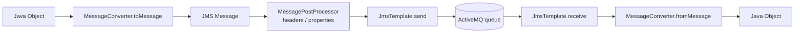

# convertAndSend, receiveAndConvert và MessagePostProcessor

> **Chương:** Spring JMS  
> **Phạm vi:** Spring Boot 3.x, Spring Framework 6.x, Java 17+ với `jakarta.jms` qua ActiveMQ Classic hoặc Artemis. Bài phân tích chính xác **quá trình chuyển payload, sửa metadata trước khi gửi và nhận đồng bộ**, không đi sâu vào routing, ACK và DLQ ngoài những điểm ảnh hưởng trực tiếp tới API.

## 1. Ba API, ba trách nhiệm

Giả sử dịch vụ đặt hàng cần gửi `OrderCreated` dưới dạng JSON qua queue `orders.created`. Trong Spring JMS, ứng dụng không nhất thiết tự tạo JMS `Session`, `TextMessage` và `MessageProducer` cho từng lần gửi. `JmsTemplate` xử lý boilerplate; hai chiều chuyển đổi dùng `MessageConverter`.



| API | Việc chính | Điểm cần nhớ |
| --- | --- | --- |
| `convertAndSend(destination, object)` | Convert object thành JMS Message, rồi gửi | **Không** tự biết DTO phải là JSON |
| `convertAndSend(destination, object, postProcessor)` | Convert, gọi `postProcessMessage`, rồi gửi | MPP chạy **sau convert, trước send** |
| `receiveAndConvert(destination)` | Nhận một JMS Message, convert thành object | Là **synchronous polling**, tiêu thụ message |
| `receiveSelectedAndConvert(destination, selector)` | Nhận có JMS selector rồi convert | Selector lọc **headers/properties**, không parse body |

**Thứ tự gửi chính xác:**

1. `DestinationResolver` xác định destination từ tên hoặc tham số `Destination`.
2. `MessageConverter.toMessage(payload, session)` tạo `TextMessage`, `BytesMessage`, `MapMessage` hoặc loại khác.
3. Nếu được truyền vào, `MessagePostProcessor.postProcessMessage(message)` chỉnh/trả lại message.
4. `JmsTemplate` gửi qua JMS provider; provider gán các header liên quan đến `send`.

**Thứ tự nhận:** tạo consumer → chờ theo receive timeout → nhận message → `MessageConverter.fromMessage` → trả object cho caller. `MessagePostProcessor` **không chạy ở chiều nhận**.

## 2. Overload và lựa chọn API

```java
// jmsTemplate là org.springframework.jms.core.JmsTemplate

jmsTemplate.convertAndSend("orders.created", payload);

jmsTemplate.convertAndSend("orders.created", payload, message -> {
    message.setStringProperty("eventType", "OrderCreated");
    return message;
});

Object payloadAgain = jmsTemplate.receiveAndConvert("orders.created");

Object selected = jmsTemplate.receiveSelectedAndConvert(
    "orders.created", "eventType = 'OrderCreated'");
```

Ngoài tên destination kiểu `String`, các method có overload nhận `jakarta.jms.Destination`, hoặc không truyền destination nếu template đã cấu hình default destination.

Khi cần **tự tạo raw Message**, dùng:

```java
jmsTemplate.send("orders.created", session -> {
    var m = session.createTextMessage("{\"orderId\":\"O-1001\"}");
    m.setStringProperty("eventType", "OrderCreated");
    return m;
});
```

`send` dùng `MessageCreator` và không cần bước `MessageConverter.toMessage`. Còn `convertAndSend` thích hợp khi ứng dụng muốn chuyển đổi nhất quán từ Java payload.

**Phạm vi destination:** trong ví dụ bài này `pubSubDomain=false`, nên tên destination được resolve thành **queue**. Không suy từ tên `orders.events` rằng đây chắc chắn là topic; domain queue/topic phụ thuộc cấu hình template và provider.

## 3. Converter mặc định: `SimpleMessageConverter`

Nếu không có `MessageConverter` riêng, `JmsTemplate` thường dùng `SimpleMessageConverter`.

| Đầu vào Java | Loại JMS Message | Object nhận lại điển hình |
| --- | --- | --- |
| `String` | `TextMessage` | `String` |
| `byte[]` | `BytesMessage` | `byte[]` |
| `Map` với các value được JMS hỗ trợ | `MapMessage` | `Map` |
| `Serializable` | `ObjectMessage` | Java object deserialize |

### Hai sai lầm phổ biến

**Sai lầm 1 — chuỗi JSON tự thành DTO:**

```java
String json = "{\"eventId\":\"evt-1\",\"orderId\":\"O-1001\"}";
jmsTemplate.convertAndSend("orders.created", json);

// Default converter: JMS TextMessage, không phải một Java OrderCreated.
Object received = jmsTemplate.receiveAndConvert("orders.created");
// Kiểu thường là String chứa JSON, chứ không phải OrderCreated.
```

**Sai lầm 2 — DTO tự thành JSON:** nếu `OrderCreated` thực hiện `Serializable`, converter mặc định có thể tạo `ObjectMessage`. Java serialization phụ thuộc classpath/trusted packages, rủi ro deserialization và schema evolution; không nên chọn chỉ vì method nhận `Object`.

Muốn object DTO ↔ JSON, phải cấu hình một JSON `MessageConverter` ở **cả producer và consumer**, ví dụ phần 7. `MapMessage` là định dạng JMS có kiểu primitive/chuỗi, **khác JSON**.

Một converter có thể ném `MessageConversionException` trước `send` nếu payload không được hỗ trợ; không đồng nghĩa broker đã nhận message.

## 4. `MessagePostProcessor`: chỉnh Message sau chuyển đổi

Spring định nghĩa interface:

```java
import jakarta.jms.JMSException;
import jakarta.jms.Message;
import org.springframework.jms.core.MessagePostProcessor;

public final class OrderMetadataProcessor implements MessagePostProcessor {
    private final String eventId;

    public OrderMetadataProcessor(String eventId) {
        this.eventId = eventId;
    }

    @Override
    public Message postProcessMessage(Message message) throws JMSException {
        message.setStringProperty("eventType", "OrderCreated");
        message.setIntProperty("schemaVersion", 2);
        message.setStringProperty("eventId", eventId);
        message.setJMSCorrelationID(eventId);
        return message;
    }
}
```

MPP có thể đặt **application properties** như `eventType`, `region`, `schemaVersion` và các header do ứng dụng sở hữu như `JMSCorrelationID`, `JMSType`, `JMSReplyTo` (khi destination reply hợp lệ).

**Không dùng MPP để ép header do provider quản lý:** `JMSMessageID`, `JMSTimestamp`, `JMSExpiration` thường được provider xác lập trong quá trình gửi. Đặt `JMSExpiration` trước `send` không tương đương cấu hình time-to-live trên producer.

Ví dụ sử dụng lambda cho từng message:

```java
String json = "{\"eventId\":\"evt-1001\",\"orderId\":\"O-1001\"}";

jmsTemplate.convertAndSend("orders.created", json, message -> {
    message.setStringProperty("eventType", "OrderCreated");
    message.setIntProperty("schemaVersion", 2);
    message.setStringProperty("contentType", "application/json");
    message.setJMSCorrelationID("trace-123");
    return message;
});
```

- `json` → **body** của `TextMessage`.
- `eventType`, `schemaVersion`, `contentType` → **JMS properties**.
- `JMSCorrelationID` → **JMS header**.
- `contentType` là property **do ứng dụng quy ước**, không phải header chuẩn bắt buộc.

**Cần dữ liệu cho selector?** Đưa nó vào property *có kiểu đúng*. Selector `eventType = 'OrderCreated' AND schemaVersion = 2` không đọc JSON body, và `schemaVersion` dạng `String "2"` không tương đương kiểu `int 2`.

### 4.1. Có nên kiểm tra body bên trong MPP?

Có thể, nhưng phải hiểu converter nào đang chạy:

```java
jmsTemplate.convertAndSend("orders.created", json, message -> {
    if (!(message instanceof jakarta.jms.TextMessage)) {
        throw new IllegalArgumentException("Expected TextMessage");
    }
    message.setStringProperty("eventType", "OrderCreated");
    return message;
});
```

Nếu đổi converter sang `BytesMessage`, phép kiểm tra sẽ từ chối message trước send. Đây là một cách phát hiện sai contract; không nên nhét toàn bộ parser/HTTP request/database side effects vào MPP.

MPP chạy **trước khi broker xác nhận gửi**. Nếu dùng MPP để ghi database riêng rồi send thất bại, tác dụng DB có thể đã xảy ra mà message chưa tới broker. Sử dụng outbox/transaction strategy khi cần liên kết tác dụng nghiệp vụ với việc phát event.

### 4.2. Delivery mode, priority, TTL là QoS của producer

Nếu template cần áp delivery mode/priority/TTL, dùng cấu hình QoS phù hợp:

```java
import jakarta.jms.ConnectionFactory;
import jakarta.jms.DeliveryMode;
import org.springframework.context.annotation.Bean;
import org.springframework.context.annotation.Configuration;
import org.springframework.jms.core.JmsTemplate;

@Configuration
class JmsQosConfig {
    @Bean
    JmsTemplate jmsTemplate(ConnectionFactory factory) {
        JmsTemplate template = new JmsTemplate(factory);
        template.setExplicitQosEnabled(true);
        template.setDeliveryMode(DeliveryMode.PERSISTENT);
        template.setPriority(6);
        template.setTimeToLive(60_000L);
        template.setReceiveTimeout(2_000L);
        return template;
    }
}
```

Đoạn trên cấu hình **toàn bộ lời gọi gửi qua bean đó**, không riêng một message. Khi khai báo `JmsTemplate` bean tùy chỉnh, Spring Boot có thể **back off** auto-config template; các property `spring.jms.template.*` không nhất thiết được áp vào bean này. Đừng thêm cấu hình mẫu này đồng thời với mẫu template tự động ở phần sau nếu không có nhu cầu cụ thể.

## 5. Ví dụ Spring Boot 3.x: gửi String JSON và nhận đồng bộ

Sử dụng **một** starter theo broker/protocol. Với Artemis native CORE:

```xml
<dependency>
    <groupId>org.springframework.boot</groupId>
    <artifactId>spring-boot-starter-artemis</artifactId>
</dependency>
```

Với ActiveMQ Classic OpenWire, **thay** bằng:

```xml
<dependency>
    <groupId>org.springframework.boot</groupId>
    <artifactId>spring-boot-starter-activemq</artifactId>
</dependency>
```

Các starter được quản lý bằng Spring Boot BOM, không tự ghép một client `javax.jms` cũ vào Spring Boot 3 dùng `jakarta.jms`.

Ví dụ `application.yml` cho Artemis broker đặt ngoài ứng dụng:

```yaml
spring:
  artemis:
    mode: native
    broker-url: tcp://localhost:61616
    user: ${BROKER_USER}
    password: ${BROKER_PASSWORD}
  jms:
    pub-sub-domain: false
    template:
      receive-timeout: 2s
```

Giả định queue test `lab.orders` đã được khai báo hoặc broker cho phép auto-create; user có quyền gửi/nhận. Nếu dùng Classic, đổi sang namespace `spring.activemq.*` và URI OpenWire; **không** dùng cả hai starter.

### 5.1. Service: dùng converter mặc định và MPP

File `OrderMessageGateway.java`:

```java
package demo.springjms;

import java.util.Optional;
import org.springframework.jms.core.JmsTemplate;
import org.springframework.stereotype.Service;

@Service
public class OrderMessageGateway {
    private static final String QUEUE = "lab.orders";

    private final JmsTemplate template;

    public OrderMessageGateway(JmsTemplate template) {
        this.template = template;
    }

    public void sendOrderCreated(String eventId, String orderId) {
        // Demo đơn giản với giá trị có kiểm soát;
        // production phải dùng JSON serializer, không nối input tùy ý.
        String json = "{\"eventId\":\"" + eventId
                + "\",\"orderId\":\"" + orderId + "\"}";

        template.convertAndSend(QUEUE, json, message -> {
            message.setStringProperty("eventType", "OrderCreated");
            message.setIntProperty("schemaVersion", 2);
            message.setStringProperty("eventId", eventId);
            message.setJMSCorrelationID(eventId);
            return message;
        });
    }

    public Optional<String> pollOrderCreated() {
        Object converted = template.receiveSelectedAndConvert(
                QUEUE,
                "eventType = 'OrderCreated' AND schemaVersion = 2");

        if (converted == null) {
            return Optional.empty();
        }
        if (!(converted instanceof String json)) {
            throw new IllegalStateException(
                    "Expected String, got " + converted.getClass());
        }
        return Optional.of(json);
    }
}
```

`receiveSelectedAndConvert` nhận và lọc bằng selector; nếu không cần selector:

```java
Object anyPayload = jmsTemplate.receiveAndConvert("lab.orders");
```

**Nhớ:** `receiveAndConvert` trả payload, **không trả JMS headers/properties**. Nếu ứng dụng cần `JMSCorrelationID` hoặc `JMSMessageID` ở chiều nhận, dùng raw `receive`/listener với `Message` hoặc một cơ chế ánh xạ metadata rõ ràng.

### 5.2. Khởi chạy demo bằng ApplicationRunner

File `SpringJmsDemoApplication.java`:

```java
package demo.springjms;

import java.util.UUID;
import org.springframework.boot.ApplicationRunner;
import org.springframework.boot.SpringApplication;
import org.springframework.boot.autoconfigure.SpringBootApplication;
import org.springframework.context.annotation.Bean;

@SpringBootApplication
public class SpringJmsDemoApplication {
    public static void main(String[] args) {
        SpringApplication.run(SpringJmsDemoApplication.class, args);
    }

    @Bean
    ApplicationRunner demo(OrderMessageGateway gateway) {
        return args -> {
            String eventId = UUID.randomUUID().toString();
            gateway.sendOrderCreated(eventId, "O-1001");
            gateway.pollOrderCreated().ifPresentOrElse(
                json -> System.out.println("Received " + json),
                () -> System.out.println("No matching message"));
        };
    }
}
```

Với queue lab không có consumer khác, ứng dụng gửi JSON dưới dạng `TextMessage` rồi nhận `String`. Đây là test end-to-end conversion; **không** phải một consumer production hoàn chỉnh. Nếu queue có backlog các message khác cũng khớp selector, có thể nhận chúng trước; muốn test chính xác từng event hãy chọn selector theo `eventId` duy nhất.

## 6. `receiveAndConvert` là polling: timeout, null và tiêu thụ message

### 6.1. Receive timeout không phải broker liveness

```yaml
spring:
  jms:
    template:
      receive-timeout: 2s
```

| Kết quả | Cách hiểu |
| --- | --- |
| `String` hoặc object | `MessageConverter.fromMessage` đã chuyển message |
| `null` | Không có message được trả về trong thời hạn (với converter thông dụng) |
| `JmsException` | Lỗi JMS, lỗi selector, conversion hoặc kết nối tùy ngữ cảnh |
| Object sai kiểu | Converter phía nhận không tuân theo contract dự kiến |

Theo mặc định `JmsTemplate` có thể chờ **vô hạn**: `RECEIVE_TIMEOUT_INDEFINITE_WAIT = -1`. `receiveTimeout=0` là **no wait**, không phải chờ vô hạn. Đặt receive timeout hữu hạn khi polling từ một HTTP request hoặc job có deadline.

`null` **không chứng minh broker chết**; queue có thể trống, selector không khớp hoặc consumer khác đã nhận. Một converter tùy chỉnh có thể trả `null` cho một payload đặc biệt, nên đừng dùng `null` làm duy nhất nguồn thông tin nghiệp vụ nếu contract cho phép null.

### 6.2. Polling tiêu thụ message, không phải browse

`receiveAndConvert` tạo consumer, nhận JMS message rồi đưa cho converter. Với acknowledgment mode mặc định và synchronous receive, message có thể đã được **ACK trước khi business logic ở caller hoàn tất**:

```java
Object payload = jmsTemplate.receiveAndConvert("orders.created");
// Nếu lệnh DB dưới đây thất bại, không thể giả định
// broker sẽ redeliver message vừa nhận.
databaseService.apply(payload);
```

Nếu conversion ném exception **sau receive**, message cũng có thể đã được ACK theo session mode; phải kiểm thử failure mode cụ thể. Với xử lý nghiệp vụ cần transaction/retry đáng tin cậy, dùng `@JmsListener` với listener container transaction setup hoặc quản lý transacted JMS session thích hợp. Đừng dùng `receiveAndConvert` auto-ack như giải pháp reliable consumer mặc định.

`receiveAndConvert` chỉ đọc **một message cho mỗi lời gọi**; không tạo một daemon subscriber. Nếu `@JmsListener` chạy trên cùng queue, hai bên là competing consumers. Cần tách queue test khỏi queue business.

### 6.3. Khi nào nên dùng selected receive?

Nếu queue chứa nhiều loại message và metadata được gắn đúng:

```java
Object order = jmsTemplate.receiveSelectedAndConvert(
        "lab.orders",
        "eventType = 'OrderCreated' AND schemaVersion >= 2");
```

Selector chỉ lọc JMS headers/properties được phép, không thể đọc `orderId` chỉ nằm trong JSON body. Message không khớp có thể vẫn nằm trong queue; việc lặp lại polling với selector quá hẹp có thể tạo backlog.

## 7. DTO → TextMessage JSON bằng `MappingJackson2MessageConverter`

Muốn `convertAndSend` nhận `OrderCreated` và `receiveAndConvert` trả lại đúng DTO, dùng converter JSON có type mapping. Ví dụ sau dùng **Spring Framework 6.x** với Jackson 2 và không dùng chung cùng context với demo converter mặc định ở mục 5.

### 7.1. Model và dependency

File `OrderCreated.java`:

```java
package demo.springjms;

public record OrderCreated(
        String eventId,
        String orderId,
        long totalVnd) {
}
```

Thêm Jackson databind nếu chưa được đưa vào ứng dụng:

```xml
<dependency>
    <groupId>com.fasterxml.jackson.core</groupId>
    <artifactId>jackson-databind</artifactId>
</dependency>
```

### 7.2. Cấu hình converter và JmsTemplate tường minh

File `OrderJsonJmsConfig.java`:

```java
package demo.springjms;

import java.util.Map;

import com.fasterxml.jackson.databind.ObjectMapper;
import jakarta.jms.ConnectionFactory;

import org.springframework.context.annotation.Bean;
import org.springframework.context.annotation.Configuration;
import org.springframework.jms.core.JmsTemplate;
import org.springframework.jms.support.converter.MappingJackson2MessageConverter;
import org.springframework.jms.support.converter.MessageConverter;
import org.springframework.jms.support.converter.MessageType;

@Configuration
public class OrderJsonJmsConfig {
    @Bean
    MessageConverter orderJsonConverter(ObjectMapper mapper) {
        MappingJackson2MessageConverter converter =
                new MappingJackson2MessageConverter();
        converter.setObjectMapper(mapper);
        converter.setTargetType(MessageType.TEXT);
        converter.setTypeIdPropertyName("_type");
        converter.setTypeIdMappings(
                Map.of("order-created-v1", OrderCreated.class));
        return converter;
    }

    @Bean
    JmsTemplate jmsTemplate(
            ConnectionFactory factory,
            MessageConverter orderJsonConverter) {
        JmsTemplate template = new JmsTemplate(factory);
        template.setMessageConverter(orderJsonConverter);
        template.setReceiveTimeout(2_000L);
        return template;
    }
}
```

**Lưu ý version:** `MappingJackson2MessageConverter` phù hợp ví dụ Spring Framework 6.x/Jackson 2. Khi nâng lên dòng framework/Jackson khác, kiểm tra API converter đang được hỗ trợ; không ép bản cũ vào dependency mới. `_type` là **JMS property** cho thông tin type do converter dùng, không tự là business `schemaVersion`.

### 7.3. Gửi và nhận DTO

```java
OrderCreated event =
        new OrderCreated("evt-1001", "O-1001", 125_000L);

jmsTemplate.convertAndSend("lab.orders.json", event, message -> {
    message.setStringProperty("eventType", "OrderCreated");
    message.setIntProperty("schemaVersion", 1);
    message.setStringProperty("eventId", event.eventId());
    message.setStringProperty("contentType", "application/json");
    return message;
});

Object converted = jmsTemplate.receiveAndConvert("lab.orders.json");
if (!(converted instanceof OrderCreated received)) {
    throw new IllegalStateException("Unexpected payload: " + converted);
}
System.out.println(received.orderId());
```

Điểm kiểm chứng:

1. Raw body là **`TextMessage` JSON**, không phải `ObjectMessage`.
2. Converter gắn property `_type` để map `order-created-v1` về Java `OrderCreated`.
3. MPP chạy sau convert, nên gắn thêm `eventId` và `eventType` mà không làm mất body JSON.
4. Cả hai đầu phải dùng converter tương thích. Nếu receiver dùng `SimpleMessageConverter`, kết quả là **String JSON**.
5. Type mapping chỉ giúp resolve class: thay đổi schema cần versioning và kế hoạch backward compatibility; không tùy tiện cho message bên ngoài chỉ định tên Java class cần deserialize.

**Khuyến nghị:** dùng metadata ổn định như `schemaVersion` hoặc `eventType` để chọn xử lý nghiệp vụ; hạn chế phụ thuộc tên package/class trên wire. Trong tích hợp phức tạp, có thể viết converter riêng để bảo đảm hợp đồng schema.

## 8. Mỗi trách nhiệm nên nằm ở đâu?

| Nhu cầu | Công cụ | Không nên nhầm với |
| --- | --- | --- |
| Object → JMS body | `MessageConverter.toMessage` | `MessagePostProcessor` |
| JMS body → Object | `MessageConverter.fromMessage` | `@JmsListener` tự động luôn giải được mọi JSON |
| Typed properties/correlation ID trước gửi | `MessagePostProcessor` | Provider-level message ID |
| Queue/topic đích | `JmsTemplate`, destination resolver | JMS selector |
| Chọn message đủ điều kiện nhận | JMS message selector | Parse JSON body |
| Priority/TTL/delivery mode | Producer/`JmsTemplate` QoS | Gán `JMSExpiration` trong MPP |
| Raw BytesMessage/custom message | `send(..., MessageCreator)` | Cố ép DTO qua SimpleMessageConverter |
| Xử lý nghiệp vụ/DB | Consumer/transaction boundary | MPP hoặc polling auto-ack |

Ví dụ raw binary dùng `MessageCreator`:

```java
byte[] encoded = encodeBinaryPayload();
jmsTemplate.send("orders.binary", session -> {
    var message = session.createBytesMessage();
    message.writeBytes(encoded);
    message.setStringProperty("contentType", "application/x-protobuf");
    message.setIntProperty("schemaVersion", 3);
    return message;
});
```

Trong đó `encodeBinaryPayload()` là codec nghiệp vụ do ứng dụng cung cấp, không phải API JMS.

## 9. Kiểm chứng và lỗi thường gặp

### 9.1. Ma trận chẩn đoán

| Hiện tượng | Nguyên nhân | Kiểm tra |
| --- | --- | --- |
| `convertAndSend(dto)` tạo `ObjectMessage` | Đang dùng SimpleMessageConverter, DTO `Serializable` | Xem raw JMS message type; cấu hình converter JSON |
| `receiveAndConvert` trả String thay vì DTO | Receiver dùng default converter | Kiểm tra bean `JmsTemplate` và `MessageConverter` |
| `MessageConversionException` khi nhận | JSON sai, `_type` thiếu/không map, body không đúng loại | Browse raw message, xác minh type map/schema |
| Selector không nhận message | Property bị thiếu hoặc khác kiểu | Kiểm tra MPP, `propertyExists`, `setIntProperty` |
| Poll treo lâu | Receive timeout không đặt | `spring.jms.template.receive-timeout`/`setReceiveTimeout` |
| Poll trả null | Không có message khớp hoặc bị consumer khác nhận | Queue depth, selectors, active consumers |
| MPP chạy nhưng message không thấy | Send/transaction chưa commit, sai destination hoặc exception | Broker metrics, logs, transaction outcome |
| TTL không đúng | Dùng setter header thay vì QoS template | `setExplicitQosEnabled`, `setTimeToLive` |
| Sai `JMSMessageID` sau send | Provider cấp ID khi gửi | Xem header của message thực nhận |
| Poll xong DB lỗi không redeliver | Auto-ack đã xảy ra trước business processing | Thiết kế listener/transaction phù hợp |
| Boot YAML timeout không tác dụng | Đã tự khai báo `JmsTemplate` bean | Xem bean thật và cấu hình trực tiếp |
| Smoke test lấy mất message production | Dùng `receive` trên queue chung | Queue test riêng; QueueBrowser nếu chỉ quan sát |

### 9.2. Integration test có selector theo ID duy nhất

Dùng `spring-boot-starter-test`, broker test đang chạy và **cấu hình converter mặc định ở mục 5**, không đồng thời kích hoạt cấu hình JSON ở mục 7:

```java
package demo.springjms;

import java.util.UUID;

import org.junit.jupiter.api.Test;
import org.springframework.beans.factory.annotation.Autowired;
import org.springframework.boot.test.context.SpringBootTest;
import org.springframework.jms.core.JmsTemplate;

import static org.junit.jupiter.api.Assertions.assertEquals;

@SpringBootTest(properties = "spring.jms.template.receive-timeout=2s")
class SpringJmsRoundTripIT {
    @Autowired JmsTemplate template;

    @Test
    void roundTripTextWithProperties() {
        String eventId = UUID.randomUUID().toString();

        template.convertAndSend("lab.orders", "order:" + eventId,
                message -> {
                    message.setStringProperty("eventId", eventId);
                    message.setStringProperty("eventType", "OrderCreated");
                    return message;
                });

        Object received = template.receiveSelectedAndConvert(
                "lab.orders", "eventId = '" + eventId + "'");

        assertEquals("order:" + eventId, received);
    }
}
```

Test này chỉ kiểm tra **convert → MPP → send → receive → convert**, không chứng minh broker persistence hay business transaction. Cần queue test và không có competing consumers, nếu không test có thể không ổn định. Nếu tự tạo JmsTemplate bean, đặt timeout trực tiếp lên bean vì Boot property có thể không được gắn.

### 9.3. Kiểm tra raw message mà không convert

```java
import jakarta.jms.Message;
import jakarta.jms.TextMessage;

Message raw = jmsTemplate.receive("lab.orders");
if (raw != null) {
    System.out.println(raw.getJMSMessageID());
    System.out.println(raw.getStringProperty("eventType"));
    System.out.println(raw instanceof TextMessage);
}
```

`receive` vẫn **tiêu thụ message**. Nếu chỉ muốn quan sát, dùng `QueueBrowser` hoặc broker console; không nhầm nhận với peek.

## 10. Bài thực hành tập trung

1. **Default conversion:** gửi `String`, `byte[]`, `Map` vào các queue lab riêng. Nhận bằng `receiveAndConvert` và đối chiếu kiểu Java/body.
2. **Properties sau converter:** gửi JSON `TextMessage` qua `convertAndSend` kèm MPP gắn `eventType` và `schemaVersion`; dùng `receiveSelectedAndConvert` để nhận.
3. **Property sai kiểu:** đổi `setIntProperty("schemaVersion", 2)` thành `setStringProperty("schemaVersion", "2")`. Quan sát selector so sánh số không còn khớp.
4. **Không có MPP:** gửi cùng JSON nhưng thiếu `eventType`. Message có thể vẫn nằm trong queue nếu selector của poller không khớp.
5. **Timeout:** thử `receive-timeout=2s` và no-wait `0` trên queue trống. Xác nhận `null` không đồng nghĩa broker chết.
6. **Raw vs converted:** xem raw `TextMessage` và typed properties với `receive`; so sánh dữ liệu trả về từ `receiveAndConvert`.
7. **Jackson converter:** chuyển sang mục 7, gửi `OrderCreated`; xác minh `TextMessage` có JSON và `_type`, nhận lại record.
8. **Lỗi type ID:** gửi message có `_type` không hợp lệ hoặc JSON sai. Quan sát conversion exception và kiểm tra ack/transaction trên broker test.
9. **QoS:** dùng template có `setExplicitQosEnabled(true)`, TTL/priority; xem headers của message nhận. Không đặt `JMSExpiration` trong MPP.
10. **Consumer cạnh tranh:** chạy một `@JmsListener` test cùng queue; cho thấy `receiveAndConvert` không nhất thiết nhận message khi listener đã lấy.

### Câu hỏi tự kiểm tra

1. **MPP chạy trước hay sau converter?** — Sau `toMessage`, trước `send`.
2. **`convertAndSend(dto)` có mặc định serialize JSON?** — Không.
3. **`receiveAndConvert` trả DTO từ TextMessage JSON khi nào?** — Khi có converter phù hợp phía nhận.
4. **`receiveAndConvert` trả null có nghĩa broker chết?** — Không.
5. **`receiveAndConvert` có phải peek?** — Không; nó nhận/tiêu thụ message.
6. **JMS selector có đọc JSON body trực tiếp không?** — Không theo JMS selector chuẩn.
7. **Nên thiết lập TTL trong MPP bằng `JMSExpiration` không?** — Không; dùng producer QoS.
8. **Vì sao không nên ghi DB trong MPP?** — Hook chạy trước send và không tự có atomicity với broker.
9. **Khi cần BytesMessage đặc biệt, API nào phù hợp?** — `send` với `MessageCreator` hoặc converter riêng.
10. **Vì sao không dùng polling auto-ack cho xử lý DB quan trọng?** — Message có thể đã ACK trước khi DB xử lý thành công.

## 11. Checklist triển khai

- [ ] Chọn `MessageConverter` phù hợp contract và được sử dụng nhất quán ở hai đầu.
- [ ] Không mặc định `Serializable` DTO sẽ được gửi thành JSON.
- [ ] Đặt typed metadata ở `MessagePostProcessor`, không parse body trong selector.
- [ ] Không tự ép header do JMS provider sinh khi send.
- [ ] Đặt priority/TTL/delivery mode qua template/producer QoS đúng cách.
- [ ] Với polling, cấu hình receive timeout hữu hạn, xử lý `null` và lỗi converter.
- [ ] Phân biệt `receive`, `receiveAndConvert` và `QueueBrowser`.
- [ ] Không để smoke test competing với consumer production.
- [ ] Cần reliable processing thì chọn listener/session transaction thay vì polling auto-ack tùy tiện.
- [ ] Kiểm tra bean `JmsTemplate` thực tế khi Spring Boot auto-config và custom config cùng tồn tại.
- [ ] Kiểm thử body type, JSON type mapping, selector, headers/properties và failure cases trên broker test.

## Tài liệu tham khảo

- [Spring Framework — JMS Integration](https://docs.spring.io/spring-framework/reference/integration/jms.html): `JmsTemplate`, message converter, listeners và transactions.
- [Spring Framework 6.2 API — JmsTemplate](https://docs.spring.io/spring-framework/docs/6.2.0/javadoc-api/org/springframework/jms/core/JmsTemplate.html): `convertAndSend`, `receiveAndConvert`, `receiveSelectedAndConvert`.
- [Spring Framework 6.2 API — MessagePostProcessor](https://docs.spring.io/spring-framework/docs/6.2.0/javadoc-api/org/springframework/jms/core/MessagePostProcessor.html): contract callback sau conversion.
- [Spring Framework 6.2 API — MappingJackson2MessageConverter](https://docs.spring.io/spring-framework/docs/6.2.0/javadoc-api/org/springframework/jms/support/converter/MappingJackson2MessageConverter.html): JSON conversion, type mappings.
- [Spring Boot — JMS Messaging](https://docs.spring.io/spring-boot/reference/messaging/jms.html): ActiveMQ Classic/Artemis starters và template auto-configuration.
