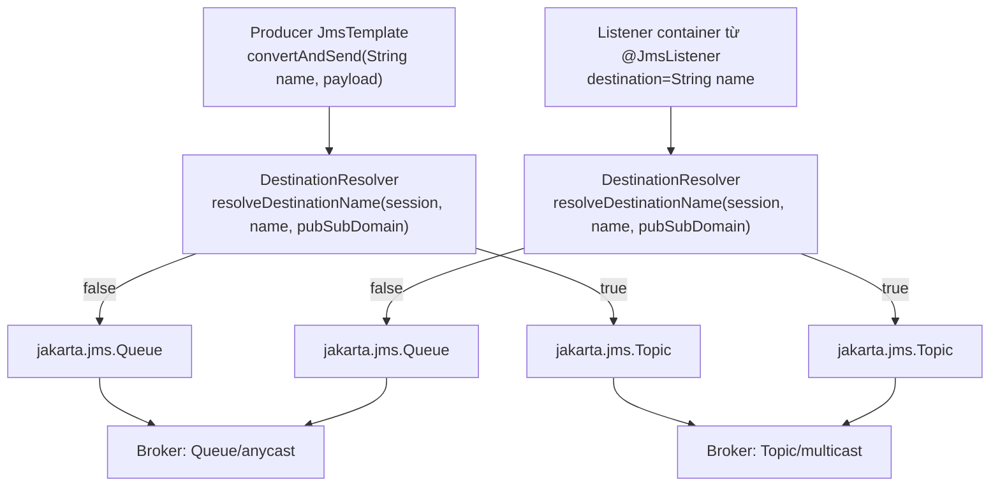

# DestinationResolver, Queue, Topic và pubSubDomain trong Spring JMS

> **Chương:** Spring JMS  
> **Module:** `INTEGRATION_MESSAGING_MESSAGE_BROKER_ACTIVEMQ` — học Apache ActiveMQ Classic và Artemis trong giao tiếp bất đồng bộ bằng queue/topic/routing và JMS; thực hành Java producer/consumer, acknowledgment, transaction, redelivery, DLQ, bảo mật và vận hành đáng tin cậy.  
> **Trọng tâm bài:** Cách Spring JMS biến **tên destination dạng `String`** thành **`jakarta.jms.Queue` hoặc `jakarta.jms.Topic`**, vai trò của `DestinationResolver` và cờ `pubSubDomain` trên **`JmsTemplate`** lẫn **listener container**. Các ví dụ dùng **Spring Boot 3.5.8, Java 17, Spring JMS 6.x và Artemis native Jakarta JMS**; có hướng dẫn đối chiếu với ActiveMQ Classic.

## 1. Câu hỏi chẩn đoán: cùng một tên nhưng producer và consumer không gặp nhau?

Một ứng dụng gửi message:

```java
jmsTemplate.convertAndSend("orders.events", "OrderCreated:O-1001");
```

Ứng dụng khác lắng nghe:

```java
@JmsListener(destination = "orders.events")
public void onEvent(String payload) {
    System.out.println(payload);
}
```

Hai chuỗi tên **giống nhau tuyệt đối**. Tuy vậy, listener có thể không nhận message. Lý do không nhất thiết nằm ở broker hoặc network:

- `JmsTemplate` có thể đang tạo **`Queue("orders.events")`**.
- `@JmsListener` có thể đang đăng ký **`Topic("orders.events")`**.
- Hoặc ngược lại.
- Trên ActiveMQ Classic, queue và topic là **hai kiểu JMS destination khác nhau** ngay cả khi tên text trùng nhau.
- Trên Artemis, chúng thường được ánh xạ vào **address + routing type + queue binding** khác nhau (`anycast` cho queue, `multicast` cho topic). Một tên không tự đảm bảo routing giống nhau.

Điểm người học cần trả lời:

**Tên `"orders.events"` chỉ đủ xác định `Destination` sau khi đã biết người resolve tên muốn nhận một `Queue` hay `Topic`, hoặc đã có một đối tượng `Destination` từ JNDI/registry.**

### 1.1. Sơ đồ đường đi



**`pubSubDomain` không nằm trong message payload và không được broker suy từ tên queue.** Đây là một **tùy chọn phía Spring JMS** nói cho lớp resolve động biết cần tạo loại destination nào.

## 2. Bốn khái niệm thường bị trộn vào nhau

| Khái niệm | Ví dụ | Nó quyết định gì? | Nó **không** tự quyết định gì? |
|---|---|---|---|
| **Tên destination** | `"orders.created"` | Một chuỗi định danh do code/config khai báo | Không nói chắc là Queue hay Topic |
| **JMS Destination object** | `jakarta.jms.Queue`, `jakarta.jms.Topic` | Kiểu đích JMS cụ thể dùng để send/subscribe | Không bảo đảm broker có physical binding/ACL thích hợp |
| **`DestinationResolver`** | `DynamicDestinationResolver`, `JndiDestinationResolver` | Cách ánh xạ `String` → `Destination` | Không phải bộ xử lý message hay transaction manager |
| **`pubSubDomain`** | `false`/`true` | Hint chọn queue hay topic khi resolver cần phân biệt domain | Không tự tạo subscription bền vững, không đổi queue thành topic trong broker |
| **Broker routing** | Classic queue/topic hoặc Artemis anycast/multicast | Message đi vào hàng chờ/subscription nào | Không bị thay đổi chỉ vì đặt cờ trên một Bean Spring không dùng tới |

Hai kiểu destination cốt lõi:

- **`Queue` (point-to-point):** nhiều competing consumers cùng lắng nghe một queue vật lý, thông thường **một message được xử lý thành công bởi một consumer**.
- **`Topic` (publish/subscribe):** mỗi subscription phù hợp có thể nhận bản riêng của event. Một topic với hai non-durable subscribers online có thể tạo hai bản delivery, không phải chia tải một event làm hai nửa.

**Nói “JMS chỉ cần tên” là thiếu một nửa hợp đồng.** Nên luôn ghi rõ **destination type**, **tên**, **consumer/subscription semantics** và **broker routing** trong interface contract.

## 3. DestinationResolver hoạt động ở đâu?

### 3.1. Interface chuẩn của Spring JMS

Trong Spring Framework 6.x với `jakarta.jms`:

```java
package org.springframework.jms.support.destination;

public interface DestinationResolver {
    Destination resolveDestinationName(
            Session session,
            String destinationName,
            boolean pubSubDomain) throws JMSException;
}
```

Trong đó:

- `session`: `jakarta.jms.Session` dùng để tạo/resolve destination động nếu cần; implementation kiểu JNDI có thể không cần session cho thao tác lookup.
- `destinationName`: tên chuỗi mà application cung cấp.
- `pubSubDomain=false`: yêu cầu point-to-point (`Queue`).
- `pubSubDomain=true`: yêu cầu publish/subscribe (`Topic`).
- Kết quả là `jakarta.jms.Destination`; Spring truyền đối tượng này cho JMS provider khi tạo producer/consumer.

Sơ đồ chuỗi lời gọi của `JmsTemplate.convertAndSend(String, Object)`:

```text
Business code
  jmsTemplate.convertAndSend("orders.created", payload)
      |
      v
JmsTemplate [connectionFactory + resolver + pubSubDomain]
      |
      +-- tạo/nhận JMS Connection và Session theo cấu hình
      |
      +-- DestinationResolver.resolveDestinationName(
              session, "orders.created", pubSubDomain)
      |      |
      |      +-- trả về Queue hoặc Topic
      |
      +-- MessageConverter chuyển payload thành JMS Message
      |
      +-- MessageProducer.send(destination, message)
      |
      +-- đóng/trả về pool các JMS resources
```

**Điểm chính:** `MessageConverter` xử lý **body/headers/properties của message**, còn `DestinationResolver` xử lý **đích của message**. Tạo một `MessageConverter` JSON không làm tên `"orders.events"` tự biến thành topic.

### 3.2. Khi truyền sẵn đối tượng `Destination` thì sao?

Spring JMS có overload nhận trực tiếp JMS `Destination`:

```java
// Fragment: topic được lấy từ JNDI hoặc do provider/JMS Session tạo.
Topic topic = ...;

JmsTemplate template = ...;
template.convertAndSend(topic, "OrderCreated:O-1001");
```

Trong lời gọi này, **đối tượng `Topic` đã quyết định loại đích**. Spring không phải gọi `DestinationResolver` cho một tên chuỗi để xác định kiểu. `template.setPubSubDomain(false)` không thể biến đối tượng `Topic` thành Queue.

Đó là lý do cần phân biệt overload:

| Lời gọi | Có cần resolve tên? | `pubSubDomain` thường có vai trò? |
|---|---|---|
| `convertAndSend("orders.created", payload)` | **Có**, vì nhận `String` | **Có** với resolver động |
| `send("orders.created", creator)` | **Có** | **Có** với resolver động |
| `receive("orders.created")` | **Có** | **Có** với resolver động |
| `convertAndSend(queueObject, payload)` | Không cần resolve tên | Không đổi type đã có |
| `convertAndSend(topicObject, payload)` | Không cần resolve tên | Không đổi type đã có |
| `@JmsListener(destination="orders.created")` | Listener container phải resolve tên | **Có**, nhưng theo **cấu hình container factory**, không theo template |

### 3.3. “Dynamic destination” không nhất thiết là broker auto-create

Một nhầm lẫn quan trọng: `DynamicDestinationResolver` gọi `Session.createQueue(name)` hoặc `Session.createTopic(name)`. Tên gọi **dynamic** ở đây chỉ cách lấy đối tượng destination theo tên, **không đảm bảo** broker đã tạo address/queue vật lý hoặc user có quyền tự tạo chúng.

Tùy nhà cung cấp, broker settings và ACL:

- Lời gọi có thể tạo một handle tới destination, **chưa** tạo physical queue.
- Broker có thể auto-create destination lúc producer/consumer kết nối.
- Broker có thể **từ chối** vì chưa có address/queue, sai routing type hoặc thiếu quyền.
- Trên Artemis, `createQueue("X")` có thể liên quan anycast address và queue, còn `createTopic("X")` liên quan multicast address/subscription queues.
- Trên Classic, queue/topic có thể được auto-create theo broker policy, nhưng chính sách bảo mật có thể giới hạn.

**Không dùng `DestinationResolver` như công cụ provisioning broker hoặc security control.** Với production, nên định nghĩa topology và ACL độc lập bằng cấu hình/hạ tầng có kiểm soát.

## 4. DynamicDestinationResolver: mặc định và cơ chế cụ thể

Spring `JmsTemplate` và Spring JMS listener destination accessor thường dùng `DynamicDestinationResolver` mặc định nếu không cấu hình resolver khác.

Logic rút gọn tương đương:

```java
public Destination resolveDestinationName(
        Session session, String name, boolean pubSubDomain)
        throws JMSException {

    return pubSubDomain
            ? session.createTopic(name)
            : session.createQueue(name);
}
```

Đây là *pseudocode mô tả hành vi*, không phải mã nguồn chép nguyên Spring.

Bảng kết quả:

| Name string | pubSubDomain | DynamicDestinationResolver gọi | Kết quả |
|---|---|---|---|
| `"demo.orders.created"` | `false` | `session.createQueue("demo.orders.created")` | `Queue` |
| `"demo.orders.events"` | `true` | `session.createTopic("demo.orders.events")` | `Topic` |
| `"demo.orders.events"` | `false` | `session.createQueue("demo.orders.events")` | **Queue khác ý định** |
| `"demo.orders.created"` | `true` | `session.createTopic("demo.orders.created")` | **Topic khác ý định** |

**Đừng suy type từ suffix `.events`, `.queue`, `.topic`.** `DynamicDestinationResolver` không tự đọc quy ước tên để đoán kiểu; nó nhận boolean `pubSubDomain` từ caller.

### 4.1. Tạo resolver rõ ràng trong Spring

```java
import org.springframework.context.annotation.Bean;
import org.springframework.context.annotation.Configuration;
import org.springframework.jms.support.destination.DestinationResolver;
import org.springframework.jms.support.destination.DynamicDestinationResolver;

@Configuration
public class DestinationConfiguration {
    @Bean
    DestinationResolver destinationResolver() {
        return new DynamicDestinationResolver();
    }
}
```

Không bắt buộc khai báo bean này nếu chỉ cần default Spring. Khai báo tường minh hữu ích khi muốn bảo đảm **template và listener dùng cùng resolver** và dễ thay bằng resolver khác để kiểm thử.

**Lưu ý:** Cùng một resolver instance **không có nghĩa** Queue/Topic luôn khớp; mỗi caller vẫn đưa vào **`pubSubDomain` riêng**. Vì vậy phải cấu hình đồng bộ cả template lẫn listener factory.

## 5. pubSubDomain nằm ở những chỗ nào?

### 5.1. Đối với producer: `JmsTemplate`

```java
JmsTemplate queueTemplate = new JmsTemplate(connectionFactory);
queueTemplate.setPubSubDomain(false); // default Queue

JmsTemplate topicTemplate = new JmsTemplate(connectionFactory);
topicTemplate.setPubSubDomain(true);  // Topic
```

- `false` là mặc định của Spring JMS destination accessor: dùng **point-to-point** cho tên String.
- `true` yêu cầu resolver động trả về **Topic**.
- Đây là setting **trên từng `JmsTemplate` bean**.
- Nếu dùng **một** `JmsTemplate` singleton và liên tục gọi `setPubSubDomain(true/false)` theo từng request, sẽ có race condition: request A có thể chuyển type ngay khi request B đang send.
- Dùng **hai template bean cấu hình bất biến sau startup** hoặc truyền **`Destination` object có type rõ** cho từng lần gửi.

**Không đổi boolean của singleton template trong runtime để chuyển giữa queue và topic.**

### 5.2. Đối với consumer: `@JmsListener` và listener factory

```java
@Bean
DefaultJmsListenerContainerFactory topicListenerFactory(
        ConnectionFactory connectionFactory,
        DestinationResolver resolver) {

    DefaultJmsListenerContainerFactory factory =
            new DefaultJmsListenerContainerFactory();
    factory.setConnectionFactory(connectionFactory);
    factory.setDestinationResolver(resolver);
    factory.setPubSubDomain(true);
    factory.setSessionTransacted(true);
    return factory;
}
```

Ở đây `setPubSubDomain(true)` **không sửa producer**. Nó khiến **listener container được factory tạo** resolve `destination` chuỗi thành Topic. Một `JmsTemplate` khác vẫn dùng Queue nếu cờ của template là `false`.

Áp dụng trên annotation:

```java
@JmsListener(
    destination = "demo.orders.events",
    containerFactory = "topicListenerFactory"
)
public void onOrderEvent(String event) {
    // Nhận từ Topic, nếu đã subscribed và broker routing đúng.
}
```

Nếu bạn quên `containerFactory` và ứng dụng chỉ có default `jmsListenerContainerFactory` với `pubSubDomain=false`, annotation **không tự chọn Topic**. Nó sẽ trở thành listener Queue cho tên `demo.orders.events`. `@JmsListener` không có tham số `pubSubDomain` riêng trên annotation.

### 5.3. Bảng toàn bộ tổ hợp producer/consumer

Giả sử cùng text name `"sales.events"`, dùng resolver động và topology broker cho phép:

| Producer template | Listener factory | Loại đích hai bên | Kết quả mong đợi |
|---|---|---|---|
| `pubSubDomain=false` | `false` | Queue → Queue | **Competing consumer**; phù hợp command/job |
| `true` | `true` | Topic → Topic | **Publish/subscribe**; subscriber hiện hành nhận event |
| `false` | `true` | Queue → Topic | **Không tương ứng**; listener topic không đọc queue đã gửi |
| `true` | `false` | Topic → Queue | **Không tương ứng**; queue consumer không phải topic subscription |
| Producer dùng trực tiếp `Topic` object | Listener `true` | Topic → Topic | Đúng dù template có default `false` |
| Producer dùng trực tiếp `Queue` object | Listener `false` | Queue → Queue | Đúng dù template có default `true` |

**Khẳng định “mismatch” là khác loại destination**, không khẳng định mọi broker sẽ biểu hiện bằng một queue rỗng: với broker chặn auto-create hoặc thiếu routing, bạn có thể gặp exception ngay lúc startup/send thay vì silent missing message.

## 6. JndiDestinationResolver: khi tên là một JNDI location

### 6.1. Vì sao có JNDI?

Trong hệ thống Jakarta EE/enterprise, destination có thể được quản lý tại application server hoặc provider naming service. Ứng dụng gọi một **logical name** như `"jms/OrdersQueue"`, còn registry cung cấp sẵn một `jakarta.jms.Queue` (hoặc Topic) đã đăng ký.

Khác resolver động:

```text
DynamicDestinationResolver
  "orders.created" + false
       |
       +── Session.createQueue("orders.created")

JndiDestinationResolver
  "java:comp/env/jms/OrdersQueue"
       |
       +── JNDI lookup(name)
       |
       +── Queue object từ naming registry
```

`JndiDestinationResolver` vẫn nhận tham số `pubSubDomain` và **xác minh object JNDI lấy ra có đúng loại destination**. Nếu bạn lookup một Topic mà caller đang yêu cầu Queue, đó là **configuration error** nên được phát hiện chứ không cố ép chuyển kiểu.

### 6.2. Cấu hình cụ thể

```java
import org.springframework.context.annotation.Bean;
import org.springframework.context.annotation.Configuration;
import org.springframework.jms.support.destination.DestinationResolver;
import org.springframework.jms.support.destination.JndiDestinationResolver;

@Configuration
public class JndiDestinationConfiguration {

    @Bean
    DestinationResolver destinationResolver() {
        JndiDestinationResolver resolver =
                new JndiDestinationResolver();

        resolver.setCache(true);
        resolver.setFallbackToDynamicDestination(false);

        return resolver;
    }
}
```

**Đây là cấu hình dành cho môi trường thực sự có JNDI binding**. Spring Boot standalone + Artemis native client không tự sinh tên JNDI `jms/OrdersQueue` chỉ vì bean này tồn tại. Bạn phải cấu hình naming context/registry, credential và binding riêng.

Hai lựa chọn chính:

- `setCache(true)`: cache `Destination` đã lookup, giảm lượt lookup; mặc định thường là bật cache. Nếu registry/broker thay binding, có thể cần invalidate hoặc restart.
- `setFallbackToDynamicDestination(false)`: **không** tự tạo destination theo tên khi JNDI lookup thất bại. Đây là mặc định của `JndiDestinationResolver`; giữ false là lựa chọn fail-fast an toàn nếu mapping được quản trị chặt.
- `setFallbackToDynamicDestination(true)`: nếu JNDI name không có, resolver có thể rơi về `DynamicDestinationResolver`. Phải hiểu rằng logical JNDI name khi fallback có thể bị dùng làm **physical destination name** không mong muốn.

**Bẫy caching:** JndiDestinationResolver cache destination theo **tên**, không phải theo cặp `(name, pubSubDomain)`; cùng một string không nên được dùng cho Queue ở chỗ này và Topic ở chỗ khác. Spring documentation yêu cầu **unique destination names across queues and topics** với cách caching này.

### 6.3. Lựa chọn fallback cần được thiết kế, không bật chỉ để hết lỗi

Giả sử thiếu binding `java:comp/env/jms/OrdersTopic`:

| Cấu hình | Kết quả có thể xảy ra |
|---|---|
| `fallbackToDynamicDestination=false` | Lookup lỗi; ứng dụng biết mapping chưa được provision |
| `fallbackToDynamicDestination=true` và caller `pubSubDomain=true` | Tạo Topic với tên literal được cung cấp (nếu provider cho phép) |
| `fallbackToDynamicDestination=true` và caller `pubSubDomain=false` | Tạo Queue với tên literal — có nguy cơ âm thầm đi sai domain |
| Cache chứa binding cũ | Có thể tiếp tục trả object cũ cho tới khi invalidated/refresh |

Với các command quan trọng, **fail fast khi thiếu binding** thường tốt hơn “tự tạo một nơi gửi khác rồi producer báo thành công nhưng consumer không nghe”.

## 7. Một ví dụ Spring Boot chạy được: Queue và Topic song song

Ta dựng một ứng dụng:

1. Nhận một HTTP request `POST /api/demo/orders`.
2. Gửi một **command** vào Queue `demo.orders.created`.
3. Publish một **event** vào Topic `demo.orders.events`.
4. Một queue listener nhận command.
5. Hai topic listeners độc lập cùng nhận event nếu đã đăng ký **trước khi publish**.

Mục đích lab là **thấy rõ việc resolve tên chuỗi theo domain**. Không dùng ví dụ này để tuyên bố hai lần send queue+topic nguyên tử: hai lời gọi template thông thường là hai thao tác gửi độc lập.

### 7.1. Phiên bản minh họa và điều kiện

- Java 17, Maven 3.9+.
- **Spring Boot 3.5.8** và dependency `spring-boot-starter-artemis`. Đây là một version được pin để bài có thể tái lập, không bắt buộc là version mới nhất ở thời điểm triển khai.
- Một broker Artemis đã bật **native Core protocol** trên `tcp://127.0.0.1:61616`; có user/password lab, cho phép send/consume các destination tương ứng.
- Queue anycast `demo.orders.created` và multicast address `demo.orders.events` đã được provision hoặc được broker auto-create đúng routing/ACL.
- Hai topic listeners trong cùng Spring Boot app có subscription khác nhau và đã startup trước khi gửi event. Đây là **non-durable subscription demo**, không phải bài về retention khi offline.

**Vì sao dùng Boot 3.x/Jakarta?** Spring Framework 6.x dùng `jakarta.jms.*`. ActiveMQ Classic 5.x client phổ biến dùng `javax.jms.*` không thể tùy tiện thay vào Boot 3.x; khi cần Classic, phải chọn **client Classic Jakarta phù hợp phiên bản** hoặc stack Spring Boot 2.x/Spring JMS 5.x, rồi kiểm thử. Không nhầm **tên lớp** `ActiveMQConnectionFactory` giữa Classic và Artemis.

### 7.2. Maven `pom.xml`

```xml
<project xmlns="http://maven.apache.org/POM/4.0.0"
         xmlns:xsi="http://www.w3.org/2001/XMLSchema-instance"
         xsi:schemaLocation="http://maven.apache.org/POM/4.0.0
             https://maven.apache.org/xsd/maven-4.0.0.xsd">

    <modelVersion>4.0.0</modelVersion>

    <parent>
        <groupId>org.springframework.boot</groupId>
        <artifactId>spring-boot-starter-parent</artifactId>
        <version>3.5.8</version>
        <relativePath/>
    </parent>

    <groupId>demo.messaging</groupId>
    <artifactId>spring-jms-destination-domain-lab</artifactId>
    <version>1.0.0</version>

    <properties>
        <java.version>17</java.version>
    </properties>

    <dependencies>
        <dependency>
            <groupId>org.springframework.boot</groupId>
            <artifactId>spring-boot-starter-artemis</artifactId>
        </dependency>
        <dependency>
            <groupId>org.springframework.boot</groupId>
            <artifactId>spring-boot-starter-web</artifactId>
        </dependency>
        <dependency>
            <groupId>org.springframework.boot</groupId>
            <artifactId>spring-boot-starter-test</artifactId>
            <scope>test</scope>
        </dependency>
    </dependencies>

    <build>
        <plugins>
            <plugin>
                <groupId>org.springframework.boot</groupId>
                <artifactId>spring-boot-maven-plugin</artifactId>
            </plugin>
        </plugins>
    </build>
</project>
```

Spring Boot parent quản lý versions của Spring JMS, Artemis client, web, test. **Không** khai báo thủ công đồng thời `spring-jms` version mới và các `javax.jms` jar cũ làm classpath mâu thuẫn.

### 7.3. `application.yml`

Tạo file `src/main/resources/application.yml` trong project lab độc lập:

```yaml
spring:
  artemis:
    mode: native
    host: ${ARTEMIS_HOST:127.0.0.1}
    port: ${ARTEMIS_PORT:61616}
    user: ${ARTEMIS_USER}
    password: ${ARTEMIS_PASSWORD}

server:
  port: 8080

logging:
  level:
    org.springframework.jms: INFO
```

Lấy mật khẩu từ environment hoặc secret manager; không lưu credential thật vào project. Khi kết nối qua TLS hoặc Artemis cluster, thiết lập connection factory và transport URI phù hợp thay vì sao chép nguyên config plaintext lab.

**Điểm cần nhớ:** `spring.artemis.mode=native` tạo provider connection tới broker đang chạy; `DestinationResolver` hoàn toàn là lựa chọn **khác** để xử lý tên queue/topic bên trên ConnectionFactory.

### 7.4. Broker Artemis: tạo đúng address và queue

Nếu broker không auto-create hoặc muốn topology rõ ràng, thêm hai fragments **bên trong `<addresses>` hiện hữu** của `etc/broker.xml`:

```xml
<address name="demo.orders.created">
    <anycast>
        <queue name="demo.orders.created"/>
    </anycast>
</address>

<address name="demo.orders.events">
    <multicast/>
</address>
```

Giải thích:

- `demo.orders.created`: một **address có anycast queue** cùng tên, dùng cho competing command consumers.
- `demo.orders.events`: một **multicast address** cho JMS Topic; broker tạo subscription queues theo client/subscription lifecycle và policy.
- Không đặt topic events vào một anycast queue chỉ vì cùng string name với destination Java.
- Nếu broker đã có address/queue cùng tên, **sửa hợp lệ cấu hình hiện hữu**, không khai báo trùng. Nếu security cấm tạo temporary/non-durable subscription queues, listener Topic có thể cần quyền/config tương ứng.

Với ActiveMQ Classic, broker tạo/nhận JMS Queue và Topic theo model riêng, không có XML `<anycast>/<multicast>` như Artemis. **Broker routing và Spring `pubSubDomain` phải khớp**.

### 7.5. Entry point `DomainDemoApplication.java`

```java
package demo.messaging;

import org.springframework.boot.SpringApplication;
import org.springframework.boot.autoconfigure.SpringBootApplication;
import org.springframework.jms.annotation.EnableJms;

@SpringBootApplication
@EnableJms
public class DomainDemoApplication {

    public static void main(String[] args) {
        SpringApplication.run(DomainDemoApplication.class, args);
    }
}
```

`@EnableJms` kích hoạt annotation-driven JMS listener registration; mỗi `@JmsListener` được quản lý bởi listener container được tạo từ `JmsListenerContainerFactory` tương ứng.

### 7.6. Quan trọng nhất: `MessagingConfig.java`

```java
package demo.messaging;

import jakarta.jms.ConnectionFactory;
import org.springframework.context.annotation.Bean;
import org.springframework.context.annotation.Configuration;
import org.springframework.jms.config.DefaultJmsListenerContainerFactory;
import org.springframework.jms.core.JmsTemplate;
import org.springframework.jms.support.destination.DestinationResolver;
import org.springframework.jms.support.destination.DynamicDestinationResolver;

@Configuration
public class MessagingConfig {

    @Bean
    public DestinationResolver destinationResolver() {
        return new DynamicDestinationResolver();
    }

    @Bean("queueJmsTemplate")
    public JmsTemplate queueJmsTemplate(
            ConnectionFactory connectionFactory,
            DestinationResolver destinationResolver) {

        JmsTemplate template = new JmsTemplate(connectionFactory);
        template.setDestinationResolver(destinationResolver);
        template.setPubSubDomain(false);
        return template;
    }

    @Bean("topicJmsTemplate")
    public JmsTemplate topicJmsTemplate(
            ConnectionFactory connectionFactory,
            DestinationResolver destinationResolver) {

        JmsTemplate template = new JmsTemplate(connectionFactory);
        template.setDestinationResolver(destinationResolver);
        template.setPubSubDomain(true);
        return template;
    }

    @Bean("queueListenerFactory")
    public DefaultJmsListenerContainerFactory queueListenerFactory(
            ConnectionFactory connectionFactory,
            DestinationResolver destinationResolver) {

        DefaultJmsListenerContainerFactory factory =
                new DefaultJmsListenerContainerFactory();
        factory.setConnectionFactory(connectionFactory);
        factory.setDestinationResolver(destinationResolver);
        factory.setPubSubDomain(false);
        factory.setSessionTransacted(true);
        factory.setConcurrency("1");
        return factory;
    }

    @Bean("topicListenerFactory")
    public DefaultJmsListenerContainerFactory topicListenerFactory(
            ConnectionFactory connectionFactory,
            DestinationResolver destinationResolver) {

        DefaultJmsListenerContainerFactory factory =
                new DefaultJmsListenerContainerFactory();
        factory.setConnectionFactory(connectionFactory);
        factory.setDestinationResolver(destinationResolver);
        factory.setPubSubDomain(true);
        factory.setSessionTransacted(true);
        factory.setConcurrency("1");
        return factory;
    }
}
```

**Phân tích từng thành phần cấu hình:**

| Bean | `pubSubDomain` | Việc thực hiện |
|---|---|---|
| `queueJmsTemplate` | `false` | `convertAndSend("demo.orders.created", ...)` → Queue |
| `topicJmsTemplate` | `true` | `convertAndSend("demo.orders.events", ...)` → Topic |
| `queueListenerFactory` | `false` | `@JmsListener` dùng factory này → Queue |
| `topicListenerFactory` | `true` | `@JmsListener` dùng factory này → Topic |
| `destinationResolver` | Không có domain cố định | Nhận boolean từ **từng caller** rồi tạo Queue/Topic |

**Có bốn vị trí set cờ, không phải một cờ global.** Vì vậy việc sửa `topicJmsTemplate` không tự làm `@JmsListener` chuyển sang Topic.

- Hai `JmsTemplate` có thể dùng **cùng ConnectionFactory** và **cùng resolver** nhưng cấu hình domain khác nhau.
- Hai listener factories cũng dùng cùng ConnectionFactory nhưng tạo listener containers khác nhau.
- `setSessionTransacted(true)` cho **listener containers** giúp JMS nhận/ack theo local transaction; nó **không làm hai lời gọi `convertAndSend` ở HTTP controller trở thành một transaction nguyên tử**.
- `setConcurrency("1")` nhằm đơn giản hóa lab: mỗi listener endpoint có một consumer, dễ đếm log. Khi tăng concurrency cho topic non-durable, số subscription và hành vi có thể thay đổi; không dùng tăng concurrency để mặc định nhận nhiều bản event cho một ứng dụng.

### 7.7. Producer: `OrderController.java`

```java
package demo.messaging;

import java.util.Map;
import java.util.UUID;

import org.springframework.beans.factory.annotation.Qualifier;
import org.springframework.http.MediaType;
import org.springframework.jms.core.JmsTemplate;
import org.springframework.web.bind.annotation.PostMapping;
import org.springframework.web.bind.annotation.RequestParam;
import org.springframework.web.bind.annotation.RestController;

@RestController
public class OrderController {

    private final JmsTemplate queueJmsTemplate;
    private final JmsTemplate topicJmsTemplate;

    public OrderController(
            @Qualifier("queueJmsTemplate")
            JmsTemplate queueJmsTemplate,
            @Qualifier("topicJmsTemplate")
            JmsTemplate topicJmsTemplate) {

        this.queueJmsTemplate = queueJmsTemplate;
        this.topicJmsTemplate = topicJmsTemplate;
    }

    @PostMapping(
        value = "/api/demo/orders",
        produces = MediaType.APPLICATION_JSON_VALUE
    )
    public Map<String, String> publish(
            @RequestParam(required = false) String id) {

        String orderId =
                id == null || id.isBlank()
                        ? UUID.randomUUID().toString()
                        : id;

        String payload = "orderId=" + orderId;

        // QUEUE: một command, competing consumers.
        queueJmsTemplate.convertAndSend(
                "demo.orders.created", payload);

        // TOPIC: event cho từng subscription online.
        topicJmsTemplate.convertAndSend(
                "demo.orders.events", payload);

        return Map.of("orderId", orderId, "status", "sent");
    }
}
```

Ở đây `Map.of(..., "status", "sent")` chỉ nói các lời gọi gửi đã trả về thành công theo cấu hình template/provider. Nó **không** chứng minh cả hai send đã commit atomically, mọi subscriber đã xử lý hoặc DB đã cập nhật. Nếu việc xuất command+event phải nguyên tử với một transaction nghiệp vụ, cần thiết kế transaction/outbox phù hợp ở bài khác.

### 7.8. Consumer: `OrderListeners.java`

```java
package demo.messaging;

import org.slf4j.Logger;
import org.slf4j.LoggerFactory;
import org.springframework.jms.annotation.JmsListener;
import org.springframework.stereotype.Component;

@Component
public class OrderListeners {

    private static final Logger log =
            LoggerFactory.getLogger(OrderListeners.class);

    @JmsListener(
        destination = "demo.orders.created",
        containerFactory = "queueListenerFactory"
    )
    public void queueWorker(String payload) {
        log.info("QUEUE worker received {}", payload);
    }

    @JmsListener(
        destination = "demo.orders.events",
        containerFactory = "topicListenerFactory"
    )
    public void topicAudit(String payload) {
        log.info("TOPIC audit received {}", payload);
    }

    @JmsListener(
        destination = "demo.orders.events",
        containerFactory = "topicListenerFactory"
    )
    public void topicNotification(String payload) {
        log.info("TOPIC notification received {}", payload);
    }
}
```

Có **ba listener endpoints**:

- `queueWorker` đọc từ Queue; nhiều bản sao queue listener trên cùng queue sẽ **cạnh tranh**, không nhận mỗi message một bản.
- `topicAudit` và `topicNotification` là **hai subscriptions khác nhau** trên Topic. Khi cả hai đã sẵn sàng, mỗi event publish thường xuất hiện một lần ở mỗi handler.
- Vì đây là **non-durable topic subscriptions**, nếu event được publish **trước khi listener subscribe**, một listener đến muộn có thể không nhận lại event cũ.
- Nếu method ném exception và container được cấu hình `sessionTransacted=true`, local JMS transaction có thể rollback/redeliver theo broker/client policy; **nghiệp vụ cần idempotency**. Bài không dùng tính năng này để thay thế nội dung về acknowledgment/DLQ.

Không nhất thiết tạo hai lớp consumer khác nhau: hai method có annotation độc lập đủ để chứng minh sự khác biệt queue/topic.

## 8. Chạy lab, quan sát và thử sai có kiểm soát

### 8.1. Khởi chạy broker và application

Broker Artemis cần tồn tại ở `127.0.0.1:61616`, login tương ứng.

Ví dụ trên Bash:

```bash
export ARTEMIS_HOST=127.0.0.1
export ARTEMIS_PORT=61616
export ARTEMIS_USER=labuser
export ARTEMIS_PASSWORD='lab-only-password'

mvn spring-boot:run
```

PowerShell:

```powershell
$env:ARTEMIS_HOST = '127.0.0.1'
$env:ARTEMIS_PORT = '61616'
$env:ARTEMIS_USER = 'labuser'
$env:ARTEMIS_PASSWORD = 'lab-only-password'

mvn spring-boot:run
```

Đợi application đã startup, **ba JMS listener endpoints đã được đăng ký/kết nối**, rồi ở terminal thứ hai gửi HTTP request:

```bash
curl -X POST 'http://127.0.0.1:8080/api/demo/orders?id=O-1001'
```

Kỳ vọng khi mọi listener đang online:

```text
QUEUE worker received orderId=O-1001
TOPIC audit received orderId=O-1001
TOPIC notification received orderId=O-1001
```

**Không yêu cầu thứ tự ba dòng log cố định**: các listener dùng các JMS sessions/threads khác nhau. Cả ba được log là bằng chứng queue+topic resolution và routing đang hoạt động; số lượng có thể khác nếu subscription chưa có, broker deny quyền hoặc mạng gặp lỗi.

### 8.2. Bảng kiểm tra lần đầu

| Phép kiểm | Quan sát cần có | Ý nghĩa |
|---|---|---|
| Startup application | Hai listener factory beans và ba endpoints tạo thành công | Spring annotation và dependency hợp lệ |
| HTTP request | Producer gửi tới cả hai destinations không exception | Hai templates hoạt động |
| Queue worker | **Một** log cho một command (với một worker) | Queue semantics |
| Topic audit | Một log nếu subscription đang online | Topic multicast/subscription |
| Topic notification | Một log độc lập nếu subscription đang online | Không phải competing consumer của audit |
| Broker management | `demo.orders.created` có anycast queue; `demo.orders.events` là multicast address/subscription | Broker routing khớp Spring |
| Trace/debug | `DestinationResolver` nhận lần lượt `false`/`true` đúng nơi | Không nhầm type ở tầng client |

### 8.3. Negative test 1 — Producer queue, listener topic

Trên **bản sao cấu hình lab**, cố ý đổi:

```java
// Cấu hình SAI cho bài test:
topicJmsTemplate.setPubSubDomain(false);
```

Dù tên `"demo.orders.events"` không đổi, producer template này giờ resolve thành `Queue` thay vì Topic.

Tùy Artemis broker topology:

- Có thể ném exception vì chỉ có multicast address, không có anycast queue phù hợp.
- Hoặc broker tự tạo queue anycast và gửi message vào đó; hai topic subscribers **không nhận** event này.
- Không nên kết luận hệ thống gửi thất bại hay thành công chỉ từ HTTP 200 nếu chưa xem broker queue/address metrics.

**Sửa đúng:** đưa `topicJmsTemplate.setPubSubDomain(true)` lại trước khi Spring bean được sử dụng; không đổi boolean trong singleton khi application đang chạy.

### 8.4. Negative test 2 — Listener sai factory

Giữ producer topic đúng, nhưng thay annotation của `topicAudit`:

```java
@JmsListener(
    destination = "demo.orders.events",
    containerFactory = "queueListenerFactory" // SAI: Queue
)
public void topicAudit(String payload) { ... }
```

- `topicNotification` còn dùng `topicListenerFactory` nên có thể tiếp tục nhận event.
- `topicAudit` giờ tạo Queue consumer. Nó có thể kết nối không được, hoặc nghe vào một anycast queue khác với subscription Topic.
- Việc debug phải bắt đầu từ **listener container factory name**, không phải từ `JmsTemplate` bởi producer đã đúng.

**Sửa đúng:** dùng `containerFactory="topicListenerFactory"` cho từng Topic listener.

### 8.5. Negative test 3 — Topic subscriber khởi động sau publish

Dừng application, publish event từ một producer khác khi ứng dụng offline, rồi khởi động application lại.

Với **non-durable Topic listeners**, các event publish trước khi subscription tồn tại **không được đảm bảo backlog** cho listener này. Đừng chẩn đoán là mất event do `pubSubDomain` chỉ dựa vào sự vắng mặt sau restart.

Nếu yêu cầu subscriber offline vẫn nhận backlog, đó là thiết kế **durable subscription**, cần client ID/subscription name/queue durability và broker policy riêng, không thể chỉ bật `pubSubDomain=true`.

## 9. Resolver của producer và listener không tự chia sẻ cài đặt domain

Một câu hỏi thường gặp: “Tôi đã khai báo `@Bean DestinationResolver` rồi, tại sao listener vẫn nghe sai?”

Vì một resolver thường chỉ hiện thực:

```java
resolveDestinationName(session, destinationName, pubSubDomain)
```

**Nó không quyết định boolean từ tên bean**. Cờ được **bên gọi** truyền:

```text
           Shared DynamicDestinationResolver
                     /           \
      JmsTemplate                       ListenerFactory
    pubSubDomain=true                 pubSubDomain=false
       │                                    │
       v                                    v
  createTopic("X")                    createQueue("X")
       │                                    │
      TOPIC                                 QUEUE
```

Cần xem ít nhất **ba lớp cấu hình**:

1. `JmsTemplate` hoặc service nào đang gửi và field `pubSubDomain` của nó.
2. `@JmsListener.containerFactory` trỏ bean nào, bean đó `pubSubDomain` là gì.
3. `DestinationResolver` là Dynamic, JNDI hay custom, có fallback/cache/alias mapping nào.

Một Bean Spring tên `topicDestinationResolver` **không tự khiến** `JmsTemplate` dùng Topic nếu class resolver vẫn là Dynamic và được gọi với boolean false.

### 9.1. Có cần một global `spring.jms.pub-sub-domain=true` không?

Một số cấu hình framework/phiên bản cho phép gán domain ở cấp auto-configured template, nhưng **không nên dựa vào một property global** khi cùng ứng dụng cần **cả queue lẫn topic**. Bài này cố ý tạo **hai JmsTemplate + hai container factories** để mọi tên bean thể hiện rõ domain và không có tác dụng phụ bất ngờ lên các listener khác.

Nếu Spring Boot auto-configuration đã tạo default `JmsTemplate`/`jmsListenerContainerFactory`, cần kiểm tra chúng có bị thay thế/override theo bean conditions hay không. Ví dụ lab tạo riêng các bean có tên rõ và yêu cầu **mọi `@JmsListener` chọn `containerFactory`**, không phụ thuộc vào default bean.

**Không đặt tên một bean là `topicJmsTemplate` rồi hy vọng annotation sẽ tự tìm nó**; `@JmsListener` không sử dụng `JmsTemplate`.

## 10. Custom DestinationResolver: ánh xạ logical name và chặn domain mismatch

Khi hệ thống có nhiều module, việc hardcode physical destination string khắp nơi dễ dẫn đến lỗi chính tả, sai naming convention hoặc vô tình nghe nhầm queue/topic. Một `DestinationResolver` custom có thể map **logical alias** sang đích vật lý và **kiểm tra domain**.

Ví dụ:

- `"orders.command"` → Queue `"demo.orders.created"`.
- `"orders.event"` → Topic `"demo.orders.events"`.

### 10.1. Java implementation chạy với Spring 6/Jakarta JMS

```java
package demo.messaging;

import jakarta.jms.Destination;
import jakarta.jms.JMSException;
import jakarta.jms.Session;

import java.util.Map;

import org.springframework.jms.support.destination.DestinationResolver;

public final class StrictAliasDestinationResolver
        implements DestinationResolver {

    private record Route(String physicalName, boolean topic) {}

    private final Map<String, Route> routes = Map.of(
        "orders.command",
        new Route("demo.orders.created", false),

        "orders.event",
        new Route("demo.orders.events", true)
    );

    @Override
    public Destination resolveDestinationName(
            Session session, String destinationName,
            boolean pubSubDomain) throws JMSException {

        Route route = routes.get(destinationName);
        if (route == null) {
            throw new IllegalArgumentException(
                    "Unregistered destination alias: "
                    + destinationName);
        }
        if (route.topic() != pubSubDomain) {
            throw new IllegalArgumentException(
                    "Wrong JMS domain for " + destinationName
                    + ": expected "
                    + (route.topic() ? "Topic" : "Queue"));
        }

        return route.topic()
                ? session.createTopic(route.physicalName())
                : session.createQueue(route.physicalName());
    }
}
```

**Đây là resolver thay thế `DynamicDestinationResolver`**, không phải một bean thứ hai thêm song song vào context đang có `DestinationResolver` mà không chọn `@Primary` hoặc `@Qualifier`. Để thử:

```java
@Bean
DestinationResolver destinationResolver() {
    return new StrictAliasDestinationResolver();
}
```

Đồng thời sửa tên ở producer/listener:

```java
queueJmsTemplate.convertAndSend("orders.command", "orderId=O-1001");

topicJmsTemplate.convertAndSend("orders.event", "orderId=O-1001");
```

```java
@JmsListener(
    destination = "orders.event",
    containerFactory = "topicListenerFactory"
)
public void onOrderEvent(String event) {
    // ...
}
```

Chỗ quan trọng: resolver **vẫn phải được truyền vào cả JmsTemplate và listener factory**. Một số ứng dụng tùy biến JmsTemplate bằng tay nhưng quên cấu hình resolver trong listener container, khiến producer dùng alias còn consumer lại nghe **physical queue có tên literal là alias**.

### 10.2. Giới hạn của custom resolver

Resolver này cung cấp **naming policy** và fail-fast trên domain mismatch, nhưng **không**:

- Tạo queue/permissions chính thức trong broker.
- Bảo vệ khỏi thay đổi ACL hoặc topology ở broker.
- Tự đổi lịch sử subscription/retained messages khi rename Topic.
- Thực hiện phân tán transaction hoặc exactly-once.
- Là cơ chế multi-tenant authorization: mã nguồn map alias không thay thế broker roles và xác thực tenant.
- Bảo đảm mỗi địa chỉ Artemis chỉ có một routing type nếu broker cho phép cả anycast/multicast.

Nếu alias mapping có thể cập nhật runtime, cần thêm versioning/observability, lifecycle/restart của listener containers và quyết định xử lý message cũ. **Không đổi alias physical destination âm thầm trong lúc đang xử lý backlog.**

## 11. Cách kiểm thử DestinationResolver độc lập với broker

Phần đáng kiểm thử nhất của `DestinationResolver` có thể test **không cần broker đang chạy**: xác nhận method `Session.createQueue` hay `createTopic` được gọi theo boolean.

Ví dụ JUnit 5 + Mockito, dùng `spring-boot-starter-test` từ `pom.xml`:

```java
package demo.messaging;

import jakarta.jms.Queue;
import jakarta.jms.Session;
import jakarta.jms.Topic;

import org.junit.jupiter.api.Test;
import org.springframework.jms.support.destination.DynamicDestinationResolver;

import static org.junit.jupiter.api.Assertions.assertSame;
import static org.mockito.Mockito.mock;
import static org.mockito.Mockito.verify;
import static org.mockito.Mockito.when;

class DynamicDestinationResolverTest {

    @Test
    void resolvesQueueWhenPubSubDomainFalse() throws Exception {
        Session session = mock(Session.class);
        Queue queue = mock(Queue.class);

        when(session.createQueue("demo.orders.created"))
            .thenReturn(queue);

        DynamicDestinationResolver resolver =
                new DynamicDestinationResolver();

        assertSame(queue, resolver.resolveDestinationName(
                session, "demo.orders.created", false));

        verify(session).createQueue("demo.orders.created");
    }

    @Test
    void resolvesTopicWhenPubSubDomainTrue() throws Exception {
        Session session = mock(Session.class);
        Topic topic = mock(Topic.class);

        when(session.createTopic("demo.orders.events"))
            .thenReturn(topic);

        DynamicDestinationResolver resolver =
                new DynamicDestinationResolver();

        assertSame(topic, resolver.resolveDestinationName(
                session, "demo.orders.events", true));

        verify(session).createTopic("demo.orders.events");
    }
}
```

Chạy trong **project lab**, không phải trên cây tài liệu module:

```bash
mvn test
```

Bài kiểm thử **chỉ chứng minh logic resolve trên phía Spring**. Nó **chưa** xác minh Artemis broker đã có anycast/multicast, subscription được tạo, hoặc ACL cho phép sử dụng destination. Vì vậy cần **hai lớp kiểm thử**: Mockito unit test + integration test với broker thật.

### 11.1. Test custom resolver phát hiện sai domain

```java
@Test
void rejectsTopicAliasWhenCallerRequestsQueue() throws Exception {
    StrictAliasDestinationResolver resolver =
            new StrictAliasDestinationResolver();
    Session session = mock(Session.class);

    org.junit.jupiter.api.Assertions.assertThrows(
        IllegalArgumentException.class,
        () -> resolver.resolveDestinationName(
                session, "orders.event", false));
}
```

Đây là code fragment đặt vào một test class có static imports/JUnit setup như `DynamicDestinationResolverTest` ở trên. Nó chứng minh **logic fail-fast** nhưng không chứng minh network/broker connectivity.

## 12. JNDI và custom resolver: khi nào nên dùng cái nào?

| Bài toán | Resolver khuyến nghị | Lý do |
|---|---|---|
| Broker đơn, tên physical cố định, auto-create hoặc provision rõ | **DynamicDestinationResolver** | Đơn giản, trực tiếp, ít config |
| Application server công bố destination trong JNDI | **JndiDestinationResolver** | Tách logical JNDI path với provider destination object |
| Bắt buộc fail nếu JNDI binding chưa tồn tại | JNDI với `fallback=false` | Không sinh địa chỉ ngoài ý muốn |
| Muốn mapping alias và chặn Queue/Topic mismatch | **Custom resolver** | Contract tên và loại destination ngay tại Spring |
| Multi-tenant với phân quyền thật | Custom alias **+ broker ACL + auth** | Resolver không thay security |
| Migrate tên queue/topic hoặc đổi broker | Custom hoặc JNDI với migration plan | Dễ tập trung mapping, nhưng vẫn phải xử lý backlog/subscription |

**Không chọn resolver chỉ để xóa exception tạm thời.** Nếu một ứng dụng đang báo "not a Topic" mà bạn bật `fallbackToDynamicDestination=true`, có thể bạn đã che giấu sai cấu hình domain thay vì sửa đúng queue/topic.

## 13. Lưu ý riêng khi dùng ActiveMQ Classic và Artemis

### 13.1. ActiveMQ Classic

Trong Classic:

- `Session.createQueue("demo.orders.created")` trả về một `Queue`; `Session.createTopic("demo.orders.events")` trả về một `Topic`.
- Classic producer/consumer dùng OpenWire hay transport khác phụ thuộc client.
- Spring JMS (từ 6.x) dùng **`jakarta.jms`**. Với ActiveMQ Classic 5.x phổ biến dùng **`javax.jms`**, phải chọn stack client/Spring phù hợp; không đổi mỗi broker URL để giải quyết class incompatibility.
- Nếu dùng Virtual Topic Classic (producer gửi `VirtualTopic.X`, consumer đọc `Consumer.A.VirtualTopic.X`), consumer group đọc một **queue**, vì vậy `pubSubDomain=false` dù nguồn dữ liệu ban đầu được publish vào Topic.
- `pubSubDomain` không tự kích hoạt Virtual Topic interceptor, không tự tạo consumer group queue.

### 13.2. ActiveMQ Artemis

Trong Artemis:

- Queue JMS thường gắn với **anycast** address+queue.
- Topic JMS thường gắn với **multicast** address và subscription queue(s).
- Một address có thể hỗ trợ nhiều routing types; Spring `pubSubDomain` giúp client chọn domain, nhưng **broker config vẫn quyết định binding nào thực sự có thể nhận**.
- Với queue listener `@JmsListener(..., containerFactory="queueListenerFactory")`, kiểm tra anycast queue tồn tại và quyền consume.
- Với topic listener `@JmsListener(..., containerFactory="topicListenerFactory")`, kiểm tra multicast, subscription creation và ACL; nếu consumer offline và non-durable thì không chờ replay.
- Không đồng nhất `DestinationResolver` với Artemis **address routing plugin**: một cái ở phía Spring trước khi gửi/nhận, một cái ở broker sau khi nhận message.

### 13.3. Nếu Queue và Topic có cùng string name trên Artemis

Giả sử address `orders` có cả:

```xml
<address name="orders">
    <anycast>
        <queue name="orders"/>
    </anycast>
    <multicast/>
</address>
```

Cả Queue và Topic client có thể dùng string `"orders"`, nhưng routing/consumers khác nhau. Điều này hữu ích nếu thiết kế có chủ đích, nhưng **dễ làm người vận hành nhầm** khi dashboard chỉ cho thấy address name.

Khuyến nghị trong domain contract:

```text
queue:orders.commands  -> anycast, competing workers
topic:orders.events    -> multicast, independent subscribers
```

Không dùng ký hiệu `queue:`/`topic:` như một URL syntax JMS chuẩn; đó chỉ là **ký pháp tài liệu** để nhấn mạnh type. Trong code vẫn dùng `pubSubDomain` hoặc object `Queue`/`Topic` đúng.

## 14. Vấn đề production phát sinh dù domain đã đúng

### 14.1. Subscription lifetime — Topic đúng vẫn có thể không nhận

Một `Topic` **non-durable** thường chỉ nhận những message publish khi subscription tồn tại. Khi listener dừng, event phát trong thời gian offline không được giữ cho listener đó.

Nếu cần offline backlog, cân nhắc **durable topic subscription**:

```java
DefaultJmsListenerContainerFactory durableTopicFactory =
        new DefaultJmsListenerContainerFactory();

durableTopicFactory.setConnectionFactory(connectionFactory);
durableTopicFactory.setDestinationResolver(destinationResolver);
durableTopicFactory.setPubSubDomain(true);
durableTopicFactory.setSubscriptionDurable(true);
durableTopicFactory.setClientId("billing-service-instance-A");
durableTopicFactory.setConcurrency("1");
```

Và trên listener:

```java
@JmsListener(
    destination = "demo.orders.events",
    subscription = "billing-events",
    containerFactory = "durableTopicFactory"
)
public void onEvent(String payload) {
    // ...
}
```

Đây là **fragment minh họa**, cần đăng ký bean `durableTopicFactory` với tên chính xác trước khi dùng. Đối với unshared durable subscription, không chạy đồng thời hai consumers cùng client ID/subscription identity trái quy tắc provider. Nếu muốn **shared durable** consumers, provider phải hỗ trợ và Spring factory cần cấu hình subscription shared theo version.

**`pubSubDomain=true` là điều kiện chọn Topic, không tự bật durability**. Nếu dùng durable subscription không đúng identity, bạn có thể tạo subscription khác với backlog cũ.

### 14.2. Đổi String destination không chuyển backlog

Khi đổi từ `orders.v1` sang `orders.v2`:

- Producer dùng resolver mới có thể gửi vào đích mới.
- Consumer vẫn nghe đích cũ hoặc ngược lại, gây mất giao nhận ứng dụng.
- Queue backlog cũ **không tự di chuyển** qua `DestinationResolver`.
- Durable topic subscriptions cũ không tự đổi tên/ID.
- Cần cutover plan: dual-read/dual-write có kiểm soát, broker bridge/migration, hoặc drain backlog có idempotency.

Custom resolver có thể giảm chỗ phải thay tên, nhưng **không thay quá trình di chuyển state và dữ liệu trong broker**.

### 14.3. Template domain không quyết định request/reply destination

Trong các luồng request/reply:

- `JMSReplyTo` có thể là Queue hoặc Topic, thường reply queue/temporary queue.
- Listener container factory còn có setting `replyPubSubDomain` cho đường reply trong những cấu hình Spring cần resolve tên reply.
- Đừng mặc định `pubSubDomain=true` cho request Topic thì reply cũng phải là Topic. Reply semantics phụ thuộc contract và cấu hình riêng.
- Nếu dùng `@SendTo`, cần kiểm tra reply destination, type và reply converter/ACL; đừng suy producer destination name là nơi gửi reply.

### 14.4. Caching và lifecycle

- `JndiDestinationResolver` cache object theo destination name; registry thay binding mà cache không refresh có thể khiến listener tiếp tục dùng đích cũ.
- `@JmsListener` thường resolve destination khi listener container khởi tạo/khôi phục consumer; việc thay custom resolver mapping trong RAM **không bắt buộc container đang chạy phải chuyển subscription**.
- Thay bean `JmsTemplate.setPubSubDomain` trên singleton sau startup có nguy cơ thread safety/race.
- Với migration, đổi config rồi **restart/recreate listener containers** một cách có kiểm soát để bindings được resolve lại, đồng thời xem backlog và durable subscriptions.

### 14.5. Phân quyền và provisioning

Một resolver trả `Topic` object hợp lệ chưa chứng minh broker cho phép ứng dụng:

- Send tới address/topic.
- Consume và tạo non-durable/durable subscription queue.
- Auto-create physical queue/address.
- Manage hay delete destination.
- Đọc DLQ/expiry queue.

Nếu Spring log báo `DestinationResolutionException`, có thể sai JNDI alias/type. Nếu log là `JMSSecurityException`, có thể broker từ chối authorization; nếu listener connect nhưng không nhận, xem domain/routing/selector/subscription. **Tách chẩn đoán theo tầng**.

## 15. Bảng xử lý lỗi nhanh

| Triệu chứng | Điểm kiểm tra đầu tiên | Hướng khắc phục |
|---|---|---|
| `JmsTemplate` gửi thành công nhưng `@JmsListener` không nhận | Producer và listener có cùng **domain** không? | So `topicJmsTemplate` và `containerFactory`, type Queue/Topic |
| Producer topic nhưng listener queue cùng string | `pubSubDomain` của listener factory đang false | Dùng topic factory hoặc typed Topic |
| Producer queue nhưng listener topic | `pubSubDomain` của template đang false | Dùng queue listener hoặc topic producer đúng contract |
| `DestinationResolutionException` | Resolver JNDI không tìm thấy name/loại | Kiểm tra registry/binding, fallback policy |
| “Not a Queue” / “Not a Topic” | JNDI object không đúng kiểu caller yêu cầu | Sửa JNDI binding hoặc domain, không bypass validate |
| Có topic listeners nhưng chỉ một nhận | Có thực sự hai subscriptions không? Listener start order? | Kiểm tra factory, broker multicast subscriptions, non-durable lifecycle |
| Event phát khi consumer offline không xuất hiện | Non-durable Topic semantics | Thiết kế durable subscription nếu cần backlog |
| Queue bị tạo ở địa chỉ lạ | JNDI fallback hoặc dynamic resolver dùng literal alias | Tắt fallback, dùng custom strict alias |
| Ứng dụng không khởi động vì nhiều `DestinationResolver` beans | Có hai candidate cùng type | Chỉ định `@Primary`/`@Qualifier` hoặc chỉ giữ một |
| Topic gửi vào Artemis nhưng queue công việc trống | Address routing multicast/anycast khác | Provision đúng physical topology |
| Spring Boot 3 báo lỗi `javax.jms` | Namespace không khớp | Dùng `jakarta.jms` client tương thích Spring 6 |
| `@JmsListener` không thấy factory name | Bean name khác `containerFactory` | Kiểm tra tên `@Bean` và annotation |
| Topic listener nhận event khi online nhưng không qua restart | Non-durable subscription | Dùng durable + client ID/subscription name đúng |
| Đổi alias nhưng vẫn nghe queue cũ | Listener container/cache chưa resolve lại | Restart/recreate container, clear cache và plan migration |
| DB processing bị lặp dù resolve đúng | Redelivery/consumer crash trước commit | Idempotency; domain config không bảo đảm exactly-once |

### 15.1. Quy trình debug một message `eventId` cụ thể

1. Ghi **producer bean** thực sự được inject, `JmsTemplate.pubSubDomain`, tên String hoặc typed Destination.
2. Ghi resolver class, JNDI/config alias có fallback hay không.
3. Ghi **listener container factory name** và `pubSubDomain` của container.
4. Xác nhận broker: Classic Queue/Topic hoặc Artemis anycast/multicast, subscription identity, ACL.
5. Xem broker enqueue/dispatch/consumer count và error logs. Một `Topic` non-durable không có subscriber trước lúc publish thì không có guarantee replay.
6. So sánh event/business ID, JMS MessageID, timestamp và acknowledgment/transaction nếu cần; không chỉ nhìn “queue depth=0”.

## 16. Câu hỏi luyện tập và lời giải

### Bài 1 — Hai bên dùng tên `orders.events` nhưng không nhận

Producer gọi `JmsTemplate.convertAndSend("orders.events", body)`; template chưa set `pubSubDomain`. Listener dùng factory `setPubSubDomain(true)`. Tại sao không nhận?

**Lời giải:** Template default `false` tạo **Queue**, listener tạo **Topic**; trùng text name không đồng nghĩa cùng destination. Sửa producer thành template Topic hoặc truyền typed Topic.

### Bài 2 — Một template cho hai loại message

Dịch vụ cần vừa gửi `orders.commands` tới queue vừa publish `orders.events` tới topic. Có nên đặt singleton template `setPubSubDomain(true)` rồi gửi topic, sau đó `setPubSubDomain(false)` rồi gửi queue trong hai request đồng thời?

**Lời giải:** Không. Đó là mutable shared configuration, có nguy cơ race giữa requests. Dùng hai `JmsTemplate` beans cấu hình sẵn hoặc typed `Destination`.

### Bài 3 — Resolver động đã tự tạo queue thật chưa?

Code `resolver.resolveDestinationName(session, "orders.commands", false)` trả về `Queue` thành công. Có chắc broker đã có physical queue và application có quyền consume?

**Lời giải:** Không. Provider có thể trả destination handle trước khi thực sự provision queue, và broker có thể từ chối khi send/receive. Kiểm tra topology và ACL thực tế.

### Bài 4 — JNDI lookup lỗi nhưng vẫn xuất hiện destination lạ

Một service dùng `JndiDestinationResolver.setFallbackToDynamicDestination(true)`; thiếu binding `jms/BillingQueue` nhưng log cho thấy queue tên `jms/BillingQueue` được tạo. Vì sao?

**Lời giải:** Resolver fallback sang dynamic resolution bằng literal name khi JNDI không tìm được binding. Nếu đây là lỗi cấu hình, đặt `fallback=false` để fail fast.

### Bài 5 — Từ Queue chuyển sang Topic để fan-out

Có hai workers A/B cùng nghe Queue `orders.commands` và hiện chia message. Product muốn **cả audit và notification nhận mỗi event**. Có chỉ cần đặt `pubSubDomain=true` trên producer không?

**Lời giải:** Không. Cần chuyển cả producer và các listener sang Topic semantics, provision broker multicast/subscriptions, kiểm tra durability/offline retention và định nghĩa message contract. Chỉ đổi producer sẽ gây mismatch.

### Bài 6 — Artemis anycast/multicast

Artemis có address `demo.orders.created` với only anycast queue. Producer Spring đặt `pubSubDomain=true` cho cùng tên, listener queue `false`. Điều gì có thể xảy ra?

**Lời giải:** Spring tạo Topic destination khác Queue của listener. Broker có thể reject do multicast routing thiếu hoặc tự tạo binding khác theo policy; queue listener không nhận message theo contract. Sửa domain và broker topology.

### Bài 7 — Hai subscribers nhưng thiếu log của listener B

Ứng dụng có hai `@JmsListener` topic, producer publish trước khi B khởi động. B không nhận event. Đây có phải `DestinationResolver` sai?

**Lời giải:** Chưa chắc. Non-durable Topic subscription thường chỉ nhận event khi đã active. Test lại với cả hai listeners sẵn sàng; nếu cần replay khi offline, dùng durable subscription.

### Bài 8 — Đổi alias của queue production

Bạn đổi mapping `orders.command` từ `orders.v1` sang `orders.v2` trong custom resolver. Điều gì xảy ra với 500 messages backlog ở queue v1?

**Lời giải:** Không tự chuyển sang v2. Phải có kế hoạch drain/migrate/bridge có idempotency và cập nhật consumer tương ứng; resolver chỉ ánh xạ tên lúc code cần dùng destination.

### Bài 9 — Test unit nào bắt sai domain sớm nhất?

Viết một test không cần broker xác nhận `DynamicDestinationResolver` gọi `createQueue` khi `pubSubDomain=false`, `createTopic` khi `true`. Test này có chứng minh broker routing đúng không?

**Lời giải:** Dùng Mockito mock Session và verify hai method (mẫu ở mục 11). Nó chứng minh Spring resolution, **không** chứng minh broker address/queue bindings, nên vẫn phải có integration test.

## 17. Checklist kết thúc bài

- [ ] Tôi phân biệt **tên String** với **đối tượng Queue/Topic** và topology broker.
- [ ] Tôi biết `DestinationResolver.resolveDestinationName(session, name, pubSubDomain)` làm gì.
- [ ] Tôi biết default resolver động dùng `Session.createQueue` khi cờ false, `Session.createTopic` khi true.
- [ ] Tôi không hiểu nhầm “dynamic resolution” là bảo đảm broker auto-provision.
- [ ] Tôi tạo **hai JmsTemplate beans** với domain cố định khi ứng dụng vừa dùng queue vừa dùng topic.
- [ ] Tôi tạo **hai listener container factories** và gắn đúng `@JmsListener.containerFactory`.
- [ ] Tôi biết JNDI resolver có cache/fallback, type validation và nguy cơ trùng name Queue/Topic.
- [ ] Tôi hiểu typed `Destination` có thể bỏ qua bước String resolution.
- [ ] Tôi biết Artemis Queue → anycast, Topic → multicast; Classic Queue/Topic là hai destination types.
- [ ] Tôi phân biệt non-durable và durable Topic subscription; không dựa vào `pubSubDomain=true` để giữ backlog offline.
- [ ] Tôi thử được queue command nhận một lần, hai topic subscriptions nhận mỗi event khi đều online.
- [ ] Tôi có unit test cho resolver và integration test với broker thật.
- [ ] Tôi không dùng resolver để thay broker ACL, transaction hay cơ chế chuyển backlog.

## 18. Tóm tắt kỹ thuật

**`DestinationResolver` giải nghĩa tên đích. `pubSubDomain` chỉ ra domain JMS mà Spring phải yêu cầu khi tên được resolve động.** Hai cấu hình có thể xuất hiện độc lập ở producer (`JmsTemplate`) và consumer (`@JmsListener` container factory).

- **`false` → Queue:** competing consumers và point-to-point.
- **`true` → Topic:** publish/subscribe, mỗi subscription đủ điều kiện có thể nhận một bản.
- **`DynamicDestinationResolver`:** tạo Queue/Topic handle từ tên bằng JMS Session; **không hứa** broker đã provision.
- **`JndiDestinationResolver`:** lookup object từ JNDI, validate type, có caching và fallback tùy chọn; default fallback **tắt**.
- **Custom resolver:** có thể map alias, fail fast khi sai domain, nhưng không thay provisioning/broker routing.
- **Spring Boot JMS:** template và listener factory **đều cần cấu hình đúng**, không đủ sửa một phía.

Trước khi debug sâu vào redelivery/transactions, hãy luôn xác minh **producer và consumer đang trỏ cùng type + tên + routing topology**. Đây là lỗi có thể xảy ra ngay cả khi network, credentials và các chuỗi tên đều đúng.

## 19. Nguồn tham khảo chính thức

1. [Spring Framework 6.2 — DestinationResolver API](https://docs.spring.io/spring-framework/docs/6.2.18/javadoc-api/org/springframework/jms/support/destination/DestinationResolver.html) — chữ ký interface và ý nghĩa tham số `pubSubDomain`.
2. [Spring Framework 6.2 — DynamicDestinationResolver](https://docs.spring.io/spring-framework/docs/6.2.18/javadoc-api/org/springframework/jms/support/destination/DynamicDestinationResolver.html) — `createQueue` / `createTopic`.
3. [Spring Framework 6.2 — JndiDestinationResolver](https://docs.spring.io/spring-framework/docs/6.2.18/javadoc-api/org/springframework/jms/support/destination/JndiDestinationResolver.html) — JNDI lookup, cache, fallback mặc định tắt và validate destination type.
4. [Spring Framework 6.2 — JmsTemplate](https://docs.spring.io/spring-framework/docs/6.2.18/javadoc-api/org/springframework/jms/core/JmsTemplate.html) — default Queue domain, dynamic resolver, send/receive overloads.
5. [Spring Framework 6.2 — DefaultJmsListenerContainerFactory](https://docs.spring.io/spring-framework/docs/6.2.18/javadoc-api/org/springframework/jms/config/DefaultJmsListenerContainerFactory.html) — listener settings, destination resolver và `pubSubDomain`.
6. [Spring Framework 6.2 — JmsListener](https://docs.spring.io/spring-framework/docs/6.2.18/javadoc-api/org/springframework/jms/annotation/JmsListener.html) — `destination`, `containerFactory` và `subscription`.
7. [Spring Framework Reference — Annotation-driven Listener Endpoints](https://docs.spring.io/spring-framework/reference/integration/jms/annotated.html) — cấu hình `@EnableJms` và container factories.
8. [Spring Boot Reference — JMS](https://docs.spring.io/spring-boot/reference/messaging/jms.html) — Artemis auto-configuration, JmsTemplate, DestinationResolver bean và @JmsListener.
9. [Apache ActiveMQ Artemis — Address Model](https://artemis.apache.org/components/artemis/documentation/latest/address-model.html) — anycast/multicast, address và queue bindings.
10. [Spring Boot 3.5.8 — release announcement](https://spring.io/blog/2025/11/20/spring-boot-3-5-8-available-now/) — phiên bản Boot minh họa.
