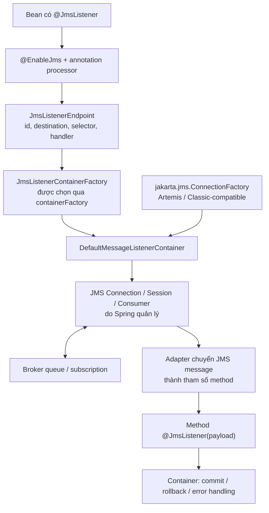

# `@JmsListener` và `DefaultJmsListenerContainerFactory`

> **Chương:** Spring JMS  
> **Ngữ cảnh:** Apache ActiveMQ Classic và Artemis trong ứng dụng Java/Spring. Bài này chỉ tập trung vào cơ chế đăng ký, cấu hình và vận hành **listener container** do Spring quản lý. Ví dụ chính dùng **Spring Boot 3.x / Spring Framework 6 / `jakarta.jms`** với broker **Artemis**; phần cuối chỉ ra ranh giới tương thích khi dùng **ActiveMQ Classic**.

Một chương trình JMS thuần thường tự tạo `Connection`, `Session`, `MessageConsumer`, gọi `setMessageListener()` và tự quản lý đóng/mở. Với Spring JMS, ta viết:

```java
@JmsListener(destination = "orders.in", containerFactory = "ordersListenerFactory")
public void receive(String payload) {
    orderService.process(payload);
}
```

Nhưng **annotation không trực tiếp mở TCP connection hoặc tự đặt transaction**. Spring đọc metadata của `@JmsListener`, tạo endpoint và sử dụng một `JmsListenerContainerFactory` để dựng **MessageListenerContainer**. Container mới sở hữu consumer, session, thread, vòng đời và việc commit/rollback theo cấu hình. Vì vậy, muốn biết message có được redeliver khi handler lỗi hay không, phải đọc **factory và transaction configuration**, không chỉ đọc method có annotation.

## 1. Cách `@JmsListener` trở thành consumer thực tế



Trong ví dụ, `ordersListenerFactory` là **tên bean của factory**; tên này không phải queue và cũng không phải bean consumer. `DefaultJmsListenerContainerFactory` là builder/cấu hình; container được dựng từ factory cho từng endpoint mới là đối tượng chạy.

### 1.1. Trách nhiệm của từng lớp

| Thành phần | Trách nhiệm | Không làm gì? |
|---|---|---|
| `@EnableJms` | Kích hoạt hạ tầng xử lý annotation listener. | Không tạo queue/server broker. |
| `@JmsListener` | Khai báo endpoint: destination, id, selector, concurrency, factory và metadata khác. | Không tự quyết định ack/rollback khi code ném exception. |
| `DefaultJmsListenerContainerFactory` | Cấu hình cách tạo `DefaultMessageListenerContainer`: connection factory, số consumer, transaction, error handler, recovery… | Không phải consumer đang chạy hay message store. |
| `DefaultMessageListenerContainer` | Quản lý session/consumer, nhận message, gọi handler, xử lý lỗi và lifecycle. | Không tự giao dịch nguyên tử với database ngoài JMS. |
| `JmsListenerEndpointRegistry` | Cho phép tìm container theo listener id, khởi động/dừng ở runtime. | Không thay đổi routing/retention của broker. |
| `JmsTemplate` | Thao tác gửi/nhận JMS từ code chủ động. | Không phải cơ chế nhận bất đồng bộ của `@JmsListener`. |

### 1.2. Điều gì xảy ra khi ứng dụng khởi động?

1. Spring tạo các bean cấu hình, tìm `@JmsListener` trên bean được quản lý.
2. Tạo endpoint tương ứng; xác định factory qua `containerFactory`. Nếu bỏ thuộc tính này, Spring tìm bean mặc định thường mang tên **`jmsListenerContainerFactory`**.
3. Factory tạo `DefaultMessageListenerContainer` và áp dụng cấu hình.
4. Container đăng ký vào registry/lifecycle; khi tự khởi động, nó thiết lập consumer và bắt đầu vòng nhận theo provider.
5. JMS message được adapter chuyển đổi sang kiểu tham số handler; xử lý xong/lỗi sẽ đi qua transaction và error handling của container.

**Không đưa `@JmsListener` trên đối tượng tạo thủ công bằng `new` rồi mong Spring tự scan.** Method phải nằm trong bean được Spring quản lý; lời gọi nội bộ thông thường tới method cũng không phải một lần nhận JMS.

## 2. `@JmsListener`: chọn đúng destination, id và factory

Một endpoint nhận queue được định nghĩa như sau:

```java
@Component
public class OrderListener {
    @JmsListener(
        id = "ordersConsumer",
        destination = "orders.in",
        containerFactory = "ordersListenerFactory")
    public void onOrder(String payload) {
        // Spring chuyển JMS TextMessage thành String theo converter phù hợp.
        System.out.println("Received " + payload);
    }
}
```

- **`id`** là tên logic của *listener container* trong registry. Đặt tên ổn định giúp vận hành dừng/chạy đúng endpoint.
- **`destination`** là tên đích JMS. Với ví dụ này là queue `orders.in`, không phải tên method hay bean.
- **`containerFactory`** là tên bean factory đã cấu hình. Nếu không chỉ định, annotation dùng factory mặc định; đừng mặc nhiên rằng cấu hình tùy biến ở bean tên khác sẽ được áp dụng.
- **`String payload`** được Spring chuyển từ `TextMessage` bằng message converter thông thường. Payload JSON không tự trở thành POJO nếu chưa cấu hình converter phù hợp.

### 2.1. Selector khác với lọc trong handler

```java
@JmsListener(
    id = "priorityOrders",
    destination = "orders.in",
    containerFactory = "ordersListenerFactory",
    selector = "priorityType = 'HIGH'")
public void highPriorityOnly(String payload) {
    processHighPriority(payload);
}
```

`processHighPriority` là hàm nghiệp vụ minh họa. Selector là **JMS selector syntax trên message properties**, không parse JSON body. Producer cần gắn property, ví dụ:

```java
jmsTemplate.convertAndSend("orders.in", "order-203", message -> {
    message.setStringProperty("priorityType", "HIGH");
    return message;
});
```

Nếu hai listener cùng tiêu thụ **một queue**, chúng có thể cạnh tranh nhận message phù hợp với selector. Selector không biến queue thành topic fan-out; cần thiết kế nhiều subscription queue riêng nếu mỗi service phải nhận bản sao độc lập.

### 2.2. Override concurrency cho một endpoint

```java
@JmsListener(
    id = "bulkOrders",
    destination = "orders.in",
    containerFactory = "ordersListenerFactory",
    concurrency = "1-3")
public void processBulk(String payload) {
    processOrder(payload);
}
```

Chuỗi `"1-3"` giới hạn dải concurrency cho **endpoint này** trên container phù hợp, ghi đè giá trị mặc định từ factory. Không nên gắn đồng thời cả `ordersConsumer`, `priorityOrders` và `bulkOrders` trong một lab rồi mong cả ba cùng nhận tất cả messages: nếu cùng đọc một queue, chúng trở thành competing consumers và có thể làm kết quả khó kiểm chứng.

### 2.3. Tham số method và conversion

Spring có thể ánh xạ `TextMessage` sang `String`, nhận `@Payload` và các JMS header/property được chuyển thành Spring Message headers. Ví dụ:

```java
@JmsListener(destination = "orders.in",
             containerFactory = "ordersListenerFactory")
public void receive(
        @Payload String payload,
        @Header(name = JmsHeaders.MESSAGE_ID, required = false)
        String jmsMessageId) {
    log.info("id={} payload={}", jmsMessageId, payload);
}
```

Các import tương ứng là `org.springframework.messaging.handler.annotation.Payload`, `org.springframework.messaging.handler.annotation.Header` và `org.springframework.jms.support.JmsHeaders`. Với custom POJO và JSON, phải cấu hình `MessageConverter` tương ứng (thường dùng converter JSON), kiểu dữ liệu/metadata và error strategy cho conversion failures. **Lỗi chuyển đổi xảy ra trước khi method handler được gọi** nhưng vẫn là lỗi của lượt xử lý listener; cấu hình session transaction/exception handling quyết định redelivery.

## 3. `DefaultJmsListenerContainerFactory`: bean cấu hình chứ không phải listener

Ví dụ khai báo trực tiếp:

```java
@Configuration
@EnableJms
public class ListenerConfiguration {
    @Bean("ordersListenerFactory")
    public DefaultJmsListenerContainerFactory ordersListenerFactory(
            ConnectionFactory connectionFactory) {
        DefaultJmsListenerContainerFactory factory =
                new DefaultJmsListenerContainerFactory();
        factory.setConnectionFactory(connectionFactory);
        factory.setPubSubDomain(false);          // Queue, không phải Topic.
        factory.setConcurrency("2-4");         // 2 core, tối đa 4 consumer.
        factory.setSessionTransacted(true);    // Local JMS transaction.
        factory.setReceiveTimeout(1000L);      // Poll timeout, milliseconds.
        factory.setRecoveryInterval(5000L);    // Recovery delay sau lỗi.
        factory.setErrorHandler(error ->
                LoggerFactory.getLogger(ListenerConfiguration.class)
                        .error("JMS listener failure", error));
        return factory;
    }
}
```

Thêm các import `jakarta.jms.ConnectionFactory`, `org.springframework.context.annotation.Bean`, `org.springframework.context.annotation.Configuration`, `org.springframework.jms.annotation.EnableJms`, `org.springframework.jms.config.DefaultJmsListenerContainerFactory` và `org.slf4j.LoggerFactory`. Đây là cấu hình **Java thuần dùng Spring JMS**; phần lab ở mục 6 sẽ đưa source hoàn chỉnh có thể chạy với Spring Boot 3.

**Cơ chế của các thuộc tính cần hiểu trước khi thay:**

| Cấu hình | Ý nghĩa | Hạn chế/lỗi hay gặp |
|---|---|---|
| `setConnectionFactory(...)` | Chọn Jakarta JMS provider để tạo connection. | Factory của Classic dùng `javax.jms` không thể gắn vào Spring JMS 6 `jakarta.jms`. |
| `setPubSubDomain(false)` | Nhận theo domain **queue**. | Không biến một address Artemis sai routing type thành queue hợp lệ. |
| `setConcurrency("2-4")` | Số concurrent consumer tối thiểu và tối đa; container có thể tăng/giảm theo tải. | Không bảo đảm thứ tự xử lý hoàn tất giữa nhiều consumer. |
| `setSessionTransacted(true)` | Container dùng JMS session transaction cho receive/ack. | **Không** tạo distributed transaction với database hoặc HTTP. |
| `setReceiveTimeout(1000L)` | Thời gian chờ của vòng receive khi không có message. | Không phải timeout cho code nghiệp vụ trong method listener. |
| `setRecoveryInterval(5000L)` | Khoảng nghỉ trước khi container thử phục hồi sau setup/connection failure. | Không phải redelivery delay của từng message trên broker. |
| `setErrorHandler(...)` | Nhận báo cáo các exception từ xử lý listener/container để log/alert. | **Không** phải nơi tự quyết định đã rollback hoặc commit; đừng chỉ nuốt exception trong handler. |

Các tham số `setConcurrency` và `setReceiveTimeout` áp dụng cho cách `DefaultMessageListenerContainer` tổ chức **receive loop**, không tạo một thread mới cho mỗi message. Một consumer/session có chuỗi xử lý tuần tự; muốn xử lý song song thì có nhiều consumer/session độc lập.

## 4. Ack, transaction và exception: ai quyết định redelivery?

Giả sử container nhận message M, chuyển body sang `String` và gọi `onOrder`. Có ba kết quả cần phân biệt:

```mermaid
sequenceDiagram
    participant B as Broker queue
    participant C as DefaultMessageListenerContainer
    participant H as @JmsListener handler
    participant DB as Business system
    B-->>C: deliver M
    C->>H: onOrder(payload)
    alt Nghiệp vụ xử lý thành công
        H->>DB: update business state
        DB-->>H: OK
        H-->>C: return
        C->>B: JMS session.commit()
    else RuntimeException từ handler
        H-->>C: throw exception
        C->>B: JMS session.rollback()
        Note over B,C: Message có thể redeliver<br/>theo broker policy
    else JMS transport/commit failure
        C-->>B: commit/receive không có kết quả chắc chắn
        Note over C,B: Connection recovery;<br/>delivery outcome có thể UNKNOWN
    end
```

Với **`setSessionTransacted(true)`**, container quản lý **local JMS transaction** quanh việc nhận message. Theo đường xử lý bình thường, handler hoàn tất thì container commit; handler ném exception thì container rollback (nếu session còn hoạt động). Trong code nghiệp vụ **không cần gọi `message.acknowledge()`, `session.commit()` hoặc `session.rollback()`**.

### 4.1. Ba kiểu handler và hậu quả

```java
@JmsListener(destination = "orders.in",
             containerFactory = "ordersListenerFactory")
public void dangerous(String payload) {
    try {
        updateOrder(payload);
    } catch (RemoteServiceUnavailable error) {
        log.error("Lỗi nghiệp vụ", error);
        // SAI nếu yêu cầu retry: return bình thường => container commit.
    }
}
```

`updateOrder` và `RemoteServiceUnavailable` là ví dụ nghiệp vụ giả định. Khi muốn broker thử lại lỗi tạm thời, handler cần **ném lỗi ra ngoài method** hoặc trả tín hiệu thất bại cho transaction manager; chỉ log rồi return không đủ.

```java
@JmsListener(destination = "orders.in",
             containerFactory = "ordersListenerFactory")
public void retryable(String payload) {
    updateOrder(payload); // Ném RuntimeException khi lỗi tạm thời.
    // Chỉ khi return bình thường, container mới đi đến commit JMS.
}
```

Trong trường hợp payload lỗi **vĩnh viễn**, không nên vô tình retry vô hạn. Có thể chủ động gửi một **rejection record** đến queue cách ly bằng cùng JMS local transaction và để handler hoàn tất, hoặc rollback và cho **max delivery attempts + DLQ policy** của broker quản lý. Hai mô hình cần được chọn rõ: nếu đã gửi rejection bằng transaction khác rồi vẫn rollback message gốc, có thể tạo hai bản lỗi.

### 4.2. `ErrorHandler` không phải cơ chế retry của từng message

`factory.setErrorHandler(...)` nhận Throwable mà container báo về để ghi log/alert. **ErrorHandler không tự động sửa payload, chuyển DLQ hoặc nâng `JMSXDeliveryCount`**. Quy tắc retry/redelivery phát sinh từ:

1. Session/transaction/ack mode của listener container.
2. Việc handler thành công, ném exception hay bị lỗi khi chuyển đổi message.
3. Chính sách redelivery/DLQ của provider/broker.

Nếu code xử lý bắt rồi **nuốt exception**, `ErrorHandler` có thể không nhận được gì từ lần xử lý đó. Nếu `ErrorHandler` ném thêm exception, không nên coi đó là cách portable để buộc broker redeliver; hãy để exception ở ranh giới handler/transaction được quản lý đúng.

### 4.3. `@Transactional` trên service không tự tạo XA

`setSessionTransacted(true)` chỉ áp dụng local transaction JMS trong container. Khi handler gọi database qua một `@Transactional` service dùng `DataSourceTransactionManager`, thứ tự có thể là:

```text
1. JMS session đang giữ message chưa commit.
2. @Transactional service commit DB thành công.
3. Handler return về DefaultMessageListenerContainer.
4. Container commit JMS => nếu mất kết nối ở đây, outcome chưa rõ.
5. Broker có thể redeliver, dù DB đã ghi.
```

**Không khẳng định “exactly once” chỉ vì cả hai lớp đều có transaction.** Với tài nguyên độc lập, cần business idempotency key, unique constraint/inbox/outbox hoặc một giải pháp transaction phối hợp thực sự hỗ trợ tất cả tài nguyên liên quan. Nếu cấu hình external transaction manager cho container, phải hiểu rõ transaction manager đó quản lý tài nguyên nào; không áp đồng thời nhiều chiến lược mâu thuẫn.

### 4.4. Vì sao `@Async` trong listener dễ gây sai ack?

```java
@JmsListener(destination = "orders.in",
             containerFactory = "ordersListenerFactory")
public void unsafeAsync(String payload) {
    executor.submit(() -> updateOrder(payload));
    // Method return ngay => container có thể commit trước khi task hoàn tất.
}
```

Nếu process chết sau khi method return nhưng trước khi task hoàn tất, JMS message có thể đã được commit. Đừng offload kiểu fire-and-forget rồi mong JMS container chờ. Hãy xử lý đồng bộ trong callback, hoặc thiết kế **một durable handoff riêng** và đặt ranh giới ack/commit ở đúng thời điểm.

## 5. Concurrency, lifecycle và recovery

### 5.1. Một queue, nhiều consumer không đồng nghĩa fan-out

Với `setConcurrency("2-4")`, container có thể tạo **nhiều JMS consumer/session độc lập** trên cùng queue. Broker phân phối message giữa các consumer theo điều kiện dispatch/prefetch; mỗi consumer không nhận toàn bộ queue như một subscriber của topic.

Hệ quả:

- Hai messages có thể được xử lý đồng thời và hoàn tất **khác thứ tự gửi**.
- Độ trễ xử lý dài ở một worker không nhất thiết chặn toàn bộ workers khác, nhưng downstream cần đủ capacity.
- Khi một consumer rollback, một consumer khác có thể nhận lần delivery tiếp theo.
- Prefetch/consumer window có thể làm phân phối không đều; tăng max concurrency không bảo đảm tăng tuyến tính throughput.
- Giới hạn concurrency nên khớp database connection pool, HTTP downstream, CPU, memory và khả năng xử lý trùng.

Nếu nghiệp vụ cần thứ tự tuyệt đối cho từng `orderId` hoặc `accountId`, cần đánh giá **message groups**, partitioning theo khóa hoặc cơ chế tuần tự hóa ở tầng nghiệp vụ; `concurrency="1-4"` không tự giữ thứ tự hoàn tất.

### 5.2. Registry và vòng đời container

Khi annotation có `id="ordersConsumer"`, có thể tìm container:

```java
@Component
public class ListenerAdmin {
    private final JmsListenerEndpointRegistry registry;

    public ListenerAdmin(JmsListenerEndpointRegistry registry) {
        this.registry = registry;
    }

    public void pause() {
        MessageListenerContainer container =
                registry.getListenerContainer("ordersConsumer");
        if (container == null) {
            throw new IllegalStateException("Listener id không tồn tại");
        }
        container.stop();
    }

    public void resume() {
        MessageListenerContainer container =
                registry.getListenerContainer("ordersConsumer");
        if (container == null) {
            throw new IllegalStateException("Listener id không tồn tại");
        }
        container.start();
    }
}
```

Import `org.springframework.jms.config.JmsListenerEndpointRegistry`, `org.springframework.jms.listener.MessageListenerContainer` và `org.springframework.stereotype.Component`. Dừng container **ngừng nhận thêm message**, không phải xóa queue hay chuyển backlog sang DLQ. Khi dùng stop/start trong production, gắn với readiness, shutdown timeout và cơ chế không làm mất transaction chưa hoàn tất.

### 5.3. Recovery interval khác redelivery delay

| Tình huống | Cơ chế liên quan | Điều cần cấu hình |
|---|---|---|
| Broker restart, TCP connection bị lỗi | `DefaultMessageListenerContainer` cố khôi phục connection/consumer theo `recoveryInterval` hoặc backoff. | Tài nguyên provider/client, retry interval, readiness và alert. |
| Handler ném lỗi nghiệp vụ, JMS transaction rollback | Broker/client quyết định redelivery; delay và max attempts nằm ở chính sách tương ứng. | `max-delivery-attempts`/`redelivery-delay` (Artemis) hoặc Classic redelivery policy. |
| Message hết TTL trước khi được xử lý | Broker expiry policy. | TTL, expiry address/queue; không liên quan trực tiếp recovery interval. |
| Container đang dừng theo lệnh vận hành | `stop()` và lifecycle của Spring. | Đợi handler đang chạy, không đóng resource bừa bãi từ thread nghiệp vụ. |

**`setRecoveryInterval(5000)` không có nghĩa mỗi poison message được thử lại sau đúng năm giây.** Nó áp dụng cho **recovery của consumer/container sau lỗi kết nối hoặc thiết lập**, không phải policy redelivery trên broker.

### 5.4. Spring Boot tự cấu hình factory và factory tùy biến

Với Spring Boot, khi có thư viện JMS, Boot thường tự tạo `ConnectionFactory`, `JmsTemplate` và có thể cấu hình factory listener mặc định dựa trên các properties. Khi tự khai báo bean `ordersListenerFactory` theo mẫu ở mục 3, **các tùy chọn bạn tự đặt trong bean này là nguồn cấu hình chính**; đừng mặc định mọi property `spring.jms.listener.*` đều đã được áp dụng cho bean riêng.

Nếu cần kế thừa các cấu hình mặc định từ Boot rồi ghi đè ít tùy chọn, có thể inject `DefaultJmsListenerContainerFactoryConfigurer` của Boot:

```java
@Bean("ordersListenerFactory")
DefaultJmsListenerContainerFactory ordersListenerFactory(
        ConnectionFactory connectionFactory,
        DefaultJmsListenerContainerFactoryConfigurer configurer) {
    DefaultJmsListenerContainerFactory factory =
            new DefaultJmsListenerContainerFactory();
    configurer.configure(factory, connectionFactory);
    factory.setSessionTransacted(true);
    factory.setConcurrency("2-4");
    return factory;
}
```

Import Boot tương ứng: `org.springframework.boot.autoconfigure.jms.DefaultJmsListenerContainerFactoryConfigurer`. **Chọn một trong hai cách** cấu hình factory (khai báo trực tiếp hoặc dùng configurer) thay vì tạo hai bean trùng tên. Khi ứng dụng có custom transaction manager, kiểm tra rõ loại transaction manager được configurer áp dụng; đừng giả định local JMS transaction và JTA luôn có cùng semantics.

## 6. Lab hoàn chỉnh: Spring Boot 3 + Artemis + `@JmsListener`

Mục tiêu là **quan sát container được Spring tạo từ factory, xử lý thành công được commit và lỗi handler được rollback rồi chuyển DLQ theo broker policy**. Ta dùng Java 17, Maven, Spring Boot **3.3.5** (một phiên bản minh họa, không phải tuyên bố mới nhất) và một **Artemis broker riêng** có acceptor JMS/Core tại `tcp://127.0.0.1:61616`.

Lab có ba source file Java:

```text
src/main/java/lab/springjms/
  ListenerLabApplication.java
  OrdersListenerConfiguration.java
  OrdersListener.java
src/main/resources/
  application.yml
pom.xml
```

### 6.1. Chuẩn bị topology trên Artemis

Trong `<artemis-instance>/etc/broker.xml`, thêm `<address-setting>` dưới **`<address-settings>` hiện hữu**:

```xml
<address-setting match="orders.in">
    <dead-letter-address>lab.DLA</dead-letter-address>
    <redelivery-delay>1000</redelivery-delay>
    <max-delivery-attempts>3</max-delivery-attempts>
</address-setting>
```

Và thêm hai address/queue **dưới `<addresses>` hiện hữu**:

```xml
<address name="orders.in">
    <anycast>
        <queue name="orders.in" durable="true"/>
    </anycast>
</address>

<address name="lab.DLA">
    <anycast>
        <queue name="lab.DLQ" durable="true"/>
    </anycast>
</address>
```

Đây là **snippet**, không phải `broker.xml` hoàn chỉnh. Dùng tên lab riêng để không đụng queue của production; đừng khai báo trùng các address/queue đã tồn tại. Khởi động lại broker lab theo quy trình hỗ trợ rồi kiểm tra queue binding:

| Address | Queue | Routing | Mục đích |
|---|---|---|---|
| `orders.in` | `orders.in` | ANYCAST | Listener xử lý đơn hàng. |
| `lab.DLA` | `lab.DLQ` | ANYCAST | Chứa message vượt giới hạn delivery. |

`max-delivery-attempts=3` thuộc **Artemis broker policy**, không phải `setRecoveryInterval(5000)` của Spring. Khi handler rollback liên tục, broker quyết định khi nào chuyển message sang `lab.DLA`. Nếu DLQ không có queue binding phù hợp, chỉ cấu hình dead-letter address chưa đủ để giữ message cho người vận hành.

### 6.2. Maven: starter Artemis theo Jakarta JMS

```xml
<project xmlns="http://maven.apache.org/POM/4.0.0"
         xmlns:xsi="http://www.w3.org/2001/XMLSchema-instance"
         xsi:schemaLocation="http://maven.apache.org/POM/4.0.0
                             https://maven.apache.org/xsd/maven-4.0.0.xsd">
    <modelVersion>4.0.0</modelVersion>

    <parent>
        <groupId>org.springframework.boot</groupId>
        <artifactId>spring-boot-starter-parent</artifactId>
        <version>3.3.5</version>
        <relativePath/>
    </parent>

    <groupId>lab.springjms</groupId>
    <artifactId>listener-container-lab</artifactId>
    <version>1.0-SNAPSHOT</version>

    <properties>
        <java.version>17</java.version>
    </properties>

    <dependencies>
        <dependency>
            <groupId>org.springframework.boot</groupId>
            <artifactId>spring-boot-starter-artemis</artifactId>
        </dependency>
    </dependencies>

    <build>
        <plugins>
            <plugin>
                <groupId>org.springframework.boot</groupId>
                <artifactId>spring-boot-maven-plugin</artifactId>
            </plugin>
        </plugins>
    </build>
</project>
```

Spring Boot quản lý version của các dependency qua BOM. `spring-boot-starter-artemis` cung cấp tích hợp Spring JMS và client Artemis phù hợp nhánh Boot; **không thêm đồng thời `activemq-client` của Classic dùng `javax.jms`** vào ví dụ Jakarta này. Nếu dùng broker Artemis ở release rất khác, cần kiểm tra khả năng tương thích của client/broker và JDK trước khi chạy.

### 6.3. `application.yml`

```yaml
spring:
  artemis:
    mode: native
    broker-url: tcp://127.0.0.1:61616
    user: ${ARTEMIS_USER}
    password: ${ARTEMIS_PASSWORD}

logging:
  level:
    lab.springjms: INFO
    org.springframework.jms.listener: INFO
```

Đặt biến môi trường `ARTEMIS_USER` và `ARTEMIS_PASSWORD` tương ứng với broker lab đang bật authentication. Không commit thông tin đăng nhập vào repository. `mode: native` yêu cầu **một broker đang chạy**, không tự khởi tạo embedded broker. Nếu broker dùng TLS, acceptor hoặc hostname khác, thay URI/properties và cấu hình bảo mật cho đúng môi trường.

### 6.4. Application: tạo producer mẫu bằng `JmsTemplate`

`src/main/java/lab/springjms/ListenerLabApplication.java`:

```java
package lab.springjms;

import org.springframework.boot.ApplicationRunner;
import org.springframework.boot.SpringApplication;
import org.springframework.boot.autoconfigure.SpringBootApplication;
import org.springframework.context.annotation.Bean;
import org.springframework.jms.core.JmsTemplate;

@SpringBootApplication
public class ListenerLabApplication {
    public static void main(String[] args) {
        SpringApplication.run(ListenerLabApplication.class, args);
    }

    @Bean
    ApplicationRunner demoProducer(JmsTemplate jmsTemplate) {
        return args -> {
            if (!args.containsOption("send-demo")) {
                return;
            }
            // JMS producer mặc định gửi PERSISTENT theo JMS QoS mặc định.
            jmsTemplate.convertAndSend("orders.in", "OK:order-1001");
            jmsTemplate.convertAndSend("orders.in", "FAIL:order-1002");
            System.out.println("Đã gửi hai message mẫu.");
        };
    }
}
```

Không tự tạo thread producer vô hạn trong `ApplicationRunner`. Đối với dữ liệu thực, phải đặt business idempotency key; lần gửi lại từ producer có thể tạo một JMS message khác cùng yêu cầu nghiệp vụ. Trong lab, hai payload chỉ dùng để phân biệt nhánh thành công và thất bại.

### 6.5. Cấu hình factory hoàn chỉnh

`src/main/java/lab/springjms/OrdersListenerConfiguration.java`:

```java
package lab.springjms;

import jakarta.jms.ConnectionFactory;
import org.slf4j.Logger;
import org.slf4j.LoggerFactory;
import org.springframework.context.annotation.Bean;
import org.springframework.context.annotation.Configuration;
import org.springframework.jms.annotation.EnableJms;
import org.springframework.jms.config.DefaultJmsListenerContainerFactory;

@Configuration
@EnableJms
public class OrdersListenerConfiguration {
    private static final Logger log =
            LoggerFactory.getLogger(OrdersListenerConfiguration.class);

    @Bean("ordersListenerFactory")
    public DefaultJmsListenerContainerFactory ordersListenerFactory(
            ConnectionFactory connectionFactory) {
        DefaultJmsListenerContainerFactory factory =
                new DefaultJmsListenerContainerFactory();
        factory.setConnectionFactory(connectionFactory);

        // Queue consumer dùng một local JMS transaction mỗi delivery.
        factory.setPubSubDomain(false);
        factory.setSessionTransacted(true);

        // Tối thiểu 2, có thể tăng tối đa 4 concurrent consumers.
        factory.setConcurrency("2-4");

        // Poll/connection recovery, KHÔNG phải redelivery delay.
        factory.setReceiveTimeout(1000L);
        factory.setRecoveryInterval(5000L);

        factory.setErrorHandler(error ->
                log.error("Lỗi khi xử lý JMS listener", error));
        return factory;
    }
}
```

Ở đây ta **không dùng Boot configurer** để người học thấy rõ từng thuộc tính đang áp dụng. Trong ứng dụng thực dùng chung các default property của Boot, có thể chọn biến thể `DefaultJmsListenerContainerFactoryConfigurer` ở mục 5.4; không khai báo lại bean trùng tên.

### 6.6. Handler thành công và handler thất bại

`src/main/java/lab/springjms/OrdersListener.java`:

```java
package lab.springjms;

import org.slf4j.Logger;
import org.slf4j.LoggerFactory;
import org.springframework.jms.annotation.JmsListener;
import org.springframework.stereotype.Component;

@Component
public class OrdersListener {
    private static final Logger log =
            LoggerFactory.getLogger(OrdersListener.class);

    @JmsListener(
        id = "ordersConsumer",
        destination = "orders.in",
        containerFactory = "ordersListenerFactory")
    public void handle(String payload) {
        log.info("Received {} on thread={}",
                payload, Thread.currentThread().getName());

        if (payload.startsWith("FAIL:")) {
            // Có chủ đích: exception thoát khỏi handler,
            // container rollback local JMS transaction.
            throw new IllegalStateException("Simulated transient failure");
        }
        if (!payload.startsWith("OK:")) {
            throw new IllegalArgumentException(
                    "Unsupported payload: " + payload);
        }
        // Mô phỏng nghiệp vụ thành công. Chưa gọi database/HTTP thật.
        log.info("Processed {}", payload);
        // Return bình thường: container commit local JMS transaction.
    }
}
```

Thí nghiệm này **cố tình cho `FAIL:order-1002` thất bại mãi** để quan sát redelivery/DLQ. Nó không phải chiến lược xử lý lỗi vĩnh viễn hoàn chỉnh; production cần phân loại retryable/permanent, giới hạn retry và theo dõi DLQ để xử lý thủ công hoặc sửa payload.

### 6.7. Chạy và quan sát

Trước khi chạy, xác nhận Artemis đã có queue `orders.in` và `lab.DLA::lab.DLQ`, broker đang hoạt động, quyền consume/send phù hợp và biến môi trường credential đúng. Chạy từ thư mục Maven:

```bash
mvn spring-boot:run "-Dspring-boot.run.arguments=--send-demo"
```

Ứng dụng Spring Boot khởi tạo container rồi `ApplicationRunner` gửi hai message. Với một source queue sạch và không có consumer ngoài lab, log có thể gần như:

```text
Đã gửi hai message mẫu.
Received OK:order-1001 on thread=...
Processed OK:order-1001
Received FAIL:order-1002 on thread=...
... Lỗi khi xử lý JMS listener ...
Received FAIL:order-1002 on thread=...
... Lỗi khi xử lý JMS listener ...
Received FAIL:order-1002 on thread=...
... Lỗi khi xử lý JMS listener ...
```

Không giả định thứ tự các dòng log giống hệt ví dụ: factory cho phép tối đa bốn consumer và các delivery có thể được xử lý song song. Kết quả chính cần kiểm chứng:

| Message | Handler | Container | Broker |
|---|---|---|---|
| `OK:order-1001` | Return bình thường. | Commit JMS local transaction. | Message không còn pending ở source queue sau commit. |
| `FAIL:order-1002` | Ném `IllegalStateException`. | Rollback JMS local transaction khi session hợp lệ. | Giao lại theo policy; hết số lần thử thì chuyển từ `orders.in` đến `lab.DLA`. |

Kiểm tra Artemis console/management: queue nguồn `orders.in`, queue DLQ `lab.DLQ` gắn với address `lab.DLA`, số lượt delivery và log lỗi. Khi broker chuyển message vào DLQ, **FQQN** để truy vấn queue chính xác là:

```text
lab.DLA::lab.DLQ
```

Có thể browse bằng `JmsTemplate` trong một thao tác vận hành có quyền phù hợp, ví dụ:

```java
jmsTemplate.browse("lab.DLA::lab.DLQ", (session, browser) -> {
    int count = 0;
    java.util.Enumeration<?> messages = browser.getEnumeration();
    while (messages.hasMoreElements()) {
        jakarta.jms.Message message =
                (jakarta.jms.Message) messages.nextElement();
        count++;
        System.out.println("Dead-letter id=" + message.getJMSMessageID());
    }
    System.out.println("DLQ count observed=" + count);
    return null;
});
```

Đoạn này là **snippet dùng tại nơi đã inject `JmsTemplate`**, không phải một class tự chạy. JMS `QueueBrowser` không consume/ack message nhưng enumeration không phải snapshot nguyên tử nếu có concurrent producers/consumers. Trên production không in payload nhạy cảm hoặc tự động replay mọi dead-letter message.

### 6.8. Thử một thay đổi để chứng minh vai trò transaction

Trên **broker lab riêng với queue sạch**, đổi:

```java
factory.setSessionTransacted(false);
```

Sau đó chạy lại với cùng payload, quan sát hành vi lỗi. **Không kỳ vọng exception từ handler sẽ tạo redelivery giống cấu hình transacted**. Đặc biệt, với `DefaultMessageListenerContainer` ở `AUTO_ACKNOWLEDGE`, provider/container có thể xác nhận message trước khi listener thực thi, nên exception từ handler không đủ để đòi broker giao lại. Đây là lý do ví dụ chính **bật transaction có chủ đích**, thay vì dựa vào giá trị ack mặc định.

Chỉ dùng thay đổi này để học cơ chế trên dữ liệu test. Trên production, không tắt transaction để giải quyết poison message vì có thể đánh mất yêu cầu xử lý nghiệp vụ chưa hoàn tất.

## 7. Chẩn đoán những lỗi thường gặp với `@JmsListener`

| Triệu chứng | Nơi kiểm tra đầu tiên | Nguyên nhân/cách sửa |
|---|---|---|
| Application chạy nhưng handler không bao giờ được gọi | `@EnableJms`, component scan, bean chứa `@JmsListener` và container có started không? | Annotation không được xử lý, class không phải Spring bean, listener chưa auto-start hoặc queue không có message phù hợp. |
| Khởi động lỗi “no bean named ordersListenerFactory” | `containerFactory` trong annotation và tên `@Bean`. | Factory được đặt tên khác, ở package không scan hoặc chưa tạo thành công. |
| Factory được tạo nhưng connect broker thất bại | `ConnectionFactory`, endpoint/port/TLS/credential, broker readiness. | Không nhầm Artemis acceptor với Classic connector; xem log recovery của container. |
| Queue có message nhưng không xử lý | Tên destination, quyền consume, routing, selector, competing consumers. | `@JmsListener` không tự tạo queue/server binding đúng nếu broker tắt auto-create. |
| Handler ném exception nhưng message không được giao lại | `sessionTransacted`, acknowledgment mode và handler có nuốt exception không? | Bật transaction đúng; không catch rồi return bình thường; kiểm tra max attempts/DLQ. |
| Log error lặp lại liên tục | Payload sai, dependency outage, redelivery attempts. | Phân loại lỗi, backoff, max attempts, DLQ; đừng vô hạn retry bên trong method. |
| Thêm concurrency nhưng throughput không tăng | DB/HTTP downstream, prefetch, CPU, session/consumer count. | Tăng số worker không giúp khi tài nguyên phía sau đã nghẽn. |
| Sau scale 2–4 consumer, đơn hàng xử lý sai thứ tự | Các message chạy đồng thời. | Dùng message groups/partitioning hoặc khóa nghiệp vụ; concurrency không bảo đảm thứ tự hoàn tất. |
| Container reconnect nhưng message vẫn pending | `recoveryInterval`, consumer count, broker authorization, transaction. | Recovery kết nối không sửa payload lỗi hay DLQ policy; xem cả broker resource state. |
| Message được xử lý ở DB hai lần | DB commit trước JMS commit; hoặc producer retry thành JMS message khác. | Dedupe theo business key và lưu side effect/idempotency atomically trong database. |
| `@Transactional` trên service nhưng JMS không rollback cùng DB | DB transaction manager khác với local JMS transaction. | Định nghĩa ranh giới hai hệ thống và cơ chế phối hợp/idempotency; không suy từ annotation tên giống nhau. |

### 7.1. Bộ chỉ số nên theo dõi

Một ứng dụng dùng Spring JMS listener nên xuất hoặc gom được:

- **Listener container state:** running/stopped, số lần recovery, số consumer hoạt động, cấu hình concurrency hiện hành.
- **Broker queue:** pending, delivering/in-flight, enqueue/dequeue, số consumer, message age.
- **Handler:** throughput, p50/p95/p99 processing latency, exception class và mã lỗi nghiệp vụ.
- **Reliability:** rollback, redelivery count, DLQ depth, session commit failure/unknown outcome.
- **Downstream:** connection-pool usage, HTTP timeout, DB transaction duration và duplicate business key.

Đừng xem mỗi chỉ số “ứng dụng Spring Boot còn chạy”: container có thể đang recovery, consumer có thể không còn quyền đọc queue hoặc handler có thể kẹt ở một request HTTP dù JVM vẫn sống.

## 8. Khi chọn ActiveMQ Classic thay vì Artemis

Spring JMS code ở tầng `@JmsListener`, `DefaultJmsListenerContainerFactory` và `JmsTemplate` **gần như giữ nguyên về mô hình**. Điểm không thể tùy tiện thay là **JMS API namespace và client provider**:

| Stack | Namespace trong ứng dụng | Provider/client | Điều phải rà soát |
|---|---|---|---|
| **Spring Boot 3 / Spring Framework 6 + Artemis** | `jakarta.jms.*` | `spring-boot-starter-artemis` với Artemis Jakarta client. | Address/queue routing, acceptor, redelivery policy/expiry/DLQ trên Artemis. |
| **Spring Boot 3 / Spring Framework 6 + ActiveMQ Classic** | `jakarta.jms.*` | `spring-boot-starter-activemq` và Classic client Jakarta-compatible do dependency management chọn. | Broker/client compatibility, URI OpenWire, Classic redelivery policy, `activemq.xml`. |
| **Spring Boot 2 / Spring Framework 5 + ActiveMQ Classic 5.x** | `javax.jms.*` | Classic client theo nhánh `javax.jms`. | Không copy nguyên package này sang Spring Framework 6. |

Đặc biệt, **`org.apache.activemq.ActiveMQConnectionFactory`** của Classic và **`org.apache.activemq.artemis.jms.client.ActiveMQConnectionFactory`** của Artemis là **hai implementation khác nhau** dù tên class ngắn giống nhau. Một client Classic dùng `javax.jms.ConnectionFactory` không thể inject vào factory Spring JMS 6 đang yêu cầu `jakarta.jms.ConnectionFactory`. Không sửa lỗi này bằng cast hoặc import tùy tiện; chọn dependency/provider đúng thế hệ.

Với Spring Boot 3 và Classic, ví dụ starter:

```xml
<dependency>
    <groupId>org.springframework.boot</groupId>
    <artifactId>spring-boot-starter-activemq</artifactId>
</dependency>
```

Và cấu hình endpoint theo dạng:

```yaml
spring:
  activemq:
    broker-url: tcp://127.0.0.1:61616
    user: ${ACTIVEMQ_USER}
    password: ${ACTIVEMQ_PASSWORD}
```

Chỉ **thay starter và provider configuration** trong một dự án đã kiểm tra tương thích, không dùng đồng thời cả hai starter như thể chúng chia sẻ một `ConnectionFactory`. Trên Classic, cấu hình queue/topic, KahaDB, flow control và redelivery/DLQ nằm trong hệ sinh thái Classic; không đặt các thuộc tính `address-settings` của Artemis vào `activemq.xml`.

## 9. Những quyết định production cần chốt

### 9.1. Một factory hay nhiều factory?

Một factory dùng chung tốt khi các endpoint có cùng yêu cầu về connection, transaction, concurrency và error strategy. Nên tạo **nhiều factory có tên riêng** nếu có khác biệt thực:

| Endpoint | Tính chất | Factory gợi ý |
|---|---|---|
| `orders.in` | Cần ack sau nghiệp vụ và idempotency. | `ordersListenerFactory`: transacted, concurrency có kiểm soát. |
| `audit.events` | Yêu cầu xử lý tuần tự và độ trễ ổn định. | `auditListenerFactory`: concurrency thấp, retry/DLQ phù hợp. |
| `notifications.ephemeral` | Có thể bỏ qua lỗi tạm thời và xử lý nhanh. | Factory khác với quy tắc ack/transaction được chấp thuận rõ. |

Không tạo factory riêng chỉ để đặt tên đẹp; mỗi factory làm tăng bề mặt cấu hình phải kiểm thử. Ngược lại, một factory transacted chung với `concurrency="2-20"` cho mọi workload có thể gây lỗi thứ tự và quá tải downstream.

### 9.2. Mẫu mã sai cần tránh

```java
@JmsListener(destination = "orders.in")
public void handler(String payload) {
    try {
        writeDatabase(payload);
    } catch (Exception problem) {
        log.error("Failed", problem);
        // Nuốt lỗi rồi return => container có thể commit message.
    }
}
```

Không để một `@JmsListener` vừa spawn tác vụ background, vừa trả về trước khi công việc hoàn tất. Không gọi thủ công `Session.commit()` trên session do container đang sở hữu. Không sửa `max-delivery-attempts` thành vô hạn chỉ để giữ lại poison message trong source queue; phải thiết kế queue DLQ và quy trình triage.

### 9.3. Khi dùng topic và durable subscription

`factory.setPubSubDomain(true)` đổi **domain JMS destination của container thành topic**; nó không tự tạo durable subscription, không xác định tên subscription/client ID và không làm tất cả consumer nhận backlog khi offline. Nếu bài toán là topic durable, cần thiết kế rõ `clientId`, `subscription`, durable/shared subscription và cấu hình provider/broker tương ứng; concurrency cao trên một durable subscription có các ràng buộc riêng theo JMS/provider. Đừng copy `setConcurrency("2-4")` từ queue vào một topic durable mà không kiểm thử.

## 10. Tự kiểm tra theo tình huống

**1.** Annotation chỉ có `@JmsListener(destination="orders.in")`. Cấu hình `ordersListenerFactory` có tự được dùng không?

**Không.** Nếu không chỉ định `containerFactory`, Spring dùng tên factory mặc định (thông thường `jmsListenerContainerFactory`). Phải đặt bean mặc định đúng tên hoặc chỉ định `containerFactory="ordersListenerFactory"`.

**2.** Handler gọi REST API, gặp lỗi và chỉ log rồi return. Trong factory `sessionTransacted=true`, broker có giao lại message không?

**Không nhất thiết, và thường là không.** Container thấy method kết thúc bình thường nên có thể commit JMS transaction. Phải ném exception hoặc định nghĩa xử lý thất bại rõ ràng.

**3.** Đặt `recoveryInterval=5000`. Có nghĩa một message bị rollback sẽ được giao lại sau 5 giây?

**Không.** Đây là khoảng khôi phục của container khi lỗi kết nối/setup. Delay của message thuộc redelivery policy của broker/client.

**4.** Dùng `@JmsListener(concurrency="2-4")` trên một queue. Hai consumer có cùng nhận mỗi message không?

**Không.** Chúng cạnh tranh tiêu thụ từ queue; message thông thường được giao cho một consumer tại một thời điểm, nhưng có thể redeliver nếu chưa commit/ack.

**5.** Handler Spring gọi service `@Transactional` ghi DB thành công; container JMS commit lỗi. Có thể xử lý lại mà không kiểm tra trạng thái DB không?

**Không.** DB commit và JMS commit là hai ranh giới riêng nếu không có transaction phối hợp. Dùng idempotency key và đối soát; không giả định lỗi commit đồng nghĩa chưa có side effect.

**6.** Spring Boot 3 dùng `jakarta.jms` nhưng classpath có client Classic `javax.jms` đời cũ. Có thể sửa bằng cách import cả hai không?

**Không.** Hai hệ API không type-compatible. Phải chọn client Jakarta-compatible và dependency starter phù hợp với Spring JMS 6, hoặc dùng stack Spring Framework 5/Boot 2 tương ứng nếu buộc dùng javax.

## 11. Ghi nhớ

**`@JmsListener` mô tả *listener nhận gì và handler là method nào*; `DefaultJmsListenerContainerFactory` quyết định *container nhận bằng cách nào*.** Khi nhận message, Spring quản lý connection/session/consumer, concurrency, transaction, error và lifecycle. Với queue công việc cần retry, một cấu hình trọng tâm là **`setSessionTransacted(true)`**, handler ném lỗi tạm thời ra ngoài, broker có redelivery/DLQ policy và nghiệp vụ có idempotency.

Khi triển khai ActiveMQ Classic hoặc Artemis, luôn xác nhận **đúng namespace Jakarta/Javax, ConnectionFactory, queue/routing và transaction boundary**. Một annotation gọn không có nghĩa độ tin cậy xuất hiện tự động; nó chỉ giúp bạn chuyển phần quản lý lifecycle từ code thủ công sang một container có cấu hình và hành vi phải được kiểm chứng.
