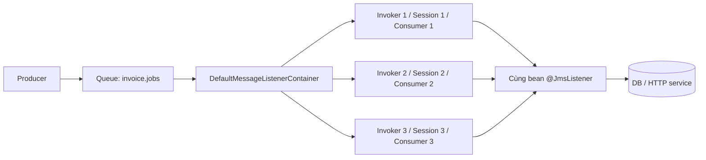
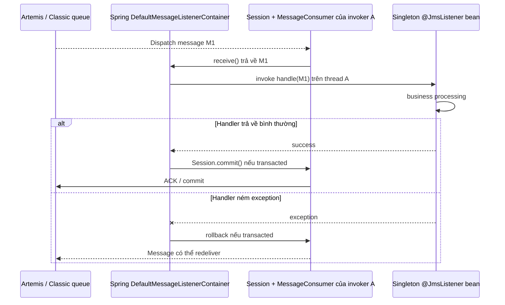

# Concurrency của listener và quan hệ với Session, thứ tự và tải

> **Chương:** Spring JMS  
> **Mô-đun:** `INTEGRATION_MESSAGING_MESSAGE_BROKER_ACTIVEMQ` — học cách dùng Apache ActiveMQ Classic và Artemis cho giao tiếp bất đồng bộ bằng queue/topic và JMS, với producer/consumer Java, acknowledgment, transaction, redelivery, DLQ, bảo mật và vận hành tin cậy.  
> **Mục tiêu riêng của bài:** Hiểu chính xác `@JmsListener` tạo **bao nhiêu JMS consumer/Session**, cách `DefaultMessageListenerContainer` co giãn concurrency, tác động lên thứ tự message, prefetch/window, throughput và tài nguyên; thực hành bằng Spring Boot với nhiều listener invoker rồi lựa chọn cấu hình **theo số đo**, thay vì chỉ tăng số thread.

## 1. Một phương thức listener không có nghĩa chỉ một consumer

Đoạn mã:

```java
@JmsListener(destination = "invoice.jobs")
public void handle(String payload) {
    process(payload);
}
```

là **một listener endpoint về mặt mã nguồn**. Spring tạo một **message listener container** đằng sau annotation đó. Container mới là thành phần quản lý JMS `Connection`, `Session`, `MessageConsumer`, lịch gọi handler, transaction, recovery và concurrency.

Khi đặt `concurrency="3-6"` cho `DefaultMessageListenerContainer`, container có thể mở **tối thiểu 3 và tối đa 6 consumer invoker** phục vụ một queue. Mỗi invoker đang chạy có một Session và MessageConsumer của riêng nó (trong cách triển khai native, cache được áp dụng theo cấu hình). Vì thế một **bean listener singleton** có thể nhận **nhiều lời gọi đồng thời** trên nhiều thread.



**Ba ranh giới cần tách rõ:**

- **Concurrency của Spring container**: số invoker đang nhận và chạy listener trên endpoint.
- **Concurrency của JMS**: một Session là ngữ cảnh xử lý tuần tự, nhưng **nhiều Session độc lập** có thể nhận song song từ cùng queue.
- **Concurrency của nghiệp vụ**: số transaction DB, HTTP call hoặc khóa nghiệp vụ có thể xử lý song song; thường nhỏ hơn hoặc bằng tổng concurrency đã cấu hình, và có thể thấp hơn đáng kể nếu downstream nghẽn.

Thêm thread listener **không** khiến một Session trở thành thread-safe, cũng không làm một job chạy nhanh hơn nếu nó bị khóa DB hoặc rate limit của dịch vụ ngoài.

## 2. Spring sử dụng Session ra sao khi tăng concurrency?

### 2.1. Đường đi của một delivery



Với `DefaultMessageListenerContainer`, logic nhận message thường chạy theo vòng `MessageConsumer.receive()` của các **listener invoker task**. Dưới `Session` của một invoker, delivery và callback được xử lý tuần tự. Nếu có 4 invoker, có thể có 4 message **đang xử lý cùng lúc**, mỗi message thuộc một Session khác nhau.

```text
Invoker A / Session A: receive M1 -> handle M1 -> commit -> receive M5
Invoker B / Session B: receive M2 -> handle M2 -> commit -> receive M6
Invoker C / Session C: receive M3 -> handle M3 -> commit -> receive M7
Invoker D / Session D: receive M4 -> handle M4 -> commit -> receive M8
```

**Không phải mỗi message mở một Session mới** trong cấu hình caching native phổ biến. Container có thể tái sử dụng các JMS resource của invoker; khi failover, đổi cache level hoặc dùng transaction manager bên ngoài, vòng đời resource có thể khác. Thread name và `System.identityHashCode(session)` chỉ hữu ích **quan sát phiên hiện tại**, không được dùng làm định danh nghiệp vụ ổn định.

### 2.2. Session không dùng đồng thời từ nhiều thread

JMS `Session` là ngữ cảnh xử lý **single-threaded**. Mô hình đúng là:

```text
Consumer A -> Session A -> thread A -> handle(job X)
Consumer B -> Session B -> thread B -> handle(job Y)
```

Mô hình không đúng:

```text
Consumer A -> Session A -> share Session A cho ThreadPool(16)
                                   -> nhiều thread commit / receive đồng thời
```

Không lưu `Session` được Spring inject vào field của singleton rồi gọi từ `CompletableFuture` khác. Với listener nhận `Session` qua tham số method, quyền sử dụng Session đó gắn với **lời gọi hiện tại** và vòng đời do container quản lý.

**Bẫy singleton bean:** DMLC gọi cùng instance của bean trên nhiều invoker. Biến field như `currentOrderId`, `ArrayList`, `SimpleDateFormat` hoặc bộ đếm `long` không đồng bộ dễ race. Nên để biến xử lý ở phạm vi method; muốn thống kê dùng `LongAdder`/Micrometer; trạng thái nghiệp vụ dùng database/transaction chứ không dùng field trong listener.

### 2.3. Spring container quyết định ACK/rollback

Với factory đặt `setSessionTransacted(true)`, Spring gọi commit **sau khi phương thức listener trả về bình thường**, và rollback khi listener ném exception phù hợp.

```java
@JmsListener(destination = "invoice.jobs", containerFactory = "workQueueFactory")
public void handle(String payload) {
    invoiceService.process(payload); // phải đồng bộ hoàn thành
    // KHÔNG gọi session.commit() tại đây.
    // Khi handler trả về bình thường, container commit JMS Session.
}
```

Nếu listener bắt lỗi, chỉ log rồi `return`, container có thể **commit message bị xử lý lỗi**:

```java
@JmsListener(destination = "invoice.jobs", containerFactory = "workQueueFactory")
public void broken(String payload) {
    try {
        process(payload);
    } catch (Exception ex) {
        log.error("Failed", ex);
        // Sai nếu muốn retry: handler trả về bình thường => JMS commit.
    }
}
```

Giải pháp là **để exception lan ra** (hoặc ném exception nghiệp vụ tương ứng) khi cần rollback. Phân biệt lỗi **retryable** với malformed/poison message; một lỗi vĩnh viễn cần chính sách DLQ/quarantine và cảnh báo, không vòng rollback vô hạn.

**Quan trọng:** `sessionTransacted=true` chỉ bao phủ **JMS local transaction** trong Session. Ghi PostgreSQL, gọi HTTP thanh toán và JMS commit **không tự thuộc một transaction nguyên tử**. Nếu DB commit thành công nhưng JVM chết trước JMS commit, message có thể được giao lại cho invoker khác; cần `eventId` ổn định, inbox/idempotency và ràng buộc unique trong DB.

## 3. `concurrency`: cố định, co giãn và phạm vi thực tế

### 3.1. Cấu hình bằng `DefaultJmsListenerContainerFactory`

Ví dụ Spring Java config:

```java
@Configuration
@EnableJms
public class JmsConfig {

    @Bean
    public DefaultJmsListenerContainerFactory workQueueFactory(
            ConnectionFactory connectionFactory) {
        var factory = new DefaultJmsListenerContainerFactory();
        factory.setConnectionFactory(connectionFactory);
        factory.setPubSubDomain(false); // queue, không phải topic
        factory.setSessionTransacted(true);
        factory.setConcurrency("2-5");
        factory.setReceiveTimeout(1000L);
        return factory;
    }
}
```

`setConcurrency("2-5")` tương đương cấu hình **`concurrentConsumers=2` và `maxConcurrentConsumers=5`** của `DefaultMessageListenerContainer`. Số invoker thật có thể là 2, 3, 4 hoặc 5 tùy tải và khả năng scheduling, **không phải luôn 5**.

Ba cách thiết lập thường gặp:

| Cách | Kết quả mong đợi | Lưu ý |
| --- | --- | --- |
| `setConcurrency("1")` | Một consumer invoker (min = max = 1) | Phù hợp thử so sánh ordering/throughput baseline |
| `setConcurrency("4")` | **Từ 1 đến 4 consumer**; số đơn lẻ là giới hạn trên | Không dùng khi muốn cố định bốn consumer |
| `setConcurrency("4-4")` | **Bốn consumer cố định** (min = max = 4) | Không bảo đảm xử lý theo thứ tự hoàn tất |
| `setConcurrency("2-5")` | Ít nhất hai, tối đa năm invoker khi có tải | Tăng/giảm động; phụ thuộc `receiveTimeout`, idle/task scheduling |

Một listener có thể override factory:

```java
@JmsListener(
    destination = "invoice.jobs",
    containerFactory = "workQueueFactory",
    concurrency = "1"
)
public void strictlySingleInvoker(String event) {
    // concurrency="1" ở annotation override giá trị mặc định của factory.
}
```

**Không triển khai đồng thời ví dụ `strictlySingleInvoker` và handler cùng queue ở trên khi đang đo một endpoint**, vì chúng trở thành **hai competing listener containers**, làm khó giải thích số consumer và kết quả phân phối.

Có thể dùng placeholder cho annotation, chẳng hạn `concurrency = "${app.jms.listener-concurrency:2-5}"`; cấu hình ở annotation sẽ **ưu tiên hơn** concurrency mặc định trong factory.

### 3.2. `DefaultMessageListenerContainer` khác `SimpleMessageListenerContainer`

| Tiêu chí | DefaultMessageListenerContainer (DMLC) | SimpleMessageListenerContainer |
| --- | --- | --- |
| Tiếp nhận | Polling `MessageConsumer.receive()` qua invoker tasks | Đăng ký JMS `MessageListener` qua `setMessageListener()` |
| Consumer count | Có min/max và khả năng co giãn động | Số consumer cố định theo cấu hình |
| External/JTA transaction | Có thể phối hợp với transaction manager thích hợp | Không cung cấp khả năng tương đương DMLC |
| Native local JMS transaction | Có, `sessionTransacted=true` | Có |
| Recovery | Có vòng recovery/reconnect điều khiển được | Ít linh hoạt hơn |
| Thường dùng | Queue worker cần điều chỉnh concurrency, reliability | Trường hợp đơn giản và fixed listeners |

Đừng suy ra “Simple nhanh hơn nên tốt hơn” từ tên class. Với bài toán workload biến động, queue concurrency và khả năng recovery, DMLC là lựa chọn thông dụng. Cũng đừng dùng thread count của executor như **thước đo duy nhất**: cần xem **active/scheduled consumers** và số session/consumer thật trên broker.

### 3.3. Dynamic scaling không tức thời

Khi đặt `2-5`, Spring phải nhận thấy có đủ công việc để lên lịch **surplus consumer invoker**; khi ít message, các surplus invoker có thể dừng theo giới hạn idle. Hành vi chịu ảnh hưởng của:

- `receiveTimeout`: một lần poll chờ bao lâu khi queue không có message.
- `idleTaskExecutionLimit`, `idleReceivesPerTaskLimit`: tiêu chí coi một task đã idle và rút surplus consumer.
- `maxMessagesPerTask` và `TaskExecutor`: số lần receive trên một task và cách task được lập lịch.
- Việc broker có message **ready để dispatch** hay đã cấp trước vào client khác.
- Session/consumer cache và thời gian tạo kết nối.

Không sửa tất cả tham số trong lần tuning đầu. Đặt `setConcurrency("2-5")` và `setReceiveTimeout(1000L)` trước, sau đó ghi **số consumer thực** trên broker và `getActiveConsumerCount()`/`getScheduledConsumerCount()` khi thử burst.

### 3.4. Có nhiều replica thì concurrency cộng theo replica

Nếu triển khai 3 pod và mỗi pod có `concurrency="2-5"`:

```text
                 Một queue: invoice.jobs
                  /        |         \
           Pod A        Pod B       Pod C
          2..5 invokers 2..5       2..5

Tổng min cấu hình ≈ 3 × 2 = 6 consumers
Tổng max cấu hình ≈ 3 × 5 = 15 consumers
```

Đây là **giới hạn cấu hình**, không phải cam kết broker luôn thấy 6–15 consumer tại mọi thời điểm: pod có thể restart, không kết nối được hoặc resource bị giới hạn. Nếu tăng thêm 5 replica mà quên mỗi replica có max=10, số kết nối JMS/DB có thể vượt ngân sách rất nhanh.

## 4. Thứ tự: mỗi Session tuần tự, cả queue thì không

### 4.1. Một queue FIFO vẫn không có global completion ordering với nhiều consumer

Giả sử broker giao lần lượt `M1, M2, M3`:

```text
t=0 ms   Consumer A nhận M1 (xử lý 200 ms)
t=1 ms   Consumer B nhận M2 (xử lý 20 ms)
t=2 ms   Consumer C nhận M3 (xử lý 30 ms)

t=21ms   B commit M2
t=32ms   C commit M3
t=200ms  A commit M1
```

**Thứ tự dispatch** có thể là M1 → M2 → M3, nhưng **thứ tự hoàn tất** là M2 → M3 → M1. Càng nhiều Session độc lập, khả năng các job hoàn tất đảo thứ tự càng lớn. Queue còn có priority, redelivery, expiry, selectors, prefetch và producer đa luồng làm thứ tự quan sát thêm phức tạp.

**Một Session tuần tự** chỉ đảm bảo invoker không đồng thời chạy hai callback trên chính Session đó. Nó **không** bảo đảm thứ tự nghiệp vụ toàn cục khi tồn tại nhiều Session hoặc khi producer không gửi đúng thứ tự.

### 4.2. Nếu cần thứ tự theo `orderId`: gắn `JMSXGroupID`

ActiveMQ Classic và Artemis hỗ trợ **message groups**. Producer gắn `JMSXGroupID` là khóa nghiệp vụ:

```java
TextMessage m = session.createTextMessage("OrderChanged");
m.setStringProperty("JMSXGroupID", tenantId + ":" + orderId);
m.setIntProperty("aggregateVersion", version);
producer.send(m);
```

Broker cố giữ các message cùng group vào một consumer owner trong cùng queue, còn những group khác có thể phân sang consumer khác. Ví dụ:

```text
ORDER-101 seq=1,2,3 -> Consumer A (Session A)
ORDER-202 seq=1,2   -> Consumer B (Session B)
ORDER-303 seq=1,2   -> Consumer C (Session C)
```

**Giới hạn cần nắm:**

- `JMSXGroupID` là **affinity/routing**, không tự **sắp lại** message nếu producer đưa seq=3 vào broker trước seq=2.
- `JMSXGroupSeq` dương là metadata, broker không tự chờ đủ số; giá trị âm như `-1` dùng để **đóng group**, khiến owner có thể được chỉ định lại.
- Rebalance, consumer crash, redelivery hoặc group map eviction có thể đổi owner; xử lý nghiệp vụ cần idempotency và kiểm tra `aggregateVersion` ở DB.
- Một group “nóng” có nhiều message bị giới hạn bởi một owner; thêm consumer không tăng throughput cho riêng group đó.

### 4.3. Queue và topic có semantics concurrency khác nhau

Với **queue**, nhiều consumers là competing consumers: mỗi **delivery** được giao cho một consumer ở một thời điểm (có thể redeliver khi lỗi).

Với **topic và các subscription thường, độc lập**, nhiều consumer có thể **mỗi người nhận một bản của cùng publication**. Spring DMLC cảnh báo không tăng concurrency cho topic nếu chưa có cơ chế vendor/JMS shared subscription phù hợp, vì không nên dùng topic subscribers thông thường như một worker pool queue.

Nếu cần cả fan-out sang Billing/Analytics **và** mỗi nhóm có nhiều worker, hãy thiết kế **subscription queue riêng cho từng nhóm** (ví dụ Artemis MULTICAST queue; Classic virtual topic) rồi cho worker bên trong mỗi nhóm **compete trên queue của nhóm**. Với shared durable subscription, cần cấu hình client/subscription identity và provider support; không chỉ tăng `concurrency` trong factory mà mặc nhiên thành shared group.

## 5. Tải và buffering: concurrency không thay thế prefetch/window

### 5.1. Khi broker đã dispatch trước rất nhiều message

```text
Broker queue có 200 jobs
  -> Consumer A nhận trước 150 message vào client prefetch
  -> Consumer B nhận 50 message
  -> A xử lý chậm
  -> B xử lý xong phần của mình và có thể rảnh
```

Tăng số invoker Spring từ 2 lên 8 không nhất thiết giải phóng ngay 150 message đã được **dispatch vào buffer của consumer A**. Cần hiểu cơ chế cấp trước của provider.

| Broker/client | Cơ chế lấy trước | Giá trị giảm buffer để thử | Đơn vị |
| --- | --- | --- | --- |
| **ActiveMQ Classic + OpenWire** | `consumer.prefetchSize` hoặc `ActiveMQPrefetchPolicy` | `queuePrefetch=1` cho job xử lý chậm | **Số message** |
| **ActiveMQ Artemis Core client** | `consumerWindowSize` | `0` (không prebuffer), hoặc 64 KiB để thử | **Byte window/credits** |

**Không đặt `consumerWindowSize=1` rồi nói tương đương “prefetch một message”**. Artemis window dương đo byte và message metadata/protocol làm số lượng message không cố định.

Một số tình huống điển hình:

- Job xử lý lâu, kích thước biến thiên, worker tốc độ khác nhau: thử **Classic prefetch nhỏ** hoặc **Artemis consumerWindowSize=0**.
- Job xử lý cực nhanh, cùng kích thước, round-trip broker đắt: thử window/prefetch lớn hơn để tăng throughput.
- Có `JMSXGroupID`: owner của group đang pinned; giảm buffering **không tự di chuyển group** đã gán.
- Consumer commit theo batch lớn: nhiều message đã nhận nhưng chưa ACK; nên kiểm soát transaction boundary trước khi đo prefetch.

### 5.2. Concurrency làm tăng tài nguyên phía broker lẫn downstream

Tăng từ 2 lên 8 invoker có thể tăng:

- JMS `Session` / `MessageConsumer` và các resource quản lý tại broker.
- Số message **in-flight** và tổng client buffer.
- Số connection tới DB nếu mỗi handler giữ một JDBC connection khi xử lý.
- HTTP requests đồng thời tới downstream, nguy cơ 429/rate limit.
- Transaction contention, lock wait và số lần rollback/redelivery.
- Số thread/JVM memory của listener invokers.

Nếu DB connection pool chỉ có 8 connection nhưng tổng concurrency listener của các instance là 30, nhiều invoker có thể chỉ ngồi chờ DB. Vì vậy số **ACK/giây** có thể không tăng, còn queue age p95/p99 và timeout lại tăng.

## 6. Ước lượng số consumer bằng số liệu

Giả sử message vào queue với tốc độ `λ` và một invoker cần trung bình `S` giây **bao gồm business processing và commit**. Với worker tuần tự và các tác vụ gần độc lập, năng lực danh nghĩa mỗi invoker là `1/S` message/giây.

Với mục tiêu mức sử dụng `ρ_target` nhằm để dư địa cho burst:

\[
N_{\mathrm{start}}=\left\lceil\frac{\lambda S}{\rho_{\mathrm{target}}}\right\rceil.
\]

Ví dụ:

```text
Tốc độ đến λ = 80 msg/s
Mean service+commit S = 0,05 s/msg
Mức dùng mục tiêu ρ_target = 0,7

N_start = ceil(80 × 0,05 / 0,7) = ceil(5,714...) = 6 consumers
```

Đây là **ước lượng bắt đầu**, không phải chứng minh đạt SLA:

1. Phải đo **mean service time** trong thời gian đủ dài, không lấy p95 làm trung bình.
2. `λ` cần dựa trên tải cao điểm có ý nghĩa; nếu burst nhanh trong 20 giây, số consumer cực lớn có thể không kinh tế bằng buffer + SLA queue age.
3. Khi DB/API bị giới hạn, `S` tăng theo concurrency; công thức “N × throughput một worker” không còn đúng.
4. `maxConcurrentConsumers` là trần chứ không phải N hoạt động mọi lúc; dynamic scaling có độ trễ.
5. Nếu group có một khóa quá nóng, năng lực của khóa đó vẫn xấp xỉ một worker bất kể N.

Đo **enqueue/s – ACK/s**, `queue age p95/p99`, `delivering/inFlight` và **p95 thời gian xử lý** cùng lúc. Không chỉ tối ưu “max concurrency” hoặc CPU utilization.

### 6.1. Ma trận thực nghiệm (số liệu giả định)

| Test | `concurrency` | Artemis window | ACK/s quan sát | Queue age p95 | In-flight peak | DB pool | Kết luận ban đầu |
| --- | --- | ---: | ---: | ---: | ---: | ---: | --- |
| A | `1` | 1 MiB | 20 | 35 s | 150 | 15% | Thiếu năng lực |
| B | `2` | 1 MiB | 39 | 15 s | 260 | 30% | Gần tuyến tính |
| C | `2-6` | 1 MiB | 72 | 5,5 s | 450 | 65% | Tăng tốt nhưng buffer lớn |
| D | `2-6` | 0 B | 70 | 3,8 s | 7 | 62% | Fairness tốt hơn, throughput giảm nhẹ |
| E | `4-10` | 0 B | 73 | 4,2 s | 13 | 98% | DB gần bão hòa, không đáng tăng |

**Đây là số liệu minh họa cách đọc bảng, không phải benchmark đã chạy.** Test D có thể phù hợp hơn C nếu SLO tập trung vào queue age và chi phí thấp; test E tăng trần concurrency nhưng hầu như không tăng ACK/s. Tất cả so sánh phải giữ nguyên message size, producer rate, transaction mode, số replica, phần xử lý nghiệp vụ và tài nguyên broker.

## 7. Thực hành có thể chạy: Spring Boot, Artemis và nhiều listener invoker

Dự án sử dụng **Java 17**, **Spring Boot 3.5.6**, starter Artemis cho namespace `jakarta.jms` và broker Artemis **native** riêng ở `tcp://127.0.0.1:61616`. Phiên bản ở đây **cố định để tái lập ví dụ**, không khẳng định là bản mới nhất. Dùng hai profile:

- `worker`: tạo `@JmsListener` với concurrency có thể điều chỉnh.
- `seed`: gửi nhiều job xen kẽ giữa các nhóm `orderId` qua **một JMS Session và một MessageProducer** để dễ quan sát.

### 7.1. Cấu hình Artemis broker

Thêm `<address>` sau vào phần `<addresses>` đã tồn tại trong `broker.xml` của **broker lab**:

```xml
<addresses>
  <address name="lab.spring.jobs">
    <anycast>
      <queue name="lab.spring.jobs">
        <durable>true</durable>
      </queue>
    </anycast>
  </address>
  <address name="lab.spring.DLQ">
    <anycast>
      <queue name="lab.spring.DLQ"/>
    </anycast>
  </address>
</addresses>
```

Và một policy retry trong `<address-settings>` **hiện có**:

```xml
<address-settings>
  <address-setting match="lab.spring.jobs">
    <redelivery-delay>1000</redelivery-delay>
    <max-delivery-attempts>5</max-delivery-attempts>
    <dead-letter-address>lab.spring.DLQ</dead-letter-address>
  </address-setting>
</address-settings>
```

**Hai block XML là trích đoạn:** chỉ gộp `<address>` / `<address-setting>` vào section tương ứng; không tạo section trùng trong file thật. Broker lab cần persistence khi dùng persistent messages, acceptor Artemis Core và tài khoản được quyền SEND/CONSUME. Không sử dụng queue thật để cố tình thử lỗi/rollback.

### 7.2. Maven `pom.xml`

```xml
<project xmlns="http://maven.apache.org/POM/4.0.0"
         xmlns:xsi="http://www.w3.org/2001/XMLSchema-instance"
         xsi:schemaLocation="http://maven.apache.org/POM/4.0.0 https://maven.apache.org/xsd/maven-4.0.0.xsd">
  <modelVersion>4.0.0</modelVersion>
  <parent>
    <groupId>org.springframework.boot</groupId>
    <artifactId>spring-boot-starter-parent</artifactId>
    <version>3.5.6</version>
    <relativePath/>
  </parent>
  <groupId>example.messaging</groupId>
  <artifactId>spring-jms-concurrency-lab</artifactId>
  <version>1.0.0</version>
  <properties>
    <java.version>17</java.version>
  </properties>
  <dependencies>
    <dependency>
      <groupId>org.springframework.boot</groupId>
      <artifactId>spring-boot-starter-artemis</artifactId>
    </dependency>
  </dependencies>
  <build>
    <plugins>
      <plugin>
        <groupId>org.springframework.boot</groupId>
        <artifactId>spring-boot-maven-plugin</artifactId>
      </plugin>
    </plugins>
  </build>
</project>
```

Starter cung cấp Spring JMS và Artemis Jakarta client tương thích theo dependency management của Boot; **không thêm cùng lúc client Classic `javax.jms`** vào dự án này.

### 7.3. `src/main/resources/application.yml`

```yaml
spring:
  application:
    name: spring-jms-concurrency-lab
  artemis:
    mode: native
    broker-url: "${BROKER_URL:tcp://127.0.0.1:61616?consumerWindowSize=0}"
    user: "${BROKER_USER}"
    password: "${BROKER_PASSWORD}"

app:
  jms:
    queue: lab.spring.jobs
    concurrency: "${LISTENER_CONCURRENCY:2-4}"
    receive-timeout-ms: 1000
  worker:
    delay-ms: "${WORKER_DELAY_MS:150}"
    fail-first-seq: "${FAIL_FIRST_SEQ:0}"
  seed:
    count: "${SEED_COUNT:60}"
    groups: "${SEED_GROUPS:6}"
```

Giải thích:

- `mode: native` yêu cầu kết nối **broker Artemis chạy riêng**, không dùng embedded broker.
- `consumerWindowSize=0` là điểm xuất phát để không prebuffer phía Artemis client khi học phân phối. Để so sánh, thay bằng `1048576` (khoảng 1 MiB).
- `LISTENER_CONCURRENCY=2-4` điều khiển **đúng một listener container trong một JVM**. Nếu chạy nhiều JVM profile `worker`, tổng consumer phải tính qua tất cả.
- Credential lấy từ environment; không đưa password thật vào repository.

### 7.4. Java: main và listener factory

`src/main/java/example/messaging/SpringJmsLabApplication.java`:

```java
package example.messaging;

import org.springframework.boot.SpringApplication;
import org.springframework.boot.autoconfigure.SpringBootApplication;

@SpringBootApplication
public class SpringJmsLabApplication {
    public static void main(String[] args) {
        SpringApplication.run(SpringJmsLabApplication.class, args);
    }
}
```

`src/main/java/example/messaging/JmsListenerConfig.java`:

```java
package example.messaging;

import jakarta.jms.ConnectionFactory;

import org.springframework.beans.factory.annotation.Value;
import org.springframework.boot.jms.ConnectionFactoryUnwrapper;
import org.springframework.context.annotation.Bean;
import org.springframework.context.annotation.Configuration;
import org.springframework.jms.annotation.EnableJms;
import org.springframework.jms.config.DefaultJmsListenerContainerFactory;

@Configuration(proxyBeanMethods = false)
@EnableJms
public class JmsListenerConfig {

    @Bean("workQueueFactory")
    DefaultJmsListenerContainerFactory workQueueFactory(
            ConnectionFactory connectionFactory,
            @Value("${app.jms.concurrency:2-4}") String concurrency,
            @Value("${app.jms.receive-timeout-ms:1000}") long receiveMs) {

        var factory = new DefaultJmsListenerContainerFactory();

        // Spring Boot có thể bọc CachingConnectionFactory cho JmsTemplate.
        // DMLC tự quản lý/cache JMS sessions và recovery; dùng factory gốc.
        factory.setConnectionFactory(
                ConnectionFactoryUnwrapper.unwrapCaching(connectionFactory));
        factory.setPubSubDomain(false); // chỉ nhận từ queue
        factory.setSessionTransacted(true);
        factory.setConcurrency(concurrency);
        factory.setReceiveTimeout(receiveMs);
        return factory;
    }
}
```

`ConnectionFactoryUnwrapper.unwrapCaching(...)` có trong Spring Boot **3.4.1+**, vì vậy phù hợp phiên bản Boot 3.5.6 đã pin. Việc tháo wrapper caching là để DMLC có quyền quản lý vòng đời kết nối/recovery; `JmsTemplate` phía seed vẫn có thể dùng factory caching do Boot cung cấp.

**Không cài thêm `JmsTransactionManager` chỉ vì muốn `sessionTransacted=true`.** Local JMS Session transaction đã đủ cho consumer demo. Nếu ứng dụng có JTA/XA hoặc local DB transaction, phải thiết kế transaction boundary riêng; đừng cấu hình hai transaction manager chồng chéo mà chưa rõ ràng.

### 7.5. Java: listener đồng thời trên **một bean**

`src/main/java/example/messaging/JobWorker.java`:

```java
package example.messaging;

import jakarta.jms.JMSException;
import jakarta.jms.Session;
import jakarta.jms.TextMessage;

import org.springframework.beans.factory.annotation.Value;
import org.springframework.context.annotation.Profile;
import org.springframework.jms.annotation.JmsListener;
import org.springframework.stereotype.Component;

@Component
@Profile("worker")
public class JobWorker {

    private final long delayMs;
    private final int failFirstSeq;

    public JobWorker(
            @Value("${app.worker.delay-ms:150}") long delayMs,
            @Value("${app.worker.fail-first-seq:0}") int failFirstSeq) {
        this.delayMs = delayMs;
        this.failFirstSeq = failFirstSeq;
    }

    @JmsListener(
        id = "invoiceWorker",
        destination = "${app.jms.queue}",
        containerFactory = "workQueueFactory"
    )
    public void onJob(TextMessage message, Session session)
            throws JMSException {

        String eventId = message.getStringProperty("eventId");
        String groupId = message.getStringProperty("JMSXGroupID");
        int sequence = message.getIntProperty("aggregateVersion");
        boolean redelivered = message.getJMSRedelivered();
        String thread = Thread.currentThread().getName();

        long started = System.nanoTime();
        try {
            Thread.sleep(delayMs); // mô phỏng nghiệp vụ đồng bộ

            if (sequence == failFirstSeq && !redelivered) {
                throw new IllegalStateException(
                        "Simulated error before listener returns");
            }

            // Ứng dụng thật: gọi service giao dịch DB + idempotency ở đây.
            // Không khởi chạy async task rồi return trước khi task hoàn tất.
            double elapsedMs =
                    (System.nanoTime() - started) / 1_000_000.0;

            System.out.printf(
                "HANDLER_OK thread=%s session=%x group=%s seq=%d "
                + "eventId=%s redelivered=%s timeMs=%.1f%n",
                thread, System.identityHashCode(session),
                groupId, sequence, eventId, redelivered, elapsedMs);

            // Không gọi message.acknowledge() hay session.commit().
            // Container commit JMS sau khi method trả về bình thường.
        } catch (InterruptedException stop) {
            Thread.currentThread().interrupt();
            throw new IllegalStateException(
                    "Interrupted: force container rollback", stop);
        }
    }
}
```

**Quan sát đúng log:**

- `HANDLER_OK` chỉ xác nhận **handler trả về trên nhánh thành công**, **không chứng minh broker đã ghi nhận JMS commit**. Xác minh ACK ở queue management (`messagesAcknowledged`/`DequeueCount`).
- `session=%x` chỉ là identity hash để quan sát Session instance; có thể thay khi recovery/cache reset. Không dùng làm khóa dedup.
- Một bean `JobWorker` có thể in nhiều tên thread **xen kẽ**, vì nhiều consumer invoker cùng gọi method trên instance đó.
- `FAIL_FIRST_SEQ=2` mô phỏng lỗi lần giao đầu của các message có `aggregateVersion=2`. Exception lan ra container, Session rollback; broker có thể redeliver sau delay hoặc chuyển DLQ khi quá số lần thử.
- Khi callback có side effect ngoài JMS, phải có `eventId` bền vững, idempotent DB/API để chịu redelivery.

### 7.6. Java: producer phát xen kẽ các nhóm bằng **một JMS Session**

`src/main/java/example/messaging/SeedRunner.java`:

```java
package example.messaging;

import java.util.UUID;

import jakarta.jms.DeliveryMode;
import jakarta.jms.TextMessage;

import org.springframework.beans.factory.annotation.Value;
import org.springframework.boot.ApplicationArguments;
import org.springframework.boot.ApplicationRunner;
import org.springframework.context.annotation.Profile;
import org.springframework.jms.core.JmsTemplate;
import org.springframework.stereotype.Component;

@Component
@Profile("seed")
public class SeedRunner implements ApplicationRunner {

    private final JmsTemplate jmsTemplate;
    private final String queueName;
    private final int count;
    private final int groups;

    public SeedRunner(
            JmsTemplate jmsTemplate,
            @Value("${app.jms.queue}") String queueName,
            @Value("${app.seed.count:60}") int count,
            @Value("${app.seed.groups:6}") int groups) {
        this.jmsTemplate = jmsTemplate;
        this.queueName = queueName;
        this.count = count;
        this.groups = groups;
    }

    @Override
    public void run(ApplicationArguments args) {
        if (count < 1 || count > 100_000 ||
                groups < 1 || groups > count) {
            throw new IllegalArgumentException(
                    "Require 1 <= groups <= count <= 100000");
        }

        String runId = UUID.randomUUID().toString();

        // JmsTemplate.execute(destination, ProducerCallback) dùng một
        // Session và một MessageProducer cho toàn bộ vòng gửi.
        jmsTemplate.execute(queueName, (session, producer) -> {
            for (int i = 0; i < count; i++) {
                int groupNo = i % groups;
                int seq = i / groups + 1;
                String groupId = "tenant-demo:ORDER-" + groupNo;
                String eventId = runId + "-" + groupNo + "-" + seq;

                TextMessage message =
                        session.createTextMessage("Invoice job " + eventId);
                message.setStringProperty("eventId", eventId);
                message.setStringProperty("JMSXGroupID", groupId);
                message.setIntProperty("JMSXGroupSeq", seq);
                message.setIntProperty("aggregateVersion", seq);

                producer.send(
                        message, DeliveryMode.PERSISTENT, 4, 0L);
            }
            return null;
        });

        System.out.printf("SEED_DONE run=%s messages=%d groups=%d%n",
                          runId, count, groups);
    }
}
```

Một Session/Producer phát tuần tự giúp bài đo dễ quan sát `seq` của từng group. Tuy nhiên `JMSXGroupSeq` **không** khiến broker tự sắp lại message và **không** thay thế cơ chế version check khi producer đa luồng, failover hoặc replay.

Lưu ý: `JmsTemplate.execute(...)` ở trên **không bọc toàn bộ batch trong một JMS transaction** theo mặc định. Mỗi `send` dùng delivery mode `PERSISTENT` riêng; nếu một send lỗi giữa vòng, các send trước đó có thể đã thành công. Bài này đo **listener concurrency**, không biến thay đổi transaction size của producer thành một biến benchmark thứ hai.

## 8. Chạy và quan sát concurrency / thứ tự

### 8.1. Chuẩn bị

Đặt `BROKER_USER` và `BROKER_PASSWORD` trong environment của **mỗi terminal**. Dùng cùng broker URL, credentials, queue và các file `pom.xml`/Java ở trên.

Build project:

```bash
mvn package
```

Lệnh build là **hướng dẫn cho người học chạy trong project mẫu**, không phải báo cáo worker đã chạy build trên repository bài học. File jar kết quả: `target/spring-jms-concurrency-lab-1.0.0.jar`.

### 8.2. Thử A — một invoker

**Terminal A:**

```bash
java -jar target/spring-jms-concurrency-lab-1.0.0.jar --spring.profiles.active=worker --app.jms.concurrency=1 --app.worker.delay-ms=300
```

**Terminal B:**

```bash
java -jar target/spring-jms-concurrency-lab-1.0.0.jar --spring.profiles.active=seed --app.seed.count=24 --app.seed.groups=4
```

Với một consumer và một Session, mỗi lần handler chạy tuần tự, số message hoàn tất tăng gần khả năng một worker (khoảng `1/0,3 ≈ 3,3` message/giây trong ví dụ sleep, chưa tính commit và overhead). Nếu có backlog cũ, kết quả sẽ nhiễu; dùng queue lab trống hoặc đối chiếu `runId`.

### 8.3. Thử B — 4 invoker trên **một JVM**

Dừng worker A cho sạch; chắc chắn không còn message pending của lần test trước (hoặc tạo queue demo riêng). Sau đó:

```bash
java -jar target/spring-jms-concurrency-lab-1.0.0.jar --spring.profiles.active=worker --app.jms.concurrency=4-4 --app.worker.delay-ms=300
```

Ở terminal producer, chạy lại `seed` cùng `count=24`/`groups=4`.

Quan sát:

- Nhiều `HANDLER_OK` xuất hiện **cùng thời gian**, với thread/session identity khác nhau.
- `seq=2` của một group có thể được xử lý ở cùng owner của group đó.
- Hoàn tất **giữa các group** không có thứ tự toàn cục.
- Tổng thông lượng có thể tăng so với N=1 nếu broker, CPU và downstream đủ sức.

**Không khẳng định tốc độ tăng chính xác 4 lần**: commit latency, scheduled delivery, network, message grouping và overhead ảnh hưởng. Đo từ broker `ACK/s` và queue age, không chỉ đếm số dòng `HANDLER_OK`.

### 8.4. Thử C — co giãn động `2-5` và đo worker bất đối xứng

```bash
java -jar target/spring-jms-concurrency-lab-1.0.0.jar --spring.profiles.active=worker --app.jms.concurrency=2-5 --app.worker.delay-ms=100
```

Tăng lượng seed, ví dụ `--app.seed.count=300 --app.seed.groups=20`, quan sát `ConsumerCount` trên Artemis Console. `2-5` chỉ là khung co giãn; không bảo đảm tất cả 5 consumer luôn xuất hiện hoặc chia mỗi người 60 job.

Nếu muốn thử **hai JVM worker khác tốc độ**, khởi chạy hai process riêng với cùng `--app.jms.concurrency=1` nhưng `--app.worker.delay-ms=800` và `--app.worker.delay-ms=100`. Cả hai cùng dùng queue lab; tổng consumer là hai. Từ log, xem group nào pinned vào worker chậm và tác động đến completion time.

### 8.5. Thử D — lỗi và redelivery

Chạy worker với cờ lỗi có chủ đích:

```bash
java -jar target/spring-jms-concurrency-lab-1.0.0.jar --spring.profiles.active=worker --app.jms.concurrency=2-2 --app.worker.fail-first-seq=2
```

Gửi 12 message chia 3 group rồi quan sát:

- Event có `seq=2` ở lần delivery đầu ném lỗi; Spring container rollback JMS Session.
- Message có thể được giao lại sau `redelivery-delay` và báo `JMSRedelivered=true`.
- Có thể thấy thứ tự log khác kỳ vọng khi redelivery hoặc owner đổi; kiểm tra theo `eventId`/`aggregateVersion`, không kết luận Spring mất message chỉ từ một log sequence.
- Nếu liên tục thất bại quá `max-delivery-attempts`, broker chuyển message vào DLQ theo cấu hình.

**Bẫy quan trọng:** Nếu thay exception trong listener thành `catch(Exception e) { log; }` rồi return, transacted container có thể commit, khiến không còn cơ hội redelivery. Đây là lỗi logic, không phải tuning concurrency.

### 8.6. Quan sát active consumer của Spring và broker

Spring có `JmsListenerEndpointRegistry`, cho phép tìm container theo `@JmsListener(id="invoiceWorker")`:

```java
import org.springframework.jms.config.JmsListenerEndpointRegistry;
import org.springframework.jms.listener.DefaultMessageListenerContainer;

DefaultMessageListenerContainer container =
        (DefaultMessageListenerContainer)
        registry.getListenerContainer("invoiceWorker");

System.out.printf("min=%d max=%d scheduled=%d active=%d%n",
        container.getConcurrentConsumers(),
        container.getMaxConcurrentConsumers(),
        container.getScheduledConsumerCount(),
        container.getActiveConsumerCount());
```

`registry` là bean `JmsListenerEndpointRegistry` lấy qua Spring dependency injection; đây là **snippet giám sát**, không phải file Java thứ bảy cần tạo. `scheduled` và `active` là **snapshot** tại thời điểm gọi; có thể khác `min/max` do recovery, idle và scheduling. Đối chiếu với `ConsumerCount` của Artemis queue để phân biệt listener invoker được lên lịch với consumer thực sự đăng ký broker.

## 9. Khi triển khai production: số đo và guardrails

### 9.1. Đặt mục tiêu trước khi tăng concurrency

Bộ số đo cần tối thiểu:

| Metric | Phạm vi | Điều kiện cảnh báo |
| --- | --- | --- |
| `enqueue/s` và `ACK/s` | Broker queue | ACK kéo dài thấp hơn enqueue, backlog tăng |
| `queue age p95/p99` | Broker/app có timestamp đáng tin cậy | Vi phạm SLA của job |
| `ConsumerCount` / `activeConsumerCount` | Broker + Spring | Không lên được concurrency cấu hình hoặc worker idle bất thường |
| `deliveringCount` / `InFlightCount` | Broker queue | Buffer/dispatch lớn trong khi ACK chậm |
| `handler duration p95/p99` | App Micrometer/timer | Bottleneck business/DB xuất hiện |
| `DB connection pool active/wait` | App/pool | Tăng concurrency khiến hết pool |
| `redelivery/DLQ rate` | Broker | Retry storm, poison messages hoặc lỗi side effect |
| `JMS commit latency` | App/provider | Disk/network broker đang nghẽn |

**Không lấy một chỉ số để suy ra toàn bộ:** `QueueSize` có thể chưa phản ánh client-buffered in-flight theo cách bạn kỳ vọng. Tổng consumer có thể đạt max nhưng thực tế nhiều worker chỉ chờ lock. Cần đọc theo **delta 30–60 giây và qua nhiều peak**, không lấy một snapshot.

### 9.2. Rollout tăng concurrency theo từng bước

Ví dụ kế hoạch:

```text
Baseline:           concurrency=2, Artemis consumerWindowSize=1MiB
Giả thuyết:         slow worker giữ nhiều message; ACK/s chưa đạt SLO
Thí nghiệm A:       giữ concurrency=2, đổi window=0
Thí nghiệm B:       giữ window=0, thử concurrency=4
Thí nghiệm C:       giữ window=0, thử concurrency=2-6
Điều kiện chọn:     queue age p95 < 10 s, ACK/s >= enqueue/s ổn định,
                    redelivery không tăng, DB pool còn margin
Rollback khi:       deadlock/timeout tăng rõ, p99 xấu đi hoặc DLQ tăng bất thường
```

Đừng thay concurrency, prefetch, session transaction mode và DB pool size cùng lúc. Muốn so sánh hiệu suất phải giữ message size, producer rate, payload mix, broker, replica count và phương án ACK như nhau. Khi chạy canary trên **cùng queue**, việc các worker cạnh tranh message có thể làm mẫu thử không độc lập; dùng workload tái lập trên queue lab nếu cần kết luận định lượng.

### 9.3. Shutdown, failover và kết quả commit không rõ

Khi deploy/scale down:

1. Dừng nhận message mới bằng container lifecycle (Spring quản lý) và đặt thời gian grace phù hợp.
2. Cho handler đang xử lý hoàn tất/commit trong thời gian cho phép.
3. Nếu pod bị kill giữa DB commit và JMS ACK, message sẽ có thể được redeliver; cần inbox/idempotency.
4. Đừng chuyển side effect sang thread pool rồi để `@JmsListener` return quá sớm: container có thể ACK trước khi tác vụ async kết thúc.
5. Đo thời gian shutdown cần thiết bằng **p99 processing + thời gian JMS commit**, không chỉ `receiveTimeout`.

Đối với Spring singleton bean, chỉ dùng thành phần dependency **thread-safe** (ví dụ `JdbcTemplate`, service thiết kế stateless, client pool có giới hạn). Trạng thái xử lý theo order nên lưu trong transaction DB, không đặt ở field chung của bean listener.

## 10. Câu hỏi thực hành và lỗi thường gặp

### Bài tập A — Một bean nhưng mấy Session?

`DefaultJmsListenerContainerFactory.setConcurrency("3-7")`, chỉ một phương thức `@JmsListener` trong một bean singleton. Có 2 pod ứng dụng.

**Hỏi:** Có tối đa bao nhiêu consumer invoker theo cấu hình? Có đúng một Session được chia sẻ cho 14 thread không?

*Hướng giải:* Tối đa **14 invoker** qua hai pod khi đều đạt max; mỗi invoker có Session/consumer riêng theo cơ chế native thông thường. Thực tế active count có thể thấp hơn và thay đổi theo tải.

### Bài tập B — Thứ tự hoàn tất không như thứ tự gửi

Producer gửi Created → Paid → Shipped; có ba listener invoker trên cùng queue. Paid commit xong trước Created.

**Hỏi:** Đây có nhất thiết là lỗi broker không? Giữ thứ tự theo order bằng cách nào?

*Hướng giải:* Không. Nhiều Session xử lý song song không bảo đảm global completion order. Dùng `JMSXGroupID=orderId`, bảo đảm producer phát theo version, xử lý tuần tự trong group và có DB version check/idempotency.

### Bài tập C — Tại sao một lỗi không redeliver?

Listener có `sessionTransacted=true` nhưng code bắt exception rồi chỉ in log và return bình thường.

**Hỏi:** Container sẽ làm gì, và sửa thế nào?

*Hướng giải:* Container có thể commit local JMS Session vì callback hoàn tất bình thường. Ném lại exception cho lỗi retryable hoặc chuyển thông điệp lỗi vĩnh viễn sang quarantine trong một transaction được thiết kế rõ ràng.

### Bài tập D — Thêm consumer có làm topic nhanh hơn?

Một topic có ba subscription **độc lập**. Nhóm Analytics tăng `concurrency` từ 1 lên 3 trên factory không cấu hình shared subscription.

**Hỏi:** Có bảo đảm ba subscriber chia nhau 1/3 message không?

*Hướng giải:* Không. Topic subscription độc lập có semantics publish-subscribe và có thể nhận bản riêng; cần shared subscription hỗ trợ đúng provider, hoặc một queue/subscription queue cho Analytics rồi nhiều worker compete trên queue đó.

### Bài tập E — Tài nguyên bị bão hòa

Từ 4 invoker lên 12, ACK/s không tăng; DB pool từ 60% lên 100%, timeout và DLQ tăng.

**Hỏi:** Giữ 12 hay giảm? Chỉ số nào chứng minh nút nghẽn?

*Hướng giải:* Ngừng tăng hoặc rollback; đo DB pool wait, lock contention, SQL latency, commit latency, ACK/s và queue age. Thêm invoker không sửa giới hạn downstream.

### Bài tập F — Classic prefetch và Artemis window

Classic queue prefetch=1000 khiến worker chậm giữ trước nhiều job; Artemis consumerWindowSize=1MiB cũng có thể buffer nhiều message.

**Hỏi:** Muốn giảm phân phối lệch phải đổi tham số nào và vì sao không thể so sánh hai số một cách trực tiếp?

*Hướng giải:* Thử Classic `queuePrefetch=1` và Artemis `consumerWindowSize=0`, giữ concurrency/ACK mode cố định khi benchmark. Classic đếm số message; Artemis window dương đếm byte.

### Bài tập G — Kiểm chứng dynamic concurrency

Chạy `2-5`, tạo burst 300 job, sau đó để queue trống. Quan sát scheduled/active consumer count tại Spring, ConsumerCount ở Artemis, ACK/s và queue age.

**Hỏi:** Tại sao có lúc chỉ thấy 2–3 active dù max=5? Những tham số nào ảnh hưởng lên xuống?

*Hướng giải:* Max là trần, không phải số active cố định. Phụ thuộc tải ready, `receiveTimeout`, idle/task limits, TaskExecutor, prefetch và kết nối thực tế; xem metric rồi mới điều chỉnh.

## 11. Tài liệu tham khảo chính thức

1. Spring Framework — [Annotation-driven Listener Endpoints](https://docs.spring.io/spring-framework/reference/integration/jms/annotated.html): `@JmsListener`, `@EnableJms`, `DefaultJmsListenerContainerFactory` và concurrency.
2. Spring Framework — [DefaultMessageListenerContainer Javadoc](https://docs.spring.io/spring-framework/docs/6.2.x/javadoc-api/org/springframework/jms/listener/DefaultMessageListenerContainer.html): Session/consumer per invoker, `concurrentConsumers`/`maxConcurrentConsumers`, dynamic scheduling và cảnh báo topic ordering.
3. Spring Framework — [Using Spring JMS](https://docs.spring.io/spring-framework/reference/integration/jms/using.html): `SimpleMessageListenerContainer` so với DMLC, native JMS transaction, recovery và caching.
4. Spring Framework — [Receiving a Message](https://docs.spring.io/spring-framework/reference/integration/jms/receiving.html): local JMS transaction của listener container, redelivery, giới hạn transaction với database.
5. Spring Framework — [`JmsTemplate` Javadoc](https://docs.spring.io/spring-framework/docs/6.2.x/javadoc-api/org/springframework/jms/core/JmsTemplate.html): `execute(ProducerCallback)` và Session callback.
6. Spring Boot — [JMS Support](https://docs.spring.io/spring-boot/3.5/reference/messaging/jms.html): `spring-boot-starter-artemis`, native broker, auto-configured ConnectionFactory/JmsTemplate, listener factory.
7. Spring Boot — [ConnectionFactoryUnwrapper Javadoc](https://docs.spring.io/spring-boot/3.5/api/java/org/springframework/boot/jms/ConnectionFactoryUnwrapper.html): `unwrapCaching` cho native factory.
8. Apache ActiveMQ Classic — [Prefetch Limit](https://activemq.apache.org/components/classic/documentation/what-is-the-prefetch-limit-for): số message prefetch và slow consumer.
9. Apache ActiveMQ Artemis — [Consumer Flow Control](https://artemis.apache.org/components/artemis/documentation/latest/flow-control.html): `consumerWindowSize` theo byte và no-buffer mode.
10. Apache ActiveMQ Classic — [Message Groups](https://activemq.apache.org/components/classic/documentation/message-groups) và Artemis — [Message Grouping](https://artemis.apache.org/components/artemis/documentation/latest/message-grouping.html): `JMSXGroupID`, group ownership và ordering theo khóa.
11. Jakarta Messaging — [Jakarta Messaging Specification 3.1](https://jakarta.ee/specifications/messaging/3.1/): semantics của Session, MessageConsumer, queue/topic, ACK và transaction.

> **Ghi nhớ:** `concurrency` của Spring JMS tăng **số consumer invoker/Session độc lập** trong listener container, không biến một Session thành đa luồng. Điều đó có thể tăng throughput trên **queue**, nhưng không bảo đảm **thứ tự hoàn tất** của tất cả message; với topic phải xem lại subscription semantics. Chọn số invoker bằng enqueue/ACK rate, p95 queue age, downstream capacity và prefetch/window. Để tin cậy, dùng transacted listener, không ACK thủ công/return sớm sau lỗi, và bảo vệ nghiệp vụ bằng idempotency trước khả năng redelivery.
