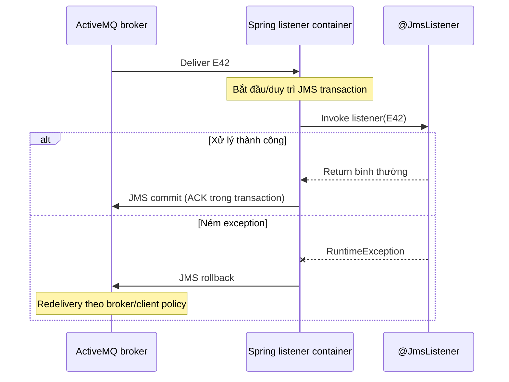
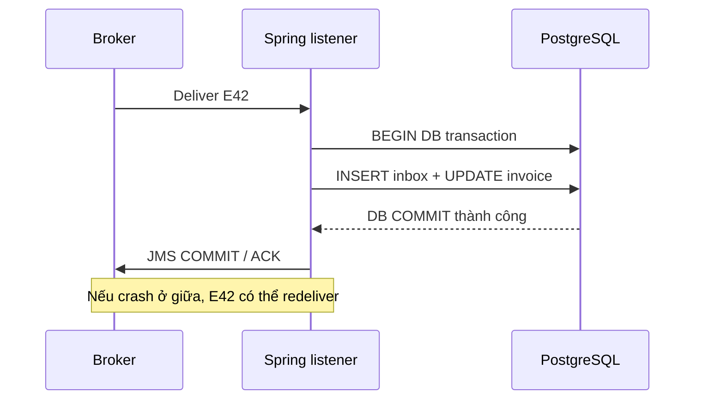

# sessionTransacted, JmsTransactionManager và giao dịch xử lý tại listener

> **Chương:** Spring JMS  
> **Phạm vi:** Spring Boot 3.x / Spring Framework 6.x, `jakarta.jms` và Apache ActiveMQ Classic hoặc Artemis. Trọng tâm là **ranh giới giao dịch tại `@JmsListener`**, sự khác nhau giữa `sessionTransacted=true` và `JmsTransactionManager`, và cách tránh nhầm JMS transaction với transaction của database nghiệp vụ.

## 1. Tình huống: listener lỗi giữa xử lý, broker phải làm gì?

Một worker nhận `GenerateInvoice` từ queue `billing.requests`:

```text
1. Broker giao E42 cho @JmsListener.
2. Listener validate E42, chạy nghiệp vụ.
3. Xử lý thành công -> xác nhận message.
   Xử lý thất bại -> không xác nhận, broker có thể redeliver.
```

Với Spring JMS, **ACK không nhất thiết xuất hiện trong code listener**. Container có thể dùng **JMS transacted Session** và tự gọi commit/rollback quanh callback. Đây chính là lý do cần biết ai sở hữu transaction và nó bao trùm những thao tác nào.



Một nguyên tắc quan trọng:

> `sessionTransacted=true` hoặc `JmsTransactionManager` điều khiển **giao dịch JMS**. Chúng **không tự tạo giao dịch nguyên tử** với PostgreSQL, MySQL, REST API hoặc broker thứ hai.

Bài này trình bày **hai cách cấu hình JMS transaction thay thế nhau**, không yêu cầu bật cả hai cách cho cùng listener:

- **Cách A — giao dịch cục bộ của listener container:** đặt `sessionTransacted=true` trên `DefaultJmsListenerContainerFactory`.
- **Cách B — giao dịch JMS do Spring quản lý:** cung cấp `JmsTransactionManager`, gắn nó vào listener container và có thể sử dụng `@Transactional` cho thao tác JMS ngoài listener.

## 2. Ba ranh giới cần tách bạch

| Ranh giới | Ai khởi tạo/quản lý? | Commit/rollback tác động đến | Không bao gồm |
|---|---|---|---|
| **Session transacted cục bộ** | JMS provider + Spring listener container với `sessionTransacted=true` | Message receive/ACK thuộc session; send cùng session nếu thực sự sử dụng nó | Transaction JDBC không cùng session và thao tác HTTP |
| **Spring `JmsTransactionManager`** | `PlatformTransactionManager` bọc `ConnectionFactory` JMS | Một JMS `Session` được bind theo thread trong phạm vi transaction, thao tác JMS tham gia nếu dùng đúng factory | Database riêng, broker thứ hai; không phải XA |
| **Spring DB transaction manager** | `DataSourceTransactionManager`, `JdbcTransactionManager` hoặc JPA manager | Thay đổi dữ liệu trên tài nguyên DB tham gia transaction | JMS ACK/send nếu không có transaction coordinator phù hợp |

Cụ thể, hai dòng dưới đây **không tương đương**:

```java
factory.setSessionTransacted(true);       // Giao dịch JMS cục bộ của container.
factory.setTransactionManager(jmsTxManager); // Giao dịch JMS qua Spring manager.
```

Không dùng đồng thời cả hai để “an toàn gấp đôi”. Khi đã chọn cách dùng manager, để container lấy ranh giới từ transaction manager và kiểm tra semantics theo cấu hình hiện hành.

### 2.1. `@Transactional` có tự biến listener thành JMS transaction không?

**Không thể kết luận chỉ từ annotation.** Spring `@Transactional` dựa trên **transaction manager được chọn**:

- Nếu ứng dụng có DB transaction manager là mặc định, `@Transactional` có thể chỉ mở **DB transaction**.
- Nếu chỉ có `JmsTransactionManager`, `@Transactional` có thể quản lý **JMS transaction** khi lời gọi được proxy Spring chặn.
- Nếu nhiều manager tồn tại, cần chỉ định `transactionManager` rõ ràng để tránh chọn sai hoặc không xác định.

Đừng thêm `@Transactional` không có qualifier vào listener rồi coi đó là xác nhận đã có JMS rollback. Với listener, **cấu hình của container factory** mới là nơi quan trọng nhất để biết ai commit/rollback delivery.

### 2.2. Giao dịch cục bộ vẫn có thể redeliver

Nếu listener ném exception và container rollback JMS session, broker có thể phân phối lại cùng message. Lúc nhận lại, `JMSRedelivered` và `JMSXDeliveryCount` giúp quan sát nhưng giá trị chính xác phụ thuộc provider/version/policy.

Không suy luận rằng “transacted” đồng nghĩa **exactly-once business processing**: nếu DB đã commit nhưng JMS chưa commit, xử lý trùng vẫn có thể xảy ra.

## 3. Chuẩn bị: Spring Boot 3.x, Artemis native broker

Ví dụ chính dùng Artemis. Với ActiveMQ Classic, thay starter và cấu hình endpoint cho Classic như cuối mục này; phần quản lý JMS transaction ở Spring giữ cùng ý tưởng.

### 3.1. Maven dependency

Ứng dụng đã sử dụng Spring Boot parent/BOM:

```xml
<dependencies>
  <dependency>
    <groupId>org.springframework.boot</groupId>
    <artifactId>spring-boot-starter-artemis</artifactId>
  </dependency>
</dependencies>
```

Spring Boot 3.x sử dụng `jakarta.jms.*`; không trộn artifact JMS client `javax.jms.*` cũ. Không khai báo version riêng cho starter nếu đang dùng dependency management của Spring Boot.

### 3.2. Cấu hình kết nối

```yaml
spring:
  artemis:
    mode: native
    broker-url: tcp://localhost:61616
    user: billing_app
    password: $${ARTEMIS_PASSWORD}

app:
  messaging:
    billing-queue: billing.requests
```

Điều kiện chạy: broker thật đang nghe endpoint đúng giao thức, đã có queue `billing.requests` hoặc policy cho phép tạo, và user có quyền send/consume. `localhost` từ trong container Docker không mặc định trỏ tới broker ở container khác.

Với ActiveMQ Classic qua OpenWire, dùng `spring-boot-starter-activemq` và `spring.activemq.broker-url` thay cho starter/properties Artemis. **Không** lấy URI native Artemis và giả định nó áp dụng cho Classic.

## 4. Cách A: `sessionTransacted=true` trên listener factory

Chỉ cần một listener nhận message, xử lý tuần tự trong phạm vi JMS transaction rồi trả kết quả? **Local transacted Session** thường là lựa chọn rõ ràng và ít bean nhất.

### 4.1. Cấu hình listener container

```java
import jakarta.jms.ConnectionFactory;
import org.springframework.boot.autoconfigure.jms
        .DefaultJmsListenerContainerFactoryConfigurer;
import org.springframework.context.annotation.Bean;
import org.springframework.context.annotation.Configuration;
import org.springframework.jms.annotation.EnableJms;
import org.springframework.jms.config.DefaultJmsListenerContainerFactory;

@Configuration(proxyBeanMethods = false)
@EnableJms
public class BillingLocalJmsConfig {

    @Bean("billingLocalListenerFactory")
    DefaultJmsListenerContainerFactory billingLocalListenerFactory(
            ConnectionFactory connectionFactory,
            DefaultJmsListenerContainerFactoryConfigurer configurer) {

        DefaultJmsListenerContainerFactory factory =
                new DefaultJmsListenerContainerFactory();

        // Mang cấu hình mặc định của Boot vào factory này trước.
        configurer.configure(factory, connectionFactory);

        // Ranh giới receive/ACK do JMS Session transaction quyết định.
        factory.setSessionTransacted(true);
        factory.setPubSubDomain(false);  // Queue
        factory.setConcurrency("1-3");
        return factory;
    }
}
```

**Ý nghĩa từng cấu hình:**

- `@EnableJms` bật hạ tầng xử lý `@JmsListener` (trong ứng dụng Boot có thể đã được kích hoạt theo cấu hình; khai báo tường minh giúp ví dụ dễ hiểu).
- `configurer.configure(...)` giữ các mặc định Spring Boot; không tự động biến thành DB transaction.
- `setSessionTransacted(true)` yêu cầu JMS Session của container dùng local transaction.
- `setPubSubDomain(false)` chọn queue, không phải topic.
- `setConcurrency("1-3")` cho phép nhiều listener sessions/consumers khi tải tăng; **mỗi session có ranh giới transaction riêng**, không có transaction chung cho 3 consumer.

Nếu chỉ cần listener đơn giản, có thể dùng listener factory do Boot tự cấu hình theo phiên bản đang triển khai; việc tự tạo bean ở đây chủ yếu để **làm rõ và kiểm soát điều kiện transacted**.

### 4.2. Listener ném exception để rollback

```java
import org.springframework.jms.annotation.JmsListener;
import org.springframework.stereotype.Component;

@Component
public class BillingCommandListener {

    private final BillingService billingService;

    public BillingCommandListener(BillingService billingService) {
        this.billingService = billingService;
    }

    @JmsListener(
        destination = "billing.requests",
        containerFactory = "billingLocalListenerFactory"
    )
    public void onInvoiceRequest(String payload) {
        // Hàm phải ném exception khi xử lý không thể thành công.
        billingService.process(payload);
    }
}
```

Trong mô hình này, Spring listener container quyết định:

| Kết quả callback | Hành vi JMS thường thấy |
|---|---|
| Trả về bình thường | Container commit JMS transaction, message được xác nhận |
| Ném exception | Container rollback JMS transaction; message có thể redeliver theo policy |
| Listener tự catch lỗi rồi return như thành công | Container có thể **commit**, dù nghiệp vụ thật chưa xử lý xong |
| Tiến trình crash trước JMS commit | Delivery có thể được broker giao lại khi phục hồi |

**Không cần** gọi `message.acknowledge()` trong listener transacted. Trong session có transaction, kết quả receive được điều khiển bằng **commit/rollback**, không phải `CLIENT_ACKNOWLEDGE`.

### 4.3. Vấn đề nghiêm trọng: nuốt lỗi

**Sai:**

```java
@JmsListener(
    destination = "billing.requests",
    containerFactory = "billingLocalListenerFactory"
)
public void handle(String payload) {
    try {
        billingService.process(payload);
    } catch (Exception e) {
        log.error("Invoice failed: {}", payload, e);
        // Sai: callback vẫn trả về bình thường.
        // Container có thể COMMIT JMS message.
    }
}
```

**Đúng về mặt rollback khi lỗi tạm thời:**

```java
@JmsListener(
    destination = "billing.requests",
    containerFactory = "billingLocalListenerFactory"
)
public void handle(String payload) {
    try {
        billingService.process(payload);
    } catch (TransientDependencyException e) {
        log.warn("Temporary error; request redelivery", e);
        throw e; // RuntimeException của ứng dụng.
    }
}
```

`TransientDependencyException` và `billingService` là thành phần nghiệp vụ minh họa. Trong production, **lỗi vĩnh viễn** cần một chính sách quarantine/DLQ, không throw vô hạn cùng một message. Chỉ log error rồi return khi business operation thực sự đã thành công hoặc message đã được giải quyết theo một hợp đồng có kiểm chứng.

### 4.4. Khi nào cách A là đủ?

Nếu listener chỉ cần một **đường nhận JMS** và logic business có cơ chế idempotency riêng, `sessionTransacted=true` là một lựa chọn gọn. Nó **không tự kết hợp** mọi lệnh `JmsTemplate.convertAndSend(...)` từ một client helper khác vào cùng local session của container: helper có thể lấy session riêng. Muốn bảo đảm nhận và gửi **trên cùng một JMS local transaction**, hãy xem cách B.

## 5. Cách B: `JmsTransactionManager` — transaction JMS do Spring quản lý

`org.springframework.jms.connection.JmsTransactionManager` là implementation của Spring `PlatformTransactionManager` cho **một JMS ConnectionFactory**. Nó có thể bind JMS `Connection`/`Session` theo thread để những thao tác Spring JMS trên **cùng factory** tham gia một JMS transaction.

### 5.1. Cấu hình manager và listener container

Đây là **lựa chọn thay thế** cho factory local ở mục 4; không cần khai báo cả hai listener factory cho cùng queue trong production.

```java
import jakarta.jms.ConnectionFactory;

import org.springframework.beans.factory.annotation.Qualifier;
import org.springframework.boot.autoconfigure.jms
        .DefaultJmsListenerContainerFactoryConfigurer;
import org.springframework.context.annotation.Bean;
import org.springframework.context.annotation.Configuration;
import org.springframework.jms.annotation.EnableJms;
import org.springframework.jms.config.DefaultJmsListenerContainerFactory;
import org.springframework.jms.connection.JmsTransactionManager;

@Configuration(proxyBeanMethods = false)
@EnableJms
public class BillingSpringJmsTxConfig {

    @Bean("billingJmsTransactionManager")
    JmsTransactionManager billingJmsTransactionManager(
            ConnectionFactory connectionFactory) {
        return new JmsTransactionManager(connectionFactory);
    }

    @Bean("billingManagedListenerFactory")
    DefaultJmsListenerContainerFactory billingManagedListenerFactory(
            ConnectionFactory connectionFactory,
            @Qualifier("billingJmsTransactionManager")
            JmsTransactionManager transactionManager,
            DefaultJmsListenerContainerFactoryConfigurer configurer) {

        DefaultJmsListenerContainerFactory factory =
                new DefaultJmsListenerContainerFactory();
        configurer.configure(factory, connectionFactory);

        // Spring manager phụ trách mở/commit/rollback JMS transaction.
        factory.setTransactionManager(transactionManager);
        factory.setPubSubDomain(false);
        factory.setConcurrency("1-3");
        return factory;
    }
}
```

Ở đây, container khởi tạo transaction trước khi gọi listener và quyết định commit/rollback dựa trên kết quả callback. **Không cần thêm `@Transactional` lên method `@JmsListener` chỉ để có rollback**; transaction boundary đã được container tạo.

### 5.2. Khi nào nên dùng manager?

- Cần một transaction JMS dùng chung giữa **receive** tại listener và **send** qua `JmsTemplate`, cùng ConnectionFactory.
- Cần viết service gửi nhiều message và commit/rollback **cả nhóm JMS send** bằng Spring `@Transactional`.
- Muốn áp dụng thống nhất transaction instrumentation, propagation, transaction manager selection trong ứng dụng Spring.
- Cần tham gia transaction JMS từ các Spring APIs biết dùng thread-bound resource của `JmsTransactionManager`.

**Hạn chế:**

- `JmsTransactionManager` chỉ quản lý transaction cục bộ của **một JMS provider/ConnectionFactory**, **không phải JTA/XA**.
- Đừng kỳ vọng message gửi qua factory khác (broker khác, wrapper khác không cùng resource key) tự tham gia transaction.
- Đừng tin rằng một số lệnh JDBC tự động được commit/rollback theo JMS transaction vì cùng chạy trên một thread.

### 5.3. Gửi hai message nguyên tử bằng `@Transactional` JMS

```java
import org.springframework.jms.core.JmsTemplate;
import org.springframework.stereotype.Service;
import org.springframework.transaction.annotation.Transactional;

@Service
public class AuditBatchPublisher {

    private final JmsTemplate jmsTemplate;

    public AuditBatchPublisher(JmsTemplate jmsTemplate) {
        this.jmsTemplate = jmsTemplate;
    }

    @Transactional(transactionManager = "billingJmsTransactionManager")
    public void publishBoth(String createdJson, String indexedJson) {
        jmsTemplate.convertAndSend("billing.audit", createdJson);
        jmsTemplate.convertAndSend("billing.audit", indexedJson);

        // Nếu ném RuntimeException, cả hai JMS send trong
        // transaction này sẽ bị rollback, nếu cùng factory.
    }
}
```

Điều kiện để ví dụ có semantics mong muốn:

1. `@Transactional` được thực thi qua **Spring proxy/interceptor**. Tự gọi `this.publishBoth(...)` từ cùng object thường **không qua proxy**, nên không mở transaction mới như kỳ vọng.
2. `JmsTemplate` sử dụng **chính ConnectionFactory phù hợp** với `billingJmsTransactionManager`. Với nhiều factory, inject/qualify chính xác.
3. Cả hai `convertAndSend` thành công và callback kết thúc bình thường thì Spring mới commit JMS transaction. Nếu lỗi xảy ra giữa hai send, rollback áp dụng cho phần JMS trong transaction.
4. Không nhầm kết quả commit JMS với việc consumer đã hoàn thành xử lý trên queue `billing.audit`.

Đây là ví dụ transaction của **producer JMS** được dùng để giải thích lợi ích của manager. Khi áp dụng vào listener nhận, container với `factory.setTransactionManager(...)` mới là ranh giới outer transaction.

### 5.4. Receive rồi gửi sang queue khác cùng broker

Với listener factory dùng `billingJmsTransactionManager` và một `JmsTemplate` dùng cùng ConnectionFactory:

```java
import org.springframework.jms.annotation.JmsListener;
import org.springframework.jms.core.JmsTemplate;
import org.springframework.stereotype.Component;

@Component
public class BillingRouter {
    private final JmsTemplate jmsTemplate;

    public BillingRouter(JmsTemplate jmsTemplate) {
        this.jmsTemplate = jmsTemplate;
    }

    @JmsListener(
        destination = "billing.requests",
        containerFactory = "billingManagedListenerFactory"
    )
    public void onRequest(String json) {
        // Không chạy CompletableFuture/new Thread ở đây.
        jmsTemplate.convertAndSend("billing.processed", json);

        // Khi method return bình thường, container commit JMS
        // transaction: receive và send có thể cùng transaction.
    }
}
```

**Phải kiểm chứng bằng integration test:** khi `JmsTemplate` dùng đúng transaction-bound resource và broker cùng JMS transaction hỗ trợ, việc consume `billing.requests` và gửi `billing.processed` là cùng một **local JMS transaction**. Nếu listener ném exception, cả consume và output send bị rollback trong transaction đó.

Không tự mở async thread để gọi `JmsTemplate` rồi mặc định thread mới sẽ thừa hưởng JMS session đang bind — Spring thread-bound transaction **không tự chuyển sang thread khác**.

Nếu nguồn và đích nằm ở **hai broker khác nhau**, `JmsTransactionManager` của một factory không thể làm cho hai broker commit nguyên tử.

## 6. Dùng `@Transactional` cho database trong listener: cần hiểu hai commit

Dịch vụ `BillingService` cập nhật database nghiệp vụ. Listener gọi service này rồi container commit JMS.



### 6.1. Cấu hình DB transaction tường minh

Nếu project dùng JDBC, một manager riêng có thể được khai báo:

```java
import javax.sql.DataSource;

import org.springframework.context.annotation.Bean;
import org.springframework.context.annotation.Configuration;
import org.springframework.jdbc.support.JdbcTransactionManager;
import org.springframework.transaction.PlatformTransactionManager;

@Configuration(proxyBeanMethods = false)
public class BusinessDbTxConfig {

    @Bean("businessDbTransactionManager")
    PlatformTransactionManager businessDbTransactionManager(
            DataSource dataSource) {
        return new JdbcTransactionManager(dataSource);
    }
}
```

Đây là **manager DB riêng**, không phải `JmsTransactionManager`. Trong ứng dụng có Spring Boot auto-configured database transaction manager, có thể dùng bean đã có; ví dụ khai báo ở đây nhằm cho thấy tên và ranh giới khi đồng thời có **hai loại manager**.

### 6.2. Service nghiệp vụ commit trước khi listener trở về

```java
import org.springframework.stereotype.Service;
import org.springframework.transaction.annotation.Transactional;

@Service
public class BillingService {

    private final InvoiceRepository invoiceRepository;

    public BillingService(InvoiceRepository invoiceRepository) {
        this.invoiceRepository = invoiceRepository;
    }

    @Transactional(transactionManager = "businessDbTransactionManager")
    public void process(String json) {
        InvoiceCommand command = InvoiceCommand.parseAndValidate(json);

        // Phải có idempotency/inbox cùng transaction DB.
        invoiceRepository.applyOnce(
            command.eventId(), command.invoiceId(), command.amountMinor());
    }
}
```

`InvoiceRepository`, `InvoiceCommand` và `applyOnce` là **API nghiệp vụ minh họa**, không phải các class có sẵn trong Spring JMS. `applyOnce` phải dùng transaction DB và unique key/inbox phù hợp, không chỉ `SELECT rồi UPDATE`.

Listener dùng **một** trong hai factory đã chọn:

```java
@JmsListener(
    destination = "billing.requests",
    containerFactory = "billingLocalListenerFactory"
)
public void onRequest(String json) {
    billingService.process(json);
}
```

**Trình tự logic:**

1. Listener container bắt đầu JMS transaction.
2. Spring gọi service qua proxy, bắt đầu DB transaction.
3. Service cập nhật dữ liệu và **DB commit** lúc method service trả về thành công.
4. Listener return bình thường.
5. Container **JMS commit/ACK**.

Nếu DB transaction lỗi và exception lan ra listener, container sẽ rollback JMS. Nhưng nếu **DB đã commit** mà tiến trình chết trước JMS commit, broker có thể giao lại event. Do đó cần **idempotent DB effect**.

### 6.3. Tại sao `@Transactional` không tự tạo distributed transaction?

Hai operation:

```text
businessDbTransactionManager.commit() -> PostgreSQL
billingJmsTransactionManager.commit()  -> Artemis/Classic
```

là hai local transaction độc lập. Dù hai manager đều là Spring `PlatformTransactionManager` và cùng method chứa `@Transactional`, chúng không tự tạo một **XA two-phase commit**.

Để muốn atomicity xuyên resource, cần kiến trúc JTA/XA tương thích và đánh giá chi phí/phức tạp; trong nhiều service bất đồng bộ, **inbox/outbox + idempotency** phù hợp hơn. Không viết “`@Transactional` bảo đảm exactly-once” trên một listener có DB và JMS.

### 6.4. Nếu cần ghi DB và gửi message mới?

Một listener vừa ghi database vừa publish `billing.updated` cần đánh giá:

- **DB commit rồi JMS send fail:** dữ liệu DB đã đổi nhưng message sự kiện chưa phát.
- **JMS send thành công rồi DB rollback:** người nhận có thể thấy event không phản ánh dữ liệu đã commit.
- **JMS send commit nhưng ACK message input chưa commit:** input bị redeliver và event output có thể gửi lần nữa.

Với yêu cầu nhất quán giữa **DB state và outbound event**, dùng **transactional outbox** trong cùng DB transaction, sau đó publisher riêng gửi và có idempotency. `JmsTransactionManager` không tự giải bài toán DB + JMS.

## 7. Các nhầm lẫn cấu hình làm mất giao dịch

| Biểu hiện | Cơ chế gây lỗi | Cách kiểm tra / sửa |
|---|---|---|
| Listener có `@Transactional` nhưng message vẫn ACK dù DB lỗi | Annotation chọn **DB transaction manager**; container không có JMS transaction, hoặc exception bị catch | Bật JMS transaction tại listener factory; để exception propagate |
| Config `sessionTransacted=true` nhưng callback catch lỗi rồi return | Container thấy callback thành công | Không nuốt lỗi; đưa lỗi vĩnh viễn vào quy trình quarantine có chủ đích |
| Cấu hình `JmsTransactionManager` nhưng listener không dùng | Listener container factory không set manager hoặc chọn sai `containerFactory` | Kiểm tra `@JmsListener(containerFactory=...)` và bean wiring |
| `@Transactional` không hoạt động khi tự gọi method | Spring proxy không chặn self-invocation | Gọi qua bean Spring khác hoặc cấu trúc lại service |
| Transaction JMS bao trùm receive nhưng không bao trùm send | `JmsTemplate` dùng factory/session khác hoặc async thread | Dùng cùng factory, cùng thread-bound transaction; thử rollback output |
| Nhiều transaction managers, annotation chọn sai | Không có qualifier hoặc bean `@Primary` gây hiểu nhầm | Dùng tên manager rõ ràng trong `@Transactional` |
| Trộn `javax.jms` với `jakarta.jms` | Client không tương thích API của Boot 3.x | Chọn starter/driver đúng Jakarta API |
| Có nhiều listener consumers, message xuất hiện “lệch thứ tự” | Mỗi container session/worker có transaction riêng | Không đồng nhất transaction với FIFO toàn cục |
| Message đã được consumer xử lý nhưng vẫn bị redeliver | DB commit rồi JMS commit chưa hoàn tất | Thiết kế idempotent handler theo event ID |
| Message liên tục được rollback | Lỗi vĩnh viễn không có quarantine hoặc policy retry | Cấu hình retry/DLQ phù hợp; phân loại exception |

### 7.1. `setSessionTransacted` và acknowledge mode

Khi JMS Session là transacted, `Session.commit()` hoặc `rollback()` quyết định outcome. `AUTO_ACKNOWLEDGE`, `CLIENT_ACKNOWLEDGE` và `DUPS_OK_ACKNOWLEDGE` là cơ chế dành cho **non-transacted sessions**; đừng dùng `factory.setSessionAcknowledgeMode(Session.CLIENT_ACKNOWLEDGE)` như cách bổ sung ACK cho một transacted listener.

### 7.2. `JmsTransactionManager` và `@Transactional` trên method listener

Khi container được cấu hình `factory.setTransactionManager(billingJmsTransactionManager)`, container đã tạo transaction bao quanh invocation của listener. Việc thêm:

```java
@Transactional(transactionManager = "billingJmsTransactionManager")
@JmsListener(
    destination = "billing.requests",
    containerFactory = "billingManagedListenerFactory"
)
public void onRequest(String json) {
    // ...
}
```

thường không cần thiết cho cùng ranh giới, và dễ khiến người đọc tưởng annotation là nguyên nhân chính tạo transaction. Nếu muốn triển khai service gọi ngoài listener (chẳng hạn `AuditBatchPublisher`), dùng annotation rõ ràng ở **service method được proxy** sẽ có ý nghĩa hơn.

### 7.3. `ErrorHandler` không phải công cụ commit/rollback

Spring listener container có thể nhận `ErrorHandler` để ghi log/giám sát lỗi. Nhưng đừng “nuốt” exception trong chính listener vì cho rằng handler riêng sẽ biết cần rollback. **Quyết định commit/rollback nằm ở transaction boundary của container** và việc callback hoàn thành thành công hay thất bại.

## 8. Kiểm chứng thực nghiệm: rollback, redelivery, cùng transaction send/receive

Phải kiểm tra trên broker thật hoặc môi trường tích hợp tương đương. Đặt queue thử nghiệm riêng `billing.requests.test` và `billing.processed.test` để không đụng thông điệp thật.

### 8.1. Test A — listener local JMS transaction rollback

Listener:

```java
import java.util.concurrent.atomic.AtomicBoolean;
import org.springframework.jms.annotation.JmsListener;
import org.springframework.stereotype.Component;

@Component
public class RetryOnceTestListener {
    private final AtomicBoolean failFirst = new AtomicBoolean(true);

    @JmsListener(
        destination = "billing.requests.test",
        containerFactory = "billingLocalListenerFactory"
    )
    public void receive(String payload) {
        if ("retry-once".equals(payload)
                && failFirst.compareAndSet(true, false)) {
            throw new IllegalStateException(
                    "Injected failure before JMS commit");
        }

        System.out.println("processed=" + payload);
    }
}
```

Gửi một message test:

```java
jmsTemplate.convertAndSend("billing.requests.test", "retry-once");
```

**Kỳ vọng:** lần đầu listener ném exception → JMS rollback; nếu broker/client policy cho phép redelivery, listener nhận lại và xử lý thành công ở lượt tiếp theo → JMS commit. `AtomicBoolean` chỉ để **test trong một instance**, không dùng làm thiết kế idempotency production; broker có thể chọn consumer khác khi concurrency lớn, nên test này cần **1 consumer instance**.

Khi test, đặt concurrency của test factory thành `1`, giới hạn số lần retry và ghi `eventId` để so sánh. Nếu đợi nhưng không thấy lượt tiếp theo, xem delay policy, listener lifecycle, connection error và DLQ; đừng suy luận transaction tự biến mất.

### 8.2. Test B — send và receive cùng `JmsTransactionManager`

Với `billingManagedListenerFactory`:

```java
@JmsListener(
    destination = "billing.requests.test",
    containerFactory = "billingManagedListenerFactory"
)
public void route(String payload) {
    jmsTemplate.convertAndSend(
        "billing.processed.test", "done:" + payload);

    if ("rollback".equals(payload)) {
        throw new IllegalStateException(
            "Rollback receive and output send together");
    }
}
```

Bài thử quan sát:

1. Gửi `ok` vào input: output `done:ok` được commit sau khi listener thành công.
2. Gửi `rollback`: listener ném exception. Trước khi xử lý lại thành công, **không được thấy output `done:rollback` đã commit** nếu send thực sự tham gia cùng JMS transaction.
3. Xác minh input được rollback/redeliver theo chính sách broker.
4. Để không có retry storm trong thử nghiệm, dùng chính sách retry ngắn và DLQ/quarantine dành riêng cho message lỗi `rollback`.

Nếu output vẫn xuất hiện dù input transaction bị rollback, một khả năng quan trọng là `JmsTemplate` đang dùng **khác ConnectionFactory hoặc session**, khiến send chạy ngoài transaction input. Kiểm tra wiring, manager và khả năng provider thực thi transaction trước khi kết luận lỗi broker.

### 8.3. Test C — DB commit rồi crash trước JMS commit

Thao tác cần thực hiện trên staging/test:

```text
1. Listener nhận E42.
2. BillingService commit PostgreSQL (có unique inbox).
3. Chủ động kill JVM trước khi container JMS commit.
4. Khởi động lại listener.
5. Broker có thể phát lại E42.
6. BillingService phát hiện E42 đã commit, không áp dụng side effect lần 2.
7. Listener hoàn thành bình thường, JMS transaction commit.
```

Kết quả cần đo **không chỉ** `JMSRedelivered` mà còn số dòng inbox, trạng thái business DB và số lần side effect được commit.

### 8.4. Ma trận kiểm thử nhanh

| Ca kiểm thử | Cấu hình | Tiêu chí PASS |
|---|---|---|
| Listener success | Local `sessionTransacted=true` | Một lượt business thành công, JMS ACK sau callback |
| Listener exception | Local transacted | Rollback và redelivery theo policy |
| Listener catch + return | Local transacted | Nhìn thấy nguy cơ JMS commit sai để sửa code |
| Managed JMS transaction | `JmsTransactionManager` ở container | Rollback receive và output send cùng session/factory |
| Transactional publisher | `@Transactional("billingJmsTransactionManager")` | Hai JMS send cùng commit hoặc cùng rollback |
| Different ConnectionFactory | Hai JMS factories | Không giả định cùng một local transaction |
| DB failure | DB `@Transactional` service + transacted listener | DB rollback, JMS rollback nếu exception propagate |
| Crash sau DB commit | DB inbox + transacted listener | Business effect không lặp dù message bị phát lại |
| Poison message | Listener luôn lỗi | Retry có giới hạn, xử lý DLQ/quarantine theo broker |
| Multiple workers | Concurrency `1-3` | Mỗi worker/session có transaction riêng; không giả định thứ tự toàn cục |

## 9. Những giới hạn vận hành cần công bố rõ

### 9.1. Redelivery policy nằm ngoài `sessionTransacted`

`sessionTransacted=true` chỉ xác định **commit/rollback delivery** ở listener. Redelivery delay, maximum delivery attempts, DLQ và hành vi poison-message cần được cấu hình/kiểm thử tại broker và, với một số client như Classic, có thể có phần client-side policy.

Một XML minh họa tối thiểu cho Artemis `etc/broker.xml`:

```xml
<address-settings>
  <address-setting match="billing.requests">
    <redelivery-delay>2000</redelivery-delay>
    <max-delivery-attempts>5</max-delivery-attempts>
    <dead-letter-address>DLQ</dead-letter-address>
  </address-setting>
</address-settings>
```

Đoạn này phải nằm trong `<address-settings>` hiện có. **DLQ cần queue/binding hoặc auto-create policy phù hợp**; XML trên không tự chứng minh mọi message lỗi chắc chắn vào đúng queue DLQ. Đừng chép cấu hình này sang `activemq.xml` của Classic.

### 9.2. Local JMS transaction không thay thế idempotency

Trong những tình huống broker crash, network failure, producer retry hay hai hệ thống commit không đồng bộ, message vẫn có thể bị xử lý lại. Sử dụng `eventId` ổn định và một unique inbox/business constraint trong transaction database để kiểm soát side effect.

### 9.3. Không giữ transaction quá lâu

Một listener chạy 5 phút và gọi REST nhiều lần trước khi return có thể giữ message in-flight cùng JMS transaction lâu, làm tăng lock/resource consumption và thời gian phục hồi. Khi cần xử lý dài, cân nhắc tách thành job/stage có state bền vững, timeout, idempotency và ACK có ý thức; không dùng transaction JMS như khóa tài nguyên vô hạn.

### 9.4. Một local transaction manager trên một broker không phải message bridge XA

Nếu listener nhận trên broker A và gửi sang broker B, một `JmsTransactionManager` gắn vào A **không** đảm bảo commit cả A lẫn B. Cần kiến trúc outbox/inbox hoặc transaction coordinator hỗ trợ XA nếu yêu cầu thực sự đòi hỏi.

## 10. Checklist chẩn đoán nhanh

Khi operator báo “`@JmsListener` lỗi nhưng message không quay lại”, kiểm tra theo thứ tự:

1. Listener thực sự dùng **containerFactory nào**? Có `sessionTransacted=true` hoặc `JmsTransactionManager` không?
2. Exception có **thoát khỏi** method listener không, hay đã bị catch rồi return?
3. Có `@Transactional` chọn nhầm DB manager rồi tưởng là JMS manager không?
4. Với `JmsTransactionManager`, factory do manager và `JmsTemplate` sử dụng có giống nhau không?
5. Có logic async/new thread khiến operation thoát khỏi thread-bound transaction không?
6. Broker có redelivery delay, delivery limit, DLQ hoặc filter/selector đang tác động không?
7. Đang nhìn đúng queue/subscription và đúng broker chưa?
8. Có duplicate đã bị consumer idempotent bỏ qua (đúng) nhưng log làm tưởng không redeliver không?
9. Thực tế message còn đang unacknowledged/in-flight, hoặc container đã stop vì connection/TLS/credential lỗi?
10. Có kết quả JMS commit không xác định sau network failure; log và metric đã phân biệt được ACK của broker với side effect database chưa?

## 11. Bài tập vận dụng

1. Một `@JmsListener` chỉ có `@Transactional` nhưng application sở hữu `DataSourceTransactionManager` làm mặc định. Vì sao không thể kết luận JMS receive sẽ rollback khi service thất bại? Bạn sẽ sửa listener factory như thế nào?
2. Listener đang `sessionTransacted=true`. Trong handler, developer catch `SQLException`, ghi log rồi return. Message có thể bị xác nhận sai như thế nào?
3. So sánh hai đoạn cấu hình `factory.setSessionTransacted(true)` và `factory.setTransactionManager(new JmsTransactionManager(cf))` theo phạm vi transaction và khả năng tham gia của `JmsTemplate`.
4. Listener dùng `billingManagedListenerFactory` nhận E42 và gửi `billing.processed`, sau đó throw exception. Những điều kiện nào phải đúng để output send bị rollback cùng input receive?
5. Một service dùng PostgreSQL, commit DB xong rồi crash trước JMS ACK. `JmsTransactionManager` có bảo đảm không cộng điểm trùng không? Cần cơ chế bổ sung nào?
6. Viết integration test trên Artemis với listener ném lỗi ở lượt đầu, thành công lượt sau; đo số lần nhận, `JMSRedelivered` và trạng thái queue.
7. Khi hai transaction managers JMS và DB cùng tồn tại, bạn sẽ đặt tên và chỉ định `@Transactional(transactionManager=...)` như thế nào để việc lựa chọn không phụ thuộc bean mặc định?
8. Nếu nhận ở Artemis broker A nhưng gửi audit sang Classic broker B, có thể dùng một `JmsTransactionManager` để atomic cả hai không? Nêu cách thiết kế an toàn hơn.

## 12. Tài liệu tham khảo

- [Spring Framework — JMS Integration](https://docs.spring.io/spring-framework/reference/integration/jms.html): `JmsTemplate`, listener containers, JMS transactions.
- [Spring Framework — Annotation-driven JMS Listener Endpoints](https://docs.spring.io/spring-framework/reference/integration/jms/annotated.html): `@JmsListener` và listener container factory.
- [Spring Framework — JMS Transaction Manager API](https://docs.spring.io/spring-framework/docs/current/javadoc-api/org/springframework/jms/connection/JmsTransactionManager.html): local JMS transaction và thread-bound session.
- [Spring Framework — Transaction Management](https://docs.spring.io/spring-framework/reference/data-access/transaction.html): `@Transactional` và transaction manager selection.
- [Spring Boot — JMS](https://docs.spring.io/spring-boot/reference/messaging/jms.html): starter, auto-configured factory, listener defaults và configurer.
- [ActiveMQ Artemis — Message Redelivery and Undelivered Messages](https://artemis.apache.org/components/artemis/documentation/latest/undelivered-messages.html): retry, redelivery delay và DLQ.

**Ghi nhớ:** `sessionTransacted=true` cho phép Spring listener container **commit JMS khi callback thành công, rollback khi callback thất bại**. `JmsTransactionManager` đưa giao dịch JMS vào hạ tầng transaction của Spring, hữu ích khi cần cùng JMS session cho listener và `JmsTemplate` hoặc `@Transactional` trên service gửi. Cả hai **chỉ bao trùm tài nguyên JMS phù hợp**, không tự bảo đảm nguyên tử với database hay broker khác. Khi kết hợp JMS và DB, hãy **commit DB trước JMS ACK**, để exception lan ra listener khi thất bại và dùng **idempotency/inbox** để chịu được redelivery.
