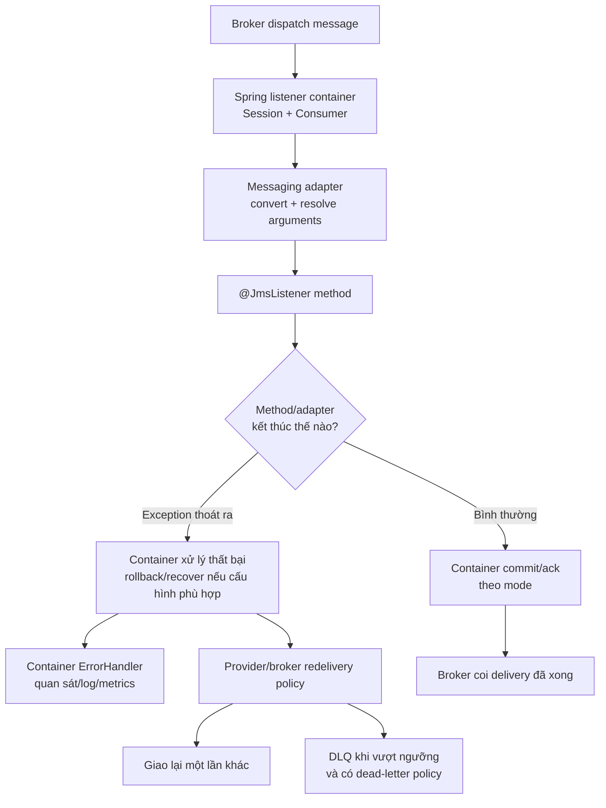
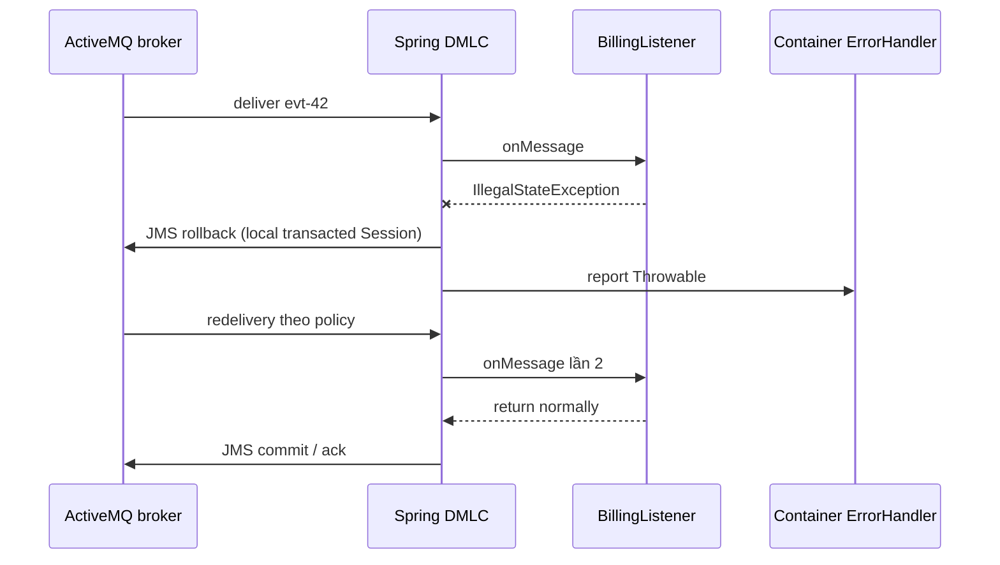

# ErrorHandler, ngoại lệ trong listener và tác động đến redelivery

> **Chương:** Spring JMS  
> **Phạm vi:** Spring Framework JMS / Spring Boot dùng Apache ActiveMQ Classic hoặc Artemis. Ví dụ chính theo Spring Boot 3.x, Spring Framework 6.x và `jakarta.jms`; nếu ứng dụng dùng Spring 5/Boot 2 thì chuyển sang `javax.jms` và client tương thích.  
> **Mục tiêu:** Hiểu ngoại lệ từ `@JmsListener` đi qua lớp adapter, container, transaction và broker như thế nào; phân biệt `ErrorHandler` của container với `JmsListenerErrorHandler` của method; cấu hình rollback/redelivery/DLQ, quan sát lỗi và xây consumer an toàn khi xử lý DB.

## 1. Tình huống: listener ném exception nhưng message vẫn biến mất

Một listener xử lý lệnh phát hành hóa đơn:

```java
@JmsListener(destination = "billing.commands")
public void onInvoice(String orderId) {
    invoiceService.createInvoice(orderId);
    // Có thể ném DataAccessException hoặc RuntimeException.
}
```

Người viết code kỳ vọng: “Phương thức ném exception thì ActiveMQ sẽ giao lại”. Điều này **không luôn đúng**. Với Spring JMS, phải xét:

1. Container nhận message theo **acknowledgment/transaction mode** nào?
2. Exception có **thoát khỏi listener adapter** để container nhận biết không?
3. Container làm `acknowledge`, `recover`, `commit` hay `rollback` khi listener kết thúc?
4. Broker/client có **redelivery policy**, delay, giới hạn attempts và DLQ không?
5. Các `ErrorHandler` đang được đặt **ở tầng nào**, có làm exception biến thành kết quả “thành công” không?

Một `ErrorHandler` chỉ ghi log **không đồng nghĩa** “yêu cầu broker retry”. Một `try/catch` trong listener rồi trả về bình thường **có thể khiến container commit/ack message đã thất bại nghiệp vụ**.

### 1.1. Sơ đồ luồng lỗi



Sơ đồ mô tả đường thành công/thất bại **theo ngữ nghĩa**, không phải khẳng định thứ tự nội bộ tuyệt đối của mọi phiên bản Spring/provider. Đặc biệt, việc container có thể rollback hay không phụ thuộc mode và transaction ownership.

**Nguyên tắc xuyên suốt bài:** với consumer có side effect quan trọng, ưu tiên **Session transacted do listener container quản lý**, để lỗi chưa xử lý **thoát khỏi listener**; broker/client điều khiển redelivery, và business handler phải **idempotent**.

## 2. Ba ranh giới cần tách: exception, acknowledgment, redelivery

| Ranh giới | Thành phần quyết định | Ý nghĩa thực tế |
|---|---|---|
| Exception từ business code | Listener, adapter và hook lỗi method | Đã trả bình thường hay vẫn báo thất bại? |
| Ack/rollback của delivery hiện tại | Spring listener container + JMS Session/transaction manager | Broker coi message đã hoàn tất hay phải đủ điều kiện giao lại? |
| Delay/attempt/DLQ | JMS provider và broker policy Classic/Artemis | Khi nào giao lại, tối đa bao nhiêu lần, cuối cùng đặt ở đâu? |

Spring `ErrorHandler` **không phải** API gửi lệnh “retry n lần” đến ActiveMQ. Nó là hook quan sát/xử lý ngoại lệ **sau khi một lỗi đã đi vào đường xử lý của container**. Muốn redelivery đáng tin cậy, phải giữ đúng **transaction/acknowledgment semantics**.

### 2.1. Một exception Java không tự biến thành JMS rollback

```java
try {
    businessService.process(orderId);
} catch (RuntimeException ex) {
    log.error("process failed", ex);
    // Không throw: method kết thúc bình thường.
}
```

Nếu container đang quản lý transacted Session, nhìn từ listener adapter đây có thể là một invocation **thành công**. Container có thể `commit()` JMS transaction và message không được giao lại, dù business side effect thất bại.

Ngược lại:

```java
try {
    businessService.process(orderId);
} catch (RuntimeException ex) {
    log.warn("process failed; request rollback", ex);
    throw ex; // Để container thấy failure.
}
```

Nếu container dùng local JMS transaction, exception thoát ra là tín hiệu để container rollback; message có thể redeliver theo policy.

### 2.2. Khi nào nên bắt ngoại lệ mà không throw?

Khi ứng dụng **đã xử lý dứt điểm** message theo contract, ví dụ:

- Duplicate `eventId` đã được DB ghi nhận và không cần side effect nữa.
- Lệnh yêu cầu đối tượng đã hủy và business policy quy định bỏ qua có audit.
- Message không hợp lệ đã được ghi **bền vững** vào quarantine riêng theo cơ chế atomic/được đối soát, và nghiệp vụ chủ động xác nhận bỏ qua.

**Không** bắt rồi bỏ qua chỉ để log sạch hoặc tránh DLQ. Nếu công việc còn phải retry, để exception thoát ra sau khi log ở đúng tầng; nếu công việc không thể retry, phải có quyết định từ chối/poison/quarantine minh bạch.

## 3. AUTO_ACKNOWLEDGE, CLIENT_ACKNOWLEDGE và transacted Session khác nhau ra sao?

Đây là điểm quyết định việc Java exception có dẫn tới redelivery thực tế hay không.

| Chế độ nhận | Khi listener thành công | Khi listener ném exception | Khuyến nghị |
|---|---|---|---|
| `AUTO_ACKNOWLEDGE` của `DefaultMessageListenerContainer` | Provider/container auto-ack theo cơ chế container | Với DMLC, message có thể đã được ack **trước listener execution**; không có redelivery đáng tin chỉ vì method throw | Không dùng làm cơ chế retry cho xử lý DB quan trọng |
| `DUPS_OK_ACKNOWLEDGE` | Ack trì hoãn theo JMS/provider | Không xây bảo đảm rollback từ exception; duplicate/ack timing phụ thuộc provider | Chỉ dùng khi chấp nhận semantics lỏng hơn |
| `CLIENT_ACKNOWLEDGE` | DMLC có thể ack sau listener thành công | Có cơ chế `recover`/best-effort redelivery theo Spring, nhưng phụ thuộc lifecycle/provider | Dùng khi đã hiểu phạm vi Session; thường ưu tiên transaction |
| `sessionTransacted=true` | Container `commit()` sau listener thành công | Container `rollback()` khi failure thoát ra; message có thể redeliver | **Lựa chọn thực dụng** khi cần retry |
| JTA/XA do transaction manager quản lý | Theo global transaction và enlistment | Rollback do transaction manager theo rules | Chỉ dùng khi thực sự cấu hình XA và recovery |

**Lưu ý về DMLC:** Trong Spring `DefaultMessageListenerContainer`, chế độ `AUTO_ACKNOWLEDGE` có thể acknowledge trước khi gọi listener. Không lấy cách callback JMS `MessageListener` thuần túy hoạt động ở mọi provider để suy ra rằng Spring DMLC sẽ redeliver khi method throw. Hãy kiểm tra container và phiên bản thực tế.

### 3.1. `sessionTransacted=true` thay đổi điều gì?

```java
DefaultJmsListenerContainerFactory factory =
        new DefaultJmsListenerContainerFactory();

factory.setSessionTransacted(true);
```

Với **local JMS transaction do container sở hữu**:

1. Container receive message trong transacted Session.
2. Listener chạy business logic.
3. Nếu listener hoàn thành bình thường, container `commit()` Session.
4. Nếu listener/adapter báo lỗi, container `rollback()` Session.
5. Broker/client áp chính sách redelivery trên message chưa được commit.

Đây là ranh giới **JMS transaction**, không phải JDBC transaction. Dù listener gọi service có `@Transactional` cho database, Spring vẫn có thể đang dùng **hai local transactions độc lập**.

### 3.2. Vì sao `CLIENT_ACKNOWLEDGE` không tương đương commit từng message?

Trong JMS, `Message.acknowledge()` có phạm vi **Session** theo hợp đồng, không phải chỉ Java object đang gọi. Nếu ứng dụng cố tự ack từ một thread khác trong khi Spring container đang quản lý Session thì có thể gây race và ack chéo. Với `@JmsListener`, nên để container quản lý ack/transaction thay vì gọi `acknowledge()` tự phát.

## 4. Hai loại ErrorHandler của Spring JMS: rất dễ nhầm

Spring có ít nhất hai điểm xử lý lỗi liên quan tới listener annotation:

| Tên | Package / kiểu | Phạm vi | Có thể làm gì? | Không được kỳ vọng |
|---|---|---|---|---|
| **Container `ErrorHandler`** | `org.springframework.util.ErrorHandler` | Lỗi thoát khỏi listener/container invocation và được container báo | Ghi log, metrics, alert; quan sát nguyên nhân | Không thay broker policy, không có message payload/Session trong chữ ký |
| **Method `JmsListenerErrorHandler`** | `org.springframework.jms.listener.adapter.JmsListenerErrorHandler` | Lỗi trong đường invocation của `@JmsListener` adapter | Quan sát Spring `Message<?>`, trả giá trị fallback/reply hoặc rethrow exception | Không coi việc trả bình thường là tự động rollback |

Khác biệt quan trọng là **phương thức nhận tham số và cách xử lý exception**.

### 4.1. Container ErrorHandler chỉ nhận `Throwable`

```java
import org.springframework.util.ErrorHandler;

ErrorHandler logging = error -> {
    // Không có tham số JMS Message hay Session tại đây.
    logger.error("Unhandled JMS listener exception", error);
};
```

Hook này là nơi ghi nhận lỗi **đã thoát ra từ callback**. Trong đường listener container dùng transaction, xử lý rollback/ack được quyết định bởi container và transaction mode; không cần ném một exception mới từ `ErrorHandler` để “buộc broker retry”.

### 4.2. Method JmsListenerErrorHandler nhận Spring Message và exception

```java
import org.springframework.jms.listener.adapter.JmsListenerErrorHandler;
import org.springframework.jms.listener.adapter.ListenerExecutionFailedException;

JmsListenerErrorHandler methodHandler = (message, exception) -> {
    logger.error("Listener invocation failed", exception);
    throw exception;
};
```

`message` ở đây là **Spring Messaging `Message<?>`** được tạo bởi adapter, không phải mặc nhiên một raw `jakarta.jms.Message`. Method handler có thể xử lý lỗi rồi **return normally**; khi đó adapter có thể xem invocation đã hoàn tất và container không nhìn thấy thất bại để rollback. Nếu phải redeliver, **rethrow**.

**Không dùng method handler để che lỗi conversion/validation nếu chưa có cơ chế quarantine hoặc audit đáng tin cậy.**

### 4.3. Đừng log hai lần ở cả hai handler mà không có lý do

Nếu method handler log rồi rethrow, container ErrorHandler cũng có thể log cùng stack trace. Có thể:

- Log mức nhẹ/có `eventId` ở tầng method, container handler tăng counter failure;
- Chỉ log stack trace một lần ở tầng container;
- Dùng tracing/span attributes và metrics để ghép thông tin ngữ cảnh.

Hạn chế log body nhạy cảm, access token, card data và các field PII. Nếu cần event ID ở ErrorHandler container, dùng MDC/tracing context được thiết kế và cleanup đúng, vì chữ ký `handleError(Throwable)` không cung cấp message trực tiếp.

## 5. Cấu hình Spring Boot 3: transacted listener + container ErrorHandler

Ví dụ dành cho **Spring Boot 3.x + Spring Framework 6.x + Jakarta Messaging**. Broker Artemis chạy ngoài ứng dụng ở `tcp://127.0.0.1:61616`. Với ActiveMQ Classic, thay dependency/client và thuộc tính broker; **logic Spring listener container giữ nguyên**.

### 5.1. Dependency và endpoint

Maven với Spring Boot parent/BOM quản lý version:

```xml
<dependency>
    <groupId>org.springframework.boot</groupId>
    <artifactId>spring-boot-starter-artemis</artifactId>
</dependency>
```

Application YAML minh họa:

```yaml
spring:
  artemis:
    mode: native
    broker-url: tcp://127.0.0.1:61616
```

Không nên cài đồng thời starter Classic và Artemis chỉ để thử một ví dụ; hai provider có `ConnectionFactory` khác nhau và có thể khiến cấu hình lựa chọn bean trở nên mơ hồ.

### 5.2. Cấu hình listener container factory

```java
import jakarta.jms.ConnectionFactory;

import org.slf4j.Logger;
import org.slf4j.LoggerFactory;
import org.springframework.boot.autoconfigure.jms.DefaultJmsListenerContainerFactoryConfigurer;
import org.springframework.context.annotation.Bean;
import org.springframework.context.annotation.Configuration;
import org.springframework.jms.annotation.EnableJms;
import org.springframework.jms.config.DefaultJmsListenerContainerFactory;
import org.springframework.util.ErrorHandler;

@Configuration
@EnableJms
public class ReliableJmsListenerConfig {

    private static final Logger log =
            LoggerFactory.getLogger(ReliableJmsListenerConfig.class);

    @Bean
    public ErrorHandler containerJmsErrorHandler() {
        return error -> {
            // Chỉ quan sát. Không tự ack hay giả định đang có JMS Session.
            log.error("Unhandled JMS listener failure", error);
            // Thêm counter/trace, alert theo nhu cầu.
        };
    }

    @Bean("reliableJmsListenerFactory")
    public DefaultJmsListenerContainerFactory reliableJmsListenerFactory(
            ConnectionFactory connectionFactory,
            DefaultJmsListenerContainerFactoryConfigurer configurer,
            ErrorHandler containerJmsErrorHandler) {

        DefaultJmsListenerContainerFactory factory =
                new DefaultJmsListenerContainerFactory();

        // Giữ các setting mặc định/Boot customizers hiện có.
        configurer.configure(factory, connectionFactory);

        // Ghi đè tường minh để exception trong listener kích hoạt
        // rollback của LOCAL JMS transaction.
        factory.setSessionTransacted(true);
        factory.setConcurrency("2-6");
        factory.setErrorHandler(containerJmsErrorHandler);
        return factory;
    }
}
```

**Kiểm tra sau khởi động:**

1. `@JmsListener` phải chỉ định đúng `containerFactory="reliableJmsListenerFactory"`; nếu không nó có thể dùng factory mặc định với transaction mode khác.
2. `configurer.configure(...)` nhận autoconfiguration hiện có; các setter sau đó ghi đè phần liên quan một cách có chủ đích.
3. `factory.setSessionTransacted(true)` giả định **local JMS transaction**. Nếu ứng dụng dùng JTA/transaction manager khác cho container, cần quyết định một transaction owner rõ ràng và không áp cấu hình local tx mù quáng.
4. `ErrorHandler` ở trên chỉ để log/metrics; **không** gọi `session.rollback()` ở đây vì callback không được cấp Session và container chịu trách nhiệm transaction.
5. `concurrency="2-6"` khiến nhiều Session/consumer lane có thể hoạt động. Không chia sẻ raw Session giữa các lane; điều chỉnh theo DB pool, broker resource và tải thật.

### 5.3. Listener cho phép exception thoát ra

```java
import org.springframework.jms.annotation.JmsListener;
import org.springframework.messaging.handler.annotation.Header;
import org.springframework.stereotype.Component;

@Component
public class BillingListener {

    private final BillingService billingService;

    public BillingListener(BillingService billingService) {
        this.billingService = billingService;
    }

    @JmsListener(
        destination = "billing.commands",
        containerFactory = "reliableJmsListenerFactory"
    )
    public void onMessage(
            String orderId,
            @Header("eventId") String eventId) {

        // Lỗi DB/validation không được nuốt.
        // Spring nhận JMS custom property eventId như message header
        // khi sử dụng header mapping phù hợp.
        billingService.createInvoiceOnce(eventId, orderId);
    }
}
```

Producer đi kèm để tạo message test:

```java
import org.springframework.jms.core.JmsTemplate;

jmsTemplate.convertAndSend(
    "billing.commands", "ORD-42",
    message -> {
        message.setStringProperty("eventId", "evt-42");
        return message;
    }
);
```

`@Header("eventId")` giả định adapter/header mapper mặc định hoặc một mapper được cấu hình để đưa custom JMS property thành Spring header. Nếu dự án dùng custom `MessageConverter`/`HeaderMapper`, **test ánh xạ này**; property thiếu có thể gây lỗi argument resolution trước khi method chạy.

## 6. Test một exception transient: rollback rồi xử lý thành công

Để thấy đường retry, một ví dụ đơn giản cố tình thất bại lần đầu cho từng `eventId`.

```java
import java.util.concurrent.ConcurrentHashMap;
import java.util.concurrent.ConcurrentMap;
import java.util.concurrent.atomic.AtomicInteger;
import org.springframework.stereotype.Service;

@Service
public class DemoBillingService {
    private final ConcurrentMap<String, AtomicInteger> attempts =
            new ConcurrentHashMap<>();

    public void createInvoiceOnce(String eventId, String orderId) {
        int current = attempts
                .computeIfAbsent(eventId, ignored -> new AtomicInteger())
                .incrementAndGet();

        System.out.println("eventId=" + eventId + " attempt=" + current);

        if (current == 1) {
            throw new IllegalStateException(
                    "Simulated transient DB outage");
        }

        System.out.println("Processed order=" + orderId);
    }
}
```

Nếu listener gọi `DemoBillingService` và Session là transacted:



**Đây chỉ là mô phỏng**, không phải idempotency production: map `attempts` nằm trong RAM, mất khi JVM restart, và không bảo vệ side effect sau DB commit nếu JMS commit thất bại. Với nghiệp vụ thật, dùng khóa `eventId` bền vững trong DB.

### 6.1. Những gì nên quan sát

- Listener được gọi lần đầu, ném exception.
- Container error handler thấy failure và log/metrics tăng một lần tương ứng.
- Broker/client có lần delivery tiếp theo; `JMSRedelivered` hoặc `JMSXDeliveryCount` có thể phản ánh redelivery theo provider.
- Ở lần chạy thành công, container commit và message không còn pending.
- Nếu số attempts chạm giới hạn do broker/client cấu hình, message cuối cùng có thể vào DLQ.

**Không chỉ đếm số log exception để suy ra số broker attempts**. Conversion error có thể xảy ra trước method, consumer có thể restart, các attempts có thể kéo dài qua instance khác.

## 7. Method-level `JmsListenerErrorHandler`: return hay rethrow quyết định gì?

`@JmsListener` có thể tham chiếu một handler theo tên bean:

```java
import org.slf4j.Logger;
import org.slf4j.LoggerFactory;
import org.springframework.context.annotation.Bean;
import org.springframework.context.annotation.Configuration;
import org.springframework.jms.listener.adapter.JmsListenerErrorHandler;

@Configuration
public class MethodHandlerConfig {

    private static final Logger log =
            LoggerFactory.getLogger(MethodHandlerConfig.class);

    @Bean("rethrowingBillingErrorHandler")
    public JmsListenerErrorHandler rethrowingBillingErrorHandler() {
        return (message, exception) -> {
            log.warn("Billing listener method failed; will propagate",
                    exception);
            throw exception; // Để container thấy failure và rollback.
        };
    }
}
```

Gắn vào listener:

```java
@JmsListener(
    destination = "billing.commands",
    containerFactory = "reliableJmsListenerFactory",
    errorHandler = "rethrowingBillingErrorHandler"
)
public void onMessage(String orderId) {
    invoiceService.createInvoice(orderId);
}
```

**Nếu method handler rethrow**, exception vẫn đi lên container. Với Session transacted, container xử lý rollback và broker xem message đủ điều kiện redelivery.

Ngược lại, cách sau nguy hiểm nếu lỗi nghiệp vụ còn phải retry:

```java
@Bean("swallowingBillingErrorHandler")
JmsListenerErrorHandler swallowingBillingErrorHandler() {
    return (message, exception) -> {
        log.error("Failure logged but swallowed", exception);
        return null; // Adapter có thể xem lỗi đã được xử lý!
    };
}
```

Khi handler trả kết quả bình thường và không có ngoại lệ khác, container có thể **commit JMS transaction**. Message có thể bị ack dù hóa đơn chưa được ghi. Nếu dùng reply semantics, giá trị trả về còn có thể ảnh hưởng thông điệp phản hồi tùy annotation/adapter.

### 7.1. Khi nào method handler có thể return thành công?

Chỉ khi nghiệp vụ **cố ý quyết định message đã được xử lý theo một kết quả cuối**. Ví dụ dữ liệu được xác minh chắc chắn là lệnh không còn hiệu lực và một audit record bền vững đã ghi thành công. Lúc đó việc ack message có thể đúng theo hợp đồng.

Không dùng `return null` để “đẩy lỗi sang container ErrorHandler”: theo đường adapter, lỗi đã có thể bị **nuốt tại tầng method**, container ErrorHandler sẽ **không nhận được exception đó**.

### 7.2. Một phân biệt về phạm vi lỗi

`JmsListenerErrorHandler` dành cho lỗi trong đường xử lý của annotated listener adapter. Không bảo đảm nó nhận mọi vấn đề ở mức transport, broker reconnect hoặc receive loop trước khi message đến adapter. Các lỗi cơ sở hạ tầng khác có thể được container phục hồi/log theo đường riêng; cần quan sát container status/connection failures, không chỉ đếm callback ở method error handler.

## 8. Exception classification: retryable, permanent và lỗi chưa rõ

Không phải exception nào cũng nên retry giống nhau, nhưng **Spring ErrorHandler không tự phân loại theo nghĩa broker sẽ biết Java exception class**.

| Tình huống | Retry? | Chính sách ứng dụng nên làm |
|---|---|---|
| DB connection timeout/temporary lock | Thường có | Rethrow; redelivery delay/backoff hữu hạn |
| HTTP 503 từ dependency tạm thời | Thường có | Rethrow, nhưng giới hạn attempt và tổng deadline |
| Message malformed JSON, schema sai vĩnh viễn | Không có ích khi retry y nguyên | Quarantine/DLQ và điều tra schema; không retry vô hạn |
| Thiếu trường bắt buộc | Thường permanent | Có audit và cơ chế reject rõ; tránh vòng poison |
| Business duplicate đã ghi nhận thành công | Không cần làm lại | Idempotent no-op, return normally rồi commit JMS |
| DB commit thành công nhưng JMS commit không rõ | Có thể redeliver | Dedupe bằng DB eventId, không coi là business failure |
| Không rõ là transient hay permanent | Theo policy hữu hạn | Rethrow, quan sát, DLQ nếu quá ngưỡng |

**Broker không tự đọc Java `IllegalArgumentException` hay `SQLException` để quyết định retry/skip.** Broker/client chỉ thấy delivery chưa được commit/ack, rồi áp policy đã cấu hình. Nếu cần phân luồng theo class ngoại lệ, ứng dụng phải chủ động thiết kế chiến lược riêng.

### 8.1. Không `Thread.sleep` trong ErrorHandler để tạo retry delay

```java
// SAI: giữ thread listener, không tạo rollback/delivery mới.
error -> Thread.sleep(10_000L);
```

Đợi trong listener/ErrorHandler chỉ chiếm thread và Session, có thể làm throughput giảm mạnh; nó không tạo policy retry ở broker. Dùng redelivery-delay/backoff của broker/client, đồng thời giới hạn số attempts và chuyển DLQ khi cần.

### 8.2. Bẫy “bắt ngoại lệ để gửi DLQ thủ công”

```java
try {
    process(message);
} catch (Exception ex) {
    jmsTemplate.convertAndSend("billing.DLQ", payload);
    return; // Container có thể ack message gốc.
}
```

Ở đây lệnh gửi DLQ và ack message gốc có thể nằm trong **hai transaction khác nhau**; crash giữa chúng gây mất hoặc nhân đôi message. Thêm nữa, tên DLQ thủ công có thể **không phải DLQ broker** đang quản lý.

Lựa chọn an toàn mặc định: **để exception thoát ra → rollback → broker retry có giới hạn → broker-managed DLQ**. Nếu cần quarantine chủ động, thiết kế atomic JMS transfer (cùng transacted Session khi phù hợp), outbox hoặc reconciliation; kiểm tra idempotency và quyền truy cập thay vì gửi thủ công trong ErrorHandler rồi ack không điều kiện.

## 9. Cấu hình redelivery và DLQ: Classic khác Artemis

Container Spring chỉ quyết định cách hoàn tất/rollback delivery đang nhận. **Giới hạn số lần, delay và DLQ thuộc policy của provider/broker**.

### 9.1. ActiveMQ Artemis: `address-settings` trên broker

Ví dụ phần `broker.xml`, với address `billing.commands` và dead-letter queue rõ ràng:

```xml
<!-- Các fragment nằm đúng vùng tương ứng của broker.xml Artemis. -->
<address-settings>
    <address-setting match="billing.#">
        <redelivery-delay>2000</redelivery-delay>
        <max-delivery-attempts>4</max-delivery-attempts>
        <dead-letter-address>DLQ</dead-letter-address>
    </address-setting>
</address-settings>

<addresses>
    <address name="billing.commands">
        <anycast>
            <queue name="billing.commands" durable="true"/>
        </anycast>
    </address>
    <address name="DLQ">
        <anycast>
            <queue name="DLQ" durable="true"/>
        </anycast>
    </address>
</addresses>
```

**Lưu ý:**

- `redelivery-delay` tính theo mili giây, broker điều phối việc giao lại theo policy.
- `max-delivery-attempts` giới hạn delivery attempts theo semantics/version Artemis; kiểm thử số callback thực tế, không cộng trừ tùy tiện.
- `dead-letter-address` quyết định đích khi message vượt ngưỡng; phải provision/đảm bảo queue nhận DLQ phù hợp. Nếu thiếu dead-letter handling, message có thể bị loại bỏ theo broker policy.
- `address-setting match="billing.#"` áp rule cho address phù hợp; quy tắc này **không phải** Spring `ErrorHandler`.
- Đảm bảo XML đặt vào **đúng các phần hiện có**, không tạo bản `<address-settings>` hoặc `<addresses>` lặp sai schema.

Artemis có thể có delivery count và cờ redelivered trên message nhận, nhưng đừng dùng số lần Spring ErrorHandler được gọi để coi bằng số attempts broker chính xác.

### 9.2. ActiveMQ Classic: client redelivery policy và Poison ACK

Trong Classic/OpenWire, `RedeliveryPolicy` phía client điều chỉnh attempts/delay; khi vượt giới hạn, client có thể gửi **Poison ACK** để broker dead-letter theo strategy.

Ví dụ Java cấu hình **client Classic**:

```java
import org.apache.activemq.ActiveMQConnectionFactory;
import org.apache.activemq.RedeliveryPolicy;

ActiveMQConnectionFactory raw =
        new ActiveMQConnectionFactory("tcp://127.0.0.1:61616");

RedeliveryPolicy policy = raw.getRedeliveryPolicy();
policy.setInitialRedeliveryDelay(1_000L);
policy.setRedeliveryDelay(2_000L);
policy.setMaximumRedeliveries(3);
policy.setUseExponentialBackOff(true);
policy.setBackOffMultiplier(2.0);
```

Dùng raw factory này cho Spring listener container tương ứng với đúng version/namespace. Nếu chạy Spring Boot 3 (Jakarta), chọn **Classic client tương thích Jakarta**, không lấy client legacy `javax.jms` gắn vào `jakarta.jms.ConnectionFactory`.

**Điểm chung:** với cả Classic và Artemis, nếu listener **không rollback** do ack mode hoặc vì exception bị nuốt, policy redelivery có thể **không được kích hoạt**, dù thiết lập attempts/delay chính xác.

## 10. Transaction database và cửa sổ crash sau khi xử lý xong

Trong một listener tạo hóa đơn ở PostgreSQL:

```text
JMS receive (local transacted Session)
    -> BEGIN DB transaction
    -> INSERT invoice + processed_event
    -> DB COMMIT
    -> Listener return normally
    -> JMS Session COMMIT
```

Nếu JVM crash **sau DB commit, trước JMS commit**, broker có thể giao lại cùng message. Đó là redelivery **hợp lệ**, không phải lỗi của ErrorHandler. Consumer cần idempotent.

### 10.1. Ví dụ idempotency với DB transaction

PostgreSQL:

```sql
CREATE TABLE processed_events (
    consumer_name text NOT NULL,
    event_id text NOT NULL,
    PRIMARY KEY (consumer_name, event_id)
);

CREATE TABLE invoice_requests (
    order_id text PRIMARY KEY,
    created_at timestamptz NOT NULL DEFAULT now()
);
```

Service Spring gọi trong listener:

```java
import org.springframework.jdbc.core.JdbcTemplate;
import org.springframework.stereotype.Service;
import org.springframework.transaction.annotation.Transactional;

@Service
public class BillingService {

    private final JdbcTemplate jdbc;

    public BillingService(JdbcTemplate jdbc) {
        this.jdbc = jdbc;
    }

    @Transactional(transactionManager = "transactionManager")
    public void createInvoiceOnce(String eventId, String orderId) {
        if (eventId == null || eventId.isBlank()) {
            throw new IllegalArgumentException("Missing eventId");
        }

        int inserted = jdbc.update(
            "INSERT INTO processed_events(consumer_name, event_id) " +
            "VALUES ('billing', ?) ON CONFLICT DO NOTHING",
            eventId);

        if (inserted == 0) {
            // Một lần nhận trước đã commit business effect.
            return;
        }

        jdbc.update(
            "INSERT INTO invoice_requests(order_id) VALUES (?) " +
            "ON CONFLICT (order_id) DO NOTHING",
            orderId);
        // DB commit khi method @Transactional return thành công.
    }
}
```

Với Spring proxy transactions hoạt động đúng, **dấu đã xử lý và invoice được commit trong một DB transaction**. Nếu SQL thứ hai lỗi, DB transaction rollback cả dấu `processed_events`; exception thoát qua listener dẫn tới JMS rollback trong container transacted.

Nếu DB commit thành công nhưng JMS rollback, lần redelivery nhận ra `eventId` đã tồn tại và **không tạo hóa đơn thứ hai**, rồi listener return để container commit JMS.

**Cảnh báo:** `@Transactional` ở đây quản lý DB transaction bởi bean `transactionManager` đã được cấu hình phù hợp; nó **không tự gộp** JMS local transaction vào DB. Nếu ứng dụng có nhiều transaction managers, chọn đúng bean tường minh và kiểm tra việc gọi method đi qua Spring proxy (không tự gọi method `@Transactional` trong cùng class).

### 10.2. Vì sao không retry vô hạn chỉ để “đảm bảo không mất”?

Một poison message thiếu `eventId` không thể đi qua validation. Nếu listener throw mãi, queue có thể bị giữ lâu, consumer bị chiếm dụng và redelivery trở thành vòng lặp. Bảo vệ bằng:

- Giới hạn attempts tại broker/client.
- Redelivery delay/backoff phù hợp.
- Dead-letter queue được cấu hình và giám sát.
- Runbook phân tích lỗi schema, DB hoặc secret/authorization.
- Redrive chỉ sau khi sửa nguyên nhân, giữ nguyên `eventId` khi cần dedupe.

## 11. Conversion/validation exception xảy ra trước business method

Một `@JmsListener` có thể nhận payload dạng object qua `MessageConverter` hoặc JSON mapping:

```java
@JmsListener(
    destination = "billing.commands",
    containerFactory = "reliableJmsListenerFactory"
)
public void onInvoice(InvoiceCommand command) {
    billingService.createInvoiceOnce(
        command.eventId(), command.orderId());
}
```

Nếu message bị sai JSON, converter không tạo được `InvoiceCommand` hoặc header bắt buộc thiếu, **method có thể không chạy** nhưng listener adapter vẫn báo lỗi. Khi Session transacted, lỗi không được xử lý có thể dẫn tới rollback và redelivery **cùng payload sai** cho đến DLQ.

Đó là lý do cần test **ít nhất hai loại lỗi**:

1. **Business exception** phát sinh sau khi method bắt đầu, ví dụ DB timeout.
2. **Adapter/conversion exception** trước khi method chạy, ví dụ JSON không hợp lệ, property sai kiểu hoặc parameter resolver thất bại.

**Không mặc định** cả hai loại lỗi đều đi qua đúng method-level handler trong mọi trường hợp cấu hình; đối chiếu hook thực tế ở phiên bản Spring đang chạy. Container-level ErrorHandler và container logs/metrics vẫn cần được theo dõi.

### 11.1. Tránh log payload thô cho malformed messages

Message lỗi có thể chứa JSON rất lớn hoặc dữ liệu nhạy cảm. Chỉ lưu các trường safe như message ID, destination, schema version, `eventId` nếu hợp lệ, exception class và trace ID. Với dữ liệu lỗi cần phân tích sâu, dùng khu vực quarantine có ACL, retention và masking thay vì in toàn bộ body vào log.

## 12. Concurrency, listener container recovery và tác động tới số lần thử

Khi cấu hình:

```java
factory.setConcurrency("2-6");
```

container có thể duy trì nhiều consumer với **Session độc lập**. Message rollback ở Session A có thể được giao lại cho Session A hoặc consumer khác tùy broker/provider/prefetch, scheduling và khả năng sẵn sàng.

### 12.1. Exception của một listener không nhất thiết hạ cả container

Spring DMLC được thiết kế quản lý consumer workers và recovery. Một business exception thông thường thường được container ghi nhận và xử lý theo mode; nó **không nhất thiết** làm toàn bộ application/service chết. Tránh dùng `System.exit`, stop connection từ handler hoặc throw lỗi không có kế hoạch để buộc restart.

Nếu broker mất kết nối, lỗi receive/connection có thể đi theo **recovery loop của container**, không giống một business exception đã vào method. Cần giám sát cả:

- `ErrorHandler` events.
- Container startup/recovery failures.
- Broker consumer count và queue pending/in-flight.
- Connection churn, listener concurrency và executor starvation.

### 12.2. Prefetch và chờ retry có thể ảnh hưởng thứ tự

ActiveMQ Classic prefetch và Artemis consumer window giúp client nhận trước nhiều message. Khi một message rollback:

- Message có thể được redeliver trễ theo policy.
- Message khác có thể được xử lý trước, nhất là với nhiều consumers.
- Một consumer có thể giữ nhiều message in-flight, tạo chênh lệch fairness.
- `JMSXDeliveryCount` có thể tăng theo provider behavior, nhưng không phải counter business attempts tuyệt đối.

Nếu nghiệp vụ yêu cầu thứ tự theo `orderId`, cần sequence/idempotency và cơ chế grouping/routing phù hợp; **không suy ra thứ tự hoàn tất** từ việc listener concurrency bằng một hay broker queue có FIFO.

### 12.3. Không tự chia sẻ JMS Session giữa thread

Mỗi DMLC invoker có lifecycle Session/Consumer do container quản lý. Không truyền raw Session hoặc JMS Message từ listener sang executor khác để ack sau; callback có thể trả về và container commit trước khi executor hoàn tất công việc.

Nếu cần offload, lưu công việc bền vững (DB/outbox/queue khác) **trước khi return**, hoặc để listener container scale số Session/consumer và xử lý đồng bộ trong callback.

## 13. Thực hành: kiểm chứng ErrorHandler có/không tác động redelivery

Dùng broker test riêng, queue `billing.commands` trống, message persistent có `eventId`. Bật log để thấy container factory, transaction mode, broker delivery count, DLQ và handler invocation. Không chạy fault injection hoặc poison test trên production.

### Bài A — `AUTO_ACKNOWLEDGE` không bảo đảm rollback

1. Dùng `DefaultJmsListenerContainerFactory` với `sessionTransacted=false` và `AUTO_ACKNOWLEDGE`.
2. Listener luôn ném `IllegalStateException`.
3. Gửi một message.
4. Quan sát số lần method chạy, queue pending và DLQ.
5. So sánh với các bài B/C.

**PASS:** hiểu rằng dù Spring ghi exception, không được suy ra message sẽ redeliver nếu đã auto-ack; biết xác định điểm ack của DMLC/version đang dùng.

### Bài B — Transacted Session, method throw, broker redelivery

1. Dùng `reliableJmsListenerFactory` với `sessionTransacted=true`.
2. Listener cố tình throw ở lần xử lý đầu theo `eventId`, lần hai return thành công.
3. Gửi một persistent message.
4. Ghi `JMSRedelivered`, `JMSXDeliveryCount` (nếu có), log ErrorHandler và số lần method được gọi.
5. Đối chiếu broker queue count sau lần commit thành công.

**PASS:** có rollback sau lần fail và delivery tiếp theo thành công; không cần ErrorHandler gọi thủ công `rollback()`.

### Bài C — Nuốt exception ngay trong listener

1. Giữ container transacted như B.
2. Đổi listener thành `try/catch` chỉ log rồi return.
3. Cố tình làm handler lỗi.
4. Kiểm tra broker đã ack/commit hay chưa; method có được gọi lại không.
5. Sửa thành catch + rethrow và thử lại trên queue sạch.

**PASS:** chứng minh **exception propagation** là yếu tố quan trọng; ErrorHandler không được gọi khi lỗi bị nuốt trước container.

### Bài D — Method `JmsListenerErrorHandler` return vs rethrow

1. Bật `@JmsListener(errorHandler="swallowingBillingErrorHandler")`.
2. Gây lỗi ở method; handler `return null`.
3. Quan sát container ErrorHandler và delivery outcome.
4. Chuyển method handler sang `rethrowingBillingErrorHandler`.
5. Dùng cùng broker policy, thử lại với message test mới.

**PASS:** khi handler rethrow, container nhìn thấy lỗi và rollback trong local transacted Session; khi handler return bình thường, message có thể được commit.

### Bài E — Poison message và DLQ

1. Artemis: cấu hình `max-delivery-attempts` hữu hạn, `dead-letter-address` và queue DLQ; hoặc Classic: cấu hình client redelivery hữu hạn + DLQ policy.
2. Gửi message malformed mà converter/validation không thể xử lý.
3. Theo dõi attempts, delay, DLQ.
4. Kiểm tra payload và metadata của DLQ có đủ để điều tra không.
5. Sửa nguyên nhân, redrive một message test với `eventId` giữ nguyên.

**PASS:** message cuối cùng được cô lập theo policy, không lặp vô hạn; việc redrive không tạo business side effect trùng.

### Bài F — DB commit thành công nhưng JMS commit thất bại

1. Dùng `BillingService.createInvoiceOnce` với unique `eventId` trong DB.
2. Tiêm sự cố **sau DB commit, trước JMS commit** bằng điểm chặn/fault injection trên môi trường staging.
3. Restart consumer để broker redeliver.
4. Xác nhận `processed_events` có đúng một row cho `eventId`.
5. Xác nhận `invoice_requests` không phát sinh duplicate side effect, message cuối cùng được JMS commit.

**PASS:** phân biệt redelivery hợp lệ với lỗi idempotency và chứng minh transaction JMS riêng với DB.

### Bài G — Nhiều consumer và phân phối lại message lỗi

1. Tăng `concurrency=3`, bật broker redelivery delay.
2. Gửi 20 message có event ID, một message poison.
3. Log instance/worker/thread, delivery count và outcome.
4. Quan sát poison có thể đến cùng hoặc khác worker, và message khác có thể hoàn tất trước.
5. Đối chiếu `unique eventId` trong DB và DLQ count.

**PASS:** không dựa vào thread identity để chống trùng hoặc bảo đảm thứ tự; worker nào nhận lại cũng xử lý theo cùng contract.

### Bài H — Phân biệt business exception và transport recovery

1. Với broker đang hoạt động, cho listener throw `IllegalStateException` và quan sát ErrorHandler.
2. Trong bài test riêng, dừng/restart broker khi consumer đang chờ.
3. Quan sát container recovery logs, consumer count, và có hay không invocation ErrorHandler.
4. Xác minh reconnect và consumer tạo lại resource đúng.
5. Gửi event mới sau khi phục hồi, kiểm tra xử lý bình thường.

**PASS:** không dùng số callback `ErrorHandler` làm toàn bộ chỉ số broker outage; theo dõi riêng receive/recovery errors.

### Bảng ghi kết quả

| Case | Listener outcome | Container mode | Method handler | Container ErrorHandler | Redelivery/DLQ dự kiến | Kết quả |
|---|---|---|---|---|---|---|
| A | Throw | AUTO_ACK | Không | Log | Không bảo đảm | |
| B | Throw lần đầu | Transacted | Không | Log | Rollback, retry | |
| C | Catch rồi return | Transacted | Không | Không thấy exception | Commit, không retry | |
| D1 | Throw, method handler return | Transacted | Swallow | Có thể không gọi | Không retry | |
| D2 | Throw, method handler rethrow | Transacted | Rethrow | Log | Rollback, retry | |
| E | Throw mọi lần | Transacted | Rethrow | Log | Retry hữu hạn rồi DLQ | |
| F | DB commit, JMS chưa | Transacted | Không | Theo lỗi | Redelivery, DB idempotent | |
| H | Broker outage | Theo cấu hình | Không có method call | Tùy đường lỗi | Container recovery | |

## 14. Những lỗi thường gặp khi troubleshoot

| Triệu chứng | Nguyên nhân thường gặp | Cách xác minh |
|---|---|---|
| Log `ErrorHandler` có exception nhưng message không retry | DMLC AUTO_ACK hoặc method handler/catch đã biến lỗi thành thành công | Đọc transaction mode, method error flow, queue ack metrics |
| Listener tự catch lỗi và vẫn return | Container coi invocation thành công | Rethrow nếu cần rollback; hoặc audit skip có chủ đích |
| `ErrorHandler` không được gọi nhưng service không xử lý | Lỗi đã bị method error handler nuốt hoặc converter/transport đi qua đường khác | Kiểm tra method handler và container recovery logs |
| ErrorHandler log hai lần cùng stack trace | Method handler rethrow và container handler cùng log | Quy định log ownership/mức độ |
| Poison message retry vô hạn | Broker/client retry policy không giới hạn hoặc thiếu DLQ | Cấu hình finite attempts và dead-letter destination |
| Message vào DLQ sau vài lần dù handler không hề chạy | Conversion/validation lỗi trước method | Kiểm tra converter, header mapper, schema, DLQ metadata |
| Listener hết lỗi nhưng DB có duplicate | DB commit trước JMS commit, redelivery hợp lệ | Unique eventId trong DB transaction |
| `Thread.sleep` trong error handler làm throughput sụt | Giữ worker/Session, không phải broker retry delay | Di chuyển delay sang provider/broker policy |
| Spring container không rollback dù có `sessionTransacted=true` trong file khác | `@JmsListener` dùng **container factory khác** | In effective bean/container config, kiểm tra `containerFactory` attribute |
| Broker healthy nhưng nhiều consumer bị kẹt | Handler blocking, DB pool cạn, prefetch/in-flight lớn | Thread dump, latency DB, Session count, queue metrics |
| Classic policy chỉnh không có tác dụng trên Artemis | Dùng nhầm client implementation | Xác định provider/protocol và broker-specific policy |
| Transport outage nhưng ErrorHandler không thấy | Receive/reconnect chạy trong container recovery path | Quan sát infrastructure logs và health checks |

## 15. Checklist production

- [ ] Xác định rõ `@JmsListener` đang dùng container factory nào và mode `AUTO_ACK`, `CLIENT_ACK` hay transacted.
- [ ] Consumer có side effect quan trọng dùng local JMS transaction/container rollback hoặc transaction manager được cấu hình có chủ đích.
- [ ] Business exception cần retry **thoát khỏi listener**; không catch rồi return chỉ để ghi log.
- [ ] Container `ErrorHandler` chủ yếu làm observability; không kỳ vọng nó gửi lệnh retry hoặc có raw JMS Message.
- [ ] Nếu dùng `@JmsListener(errorHandler=...)`, đã xác định rõ return vs rethrow và ảnh hưởng tới commit/rollback.
- [ ] Không log stack trace hai lần và không log payload nhạy cảm trong ErrorHandler.
- [ ] Broker/client có finite redelivery attempts, delay/backoff và DLQ thực sự nhận message.
- [ ] Đã thử conversion errors, business errors, duplicate và poison messages.
- [ ] Consumer idempotent theo `eventId` bền vững; database transaction không tự gộp với JMS transaction.
- [ ] Không tự chuyển message sang DLQ bằng side-effect send rồi ack nếu chưa đảm bảo transaction/reconciliation.
- [ ] Không sleep trong handler để delay retry và không offload rồi return trước khi durable business work hoàn tất.
- [ ] Mỗi listener lane có Session độc lập, concurrency và broker prefetch/window đã đo.
- [ ] Có metrics error count, rollback/ack, delivery count, DLQ age, broker recovery và duplicate side effect.
- [ ] Đã diễn tập DB commit → JVM crash → JMS redelivery và broker restart/reconnect.
- [ ] Đúng Spring Boot/Spring Framework/JMS namespace và provider Classic/Artemis tương thích.

## 16. Tài liệu tham khảo và câu hỏi ôn tập

### Tài liệu chính thức

1. [Spring Framework — JMS Integration](https://docs.spring.io/spring-framework/reference/integration/jms.html): listener containers, acknowledgment, transacted sessions và `@JmsListener`.
2. [Spring Framework — AbstractMessageListenerContainer API](https://docs.spring.io/spring-framework/docs/current/javadoc-api/org/springframework/jms/listener/AbstractMessageListenerContainer.html): `setErrorHandler`, transaction/ack và xử lý ngoại lệ.
3. [Spring Framework — DefaultMessageListenerContainer API](https://docs.spring.io/spring-framework/docs/current/javadoc-api/org/springframework/jms/listener/DefaultMessageListenerContainer.html): lifecycle, concurrency, recovery và behavior acknowledgment.
4. [Spring Framework — JmsListenerErrorHandler API](https://docs.spring.io/spring-framework/docs/current/javadoc-api/org/springframework/jms/listener/adapter/JmsListenerErrorHandler.html): lỗi từ annotated method và xử lý bằng method handler.
5. [Apache ActiveMQ Classic — Message Redelivery and DLQ Handling](https://activemq.apache.org/components/classic/documentation/message-redelivery-and-dlq-handling): client policy, Poison ACK và DLQ.
6. [Apache ActiveMQ Artemis — Undelivered Messages](https://artemis.apache.org/components/artemis/documentation/latest/undelivered-messages.html): redelivery delay, max attempts và dead-letter address.
7. [Jakarta Messaging Specification](https://jakarta.ee/specifications/messaging/3.1/): Session, transaction và acknowledgment semantics.

### Tự kiểm tra

1. Vì sao `ErrorHandler` có thể log được exception nhưng broker vẫn không giao lại message?
2. Khi method handler bắt exception và `return null`, transacted Session có thể làm gì?
3. Cấu hình `sessionTransacted=true` giúp gì khi business code ném `RuntimeException`?
4. Nếu database đã commit nhưng JMS chưa commit trước khi crash, vì sao phải có unique `eventId`?
5. Một message JSON sai schema bị retry tới DLQ nhưng `@JmsListener` không được gọi lần nào: lỗi có thể nằm ở đâu?
6. Vì sao transport reconnect error có thể không được nhận qua `JmsListenerErrorHandler`?

> **Ghi nhớ:** **Exception phải thoát qua listener adapter để container biết xử lý đã thất bại; Session/transaction mode quyết định ack hay rollback; provider/broker policy mới quyết định redelivery, delay và DLQ.** `ErrorHandler` của container chủ yếu để quan sát, trong khi `JmsListenerErrorHandler` có thể **nuốt hoặc truyền tiếp** lỗi của annotated method. Với nghiệp vụ cần độ tin cậy, dùng transacted listener, retry hữu hạn, DLQ và idempotent DB processing — không lấy một dòng log exception làm bằng chứng message sẽ được xử lý lại.
