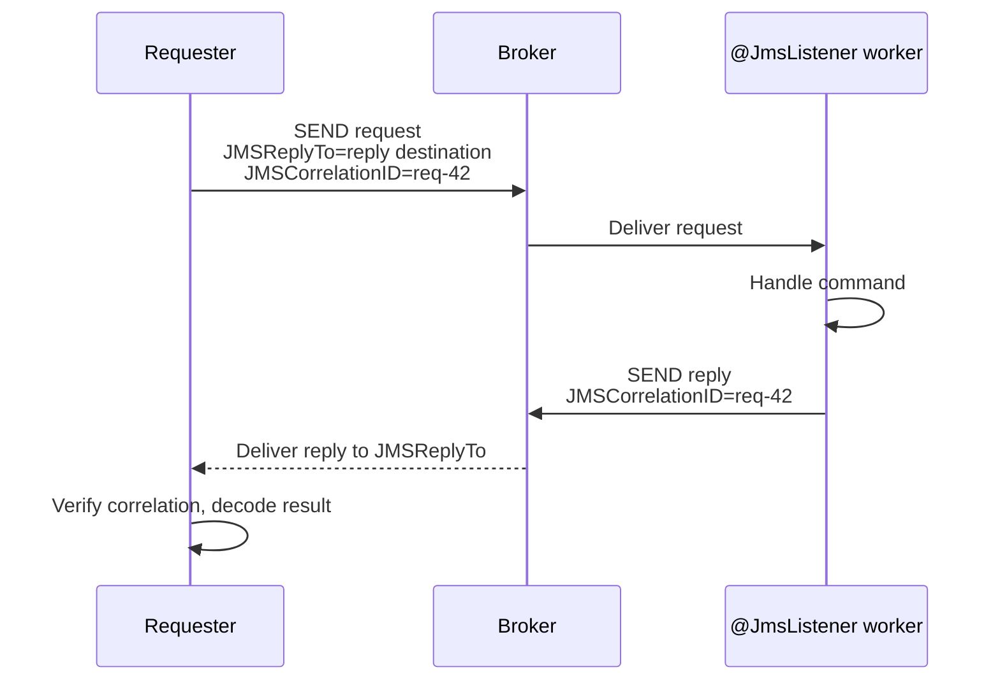
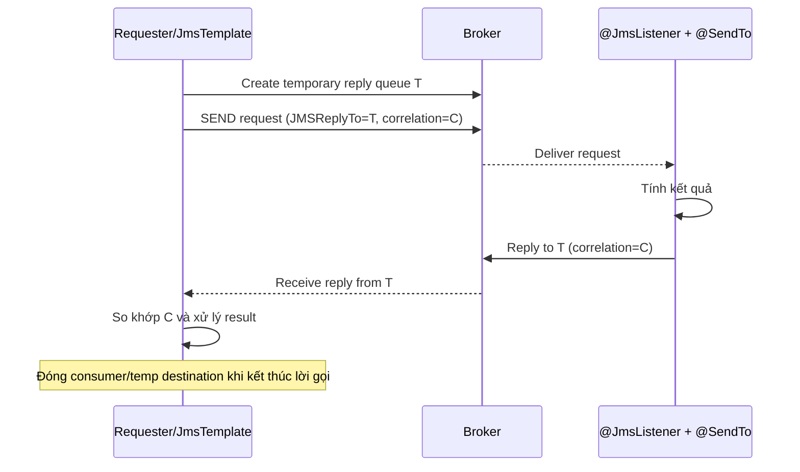
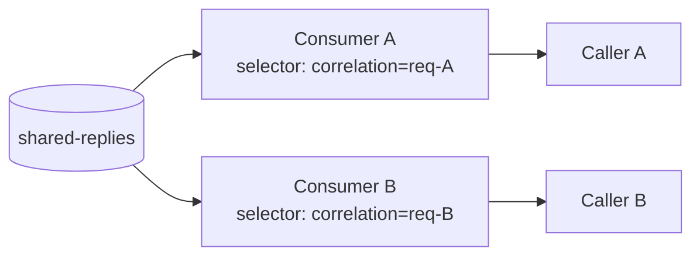
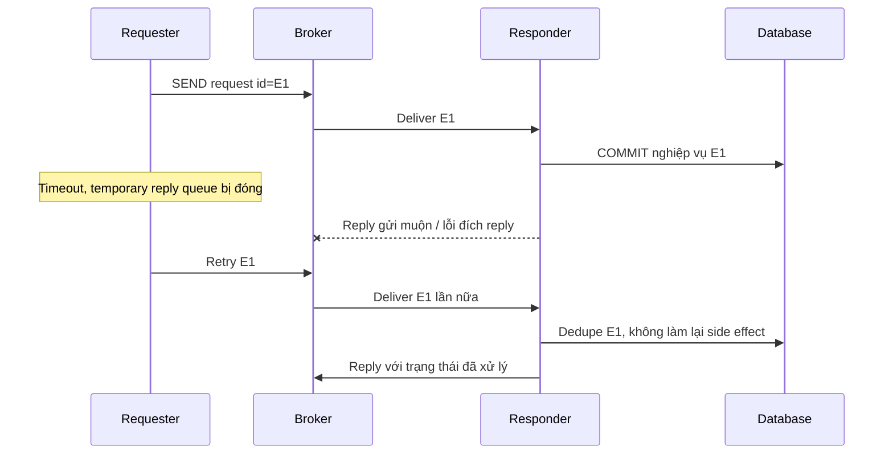

# @SendTo, request–reply và truyền JMSCorrelationID

> **Chương:** Spring JMS  
> **Phạm vi:** Thiết kế một lời gọi request–reply qua Apache ActiveMQ Classic hoặc ActiveMQ Artemis bằng `@JmsListener`, `@SendTo` và `JmsTemplate`. Bài tập trung vào **địa chỉ trả lời (`JMSReplyTo`)**, **khóa tương quan (`JMSCorrelationID`)**, **cách requester chờ đúng phản hồi**, timeout, transaction và failure modes. Lab dùng **Spring Boot 3.3.5 / Spring JMS 6 / Java 17 / Jakarta JMS** kết nối ActiveMQ Classic; đây là các mốc minh họa API, **không phải khuyến nghị về phiên bản mới nhất hoặc hỗ trợ production**.

## 1. Bài toán: gửi một command, đợi đúng response

Dịch vụ tính phí gửi command `CalculateQuote(orderId=O-42)` đến queue `lab.rpc.requests`. Có thể có 20 replica của dịch vụ tính phí xử lý request, và đồng thời 100 requester đang chờ kết quả. Khi một worker hoàn thành, nó trả message `QuoteReady` về destination do requester chỉ định.

Trên JMS, broker không tự tạo quan hệ **HTTP request/response**. Đây là hai message, thường đi qua **hai destination**:



Ba giá trị thường gặp:

| Thuộc tính | Vai trò | Ai tạo/đọc? |
|---|---|---|
| **`JMSReplyTo`** | `Destination` mà requester muốn response được gửi tới, có thể là queue chung hoặc temporary queue | **Requester đặt** trên request; worker/adapter chọn làm đích gửi reply |
| **`JMSCorrelationID`** | Khóa string/byte để ghép **reply với một request logic** | Requester đặt convention; **responder truyền/đặt lại** theo convention; requester so khớp |
| **`JMSMessageID`** | Định danh **message vật lý** do JMS provider quản lý khi gửi | Broker/provider cấp; request và reply thường có **hai JMSMessageID khác nhau** |

**Quy tắc quan trọng:** `JMSReplyTo` trả lời câu hỏi **“gửi response đi đâu?”**; `JMSCorrelationID` trả lời **“response này thuộc request nào?”**. Không dùng `JMSMessageID` của **response** làm mã request, không coi `@SendTo` là cơ chế tự động đối chiếu correlation.

### 1.1 Hai lựa chọn reply destination

**Temporary reply destination:** mỗi lời gọi `JmsTemplate.sendAndReceive(...)` thông thường tạo một temporary queue trên connection, đặt nó vào `JMSReplyTo` của request rồi chờ response tại đó. Mỗi request có đích reply riêng nên không cần một JMS selector để tách phản hồi của những request khác nhau tại cùng một queue chung.

**Shared reply queue:** requester chỉ định một queue cố định, ví dụ `lab.rpc.shared-replies`. Nhiều request/instance dùng chung destination; consumer cần **`JMSCorrelationID` và selector** hoặc một dispatcher ghép correlation với lời gọi đang chờ. Queue này có vòng đời độc lập, có thể giữ reply đến muộn hoặc mồ côi.

| Tiêu chí | Temporary reply queue | Shared reply queue |
|---|---|---|
| Phân biệt các request | Mỗi lời gọi có một destination reply riêng | Cần `JMSCorrelationID` ổn định và quy tắc routing/selector |
| Đơn giản để code | `JmsTemplate.sendAndReceive` | Tự tạo request, consumer chọn lọc hoặc dispatcher |
| Vòng đời | Gắn với kết nối requester; không thích hợp để nhận sau khi requester chết | Queue có thể tiếp tục giữ response sau restart |
| Áp lực broker | Tạo/hủy temporary destinations và consumer theo mỗi lời gọi | Có thể giảm churn nhưng cần quản lý pending requests, TTL, orphan replies |
| Khi timeout | Temporary reply destination có thể bị hủy; response muộn không đến requester cũ | Reply muộn có thể tiếp tục nằm trong queue chung |
| Khi scale nhiều instance | Dễ làm demo, nhưng request đồng thời cao gây overhead | Cần selector/dispatcher đúng, monitoring và giới hạn tài nguyên |

**Request–reply trên broker vẫn là trao đổi message bất đồng bộ** ở nền tảng. Việc requester chờ đồng bộ có thể làm giảm throughput, tạo timeout và kết nối bị giữ lâu. Đừng dùng nó thay HTTP/gRPC chỉ vì broker sẵn có nếu yêu cầu là RPC thời gian thực với deadline nghiêm ngặt.

## 2. `@SendTo` hoạt động thế nào trên một `@JmsListener`?

`@SendTo` của Spring Messaging được dùng để khai báo **destination trả lời mặc định** khi method listener trả về một giá trị. Ví dụ:

```java
import org.springframework.jms.annotation.JmsListener;
import org.springframework.messaging.handler.annotation.SendTo;

@JmsListener(destination = "lab.rpc.requests")
@SendTo("lab.rpc.default-replies")
public String handle(String request) {
    return "result:" + request;
}
```

Khi Spring JMS listener adapter nhận request:

1. Chuyển JMS message thành tham số method qua message converter/resolvers.
2. Gọi method; **giá trị khác `null`** có thể được chuyển thành JMS reply.
3. Chọn reply destination: **`JMSReplyTo` trên request nếu có**; nếu không có, dùng destination mặc định từ `@SendTo` (hoặc default reply destination được cấu hình tương ứng).
4. Chuyển kết quả thành JMS message và gửi đến destination đó, trong session/transaction của listener theo cấu hình.

Vì vậy `@SendTo("lab.rpc.default-replies")` **không bắt mọi reply đi vào queue này**. Nếu requester gửi `JMSReplyTo=temp-queue-123`, adapter gửi vào **temporary queue đó**. `@SendTo` chỉ là **fallback**. Nếu request không đặt `JMSReplyTo`, một return value có `@SendTo` vẫn có đích hợp lệ. Nếu không có cả hai, adapter có thể không tìm được đích trả lời và phát lỗi; cách xử lý lỗi/redelivery phụ thuộc listener container.

### 2.1 Chọn đúng annotation và message converter

- `@JmsListener`: `org.springframework.jms.annotation.JmsListener`.
- `@SendTo`: `org.springframework.messaging.handler.annotation.SendTo`, **không** phải một method trong JMS API.
- Với Spring Boot 3/Spring 6, JMS API là **`jakarta.jms.*`**. Spring Boot 2/Spring 5 dùng `javax.jms.*`; không trộn hai namespace trên cùng client/wiring.
- `String` return type với converter mặc định thường thành **JMS `TextMessage`**. Với DTO tùy biến, cần cấu hình converter JSON/text an toàn; nếu dùng mặc định với object `Serializable` có thể dẫn đến `ObjectMessage`, điều không nên chọn bừa cho các boundary không tin cậy.
- Return `void` hoặc `null` nghĩa là không có giá trị response tự động tương ứng. Khi cần reply nhiều message hoặc streaming, thiết kế producer/adapter riêng thay vì cố biến một return thành stream.

### 2.2 Có phải Spring tự truyền `JMSCorrelationID`?

**Trong đường trả lời tự động qua Spring JMS listener adapter**, response thường được hậu xử lý bằng cách:

1. Nếu request có **`JMSCorrelationID`**, đặt **cùng giá trị** lên response.
2. Nếu request **không có `JMSCorrelationID`**, adapter có thể dùng **`JMSMessageID` của request** làm correlation ID của response theo quy tắc request–reply mà Spring hỗ trợ.

Đó là **hành vi adapter của Spring JMS**, **không phải JMS provider có nghĩa vụ tự truyền mọi header khi ứng dụng tự tạo reply**. Nếu thay `@SendTo` bằng mã gửi reply thủ công hoặc kết nối với một service khác framework, **phải tự kiểm chứng và đặt correlation theo contract**. Không dùng việc fallback sang request JMSMessageID để thay thế một **business request ID ổn định qua retry**.

```text
Request:
  JMSMessageID      = ID:broker:101
  JMSCorrelationID  = req-e8f4
  JMSReplyTo        = temporary-queue-A

Reply tự động từ listener:
  JMSMessageID      = ID:broker:102     (ID vật lý MỚI)
  JMSCorrelationID  = req-e8f4          (dùng để ghép request)
  Destination       = temporary-queue-A
```

**Chú ý:** `JMSMessageID` được JMS provider gán theo cơ chế của nó; số liệu trên là sơ đồ minh họa, không phải định dạng/giá trị chắc chắn của mọi broker.

## 3. Luồng A — requester dùng `JmsTemplate.sendAndReceive`

Spring `JmsTemplate` có phương thức đồng bộ để gửi một request rồi chờ reply. Với destination name và `MessageCreator`:

```java
Message reply = jmsTemplate.sendAndReceive(
        "lab.rpc.requests",
        session -> {
            TextMessage request = session.createTextMessage("quote:O-42");
            request.setJMSCorrelationID("req-123");
            return request;
        });
```

Trong mẫu này `Message` và `TextMessage` là **`jakarta.jms`** với Spring Boot 3. `JmsTemplate` sẽ chuẩn bị temporary reply destination và gắn `JMSReplyTo` vào request trong luồng `sendAndReceive`; lập trình viên **không phải tự đặt một queue cố định cho reply**.

**Điểm cần nhớ:**

- Thiết lập **`receiveTimeout` hữu hạn**. Không có timeout hợp lý có thể làm caller treo khi worker lỗi hoặc reply bị mất. Với Spring `JmsTemplate`, `null` response thường có nghĩa chờ quá timeout, **không chứng minh worker chưa xử lý**.
- Nếu caller đã đặt `JMSCorrelationID`, hãy kiểm tra response có giữ đúng giá trị. Với temporary destination riêng, selector theo correlation thường **không phải điều kiện bắt buộc để lấy đúng response**, nhưng **kiểm tra correlation vẫn hữu ích** để xác nhận hợp đồng.
- Temporary queue phụ thuộc connection/client còn sống. Nếu requester đã timeout/đóng connection, worker có thể xử lý xong nhưng **không gửi được reply vào destination cũ**.
- `sendAndReceive` chỉ điều phối thao tác messaging, **không đảm bảo business exactly-once** khi caller retry sau timeout.



## 4. Lab Spring Boot 3 + ActiveMQ Classic

Lab này có **một process Spring Boot** vừa chứa listener, vừa khởi tạo một request khi ứng dụng chạy. Hai vai trò nằm cùng JVM chỉ để thực hành; production có thể tách thành hai service mà **không đổi hợp đồng JMS**.

**Điều kiện:**

- JDK 17, Maven, một **ActiveMQ Classic broker** có OpenWire tại `tcp://127.0.0.1:61616` và quyền tạo **temporary queue**.
- Spring Boot **3.3.5** (mốc API minh họa); Spring JMS 6 dùng **`jakarta.jms`**. Trong một ứng dụng Boot 2 phải đổi về thư viện/import `javax.jms` tương ứng, không chép nguyên lab.
- Queue thực hành `lab.rpc.requests` và `lab.rpc.default-replies`; chỉ sử dụng môi trường lab.

### 4.1 `pom.xml`

```xml
<project xmlns="http://maven.apache.org/POM/4.0.0"
         xmlns:xsi="http://www.w3.org/2001/XMLSchema-instance"
         xsi:schemaLocation="http://maven.apache.org/POM/4.0.0 https://maven.apache.org/xsd/maven-4.0.0.xsd">
    <modelVersion>4.0.0</modelVersion>
    <parent>
        <groupId>org.springframework.boot</groupId>
        <artifactId>spring-boot-starter-parent</artifactId>
        <version>3.3.5</version>
        <relativePath/>
    </parent>
    <groupId>lab</groupId>
    <artifactId>jms-reply-demo</artifactId>
    <version>0.0.1-SNAPSHOT</version>
    <properties>
        <java.version>17</java.version>
    </properties>
    <dependencies>
        <dependency>
            <groupId>org.springframework.boot</groupId>
            <artifactId>spring-boot-starter-activemq</artifactId>
        </dependency>
    </dependencies>
    <build>
        <plugins>
            <plugin>
                <groupId>org.springframework.boot</groupId>
                <artifactId>spring-boot-maven-plugin</artifactId>
            </plugin>
        </plugins>
    </build>
</project>
```

Boot dependency management chọn Spring JMS và client Classic **Jakarta-compatible** tương ứng. Không thêm `javax.jms-api` hoặc client Classic `javax` vào cùng application. Nếu dùng Artemis, thay **starter**, client và cấu hình endpoint theo broker Artemis thực tế; cú pháp JMS method của ví dụ vẫn là Jakarta, nhưng không mặc định dùng một provider client khác để nói OpenWire.

### 4.2 `application.yml`

Tạo `src/main/resources/application.yml`:

```yaml
spring:
  activemq:
    broker-url: tcp://127.0.0.1:61616
  jms:
    pub-sub-domain: false
```

Ví dụ giả định broker lab có kết nối được từ host đang chạy app. Nếu yêu cầu authentication, cấu hình `spring.activemq.user`/`spring.activemq.password` bằng biến môi trường hoặc secret management, không commit credential thật trong repository. Queue có thể phải được tạo trước theo security/destination policy của broker.

### 4.3 Responder có `@JmsListener` và `@SendTo`

Tạo `src/main/java/lab/rpc/RpcResponder.java`:

```java
package lab.rpc;

import org.springframework.jms.annotation.JmsListener;
import org.springframework.messaging.handler.annotation.SendTo;
import org.springframework.stereotype.Component;

@Component
public class RpcResponder {
    @JmsListener(
            destination = "lab.rpc.requests",
            containerFactory = "jmsListenerContainerFactory")
    @SendTo("lab.rpc.default-replies")
    public String handle(String command) {
        if (!command.startsWith("quote:")) {
            throw new IllegalArgumentException("Unsupported request");
        }
        String orderId = command.substring("quote:".length());
        if (!orderId.matches("[A-Za-z0-9-]{1,64}")) {
            throw new IllegalArgumentException("Invalid orderId");
        }
        return "quote-ok:" + orderId;
    }
}
```

Ứng dụng dùng return `String` để Spring converter tạo `TextMessage`. `@SendTo` khai báo default reply queue. Khi request có `JMSReplyTo` do `JmsTemplate.sendAndReceive` đặt, **đích động đó được ưu tiên**. Trong tình huống command không hợp lệ, handler ném exception: không có reply thành công; khả năng request bị redeliver, vào DLQ hoặc bị loại phụ thuộc transaction và policy.

### 4.4 ApplicationRunner thực hiện round-trip và xác minh correlation

Tạo `src/main/java/lab/rpc/RpcApplication.java`:

```java
package lab.rpc;

import java.util.UUID;
import jakarta.jms.ConnectionFactory;
import jakarta.jms.Message;
import jakarta.jms.TextMessage;
import org.springframework.boot.ApplicationRunner;
import org.springframework.boot.SpringApplication;
import org.springframework.boot.autoconfigure.SpringBootApplication;
import org.springframework.boot.autoconfigure.jms.DefaultJmsListenerContainerFactoryConfigurer;
import org.springframework.context.annotation.Bean;
import org.springframework.jms.annotation.EnableJms;
import org.springframework.jms.config.DefaultJmsListenerContainerFactory;
import org.springframework.jms.core.JmsTemplate;

@SpringBootApplication
@EnableJms
public class RpcApplication {
    public static void main(String[] args) {
        SpringApplication.run(RpcApplication.class, args);
    }

    @Bean
    DefaultJmsListenerContainerFactory jmsListenerContainerFactory(
            ConnectionFactory connectionFactory,
            DefaultJmsListenerContainerFactoryConfigurer configurer) {
        DefaultJmsListenerContainerFactory factory =
                new DefaultJmsListenerContainerFactory();
        configurer.configure(factory, connectionFactory);
        factory.setSessionTransacted(true);
        return factory;
    }

    @Bean
    ApplicationRunner requestOnce(JmsTemplate jmsTemplate) {
        return args -> {
            // Chờ tối đa 5 giây, thay vì vô hạn nếu không có response.
            jmsTemplate.setReceiveTimeout(5_000L);

            String correlationId = "req-" + UUID.randomUUID();
            Message response = jmsTemplate.sendAndReceive(
                    "lab.rpc.requests",
                    session -> {
                        TextMessage request = session.createTextMessage(
                                "quote:O-42");
                        request.setJMSCorrelationID(correlationId);
                        // Không tự set JMSReplyTo:
                        // sendAndReceive tạo temporary reply queue.
                        return request;
                    });

            if (response == null) {
                throw new IllegalStateException(
                        "Request timed out; business outcome is unknown");
            }
            if (!correlationId.equals(response.getJMSCorrelationID())) {
                throw new IllegalStateException(
                        "Unexpected JMSCorrelationID on response");
            }
            if (!(response instanceof TextMessage textResponse)) {
                throw new IllegalStateException(
                        "Expected TextMessage response");
            }
            System.out.println("CORRELATION VERIFIED: " + correlationId);
            System.out.println("REPLY: " + textResponse.getText());
        };
    }
}
```

Chạy tại thư mục dự án:

```bash
mvn clean package
mvn spring-boot:run
```

**Kết quả kỳ vọng** (với broker và quyền truy cập đúng):

```text
CORRELATION VERIFIED: req-<UUID>
REPLY: quote-ok:O-42
```

Ký hiệu `<UUID>` ở trên chỉ là placeholder của **output**, không phải một ID cụ thể. `ApplicationRunner` chạy một request tại startup; ứng dụng có listener nên không tự thoát sau khi in kết quả. Dùng Ctrl+C để dừng lab.

**Ranh giới transaction:** `factory.setSessionTransacted(true)` tạo JMS local transaction cho listener. Trong đường xử lý response tự động, request consumption và reply send do listener adapter thực hiện trong session có thể được commit/rollback theo container. Điều đó **không biến** thao tác database/HTTP bên ngoài thành một phần của JMS transaction. `JmsTemplate` phía requester có lifetime và session riêng; chờ đúng reply không đồng nghĩa business effect chỉ xảy ra một lần.

**Lưu ý về thời gian:** listener có thể bắt đầu sau thời điểm startup tùy môi trường, hoặc broker có thể chậm. Nếu timeout của demo quá ngắn, tăng trong **lab**, kiểm queue, listener container logs và quyền temp destinations. Không xem timeout là bằng chứng responder đã rollback.

## 5. Luồng B — shared reply queue và JMS selector theo correlation

Đôi khi phải dùng reply queue cố định: client nhiều ngôn ngữ, quy trình có worker stateless, giới hạn chính sách temporary destinations, hoặc muốn quan sát message trả lời sau khi requester restart. Khi đó **bạn tự chịu trách nhiệm correlation**.

### 5.1 Gửi vào queue chung và lọc response đúng ID

Ví dụ service gọi **cùng responder ở mục 4** (giữ `@SendTo` fallback):

```java
package lab.rpc;

import java.util.UUID;
import jakarta.jms.Message;
import jakarta.jms.TextMessage;
import org.springframework.jms.core.JmsTemplate;
import org.springframework.stereotype.Service;

@Service
public class SharedReplyGateway {
    private final JmsTemplate jmsTemplate;

    public SharedReplyGateway(JmsTemplate jmsTemplate) {
        this.jmsTemplate = jmsTemplate;
    }

    public String request(String command) throws Exception {
        String correlationId = "req-" + UUID.randomUUID();
        String replyQueue = "lab.rpc.shared-replies";

        jmsTemplate.send("lab.rpc.requests", session -> {
            TextMessage request = session.createTextMessage(command);
            request.setJMSCorrelationID(correlationId);
            request.setJMSReplyTo(session.createQueue(replyQueue));
            return request;
        });

        // Correlation ID do chính code tạo từ UUID, không phải input tùy ý.
        String selector = "JMSCorrelationID = '" + correlationId + "'";
        Message response = jmsTemplate.receiveSelected(replyQueue, selector);

        if (response == null) {
            throw new IllegalStateException(
                    "Timed out waiting for correlation=" + correlationId);
        }
        if (!correlationId.equals(response.getJMSCorrelationID())) {
            throw new IllegalStateException("Mismatched response");
        }
        if (!(response instanceof TextMessage text)) {
            throw new IllegalStateException("Unexpected response type");
        }
        return text.getText();
    }
}
```

**Để timeout không vô hạn**, `JmsTemplate` dùng ở service phải có `receiveTimeout` hữu hạn (như cấu hình tại startup ở lab, hoặc cấu hình bean riêng). Trong app production nên thiết lập timeout tại cấu hình dependency chung, không gọi setter trên shared bean từ nhiều request đang chạy.

Vì có `request.setJMSReplyTo(session.createQueue(replyQueue))`, Spring JMS adapter **gửi response tới `lab.rpc.shared-replies`**, không phải `lab.rpc.default-replies` trong `@SendTo`. `JMSCorrelationID` được echo từ request. Consumer dùng `JMS selector` để chỉ nhận message có correlation ID bằng chuỗi UUID vừa tạo.

**Về selector:** ký tự được đưa vào expression JMS selector phải được escape/validate nếu lấy từ input ngoài. Ví dụ cố ý tạo ID bằng UUID dưới quyền kiểm soát của ứng dụng, nên không có dấu nháy đơn để tiêm vào selector. Trong hệ thống thật, nếu ID nhận từ hệ thống khác, chỉ chấp nhận định dạng allowlist hoặc escape chính xác trước khi xây selector. Selector hỗ trợ lọc, **không phải cơ chế xác thực hay bảo vệ quyền truy cập**.

### 5.2 Vì sao không dùng một consumer không selector trên shared queue?

Giả sử có 2 requester và 2 reply:

```text
Requester A: correlation=req-A, đợi shared-replies
Requester B: correlation=req-B, đợi shared-replies
Reply cho B đến trước reply cho A.
```

Nếu A chỉ gọi `receive("lab.rpc.shared-replies")`, broker có thể giao **reply của B** cho A. Việc A kiểm tra correlation **sau khi đã nhận** không tự trả lại message cho B nếu nó đã bị ACK. Dùng **selector ngay khi tạo consumer** hoặc một **dispatcher duy nhất** nhận rồi route theo correlation đến promise/future đang đợi.



Trong ví dụ `receiveSelected`, mỗi lời gọi thường tạo/đóng một consumer và có chi phí broker. Với concurrency cao, một **reply listener dài hạn** cộng concurrent map `correlationId → pending future` có thể phù hợp hơn, nhưng phải xử lý:

- Thread-safe registration **trước khi** request được publish để tránh reply đến trước khi map có entry.
- Timeout và hủy future để tránh memory leak.
- Reply đến muộn sau timeout hoặc process restart (orphan reply).
- Giới hạn số pending requests, TTL của reply và retention/DLQ.
- Nhiều replica: không thể chỉ dùng map nội bộ JVM nếu reply có thể đến instance khác. Dùng queue reply phân vùng theo instance, consistent routing hoặc shared state/dispatcher theo contract.

**Không dùng một reply queue chung rồi hy vọng selector theo JMSMessageID của reply khớp JMSMessageID request**: hai message có ID vật lý riêng.

## 6. Khi tự tạo response: phải đặt header nào?

`@SendTo` phù hợp request–reply đơn giản: một message vào, một kết quả trả về. Nhưng khi handler gửi response **thủ công** qua `JmsTemplate` hay JMS producer (ví dụ gửi sau khi workflow hoàn thành), không được mặc định framework sẽ copy `JMSReplyTo`/`JMSCorrelationID` hộ.

Đoạn mã JMS API minh họa **một request và một reply trên cùng session**:

```java
// Áp dụng khi bạn thật sự tự quản JMS Message/Session.
Destination replyTo = incomingRequest.getJMSReplyTo();
if (replyTo == null) {
    throw new IllegalArgumentException("Missing JMSReplyTo");
}

String correlation = incomingRequest.getJMSCorrelationID();
if (correlation == null || correlation.isBlank()) {
    // Chọn một convention đã thỏa thuận với requester.
    correlation = incomingRequest.getJMSMessageID();
}
if (correlation == null) {
    throw new IllegalStateException("No correlation identifier");
}

MessageProducer replyProducer = session.createProducer(replyTo);
try {
    TextMessage reply = session.createTextMessage("quote-ok:O-42");
    reply.setJMSCorrelationID(correlation);
    replyProducer.send(reply);
} finally {
    replyProducer.close();
}
```

Ở đây `incomingRequest`, `session` là biến do method xử lý JMS đã có; snippet chỉ minh họa phần **chọn reply destination và đặt correlation**. Nó **không phải** một method Spring listener hoàn chỉnh. Nếu session transacted, phải commit/rollback theo trách nhiệm người sở hữu session; nếu adapter/Framework đã định gửi reply tự động, **không vừa return value vừa gửi thủ công**, tránh tạo **hai response** cho cùng request.

### 6.1 Hai convention được gặp trong tích hợp

| Convention | Request | Reply | Ưu/nhược |
|---|---|---|---|
| **Correlation ID tự tạo** | Requester đặt `JMSCorrelationID=C` trước send | Responder đặt `JMSCorrelationID=C` | Ổn định qua retry nếu chọn giữ cùng business request ID; dễ map |
| **Message-ID correlation** | Requester lấy `JMSMessageID=M` sau send | Responder đặt `JMSCorrelationID=M` | Phụ thuộc ID do broker cấp; khó giữ cố định khi resend request |

Một số adapter (gồm đường reply tự động của Spring JMS) dùng convention thứ hai **khi request không có correlation ID**. Điều đó không làm convention thứ hai trở thành chuẩn bắt buộc với mọi provider/service. Trong hệ thống nhiều ngôn ngữ/broker, hãy **ghi rõ convention trong hợp đồng tích hợp và test bằng message thật**.

**Không dùng `eventId` của nghiệp vụ như một mã phiên duy nhất mà chưa định nghĩa retry:** nếu cùng sự kiện logic được gọi lại, dùng cùng business id cho dedupe; còn mỗi **attempt** có thể cần ID riêng để định tuyến reply. Có thể mang cả `businessRequestId` trong payload và `JMSCorrelationID` của attempt. Cách chọn phụ thuộc yêu cầu tránh trùng và retry, nhưng phải nhất quán.

## 7. Timeout, duplicate và transaction: request–reply không phải exactly-once

### 7.1 Ba cửa sổ lỗi đáng nhớ

| Thời điểm lỗi | Requester quan sát | Broker/responder có thể đã làm | Thiết kế cần có |
|---|---|---|---|
| Trước khi broker nhận request | Send/connection error | Request có thể chưa tồn tại | Retry có backoff, xác định unknown outcome |
| Broker nhận và worker **đã commit DB**, nhưng reply mất | Timeout | Nghiệp vụ có thể đã hoàn tất | Business request ID + idempotency; không retry như lần tạo nghiệp vụ mới |
| Responder gửi reply, requester's temp queue bị hủy sau timeout | Timeout hoặc không nhận được reply | Worker có thể đã xử lý xong; send reply có thể thất bại | Response status query/reconciliation, deadline, theo dõi orphan/reply failure |



**Timeout không hủy việc đã gửi**. Requester thấy `null` từ `sendAndReceive` hoặc exception **không đủ** để kết luận DB chưa commit. Retry nên mang `businessRequestId` ổn định; bên nhận lưu marker unique trong cùng DB transaction với thay đổi nghiệp vụ và có thể tái dựng kết quả khi duplicate.

### 7.2 Phạm vi transaction JMS

Với `DefaultJmsListenerContainerFactory.setSessionTransacted(true)`, Spring listener container sử dụng local JMS transaction để xác nhận message sau xử lý. Đường `@JmsListener` trả reply qua adapter có thể nằm trong cùng session JMS đó theo cách provider/container triển khai.

Tuy nhiên:

- Transaction JMS **không tự bao gồm JDBC** hoặc REST/HTTP call. DB commit trước JMS commit vẫn có cửa sổ duplicate.
- Gửi reply qua **một `JmsTemplate` khác** có thể dùng connection/session khác, không mặc nhiên chung transaction với việc nhận request.
- Nếu handler ném exception, container có thể rollback và request được giao lại theo redelivery policy; requester có thể timeout ngay cả khi request còn retry.
- Nếu trả lời sau khi DB đã commit mà message reply được gửi lại, requester phải chịu được **duplicate reply** hoặc reply đến sau khi request hoàn tất.
- Nếu cần broker+DB transaction chung, phải cân nhắc XA/JTA thực sự, với chi phí/recovery; không dùng `@SendTo` như shortcut transaction phân tán.

**Lựa chọn vận hành thực dụng:** một handler idempotent theo business request ID, ghi kết quả bền vững, gửi response như một hành động có thể thử lại; caller có thể hỏi lại trạng thái khi response mất.

### 7.3 Deadline, TTL và retry policy

Một request chờ 5 giây không có nghĩa message trên broker tự hết hạn sau 5 giây. **Receive timeout** chỉ giới hạn thời gian chờ của caller. Nếu muốn bỏ qua công việc đã quá hạn, cần **message expiration/deadline trong payload** và logic responder kiểm tra hạn thực thi.

Nếu dùng TTL trên JMS message, lưu ý:

- TTL không giết một handler đang chạy hay rollback database.
- Message hết hạn trước khi worker nhận có thể không được xử lý hoặc đi theo expiry/DLQ policy.
- Reply có thể bị giữ trên shared queue sau khi caller không còn tồn tại nếu không đặt TTL/retention thích hợp.
- Cần phân biệt **deadline nghiệp vụ**, timeout chờ reply và TTL broker: ba thời điểm khác nhau.

Không retry đồng loạt với cùng timeout ngắn tạo **retry storm**. Đặt concurrency limit, circuit breaker và exponential backoff; ghi metric elapsed/timeout/retry theo `businessRequestId`. Không log payload chứa token hoặc dữ liệu nhạy cảm.

## 8. Những lỗi thường gặp khi dùng `@SendTo`

| Triệu chứng | Kiểm tra trước tiên | Vì sao xảy ra |
|---|---|---|
| Listener trả `String` nhưng caller timeout | `JMSReplyTo` trên request, permission temp queue, listener log và broker reply destination | Reply có thể gửi sai đích hoặc không gửi được |
| Reply xuất hiện ở `lab.rpc.default-replies` dù caller muốn chờ temporary queue | Caller thực tế chỉ dùng `convertAndSend` thay vì `sendAndReceive` hoặc quên `JMSReplyTo` | `@SendTo` là fallback |
| Reply không có `JMSCorrelationID` mong đợi | Header request, client API/adapter và response path thực tế | Code gửi reply thủ công không copy correlation, hoặc convention khác |
| Hai concurrent callers nhận nhầm reply | Shared queue consumer không selector hoặc dispatcher sai | Queue không gắn response với caller theo bản chất |
| App nhận reply nhưng code cast thất bại | Reply là `BytesMessage`/custom converter, không phải `TextMessage` | Khác message converter/contract |
| Requester timeout, business đã chạy | DB commit trước khi reply tới caller | Không có transaction chung với thời gian chờ |
| Consumer xử lý lặp khi requester retry | Hai message vật lý cùng một sự kiện logic | Thiếu business idempotency |
| `@SendTo` method trả null hoặc void | Không có return value để chuyển thành JMS reply | Cần trả kết quả hoặc gửi response chủ động |
| `No reply destination` hoặc lỗi send reply | Request không có `JMSReplyTo` và không có default destination, hoặc destination không hợp lệ | Thiếu contract reply routing |
| Message kẹt DLQ/retry | Handler ném exception hoặc response send thất bại trong transaction | Kiểm redelivery policy, session transacted và DLQ |
| Hết temporary destinations/consumer resources | Tải RPC đồng thời quá cao, kết nối/consumer tạo-hủy liên tục | Giảm concurrency, cân nhắc reply dispatcher/queue dùng chung |

### 8.1 Không có reply không đồng nghĩa không có ACK

Một consumer `@JmsListener` kiểu `void` có thể xử lý/ACK request mà không gửi reply. Ngược lại, một handler trả return value nhưng lỗi khi gửi reply có thể khiến **cả transaction JMS** rollback nếu listener container cấu hình transacted. Kết quả phụ thuộc container, transaction boundaries và lỗi tại thời điểm cụ thể; phải đo cả **request dequeue, reply enqueue, redelivery và DB commit**, không chỉ nhìn một counter.

### 8.2 Security của reply destination

`JMSReplyTo` là destination do requester cung cấp. Với hệ thống nhiều tenant hoặc client không tin cậy:

- Kiểm soát quyền tạo temporary destination, quyền send/consume trên reply queues và quyền read queue chính.
- Không nhận một reply destination tùy ý từ người dùng rồi tự động gửi payload nhạy cảm mà không xác thực authorization.
- Không cho rằng correlation ID là secret hoặc bằng chứng danh tính; nó là **khóa ghép cặp**, có thể bị nhìn thấy trong header/monitoring.
- Giới hạn message size, thời gian sống, số outstanding requests và retention của queue trả lời.
- TLS/credential ở broker và phân quyền theo destination vẫn cần thiết dù dùng `@SendTo`.

## 9. Ma trận thử nghiệm request–reply

| Mã | Thiết lập | Kiểm chứng |
|---|---|---|
| R1 | `sendAndReceive` với correlation ID tùy chọn, handler có `@SendTo` | Reply tới temporary destination, `JMSCorrelationID` khớp |
| R2 | Gửi request không có `JMSReplyTo`, handler có `@SendTo` | Reply đi vào default reply queue |
| R3 | Gửi request có `JMSReplyTo=shared-replies` | Reply vào shared queue, không vào `@SendTo` fallback |
| R4 | Hai request có correlation khác nhau, reply đến đảo thứ tự | Selector/dispatcher ghép đúng từng caller |
| R5 | Reply handler trả `null` | Không có reply; caller timeout theo cấu hình |
| R6 | Handler ném exception trước return | Quan sát rollback/redelivery/DLQ; không nhận response thành công |
| R7 | Caller timeout trước khi handler hoàn tất | Work có thể vẫn chạy; thử idempotent retry cùng business ID |
| R8 | Requester ngắt connection khi temp queue đã tạo | Reply có thể không gửi được/không còn ai nhận; xem broker log |
| R9 | Worker commit DB rồi crash trước gửi reply | Retry request không được nhân đôi side effect |
| R10 | Gửi response thủ công không set correlation | Phép test phát hiện mismatch; sửa contract |
| R11 | Shared reply queue có orphan reply quá hạn | Queue TTL/retention và cleanup có hoạt động? |
| R12 | Classic vs Artemis, cùng mã Jakarta JMS | Kiểm starter/client/acceptor/authorization và chạy lại các test |

Khi kiểm thử, dùng **queue lab tách biệt**, log request ID, correlation ID, request JMSMessageID, response JMSMessageID, `JMSReplyTo`, timestamps và transaction outcome. Không suy từ thứ tự log của hai process rằng broker gửi đúng sai nếu đồng hồ không được đồng bộ. Một kết quả PASS phải chứng minh **đúng destination, đúng correlation, đúng business outcome**, không chỉ “có dòng REPLY”.

## 10. Khi nào nên dùng `@SendTo` và khi nào không?

| Nhu cầu | Cách làm phù hợp | Điểm cần chấp nhận |
|---|---|---|
| Demo hoặc RPC ít traffic, requester chờ đồng bộ | `JmsTemplate.sendAndReceive` + `@JmsListener` trả giá trị + `@SendTo` fallback | Temporary destination per call, timeout hữu hạn |
| Cần reply routing cố định với nhiều hệ thống | Shared reply queue + `JMSCorrelationID` + selector/dispatcher | Chịu trách nhiệm orphan reply, concurrency, routing |
| Handler trả một kết quả sau xử lý ngắn | `@SendTo` + return value | Trả `null`/throw không tạo success reply |
| Handler chạy workflow hàng phút/giờ | Command + event/status queue, correlation bền vững hoặc query status | Không nên giữ thread request chờ rất lâu |
| Tác động có tiền/điểm/thanh toán | Request–reply + idempotency/DB transaction | Reply đến muộn hoặc trùng vẫn phải xử lý |
| Nhiều broker, đa ngôn ngữ, nhiều protocol | Hợp đồng reply destination/correlation rõ và adapter theo protocol | Không mặc định mọi provider echo correlation giống Spring |
| Cần kết quả lỗi theo schema chứ không chỉ timeout | Thiết kế reply chứa status/error code đã chuẩn hóa | Phân biệt business reject với infrastructure exception |

### Câu hỏi tự kiểm tra

1. `@SendTo("fallback")` có luôn ép response vào `fallback` không, nếu requester đã đặt `JMSReplyTo`?
2. Tại sao `JMSMessageID` trên response không bằng `JMSMessageID` trên request? Dùng thuộc tính nào để tương quan?
3. Với `sendAndReceive` dùng temporary queue, có cần shared-queue selector cho từng request không? Vì sao vẫn nên kiểm correlation?
4. Nếu chỉ dùng `jmsTemplate.convertAndSend` gửi request không có `JMSReplyTo`, listener có `@SendTo` sẽ trả response về đâu?
5. Hai instance cùng gọi `receive("shared-replies")` không selector có nguy cơ gì ngay cả khi mỗi instance kiểm tra correlation sau receive?
6. Một handler đã commit database nhưng reply bị timeout. Vì sao requester không thể an toàn retry bằng một business ID mới?
7. Transaction JMS trên listener có tự đưa PostgreSQL transaction vào cùng commit không?
8. Nêu sự khác nhau giữa caller receive timeout, JMS message TTL và business deadline.
9. Nếu Spring JMS adapter được thay bằng code `MessageProducer` thuần, những header nào cần tự kiểm soát để không mất reply routing?
10. Vì sao `JMSCorrelationID` không phải cơ chế xác thực và không được dùng như tenant authorization?

### Checklist nghiệm thu

- [ ] Caller và responder dùng **cùng convention `JMSCorrelationID`**, có test echo và mismatch.
- [ ] Request có `JMSReplyTo` khi đòi reply động; `@SendTo` chỉ được coi là fallback.
- [ ] `JmsTemplate` có receive timeout hữu hạn, đo timeout và unknown business outcome.
- [ ] Shared reply queue có selector hoặc dispatcher an toàn khi concurrent.
- [ ] Reply đến muộn, orphan reply, duplicate reply và restart requester đều có phương án.
- [ ] Handler có business ID/idempotency riêng, không dùng `JMSMessageID` thay unique business key.
- [ ] Return type và message converter đã thống nhất, không vô tình tạo `ObjectMessage` không tin cậy.
- [ ] Transaction JMS với DB được phân ranh; retry/redelivery/DLQ và lỗi send reply được kiểm thử.
- [ ] Reply destination, temporary queue và queue trả lời chung được bảo vệ bằng ACL/TLS/quota.
- [ ] Đã chạy smoke test trên **đúng client/phiên bản Classic hoặc Artemis**, không suy compatibility chỉ từ Jakarta JMS API.

**Kết luận:** `@SendTo` trong Spring JMS chỉ định **đích trả lời mặc định** cho method `@JmsListener` có return value; `JMSReplyTo` trên request, nếu có, là **đích động được ưu tiên**. `JMSCorrelationID` giúp ghép response với request, trong khi `JMSMessageID` chỉ định danh từng message vật lý. `JmsTemplate.sendAndReceive` đơn giản hóa mô hình temporary reply queue; shared queue đòi hỏi selector/dispatcher và quản lý reply mồ côi. Cuối cùng, **nhận được reply đúng correlation không đồng nghĩa tác động nghiệp vụ đúng một lần**: timeout, retry và crash vẫn cần business ID ổn định, idempotency và transaction có ranh giới rõ ràng.
