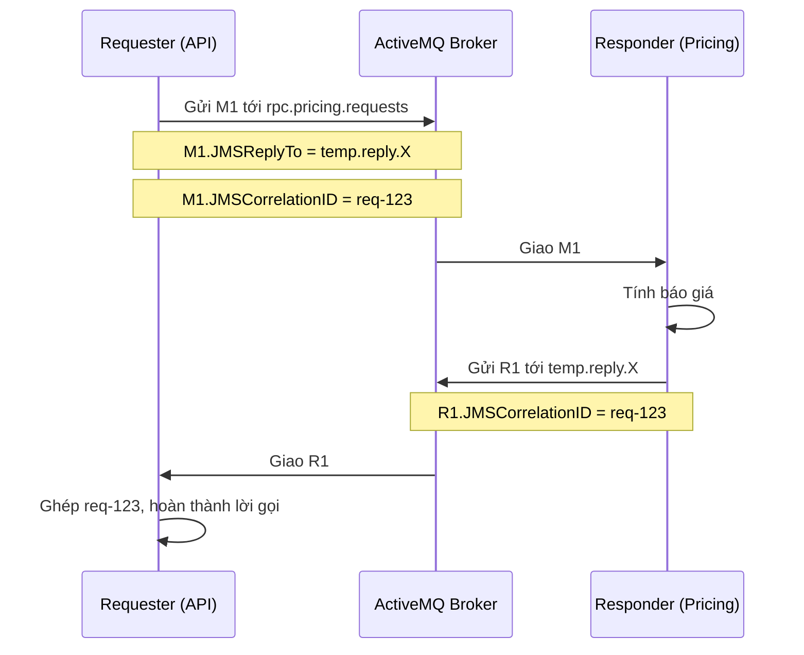

# Request–reply với reply queue, correlation ID và timeout

> **Chương:** Mẫu tích hợp  
> **Phạm vi:** Java JMS/Jakarta Messaging trên ActiveMQ Classic hoặc Artemis; ví dụ dùng **Artemis CORE + Jakarta Messaging 3.x**, Java 17+. Bài tập trung vào đường đi yêu cầu–phản hồi, cách chọn reply destination, ghép correlation ID, giới hạn thời gian chờ và xử lý kết quả đến muộn. Các nội dung transaction/redelivery chỉ xét tại ranh giới liên quan đến request–reply.

## 1. Vấn đề: gửi bất đồng bộ nhưng cần một kết quả

Một API báo giá nhận yêu cầu `quote(SKU-42, 2)` rồi nhờ dịch vụ pricing tính tiền thông qua broker. Bên gọi muốn nhận kết quả trong **5 giây**. Khác với fire-and-forget, bên gọi phải chuẩn bị **đường quay về** cho phản hồi và biết phản hồi nào thuộc yêu cầu nào.



**Ba thành phần không thể đánh đồng:**

| Thành phần | Chịu trách nhiệm | Ví dụ |
| --- | --- | --- |
| **Request queue** | Đưa yêu cầu tới một trong các responder | `rpc.pricing.requests` |
| **Reply destination** (header `JMSReplyTo` trên request) | Chỉ ra nơi requester muốn nhận câu trả lời | Một `TemporaryQueue` hoặc `rpc.pricing.replies.api-1` |
| **Correlation ID** (header `JMSCorrelationID`) | Ghép phản hồi với đúng yêu cầu đang chờ | `7b4b...`, ổn định trong vòng đời request |

`JMSReplyTo` không tạo câu trả lời. Broker chỉ **chuyển message**, còn responder phải đọc header này và **chủ động gửi reply**. Tương tự, broker không tự đảm bảo response chứa đúng correlation ID; đó là **hợp đồng của hai ứng dụng**.

Về bản chất, request–reply trên JMS vẫn là **hai message bất đồng bộ**. Lời gọi đồng bộ chỉ do ứng dụng dựng lên bằng việc **chờ** trên reply queue.

## 2. Hợp đồng message: `JMSReplyTo` và `JMSCorrelationID`

### 2.1. Request do requester tạo

```java
// session: jakarta.jms.Session
Queue requestQueue = session.createQueue("rpc.pricing.requests");
TemporaryQueue replyQueue = session.createTemporaryQueue();

String requestId = java.util.UUID.randomUUID().toString();
TextMessage request = session.createTextMessage("SKU-42:2");

request.setJMSReplyTo(replyQueue);
request.setJMSCorrelationID(requestId);
request.setStringProperty("requestId", requestId);
request.setLongProperty("deadlineEpochMs",
        System.currentTimeMillis() + 5_000L);
```

- `JMSReplyTo` là **`jakarta.jms.Destination`**, không phải tên queue được truyền dưới dạng `String`. Responder đọc `request.getJMSReplyTo()` và gửi tới đối tượng destination đó.
- `JMSCorrelationID` là **JMS header**. Ứng dụng có thể đặt một UUID/ID có cấu trúc từ trước khi gọi `send`.
- Property `requestId` là metadata riêng của ứng dụng, tiện cho log và trace. Có thể đồng nhất giá trị với `JMSCorrelationID`, nhưng cần quy ước để tránh hai nguồn sự thật lệch nhau.
- Property `deadlineEpochMs` là ví dụ về **hợp đồng nghiệp vụ**, không phải header chuẩn JMS hoặc cơ chế broker tự hủy request khi quá hạn.

### 2.2. Response do responder tạo

```java
Destination replyTo = request.getJMSReplyTo();
String requestId = request.getJMSCorrelationID();

if (replyTo == null || requestId == null || requestId.isBlank()) {
    throw new JMSException("Request missing replyTo/correlationId");
}

TextMessage response = session.createTextMessage(
        "{\"sku\":\"SKU-42\",\"totalVnd\":250000}");
response.setJMSCorrelationID(requestId);
response.setJMSType("PriceQuoted");

// producer được tạo không gắn sẵn destination.
MessageProducer replyProducer = session.createProducer(null);
replyProducer.send(replyTo, response,
        DeliveryMode.NON_PERSISTENT, 4, 10_000L);
```

**Quy tắc ghép cặp:** responder phải **sao chép request.`JMSCorrelationID` sang response.`JMSCorrelationID`** theo contract này. Đừng dùng response.`JMSMessageID` làm correlation ID vì đó là ID **mới** do provider cấp cho response.

### 2.3. Hai quy ước correlation thường gặp

| Quy ước | Requester thực hiện | Responder thực hiện | Đánh đổi |
| --- | --- | --- | --- |
| **Application-generated ID** (khuyến nghị ở ví dụ) | Sinh `requestId` trước `send` và đặt `JMSCorrelationID` | Copy ID đó sang response | Có thể tạo selector trước khi gửi; ID ổn định cho trace/retry |
| **Request JMSMessageID** | Gửi request, sau `send` lấy `request.getJMSMessageID()` | Đặt `response.JMSCorrelationID = request.JMSMessageID` | Đợi provider cấp ID mới biết correlation; cần phối hợp consumer/buffer reply |

Hai cách **không được trộn**. Nếu requester đợi correlation ID do ứng dụng sinh, còn responder gán request `JMSMessageID`, reply có thể đã đến queue nhưng **không bao giờ khớp selector**.

Với application-generated ID, ưu tiên UUID dạng chuỗi, giới hạn độ dài và ký tự. Nếu xây selector bằng cách nối chuỗi, **không ghép dữ liệu tùy ý từ người dùng** vào biểu thức: dấu nháy có thể làm hỏng selector hoặc thay đổi điều kiện.

## 3. Reply queue tạm thời hay cố định?

### 3.1. `TemporaryQueue`: thuận tiện cho request đồng bộ ngắn

```java
TemporaryQueue replyQueue = session.createTemporaryQueue();
MessageConsumer replyConsumer = session.createConsumer(
        replyQueue, "JMSCorrelationID = '" + requestId + "'");
```

Đặc tính quan trọng:

- Temporary queue được tạo bởi **một connection**; consumer dùng để đọc queue đó phải thuộc connection sở hữu nó. **Connection khác vẫn có thể gửi** message vào temporary queue bằng `JMSReplyTo` nhận từ request.
- Temporary queue tồn tại theo vòng đời connection và sẽ bị xóa khi connection sở hữu đóng; có thể gọi `delete()` khi không còn consumer và không cần nó nữa.
- Nó **không phải nơi lưu reply bền vững qua restart** của requester. Requester crash hoặc reconnect bằng connection mới sẽ không khôi phục lại reply queue cũ như một queue cố định.
- Khi đi qua bridge/federation/multiple brokers, responder phải **gửi được** tới temporary destination do requester tạo. Đừng giả định reply-to object từ broker khác luôn chuyển được qua ranh giới provider.
- Tạo một temporary queue cho **mỗi request** là mẫu dễ hiểu nhưng có chi phí broker resource/management; workload high-QPS cần đo và cân nhắc tái sử dụng theo connection.

**Thứ tự nên dùng:** tạo reply destination và reply consumer **trước khi gửi request**, sau đó `connection.start()` và send. Cách này tránh tình huống responder trả lời rất nhanh nhưng requester chưa sẵn sàng nhận. Với reply queue, message có thể đã xếp hàng tạm thời khi chưa có consumer, nhưng nên tránh dựa vào timing để thiết kế race condition.

### 3.2. Queue cố định: dùng được lâu, nhưng cần phân luồng reply

Ví dụ:

```text
request queue:  rpc.pricing.requests
reply queue:    rpc.pricing.replies.api-1
requestId:      req-001
selector:       JMSCorrelationID = 'req-001'
```

Ưu điểm là reply destination không biến mất theo mỗi connection và có thể được cấu hình durable. Nhưng phải giải quyết **ownership**:

- Nếu **requester A và B** cùng consume một reply queue mà **không có selector/dispatcher**, B có thể nhận reply dành cho A rồi discard → A timeout dù broker đã giao thành công.
- Mở một consumer **với selector theo từng request** có thể hoạt động ở tải thấp, nhưng số consumer/selector tăng theo requests in-flight; cần giới hạn concurrency và cleanup khi timeout.
- Với throughput cao, sử dụng **một long-lived reply consumer** trên reply queue riêng theo instance hoặc một dispatcher có định tuyến đúng correlation ID đến các pending futures. Không tạo một consumer riêng cho mọi HTTP request một cách vô hạn.
- Một reply queue dùng chung giữa nhiều instances chỉ an toàn khi thiết kế **partition/selector/ownership** rõ ràng. Consumer `AUTO_ACKNOWLEDGE` nhận nhầm response rồi bỏ qua là mất response cho caller đúng.

### Bảng quyết định

| Tiêu chí | TemporaryQueue | Queue cố định |
| --- | --- | --- |
| Vòng đời | Gắn với connection sở hữu | Tồn tại độc lập, theo provisioning/retention |
| Dễ bắt đầu | Dễ cho một request–reply đồng bộ | Cần quản lý tên, consumer, ACL và backlog |
| Requester restart | Reply queue cũ không tồn tại | Có thể giữ reply nếu thiết kế consumer/state phù hợp |
| Nhiều request đồng thời | Phải quản lý số temp destinations và listeners | Cần multiplex bằng correlation ID |
| Broker bridge/multi-hop | Có thể khó route trở lại | Queue cố định dễ provision/routing hơn |
| Rủi ro reply đến muộn | Destination đã mất, reply có thể không gửi được | Reply tích backlog nếu không có TTL/cleanup |

**Không chọn fixed reply queue chỉ vì “durable hơn”** nếu ứng dụng vẫn chỉ chờ trong RAM rồi mất bản đồ `requestId → caller` khi restart. Muốn phục hồi quy trình sau restart, phải lưu cả **trạng thái chờ và kết quả** vào persistent inbox/workflow store.

## 4. Java thực hành: requester với temporary reply queue và timeout

Ví dụ dùng **Artemis Jakarta client**, Java 17+ và broker Artemis đang chạy tại `tcp://localhost:61616`. Queue `rpc.pricing.requests` đã được provision hoặc broker cho phép auto-create. Requester và responder cùng dùng quy ước **UUID ứng dụng**; response có `JMSCorrelationID` bằng ID request.

Dependency Maven, version minh họa (chọn phiên bản tương thích broker/BOM của dự án):

```xml
<dependency>
    <groupId>org.apache.artemis</groupId>
    <artifactId>artemis-jakarta-client</artifactId>
    <version>2.50.0</version>
</dependency>
```

Ví dụ `PriceRequester.java`:

```java
package demo.rpc;

import java.util.UUID;

import jakarta.jms.Connection;
import jakarta.jms.DeliveryMode;
import jakarta.jms.JMSException;
import jakarta.jms.Message;
import jakarta.jms.MessageConsumer;
import jakarta.jms.MessageProducer;
import jakarta.jms.Queue;
import jakarta.jms.Session;
import jakarta.jms.TemporaryQueue;
import jakarta.jms.TextMessage;

import org.apache.activemq.artemis.jms.client.ActiveMQConnectionFactory;

public final class PriceRequester {
    private static final long WAIT_MS = 5_000L;

    public static void main(String[] args) throws JMSException {
        ActiveMQConnectionFactory factory =
                new ActiveMQConnectionFactory(required("ARTEMIS_URL"));
        Connection connection = factory.createConnection(
                required("ARTEMIS_USER"), required("ARTEMIS_PASSWORD"));

        try {
            Session session = connection.createSession(
                    false, Session.AUTO_ACKNOWLEDGE);
            try {
                Queue requests = session.createQueue("rpc.pricing.requests");
                TemporaryQueue replies = session.createTemporaryQueue();

                String requestId = UUID.randomUUID().toString();
                // UUID hex-and-hyphen là giá trị an toàn để đặt trong selector.
                String selector = "JMSCorrelationID = '" + requestId + "'";
                MessageConsumer consumer = session.createConsumer(
                        replies, selector);
                MessageProducer producer = session.createProducer(requests);

                try {
                    connection.start(); // Bật nhận reply.

                    long deadline = System.currentTimeMillis() + WAIT_MS;
                    TextMessage request =
                            session.createTextMessage("SKU-42:2");
                    request.setJMSReplyTo(replies);
                    request.setJMSCorrelationID(requestId);
                    request.setStringProperty("requestId", requestId);
                    request.setLongProperty("deadlineEpochMs", deadline);

                    // TTL của request ở broker, không phải timeout receive.
                    producer.send(request, DeliveryMode.PERSISTENT, 4,
                            WAIT_MS);

                    long remaining = deadline - System.currentTimeMillis();
                    if (remaining <= 0L) {
                        throw new IllegalStateException(
                                "Deadline elapsed during send");
                    }

                    Message response = consumer.receive(remaining);
                    if (response == null) {
                        throw new IllegalStateException(
                                "Request timed out: " + requestId);
                    }
                    if (!requestId.equals(
                            response.getJMSCorrelationID())) {
                        throw new IllegalStateException(
                                "Unexpected correlation ID");
                    }
                    if (!(response instanceof TextMessage text)) {
                        throw new IllegalStateException(
                                "Expected TextMessage response");
                    }

                    System.out.println("requestId=" + requestId
                            + " reply=" + text.getText());
                } finally {
                    producer.close();
                    consumer.close();
                    // Có thể delete() sau khi không còn consumer;
                    // đóng connection cũng xóa temporary destination.
                    replies.delete();
                }
            } finally {
                session.close();
            }
        } finally {
            connection.close();
        }
    }

    private static String required(String name) {
        String value = System.getenv(name);
        if (value == null || value.isBlank()) {
            throw new IllegalStateException("Missing " + name);
        }
        return value;
    }
}
```

**Giải thích những dòng quyết định:**

1. `TemporaryQueue` tạo **reply destination**, không gửi request vào đó.
2. `JMSReplyTo` đặt trên request báo cho responder biết nơi trả lời.
3. `JMSCorrelationID` do requester sinh trước `send`, nhờ đó selector có thể được tạo ngay.
4. `MessageConsumer` được đăng ký trước khi gửi request; `connection.start()` cho phép nhận.
5. `producer.send(..., WAIT_MS)` truyền **time-to-live**, còn `consumer.receive(remaining)` là **thời gian chờ cục bộ**. Chúng không cùng một thao tác.
6. Khi timeout, requester đóng consumer/temporary queue; nó **không gửi lệnh cancel** đến responder và không bảo đảm broker hủy message đã được giao.
7. Reply được kiểm tra cả `JMSCorrelationID` lẫn message type; không chỉ tin vào body.

Mẫu này mỗi lần chạy tạo một request, nên không có shared mutable `Session` giữa các thread. Với nhiều HTTP requests song song, **không chia sẻ một `Session` giữa các thread**; dùng request-scoped session hoặc một dispatcher chuyên trách có cơ chế concurrency kiểm soát được.

## 5. Java responder: nhận request, trả reply và commit JMS

Responder dùng **một transacted `Session`** để ràng buộc việc nhận request và gửi response trong **một local JMS transaction**. Đây là atomicity **giữa các thao tác JMS trên cùng broker/session**; không bao gồm database, HTTP hoặc side effects bên ngoài.

File `PriceResponder.java`:

```java
package demo.rpc;

import jakarta.jms.Connection;
import jakarta.jms.DeliveryMode;
import jakarta.jms.Destination;
import jakarta.jms.JMSException;
import jakarta.jms.Message;
import jakarta.jms.MessageConsumer;
import jakarta.jms.MessageProducer;
import jakarta.jms.Queue;
import jakarta.jms.Session;
import jakarta.jms.TextMessage;

import org.apache.activemq.artemis.jms.client.ActiveMQConnectionFactory;

public final class PriceResponder {
    public static void main(String[] args) throws JMSException {
        ActiveMQConnectionFactory factory =
                new ActiveMQConnectionFactory(required("ARTEMIS_URL"));
        Connection connection = factory.createConnection(
                required("ARTEMIS_USER"), required("ARTEMIS_PASSWORD"));

        try {
            Session session = connection.createSession(
                    true, Session.SESSION_TRANSACTED);
            try {
                Queue requestQueue =
                        session.createQueue("rpc.pricing.requests");
                MessageConsumer consumer =
                        session.createConsumer(requestQueue);
                MessageProducer replies = session.createProducer(null);

                try {
                    connection.start();
                    while (!Thread.currentThread().isInterrupted()) {
                        Message incoming = consumer.receive(1_000L);
                        if (incoming == null) {
                            continue;
                        }

                        try {
                            if (!(incoming instanceof TextMessage request)) {
                                throw new JMSException("Unexpected body type");
                            }

                            Destination replyTo = request.getJMSReplyTo();
                            String correlationId =
                                    request.getJMSCorrelationID();

                            if (replyTo == null || correlationId == null
                                    || correlationId.isBlank()) {
                                throw new JMSException(
                                        "Missing replyTo/correlationId");
                            }

                            long deadline = incoming.propertyExists(
                                    "deadlineEpochMs")
                                    ? incoming.getLongProperty(
                                            "deadlineEpochMs")
                                    : 0L;

                            // Không tạo reply cho request đã hết deadline.
                            // Policy này phù hợp dịch vụ chỉ tính giá, không
                            // mặc nhiên phù hợp với nghiệp vụ có side effects.
                            if (deadline > 0L
                                    && System.currentTimeMillis() > deadline) {
                                session.commit(); // Retire expired request.
                                continue;
                            }

                            String[] fields =
                                    request.getText().split(":", -1);
                            if (fields.length != 2
                                    || !fields[0].matches("[A-Z0-9-]{1,40}")) {
                                throw new JMSException("Invalid SKU format");
                            }
                            int qty = Integer.parseInt(fields[1]);
                            if (qty < 1 || qty > 100) {
                                throw new JMSException("Invalid quantity");
                            }

                            long totalVnd = 125_000L * qty;
                            String json = "{\"sku\":\"" + fields[0]
                                    + "\",\"qty\":" + qty
                                    + ",\"totalVnd\":" + totalVnd + "}";

                            TextMessage reply =
                                    session.createTextMessage(json);
                            reply.setJMSCorrelationID(correlationId);
                            reply.setJMSType("PriceQuoted");
                            reply.setStringProperty(
                                    "requestId", correlationId);

                            // Chỉ gửi lại đúng replyTo được request cung cấp.
                            // Trong môi trường đa tenant phải có allowlist/
                            // authorization để chống reply-to injection.
                            replies.send(replyTo, reply,
                                    DeliveryMode.NON_PERSISTENT, 4, 10_000L);

                            // Chốt việc nhận request và gửi reply cùng lúc.
                            session.commit();
                            System.out.println(
                                    "Replied to " + correlationId);
                        } catch (JMSException | RuntimeException failure) {
                            try {
                                session.rollback();
                            } catch (JMSException rollbackFailure) {
                                failure.addSuppressed(rollbackFailure);
                            }
                            System.err.println(
                                    "Request failed: " + failure.getMessage());
                            // Production: retry có backoff/giới hạn, DLQ hoặc
                            // error reply có chủ đích cho lỗi không retryable.
                        }
                    }
                } finally {
                    replies.close();
                    consumer.close();
                }
            } finally {
                session.close();
            }
        } finally {
            connection.close();
        }
    }

    private static String required(String name) {
        String value = System.getenv(name);
        if (value == null || value.isBlank()) {
            throw new IllegalStateException("Missing " + name);
        }
        return value;
    }
}
```

### Vì sao transacted response vẫn không bảo đảm caller thấy reply?

`session.commit()` có thể xác nhận **request được ACK và response đã gửi** trên broker; nhưng requester có thể:

- Đã vượt deadline rồi đóng temporary queue.
- Đang trong network partition và không nhận reply.
- Đã crash sau khi reply tới client nhưng trước khi API hoàn tất HTTP response.

Vì thế **JMS transaction không thể bảo đảm một HTTP caller luôn nhận đúng một response**. Nó chỉ xử lý ranh giới dữ liệu trong session JMS; muốn hồi phục tác dụng nghiệp vụ, vẫn cần workflow state và idempotency riêng.

**Lưu ý lỗi dữ liệu:** trong ví dụ, request không hợp lệ sẽ rollback và có thể được redeliver. Production nên phân biệt **lỗi không thể sửa bằng retry** (trả error reply hoặc đưa vào DLQ theo policy) với lỗi tạm thời, tránh poison message chiếm queue mãi.

## 6. Ba timeout khác nhau và quy tắc deadline

```text
t0                         t1                         t2
|--- requester wait 5 s ---|
|-------- request TTL 5 s -------->|  (tính tại thời điểm send)
|---------------- response TTL 10 s nếu được gửi ---------------->|
```

Các mốc trên mang tính minh họa: `request TTL` bắt đầu tính từ khi **send** và không nhất thiết trùng `t0` của đồng hồ requester.

| Giới hạn | Phía cấu hình | Khi quá hạn | **Không** có nghĩa |
| --- | --- | --- | --- |
| **Receive timeout** | `consumer.receive(5_000)` hoặc `JmsTemplate.receiveTimeout` | Caller hết chờ, nhận `null` nếu chưa có message | Broker đã hủy request; responder đã dừng |
| **Request TTL** | `producer.send(..., timeToLive)` | Message chưa giao có thể bị broker loại khi hết hạn | Request đang được responder xử lý bị hủy ngay |
| **Reply TTL** | `replyProducer.send(..., timeToLive)` | Reply không còn giá trị sau thời hạn ở broker | Requester đã chắc chắn nhận được câu trả lời |
| **Deadline nghiệp vụ** | Property như `deadlineEpochMs`, hệ thống đồng hồ | Responder có thể bỏ qua xử lý không còn cần thiết | Một chuẩn JMS bắt buộc hoặc cơ chế tự cancel |

**Quan hệ cần thiết kế:** HTTP timeout, JMS receive timeout, request TTL, thời gian xử lý tối đa của responder, reply TTL và network latency. Ví dụ requester đợi 5 giây nhưng request TTL 10 phút thì broker vẫn có thể giao request cho responder sau khi HTTP caller đã bỏ đi — gây lãng phí hoặc tác dụng phụ không mong muốn.

Trong code ví dụ, `deadlineEpochMs` được dùng để **bỏ qua request cũ nếu chưa làm việc**. Trong hệ thống phân tán, clock giữa requester/responder có thể lệch; nếu deadline cần chính xác, đồng bộ thời gian và chấp nhận safety margin. Một responder đã bắt đầu thao tác bên ngoài (thanh toán, email, database) **không thể tự hoàn tác** chỉ vì deadline đã qua.

### Timeout không đồng nghĩa kết quả nghiệp vụ thất bại

```mermaid
sequenceDiagram
    participant C as Requester
    participant B as Broker
    participant S as Responder
    C->>B: Request(req-123), replyTo=temp.X
    B->>S: Request(req-123)
    Note over S: Đang xử lý lâu
    Note over C: Hết 5 giây
    C-->>C: Timeout; đóng temp.X
    S->>B: Reply(req-123) muộn
    Note over B,S: Reply có thể bị từ chối/không còn nơi nhận
```

Requester timeout chỉ nói **không nhận được reply đúng hạn**. Responder có thể chưa bắt đầu, đang xử lý, đã commit DB hoặc đã gửi response nhưng response bị lạc. Vì vậy API không nên trả một thông báo khẳng định “giao dịch không thực hiện” khi chỉ biết đã timeout.

Nếu call này tạo side effects (đặt vé, chuyển tiền), khi retry phải gửi **requestId/idempotencyKey ổn định** và responder phải kiểm tra hiệu ứng đã thực hiện; nếu caller tự sinh ID mới ở mỗi retry sẽ dễ tạo giao dịch trùng.

## 7. Reply đến muộn, thất lạc và ghép nhầm

### 7.1. Những failure windows cần biết

| Sự cố | Requester thấy gì? | Có thể xảy ra ở broker/responder | Biện pháp |
| --- | --- | --- | --- |
| Send thất bại trước broker nhận | Exception | Request chưa được nhận | Retry theo policy với requestId ổn định |
| Send thành công, responder chưa xử lý | Chờ rồi timeout | Message còn trong request queue | Request TTL/deadline và monitoring |
| Responder xử lý xong, reply chưa gửi | Chờ rồi timeout | Business side effect đã có | Outbox/idempotency ở responder nếu cần |
| Reply đã gửi, requester timeout | Timeout | Reply tồn tại nhưng requester đã đóng/không nhận | TTL reply, cleanup, theo dõi late replies |
| Responder crash giữa nhận và gửi reply | Timeout hoặc reply sau retry | Request có thể được redeliver | Transacted consume+reply và idempotency |
| Reply bị consume nhầm bởi instance B | Requester A timeout | Một fixed reply queue bị nhiều consumer đọc không đúng ownership | Per-instance queue, selector hoặc reply dispatcher |
| Responder copy sai correlation ID | Timeout | Reply đến đúng queue nhưng không khớp selector | Contract test, log ID hai phía |
| Requester reconnect | Timeout hoặc mất pending state | TemporaryQueue cũ đã hết vòng đời | Không giả định temp reply được khôi phục |

**Đặc biệt:** requestor nhận timeout rồi gọi lại với **cùng requestId** nhưng temporary queue **mới** có thể khiến responder gửi **hai response tới hai reply destinations khác nhau** từ các lần thử. Định danh nghiệp vụ phải được bảo vệ ở responder; correlation không tự loại trùng request.

### 7.2. Fixed reply queue và nguy cơ “steal reply”

Một thiết kế sai phổ biến:

```text
rpc.replies (một queue)
  ├─ Requester A: consumer không selector
  └─ Requester B: consumer không selector

Reply cho A → broker có thể giao cho B
B thấy correlation ID không thuộc pending requests → bỏ qua
A timeout; message đã bị ACK và mất khỏi queue
```

Ba mô hình an toàn hơn:

1. **Một reply queue riêng cho mỗi instance/worker ổn định**: mỗi instance sở hữu consumer riêng; restart có thể dùng lại queue và xử lý stale replies theo policy.
2. **Một consumer dispatcher duy nhất cho một reply queue**: dispatcher đọc một lần, tra `correlationId → pending future`, hoàn thành đúng request, ghi nhận unmatched replies. Nếu dispatcher là shared service, nó cần nơi lưu pending state hoặc cách định tuyến sang đúng requester.
3. **Selector cho mỗi outstanding request**: tạo consumer dùng `JMSCorrelationID = '<uuid>'`, đóng ngay sau kết quả/timeout. Dễ thực hành nhưng chi phí cao nếu requests đồng thời lớn.

Không để một consumer nhận mọi reply rồi **ACK trước khi biết ai đang chờ**, trừ khi hệ thống chấp nhận bỏ unmatched replies và có cách phục hồi nghiệp vụ.

## 8. Spring JMS: `JmsTemplate.sendAndReceive` cho trường hợp ngắn hạn

Khi dùng Spring Boot và `JmsTemplate`, có thể tránh boilerplate tạo temporary reply queue thủ công:

```java
import java.util.UUID;
import jakarta.jms.JMSException;
import jakarta.jms.Message;
import jakarta.jms.TextMessage;
import org.springframework.jms.core.JmsTemplate;

public final class PricingClient {
    private final JmsTemplate jmsTemplate;

    public PricingClient(JmsTemplate jmsTemplate) {
        this.jmsTemplate = jmsTemplate;
    }

    public String quote() throws JMSException {
        String requestId = UUID.randomUUID().toString();

        Message response = jmsTemplate.sendAndReceive(
                "rpc.pricing.requests",
                session -> {
                    TextMessage request =
                            session.createTextMessage("SKU-42:2");
                    request.setJMSCorrelationID(requestId);
                    request.setStringProperty("requestId", requestId);
                    request.setLongProperty("deadlineEpochMs",
                            System.currentTimeMillis() + 5_000L);
                    return request;
                });

        if (response == null) {
            throw new IllegalStateException("Pricing request timed out");
        }
        if (!requestId.equals(response.getJMSCorrelationID())) {
            throw new IllegalStateException("Wrong correlation ID");
        }
        if (!(response instanceof TextMessage text)) {
            throw new IllegalStateException("Expected text response");
        }
        return text.getText();
    }
}
```

Khi cấu hình `JmsTemplate` để polling:

```java
jmsTemplate.setReceiveTimeout(5_000L);
```

`sendAndReceive` tạo temporary reply destination cho lời gọi và thiết lập `JMSReplyTo` trên message trước khi gửi. Responder vẫn phải **đọc replyTo và copy correlation ID**; không phải cứ dùng `JmsTemplate` là broker ghép reply giúp bạn.

**Cẩn thận:**

- `JmsTemplate.receiveTimeout` giới hạn thời gian nhận phản hồi; nó **không tự đặt request TTL** tương ứng. Cần chủ động cấu hình time-to-live theo policy producer nếu muốn request hết hạn.
- Đây là lời gọi **đồng bộ và chiếm thread** trong lúc chờ; với số lượng request HTTP lớn, kiểm soát concurrency và tổng số reply destinations.
- Nếu cần typed DTO, cấu hình `MessageConverter` hoặc giải mã `TextMessage` tại caller. `sendAndReceive` trả **raw `Message`**, không phải `OrderQuote` Java object.
- Với quy trình kéo dài, nhiều bước hoặc yêu cầu sống qua restart, dùng async reply consumer + persisted correlation state thay vì buộc HTTP thread đợi JMS.

## 9. Cấu hình broker và quyền truy cập liên quan

### 9.1. Artemis request queue anycast

Trích đoạn trong `broker.xml` của Artemis, bên trong phần cấu hình `<addresses>`:

```xml
<addresses>
    <address name="rpc.pricing.requests">
        <anycast>
            <queue name="rpc.pricing.requests" durable="true"/>
        </anycast>
    </address>
</addresses>
```

Một request queue dùng **anycast** để mỗi request được một responder xử lý. Reply destination có thể là temporary queue do JMS client tạo; nếu broker từ chối tạo destination động, request–reply sẽ thất bại khi tạo temporary queue, dù request queue đã có.

**Security cần kiểm tra:**

- Requester có quyền **send** trên `rpc.pricing.requests`.
- Requester được phép tạo/đọc temporary reply destination của chính nó.
- Responder có quyền **consume** request queue và **send** tới reply destination cần thiết.
- Nếu dùng fixed reply queue, đặt ACL và quy ước ownership rõ ràng.
- `JMSReplyTo` đến từ message là **đầu vào do người gửi chỉ định**. Không cho responder có quyền gửi tới mọi queue chứa dữ liệu nhạy cảm khi nguồn request không được tin cậy; kiểm tra destination và ACL để tránh **reply-to injection**.

Với ActiveMQ Classic, cùng Java JMS API có thể dùng nhưng thay provider client bằng Classic Jakarta/`javax.jms` phù hợp stack, và cấu hình `transportConnector`/destination/security theo Classic. Không copy `broker.xml` Artemis sang Classic `activemq.xml`.

### 9.2. Không để reply queue thành đường lưu trữ vô hạn

Với fixed reply queue, nên có TTL, xử lý unmatched replies, metric backlog và quy trình cleanup. Với temporary queue, cần limit concurrency và dọn connection/consumer khi lỗi. Bất kể loại queue, log `requestId`, queue name và thời điểm deadline, nhưng **không log body chứa thông tin cá nhân hoặc token**.

## 10. Kiểm chứng end-to-end và fault injection

**Chuẩn bị:** broker Artemis test, queue `rpc.pricing.requests`, hai class `PriceResponder` và `PriceRequester`, env `ARTEMIS_URL`, `ARTEMIS_USER`, `ARTEMIS_PASSWORD`. Dùng đúng client Jakarta Artemis; không chạy cùng queue với dịch vụ thật.

Ví dụ biến môi trường:

```text
ARTEMIS_URL=tcp://localhost:61616
ARTEMIS_USER=rpc_lab
ARTEMIS_PASSWORD=<secret do môi trường cung cấp>
```

### Lab A — Đường đi đúng

1. Khởi động `PriceResponder` và xác nhận consumer đang nghe `rpc.pricing.requests`.
2. Chạy `PriceRequester`, quan sát request ID và JSON reply trong hạn.
3. Kiểm tra `reply.JMSCorrelationID == request.JMSCorrelationID`; xác minh reply đến temporary queue chứ không vào request queue.
4. Dừng requester. Xác minh temporary queue không bị giữ như một fixed durable queue.

### Lab B — Lệch correlation hoặc không có `replyTo`

1. Trên broker test, thay responder đặt `reply.setJMSCorrelationID("wrong-id")`.
2. Chạy requester; do selector không khớp, requester hết thời gian chờ dù reply đã được gửi tới temporary queue.
3. Thử request không có `JMSReplyTo`; responder phải báo lỗi có kiểm soát, không đoán queue đích.
4. Khôi phục code đúng, kiểm tra tránh dead letter/retry vô hạn cho request không hợp lệ.

### Lab C — Timeout và late reply

1. Tăng thời gian xử lý responder lên hơn 5 giây; requester phải timeout.
2. Xác minh timeout **không** có nghĩa business action chắc chắn chưa xảy ra. Với temporary queue đã bị đóng, reply muộn có thể không gửi/nhận được.
3. Gắn `deadlineEpochMs` và kiểm tra responder có bỏ qua yêu cầu chưa bắt đầu sau deadline hay không.
4. Gửi lại cùng requestId từ test client, kiểm tra idempotency khi responder có side effect.

### Lab D — Nhiều requester, fixed queue

1. Tạo queue `rpc.pricing.replies.shared` và hai requesters A/B cùng consume không selector.
2. Thử nhiều request có requestId khác nhau; ghi nhận hiện tượng reply bị instance không sở hữu nhận nhầm.
3. Thay bằng **selector theo correlation ID** hoặc **reply queue riêng cho từng instance**.
4. Kiểm tra tổng số active consumers, queue depth, reply TTL và cleanup sau timeout.

### Lab E — Transaction boundary

1. Làm responder rollback **trước** `session.commit()`, xác nhận request có thể được redeliver và response chưa được commit.
2. Làm crash **sau** `session.commit()` nhưng trước khi requester nhận; quan sát requester có thể timeout dù broker đã commit JMS.
3. Nếu xử lý DB ngoài JMS, lưu idempotency marker theo requestId để side effect không lặp khi request redeliver hoặc requester retry.

### Bảng quan sát kỳ vọng

| Tình huống | Request queue | Reply queue | Requester |
| --- | --- | --- | --- |
| Request hợp lệ, responder nhanh | Message được xử lý/ACK | Reply có correlation ID đúng | Nhận kết quả |
| Sai correlation ID | Request có thể đã xử lý | Reply không khớp selector | Timeout |
| Không có responder | Backlog đến khi TTL/expiry | Không có reply | Timeout |
| Responder xử lý quá chậm | Request có thể đã giao | Reply trễ hoặc không còn destination | Timeout |
| Fixed queue bị competing consumers sai | Request đã xử lý | Reply có thể bị consumer khác nhận | Caller đúng timeout |
| Transaction responder rollback | Request đủ điều kiện redelivery | Reply chưa commit | Tiếp tục chờ hoặc timeout |

## 11. Checklist triển khai request–reply

- [ ] Đặt đúng **request queue**, không lẫn với reply destination.
- [ ] Request có `JMSReplyTo` và `JMSCorrelationID`; responder trả về đúng destination và copy ID.
- [ ] Chọn **một** quy ước correlation (UUID ứng dụng hoặc request `JMSMessageID`), không trộn.
- [ ] Temporary queue chỉ dùng khi chấp nhận mất khả năng nhận reply sau disconnect/restart.
- [ ] Fixed queue có ownership/selector/dispatcher, tránh consumer nhận nhầm reply.
- [ ] Consumer được tạo đúng lúc, dọn khi timeout và kiểm soát số pending requests.
- [ ] Đặt receive timeout, request TTL, reply TTL và business deadline theo SLO; không đồng nhất chúng.
- [ ] Hiểu **timeout không hủy tác dụng nghiệp vụ** và không chứng minh request thất bại.
- [ ] Khi retry, dùng requestId ổn định và responder idempotent nếu có side effects.
- [ ] Responder phân biệt lỗi tạm thời với request không hợp lệ để tránh poison loop.
- [ ] Đảm bảo ACL cho request queue/temporary hoặc fixed reply queue; kiểm tra reply-to injection.
- [ ] Giám sát latency p95/p99, timeout rate, unknown replies, backlog và correlation mismatch.
- [ ] Thử mất responder, network partition, reply đến muộn và crash quanh JMS commit.

## Tài liệu tham khảo

1. [Jakarta Messaging 3.1 Specification — JMSReplyTo, JMSCorrelationID và request/reply](https://jakarta.ee/specifications/messaging/3.1/jakarta-messaging-spec-3.1.html).
2. [Jakarta Messaging 3.1 — Message API](https://jakarta.ee/specifications/messaging/3.1/apidocs/jakarta.messaging/jakarta/jms/message).
3. [Jakarta Messaging 3.1 — TemporaryQueue API](https://jakarta.ee/specifications/messaging/3.1/apidocs/jakarta.messaging/jakarta/jms/temporaryqueue).
4. [Spring Framework — JMS Integration](https://docs.spring.io/spring-framework/reference/integration/jms.html).
5. [Spring Framework — JmsTemplate API](https://docs.spring.io/spring-framework/docs/6.2.0/javadoc-api/org/springframework/jms/core/JmsTemplate.html).
6. [Apache ActiveMQ Artemis — Address Model](https://artemis.apache.org/components/artemis/documentation/latest/address-model.html).
