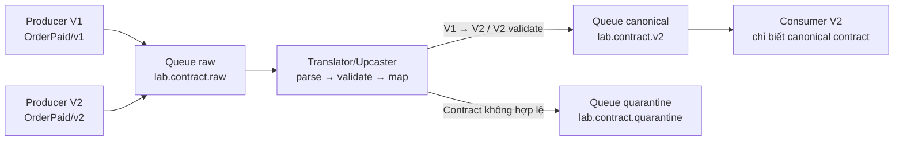

# Chuyển đổi thông điệp giữa các hợp đồng và phiên bản schema

> **Chương:** Mẫu tích hợp  
> **Module:** `INTEGRATION_MESSAGING_MESSAGE_BROKER_ACTIVEMQ` — học Apache ActiveMQ Classic và Artemis trong giao tiếp bất đồng bộ bằng queue, topic, routing và JMS; thực hành Java producer/consumer, acknowledgment, transaction, redelivery, DLQ, bảo mật và vận hành broker đáng tin cậy.  
> **Trọng tâm bài:** Thiết kế **message translator/upcaster** để tiếp nhận nhiều phiên bản hợp đồng (contract), kiểm tra nội dung, ánh xạ sang schema đích và chuyển tiếp an toàn qua ActiveMQ. Bài dùng ví dụ `OrderPaid` V1 → V2, **một transacted JMS Session** cho `receive → convert → send → commit`, đường cách ly cho input không hợp lệ, và kế hoạch nâng cấp không làm mất/trùng nghiệp vụ.

## 1. Vấn đề thực tế: producer và consumer không nâng cấp cùng lúc

Một hệ thống thanh toán đã phát sự kiện `OrderPaid` với cấu trúc V1:

```json
{
  "order_id": "O-101",
  "amount_minor": 2599,
  "currency_code": "USD",
  "paid_at": "2026-11-17T08:30:00Z"
}
```

Consumer V2 của dịch vụ giao hàng muốn nhận:

```json
{
  "orderId": "O-101",
  "payment": {
    "minorUnits": 2599,
    "currency": "USD"
  },
  "occurredAt": "2026-11-17T08:30:00Z"
}
```

Đây là thay đổi **cấu trúc dữ liệu** và tên trường, không chỉ thêm trường tùy chọn. Khi nâng cấp từ từ:

- Producer cũ còn gửi V1.
- Producer mới có thể gửi V2.
- Consumer mới chỉ muốn xử lý V2.
- Broker phải tiếp tục chuyển message trong thời gian các phiên bản cùng tồn tại.
- Message trong backlog/DLQ có thể được tạo **trước cả đợt nâng cấp**.

Nếu consumer V2 đọc thẳng V1, một số lỗi có thể xảy ra: field `orderId` bị thiếu, giá trị tiền bị hiểu sai, sự kiện bị bỏ, rollback liên tục hoặc bản V1 đi vào DLQ. Đổi tên queue/topic đơn thuần **không sửa schema**.

**Mục tiêu:** xây dựng một cổng chuyển đổi ở ranh giới message:



**Transformer không phải chức năng tự động của JMS.** JMS/ActiveMQ chuyển `Message` và lưu trữ/định tuyến theo destination; **quy tắc đổi `order_id` thành `orderId` hay `amount_minor` sang `payment.minorUnits` do ứng dụng (hoặc một plugin do bạn triển khai) định nghĩa**.

### 1.1. Kết quả mong đợi sau bài

Bạn có thể:

1. Định nghĩa contract có version và các bất biến **ngữ nghĩa**, không chỉ so sánh JSON fields.
2. Chọn nơi đặt translator: producer, consumer adapter, service chuyên trách hoặc broker extension — kèm đánh đổi.
3. Phân biệt **upcasting** V1 → V2, **downcasting** V2 → V1, canonicalization và message enrichment.
4. Xử lý **phiên bản lạ**, field sai kiểu, thay đổi mất dữ liệu và payload thiếu thông tin.
5. Viết một translator Java đọc `TextMessage`, bảo toàn `eventId`, tạo `JMSMessageID` mới, gửi đúng output destination.
6. Dùng **cùng transacted JMS Session** để xác nhận input và publish output nguyên tử **trong một transaction domain**.
7. Đưa message lỗi **hợp đồng** sang quarantine mà không tạo poison loop; rollback lỗi broker/transport để retry.
8. Kiểm thử tương thích bằng golden fixtures, nâng cấp không đồng bộ và phát hiện schema drift qua metrics.

## 2. Contract là schema cộng với semantics

### 2.1. Envelope và payload phải tách trách nhiệm

Một message có hai lớp:

```text
JMS message
├── Provider headers: JMSMessageID, JMSTimestamp,
│                    JMSCorrelationID, JMSExpiration, JMSRedelivered...
├── Application properties (envelope metadata):
│     eventType       = "OrderPaid"
│     schemaVersion   = 1 hoặc 2 (Integer)
│     eventId         = "evt-O-101" (ổn định theo logical event)
│     contentType     = "application/json"
│     traceId         = "trace-..." (nếu có)
└── TextMessage body:
      JSON payload theo schema tương ứng
```

Trong bài, version đặt trong **application property** `schemaVersion` và kiểu event trong `eventType`. Đây là một **quy ước contract của ứng dụng**, không phải header JMS có sẵn do provider tự đặt.

| Thành phần | Chủ sở hữu | Có thay đổi khi republish? | Dùng để làm gì? |
|---|---|---|---|
| `eventType` | Application | Giữ nguyên nếu vẫn là cùng semantic event | Dispatch đến converter phù hợp |
| `schemaVersion` | Application | **Đổi 1 → 2** sau conversion | Chọn parser/validator |
| `eventId` | Application | **Giữ nguyên** trong translation cùng logical event | Idempotency/correlation end-to-end |
| `contentType` | Application | Giữ `application/json` nếu format không đổi | Chọn decoder |
| `JMSCorrelationID` | Application/flow | Có thể copy nếu hợp đồng correlation yêu cầu | Request/reply hoặc theo dõi flow |
| `JMSMessageID` | JMS provider | **Message mới có ID mới** khi gửi lại | Trace transport instance |
| `JMSRedelivered`, `JMSXDeliveryCount` | JMS provider | **Không sao chép** | Trạng thái delivery của message hiện tại |
| `JMSExpiration` / `JMSPriority` | JMS provider theo send options | Cần **xét chính sách thời gian/ưu tiên**, không copy thô | TTL và dispatch priority |

Một ví dụ Java JMS (Classic 5.x/`javax.jms`):

```java
TextMessage message = session.createTextMessage(jsonPayload);
message.setStringProperty("eventType", "OrderPaid");
message.setIntProperty("schemaVersion", 1);
message.setStringProperty("eventId", "evt-O-101");
message.setStringProperty("contentType", "application/json");
producer.send(message);
```

**Không dùng `JMSMessageID` làm khóa idempotency nghiệp vụ.** Translator tạo một JMS message mới để gửi sang destination V2; producer cũng có thể retry tạo message mới cho cùng logical event. Cả hai trường hợp làm JMS ID khác nhưng `eventId` vẫn phải đại diện cho cùng một sự kiện.

### 2.2. Hợp đồng V1 → V2 có quy tắc cụ thể

| V1 | V2 | Luật chuyển đổi | Rủi ro nếu map tùy tiện |
|---|---|---|---|
| `order_id`: string | `orderId`: string | Giữ nguyên định danh; không trim/đổi case tùy ý | Tạo order ID khác |
| `amount_minor`: integer | `payment.minorUnits`: integer | **Giữ nguyên đơn vị minor**, không đổi sang `double` | Mất precision hoặc sai số tiền |
| `currency_code`: string | `payment.currency`: string | Giữ mã tiền, kiểm tra dạng chữ hoa 3 ký tự | Nhầm loại tiền |
| `paid_at`: timestamp có offset | `occurredAt`: UTC instant | Parse có timezone/offset, chuẩn hóa về ISO-8601 UTC | Lệch múi giờ hoặc dịch ngày |
| `eventId` property | `eventId` property | **Giữ nguyên logical key** | Gây duplicate side effect |
| `schemaVersion=1` | `schemaVersion=2` | Chỉ tăng sau khi payload đã pass validation | Consumer đọc sai format |

Ví dụ amount `2599` là **minor units theo currency đó**, **không tự suy ra “25,99” cho mọi currency** (một số currency có zero/three minor digits). Đừng làm `amount / 100.0` trong translator để tạo số thực, và không bỏ đơn vị nếu consumer còn cần.

Ví dụ timestamp đầu vào `"2026-11-17T15:30:00+07:00"` và UTC output `"2026-11-17T08:30:00Z"` mô tả **cùng một instant**, không phải đổi thời điểm nghiệp vụ.

### 2.3. Luật bắt buộc: không tự chế dữ liệu thiếu

Nếu V2 bổ sung `paymentMethodId` **bắt buộc** nhưng V1 hoàn toàn không lưu phương thức thanh toán, translator **không thể** tạo một ID đúng bằng cách chọn `"UNKNOWN"` rồi giả đó là dữ liệu thật.

Các lựa chọn phải được quyết định trong contract:

- Cho phép V2 field **optional/nullable**, consumer có đường xử lý rõ;
- Truy vấn nguồn dữ liệu đáng tin cậy qua **enrichment** (có timeout/cache/concurrency, khác phép đổi cấu trúc thuần túy);
- Chuyển input thiếu thông tin sang **quarantine** để xử lý;
- Giữ V1 consumer cho đến khi hệ thống có đủ dữ liệu migrate;
- Tạo contract V2 khác thể hiện rõ `unknownReason` nếu business chấp nhận.

**Thêm field default bịa có thể cho JSON “hợp lệ” nhưng tạo message sai sự thật.** Đây thường nguy hiểm hơn lỗi parse được phát hiện sớm.

## 3. Schema evolution: tương thích phải xét từ cả hai chiều

### 3.1. Ma trận thay đổi

| Thay đổi contract | Consumer cũ nhận message mới? | Consumer mới nhận message cũ? | Nhận xét |
|---|---|---|---|
| Thêm field optional, consumer cũ bỏ qua field lạ | Thường **có** | Thường **có** nếu default cho field mới | Chỉ an toàn khi cấu hình parser và semantics cho phép |
| Thêm field **required** | Tùy old consumer | **Không**, nếu old payload thiếu field | Cần version/adapter/default có căn cứ |
| Đổi `order_id` → `orderId` | Thường **không** | Thường **không** | Breaking change |
| Đổi `amount_minor` → decimal ở major unit | Có thể parse nhưng **sai nghĩa** | Có thể parse nhưng **sai nghĩa** | Breaking semantic; không chỉ schema shape |
| Bỏ field mà consumer còn dùng | **Không** | Tùy | Breaking contract |
| Mở enum thêm giá trị | Old parser có thể reject | New parser thường hiểu old | “Thêm enum” không luôn backward compatible |
| Đổi timezone-naive sang UTC | Có thể parse nhưng sai giờ | Cần quy tắc migration | Dữ liệu lịch sử thiếu offset có thể không phục hồi chính xác |
| Đổi `TextMessage` JSON sang `BytesMessage` Avro | Không | Không | Đổi **wire representation** và schema |

Ở đây:

- **Backward compatibility:** consumer mới có thể đọc các message được producer cũ tạo.
- **Forward compatibility:** consumer cũ có thể đọc các message từ producer mới.
- **Full compatibility:** cả hai chiều theo tập message/semantics được định nghĩa.

Một parser “không ném exception” **chưa đủ** gọi là tương thích. Nếu consumer cũ âm thầm bỏ field có ý nghĩa mới rồi ghi trạng thái sai, tương thích cú pháp nhưng **không tương thích nghiệp vụ**.

### 3.2. Đặt `schemaVersion` ở đâu?

Ba chiến lược phổ biến:

1. **JMS property `schemaVersion`**: tốt cho routing/selector, không phải parse body mới biết version.
2. **JSON envelope trong body**: portable qua HTTP/storage, ví dụ `{"type":"OrderPaid","schemaVersion":2,"data":{...}}`.
3. **Schema ID/subject trong registry**: phù hợp hệ thống nhiều schema và serializer (Avro/Protobuf/JSON Schema); consumer tra schema ID và validate.

Bài này dùng (1). Nếu ứng dụng còn đưa payload vào S3/REST mà không mang JMS properties, cần **lưu envelope kèm body** để version không bị mất trong quá trình đổi transport.

**Đừng có hai version không đồng nhất.** Nếu vừa dùng property `schemaVersion=2` vừa có `"schemaVersion":1` trong JSON body, phải có quy tắc reject/log mismatch. Trong ví dụ, body chỉ chứa business data và version nằm ở envelope property.

### 3.3. Nên dùng một schema đích canonical

Trong giai đoạn nâng cấp, dễ nảy sinh nhiều ma trận chuyển đổi:

```text
V1 → V2
V1 → V3
V2 → V1
V2 → V3
V3 → V1
V3 → V2
```

Nếu có `N` phiên bản và chuyển mọi cặp trực tiếp, số mapper có thể tăng gần `N×(N−1)`. Thường ổn định hơn:

```text
  V1 ─┐
      ├──► Canonical V3 ──► Consumer V3
  V2 ─┤
      │
  V3 ─┘
```

Mỗi input version có một đường upcast đến canonical (hoặc chuỗi upcast V1→V2→V3 khi các hàm thuần nhỏ dễ kiểm thử). **Không mặc định downcast luôn khả thi**: chuyển ngược V3→V1 có thể mất field/độ chính xác/semantics.

Canonical **không** nên là “siêu schema” chứa vô hạn field của mọi service. Nó là contract có owner, lifecycle, schema tests và quy tắc tương thích công bố rõ.

## 4. Nên đặt Message Translator ở đâu?

| Vị trí | Luồng | Khi phù hợp | Rủi ro/chú ý |
|---|---|---|---|
| **Producer adapter** | Producer domain → V2 trước publish | Chủ động nâng cấp mọi producer cùng lúc hoặc có SDK thống nhất | Producer cũ còn tồn tại; backlog V1 không tự biến mất |
| **Consumer adapter** | Mỗi consumer đọc V1/V2 rồi upcast trong process | Ít consumers, logic cần local, không muốn queue trung gian | Mỗi consumer có thể triển khai lệch luật |
| **Dedicated translator service** | Queue raw → translator → queue V2 | Nhiều producer/consumer, muốn quản lý version tập trung | Thêm hop, queue, SLA, monitoring và quyền |
| **Broker plugin/transformer** | Broker nhận/route và invoke extension | Tác vụ rất ổn định, muốn gần broker | Upgrade/deploy broker phụ thuộc custom code; lỗi plugin có thể ảnh hưởng broker |
| **Gateway/connector** | Bridge hai protocol/broker với schema mapping | Migrate Classic↔Artemis, hoặc tích hợp hệ thống ngoài | Transaction scope/ack/retry qua hai broker **khác** cần thiết kế riêng |

Ví dụ bài này chọn **dedicated translator trên cùng broker**, vì muốn quan sát rõ đường `raw→v2` và dễ kiểm thử với CLI. Không buộc ứng dụng production phải tách thêm service nếu logic rất ít và các consumer có thể tự upcast an toàn.

### 4.1. Classic và Artemis không tự hiểu business JSON schema

ActiveMQ Classic và Artemis cung cấp JMS destination, selector, transaction, routing, persistence, security, bridge, address rules... nhưng **không mặc định hiểu**:

- `"amount_minor"` phải thành `"payment.minorUnits"`;
- currency phải giữ semantic minor units;
- `"paid_at"` phải normalize timestamp;
- `"schemaVersion":99` cần bị cách ly.

Artemis có `Transformer` chạy trong broker (ví dụ trên **divert/core bridge**). Classic còn có `org.apache.activemq.MessageTransformer` dạng **client-side extension** gắn với `ActiveMQConnectionFactory`/connection/session/producer/consumer, bên cạnh các plugin broker khác. Đừng đánh đồng hai API này với một cơ chế broker transform chuẩn chung cho JMS. Nếu dùng extension, **logic chuyển schema vẫn do bạn triển khai, version, deploy, test và giám sát**; lỗi tùy biến ở tầng broker/client có thể ảnh hưởng rộng. Trong nhiều trường hợp **đặt business schema logic bên ngoài broker** giúp rollback và kiểm thử an toàn hơn.

### 4.2. Queue, Topic và Virtual Topic khác về nơi chuyển đổi

- **Raw queue → translator → canonical queue:** một message đầu vào được một translator consumer nhận; output canonical phục vụ competing consumers.
- **Raw topic → nhiều subscriber:** nếu translator là non-durable subscriber và offline, có thể mất event mà producer đã publish. Cần durable subscription hoặc intermediate durable queue nếu muốn backlog.
- **ActiveMQ Classic Virtual Topic:** producer gửi Topic `VirtualTopic.Orders`, translator có thể đọc **một queue nhóm riêng** như `Consumer.SchemaTranslator.VirtualTopic.Orders`. Các consumer group khác vẫn độc lập; chuyển đổi một group **không biến đổi payload trên các group còn lại**.
- **Artemis:** multicast address và queue/subscription bindings khác Classic Virtual Topic. Không copy nguyên tên group Virtual Topic rồi cho rằng broker tự định tuyến tương đương nếu chưa cấu hình compatibility/migration.

**Đừng nhầm message conversion với routing fan-out.** Converter thay contract; topic/queue quyết định consumer nào có bản message.

## 5. Giao dịch nguyên tử: receive + convert + send trên cùng JMS Session

Với input ở `lab.contract.raw` và output ở `lab.contract.v2`, cùng **một broker JMS transaction domain**, ta muốn:

```mermaid
sequenceDiagram
    participant R as Raw Queue
    participant T as Translator (JMS Session)
    participant O as Canonical V2 Queue
    participant Q as Quarantine Queue
    R->>T: receive() raw message
    T->>T: đọc envelope → validate → normalize V2
    alt Contract hợp lệ
        T-->>O: producer.send(V2) trong transaction
        T->>R: Session.commit() cùng transaction
        Note over R,O: input ack và output send cùng commit
    else Lỗi contract cố định
        T-->>Q: send(original + reason) trong transaction
        T->>R: Session.commit() cùng transaction
        Note over R,Q: input ack và quarantine send cùng commit
    else Lỗi broker/network/storage
        T->>R: Session.rollback() / kết quả commit chưa rõ
        Note over R,T: broker redelivery theo policy; cần idempotency
    end
```

### 5.1. Bốn kết cục phải phân biệt

| Tình huống | Hành động | Input raw | Output |
|---|---|---|---|
| V1/V2 hợp lệ | `send(V2)` + `commit()` | Được ack | Có V2 sau commit |
| Version lạ/payload sai schema nhưng **đã xác định là lỗi contract** | `send(quarantine)` + `commit()` | Được ack | Có bản cách ly, **không** có V2 |
| Broker/connection/storage lỗi **trước commit** | `rollback()` hoặc để session kết thúc | Chưa ack, có thể redeliver | Send chưa commit bị hủy |
| Connection lỗi **đúng lúc commit** | Outcome có thể chưa xác định từ phía client | Không thể đoán chỉ từ exception | Phải tra state, retry idempotent |

**Không được bắt mọi `Exception` rồi “đưa sang DLQ”**: JMS authorization/transport error là lỗi hạ tầng, không phải payload sai. Nếu đưa chính message tốt vào quarantine và commit input khi broker tạm thời lỗi, bạn đã vô tình **đổi lỗi tạm thời thành mất xử lý**.

### 5.2. Vì sao cần một Session cho cả consumer và producer?

Đúng:

```java
Session session =
    connection.createSession(true, Session.SESSION_TRANSACTED);

MessageConsumer source = session.createConsumer(rawQueue);
MessageProducer target = session.createProducer(canonicalQueue);

Message message = source.receive(5000);
if (message != null) {
    target.send(normalizedMessage);
    session.commit(); // nhận+gửi trong cùng local transaction
}
```

Sai nếu cần atomicity:

```java
Session inputSession = connection.createSession(
        true, Session.SESSION_TRANSACTED);
Session outputSession = connection.createSession(
        true, Session.SESSION_TRANSACTED);

// outputSession.commit() có thể thành công...
// process crash...
// inputSession.commit() chưa kịp chạy → raw redeliver.
// Hai local transactions KHÔNG tự nguyên tử chỉ vì cùng Connection.
```

Nếu source và destination nằm ở **hai broker khác nhau**, một JMS local Session thông thường **không thể bao phủ cả hai broker**. Cần outbox/inbox, bridge với explicit delivery guarantees hoặc XA/JTA nếu topology thực sự hỗ trợ và được quản trị đúng; đừng giả định từ mẫu single-broker trong bài này.

### 5.3. Những thứ local JMS transaction không giải quyết

- Không đảm bảo message V2 **chỉ được xử lý nghiệp vụ đúng một lần**: downstream có thể redeliver.
- Không commit SQL database hoặc HTTP response của hệ ngoài.
- Không biến một event thiếu dữ liệu thành event có ngữ nghĩa đúng.
- Không chống producer republish cùng logical event với JMSMessageID mới.
- Không xóa thông tin nhạy cảm khỏi payload đã được gửi vào DLQ/log.
- Không bảo đảm broker khác cùng tham gia transaction.

Vì thế `eventId`, idempotency, schema validation, version rollout và quarantine audit vẫn là thành phần bắt buộc của mẫu tích hợp.

## 6. Định nghĩa schema V2 có thể kiểm thử

Dưới đây là **JSON Schema Draft 2020-12** để diễn tả contract đích. Đây là *schema document tham khảo* cho registry/test, **không phải file cần tạo trong repository hiện tại**.

```json
{
  "$schema": "https://json-schema.org/draft/2020-12/schema",
  "$id": "https://schemas.example.invalid/events/OrderPaid/v2",
  "title": "OrderPaid V2 payload",
  "type": "object",
  "required": ["orderId", "payment", "occurredAt"],
  "additionalProperties": false,
  "properties": {
    "orderId": {
      "type": "string",
      "minLength": 1,
      "maxLength": 128
    },
    "payment": {
      "type": "object",
      "required": ["minorUnits", "currency"],
      "additionalProperties": false,
      "properties": {
        "minorUnits": {
          "type": "integer",
          "minimum": 1
        },
        "currency": {
          "type": "string",
          "pattern": "^[A-Z]{3}$"
        }
      }
    },
    "occurredAt": {
      "type": "string",
      "format": "date-time"
    }
  }
}
```

**Chi tiết quan trọng của JSON Schema:**

- `additionalProperties:false` ở root và nested payment khiến field không được định nghĩa **bị reject**. Điều này giúp bài lab phát hiện schema drift, nhưng trong hệ thống cần backward-compatible additive fields có thể phải chọn rule khác.
- `type:integer` ngăn JSON number dạng floating-point đi vào tiền tệ theo một đường mapper không rõ.
- `format:date-time` của JSON Schema **có thể chỉ mang ý nghĩa annotation**, tùy validator và việc bật format-assertion. Vì vậy code lab bên dưới vẫn parse `Instant` thực sự để kiểm tra timestamp.
- `"$id"` ở trên là URI **minh họa**, không phải registry thật. Nếu dùng registry, đặt schema ID/subject/version theo chính sách triển khai.
- Một schema “pass” chưa kiểm tra currency code là ISO 4217 có thật hoặc business amount được phép; đó thuộc **semantic validation**.

## 7. Lab Java/JMS: chuyển OrderPaid V1/V2, cách ly bản lỗi

### 7.1. Môi trường và phạm vi

Lab dùng:

- **JDK 17**, **Maven 3.9+**.
- **Apache ActiveMQ Classic 5.19.12 client** (`javax.jms`, OpenWire). Có thể kết nối **ActiveMQ Classic broker** hoặc **Artemis bật OpenWire protocol**; broker/client khác cần test routing/quarantine policy.
- Jackson `jackson-databind 2.19.2` để parse/build JSON theo kiểu integer/string, không ghép JSON tùy ý.
- Ba **physical queues** trên một broker: `lab.contract.raw`, `lab.contract.v2`, `lab.contract.quarantine`.
- Tài khoản có quyền send/consume/browse đúng ba queue; queue được pre-create hoặc broker auto-create theo policy.

**Không dùng `ObjectMessage` Java serialization** để chuyển giữa nhiều schema/service phiên bản: ràng buộc Java classpath quá chặt, khó polyglot và có rủi ro deserialization. Lab dùng `TextMessage` JSON với kiểu rõ; dữ liệu nhạy cảm production cần chính sách mã hóa/redaction độc lập.

### 7.2. Maven `pom.xml`

```xml
<project xmlns="http://maven.apache.org/POM/4.0.0"
         xmlns:xsi="http://www.w3.org/2001/XMLSchema-instance"
         xsi:schemaLocation="http://maven.apache.org/POM/4.0.0
             https://maven.apache.org/xsd/maven-4.0.0.xsd">
  <modelVersion>4.0.0</modelVersion>

  <groupId>demo.activemq</groupId>
  <artifactId>orderpaid-contract-translator</artifactId>
  <version>1.0-SNAPSHOT</version>

  <properties>
    <maven.compiler.release>17</maven.compiler.release>
    <project.build.sourceEncoding>UTF-8</project.build.sourceEncoding>
  </properties>

  <dependencies>
    <dependency>
      <groupId>org.apache.activemq</groupId>
      <artifactId>activemq-client</artifactId>
      <version>5.19.12</version>
    </dependency>
    <dependency>
      <groupId>com.fasterxml.jackson.core</groupId>
      <artifactId>jackson-databind</artifactId>
      <version>2.19.2</version>
    </dependency>
  </dependencies>

  <build>
    <plugins>
      <plugin>
        <groupId>org.apache.maven.plugins</groupId>
        <artifactId>maven-compiler-plugin</artifactId>
        <version>3.14.1</version>
      </plugin>
      <plugin>
        <groupId>org.codehaus.mojo</groupId>
        <artifactId>exec-maven-plugin</artifactId>
        <version>3.5.1</version>
      </plugin>
    </plugins>
  </build>
</project>
```

`jackson-databind` mang theo `jackson-core`/`jackson-annotations` qua dependencies cùng dòng phiên bản. Trong production, quản lý version qua BOM/dependency management và theo dõi security advisories; version pin ở lab chỉ nhằm tính tái lập, không khẳng định là bản bảo mật tối ưu trong mọi thời điểm.

### 7.3. Code `OrderPaidTranslatorLab.java`

Tạo `src/main/java/demo/OrderPaidTranslatorLab.java` trong **project lab độc lập**. Chương trình hỗ trợ các lệnh:

```text
seed-v1 <id>             — gửi payload V1 hợp lệ vào raw
seed-v2 <id>             — gửi payload V2 hợp lệ vào raw
seed-bad <id>            — gửi V1 có amount_minor sai kiểu
translate-one            — nhận một message, convert → V2 hoặc quarantine
consume-v2               — kiểm tra một message ở canonical queue
consume-quarantine       — kiểm tra một message bị cách ly
```

**Nguồn Java hoàn chỉnh** (các comment nhấn mạnh ranh giới transaction và contract):

```java
package demo;

import com.fasterxml.jackson.core.JsonProcessingException;
import com.fasterxml.jackson.databind.JsonNode;
import com.fasterxml.jackson.databind.ObjectMapper;
import com.fasterxml.jackson.databind.node.ObjectNode;
import org.apache.activemq.ActiveMQConnectionFactory;

import javax.jms.Connection;
import javax.jms.DeliveryMode;
import javax.jms.JMSException;
import javax.jms.Message;
import javax.jms.MessageConsumer;
import javax.jms.MessageProducer;
import javax.jms.Queue;
import javax.jms.Session;
import javax.jms.TextMessage;

import java.time.Instant;
import java.time.format.DateTimeParseException;
import java.util.Arrays;
import java.util.HashSet;
import java.util.Iterator;
import java.util.Set;

public final class OrderPaidTranslatorLab {
    private static final ObjectMapper JSON = new ObjectMapper();

    private static final String RAW = "lab.contract.raw";
    private static final String V2 = "lab.contract.v2";
    private static final String QUARANTINE = "lab.contract.quarantine";

    private static final String EVENT_TYPE = "OrderPaid";
    private static final String CONTENT_TYPE = "application/json";

    private record Envelope(int version, String eventId, String body) {}

    private static final class ContractViolation extends Exception {
        final String code;

        ContractViolation(String code) {
            super(code);
            this.code = code;
        }

        ContractViolation(String code, Throwable cause) {
            super(code, cause);
            this.code = code;
        }
    }

    public static void main(String[] args) throws Exception {
        if (args.length == 0) {
            usage();
            return;
        }

        String command = args[0];
        boolean needsId = command.equals("seed-v1")
                || command.equals("seed-v2")
                || command.equals("seed-bad");

        if ((needsId && args.length != 2)
                || (!needsId && args.length != 1)) {
            usage();
            return;
        }

        String url = System.getenv().getOrDefault(
                "BROKER_URL", "tcp://127.0.0.1:61616");
        String user = System.getenv("BROKER_USER");
        String password = System.getenv("BROKER_PASSWORD");
        if (user != null && !user.isBlank() && password == null) {
            throw new IllegalArgumentException(
                    "BROKER_PASSWORD required when BROKER_USER is set");
        }

        ActiveMQConnectionFactory factory =
                new ActiveMQConnectionFactory(url);

        Connection connection =
                user == null || user.isBlank()
                        ? factory.createConnection()
                        : factory.createConnection(user, password);
        try {
            connection.start();
            switch (command) {
                case "seed-v1" ->
                        seed(connection, validateId(args[1]), "v1");
                case "seed-v2" ->
                        seed(connection, validateId(args[1]), "v2");
                case "seed-bad" ->
                        seed(connection, validateId(args[1]), "bad");
                case "translate-one" -> translateOne(connection);
                case "consume-v2" -> consumeOne(connection, V2);
                case "consume-quarantine" ->
                        consumeOne(connection, QUARANTINE);
                default -> usage();
            }
        } finally {
            connection.close();
        }
    }

    private static String validateId(String id) {
        if (!id.matches("[A-Za-z0-9_-]{1,40}")) {
            throw new IllegalArgumentException(
                    "id must be 1..40 letters/digits/_/-");
        }
        return id;
    }

    // Producer mô phỏng cả hai phiên bản và một message lỗi.
    private static void seed(Connection connection, String id,
                             String kind) throws Exception {
        int version = kind.equals("v2") ? 2 : 1;
        ObjectNode root = JSON.createObjectNode();

        if (version == 1) {
            root.put("order_id", "O-" + id);
            if (kind.equals("bad")) {
                root.put("amount_minor", "wrong-type");
            } else {
                root.put("amount_minor", 2599L);
            }
            root.put("currency_code", "USD");
            root.put("paid_at", "2026-11-17T08:30:00Z");
        } else {
            root.put("orderId", "O-" + id);
            ObjectNode payment = root.putObject("payment");
            payment.put("minorUnits", 2599L);
            payment.put("currency", "USD");
            root.put("occurredAt", "2026-11-17T08:30:00Z");
        }

        Session session = connection.createSession(
                true, Session.SESSION_TRANSACTED);
        try {
            Queue raw = session.createQueue(RAW);
            MessageProducer producer = session.createProducer(raw);
            try {
                producer.setDeliveryMode(DeliveryMode.PERSISTENT);
                TextMessage message = session.createTextMessage(
                        JSON.writeValueAsString(root));

                message.setStringProperty("eventType", EVENT_TYPE);
                message.setIntProperty("schemaVersion", version);
                message.setStringProperty("eventId", "evt-" + id);
                message.setStringProperty("contentType", CONTENT_TYPE);
                message.setStringProperty("traceId", "trace-" + id);
                message.setJMSCorrelationID("order-" + id);

                producer.send(message);
                session.commit();

                System.out.println("SEEDED kind=" + kind
                        + " eventId=evt-" + id
                        + " JMSMessageID=" + message.getJMSMessageID());
            } finally {
                producer.close();
            }
        } catch (Exception error) {
            rollbackQuietly(session, error);
            throw error;
        } finally {
            session.close();
        }
    }

    // Một message nguồn -> một message V2 HOẶC quarantine.
    // Mọi receive/send dùng CÙNG transacted Session.
    private static void translateOne(Connection connection)
            throws Exception {
        Session session = connection.createSession(
                true, Session.SESSION_TRANSACTED);

        try {
            MessageConsumer consumer =
                    session.createConsumer(session.createQueue(RAW));
            MessageProducer output =
                    session.createProducer(session.createQueue(V2));
            MessageProducer quarantine =
                    session.createProducer(
                            session.createQueue(QUARANTINE));

            try {
                Message source = consumer.receive(5000L);
                if (source == null) {
                    session.rollback();
                    System.out.println("NO_RAW_MESSAGE");
                    return;
                }

                try {
                    Envelope envelope = readEnvelope(source);
                    String canonical = toCanonicalV2(
                            envelope.version(), envelope.body());

                    TextMessage mapped =
                            session.createTextMessage(canonical);
                    mapped.setStringProperty("eventType", EVENT_TYPE);
                    mapped.setStringProperty("contentType", CONTENT_TYPE);
                    mapped.setStringProperty(
                            "eventId", envelope.eventId());
                    mapped.setIntProperty("schemaVersion", 2);
                    mapped.setIntProperty(
                            "sourceSchemaVersion", envelope.version());
                    String originalMessageId = source.getJMSMessageID();
                    if (originalMessageId != null) {
                        mapped.setStringProperty(
                                "originalJmsMessageId",
                                originalMessageId);
                    }

                    if (source.propertyExists("traceId")) {
                        Object trace = source.getObjectProperty("traceId");
                        if (trace instanceof String value) {
                            mapped.setStringProperty("traceId", value);
                        }
                    }
                    String correlationId =
                            source.getJMSCorrelationID();
                    if (correlationId != null) {
                        mapped.setJMSCorrelationID(correlationId);
                    }

                    // Duy trì độ ưu tiên và thời hạn còn lại.
                    // KHÔNG reset TTL về một giá trị đầy đủ mới.
                    sendPreservingDeadline(source, output, mapped);

                    session.commit();
                    System.out.println("TRANSLATED eventId="
                            + envelope.eventId()
                            + " v" + envelope.version() + " -> v2"
                            + " inputMessageId="
                            + source.getJMSMessageID());
                } catch (ContractViolation invalid) {
                    // Chỉ lỗi CONTRACT có thể xác định mới đi
                    // quarantine. JMS/network error sẽ rollback.
                    String rawBody = source instanceof TextMessage text
                            ? text.getText()
                            : "<NON_TEXT_MESSAGE>";

                    // Lab giữ raw body để điều tra. Production
                    // phải redaction/encryption và retention.
                    TextMessage rejected =
                            session.createTextMessage(rawBody);
                    rejected.setStringProperty(
                            "errorCode", invalid.code);

                    String originalId = source.getJMSMessageID();
                    if (originalId != null) {
                        rejected.setStringProperty(
                                "originalJmsMessageId", originalId);
                    }
                    if (source.propertyExists("eventId")) {
                        Object originalEventId =
                                source.getObjectProperty("eventId");
                        if (originalEventId instanceof String value) {
                            rejected.setStringProperty("eventId", value);
                        }
                    }

                    quarantine.send(rejected,
                            DeliveryMode.PERSISTENT, 4, 0L);
                    session.commit(); // raw ack + quarantine send
                    System.out.println("QUARANTINED code="
                            + invalid.code);
                }
            } finally {
                quarantine.close();
                output.close();
                consumer.close();
            }
        } catch (Exception error) {
            rollbackQuietly(session, error);
            throw error;
        } finally {
            session.close();
        }
    }

    private static Envelope readEnvelope(Message source)
            throws JMSException, ContractViolation {
        if (!(source instanceof TextMessage textMessage)) {
            throw new ContractViolation("UNSUPPORTED_JMS_BODY");
        }

        Object version = source.getObjectProperty("schemaVersion");
        if (!(version instanceof Integer v)) {
            throw new ContractViolation("INVALID_VERSION_PROPERTY");
        }
        if (v != 1 && v != 2) {
            throw new ContractViolation("UNSUPPORTED_SCHEMA_VERSION");
        }
        Object eventType = source.getObjectProperty("eventType");
        if (!(eventType instanceof String eventTypeName)
                || !EVENT_TYPE.equals(eventTypeName)) {
            throw new ContractViolation("INVALID_EVENT_TYPE");
        }
        Object contentType = source.getObjectProperty("contentType");
        if (!(contentType instanceof String contentTypeName)
                || !CONTENT_TYPE.equals(contentTypeName)) {
            throw new ContractViolation("INVALID_CONTENT_TYPE");
        }
        Object eventIdProperty = source.getObjectProperty("eventId");
        if (!(eventIdProperty instanceof String eventId)
                || eventId.isBlank() || eventId.length() > 128) {
            throw new ContractViolation("INVALID_EVENT_ID");
        }

        String body = textMessage.getText();
        if (body == null || body.isBlank() || body.length() > 65536) {
            throw new ContractViolation("INVALID_BODY_SIZE");
        }
        return new Envelope(v, eventId, body);
    }

    private static String toCanonicalV2(int version, String body)
            throws ContractViolation {
        try {
            JsonNode parsed = JSON.readTree(body);
            ObjectNode target;

            if (version == 1) {
                requireExactKeys(parsed,
                        "order_id", "amount_minor",
                        "currency_code", "paid_at");

                String orderId = requiredString(parsed, "order_id");
                long minor = positiveLong(parsed, "amount_minor");
                String currency = currencyCode(
                        requiredString(parsed, "currency_code"));
                String paidAt = utcInstant(
                        requiredString(parsed, "paid_at"));

                target = JSON.createObjectNode();
                target.put("orderId", orderId);
                ObjectNode payment = target.putObject("payment");
                payment.put("minorUnits", minor);
                payment.put("currency", currency);
                target.put("occurredAt", paidAt);
            } else if (version == 2) {
                requireExactKeys(parsed,
                        "orderId", "payment", "occurredAt");
                requiredString(parsed, "orderId");

                JsonNode payment = parsed.get("payment");
                requireExactKeys(payment, "minorUnits", "currency");
                positiveLong(payment, "minorUnits");
                currencyCode(requiredString(payment, "currency"));
                utcInstant(requiredString(parsed, "occurredAt"));

                // V2 -> V2: validate, giữ nguyên nội dung
                // ngữ nghĩa; reserialize có thể đổi whitespace.
                target = (ObjectNode) parsed.deepCopy();
            } else {
                throw new ContractViolation(
                        "UNSUPPORTED_SCHEMA_VERSION");
            }

            return JSON.writeValueAsString(target);
        } catch (JsonProcessingException error) {
            throw new ContractViolation("INVALID_JSON", error);
        }
    }

    private static void requireExactKeys(
            JsonNode node, String... expectedFields)
            throws ContractViolation {
        if (node == null || !node.isObject()) {
            throw new ContractViolation("NOT_AN_OBJECT");
        }

        Set<String> missing = new HashSet<>(
                Arrays.asList(expectedFields));
        Iterator<String> fields = node.fieldNames();
        while (fields.hasNext()) {
            String name = fields.next();
            if (!missing.remove(name)) {
                throw new ContractViolation("UNKNOWN_FIELD_" + name);
            }
        }
        if (!missing.isEmpty()) {
            throw new ContractViolation("MISSING_REQUIRED_FIELDS");
        }
    }

    private static String requiredString(JsonNode node, String field)
            throws ContractViolation {
        JsonNode value = node.get(field);
        if (value == null || !value.isTextual()) {
            throw new ContractViolation("INVALID_STRING_" + field);
        }
        String text = value.textValue();
        if (text.isBlank() || text.length() > 128) {
            throw new ContractViolation("INVALID_LENGTH_" + field);
        }
        return text;
    }

    private static long positiveLong(JsonNode node, String field)
            throws ContractViolation {
        JsonNode value = node.get(field);
        if (value == null || !value.isIntegralNumber()
                || !value.canConvertToLong()
                || value.longValue() <= 0L) {
            throw new ContractViolation("INVALID_INTEGER_" + field);
        }
        return value.longValue();
    }

    private static String currencyCode(String currency)
            throws ContractViolation {
        if (!currency.matches("[A-Z]{3}")) {
            throw new ContractViolation("INVALID_CURRENCY_CODE");
        }
        // Production: còn phải xác minh ISO 4217/business allowlist.
        return currency;
    }

    private static String utcInstant(String text)
            throws ContractViolation {
        try {
            return Instant.parse(text).toString();
        } catch (DateTimeParseException error) {
            throw new ContractViolation("INVALID_TIMESTAMP", error);
        }
    }

    private static void sendPreservingDeadline(
            Message source, MessageProducer output, Message mapped)
            throws JMSException, ContractViolation {
        long expiry = source.getJMSExpiration();
        long ttl = 0L;

        if (expiry > 0L) {
            ttl = expiry - System.currentTimeMillis();
            if (ttl <= 0L) {
                throw new ContractViolation("EXPIRED_BEFORE_TRANSLATION");
            }
        }
        // Source priority vẫn do broker/provider cấp;
        // không copy trực tiếp JMS headers của source.
        output.send(mapped, DeliveryMode.PERSISTENT,
                source.getJMSPriority(), ttl);
    }

    private static void consumeOne(Connection connection,
                                   String queueName) throws Exception {
        Session session = connection.createSession(
                true, Session.SESSION_TRANSACTED);
        try {
            MessageConsumer consumer = session.createConsumer(
                    session.createQueue(queueName));
            try {
                Message received = consumer.receive(5000L);
                if (received == null) {
                    session.rollback();
                    System.out.println("EMPTY " + queueName);
                    return;
                }

                if (!(received instanceof TextMessage text)) {
                    throw new IllegalStateException(
                            "Expected TextMessage in " + queueName);
                }
                System.out.println("DEST=" + queueName);
                System.out.println("JMSMessageID="
                        + received.getJMSMessageID());
                System.out.println("eventId="
                        + received.getStringProperty("eventId"));
                System.out.println("body=" + text.getText());

                if (V2.equals(queueName)) {
                    // Consumer V2 thực sự kiểm tra contract,
                    // không ack một bản rỗng/sai schema.
                    Envelope e = readEnvelope(received);
                    if (e.version() != 2) {
                        throw new IllegalStateException(
                                "Canonical queue must contain v2");
                    }
                    toCanonicalV2(2, e.body());
                } else {
                    System.out.println("errorCode="
                            + received.getStringProperty("errorCode"));
                }

                session.commit();
                System.out.println("CONSUMED_COMMITTED");
            } finally {
                consumer.close();
            }
        } catch (Exception error) {
            rollbackQuietly(session, error);
            throw error;
        } finally {
            session.close();
        }
    }

    private static void rollbackQuietly(
            Session session, Exception primary) {
        try {
            session.rollback();
        } catch (JMSException rollbackError) {
            primary.addSuppressed(rollbackError);
        }
    }

    private static void usage() {
        System.out.println("seed-v1 <id>");
        System.out.println("seed-v2 <id>");
        System.out.println("seed-bad <id>");
        System.out.println("translate-one");
        System.out.println("consume-v2");
        System.out.println("consume-quarantine");
    }
}
```

### 7.4. Những quyết định quan trọng trong mã

**Chỉ sai hợp đồng mới quarantine.** `ContractViolation` được ném cho version lạ, body không phải JSON/text, kiểu tiền sai, field thiếu/thừa trong bộ rules nghiêm ngặt, timestamp không parse được. Lỗi gửi JMS, `JMSException`, mất kết nối, quyền truy cập hoặc lỗi ngoài ý muốn **không** được catch như contract violation: đường ngoài rollback để broker xử lý redelivery.

**Hai nhánh đều dùng cùng Session.** Với message tốt, `commit()` chốt ack input + send output V2. Với message sai hợp đồng, `commit()` chốt ack input + send quarantine. Việc chuyển lỗi sang quarantine là **một kết quả có chủ đích**, không phải để broker tự động áp dụng poison-message DLQ.

**Một message gốc, một logical event.** `eventId` được copy sang V2; `originalJmsMessageId` lưu để trace. Không set thủ công `JMSMessageID`, `JMSRedelivered`, `JMSXDeliveryCount` hay `JMSTimestamp` trên message output.

**Không mặc định kéo dài TTL.** Nếu message nguồn có `JMSExpiration` dương, mã tính `ttl=JMSExpiration - now` khi gửi output. Như vậy hạn hợp lệ **xấp xỉ được bảo toàn**, thay vì tự đặt thêm 60 giây cho message vốn sắp hết hạn. Dù vậy, thời điểm gửi/commit và độ lệch clock có thể khiến output expire sớm; SLA cao cần **business `deadlineAt` độc lập** và kiểm tra tại consumer. Nếu nguồn `TTL=0`, ví dụ gửi output với TTL 0 theo contract minh họa.

**Không tự động bảo toàn `JMSReplyTo`, vendor-specific scheduling hay selector metadata.** Những trường này có thể trỏ tới destination/request khác hoặc mang ý nghĩa của message transport cũ. Chỉ copy fields đã được hợp đồng mới cho phép. Nếu cần request/reply, hãy định nghĩa mapping `JMSCorrelationID`/`JMSReplyTo` tường minh và kiểm tra broker ACL.

**Strict validation là quyết định của lab.** Hàm `requireExactKeys` cố ý reject field lạ để không âm thầm vứt data trong quá trình rename/nest. Với contract cho phép **field bổ sung tùy chọn**, có thể sửa validator theo schema policy, nhưng phải quyết định **giữ, bỏ hoặc chuyển** field và có golden tests.

**Không gửi đồng thời V2 và quarantine cho một input.** Chính xác một nhánh được commit. Nếu thêm nhánh audit/outbox, phải thiết kế semantics và retention riêng.

### 7.5. Cấu hình broker

**ActiveMQ Classic:** với lab có quyền auto-create queue, có thể dùng tên queue như trong source trực tiếp. Trong production, broker authentication/authorization phải cho transformer:

- consume `lab.contract.raw`;
- send `lab.contract.v2`;
- send `lab.contract.quarantine`;
- không cần quyền admin trên tất cả destination.

**Artemis qua OpenWire:** acceptor cần cho phép `OPENWIRE` (nếu chưa có), ví dụ một dòng trong `<acceptors>` hiện hữu:

```xml
<acceptor name="openwire">tcp://0.0.0.0:61616?protocols=OPENWIRE</acceptor>
```

Không khai báo **hai acceptors trùng port 61616**; sửa acceptor hiện hữu hoặc chọn port khác. Trong `<addresses>` của `etc/broker.xml`, nếu tắt auto-create, khai báo ba address/queue kiểu anycast:

```xml
<address name="lab.contract.raw">
  <anycast>
    <queue name="lab.contract.raw"/>
  </anycast>
</address>

<address name="lab.contract.v2">
  <anycast>
    <queue name="lab.contract.v2"/>
  </anycast>
</address>

<address name="lab.contract.quarantine">
  <anycast>
    <queue name="lab.contract.quarantine"/>
  </anycast>
</address>
```

Đây chỉ là **fragment bên trong các phần tử tương ứng**, không phải file broker hoàn chỉnh. Nếu broker đã khai báo queue/address, hãy sử dụng khai báo hiện hữu, không copy trùng. Trong Artemis dùng **native Jakarta client** thì thay Maven dependency/source imports và ConnectionFactory; ví dụ bên dưới làm rõ.

### 7.6. Chạy thí nghiệm

Bash:

```bash
export BROKER_URL='tcp://127.0.0.1:61616'
export BROKER_USER='labuser'
export BROKER_PASSWORD='lab-only-password'

mvn -q compile exec:java '-Dexec.mainClass=demo.OrderPaidTranslatorLab' '-Dexec.args=seed-v1 caseA'
mvn -q compile exec:java '-Dexec.mainClass=demo.OrderPaidTranslatorLab' '-Dexec.args=seed-v2 caseB'
mvn -q compile exec:java '-Dexec.mainClass=demo.OrderPaidTranslatorLab' '-Dexec.args=seed-bad caseC'
```

PowerShell:

```powershell
$env:BROKER_URL = 'tcp://127.0.0.1:61616'
$env:BROKER_USER = 'labuser'
$env:BROKER_PASSWORD = 'lab-only-password'

mvn -q compile exec:java '-Dexec.mainClass=demo.OrderPaidTranslatorLab' '-Dexec.args=seed-v1 caseA'
mvn -q compile exec:java '-Dexec.mainClass=demo.OrderPaidTranslatorLab' '-Dexec.args=seed-v2 caseB'
mvn -q compile exec:java '-Dexec.mainClass=demo.OrderPaidTranslatorLab' '-Dexec.args=seed-bad caseC'
```

Dùng **một broker, ba queue lab rỗng, không có consumer khác**. Sau khi seed ba messages:

```bash
mvn -q compile exec:java '-Dexec.mainClass=demo.OrderPaidTranslatorLab' '-Dexec.args=translate-one'
mvn -q compile exec:java '-Dexec.mainClass=demo.OrderPaidTranslatorLab' '-Dexec.args=translate-one'
mvn -q compile exec:java '-Dexec.mainClass=demo.OrderPaidTranslatorLab' '-Dexec.args=translate-one'

mvn -q compile exec:java '-Dexec.mainClass=demo.OrderPaidTranslatorLab' '-Dexec.args=consume-v2'
mvn -q compile exec:java '-Dexec.mainClass=demo.OrderPaidTranslatorLab' '-Dexec.args=consume-v2'
mvn -q compile exec:java '-Dexec.mainClass=demo.OrderPaidTranslatorLab' '-Dexec.args=consume-quarantine'
```

Kỳ vọng **về mặt logic**, nếu các queue ban đầu rỗng và thứ tự dispatch là thứ tự seed:

| Source event | Translator result | Canonical queue | Quarantine queue |
|---|---|---|---|
| `evt-caseA`, V1 hợp lệ | `TRANSLATED ... v1 -> v2` | Có V2 với `orderId=O-caseA` | Không |
| `evt-caseB`, V2 hợp lệ | `TRANSLATED ... v2 -> v2` | Có V2 giữ semantic payload | Không |
| `evt-caseC`, V1 với `amount_minor="wrong-type"` | `QUARANTINED code=INVALID_INTEGER_amount_minor` | Không | Có source JSON + error metadata |

**Không bắt buộc thứ tự nhận tuyệt đối** nếu có priority, transaction, consumer khác hoặc cấu hình broker riêng. Điều cần chứng minh là **mapping và tổng trạng thái**, không phải một line log đúng một số thứ tự nào đó.

Đầu ra `consume-v2` cho `evt-caseA` có body dạng:

```json
{
  "orderId": "O-caseA",
  "payment": {
    "minorUnits": 2599,
    "currency": "USD"
  },
  "occurredAt": "2026-11-17T08:30:00Z"
}
```

Nếu `consume-quarantine` xuất hiện `INVALID_INTEGER_amount_minor`, đó là chủ đích test. Nếu queue raw còn message, hãy xem translator có `NO_RAW_MESSAGE` vì timeout, broker có worker khác hay redelivery delay; không tự quy lỗi payload nếu chưa xem log.

**Lưu ý về quarantine:** Lab cố ý lưu **raw message body** để người học quan sát. Production phải bảo vệ dữ liệu cá nhân/tài chính bằng redaction/encryption, quyền đọc hạn chế, TTL/retention/size quota, audit reprocess và quy trình xóa; không được log raw body vô điều kiện.

### 7.7. Phân biệt lỗi contract và lỗi xử lý downstream

Nếu input parse/validate thành V2 hợp lệ nhưng consumer canonical bị database timeout, **không đưa message đó sang quarantine schema**. Đây là lỗi handler/infra:

```text
raw → translator → canonical V2 (đã đúng contract)
                                |
                                v
                       consumer V2 / DB timeout
                                |
                        rollback/retry → DLQ
```

Quarantine ở translator là **schema/contract defect**; DLQ downstream là **delivery/processing defect**. Hai queue có thể cần runbook và owner khác nhau. Không gộp metric “schema mismatch” với “DB down”.

## 8. Đổi client giữa Classic và Artemis mà không đổi quy tắc schema

Mã lab dùng:

```java
org.apache.activemq.ActiveMQConnectionFactory
javax.jms.*
```

Với **Artemis native Jakarta JMS** (JMS 3.x), tọa độ/namespace khác:

```xml
<dependency>
  <groupId>org.apache.artemis</groupId>
  <artifactId>artemis-jakarta-client</artifactId>
  <version>2.57.0</version>
</dependency>
```

```java
import jakarta.jms.Connection;
import jakarta.jms.Session;
import jakarta.jms.Message;
import jakarta.jms.TextMessage;
import org.apache.activemq.artemis.jms.client.ActiveMQConnectionFactory;

ActiveMQConnectionFactory factory =
    new ActiveMQConnectionFactory(
            "tcp://127.0.0.1:61616", "labuser", "password-from-secret");

// Connection/Session/Queue/MessageProducer semantics tương ứng,
// nhưng imports và ConnectionFactory khác Classic javax.jms.
```

**Không thể** giữ nguyên Java `javax.jms` imports rồi chỉ đổi dependency thành `artemis-jakarta-client`. Nếu muốn giữ `javax.jms` trên Artemis, sử dụng `artemis-jms-client` cùng phiên bản thay vì Jakarta artifact. Khi migrate broker phải chạy contract tests trên thực tế, vì provider-specific headers, expiry, selector, DLQ và destination auto-create khác nhau.

**Business translator nên phụ thuộc schema, không phụ thuộc quá sâu vào provider.** Hàm `toCanonicalV2` có thể tách thành thư viện/domain module chỉ nhận JSON và version; lớp JMS adapter đảm nhiệm receive/send, transaction, retry, authentication và metrics. Điều này giúp test pure mapping mà không cần broker.

## 9. Kiểm thử chuyển đổi: golden fixtures và property tests

### 9.1. Một golden fixture phải có cả input lẫn expected output

```json
{
  "inputVersion": 1,
  "input": {
    "order_id": "O-101",
    "amount_minor": 2599,
    "currency_code": "USD",
    "paid_at": "2026-11-17T15:30:00+07:00"
  },
  "expectedVersion": 2,
  "expected": {
    "orderId": "O-101",
    "payment": {
      "minorUnits": 2599,
      "currency": "USD"
    },
    "occurredAt": "2026-11-17T08:30:00Z"
  }
}
```

Khi viết test Jackson, hãy so sánh **JSON trees/semantic values**, không so byte-by-byte vì whitespace hoặc thứ tự properties có thể khác. Nếu producer/consumer ký số payload ở mức bytes, cần thiết kế canonical serialization/signature riêng, không chỉ gọi ObjectMapper rồi mong có cùng bytes.

### 9.2. Các test phải có

| Nhóm test | Input | Kết quả đúng |
|---|---|---|
| Happy path V1 | Đủ `order_id, amount_minor, currency_code, paid_at` | V2 đúng số tiền/instant |
| V2 pass-through | Payload V2 hợp lệ | V2 vẫn hợp lệ, không tạo default mơ hồ |
| Missing field | V1 thiếu `amount_minor` | Quarantine `MISSING_REQUIRED_FIELDS` |
| Wrong type | `amount_minor="2599"` là String, không phải integer | Quarantine, không silent coercion |
| Numeric overflow | `amount_minor` lớn hơn Java long | Quarantine, không wrap |
| Negative/zero amount | `amount_minor<=0` | Quarantine theo contract OrderPaid lab |
| Time without timezone | `paid_at="2026-11-17 15:30:00"` | Reject vì thiếu offset rõ |
| Timezone normalization | `+07:00` sang UTC | Giữ cùng instant |
| Unknown version | `schemaVersion=99` | Quarantine/unknown-version policy |
| Unknown field | `surpriseField` ngoài schema | Reject theo strict policy lab |
| Unknown event type | `eventType="OrderCancelled"` | Reject; không map như OrderPaid |
| Duplicate event | Hai JMS messages cùng `eventId` | Consumer/inbox không chạy side effect hai lần |
| JMS send fault | Broker từ chối output destination | **Rollback**, input redeliver; không quarantine |
| Crash before commit | Receive+send nhưng không commit | Không có output đã commit, input có thể redeliver |
| Crash during commit | Response bị mất | Outcome có thể chưa biết; verify broker state/idempotency |
| TTL near expiry | Message còn rất ít TTL | Không tự gia hạn; observe expiry path |
| Cross-broker migration | Raw broker A → canonical broker B | **Không** giả định cùng local JMS transaction |

### 9.3. Tách pure mapping khỏi JMS integration tests

Một helper có thể test không cần broker:

```java
// Pseudocode JUnit ở cùng package/test module:
String out = OrderPaidTransformer.toCanonicalV2(1, rawV1);
JsonNode actual = new ObjectMapper().readTree(out);

assertEquals("O-101", actual.get("orderId").asText());
assertEquals(2599L,
    actual.path("payment").path("minorUnits").longValue());
assertEquals("2026-11-17T08:30:00Z",
    actual.get("occurredAt").asText());
```

Đoạn trên là **pseudocode** với `OrderPaidTransformer` được trích riêng từ `toCanonicalV2` của lab, không phải method public hiện có trong file Java trên. Để chạy test thật, tách hàm converter thành class/package-visible hoặc đưa test vào cùng top-level class, thêm JUnit 5 và assertions dependency. Không tuyên bố đã có test run chỉ từ fragment.

Integration test với broker riêng còn cần chứng minh **raw được ack và canonical được gửi cùng transaction** cũng như **quarantine được commit atomically với ack của input**. Unit test mapping không thể xác nhận JMS transaction.

## 10. Lộ trình triển khai phiên bản mới không dừng hệ thống

### 10.1. Bốn giai đoạn khuyến nghị

**Giai đoạn 1 — Inventory & contract freeze**

- Liệt kê **producer versions** và **consumer versions** đang tồn tại.
- Ghi schema ID/version, owner, semantics và lịch sử changes; lưu golden samples có redaction.
- Kiểm tra queue backlog, TTL, DLQ và **những message V1 đã tồn tại**.
- Định nghĩa bất biến: `eventId` stable, amount minor units, currency, timestamp có offset, idempotency.

**Giai đoạn 2 — Deploy consumer mới trước, nhưng chưa bỏ tương thích**

- Consumer V2 có thể đọc từ canonical queue hoặc có upcaster V1+V2 nội bộ.
- Đảm bảo translator nhận V1/V2, output V2, unknown version đi quarantine.
- Tạo metrics theo source version; test real broker và rollback.
- Có rollback plan: old consumers giữ đủ lâu, không dual consume cùng business side effect nếu chưa có dedup.

**Giai đoạn 3 — Dịch producer dần sang V2**

- Producer cũ còn V1 đi qua translator.
- Producer mới gửi V2. Cả hai đều giữ eventId và business contract.
- Quan sát `sourceSchemaVersion` phân phối từng ngày.
- Nếu producer bắt đầu phát V3 bất ngờ, translator **không tự giả đó là V2**; đưa vào quarantine và cảnh báo owner.

**Giai đoạn 4 — Drain V1 và bỏ adapter có kiểm soát**

- Chỉ gỡ V1 converter khi **không còn** producer V1, backlog V1, DLQ V1 cần replay, message scheduled V1 hoặc kế hoạch disaster recovery có message V1.
- Định nghĩa thời gian “sunset” công khai và test replay V1 trước khi xóa code.
- Giữ backward-compatibility artifact/rollback path nếu môi trường có snapshot lâu ngày.
- Không xóa queue raw cũ/đổi alias trước khi drain/reconcile message.

### 10.2. Dual-write/dual-consume không mặc định an toàn

Một phương án migrate vội:

```text
Producer gửi cùng logical event tới old queue và new queue.
Old consumer chạy.
New consumer chạy.
→ Cùng orderId có thể bị tính tiền/giao hàng hai lần.
```

Nếu buộc dual-publish, định nghĩa một trong các chiến lược:

- Chỉ một consumer path được phép tạo side effect; path kia chạy **shadow validation**.
- Cả hai có inbox/unique constraint dùng **cùng business key/occurrence**, không phải JMS ID.
- Transactional outbox đảm bảo eventual publish với retry idempotent.
- Có cutover flag/generation và đo mismatch trước khi bật đường mới.

**Message versioning không đồng nghĩa bắt buộc dual-publish.** Một canonical queue sau translator thường dễ kiểm soát hơn trong đợt nâng cấp có nhiều producers chưa đồng nhất.

## 11. Quarantine, DLQ và các lỗi phải phân loại riêng

| Loại lỗi | Ví dụ | Xử lý phù hợp | Vì sao |
|---|---|---|---|
| **Malformed JSON** | `"{bad"` | Quarantine, chỉ ack nguồn sau khi bản lỗi lưu thành công | Retry mãi không sửa JSON |
| **Unsupported schema version** | V99 khi translator chỉ biết V1/V2 | Quarantine + alert producer team | Không đoán tương thích |
| **Semantic violation** | Amount âm, timestamp không timezone | Quarantine hoặc điều tra upstream | Message parse được nhưng sai hợp đồng |
| **Transient broker/storage failure** | Output queue tạm unavailable, broker restart | **Rollback/ retry**, không quarantine contract | Payload có thể hoàn toàn đúng |
| **Destination authorization failure** | Transformer thiếu quyền send canonical | Fail/rollback + page ops | Đưa mọi message sang quarantine là che lỗi ACL |
| **Translator programming bug** | NullPointerException ở mapper | Rollback, theo dõi retry/DLQ và fix code | Không tự gọi đó là lỗi dữ liệu |
| **Downstream DB timeout** | V2 consumer xử lý SQL timeout | Consumer rollback, redelivery theo policy | Không liên quan schema translation |
| **Late/expired message** | TTL đã gần hết trong raw queue | Theo deadline/expiry policy và reconcile | Không kéo dài nghĩa vụ quá hạn bằng cách reset TTL |
| **Repeated business event** | Cùng `eventId` bị producer publish hai lần | Consumer/inbox dedup | Schema hợp lệ nhưng có thể duplicate |

**Quarantine** là destination nghiệp vụ dành cho **contract violations có thể phân loại**. **DLQ** là nơi broker có thể chuyển message sau nhiều lần delivery failure, tùy redelivery/dead-letter policy. Dù cả hai đều cần triage, **không nên trộn semantics** của chúng.

### 11.1. Cần lưu gì trong quarantine?

Tối thiểu:

```text
errorCode
eventId (nếu đọc được)
originalJmsMessageId
sourceDestination
schemaVersion (nếu đọc được)
eventType (nếu đọc được)
observedAt
translatorVersion
payload checksum
payload reference hoặc raw payload theo chính sách privacy/retention
```

Không log raw payment/customer payload tự do: quarantine thường chứa chính những message sai schema/khó dự đoán, có thể chứa PII không nằm trong danh sách fields chuẩn. Giới hạn kích thước message, quyền truy cập và thời gian lưu; nên có workflow người duyệt để replay.

### 11.2. Replay sau khi sửa converter

Một quy trình đúng:

1. Xác định nguồn lỗi và nâng version converter có golden test.
2. Lấy payload gốc (hoặc reference an toàn) từ quarantine.
3. Replay qua **raw queue** với **`eventId` cũ** và metadata schema phù hợp, không tự đổi business ID.
4. Ghi `replayBatchId`/operator/reason ở audit storage (và property khi phù hợp).
5. Kiểm tra **downstream idempotency** trước khi cho phép side effect.
6. Chỉ xác nhận xóa/ack quarantine record theo runbook sau khi replay được lưu bền vững.

**Một lỗi nguy hiểm:** Nếu admin app đọc quarantine, gửi raw lại vào input broker khác, rồi ack quarantine theo hai local transactions riêng, crash ở giữa có thể mất/trùng bản replay. Dùng transaction cùng broker/session nếu có thể, hoặc outbox/idempotency cho cross-broker replay.

## 12. Monitoring và ownership cho message translation

| Metric | Ý nghĩa | Ngưỡng/cảnh báo nên có |
|---|---|---|
| `translator_input_total{version}` | Số message V1/V2 được nhận | Phát hiện producer cũ còn sống |
| `translator_success_total{sourceVersion}` | Chuyển đổi thành công | Tỷ lệ success giảm sau deploy |
| `translator_quarantine_total{errorCode}` | Contract violation | Cảnh báo ngay khi unknown-version tăng |
| `translator_retry_total{reason}` | Lỗi broker/runtime dẫn tới rollback | Tách infra với data |
| `translator_latency_ms` | Parse+map+send+commit | p95/p99 và SLO |
| `raw_queue_oldest_age` | Backlog trước chuyển đổi | Chậm có thể làm TTL expire |
| `v2_queue_oldest_age` | Downstream backlog | Consumer V2 có đang theo kịp không? |
| `quarantine_queue_depth` | Bản lỗi chưa triage | Retention, ownership, DLQ growth |
| `translation_duplicate_detected` | Trùng `eventId` sau input/replay | Producer retry hay outbox duplicate |
| `schema_version_unknown_total` | Producer phát bản chưa được hỗ trợ | Enforce version rollout policy |

Không đưa `eventId` hay `orderId` vào **metric labels** vì cardinality vô hạn; sử dụng trong structured logs/traces có redaction và retention, metric chỉ gắn `eventType`, `schemaVersion`, `errorCode` có tập giá trị giới hạn.

### 12.1. Phân quyền tối thiểu

- Producer raw: chỉ `send` raw, không `consume` quarantine.
- Translator: `consume` raw, `send` canonical/quarantine, đọc cần thiết cho schema metadata.
- Consumer V2: `consume` canonical, **không** đọc quarantine chứa raw payload.
- Ops quarantine: nhóm riêng, quyền giới hạn, audit hoạt động replay.
- Không cấp broker admin cho mọi ứng dụng; dùng TLS, secret management, network policy cho connector.

Trong Classic/Artemis, cách khai báo roles/ACL khác nhau; đưa yêu cầu quyền vào sơ đồ trước khi triển khai, không coi một snippet `DestinationResolver` hay Java API là bảo mật.

## 13. Các bẫy chuyển schema khó thấy

### 13.1. Không được dựa vào `getBody()`/ép kiểu sai loại JMS

Một `TextMessage` có JSON string khác `BytesMessage` có bytes JSON. Nếu consumer code ép mọi `Message` thành `TextMessage`, có thể ném `ClassCastException` hoặc mất dữ liệu. Bài lab kiểm tra `instanceof TextMessage` rồi quarantine kiểu khác.

Nếu cần hỗ trợ Avro/Protobuf, tạo **decoder được chọn theo `contentType`/schema ID**; không âm thầm parse bytes thành String với platform default charset. JSON text gửi qua `TextMessage` không cần tự giả định byte encoding trong ứng dụng.

### 13.2. Map tiền qua `double`

**Sai:**

```java
double amount = json.get("amount_minor").asDouble() / 100.0;
```

Lỗi: `double` không biểu diễn chính xác nhiều số thập phân, hơn nữa 100 không phải số minor units của mọi currency. **Đúng với contract trong bài:** giữ nguyên `long minorUnits`, kiểm tra range, currency code và quy tắc nghiệp vụ.

### 13.3. Tin rằng parser lenient đồng nghĩa compatible

Một consumer có thể bỏ qua field mới mà vẫn parse thành công, nhưng nếu field đó là `refundStatus="REVERSED"`, consumer cũ có thể tiếp tục fulfil đơn hàng sai. Compatibility check phải bao gồm **semantic invariants**, không chỉ thông báo “JSON deserialized successfully”.

### 13.4. Giữ `JMSMessageID` hoặc delivery count của message cũ

Sau khi publish V2, message mới phải có `JMSMessageID` do provider cấp. `JMSRedelivered` của message mới thường là `false` vì nó là delivery mới, dù input raw đã từng redeliver 5 lần. Nếu cần forensic, đặt `originalJmsMessageId` **như application property**; không giả mạo header provider.

### 13.5. Không thấy field mới trong topic không nhất thiết do converter

Với Topic, subscription có thể non-durable và offline khi event được publish; hoặc publisher đang gửi Topic còn consumer nghe Queue cùng name. Chẩn đoán cần phân biệt **schema conversion error** với **destination/routing/subscription error**.

### 13.6. Dùng converter để đổi tên broker destination rồi quên backlog cũ

Một logical alias từ `raw.v1` sang `raw.v2` không tự di chuyển 10.000 messages còn ở queue cũ. Cần quản lý drain/bridge/cutover và idempotency. Thay tên/topic không sửa message trong store.

### 13.7. Message hết hạn trong lúc chuyển đổi

Nếu nguồn có TTL ngắn nhưng translator backlog lâu, thời gian còn lại có thể gần 0. Copy nguyên TTL ban đầu từ producer sang V2 **vô tình gia hạn hạn nghiệp vụ**, trong khi message gốc đáng ra sắp expire. Dùng `JMSExpiration` hoặc explicit `deadlineAt` để đặt quyết định; nếu dữ liệu đã quá hạn, đưa vào expired path/reconciliation theo business contract, không chỉ gửi như event mới.

### 13.8. Mapper có side effect không idempotent

Nếu converter cần gọi service ngoài để làm giàu dữ liệu, crash sau enrichment nhưng trước JMS commit có thể gọi API ngoài **lại lần nữa**. “Same JMS transaction” không bao phủ HTTP/SQL bên ngoài. Dùng cache/idempotent enrichment, outbox hoặc **tách deterministic pure mapping khỏi enrichment**.

## 14. Bài tập thực hành có đáp án

### Bài 1 — Thêm field bắt buộc

V3 bổ sung `paymentProviderTransactionId` bắt buộc, nhưng payload V1 không có. Translator nên tự gán `"unknown"` và công bố V3 như thành công?

**Đáp án:** Không, trừ khi contract chính thức định nghĩa `unknown` là giá trị hợp lệ có ngữ nghĩa rõ. Có thể làm field optional, enrichment từ nguồn xác thực, quarantine hoặc giữ phiên bản cũ.

### Bài 2 — Chuyển currency

V1 có `amount_minor=1250` và `currency_code="JPY"`; code dùng `amount_minor/100` và cho V2 `majorUnits=12.5`. Sai ở đâu?

**Đáp án:** `amount_minor` là đơn vị nhỏ nhất của currency; JPY thường không có minor decimals, nên phép chia 100 là **sai ngữ nghĩa**. Bài dùng `payment.minorUnits=1250` giữ nguyên số nguyên và currency, không chuyển thành float.

### Bài 3 — Producer cũ và mới gửi xen kẽ

Raw queue chứa V1/V2; consumer canonical chỉ biết V2. Nên cho consumer canonical tự kiểm tra V1, hay đặt translator trước?

**Đáp án:** Cả hai có thể hợp lệ; nếu nhiều consumers và muốn một nơi quản lý version, đặt translator/upcaster trước canonical queue thường dễ kiểm thử và rollout hơn. Đảm bảo `schemaVersion`, idempotency và error path.

### Bài 4 — Input sai schema nhưng code bắt exception rồi rollback

V1 gửi `amount_minor="abc"`. Handler rollback vô hạn, cuối cùng vào broker DLQ. Có lựa chọn nào tốt hơn?

**Đáp án:** Phân loại rõ lỗi contract cố định và **quarantine nguyên payload + errorCode** trong cùng JMS local transaction với ack input; không retry lỗi không thể tự sửa. Lỗi broker/network vẫn rollback.

### Bài 5 — Hai Session, hai commits

Translator nhận raw ở `Session A` và gửi V2 ở `Session B`, commit B trước rồi crash trước khi commit A. Có chuyện gì?

**Đáp án:** V2 đã được gửi nhưng raw chưa ack, có thể redeliver làm phát V2 lần nữa. Dùng **cùng Session** cho cả receive/send nếu cùng broker transaction domain; vẫn cần idempotent downstream.

### Bài 6 — Schema header giả mạo

Producer gửi JSON V1 nhưng `schemaVersion=2`. Upcaster validate V2 và gặp field thiếu. Có nên “tự đoán” V1 theo `order_id`?

**Đáp án:** Không nên tự đoán version trong hệ thống có contract rõ, vì dẫn đến ambiguous mapping và che lỗi producer. Quarantine `INVALID_CONTRACT` hoặc trả về rule chính thức nếu có kế hoạch migration.

### Bài 7 — Chuyển đổi qua hai brokers

Raw ở ActiveMQ Classic, canonical ở Artemis, một JMS Session trên Classic có thể commit receive và send Artemis nguyên tử không?

**Đáp án:** Không. Hai broker có transaction managers riêng. Cần bridge/outbox/inbox với idempotency hoặc XA/JTA phù hợp; thiết kế và test failure windows rõ.

### Bài 8 — Giữ lại TTL

Raw có `JMSExpiration` chỉ còn 1 giây, mapping mất 0,8 giây. Nếu output gửi TTL=60 giây thì có vấn đề gì?

**Đáp án:** Đã gia hạn cửa sổ sống của message gần 60 giây không có sự đồng ý của business contract. Nên dùng remaining TTL hoặc `deadlineAt`; kiểm soát trường hợp quá hạn và reconcile.

### Bài 9 — JSON Schema pass nhưng nghiệp vụ vẫn sai

Một V2 có `currency="XXX"` và `minorUnits=500`, schema chỉ kiểm tra regex 3 chữ hoa. Có chắc phù hợp payment contract?

**Đáp án:** Không. Regex chỉ kiểm tra **hình dạng**, không chứng minh currency hợp lệ/được phép. Cần ISO 4217/business allowlist, cùng các invariants khác.

### Bài 10 — Reprocess từ quarantine

Sau fix converter, operator publish message lỗi lại vào raw. Nên tạo eventId mới để “không trùng” không?

**Đáp án:** Không: đó vẫn là **cùng logical event**, cần giữ eventId cũ để downstream deduplicate. Dùng `replayBatchId` riêng để audit lần replay.

## 15. Checklist nghiệm thu

- [ ] Tôi có tài liệu V1/V2 mô tả **mapping từng field và semantics**.
- [ ] Tôi giữ amount trong minor units bằng integer/long, không dùng double tùy tiện.
- [ ] Tôi kiểm tra timestamp có timezone và chuẩn hóa UTC đúng instant.
- [ ] Tôi phân biệt `eventId` (logical event) với `JMSMessageID` (transport instance).
- [ ] Tôi không copy `JMSRedelivered`, `JMSXDeliveryCount` hoặc vendor-specific scheduling property sang output.
- [ ] Tôi chọn một vị trí chuyển đổi có owner và khả năng rollout/rollback rõ.
- [ ] Tôi phân loại lỗi contract cố định và lỗi hạ tầng để quyết định quarantine/rollback.
- [ ] Tôi dùng cùng transacted Session cho receive+publish khi source/target thuộc cùng broker.
- [ ] Tôi biết giới hạn local transaction khi database và nhiều brokers cùng tham gia.
- [ ] Tôi không tự reset TTL/deadline khi republish message.
- [ ] Tôi có golden fixtures cho V1→V2 và test unknown version, invalid number/time, extra fields.
- [ ] Tôi kiểm thử ack input + send output/quarantine bằng integration test với broker.
- [ ] Tôi đo tỷ lệ source versions, số quarantine, backlog age và lỗi mapping.
- [ ] Tôi có schema governance, lịch sunset V1 và kế hoạch xử lý backlog/DLQ V1.
- [ ] Tôi có business idempotency/inbox cho downstream và quy trình replay có audit.
- [ ] Tôi không để quarantine payload nhạy cảm lộ qua logs, dashboard hoặc tài khoản dùng chung.

## 16. Tóm tắt quyết định kỹ thuật

**Message transformation là một contract boundary có trạng thái giao nhận**, không chỉ một hàm rename JSON fields:

1. **Xác định version và loại event** qua envelope metadata có quy ước; không đoán từ tên queue.
2. **Validate trước khi map**; giữ nguyên money units, timestamp semantics và logical `eventId`.
3. **Canonicalize** các phiên bản được hỗ trợ thành V2 để downstream không cần mang mã tương thích V1 quá lâu.
4. **Cùng Session, cùng broker** cho `receive → send → commit`, kể cả khi đưa bản lỗi contract sang quarantine; tránh hai commits cục bộ không nguyên tử.
5. **Không bao giờ biến lỗi hạ tầng thành lỗi dữ liệu**. Lỗi broker/connection cần rollback và retry; schema violation cần quarantine có giám sát.
6. **Khôi phục nghiệp vụ dựa vào eventId/idempotency**; JMS message ID, redelivery count và TTL phải được hiểu đúng khi chuyển tiếp.
7. **Triển khai theo phiên bản và hợp đồng**, không chỉ đổi tên queue hoặc đặt parser thành lenient.

## 17. Tài liệu tham khảo

- [Jakarta Messaging 3.1 — Message API](https://jakarta.ee/specifications/messaging/3.1/apidocs/jakarta.messaging/jakarta/jms/message) — JMS headers/properties, message body, expiration, correlation và provider-owned fields.
- [Jakarta Messaging 3.1 — Session API](https://jakarta.ee/specifications/messaging/3.1/apidocs/jakarta.messaging/jakarta/jms/session) — local transaction, `commit`, `rollback`, phạm vi gửi/nhận.
- [Jakarta Messaging Specification 3.1](https://jakarta.ee/specifications/messaging/3.1/jakarta-messaging-spec-3.1.html) — semantics của JMS message, transaction, delivery.
- [Apache ActiveMQ Classic 5.19.12 Release](https://activemq.apache.org/components/classic/download/classic-05-19-12) — phiên bản Classic client dùng trong lab.
- [Apache ActiveMQ Classic — Message Redelivery and DLQ Handling](https://activemq.apache.org/components/classic/documentation/message-redelivery-and-dlq-handling) — retry/DLQ khác quarantine contract.
- [Apache ActiveMQ Artemis — Address Model](https://artemis.apache.org/components/artemis/documentation/latest/address-model.html) — anycast/multicast, physical queue topology.
- [Apache ActiveMQ Artemis — Transformers](https://artemis.apache.org/components/artemis/documentation/latest/transformers) — broker-side transformer cho diverts/bridges.
- [Apache ActiveMQ Classic — Message Transformation](https://activemq.apache.org/components/classic/documentation/message-transformation) — client MessageTransformer và nơi gắn extension.
- [Apache ActiveMQ Artemis — Core Client](https://artemis.apache.org/components/artemis/documentation/latest/core.html) — Session local transactions và XA ở tầng Artemis Core.
- [JSON Schema Draft 2020-12](https://json-schema.org/draft/2020-12) — mô tả schema/validation và vocabulary.
- [RFC 8259 — The JavaScript Object Notation (JSON) Data Interchange Format](https://www.rfc-editor.org/rfc/rfc8259) — JSON syntax và số/strings.
- [Maven Central — jackson-databind 2.19.2](https://central.sonatype.com/artifact/com.fasterxml.jackson.core/jackson-databind/2.19.2) — dependency Jackson dùng trong lab.
