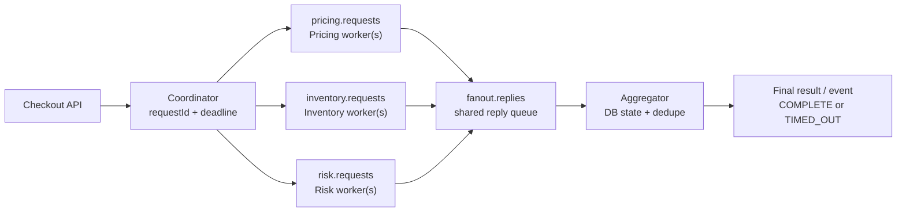
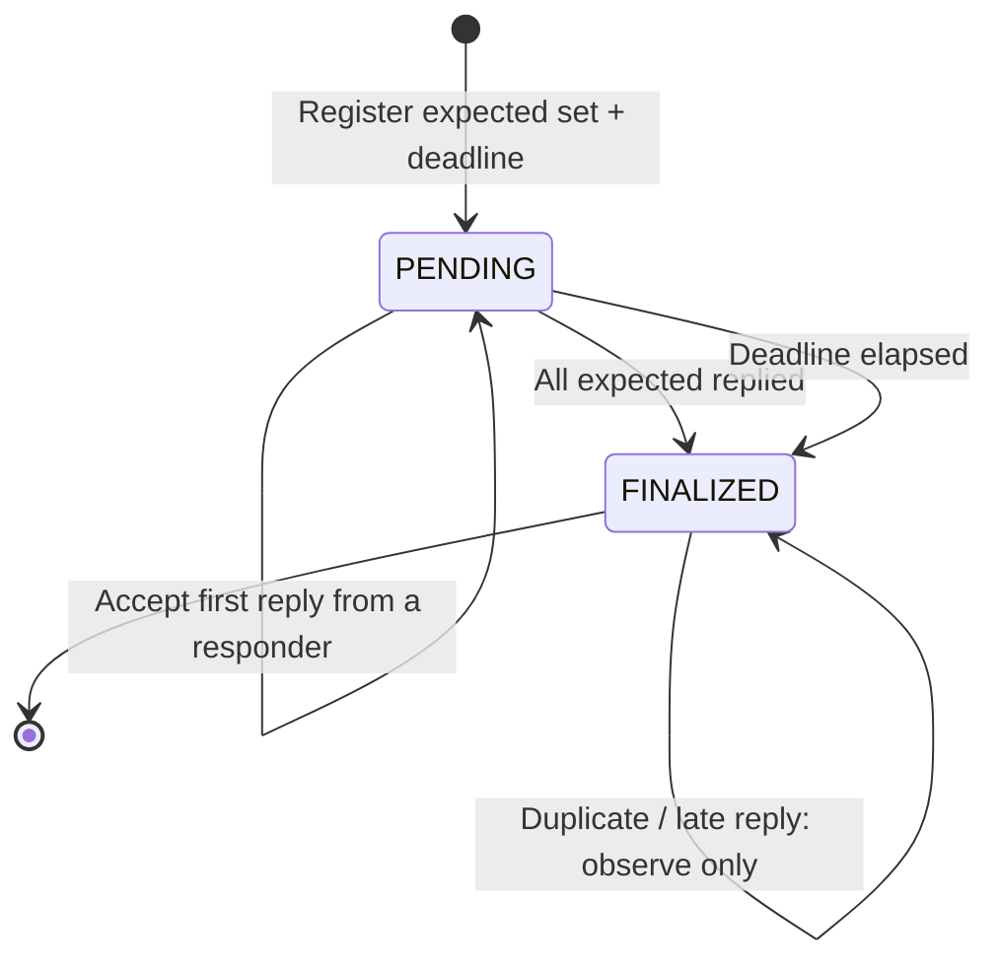

# Fan-out, tổng hợp kết quả và kiểm soát thiếu phản hồi

> **Chương:** Mẫu tích hợp  
> **Phạm vi:** Apache ActiveMQ Classic hoặc ActiveMQ Artemis, Java JMS và một nơi lưu trạng thái tổng hợp bền vững. Trọng tâm là mẫu **Scatter–Gather**: phát một yêu cầu tới nhiều tác vụ độc lập, ghép phản hồi, chốt kết quả khi đủ hoặc hết hạn. Ví dụ dùng ba worker `pricing`, `inventory`, `risk` và PostgreSQL cho trạng thái coordinator.

## 1. Bài toán: một yêu cầu cần ba kết quả, nhưng không thể chờ mãi

API `CheckoutQuote` cần đồng thời:

- `pricing` tính giá cuối cùng;
- `inventory` xác nhận tồn kho;
- `risk` đánh giá rủi ro giao dịch.

Mỗi service có thể xử lý với thời gian khác nhau, bị restart hoặc phản hồi hai lần. API đặt deadline 2 giây. Nếu đến hạn chỉ nhận được hai phản hồi, hệ thống cần trả kết quả **thiếu dữ liệu có chủ đích**, thay vì chặn vô hạn hoặc tự coi nhánh chưa trả lời là thành công.



Đây là **fan-out → gather**, không phải “gửi cùng một message vào queue có ba consumer”:

- **Queue có ba consumer cạnh tranh:** mỗi message thông thường đến **một** consumer; đây là phân chia công việc, **không** bảo đảm cả ba nghiệp vụ cùng nhận.
- **Ba queue theo nhiệm vụ:** coordinator gửi ba message vật lý tới ba destination; mỗi đội worker xử lý đúng chức năng.
- **Topic có ba subscription riêng:** cũng có thể fan-out một message tới ba subscription, nhưng phải cấu hình subscription bền vững nếu các service cần nhận khi offline. Mỗi subscription có backlog riêng.

Trong ví dụ, **ba queue riêng** giúp diễn đạt chính xác tập phản hồi được kỳ vọng và tách quyền truy cập theo nhiệm vụ.

### 1.1. Điều phối phải trả lời được bốn câu hỏi

1. **Đợi ai?** Tập responder cố định của request: `{pricing, inventory, risk}`.
2. **Ghép về đâu?** `requestId` ổn định và `JMSCorrelationID` trên request/reply.
3. **Khi nào chốt?** Đủ tất cả phản hồi hợp lệ **hoặc** chạm deadline.
4. **Thiếu thì sao?** Trả `missingResponders` rõ ràng và outcome `TIMED_OUT`; không đoán giá trị của nhánh thiếu.

Một message trả về lỗi nghiệp vụ vẫn là **một phản hồi**. Đừng đánh đồng “đã trả lời” với “thành công”.

## 2. Hợp đồng message: identity, correlation, responder và deadline

### 2.1. Contract request

Mỗi lệnh tới một worker có các trường ví dụ:

```json
{
  "schemaVersion": 1,
  "requestId": "11111111-1111-1111-1111-111111111111",
  "responderId": "pricing",
  "orderId": "O-100",
  "currency": "VND"
}
```

Các JMS header/property nên đi kèm:

| Trường | Ví dụ | Tác dụng |
|---|---|---|
| `JMSCorrelationID` | `11111111-1111-1111-1111-111111111111` | Nối các request/reply cùng một đợt fan-out |
| `JMSReplyTo` | Queue `fanout.replies` | Destination cho worker gửi phản hồi |
| Property `responderId` | `pricing` | Xác định nhánh được yêu cầu; thuộc hợp đồng ứng dụng |
| Property `schemaVersion` | `1` | Kiểm tra version contract |
| Property `deadlineEpochMs` | Epoch milliseconds | Gợi ý để worker bỏ qua việc quá hạn; **DB deadline là nguồn quyết định chốt** |
| Body | JSON như trên | Dữ liệu nghiệp vụ cần xử lý |

`JMSCorrelationID` và `JMSReplyTo` là **JMS headers**. `responderId`/`schemaVersion` là **application properties**, không phải JMS headers chuẩn. `JMSMessageID` do provider cấp khi gửi, **không** nên dùng làm business `requestId`: producer retry có thể tạo message vật lý mới với ID khác.

`deadlineEpochMs` phải được diễn giải theo contract (UTC epoch milliseconds). Worker có thể kiểm tra deadline để tiết kiệm tài nguyên, nhưng không được dùng đồng hồ máy worker làm trọng tài duy nhất cho việc chốt kết quả.

### 2.2. Contract reply

```json
{
  "schemaVersion": 1,
  "requestId": "11111111-1111-1111-1111-111111111111",
  "responderId": "pricing",
  "resultStatus": "SUCCESS",
  "data": {
    "totalMinor": 129900,
    "currency": "VND"
  }
}
```

Reply cần giữ **cùng `JMSCorrelationID`** với request; property `responderId` phải cho biết worker nào trả lời. Có thể có `replyEventId` ổn định qua retry, nhưng khóa logic của **một slot phản hồi** trong bài này là:

```text
(requestId, responderId)
```

Vì yêu cầu chỉ cần **một kết quả cuối cho mỗi nhánh**, khóa trên ngăn một worker làm tăng bộ đếm hoàn tất hai lần. Nếu nghiệp vụ muốn nhiều phiên bản phản hồi của cùng worker, phải định nghĩa rõ `attempt/version` và luật chọn bản thắng; không vô tình ghi đè bản đầu.

**Không tự tin tưởng mọi responderId do message khai báo.** Aggregator phải đối chiếu với tập nhánh đã đăng ký và quyền publish của client; người gửi bất kỳ không được tự thêm một phản hồi “risk=SUCCESS”.

### 2.3. Vì sao reply queue bền vững thường tốt hơn temporary queue?

`JMSReplyTo` có thể trỏ tới `TemporaryQueue` cho RPC ngắn, nhưng temporary destination có vòng đời gắn với connection sở hữu. Nếu coordinator chết/restart, temporary queue có thể biến mất, khiến kết quả trả chậm không còn đích hợp lệ.

Với aggregate chờ vài giây/phút và cần sống qua restart, ưu tiên một **reply queue thường được provision rõ ràng**, ví dụ `fanout.replies`. Nhiều aggregator instance có thể cạnh tranh consume queue đó, nhưng dùng **cùng PostgreSQL** để đồng bộ state. Reply queue phải có ACL, TTL/retention và dung lượng phù hợp.

## 3. State machine: hoàn tất, kết quả lỗi và thiếu phản hồi

Ta chọn **ALL-RESPONSES** cho bài thực hành: chốt sớm chỉ khi đã nhận phản hồi từ mọi nhánh; nếu quá hạn thì chốt với những gì đã có.



`state=FINALIZED` là **trạng thái kết thúc không đổi**. Tính chất kết quả lưu riêng:

| `outcome` | Điều kiện | Ý nghĩa |
|---|---|---|
| `ALL_SUCCEEDED` | Đủ phản hồi, tất cả `SUCCESS` | Tất cả nhánh đã hoàn thành thành công |
| `COMPLETED_WITH_ERRORS` | Đủ phản hồi nhưng có một hoặc nhiều `ERROR` | Không thiếu phản hồi, nhưng nghiệp vụ thất bại một phần |
| `TIMED_OUT` | Đến deadline khi vẫn thiếu ít nhất một phản hồi | Chốt kết quả một phần; công khai danh sách thiếu |

Ví dụ:

```json
{
  "requestId": "11111111-1111-1111-1111-111111111111",
  "outcome": "TIMED_OUT",
  "received": {
    "pricing": {"resultStatus": "SUCCESS", "totalMinor": 129900},
    "inventory": {"resultStatus": "SUCCESS", "available": true}
  },
  "missingResponders": ["risk"],
  "finalized": true
}
```

**Không dùng số phản hồi thô để quyết định xong.** Nếu pricing gửi ba reply do mạng retry, ba message không thể thay thế phản hồi của inventory và risk.

### 3.1. Định nghĩa deadline phải có nguồn thời gian và điểm quyết định

Ví dụ `deadlineAt = createdAt + 2 seconds` được ghi vào PostgreSQL dạng `TIMESTAMPTZ`. Trong thiết kế này, một reply chỉ được **nhận vào tập kết quả** nếu aggregator lấy được khóa transaction của request và kiểm tra **đồng hồ database** thấy chưa đến hạn. Đây là **deadline theo thời điểm xử lý tại aggregator**, không phải theo thời gian worker khẳng định đã gửi.

Hệ quả: reply có thể được gửi trước deadline nhưng do backlog/network, đến DB sau deadline và bị coi là **late**. Đó là chính sách nhất quán; nếu SLA muốn đánh giá theo thời điểm broker nhận, cần thiết kế bằng chứng timestamp đáng tin cậy, không lấy timestamp tự khai của worker làm mặc định.

### 3.2. Chính sách khác ALL-RESPONSES

| Chính sách | Khi nào chốt sớm? | Điểm cần lưu ý |
|---|---|---|
| **All** | Nhận đủ tất cả nhánh | Dễ lý giải; nhánh chậm ảnh hưởng latency |
| **Quorum** | Đủ `k` phản hồi **hợp lệ theo tiêu chí** | Phải nói rõ `k` success hay `k` phản hồi bất kể lỗi |
| **First-success** | Phản hồi thành công đầu tiên | Không đồng nghĩa chờ toàn bộ để tổng hợp |
| **Best-effort until deadline** | Chỉ chốt khi đến deadline | Luôn tận dụng khoảng thời gian cho phản hồi đến sau |

Với giá bán/tồn kho/risk, **quorum 2/3 không nhất thiết an toàn**: thiếu risk có thể không cho phép checkout. Chọn chính sách theo quy tắc nghiệp vụ, không chỉ theo mong muốn giảm latency.

## 4. Lưu state bền vững trong PostgreSQL

Không nên giữ tổng hợp chỉ trong một `ConcurrentHashMap<UUID, List<Reply>>`:

- Process restart làm mất danh sách expected và reply đã nhận.
- Nhiều aggregator instance không chia sẻ state.
- Không có lock đủ mạnh để giải quyết cuộc đua **reply cuối vs timeout**.
- Không có bản ghi cuối cùng đáng tin cậy cho API polling/redrive.

Đề xuất schema tối giản:

```sql
CREATE TABLE fanout_jobs (
    request_id UUID PRIMARY KEY,
    created_at TIMESTAMPTZ NOT NULL DEFAULT clock_timestamp(),
    deadline_at TIMESTAMPTZ NOT NULL,
    state TEXT NOT NULL DEFAULT 'PENDING'
        CHECK (state IN ('PENDING', 'FINALIZED')),
    outcome TEXT
        CHECK (outcome IS NULL OR outcome IN
              ('ALL_SUCCEEDED', 'COMPLETED_WITH_ERRORS', 'TIMED_OUT')),
    finalized_at TIMESTAMPTZ,
    CONSTRAINT ck_fanout_final
      CHECK ((state = 'PENDING' AND outcome IS NULL AND finalized_at IS NULL)
          OR (state = 'FINALIZED' AND outcome IS NOT NULL
              AND finalized_at IS NOT NULL))
);

CREATE TABLE fanout_expected (
    request_id UUID NOT NULL
        REFERENCES fanout_jobs(request_id),
    responder_id TEXT NOT NULL,
    PRIMARY KEY (request_id, responder_id)
);

CREATE TABLE fanout_replies (
    request_id UUID NOT NULL,
    responder_id TEXT NOT NULL,
    reply_event_id TEXT NOT NULL,
    result_status TEXT NOT NULL
        CHECK (result_status IN ('SUCCESS','ERROR')),
    payload_json JSONB NOT NULL,
    received_at TIMESTAMPTZ NOT NULL DEFAULT clock_timestamp(),
    PRIMARY KEY (request_id, responder_id),
    FOREIGN KEY (request_id, responder_id)
        REFERENCES fanout_expected(request_id, responder_id)
);

CREATE TABLE integration_outbox (
    outbox_id BIGSERIAL PRIMARY KEY,
    dedupe_key TEXT NOT NULL UNIQUE,
    destination TEXT NOT NULL,
    event_type TEXT NOT NULL,
    payload_json JSONB NOT NULL,
    created_at TIMESTAMPTZ NOT NULL DEFAULT clock_timestamp(),
    published_at TIMESTAMPTZ
);

CREATE INDEX idx_fanout_jobs_due
    ON fanout_jobs (deadline_at)
    WHERE state = 'PENDING';

CREATE INDEX idx_integration_outbox_unpublished
    ON integration_outbox (created_at)
    WHERE published_at IS NULL;
```

### 4.1. Tại sao có hai bảng `expected` và `replies`?

- `fanout_expected` là **bản hợp đồng đã chốt**: aggregator biết đang đợi những responder nào.
- `fanout_replies` chỉ có một hàng cho mỗi `(requestId, responderId)`.
- Danh sách thiếu được tính bằng **hiệu hai tập**, không từ “3 trừ tổng message đã receive”.

```sql
SELECT e.responder_id
FROM fanout_expected e
LEFT JOIN fanout_replies r
  ON r.request_id = e.request_id
 AND r.responder_id = e.responder_id
WHERE e.request_id = ?
  AND r.request_id IS NULL
ORDER BY e.responder_id;
```

Ràng buộc khóa ngoại bảo vệ khỏi việc lưu một responder không có trong expected set. Tuy nhiên, ứng dụng vẫn nên kiểm tra đầu vào sớm để đưa phản hồi không hợp lệ vào quarantine thay vì retry vô hạn.

### 4.2. Vì sao reply_event_id và unique key là hai vấn đề khác?

`reply_event_id` hữu ích để truy vết **bản reply vật lý/logic** và producer retry. Nhưng business slot duy nhất là responder của request. Do đó `PRIMARY KEY(request_id, responder_id)` mới là bộ phân xử **một nhánh chỉ được tính một lần**.

Nếu hai reply có cùng slot nhưng payload khác, không được lặng lẽ dùng `ON CONFLICT DO NOTHING` rồi coi như là duplicate an toàn. Phải so sánh `result_status` và `payload_json` đã chuẩn hóa, ghi nhận vi phạm contract và có chính sách xử lý. `JSONB` hỗ trợ so sánh ý nghĩa JSON object ở mức PostgreSQL, nhưng không thay việc chuẩn hóa schema nghiệp vụ.

## 5. Khởi tạo aggregate và fan-out: không để “job tồn tại nhưng request không gửi”

Một bài toán đặc biệt nguy hiểm là coordinator ghi DB thành công nhưng crash **trước khi gửi đủ ba JMS request**.

**Cách chưa an toàn:**

```text
INSERT fanout_jobs(requestId)
COMMIT DB
send pricing request -> OK
send inventory request -> crash
send risk request -> chưa chạy
```

Job sẽ đợi hai nhánh **chưa từng được phát yêu cầu**, cuối cùng chỉ có timeout. Hệ thống có thể retry riêng nhưng khó biết request nào đã được gửi.

### 5.1. Outbox cho các tác vụ fan-out

Trong **một DB transaction**, ghi:

1. `fanout_jobs` với deadline.
2. Ba hàng `fanout_expected` cho pricing, inventory, risk.
3. Ba hàng `integration_outbox`, mỗi hàng chứa destination và JSON request của một nhánh.

Ví dụ khung SQL:

```sql
BEGIN;

INSERT INTO fanout_jobs(request_id, deadline_at)
VALUES (?, clock_timestamp() + INTERVAL '2 seconds');

INSERT INTO fanout_expected(request_id, responder_id)
VALUES (?, 'pricing'),
       (?, 'inventory'),
       (?, 'risk');

-- 3 bản ghi outbox; payload là JSON request đã chuẩn hóa.
INSERT INTO integration_outbox
    (dedupe_key, destination, event_type, payload_json)
VALUES
    (?, 'pricing.requests', 'FanoutRequest', CAST(? AS jsonb)),
    (?, 'inventory.requests', 'FanoutRequest', CAST(? AS jsonb)),
    (?, 'risk.requests', 'FanoutRequest', CAST(? AS jsonb));

COMMIT;
```

Ở đây các dấu `?` là JDBC parameters; ba `dedupe_key` phải khác nhau, ví dụ:

```text
fanout:11111111-1111-1111-1111-111111111111:dispatch:pricing
fanout:11111111-1111-1111-1111-111111111111:dispatch:inventory
fanout:11111111-1111-1111-1111-111111111111:dispatch:risk
```

**Lưu ý về deadline ngắn:** với SLO chỉ 2 giây, thời gian chờ outbox relay cũng tiêu tốn deadline. Nếu cần phân biệt thời gian nhận request và thời gian thật sự dispatch, lưu thêm `dispatchAt`/hạn riêng từng nhánh và chọn policy rõ ràng.

Một outbox publisher nền sẽ gửi message persistent tới destination tương ứng, sau khi broker chấp nhận mới đánh dấu `published_at`. Nếu crash sau JMS send nhưng trước khi cập nhật outbox, message có thể được phát **lặp**. Đây là mô hình **at-least-once publication**, yêu cầu worker và aggregator có idempotency.

Không cần giả vờ rằng transaction PostgreSQL của outbox và JMS commit là một XA transaction.

### 5.2. Cách đơn giản hơn cho demo cùng một broker

Nếu không cần database outbox trong bài thử nghiệm, có thể gửi ba message trong **một JMS transacted Session**: hoặc commit cả ba, hoặc rollback nhóm send trong JMS. Cách này **không** làm atomic với việc tạo `fanout_jobs` trong PostgreSQL; chỉ dùng để học/đo JMS fan-out trước khi triển khai outbox đầy đủ.

## 6. Java JMS: gửi một đợt fan-out ba queue

Ví dụ API `jakarta.jms`, phù hợp Spring Boot 3.x với Artemis Jakarta client. Nếu dùng ActiveMQ Classic, cần đúng Jakarta-compatible client và OpenWire transport tương ứng; không trộn `javax.jms` và `jakarta.jms`.

### 6.1. Đoạn Java gửi ba yêu cầu qua một transacted Session

```java
import jakarta.jms.Connection;
import jakarta.jms.ConnectionFactory;
import jakarta.jms.DeliveryMode;
import jakarta.jms.Destination;
import jakarta.jms.JMSException;
import jakarta.jms.MessageProducer;
import jakarta.jms.Queue;
import jakarta.jms.Session;
import jakarta.jms.TextMessage;

import java.util.Map;
import java.util.UUID;

public final class FanoutPublisher {
    private static final Map<String, String> DESTINATIONS = Map.of(
        "pricing", "pricing.requests",
        "inventory", "inventory.requests",
        "risk", "risk.requests"
    );

    public static void sendThree(
            ConnectionFactory connectionFactory,
            UUID requestId,
            Map<String, String> requestJsonByResponder,
            long deadlineEpochMs) throws JMSException {

        Connection connection = connectionFactory.createConnection();
        try {
            Session session = connection.createSession(
                    true, Session.SESSION_TRANSACTED);
            try {
                MessageProducer producer = session.createProducer(null);
                try {
                    Queue replyQueue =
                            session.createQueue("fanout.replies");

                    for (Map.Entry<String, String> target
                            : DESTINATIONS.entrySet()) {
                        String responder = target.getKey();
                        String payload =
                                requestJsonByResponder.get(responder);
                        if (payload == null) {
                            throw new IllegalArgumentException(
                                    "Missing payload for " + responder);
                        }

                        Destination destination =
                                session.createQueue(target.getValue());

                        TextMessage request =
                                session.createTextMessage(payload);
                        request.setJMSCorrelationID(
                                requestId.toString());
                        request.setJMSReplyTo(replyQueue);
                        request.setStringProperty(
                                "responderId", responder);
                        request.setIntProperty("schemaVersion", 1);
                        request.setLongProperty(
                                "deadlineEpochMs", deadlineEpochMs);

                        producer.send(
                                destination,
                                request,
                                DeliveryMode.PERSISTENT,
                                4,
                                0L); // Không dùng TTL làm deadline tổng hợp.
                    }

                    session.commit(); // Cùng JMS transaction.
                } catch (JMSException | RuntimeException error) {
                    try {
                        session.rollback();
                    } catch (JMSException rollbackError) {
                        error.addSuppressed(rollbackError);
                    }
                    throw error;
                } finally {
                    producer.close();
                }
            } finally {
                session.close();
            }
        } finally {
            connection.close();
        }
    }
}
```

**Giới hạn code:** đây là **producer helper có thể tích hợp trong app**, chưa bao gồm khởi tạo job DB hoặc relay outbox. `Map.of` không cam kết thứ tự iteration; không cần thứ tự vì **ba tác vụ độc lập**, và coordinator ghép kết quả bằng `responderId` chứ không bằng thứ tự request gửi.

`timeToLive=0` nghĩa là không đặt JMS expiration tự động cho request; thời hạn nghiệp vụ được quản lý bằng `deadlineAt` trong DB. Có thể chọn TTL phù hợp để giảm công việc quá hạn, nhưng nếu message hết hạn trước khi worker xử lý, aggregator vẫn phải **chốt thiếu** chính xác.

Các tên queue phải được provision và cấp quyền tương ứng trong production. Với Artemis, kiểm tra queue ANYCAST/binding và security roles; với Classic, kiểm tra authorization và destination policy.

### 6.2. Gửi một message topic thay vì ba queue: khi nào hợp lý?

Nếu nhiều service đều cần **cùng một body sự kiện**, một topic `checkout.quote.requested` có thể fan-out tới ba **subscription riêng biệt**:

```text
Topic checkout.quote.requested
  ├─ pricing-subscription   -> Pricing
  ├─ inventory-subscription -> Inventory
  └─ risk-subscription      -> Risk
```

Điểm khác:

- Topic non-durable không bảo đảm backlog cho subscriber offline.
- Durable subscriptions cần danh tính ổn định và cấu hình tương ứng với client/broker, không thể coi như ba consumer cạnh tranh trên **một** durable subscription.
- Với Artemis MULTICAST, mỗi subscription tương ứng một queue/binding; với Classic, dùng semantics JMS Topic/durable subscription.
- Coordinator vẫn phải biết **tập expected responders**; chỉ gửi vào topic **không** cho biết chính xác ai đã subscribe tại thời điểm đó.

Khi ba service có body lệnh/ACL/schema khác nhau, **ba queue tường minh** thường đơn giản hơn.

## 7. Worker trả lời đúng correlation và destination

Worker nhận từ queue riêng, tính toán rồi gửi reply tới `JMSReplyTo`. Nếu cả receive và reply send ở **cùng một broker và cùng JMS transacted Session**, có thể commit hai thao tác JMS cùng lúc.

```java
import jakarta.jms.*;

public final class PricingWorkerOnce {

    public static boolean runOnce(ConnectionFactory factory)
            throws JMSException {

        Connection connection = factory.createConnection();
        try {
            Session session = connection.createSession(
                    true, Session.SESSION_TRANSACTED);
            try {
                Queue requestQueue =
                        session.createQueue("pricing.requests");
                MessageConsumer consumer =
                        session.createConsumer(requestQueue);
                MessageProducer producer =
                        session.createProducer(null);

                try {
                    connection.start();
                    Message incoming = consumer.receive(10_000L);
                    if (incoming == null) {
                        return false;
                    }

                    try {
                        String correlationId =
                                incoming.getJMSCorrelationID();
                        Destination replyTo =
                                incoming.getJMSReplyTo();

                        if (correlationId == null || replyTo == null) {
                            throw new IllegalArgumentException(
                                    "Missing correlation/reply destination");
                        }

                        // Production: parse/validate request body,
                        // tính pricing thật và kiểm tra replyTo ACL.
                        TextMessage reply = session.createTextMessage(
                            "{\"resultStatus\":\"SUCCESS\","
                            + "\"totalMinor\":129900,"
                            + "\"currency\":\"VND\"}");

                        reply.setJMSCorrelationID(correlationId);
                        reply.setStringProperty(
                                "responderId", "pricing");
                        reply.setStringProperty(
                                "replyEventId", correlationId + ":pricing");
                        reply.setStringProperty(
                                "resultStatus", "SUCCESS");

                        producer.send(replyTo, reply,
                                DeliveryMode.PERSISTENT, 4, 0L);

                        session.commit(); // Receive + reply send.
                        return true;
                    } catch (JMSException | RuntimeException error) {
                        try {
                            session.rollback();
                        } catch (JMSException rollbackError) {
                            error.addSuppressed(rollbackError);
                        }
                        throw error;
                    }
                } finally {
                    try {
                        producer.close();
                    } finally {
                        consumer.close();
                    }
                }
            } finally {
                session.close();
            }
        } finally {
            connection.close();
        }
    }
}
```

Các worker `inventory` và `risk` có cấu trúc tương tự nhưng destination/responderId và payload khác nhau.

**Những giới hạn phải hiểu:**

1. `replyEventId` trong ví dụ được tạo **ổn định** từ `requestId + responderId`; không sinh ID ngẫu nhiên mới mỗi lần cùng request được giao lại.
2. Đây là transaction **JMS local**: không bao trùm database/HTTP mà pricing worker có thể gọi. Nếu worker đã trừ hàng trong DB rồi crash trước JMS commit, cần idempotency ở nghiệp vụ worker.
3. `JMSReplyTo` nên được kiểm tra/allowlist theo địa chỉ reply queue đã thiết kế; không cho message không tin cậy tùy ý khiến worker gửi ra một destination khác.
4. Các reply có thể **đến sai thứ tự**, không sao: coordinator không lấy “reply thứ hai = inventory” mà lấy `responderId`.
5. `IllegalArgumentException` cho message sai contract sẽ gây rollback; production phải có chính sách retry có giới hạn/quarantine, không tạo poison loop vô hạn.

## 8. Aggregator: ghép phản hồi bằng transaction và unique constraint

Bây giờ có ba worker gửi về **cùng queue** `fanout.replies`. Hai instance aggregator có thể nhận các reply của cùng request gần như đồng thời. Phải bảo đảm:

- Một slot `(requestId,responderId)` được tính **tối đa một lần**.
- Một job chỉ chốt **một lần**, khi đủ phản hồi hoặc hết hạn.
- Không có kết quả “đã FINALIZED nhưng final event chưa được ghi” trong database.
- Nếu DB commit nhưng JMS ACK thất bại, reply được giao lại **không tạo kết quả chốt thứ hai**.

### 8.1. Thuật toán trong một DB transaction

```text
BEGIN
  SELECT fanout_jobs WHERE request_id = ? FOR UPDATE

  Nếu không tồn tại:
    reject/quarantine unknown requestId
  Nếu state = FINALIZED:
    ghi nhận duplicate/late (nếu cần), không thay đổi kết quả
  Nếu deadline đã tới theo database clock:
    finalize TIMED_OUT với reply đang có
  Ngược lại:
    kiểm tra responderId thuộc fanout_expected
    INSERT fanout_replies ON CONFLICT DO NOTHING
    nếu trùng: so sánh payload với reply đã lưu
    nếu mọi responder đều đã trả lời:
      finalize ALL_SUCCEEDED hoặc COMPLETED_WITH_ERRORS
      INSERT final event vào integration_outbox
COMMIT DB
Sau khi commit thành công: JMS ACK/commit reply
```

**Nơi quyết định duy nhất** là transaction giữ row lock trên `fanout_jobs`. Khi reply cuối và timeout scanner chạy đồng thời, cả hai phải tranh chấp **cùng row lock**, không tự cập nhật độc lập.

### 8.2. SQL upsert một phản hồi

Trong transaction đã khóa job:

```sql
INSERT INTO fanout_replies
    (request_id, responder_id, reply_event_id,
     result_status, payload_json)
VALUES (?, ?, ?, ?, CAST(? AS jsonb))
ON CONFLICT (request_id, responder_id) DO NOTHING;
```

Kiểm tra `executeUpdate()`:

- `1`: một response slot mới được chấp nhận.
- `0`: slot đã có; truy vấn row cũ để đối chiếu `result_status` và `payload_json`. Nếu khác, ghi nhận **conflicting duplicate**, không tự ghi đè.
- Vi phạm FK vì responder không thuộc expected set: **không** được tính là thành công; đưa về chính sách xử lý malformed/unauthorized reply.

Đếm đủ nhánh **theo expected set**:

```sql
SELECT
  (SELECT COUNT(*)
     FROM fanout_expected e
    WHERE e.request_id = ?) AS expected_count,
  (SELECT COUNT(*)
     FROM fanout_replies r
    WHERE r.request_id = ?) AS received_count;
```

Vì bảng replies có FK và khóa duy nhất, `received_count` không thể lớn hơn `expected_count` nếu data integrity được duy trì. Khi hai số bằng nhau, tất cả nhánh đã **trả lời**; outcome còn phụ thuộc có `ERROR` hay không:

```sql
SELECT COUNT(*) AS error_count
FROM fanout_replies
WHERE request_id = ?
  AND result_status = 'ERROR';
```

### 8.3. Chốt và ghi final event **cùng DB transaction**

```sql
UPDATE fanout_jobs
SET state = 'FINALIZED',
    outcome = ?,
    finalized_at = clock_timestamp()
WHERE request_id = ?
  AND state = 'PENDING';
```

Ngay sau UPDATE trong **cùng transaction**, ghi:

```sql
INSERT INTO integration_outbox
    (dedupe_key, destination, event_type, payload_json)
VALUES
    (?, 'fanout.results', 'FanoutFinalized',
     CAST(? AS jsonb))
ON CONFLICT (dedupe_key) DO NOTHING;
```

`dedupe_key` có thể là:

```text
fanout:11111111-1111-1111-1111-111111111111:final
```

`payload_json` phải là **snapshot cuối** gồm outcome, từng reply đã nhận và `missingResponders`; xây dựng snapshot từ dữ liệu trong transaction vừa khóa. Khi DB commit, **status FINALIZED và outbox final event cùng tồn tại**. Relay có thể gửi final event nhiều lần nếu crash tại ranh giới publish/mark, nên downstream cũng cần idempotency theo requestId.

## 9. Spring Boot 3.x: listener ACK sau khi trạng thái DB commit

### 9.1. Dependency và cấu hình cơ bản

Sử dụng Spring Boot dependency management:

```xml
<dependencies>
  <dependency>
    <groupId>org.springframework.boot</groupId>
    <artifactId>spring-boot-starter-artemis</artifactId>
  </dependency>
  <dependency>
    <groupId>org.springframework.boot</groupId>
    <artifactId>spring-boot-starter-jdbc</artifactId>
  </dependency>
  <dependency>
    <groupId>org.postgresql</groupId>
    <artifactId>postgresql</artifactId>
    <scope>runtime</scope>
  </dependency>
</dependencies>
```

```yaml
spring:
  artemis:
    mode: native
    broker-url: tcp://localhost:61616
    user: aggregator_app
    password: $¤{ARTEMIS_PASSWORD}
  datasource:
    url: jdbc:postgresql://localhost:5432/checkout
    username: checkout_app
    password: $¤{DB_PASSWORD}

fanout:
  timeout-scan-ms: 1000
```

Đây là cấu hình **Artemis native**. Nếu dùng Classic, đổi starter/provider/properties cho Classic; không dùng chung URI hay client mà không kiểm tra protocol. Các queue cần được provision trong broker, ACL phù hợp.

### 9.2. Listener factory dùng JMS local transaction

```java
import jakarta.jms.ConnectionFactory;
import org.springframework.boot.autoconfigure.jms
        .DefaultJmsListenerContainerFactoryConfigurer;
import org.springframework.context.annotation.Bean;
import org.springframework.context.annotation.Configuration;
import org.springframework.jms.annotation.EnableJms;
import org.springframework.jms.config.DefaultJmsListenerContainerFactory;

@Configuration(proxyBeanMethods = false)
@EnableJms
public class AggregateJmsConfiguration {

    @Bean("aggregateReplyListenerFactory")
    DefaultJmsListenerContainerFactory replyListenerFactory(
            ConnectionFactory connectionFactory,
            DefaultJmsListenerContainerFactoryConfigurer configurer) {
        DefaultJmsListenerContainerFactory factory =
                new DefaultJmsListenerContainerFactory();
        configurer.configure(factory, connectionFactory);
        factory.setSessionTransacted(true);
        factory.setConcurrency("1-4");
        factory.setPubSubDomain(false);
        return factory;
    }
}
```

Đây là **JMS transaction** của listener: khi callback thành công, container commit/ACK; khi exception thoát ra, container rollback, broker có thể redeliver.

### 9.3. Listener chỉ trích xuất metadata, giao DB cho service riêng

```java
import jakarta.jms.JMSException;
import jakarta.jms.TextMessage;
import java.util.UUID;
import org.springframework.jms.annotation.JmsListener;
import org.springframework.stereotype.Component;

@Component
public class FanoutReplyListener {
    private final FanoutAggregationService service;

    public FanoutReplyListener(FanoutAggregationService service) {
        this.service = service;
    }

    @JmsListener(
        destination = "fanout.replies",
        containerFactory = "aggregateReplyListenerFactory"
    )
    public void onReply(TextMessage message) throws JMSException {
        String correlation = message.getJMSCorrelationID();
        String responder = message.getStringProperty("responderId");
        String replyEventId =
                message.getStringProperty("replyEventId");
        String resultStatus =
                message.getStringProperty("resultStatus");

        if (correlation == null || responder == null
                || replyEventId == null || resultStatus == null) {
            throw new IllegalArgumentException(
                    "Missing required reply metadata");
        }

        FanoutReply reply = new FanoutReply(
                UUID.fromString(correlation),
                responder,
                replyEventId,
                resultStatus,
                message.getText());

        // Service này cần transaction DB RIÊNG, commit
        // trước khi callback return để container ACK JMS.
        service.acceptReply(reply);
    }
}

// Ví dụ DTO Java 17:
record FanoutReply(
    UUID requestId,
    String responderId,
    String replyEventId,
    String resultStatus,
    String jsonBody
) {}
```

Nếu dữ liệu đến dưới dạng `BytesMessage`/AMQP mapping khác, phải có decoder phù hợp, không ép kiểu `TextMessage` mù quáng. Metadata không hợp lệ cần đường quarantine và retry giới hạn; throw liên tục trên poison message không phải giải pháp cuối.

### 9.4. Logic DB transaction trong service

Đoạn dưới minh họa **phần cốt lõi**; các hàm `assertExpected`, `verifyDuplicate`, `finalizeLocked` và `rejectUnexpectedReply` là logic ứng dụng phải triển khai theo SQL tại mục 8, không phải Spring API có sẵn:

```java
import java.time.OffsetDateTime;
import java.util.UUID;
import org.springframework.jdbc.core.JdbcTemplate;
import org.springframework.stereotype.Service;
import org.springframework.transaction.annotation.Transactional;

@Service
public class FanoutAggregationService {
    private final JdbcTemplate jdbc;

    public FanoutAggregationService(JdbcTemplate jdbc) {
        this.jdbc = jdbc;
    }

    @Transactional // DB manager, không phải JMS manager.
    public void acceptReply(FanoutReply reply) {
        JobState job = jdbc.queryForObject(
            "SELECT state, deadline_at FROM fanout_jobs "
            + "WHERE request_id = ? FOR UPDATE",
            (rs, rowNum) -> new JobState(
                rs.getString("state"),
                rs.getObject("deadline_at", OffsetDateTime.class)),
            reply.requestId());

        if (job == null) {
            throw new IllegalStateException("Unknown requestId");
        }

        // Row lock đã được giữ trong DB transaction.
        if (!"PENDING".equals(job.state())) {
            // Late/duplicate: ghi metric/audit riêng nếu cần.
            return;
        }

        OffsetDateTime dbNow = jdbc.queryForObject(
            "SELECT clock_timestamp()",
            (rs, rowNum) -> rs.getObject(1, OffsetDateTime.class));

        if (!dbNow.isBefore(job.deadlineAt())) {
            finalizeLocked(reply.requestId(), "TIMED_OUT");
            return;
        }

        assertExpected(reply.requestId(), reply.responderId());

        int inserted = jdbc.update(
            "INSERT INTO fanout_replies "
            + "(request_id, responder_id, reply_event_id, "
            + "result_status, payload_json) "
            + "VALUES (?, ?, ?, ?, CAST(? AS jsonb)) "
            + "ON CONFLICT (request_id, responder_id) DO NOTHING",
            reply.requestId(),
            reply.responderId(),
            reply.replyEventId(),
            reply.resultStatus(),
            reply.jsonBody());

        if (inserted == 0) {
            verifyDuplicate(reply); // Không tính thêm.
        }

        long expected = jdbc.queryForObject(
            "SELECT COUNT(*) FROM fanout_expected "
            + "WHERE request_id = ?",
            Long.class, reply.requestId());
        long received = jdbc.queryForObject(
            "SELECT COUNT(*) FROM fanout_replies "
            + "WHERE request_id = ?",
            Long.class, reply.requestId());

        if (received == expected) {
            long errors = jdbc.queryForObject(
                "SELECT COUNT(*) FROM fanout_replies "
                + "WHERE request_id = ? AND result_status = 'ERROR'",
                Long.class, reply.requestId());
            finalizeLocked(reply.requestId(),
                errors == 0 ? "ALL_SUCCEEDED"
                            : "COMPLETED_WITH_ERRORS");
        }
    }

    private record JobState(
        String state, OffsetDateTime deadlineAt) {}

    // Các method dưới đây là hợp đồng cần hiện thực dựa vào
    // SQL mục 8; không phải API có sẵn của Spring/JMS.
    private void assertExpected(UUID id, String responder) {
        throw new UnsupportedOperationException("Implement expected check");
    }
    private void verifyDuplicate(FanoutReply reply) {
        throw new UnsupportedOperationException("Implement conflict check");
    }
    private void finalizeLocked(UUID id, String outcome) {
        throw new UnsupportedOperationException("Implement final + outbox");
    }
}
```

**Lưu ý chủ đích của ví dụ:** Đây là **skeleton thuật toán**, không phải lớp runnable hoàn chỉnh. Ba hàm cuối bắt buộc được hiện thực trước khi triển khai. `@Transactional` ở đây phải gắn với **database transaction manager**. Nếu dự án có cả `JmsTransactionManager` và DB manager, chỉ định rõ `@Transactional(transactionManager="businessDbTransactionManager")` và đảm bảo tên manager đó thật sự quản lý `DataSource` đang dùng.

Điểm quan trọng không thể bỏ qua:

- Spring gọi `acceptReply` **qua bean proxy**, nên DB transaction commit/rollback trước khi method quay lại listener.
- Khi DB commit thành công, listener trả về và container JMS mới commit ACK.
- Crash **sau DB commit, trước JMS ACK** có thể redeliver; unique key và job state giúp bỏ qua.
- `finalizeLocked` phải cập nhật `fanout_jobs` và ghi `integration_outbox` **cùng DB transaction**, không gọi JMS send trực tiếp trong lúc giữ row lock.
- Nếu reply đã final, service return an toàn và listener ACK; nếu dữ liệu reply khác payload đã ghi hoặc không hợp lệ, phải có quy trình audit/quarantine phù hợp.

## 10. Timeout scanner: chốt được cả khi không có reply nào

Một hệ thống chỉ kiểm tra deadline **khi nhận reply** sẽ có lỗ hổng: nếu **không worker nào trả lời**, không callback nào chạy để chốt job. Vì thế phải có scanner/timer độc lập với luồng reply.

### 10.1. SQL chọn job hết hạn có khóa

Trong PostgreSQL, để nhiều scanner instance không xử lý trùng:

```sql
BEGIN;

SELECT request_id
FROM fanout_jobs
WHERE state = 'PENDING'
  AND deadline_at <= clock_timestamp()
ORDER BY deadline_at
LIMIT 100
FOR UPDATE SKIP LOCKED;

-- Với mỗi request_id đã khóa:
-- UPDATE fanout_jobs -> FINALIZED / TIMED_OUT
-- INSERT integration_outbox -> FanoutFinalized
-- (tạo snapshot kết quả từ expected/replies)
COMMIT;
```

`FOR UPDATE SKIP LOCKED` giúp scanner bỏ qua job hiện đang bị transaction khác khóa, thay vì tất cả scanner phải chờ cùng một row. Cần giới hạn batch/transaction duration để không giữ khóa quá lâu.

Có thể triển khai với Spring `@Scheduled` và `TransactionTemplate` trên **DB manager**; lần quét mỗi giây chỉ là tham số vận hành. Với deadline 2 giây, polling mỗi giây có thể thêm khoảng trễ chốt sau deadline; nếu SLA rất chặt, phải đánh giá độ trễ scheduler, queue và database.

### 10.2. Cuộc đua reply cuối và timeout

```text
T1: Reply risk tới đúng gần deadline
T2: Timeout scanner thấy job sắp quá hạn

Cả hai muốn SELECT fanout_jobs ... FOR UPDATE.

Nếu T1 lấy lock trước deadline:
  T1 insert risk, đủ 3 replies, FINALIZED/ALL_SUCCEEDED.
  T2 đọc lại state FINALIZED -> không được timeout nữa.

Nếu T2 lấy lock khi deadline đã tới:
  T2 FINALIZED/TIMED_OUT với missing risk.
  T1 tới sau -> late reply, không được sửa kết quả đã chốt.
```

Điểm **linearization** là quyết định trong DB transaction dưới khóa của cùng `request_id`. Kết quả không phụ thuộc thứ tự thread in log hay vào tính may rủi của `ConcurrentHashMap`.

**Không dùng cùng lúc** một timer trong từng JVM và một timeout scanner DB mà không có cùng transaction/lock: hai bên có thể cùng phát final event trái ngược.

### 10.3. Reply đến sau deadline xử lý thế nào?

Với kết quả cuối **immutable**, có ba hướng:

- **ACK và ghi metric/audit late reply:** không thay đổi `fanout_jobs` đã final.
- **Lưu `late_replies` riêng** nếu cần phân tích chậm trễ, bảo đảm không vô tình trở thành một expected reply đúng hạn.
- **Phát event correction mới** chỉ khi nghiệp vụ có thiết kế rõ revision/version của kết quả. Đây là luồng mới, **không** sửa lén final event đã phát.

Nếu API trả `202 Accepted` kèm `requestId` và cho phép polling, trạng thái `FINALIZED` cần nhất quán bất kể instance phục vụ polling nào.

## 11. Vận hành: timeout không có nghĩa worker đã ngừng chạy

Sau khi coordinator chốt TIMED_OUT, các worker có thể vẫn đang xử lý message đã nhận. Không có lệnh JMS chuẩn nào bảo đảm **hủy tác vụ đang chạy trên tất cả worker** chỉ bằng cách đổi trạng thái aggregate.

- Nếu có yêu cầu hủy, gửi **cancellation command** riêng tới mỗi worker, nhưng coi đó là **best-effort**; worker phải kiểm tra trạng thái trước side effect.
- Nếu payload đại diện cho hành động không thể đảo ngược (charge tiền, giữ kho), không được “coi như hủy” khi timeout; cần trạng thái nghiệp vụ và compensation rõ ràng.
- TTL hoặc broker message expiry không thu hồi được một công việc đã bắt đầu xử lý.
- Hết deadline không đồng nghĩa các worker thất bại: chỉ có nghĩa coordinator **chưa nhận được phản hồi được chấp nhận trong hạn**.

### 11.1. Trả HTTP thế nào?

Với deadline 2 giây và khả năng partial result, hai kiểu API thường dùng:

| Kiểu | Ưu điểm | Điểm cần quyết định |
|---|---|---|
| `POST /checkout-quotes` trả `202` + `requestId` | Không giữ HTTP thread trong khi broker/worker chạy | Cần `GET /checkout-quotes/{id}` hoặc event/callback báo final |
| HTTP đợi tối đa một deadline rồi trả kết quả | Tích hợp tiện cho caller đồng bộ | Caller timeout phải bao phủ overhead; cần quy định partial result và retry |

Khi caller retry `POST` do HTTP timeout, dùng **idempotency key của yêu cầu gốc** để không sinh **fan-out job mới** cho cùng một thao tác business. `requestId` được tái sử dụng, không cấp ngẫu nhiên mới mỗi lần retry.

### 11.2. Metric quan trọng

| Metric | Câu hỏi vận hành |
|---|---|
| `fanout_jobs_pending` | Bao nhiêu request vẫn đang đợi? |
| `fanout_completion_latency` | Mất bao lâu từ tạo job đến finalized? |
| `fanout_timeout_total` | Tỷ lệ chốt vì thiếu phản hồi? |
| `fanout_missing_responder_total{responder}` | Nhánh nào thường xuyên vắng mặt? |
| `fanout_reply_duplicate_total` | Worker/client retry có làm gửi trùng không? |
| `fanout_reply_late_total` | Reply nào vượt deadline hoặc đến sau final? |
| `fanout_reply_conflict_total` | Cùng slot nhưng payload khác có xuất hiện không? |
| `fanout_outbox_pending_age` | Relay gửi request/final event có bị nghẽn không? |
| `fanout_replies_queue_depth` | Aggregator có kịp consume reply không? |

Không log toàn bộ payload chứa dữ liệu nhạy cảm; log `requestId`, `responderId`, thời điểm chốt, outcome và độ trễ đủ để điều tra.

## 12. Các lỗi phổ biến và cách tránh

| Lỗi | Hậu quả | Cách sửa |
|---|---|---|
| Gửi một message vào queue có ba competing consumers | Chỉ một worker xử lý, không phải ba nhánh | Ba queue hoặc topic với ba subscription độc lập |
| Lấy `JMSMessageID` làm requestId lâu dài | Retry tạo ID mới, replies khó ghép | Business requestId ổn định + `JMSCorrelationID` |
| Dùng reply thứ 1/2/3 thay vì responderId | Reply lệch thứ tự -> ghép sai nội dung | Khóa theo `(requestId,responderId)` |
| Chỉ đếm tổng số reply | Một responder duplicate lấp chỗ nhánh thiếu | Unique constraint và expected set |
| Lưu aggregate in-memory | Restart mất state, nhiều instance race | PostgreSQL state + row lock |
| Không có timeout scanner riêng | Không reply nào -> job chờ mãi | Timer/sweeper có DB transaction |
| Timeout và reply callback chốt độc lập | Hai kết quả cuối trái ngược | Cùng lock trên row job, finalization idempotent |
| Đưa kết quả một phần nhưng giấu missing | Caller coi dữ liệu chưa biết là thành công | Outcome + missingResponders tường minh |
| Sửa final result khi late reply tới | Caller đã xử lý event cũ; mất tính nhất quán | Immutable final hoặc correction event có version |
| Tạo job DB trước rồi gửi từng JMS request không outbox | Crash gây thiếu nhánh vì chưa dispatch | Outbox + at-least-once relay |
| ACK reply trước DB commit | Crash làm mất phản hồi khỏi aggregator | DB commit trước JMS ACK |
| Gọi remote API trong transaction đang giữ row lock | Lock contention, backlog, timeout | Validate ngoài transaction; DB transaction ngắn |
| Đồng nhất JMS transaction với database transaction | Crash giữa hai commit tạo duplicate | Inbox/idempotency và outbox |
| Dùng TemporaryQueue cho job dài hạn | Coordinator restart làm mất reply destination | Reply queue bền vững được provision |
| Dùng quorum tùy tiện cho nhánh risk | Thiếu đánh giá bắt buộc mà vẫn checkout | Chính sách dựa trên điều kiện nghiệp vụ |

## 13. Ma trận kiểm thử bắt buộc

| Ca | Kịch bản | Kết quả cần kiểm chứng |
|---|---|---|
| **Đủ ba, đúng hạn** | Pricing, inventory, risk đều trả SUCCESS | Một `ALL_SUCCEEDED`, không có missing |
| **Đủ ba, một ERROR** | Risk trả `ERROR` trước deadline | `COMPLETED_WITH_ERRORS`, không coi risk là missing |
| **Thiếu một** | Risk không phản hồi | `TIMED_OUT`, `missingResponders=["risk"]` |
| **Không ai phản hồi** | Cả ba worker down | Scanner vẫn chốt TIMED_OUT; không cần callback |
| **Duplicate** | Pricing reply ba lần giống nhau | Vẫn một response slot, không chốt nhầm |
| **Conflicting duplicate** | Pricing gửi hai body khác nhau cùng requestId | Cảnh báo/quarantine, không tự overwrite |
| **Reply sai requestId** | Correlation không có trong DB | Không ghép vào job khác, xử lý unknown reply |
| **Reply sai responder** | Responder không nằm trong expected | Không đếm, reject/quarantine |
| **Out-of-order** | Risk về trước pricing | Ghép đúng theo responderId |
| **Crash aggregator trước DB commit** | Transaction rollback, JMS chưa ACK | Redelivery và xử lý lại, không mất reply |
| **Crash sau DB commit trước JMS ACK** | Reply bị redeliver | Unique/state chặn double count/final event |
| **Reply cuối đua timeout** | Hai transaction ở gần deadline | Duy nhất một outcome final |
| **Nhiều aggregator instances** | 4 consumer cùng reply queue | Cùng DB lock/unique, không tạo nhiều final |
| **Outbox relay crash** | JMS send xong, chưa mark published | Có thể gửi trùng, nhưng worker/aggregator idempotent |
| **Late reply** | Risk về sau FINALIZED | Không sửa final; metric/audit late tăng |
| **Restart coordinator** | Restart lúc PENDING | Reload trạng thái DB, scanner tiếp tục chốt |

Khi test concurrency, chạy **nhiều process/Session độc lập**; không dùng nhiều thread chung một JMS Session rồi nhầm lỗi thread safety thành lỗi aggregation.

## 14. Bài tập vận dụng

1. Một queue `checkout.requests` có ba consumer khác nhau. Vì sao chúng **không** tự thực hiện fan-out ba nhánh?
2. Pricing gửi ba bản reply với cùng requestId. Nếu aggregator dùng `count++` cho mỗi message, điều gì có thể xảy ra? Nêu unique key cần dùng.
3. Inventory trả `ERROR`, risk không trả lời. Outcome nào nên xuất hiện khi deadline đến? Phân biệt `ERROR` với `missingResponders`.
4. Coordinator tạo DB job nhưng chết sau khi gửi pricing, trước inventory. Bạn thiết kế outbox như thế nào để không bỏ sót dispatch?
5. Vì sao `JMSReplyTo=TemporaryQueue` có thể không phù hợp với aggregate sống qua coordinator restart?
6. Reply cuối và timeout scanner cùng quyết định chốt. Viết thứ tự lock/transaction cần có để chỉ một outcome được commit.
7. DB đã commit reply risk cuối cùng nhưng JMS ACK thất bại. Lần redelivery có thể tạo final event thứ hai không nếu thiết kế đúng? Vì sao?
8. Với chính sách `quorum=2`, hai reply `SUCCESS` nhưng nhánh risk chưa trả lời, hệ thống thanh toán có được hoàn tất ngay không? Trả lời theo yêu cầu domain thay vì chỉ đếm.
9. Khi timeout, worker pricing vẫn gọi API bên ngoài. Coordinator có thể hủy tác dụng phụ đó chỉ bằng xóa message trong broker không?
10. Thiết kế endpoint polling trả `PENDING` hoặc `FINALIZED` và hợp đồng JSON có `outcome`, `received`, `missingResponders`; giải thích cách giữ response bất biến sau final.

## 15. Tài liệu tham khảo

- [Enterprise Integration Patterns — Scatter-Gather](https://www.enterpriseintegrationpatterns.com/patterns/messaging/BroadcastAggregate.html): fan-out và tổng hợp nhiều phản hồi.
- [Enterprise Integration Patterns — Aggregator](https://www.enterpriseintegrationpatterns.com/patterns/messaging/Aggregator.html): correlation, completeness condition và aggregation algorithm.
- [Jakarta Messaging Specification](https://jakarta.ee/specifications/messaging/): `JMSCorrelationID`, `JMSReplyTo`, Queue/Topic, session transaction.
- [Spring Framework — JMS](https://docs.spring.io/spring-framework/reference/integration/jms.html): listener container và `JmsTemplate`.
- [PostgreSQL — Explicit Locking](https://www.postgresql.org/docs/current/explicit-locking.html): `SELECT ... FOR UPDATE` và row lock.
- [PostgreSQL — INSERT / ON CONFLICT](https://www.postgresql.org/docs/current/sql-insert.html): unique keys và xử lý duplicate.
- [PostgreSQL — SELECT / SKIP LOCKED](https://www.postgresql.org/docs/current/sql-select.html): scanner đồng thời với `FOR UPDATE SKIP LOCKED`.
- [ActiveMQ Artemis — Address Model](https://artemis.apache.org/components/artemis/documentation/latest/address-model.html): ANYCAST/MULTICAST và queue/subscription.
- [ActiveMQ Classic — JMS](https://activemq.apache.org/components/classic/documentation/jms): API JMS và broker.

**Kết luận:** Fan-out đáng tin cậy cần **tập nhánh dự kiến được lưu bền vững**, **requestId ổn định và correlation chính xác**, **một reply slot duy nhất cho mỗi responder**, **deadline có nguồn thời gian rõ ràng** và **một transaction chốt kết quả duy nhất**. Khi thiếu phản hồi, trả kết quả một phần với `missingResponders` thay vì chờ vô hạn; khi reply đến muộn hoặc bị phát lại, không thay đổi final đã công bố. Outbox cho dispatch/final event và idempotency ở các worker là phần bổ sung quan trọng để mẫu Scatter–Gather chịu được crash giữa DB và JMS.
