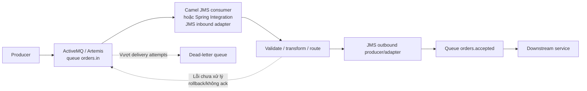
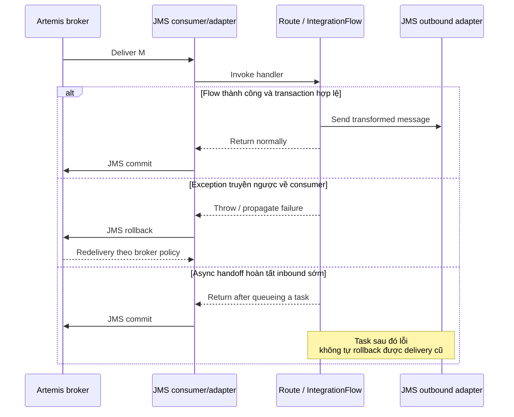
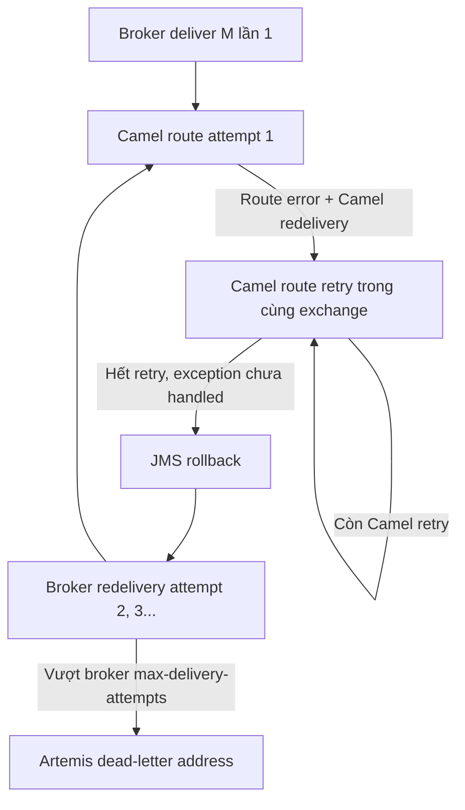
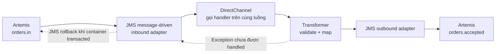

# Kết nối ActiveMQ với Apache Camel hoặc Spring Integration

> **Chương:** Mẫu tích hợp  
> **Phạm vi:** Dùng **Apache Camel JMS** hoặc **Spring Integration JMS** nối ứng dụng Java với ActiveMQ Classic/Artemis để thực hiện luồng nhận → biến đổi/định tuyến → gửi. Trọng tâm là *endpoint*, *channel/route*, *transaction*, *error propagation* và *đường đi khi broker redeliver*; không lặp lại lý thuyết JMS queue/topic.

Một consumer thuần JMS chỉ biết nhận message và gọi code. Hệ thống thực tế thường còn phải đọc lệnh ở `orders.in`, kiểm tra định dạng, biến đổi thành event, gửi sang `orders.accepted`, đôi khi gọi database hoặc dịch vụ bên ngoài. Viết toàn bộ việc này bằng `MessageConsumer`, `Session` và `MessageProducer` dễ dẫn đến logic định tuyến lẫn với quản lý connection/transaction.

**Apache Camel** và **Spring Integration** cung cấp abstraction để nối các bước đó, nhưng không thay thế tính chất của broker: queue vẫn có competing consumers, session vẫn có acknowledgement/transaction, và một lỗi xảy ra **sau side effect nhưng trước JMS commit** vẫn có thể dẫn tới giao lại.

## 1. Hai cách diễn đạt cùng một đường tích hợp



| Câu hỏi | Apache Camel | Spring Integration |
|---|---|---|
| Luồng được biểu diễn bằng gì? | **Route** qua các URI endpoint: `from(...).process(...).to(...)`. | **IntegrationFlow** từ inbound adapter, qua message channels, transformers/handlers đến outbound adapter. |
| Kết nối JMS qua đâu? | `camel-jms` component, dùng Jakarta `ConnectionFactory` phù hợp. | `spring-integration-jms` inbound/outbound adapter hoặc gateway, dùng Jakarta `ConnectionFactory` phù hợp. |
| Logic nghiệp vụ chạy ở đâu? | `Processor` / bean / transformer / router trong route. | Service activator/handler, transformer, router trong flow. |
| Ai nhận message và quản lý consumer? | Camel JMS component dùng cơ chế Spring JMS listener/consumer nội bộ theo cấu hình endpoint. | JMS message-driven inbound adapter quản lý listener container. |
| Điều gì quyết định việc message được giao lại? | Transaction/ack của JMS endpoint + exception từ route + policy của broker. | Transaction/ack của inbound adapter/container + exception trên flow đồng bộ + policy broker. |
| Lỗi thường bị che ở đâu? | `onException(...).handled(true)`, `doTry/doCatch`, `wireTap`/asynchronous handoff. | `errorChannel`, `ExecutorChannel`/`QueueChannel` hoặc handler bắt rồi nuốt exception. |

**Quy tắc chung:** Muốn broker nhận biết một delivery **chưa hoàn tất**, lỗi phải đi ngược về **ranh giới nhận JMS** khi session còn có thể rollback. Nếu framework chuyển việc sang một task bất đồng bộ rồi coi inbound delivery đã xong, một exception xuất hiện sau đó **không thể tự quay ngược thời gian để rollback JMS session cũ**.

### 1.1. Chọn Camel hay Spring Integration

- Chọn **Camel** khi luồng gồm nhiều endpoint/protocol, nhiều bước routing/EIP như `content-based router`, `split`, `aggregate`, `enrich`, routing sang HTTP/SFTP/JMS, hoặc khi cấu trúc route là mô hình chính của ứng dụng.
- Chọn **Spring Integration** khi ứng dụng chủ yếu dựa trên Spring Messaging: `MessageChannel`, service activator, transformer, gateway, channel interceptor và tích hợp sâu với các bean Spring hiện có.
- **Không cần sử dụng cả hai chỉ để chuyển một queue sang một queue.** Thêm hai framework lên cùng một nguồn còn làm tăng số container/consumer và nguy cơ hai luồng cạnh tranh nhận message.

## 2. Ranh giới thực thi và transaction phải chốt trước khi viết route

Xét lệnh `ORDER|A-101|OK`:

```text
          Giao dịch JMS nhận (nếu bật transacted consumer)
Broker --deliver--> [JMS inbound] --validate--> [transform] --send--> orders.accepted
                        |                                        |
                        +---- exception propagates --------------+
                        |
                  JMS commit / rollback
```

**Cần phân biệt hai mức bảo đảm:**

1. **Local JMS transaction** có thể bảo vệ các thao tác nhận/gửi JMS tham gia **cùng transaction manager, connection factory và broker**. Không suy từ việc cả hai endpoint dùng `jms:` rằng chúng chắc chắn chung một transaction: phải xem transaction manager/configuration cụ thể.
2. Một thao tác JDBC/REST nằm trong route **không được JMS transaction tự động bao phủ**. Nếu database commit thành công nhưng JMS nhận rollback, message có thể redeliver và handler có thể chạy lại. Muốn business effect không lặp, cần business idempotency key, inbox/outbox hoặc cơ chế phối hợp phù hợp.

### 2.1. Khi nào handler lỗi dẫn đến broker redelivery?



**Không nhầm các tầng retry:** Camel có thể retry **bên trong một route exchange** (Camel error handler), còn Artemis/Classic có thể **redeliver message từ broker** sau rollback. Nếu cả hai được bật, số lần gọi service ngoài có thể tăng nhiều hơn dự kiến.

## 3. Chuẩn bị broker Artemis cho ví dụ chính

Ví dụ dùng **Spring Boot 3.3.5**, **Apache Camel 4.8.1**, **Java 17** và Artemis với acceptor phù hợp tại `tcp://127.0.0.1:61616`. Các version chỉ dùng để tái lập cấu trúc ví dụ, không phải xác nhận phiên bản mới nhất. Cần kiểm tra compatibility/BOM trước khi dùng ở production.

Trong `<artemis-instance>/etc/broker.xml`, các đoạn **bên trong khối `<addresses>` đang có**:

```xml
<address name="orders.in">
    <anycast>
        <queue name="orders.in" durable="true"/>
    </anycast>
</address>

<address name="orders.accepted">
    <anycast>
        <queue name="orders.accepted" durable="true"/>
    </anycast>
</address>

<address name="lab.DLA">
    <anycast>
        <queue name="lab.DLQ" durable="true"/>
    </anycast>
</address>
```

Và đoạn **bên trong `<address-settings>` hiện hữu**:

```xml
<address-setting match="orders.in">
    <dead-letter-address>lab.DLA</dead-letter-address>
    <max-delivery-attempts>3</max-delivery-attempts>
    <redelivery-delay>1000</redelivery-delay>
</address-setting>
```

**Không thêm nguyên văn các phần tử root lặp lại** vào `broker.xml`. Kiểm tra không trùng address/queue, policy match đúng source address, quyền gửi/consume phù hợp rồi restart broker lab theo quy trình được hỗ trợ.

| Address | Queue binding | Vai trò |
|---|---|---|
| `orders.in` | `orders.in` | Nhận lệnh từ producer. |
| `orders.accepted` | `orders.accepted` | Nhận event đã qua xử lý. |
| `lab.DLA` | `lab.DLQ` | Giữ message từ `orders.in` vượt giới hạn delivery; FQQN `lab.DLA::lab.DLQ`. |

Chọn **ANYCAST** vì đây là các JMS queue trong lab. Đừng giả định `JMS Queue("lab.DLQ")` tự tham chiếu queue đang gắn vào address `lab.DLA`; khi address và queue khác tên, dùng FQQN để kiểm tra bằng consumer/browser của Artemis.

## 4. Camel JMS route: Maven và kết nối

### 4.1. Dependencies

Tạo một **dự án Camel riêng** với `pom.xml` dưới đây. Không tạo cùng lúc bean Camel route và Spring Integration flow trên một source queue khi muốn thử riêng từng framework.

```xml
<project xmlns="http://maven.apache.org/POM/4.0.0"
         xmlns:xsi="http://www.w3.org/2001/XMLSchema-instance"
         xsi:schemaLocation="http://maven.apache.org/POM/4.0.0
                             https://maven.apache.org/xsd/maven-4.0.0.xsd">
    <modelVersion>4.0.0</modelVersion>
    <parent>
        <groupId>org.springframework.boot</groupId>
        <artifactId>spring-boot-starter-parent</artifactId>
        <version>3.3.5</version>
        <relativePath/>
    </parent>
    <groupId>lab.activemq</groupId>
    <artifactId>camel-artemis-pattern</artifactId>
    <version>1.0-SNAPSHOT</version>

    <properties>
        <java.version>17</java.version>
        <camel.version>4.8.1</camel.version>
    </properties>

    <dependencyManagement>
        <dependencies>
            <dependency>
                <groupId>org.apache.camel.springboot</groupId>
                <artifactId>camel-spring-boot-bom</artifactId>
                <version>${camel.version}</version>
                <type>pom</type>
                <scope>import</scope>
            </dependency>
        </dependencies>
    </dependencyManagement>

    <dependencies>
        <dependency>
            <groupId>org.apache.camel.springboot</groupId>
            <artifactId>camel-spring-boot-starter</artifactId>
        </dependency>
        <dependency>
            <groupId>org.apache.camel.springboot</groupId>
            <artifactId>camel-jms-starter</artifactId>
        </dependency>
        <dependency>
            <groupId>org.springframework.boot</groupId>
            <artifactId>spring-boot-starter-artemis</artifactId>
        </dependency>
    </dependencies>
    <build>
        <plugins>
            <plugin>
                <groupId>org.springframework.boot</groupId>
                <artifactId>spring-boot-maven-plugin</artifactId>
            </plugin>
        </plugins>
    </build>
</project>
```

`camel-jms-starter` cung cấp Camel JMS component; `spring-boot-starter-artemis` cung cấp Artemis/Jakarta `ConnectionFactory` và Spring JMS. Không thêm `activemq-client` 5.x dùng `javax.jms` vào cùng ví dụ Spring Boot 3/Jakarta.

### 4.2. `application.yml`

```yaml
spring:
  main:
    web-application-type: none
  artemis:
    mode: native
    broker-url: tcp://127.0.0.1:61616
    user: ${ARTEMIS_USER}
    password: ${ARTEMIS_PASSWORD}

camel:
  springboot:
    main-run-controller: true

logging:
  level:
    lab.integration: INFO
```

`mode: native` nghĩa là kết nối broker Artemis **đã chạy bên ngoài ứng dụng**. Đặt `ARTEMIS_USER`/`ARTEMIS_PASSWORD` theo tài khoản có quyền tạo connection, gửi `orders.accepted` và consume `orders.in`. `main-run-controller` giữ Camel application chạy cho quá trình nhận liên tục trong ví dụ non-web; trên môi trường có orchestrator, dùng shutdown lifecycle của ứng dụng thay vì vòng giữ JVM tự viết.

### 4.3. Vì sao phải thống nhất ConnectionFactory và transaction manager?

Trong ví dụ, ta chủ động gắn **một Artemis `ConnectionFactory` và một `JmsTransactionManager`** vào Camel JMS component. Đây là cấu hình cần thiết để có một ranh giới transaction JMS rõ ràng thay vì chỉ viết URI `jms:` rồi suy đoán behavior.

```java
package lab.integration;

import jakarta.jms.ConnectionFactory;
import org.apache.camel.component.jms.JmsComponent;
import org.springframework.context.annotation.Bean;
import org.springframework.context.annotation.Configuration;
import org.springframework.jms.connection.JmsTransactionManager;

@Configuration
public class CamelJmsConfig {
    @Bean
    public JmsTransactionManager ordersJmsTransactionManager(
            ConnectionFactory connectionFactory) {
        return new JmsTransactionManager(connectionFactory);
    }

    @Bean("jms")
    public JmsComponent jmsComponent(
            ConnectionFactory connectionFactory,
            JmsTransactionManager ordersJmsTransactionManager) {
        JmsComponent component = new JmsComponent();
        component.setConnectionFactory(connectionFactory);
        component.setTransactionManager(ordersJmsTransactionManager);
        component.setTransacted(true);
        return component;
    }
}
```

Vì component tên `jms` đã có bean cấu hình riêng, ứng dụng phải đảm bảo không vô tình tạo **một Camel JMS component thứ hai** dùng ConnectionFactory khác. Khi dùng Camel Spring Boot auto-configuration, kiểm tra component thực tế đã được resolve từ Spring registry. `JmsTransactionManager` điều khiển **local JMS transaction** trên ConnectionFactory này; nó **không** biến lời gọi HTTP hoặc JDBC thành phần của cùng giao dịch.

## 5. Route Camel chạy được: nhận, validate, biến đổi và gửi queue khác

### 5.1. Application + producer thử nghiệm

Tạo `src/main/java/lab/integration/CamelArtemisApplication.java`:

```java
package lab.integration;

import org.springframework.boot.ApplicationRunner;
import org.springframework.boot.SpringApplication;
import org.springframework.boot.autoconfigure.SpringBootApplication;
import org.springframework.context.annotation.Bean;
import org.springframework.jms.core.JmsTemplate;

@SpringBootApplication
public class CamelArtemisApplication {
    public static void main(String[] args) {
        SpringApplication.run(CamelArtemisApplication.class, args);
    }

    @Bean
    ApplicationRunner sendDemo(JmsTemplate jmsTemplate) {
        return arguments -> {
            if (!arguments.containsOption("send-demo")) {
                return;
            }
            jmsTemplate.convertAndSend(
                    "orders.in", "ORDER|A-101|OK");
            jmsTemplate.convertAndSend(
                    "orders.in", "ORDER|A-102|TEMP");
            System.out.println("Demo: đã yêu cầu gửi hai message.");
        };
    }
}
```

`ApplicationRunner` chỉ gửi khi có `--send-demo`. Nếu restart ứng dụng với cùng tham số, nó sẽ gửi **hai JMS message mới**, không tự hiểu rằng A-101/A-102 đã từng được gửi. Với nghiệp vụ thật, producer phải cung cấp **business idempotency key** ổn định.

### 5.2. `RouteBuilder` với endpoint `jms:queue:...`

Tạo `src/main/java/lab/integration/OrdersRoute.java`:

```java
package lab.integration;

import org.apache.camel.LoggingLevel;
import org.apache.camel.builder.RouteBuilder;
import org.springframework.stereotype.Component;

@Component
public class OrdersRoute extends RouteBuilder {
    @Override
    public void configure() {
        // Không retry bên trong Camel trong bài lab. Khi route lỗi,
        // JMS transaction ở consumer sẽ rollback và broker xử lý retry.
        errorHandler(defaultErrorHandler().maximumRedeliveries(0));

        from("jms:queue:orders.in?concurrentConsumers=2")
            .routeId("orders-acceptance")
            .process(exchange -> {
                String payload =
                        exchange.getMessage().getBody(String.class);
                String[] parts = payload == null
                        ? new String[0]
                        : payload.split("\\|", -1);

                if (parts.length != 3 ||
                        !"ORDER".equals(parts[0]) ||
                        parts[1].isBlank()) {
                    throw new IllegalArgumentException(
                            "Sai cấu trúc ORDER|id|status");
                }
                if ("TEMP".equals(parts[2])) {
                    throw new IllegalStateException(
                            "Giả lập downstream đang unavailable");
                }
                if (!"OK".equals(parts[2])) {
                    throw new IllegalArgumentException(
                            "Order status không hỗ trợ");
                }

                // Chỉ đến đây khi message phù hợp.
                exchange.getMessage().setBody(
                        "ACCEPTED|" + parts[1]);
                exchange.getMessage().setHeader(
                        "requestId", parts[1]);
            })
            .to("jms:queue:orders.accepted")
            .log(LoggingLevel.INFO,
                    "Routed requestId=${header.requestId}");
    }
}
```

**Diễn giải route, không chỉ đọc cú pháp:**

1. `from("jms:queue:orders.in")` là **Camel JMS consumer endpoint**, không phải direct Java `MessageConsumer` do ứng dụng tự quản lý.
2. `concurrentConsumers=2` yêu cầu hai consumer đồng thời; queue chia message cho các consumer, **không fan-out** cho mỗi consumer một bản sao.
3. `process(...)` chạy đồng bộ trong exchange; exception không được nuốt để Camel/JMS boundary biết xử lý thất bại.
4. `to("jms:queue:orders.accepted")` gửi message đã biến đổi qua cùng Camel JMS component. Nếu các endpoint tham gia cùng Spring JMS transaction trên một `ConnectionFactory`, inbound completion và outbound send có thể thuộc cùng **local JMS transaction**; cần xác minh bằng integration test/recovery của chính stack, không giả định chỉ từ URI.
5. `errorHandler(...maximumRedeliveries(0))` tắt **retry trong Camel** của route này, **không** tắt redelivery mà Artemis quyết định sau khi JMS rollback.

Nếu bạn thay `process` bằng `wireTap`, `seda` hoặc một thread pool fire-and-forget, **ranh giới hoàn tất có thể thay đổi**: JMS consumer có thể commit trước khi task nền hoàn tất. Chỉ offload khi có một durable handoff và quy tắc retry riêng.

### 5.3. Cách chạy

Kiểm tra Artemis lab đã chạy, ba queue ở mục 3 tồn tại, không có consumer khác trên `orders.in`. Từ thư mục dự án Camel:

```bash
mvn spring-boot:run "-Dspring-boot.run.arguments=--send-demo"
```

Ở terminal/log có thể thấy:

```text
Demo: đã yêu cầu gửi hai message.
Routed requestId=A-101
... IllegalStateException: Giả lập downstream đang unavailable
... IllegalStateException: Giả lập downstream đang unavailable
... IllegalStateException: Giả lập downstream đang unavailable
```

**Không dựa vào thứ tự log**: Camel có hai consumers, Spring Boot producer chạy khi application startup, và broker có thể đang chứa messages từ thử nghiệm cũ. Kết quả cần xem trên broker:

| Payload | Route | Kết quả kỳ vọng |
|---|---|---|
| `ORDER|A-101|OK` | Validate và đổi thành `ACCEPTED|A-101`; gửi sang `orders.accepted`. | Queue đích có event; lượt nhận nguồn được hoàn tất khi JMS transaction commit. |
| `ORDER|A-102|TEMP` | Ném `IllegalStateException`. | JMS rollback → Artemis redelivery theo policy; vượt `max-delivery-attempts=3` thì chuyển vào `lab.DLA::lab.DLQ`. |

Nếu sau lần gửi thấy `orders.accepted` có message nhưng `orders.in` vẫn có bản gốc A-101, hãy kiểm tra **transaction participation của outbound producer**, inbound rollback/commit, consumer khác, lỗi transport và trạng thái broker. Không sửa bằng cách gọi `acknowledge()` thủ công trong `Processor`.

### 5.4. Cách kiểm tra kết quả không làm mất message

Với Artemis management console, xem queue `orders.accepted` và queue `lab.DLQ`. Có thể dùng JMS `QueueBrowser` trong tool quản trị để đọc, hoặc thêm một phép browse tách riêng:

```java
// Snippet trong nơi đã inject jakarta.jms.ConnectionFactory.
try (jakarta.jms.JMSContext context =
        connectionFactory.createContext(
                jakarta.jms.JMSContext.AUTO_ACKNOWLEDGE)) {
    jakarta.jms.Queue queue =
            context.createQueue("lab.DLA::lab.DLQ");
    jakarta.jms.QueueBrowser browser =
            context.createBrowser(queue);
    try {
        java.util.Enumeration<?> rows = browser.getEnumeration();
        while (rows.hasMoreElements()) {
            jakarta.jms.Message message =
                    (jakarta.jms.Message) rows.nextElement();
            System.out.println(message.getJMSMessageID());
        }
    } finally {
        browser.close();
    }
}
```

Đoạn này là **snippet**, không thêm vào route đang nhận message. Queue browser không consume message; enumeration có thể thay đổi nếu có consumer/sender đồng thời. `lab.DLA::lab.DLQ` là **FQQN** của Artemis khi address và queue có tên khác nhau. Đừng in payload nhạy cảm hoặc thử replay trên broker production.

## 6. Hai tầng retry: Camel error handler không phải DLQ của broker

Khi một Camel processor ném exception, có thể có **hai vòng thử**:



Nếu Camel chạy **3 lần thực thi route cho mỗi JMS delivery** và broker cho **3 delivery attempts**, một dependency ngoài có thể bị gọi tới khoảng **9 lần** cho cùng yêu cầu (giới hạn thực tế còn phụ thuộc cấu hình và các exception cụ thể). Vì thế cần idempotency và phải tính cả *Camel retry* lẫn *broker retry* khi đặt timeout.

### 6.1. `handled(true)` và `handled(false)` thay đổi kết cục JMS

Ví dụ Camel:

```java
onException(IllegalArgumentException.class)
    .handled(true)
    .to("jms:queue:orders.invalid");
```

`handled(true)` nói với Camel rằng exception **đã được xử lý** trong route. Nếu đường xử lý lỗi này hoàn tất và JMS transaction commit, broker sẽ không tự redeliver message gốc chỉ vì exception ban đầu. Đây có thể là chủ đích đúng với lỗi **vĩnh viễn**, nhưng cần đảm bảo bản ghi rejection gửi đi được commit theo transaction phù hợp.

Ngược lại:

```java
onException(IllegalStateException.class)
    .maximumRedeliveries(0)
    .handled(false);
```

Exception được để ở trạng thái **chưa xử lý**, để nó đi đến ranh giới JMS rollback và redelivery. Nếu broker chưa được cấu hình DLQ/giới hạn attempts, poison message có thể lặp lại lâu dài.

**Không đặt cả hai đoạn trên cùng các handler chung chung và suy từ thứ tự mã rằng luôn xử lý đúng mọi loại exception.** Phải thiết kế thứ tự/độ ưu tiên `onException` cho chính route và kiểm thử từng exception class. Trong lab chính, ta cố tình **không** có `handled(true)` để broker thể hiện chính sách DLQ.

### 6.2. Dead Letter Channel của Camel khác DLQ của Artemis

Camel có **Dead Letter Channel** là một **error handler của route**: sau khi hết route-level retries, Camel có thể gửi exchange đến một Camel endpoint đặc biệt. Artemis có **dead-letter address/queue** ở **broker**: message được chuyển đi sau những JMS deliveries thất bại theo broker policy.

| Cơ chế | Ai quyết định? | Message được chuyển khi nào? | Cảnh báo |
|---|---|---|---|
| Camel `deadLetterChannel("jms:queue:...")` | Camel route error handler. | Sau Camel error handling/redelivery trong một exchange. | Handler có thể đánh dấu exchange đã xử lý, làm JMS consumer commit bản gốc; nên hiểu transaction và đích nhận trước. |
| Artemis `dead-letter-address` | Artemis broker policy. | Sau các lượt delivery JMS rollback/vượt giới hạn. | Cần queue binding trên address nhận; không tự xác nhận business thành công. |
| Application quarantine | Code business/Camel route chủ động. | Khi phân loại payload không thể retry. | Cần tránh vừa gửi rejection rồi rollback bản gốc ngoài ý muốn. |

Không nên đặt tên ba đích đều là `DLQ` nếu không phân biệt được nguồn gốc. Dashboard nên biết queue nào do **Camel xử lý lỗi**, queue nào do **broker dead-letter**, và queue nào là **business rejection**.

## 7. Cùng bài toán bằng Spring Integration JMS

Spring Integration không diễn đạt đường đi bằng Camel `from/to`, mà bằng **`IntegrationFlow`** gồm các endpoint kết nối qua Spring Messaging `MessageChannel`. Đầu JMS thường là **message-driven inbound channel adapter**; cuối JMS là **outbound channel adapter**.



**Điểm cần nhớ:** Trong sơ đồ, `DirectChannel` có tính chất **đồng bộ trong cùng thread của caller**. Nếu đổi sang `ExecutorChannel` hoặc `QueueChannel`, bạn tạo một ranh giới giao nhận mới; inbound JMS adapter có thể hoàn tất việc nhận trước khi xử lý ở downstream channel hoàn tất. Vì thế đừng coi mọi IntegrationFlow đều có khả năng rollback về JMS source như nhau.

### 7.1. Dependency cho dự án Spring Integration *riêng*

Giữ cùng Spring Boot parent `3.3.5` và Java 17, nhưng **không thêm Camel starters**. Các dependency:

```xml
<dependencies>
    <dependency>
        <groupId>org.springframework.boot</groupId>
        <artifactId>spring-boot-starter-integration</artifactId>
    </dependency>
    <dependency>
        <groupId>org.springframework.integration</groupId>
        <artifactId>spring-integration-jms</artifactId>
    </dependency>
    <dependency>
        <groupId>org.springframework.boot</groupId>
        <artifactId>spring-boot-starter-artemis</artifactId>
    </dependency>
</dependencies>
```

Spring Boot BOM quản lý version của Spring Integration/JMS và Artemis client. Có thể dùng `application.yml` phần `spring.artemis` như ở mục 4.2, **bỏ toàn bộ `camel.springboot`**. Đừng khởi động đồng thời Camel app và Spring Integration app nếu cả hai cùng đọc `orders.in`, trừ khi cố tình thử competing consumers.

### 7.2. `IntegrationFlow` với inbound và outbound adapter

Tạo `src/main/java/lab/integration/IntegrationJmsFlow.java`:

```java
package lab.integration;

import jakarta.jms.ConnectionFactory;
import org.springframework.context.annotation.Bean;
import org.springframework.context.annotation.Configuration;
import org.springframework.integration.annotation.IntegrationComponentScan;
import org.springframework.integration.config.EnableIntegration;
import org.springframework.integration.dsl.IntegrationFlow;
import org.springframework.integration.jms.dsl.Jms;

@Configuration
@EnableIntegration
@IntegrationComponentScan
public class IntegrationJmsFlow {
    @Bean
    public IntegrationFlow ordersFlow(ConnectionFactory connectionFactory) {
        return IntegrationFlow.from(
                Jms.messageDrivenChannelAdapter(connectionFactory)
                    .destination("orders.in")
                    .configureListenerContainer(
                        container -> container.sessionTransacted(true)))
            // Đây là flow đồng bộ, không chèn ExecutorChannel/QueueChannel.
            .<String, String>transform(payload -> {
                String[] fields = payload == null
                        ? new String[0]
                        : payload.split("\\|", -1);
                if (fields.length != 3 ||
                        !"ORDER".equals(fields[0]) ||
                        fields[1].isBlank()) {
                    throw new IllegalArgumentException(
                            "Sai cấu trúc ORDER|id|status");
                }
                if ("TEMP".equals(fields[2])) {
                    throw new IllegalStateException(
                            "Downstream chưa sẵn sàng");
                }
                if (!"OK".equals(fields[2])) {
                    throw new IllegalArgumentException(
                            "Status không hỗ trợ");
                }
                return "ACCEPTED|" + fields[1];
            })
            .handle(Jms.outboundAdapter(connectionFactory)
                    .destination("orders.accepted"))
            .get();
    }
}
```

Trong một dự án Boot có `@SpringBootApplication` cùng package, đây là một bean flow. `Jms.messageDrivenChannelAdapter` tạo inbound JMS consumer dựa trên listener container, không cần viết `@JmsListener` riêng cho cùng queue. `Jms.outboundAdapter` gửi kết quả về queue khác; đây là **one-way send**, không đợi một reply từ downstream.

**Ranh giới thực tế của snippet:**

- `sessionTransacted(true)` trên inbound listener container giúp exception từ **đường flow đồng bộ** dẫn đến rollback lượt nhận JMS, nếu session vẫn hoạt động.
- Outbound JMS adapter là một thao tác gửi riêng; **không được tuyên bố send và nhận đã atomic với nhau chỉ từ việc cùng dùng `ConnectionFactory`**. Muốn đảm bảo **receive + send cùng JMS transaction**, phải cấu hình rõ cùng transaction manager/resource và kiểm thử sự cố giữa hai thao tác, hoặc dùng outbox/giải pháp phối hợp phù hợp.
- `TEMP` là lỗi thử nghiệm cố ý. Khi broker policy cho phép, nó sẽ redeliver; khi vượt giới hạn thì chuyển dead-letter. Retry bên Spring Integration hay một `errorChannel` có thể thay đổi khi nào exception được ném ngược về inbound container.

### 7.3. `MessageChannel` có thể làm thay đổi reliability

| Channel/handler trong flow | Tác động tới delivery transaction | Lưu ý |
|---|---|---|
| **`DirectChannel`** | Handler đồng bộ trên thread gọi send vào channel; exception thường truyền ngược về inbound adapter. | Phù hợp khi cần lỗi nghiệp vụ ảnh hưởng lượt nhận JMS. |
| **`ExecutorChannel`** | Dispatch sang thread khác, có biên bất đồng bộ. | Inbound có thể hoàn tất/commit trước khi task downstream chạy; cần cơ chế bền vững riêng. |
| **`QueueChannel`** | Chuyển message sang queue của Spring Integration để poll sau. | In-memory channel không tự trở thành durable JMS queue; tách transaction nhận khỏi business processing. |
| **`PublishSubscribeChannel`** | Có thể gửi tới nhiều subscriber và có lựa chọn executor. | Không đồng nghĩa broker fan-out; phải hiểu ack/error propagation và isolation của từng subscriber. |
| **Error channel** | Nhận `ErrorMessage` để quan sát hoặc xử lý lỗi theo cấu hình. | Nếu lỗi bị coi là handled mà không lan về JMS listener, source message có thể được commit. |

Với Spring Integration, **chọn channel cũng là chọn một phần delivery semantics**, không chỉ là phong cách tổ chức code.

### 7.4. Adapter và gateway là hai hợp đồng khác nhau

**Inbound/outbound channel adapter** phù hợp cho truyền message **một chiều**: source queue → flow → destination queue. Một **JMS outbound gateway** thường dùng khi caller cần gửi request và **chờ reply** qua JMS, gắn correlation ID và reply destination theo cấu hình; nó có timeout, temporary/named reply queue, cùng rủi ro request đã xử lý nhưng reply bị mất.

Không biến mọi event flow thành request–reply đồng bộ qua broker: một gateway bị chặn khi không có reply có thể giữ thread/transaction lâu và làm backlog tăng. Nếu nghiệp vụ là workflow dài, thường cần correlation/state machine và response bất đồng bộ hơn là một lời gọi chờ vô hạn.

## 8. Tích hợp với ActiveMQ Classic: vẫn là JMS, nhưng khác client

**Không cần thay đổi toàn bộ Camel route hoặc IntegrationFlow** chỉ vì broker đổi từ Artemis sang Classic, nếu các endpoint đều là queue JMS và application dùng **client/namespace tương thích**. Tuy nhiên, các lớp cấu hình provider **không thay thế lẫn nhau**:

| Hạng mục | Artemis trong lab | ActiveMQ Classic |
|---|---|---|
| Broker config | `broker.xml` với address/queue, `address-settings`, dead-letter address. | `activemq.xml`, queue/topic destination, KahaDB, destination policy/dead-letter strategy. |
| Spring Boot 3 integration | `spring-boot-starter-artemis`, `jakarta.jms.ConnectionFactory`. | `spring-boot-starter-activemq` với client Classic **Jakarta-compatible** do stack hỗ trợ. |
| Connection factory cụ thể | `org.apache.activemq.artemis.jms.client.ActiveMQConnectionFactory`. | `org.apache.activemq.ActiveMQConnectionFactory` từ client Classic thích hợp. |
| Retry/poison | Artemis `max-delivery-attempts` và `dead-letter-address` theo source address. | Client Classic redelivery policy và broker dead-letter strategy, tùy cấu hình. |
| Đường JMS ở framework | `jms:queue:...` hoặc `Jms.messageDrivenChannelAdapter`. | Vẫn dùng JMS component/adapter, nhưng URI/credentials và behavior provider cần kiểm chứng. |

### 8.1. Spring Boot 3 dùng Jakarta JMS

Nếu chuyển ví dụ sang Classic và dùng Spring Boot 3, chọn starter:

```xml
<dependency>
    <groupId>org.springframework.boot</groupId>
    <artifactId>spring-boot-starter-activemq</artifactId>
</dependency>
```

Và `application.yml`:

```yaml
spring:
  activemq:
    broker-url: tcp://127.0.0.1:61616
    user: ${ACTIVEMQ_USER}
    password: ${ACTIVEMQ_PASSWORD}
```

**Điểm không portable:** ActiveMQ Classic client 5.x dùng `javax.jms` không tự tương thích với Spring Framework 6/Jakarta `ConnectionFactory`. Chọn **Classic client Jakarta-compatible** theo phiên bản Spring Boot và broker bạn dùng, không sửa bằng ép kiểu hoặc thêm đồng thời cả hai API vào classpath.

Nếu môi trường phải dùng client `javax.jms` đời cũ, cần chọn stack Spring/Camel cùng thế hệ tương ứng, hoặc thiết kế một boundary dịch vụ rõ ràng. Không trộn code `javax.jms` và `jakarta.jms` trong cùng ứng dụng với giả định hai interface đó tương đương.

### 8.2. Đừng copy DLQ và persistence settings qua lại

Đoạn `<dead-letter-address>lab.DLA</dead-letter-address>` và `<max-delivery-attempts>3</max-delivery-attempts>` thuộc **Artemis**, không đưa nguyên vào `activemq.xml`. Trong Classic, policy cho rollback/redelivery còn có phần ở **client**, và dead-letter strategy nằm ở cấu hình Classic. Khi migrate, phải kiểm tra DLQ source mapping, retry count, subscription semantics, queue name/selector và transaction behavior trên broker đích.

**Trường hợp lệch kết quả phổ biến:** Camel route/IntegrationFlow y hệt trước, nhưng một phiên bản broker gửi message vào queue DLQ tên khác, hoặc Classic client cấu hình redelivery khác Artemis. Đừng kết luận lỗi nằm ở processor chỉ vì route Java không đổi.

## 9. Kiểm thử tích hợp: cần xác nhận *đường transaction*, không chỉ output

Một lần gửi `ORDER|A-101|OK` và thấy `ACCEPTED|A-101` là bài thử **happy path**, chưa chứng minh retry, không mất message hay atomicity. Với Camel hoặc Spring Integration, hãy chạy các bài thử sau trên **broker lab có queue sạch**:

| Kịch bản | Thao tác | Quan sát cần có | Ý nghĩa |
|---|---|---|---|
| Thành công | Gửi `ORDER|A-101|OK`. | Output `orders.accepted` có event; source delivery được commit. | Wiring connection, route/flow và destination hoạt động. |
| Lỗi tạm thời | Gửi `ORDER|A-102|TEMP`. | Exception từ processor/transformer; JMS rollback, redelivery theo broker policy. | Không có handler nào âm thầm đánh dấu xử lý thành công. |
| Hết retry | Giữ `TEMP` không hồi phục cho đến hết attempts. | Message rời source và vào `lab.DLA::lab.DLQ`. | Đúng dead-letter address và queue binding của Artemis. |
| Lỗi schema | Gửi `INVALID_PAYLOAD`. | Validation error có dấu vết và đi theo error strategy được thiết kế. | Không retry vô hạn trên dữ liệu chắc chắn không thể tự sửa. |
| Broker mất kết nối | Dừng broker **lab** khi route đang hoạt động rồi khởi động lại. | Container/client recovery, metric kết nối và kết quả send/commit. | Phân biệt connection recovery với message redelivery. |
| Lỗi sau outbound send | Chèn fault injection sau `orders.accepted`, trước source completion trong test riêng. | Có thể thấy bản output trùng nếu send/receive không atomic. | Không tuyên bố atomic chỉ từ việc dùng JMS ở hai endpoint. |
| Downstream DB đã ghi trước JMS commit | Ghi DB rồi giả lập connection failure tại commit boundary. | Source message có thể redeliver; business ID không được ghi trùng. | Cần idempotency ở DB/side effect. |
| Thử với channel bất đồng bộ | Đổi Spring Integration `DirectChannel` sang `ExecutorChannel` trong test riêng. | Task lỗi có thể không rollback được inbound delivery đã hoàn tất. | Async boundary làm thay đổi failure propagation. |

### 9.1. Một phép thử rollback không cần tắt broker

Trong Camel route chính, payload `ORDER|A-102|TEMP` **luôn ném exception**. Với transaction JMS và broker DLQ đã cấu hình, đây là bài thử trực tiếp mà không cần kill process. Quan sát:

1. Tại Camel: số lần processor được gọi đối với cùng business ID, loại exception, Camel `ExchangeId`.
2. Tại Artemis: source queue delivering/in-flight, delivery count, redelivery delay, dead-letter queue depth.
3. Tại output queue: **không có** `ACCEPTED|A-102`.
4. Sau khi hết max attempts: message còn trong `lab.DLA::lab.DLQ` để triage.

Không dùng `ExchangeId` như business idempotency key: mỗi lần JMS redelivery có thể tạo exchange mới. Với producer retry, `JMSMessageID` cũng có thể đổi; cần một `requestId` ổn định được mang trong JMS property/body và bảo vệ ở business store.

### 9.2. Phép thử receive–send atomicity

Nếu hệ thống yêu cầu **nhận queue A và gửi queue B cùng một local JMS transaction**, test cần xác minh bằng lỗi được chèn **giữa send B và commit nhận A**:

```text
A: orders.in      B: orders.accepted
        |                 ^
        v                 |
  nhận M1 ---- biến đổi ---- gửi M2
        |
  [fault trước commit JMS]
        |
  rollback/recovery
```

Kết quả mong đợi **khi cùng local JMS transaction thực sự bao phủ cả hai JMS thao tác**: rollback không để lại M2 đã commit độc lập trong B, và M1 vẫn có thể được giao lại. Nếu đã thấy M2 ở B sau rollback M1, hai thao tác không thuộc cùng transaction như bạn tưởng, hoặc một client/provider khác đã gửi M2 độc lập.

**Giới hạn:** Không thể suy được kết quả của `commit()` từ việc client ném exception khi mất kết nối; có thể broker đã commit nhưng response bị mất. Với production, dùng transaction outcome logging, business ID và đối soát; trong môi trường test, kết hợp broker management/journal trace theo khả năng.

### 9.3. Idempotency khi route gọi HTTP hoặc database

Ví dụ route `orders.in → validate → chargePayment → orders.accepted` có thêm một dependency bên ngoài JMS:

```text
1. Camel/SI nhận ORDER A-101 từ broker.
2. chargePayment(A-101) thành công ở Payment Service.
3. JMS commit lỗi hoặc process crash.
4. Broker redeliver ORDER A-101.
5. Route gọi chargePayment(A-101) lần nữa.
```

Không có Camel/Spring Integration setting đơn lẻ nào làm HTTP operation trở thành cùng atomic transaction với Artemis. Phải truyền `paymentRequestId` như idempotency key đến Payment Service hoặc lưu trạng thái nghiệp vụ có unique constraint và reconciliation. Với lỗi `send/commit` outcome UNKNOWN, đừng tự động retry một lệnh thanh toán mà chưa kiểm tra kết quả.

## 10. Vận hành: đo đúng chỗ và xử lý sự cố theo tầng

### 10.1. Một log tương quan đáng dùng

Đừng chỉ log `Exception: ...`. Nên có những trường sau trên cả producer, route/flow và consumer cuối:

| Trường | Tác dụng |
|---|---|
| `businessRequestId` | Nhận diện cùng nghiệp vụ xuyên qua producer retry/JMS redelivery. |
| `JMSMessageID` | Nhận diện một JMS message cụ thể; không đủ để chống duplicate business request. |
| `JMSCorrelationID` | Liên kết request/reply hoặc chuỗi event nếu được thiết kế. |
| `routeId`/`flowId`, step | Cho biết lỗi ở inbound, transform, outbound hay downstream. |
| `deliveryCount`/`redelivered` nếu broker cung cấp | Giúp tách lỗi retry khỏi lần gửi mới. |
| `transactionOutcome` | `COMMITTED` / `ROLLED_BACK` / `UNKNOWN`; không gắn kết luận khi commit mất phản hồi. |
| `brokerEndpoint`, destination | Xác nhận message tới đúng broker/address/queue. |
| `exceptionClass` và mã lỗi | Phân biệt validation error với transport/transaction/dependency error. |

Không in toàn bộ payload nếu message có thông tin cá nhân, token, tài khoản thanh toán hoặc dữ liệu nhạy cảm. Với message đi DLQ, phải có ACL, retention và audit trail cho việc browse/replay.

### 10.2. Metrics theo đúng tầng

**Broker:** enqueue/dequeue counts, queue pending, delivering/in-flight, consumer count, redelivery, expired và DLQ depth, resource usage.  
**Camel:** số exchange hoàn tất/thất bại, route latency, processor lỗi, thread pool, inflight exchanges và route state.  
**Spring Integration:** channel send/receive counts khi instrument, handler duration/error, adapter/container state, queue của channel nếu có.  
**Downstream:** DB transaction latency, HTTP timeout, idempotency duplicate rate, circuit breaker và connection pool.

Một route `started` nhưng broker queue không có consumer phù hợp vẫn là sự cố triển khai; một queue `pending=0` không chứng minh mọi business effect đã hoàn tất nếu messages đang delivering hoặc đi sang output/DLQ.

### 10.3. Runbook chẩn đoán

| Triệu chứng | Kiểm tra trước | Cách hiểu đúng |
|---|---|---|
| Route Camel không nhận message | Camel `jms` component, connection factory, endpoint URI, broker ACL/queue binding. | Annotation route chạy không đồng nghĩa JMS consumer đã kết nối và route đúng queue. |
| `No component found with scheme: jms` | Dependency `camel-jms-starter` có mặt và component tên `jms` được đăng ký không? | Có Camel core không đủ để hiểu URI `jms:`. |
| Lỗi `ConnectionFactory` không type-compatible | Classpath `jakarta.jms`/`javax.jms`, client Classic/Artemis, Spring Boot major version. | Không thể chữa bằng cast. |
| Message vào queue nhưng `orders.accepted` trống | Handler exception, destination name, queue ACL, transaction rollback, outbound adapter. | Đọc route exception và broker deliveries, không đoán message bị mất. |
| Payload invalid được coi là thành công | Camel `handled(true)` hoặc Spring Integration error channel/handler nuốt lỗi? | Inbound JMS transaction có thể commit dù nghiệp vụ báo lỗi ở log. |
| `TEMP` được gọi nhiều hơn số broker attempts | Camel retry trong exchange + broker redelivery hoặc producer retry. | Đếm từng tầng độc lập, hạn chế retry gây side effect trùng. |
| Sau thêm `ExecutorChannel` không còn redelivery dù handler lỗi | Async handoff đã tách transaction boundary. | Inbound đã có thể commit trước khi task lỗi. |
| Broker lại giao message đã xử lý ở DB | DB commit trước JMS commit hoặc mất phản hồi commit. | Dedupe theo business ID; không giả định framework bảo đảm exactly once. |
| Thêm concurrent consumers, dữ liệu cập nhật sai thứ tự | Nhiều handlers song song, thiếu khóa phiên bản/message grouping. | Concurrency ảnh hưởng ordering; thiết kế theo entity key. |
| Message ở DLQ nhưng app báo lỗi “route handled” | Camel dead-letter/error handler và Artemis dead-letter policy có thể khác. | Xem **đích nào** đã đưa message vào queue lỗi và trạng thái commit JMS. |

### 10.4. Tải cao và backpressure

Camel và Spring Integration có thể tạo thêm buffer/thread pool/channels giữa producer và consumer. Khi broker hoặc downstream chậm:

- Hạn chế số concurrent consumers theo DB/HTTP capacity.
- Tránh hàng chờ in-memory không giới hạn vì chúng **không tự durable**.
- Theo dõi memory, pending/in-flight và đầu ra; không đánh giá throughput chỉ bằng số `from()` exchange bắt đầu.
- Nếu upstream là API HTTP, thiết kế rate limit, bounded work queue và backoff; không giữ vô hạn HTTP threads trong một gửi JMS bị flow control.
- Nếu cần đảm bảo event không mất qua crash ứng dụng, đừng chuyển message sang `ExecutorChannel`/`wireTap` bất đồng bộ mà không có một durable handoff được xác nhận.

### 10.5. Quy trình dừng có kiểm soát

Khi service nhận SIGTERM, nên chuyển readiness thành not-ready, để Camel/Spring listener container dừng nhận message mới, đợi inflight handlers trong khoảng grace period rồi đóng JMS connections. Nếu handler còn transaction chưa commit khi process bị kill, broker có thể redeliver sau recovery. Đừng gọi `close()` trực tiếp trên session do framework sở hữu từ thread nghiệp vụ.

Graceful shutdown **không phải cách chuyển backlog sang DLQ**; message chưa tiêu thụ có thể tiếp tục chờ ở source queue đến khi instance mới hoạt động.

## 11. Các lỗi thiết kế dễ lọt qua code review

### 11.1. Dùng `handled(true)` cho mọi exception

```java
onException(Exception.class)
    .handled(true)
    .log("Đã ghi nhận lỗi");
```

Với một JMS consumer transacted, Camel có thể coi exchange đã được xử lý; **JMS commit** có thể xảy ra dù side effect nghiệp vụ thất bại. Chỉ dùng `handled(true)` khi có **quyết định kết thúc có chủ đích**: chẳng hạn một rejection record bền vững hoặc nghiệp vụ đã được đối soát.

### 11.2. Offload background trước khi commit

```java
from("jms:queue:orders.in")
    .to("seda:backgroundOrders"); // Async handoff; không còn cùng scope.
```

Với `seda`, việc route inbound hoàn tất có thể không chờ quá trình xử lý trong consumer phía sau. Nếu process crash ngay sau khi JMS consumer commit nhưng trước khi `seda` task hoàn tất, công việc có nguy cơ mất ở tầng ứng dụng. Nếu yêu cầu durable handoff, chọn một queue JMS thứ hai có transaction/ack đúng và business idempotency; không xem `seda` là broker bền vững.

### 11.3. Để hai framework cạnh tranh cùng source queue

Nếu Camel route và Spring Integration inbound adapter cùng `orders.in` đang chạy, broker có thể chia message giữa hai hệ thống. Một message **không** mặc định đi qua cả hai pipeline. Nếu thật sự muốn cả hai nhận, thiết kế **multicast/topic với subscription queues** hoặc sao chép event tới hai queue ở broker theo policy rõ ràng, rồi xử lý mỗi queue riêng.

### 11.4. Coi exception từ `send()` là chắc chắn chưa gửi

Khi outbound JMS `send()`/`commit()` ném lỗi do mạng mất phản hồi, broker có thể đã nhận message. Retry mù quáng có thể tạo output trùng. Gắn `eventId`/`requestId` ổn định, kiểm tra downstream idempotency; nếu có JDBC ngoài JMS, cân nhắc transactional outbox và inbox.

### 11.5. Dùng correlation ID làm “duy nhất” mà không có hợp đồng

`JMSCorrelationID` hữu ích cho request–reply/trace, nhưng chỉ thành idempotency key khi **producer và consumer cùng cam kết quy tắc sinh/truyền/duy trì nó**. Với event do nhiều nguồn phát, nên có `businessRequestId` hoặc `eventId` riêng, không suy rằng một header JMS ngẫu nhiên tự đủ để chống duplicate.

## 12. Bài tập tình huống và đáp án

**Bài 1 — Tự giải thích đường đi của một message.** Trong Camel route `from("jms:queue:orders.in").process(...).to("jms:queue:orders.accepted")`, đoạn `process` ném `IllegalStateException` và route không có handler nuốt lỗi. Cấu hình JMS consumer transacted đang có hiệu lực. Điều gì xảy ra?

**Đáp án:** Exception được đưa tới error boundary; nếu session còn hoạt động, JMS transaction rollback. Message gốc có thể được Artemis redeliver theo `max-delivery-attempts`/`redelivery-delay` rồi tới DLQ. Không nên tự gọi `message.acknowledge()` trong processor.

**Bài 2 — Sửa nhầm `handled(true)`.** Một route đã thêm:

```java
onException(Exception.class)
    .handled(true)
    .log("Error recorded");
```

Sau đó broker không redeliver message dù side effect không thành công. Vì sao?

**Đáp án:** Camel coi exception là đã xử lý; nếu exchange/transaction hoàn tất, JMS consumer có thể commit bản gốc. Cần chọn chiến lược chính xác: để exception propagate cho broker retry, hoặc chủ động quarantine có ranh giới transaction phù hợp rồi commit.

**Bài 3 — Hai lần retry có thể nhân lên.** Camel retry **2 lần thêm** sau attempt đầu; Artemis cho tối đa **3 delivery attempts** trước DLQ. Trong trường hợp lỗi luôn tái hiện, tối đa khoảng bao nhiêu lần handler được gọi?

**Đáp án:** Khoảng **3 × 3 = 9 lần** nếu mỗi JMS delivery chạy đủ một attempt đầu và hai Camel retries. Đây là mô hình tính trường hợp đơn giản, không phải cam kết về số HTTP side effects: exception class, recoverability, rollback, transaction và timing có thể làm ít hoặc khác hơn.

**Bài 4 — Source queue có hai IntegrationFlow.** Flow A và flow B đều có JMS inbound adapter trỏ `orders.in`. Có phải một message được cả hai xử lý không?

**Đáp án:** Không. Hai adapters là **competing consumers** của cùng queue. Nếu muốn mỗi service một bản, phải thiết kế routing/fan-out với queue/subscription riêng.

**Bài 5 — Vì sao `ExecutorChannel` làm thay đổi ack?** Ban đầu Spring Integration dùng flow đồng bộ và exception từ transformer làm JMS rollback. Sau khi thêm `ExecutorChannel` trước transformer, message đôi khi được broker xem là đã xử lý dù transformer lỗi.

**Đáp án:** Executor tạo một ranh giới asynchronous. Inbound JMS adapter có thể hoàn tất và commit khi chỉ mới gửi task vào channel; exception xảy ra sau đó ở worker thread không tự rollback session của inbound consumer. Cần durable handoff hoặc thiết kế transaction/ack khác.

**Bài 6 — Không thấy message ở DLQ.** Broker có `dead-letter-address=lab.DLA`, nhưng ứng dụng đọc `Queue("lab.DLQ")` thấy rỗng. Cần kiểm tra điều gì?

**Đáp án:** Xác nhận address `lab.DLA` có binding queue `lab.DLQ`; khi address và queue khác tên, browse qua FQQN `lab.DLA::lab.DLQ`. Kiểm tra message thực sự vượt delivery attempts, chưa hết TTL hoặc được handler `handled(true)` và commit.

**Bài 7 — Migrate từ Artemis sang Classic.** Một team thay `spring-boot-starter-artemis` bằng `activemq-client:5.x` cũ, giữ Spring Boot 3 và import `jakarta.jms.ConnectionFactory`. Tại sao có thể lỗi?

**Đáp án:** Client Classic đời cũ có thể triển khai `javax.jms` thay vì `jakarta.jms`; chúng khác kiểu Java. Chọn starter/client Classic Jakarta-compatible theo dependency management của Boot 3, và kiểm tra redelivery/DLQ cùng broker config Classic.

**Bài 8 — Side effect trả tiền đã hoàn tất nhưng JMS commit chưa xác định.** Người vận hành thấy M1 được redeliver. Có nên gọi thanh toán lại vì Camel báo lỗi không?

**Đáp án:** Không. Cần tra cứu trạng thái theo `paymentRequestId` và đảm bảo idempotency ở Payment Service. JMS transaction không phối hợp nguyên tử với HTTP. Một exchange bị retry không chứng minh side effect trước đó chưa xảy ra.

## 13. Checklist trước khi triển khai

- [ ] Chọn **một** cách chủ đạo: Camel route hoặc Spring Integration flow; không để hai consumer cạnh tranh cùng queue ngoài ý muốn.
- [ ] Chọn đúng **Java/JMS API namespace** (`jakarta.jms` cho Boot 3), broker client và BOM tương thích.
- [ ] Xác nhận broker runtime có source/output queue, address/routing type phù hợp, quyền send/consume và DLQ binding thực sự.
- [ ] Dùng connection factory/transaction manager **nhất quán** cho các JMS operations cần tham gia cùng local transaction; viết test rollback khi gửi output thất bại.
- [ ] Kiểm tra rõ exception nào **propagate**, exception nào **handled**, và message lỗi đi theo broker DLQ hay application quarantine.
- [ ] Đếm retry ở **cả framework và broker**; chọn delay/max attempts tránh retry storm.
- [ ] Không offload việc chưa bền vững sang `seda`, `ExecutorChannel` hoặc thread pool rồi commit inbound sớm.
- [ ] Gắn business idempotency key cho producer/consumer và thiết kế chống duplicate khi JMS commit outcome UNKNOWN.
- [ ] Định nghĩa concurrency, prefetch/credit, queue backpressure và downstream capacity; đo throughput/lỗi ở từng tầng.
- [ ] Có dashboard pending/in-flight, consumer count, route/flow errors, DLQ, message age và quy trình replay được phân quyền.
- [ ] Kiểm thử khởi động lại broker/app, handler exception, network failure, DB commit trước JMS commit và shutdown khi còn inflight.

## 14. Ghi nhớ

**Apache Camel** diễn đạt đường tích hợp qua **routes và endpoints**; **Spring Integration** diễn đạt qua **inbound/outbound adapters, channels và handlers**. Cả hai đều giúp nối ActiveMQ với code nghiệp vụ, nhưng **không thay thế JMS transaction, broker redelivery/DLQ hay idempotency**.

Với Camel, chú ý `camel-jms`, `RouteBuilder`, `JmsTransactionManager`, `onException` và giới hạn Camel retry. Với Spring Integration, chú ý `Jms.messageDrivenChannelAdapter`, `IntegrationFlow`, `DirectChannel` so với channel bất đồng bộ, cũng như cách lỗi được truyền về listener container. Trên ActiveMQ Classic hay Artemis, điều quyết định độ tin cậy không phải số dòng cấu hình framework, mà là **message được xem là hoàn tất tại mốc nào, lỗi lan đến đâu, và side effect có chịu được việc chạy lại hay không**.
