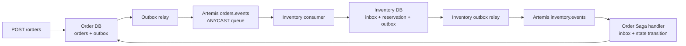
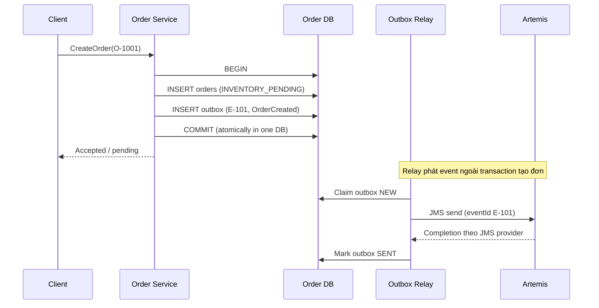
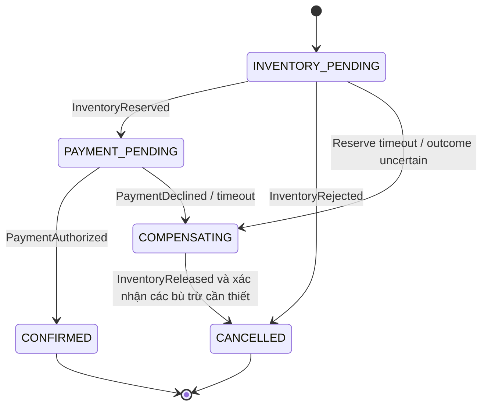

# Outbox, inbox và xử lý từng bước trong quy trình nghiệp vụ

> **Chương:** Mẫu tích hợp  
> **Trọng tâm:** Kết hợp **transactional outbox**, **transactional inbox** và **Saga/state machine** để điều phối quy trình Order → Inventory → Payment qua **Apache ActiveMQ Artemis** và Java/Spring Boot. Tập trung vào ranh giới transaction, chống mất và xử lý trùng thông điệp, idempotency, thứ tự bước, phục hồi và compensation. Những khác biệt cần lưu ý khi dùng **ActiveMQ Classic** được chỉ rõ, không giả định hai broker có cùng cấu hình.

## 1. Một quy trình có ba loại trạng thái và ba điểm có thể hỏng

Một người dùng đặt hàng `O-1001`. Order Service lưu đơn vào database riêng; Inventory Service giữ hàng; Payment Service xác nhận thanh toán; sau đó Order Service chuyển đơn sang `CONFIRMED`. Không service nào được phép mở database transaction của service khác. Message broker được dùng để truyền command/event bất đồng bộ.

Nếu code Order làm như sau:

```java
// Anti-pattern: hai tài nguyên không cùng một transaction.
orderRepository.save(order);                  // DB có thể commit.
jmsTemplate.convertAndSend("orders.events", event); // Broker có thể lỗi.
```

thì giữa hai thao tác có một **dual-write gap**. Ví dụ DB đã commit nhưng JVM chết trước send: Order tồn tại nhưng Inventory không biết. Nếu gửi JMS trước DB commit thì event có thể đi trước dữ liệu hoặc DB rollback. Còn consumer nhận event rồi ghi database nhưng chết trước ACK: broker giao lại, có nguy cơ trừ tồn kho hai lần.

Ta cần ba cơ chế riêng, **không phải một cấu hình “exactly-once” duy nhất**:

| Cơ chế | Đặt ở đâu? | Vấn đề nó giải quyết | Điều nó không tự giải quyết |
|---|---|---|---|
| **Transactional outbox** | Bên phát event, cùng database với thay đổi nghiệp vụ | Ghi nghiệp vụ và **ý định phát event** atomically | Publisher có thể gửi trùng khi mất phản hồi; broker vẫn phải bền vững |
| **Transactional inbox** | Bên nhận event, cùng database với side effect | Không thực hiện lại side effect DB khi cùng event được redeliver | Không tự chống lặp HTTP/email ở hệ ngoài hoặc event khác ID cùng một ý nghĩa |
| **Saga / state machine** | Theo dõi tiến trình nhiều bước, trong một hoặc nhiều service | Chuyển trạng thái hợp lệ, timeout, compensation và phục hồi quy trình | Không biến các bước xuyên service thành một ACID transaction toàn cục |



Mô hình này là **at-least-once event publication/delivery kết hợp xử lý idempotent**, không quảng bá là exactly-once end-to-end. Một event có thể xuất hiện nhiều lần trên broker, nhưng cùng `eventId` không được gây tác dụng nghiệp vụ lặp trong database của đúng consumer.

## 2. Định danh: ba ID phải tách biệt

| Trường | Ví dụ | Ai tạo? | Dùng để làm gì? |
|---|---|---|---|
| `orderId` / aggregate ID | `O-1001` | Order Service | Nhận diện thực thể nghiệp vụ; unique constraint |
| `eventId` | UUID `f2c3...` | Service phát, tạo **một lần trước khi ghi outbox** | Khóa deduplication inbox, đối soát retry và replay |
| `sagaId` / correlation ID | `S-1001` | Điểm khởi tạo quy trình | Liên kết các message thuộc cùng một quy trình |
| `stepId` hoặc `commandId` | `S-1001:reserve-inventory` | Saga/orchestrator | Ngăn cùng một bước/command tạo tác dụng phụ nhiều lần |
| `JMSMessageID` | `ID:...` | JMS provider khi send | Chẩn đoán một lần gửi vật lý, **không ổn định khi relay gửi lại** |
| `causationId` | Event ID kích hoạt bước hiện tại | Service phát message tiếp theo | Truy vết event nào tạo command/event này |

Một **event ID không được tạo lại ở mỗi lần publisher retry**. Ví dụ publisher gửi `E-101`, broker nhận nhưng network mất trước phản hồi; outbox vẫn ở trạng thái chưa xác nhận. Lần sau publisher phải gửi **cùng `E-101`**. `JMSMessageID` có thể khác, nên consumer dedup theo `eventId` hoặc một business key rõ ràng.

### 2.1. Tách biệt một message vật lý và một sự kiện logic

```text
Outbox row: eventId=E-101
    |-- publish attempt 1 -> JMSMessageID=ID-A -> broker nhận
    |      (publisher chết trước khi update outbox)
    |
    |-- publish attempt 2 -> JMSMessageID=ID-B -> broker nhận tiếp
                                  |
                         Inbox thấy cùng E-101
                         -> chỉ xử lý nghiệp vụ một lần
```

**Định nghĩa thành công theo từng tầng:** outbox `SENT` là publisher đã nhận tín hiệu hoàn tất gửi theo provider; inbox `processed` là transaction bên consumer đã commit; Saga `CONFIRMED` là trạng thái nghiệp vụ sau những điều kiện quyết định. Không lấy một trong ba mốc để thay cho hai mốc còn lại.

## 3. Schema PostgreSQL: mỗi service sở hữu một database

Để dễ kiểm chứng, dùng **hai database độc lập** trong lab: `order_db` và `inventory_db`. Chúng có thể có cùng tên bảng `outbox_events` vì thuộc **database khác nhau**. Không tạo một transaction JDBC nối hai database để “giả làm” atomicity giữa services.

### 3.1. Database của Order Service

```sql
-- Chạy chỉ trên order_db.
CREATE TABLE orders (
    order_id        VARCHAR(64) PRIMARY KEY,
    amount_minor    BIGINT NOT NULL CHECK (amount_minor >= 0),
    status          VARCHAR(32) NOT NULL,
    version         BIGINT NOT NULL DEFAULT 0,
    created_at      TIMESTAMPTZ NOT NULL DEFAULT now()
);

CREATE TABLE outbox_events (
    event_id         UUID PRIMARY KEY,
    aggregate_id     VARCHAR(64) NOT NULL,
    event_type       VARCHAR(80) NOT NULL,
    destination      VARCHAR(120) NOT NULL,
    payload          TEXT NOT NULL,
    status           VARCHAR(16) NOT NULL DEFAULT 'NEW'
                     CHECK (status IN ('NEW', 'IN_FLIGHT', 'SENT')),
    occurred_at      TIMESTAMPTZ NOT NULL DEFAULT now(),
    next_attempt_at  TIMESTAMPTZ NOT NULL DEFAULT now(),
    claimed_by       VARCHAR(120),
    claimed_until    TIMESTAMPTZ,
    attempts         INTEGER NOT NULL DEFAULT 0,
    published_at     TIMESTAMPTZ
);

CREATE INDEX ix_outbox_claim
    ON outbox_events (status, next_attempt_at, occurred_at);

CREATE TABLE inbox_events (
    consumer_name VARCHAR(96) NOT NULL,
    event_id      UUID NOT NULL,
    processed_at  TIMESTAMPTZ NOT NULL DEFAULT now(),
    PRIMARY KEY (consumer_name, event_id)
);

CREATE TABLE saga_steps (
    saga_id     VARCHAR(64) NOT NULL,
    step_key    VARCHAR(96) NOT NULL,
    status      VARCHAR(20) NOT NULL,
    updated_at  TIMESTAMPTZ NOT NULL DEFAULT now(),
    PRIMARY KEY (saga_id, step_key)
);
```

`orders.status` được phép đi qua các trạng thái do ứng dụng định nghĩa, ví dụ `INVENTORY_PENDING` → `PAYMENT_PENDING` → `CONFIRMED` hoặc `COMPENSATING` → `CANCELLED`. `version` hỗ trợ optimistic concurrency/conditional update, còn khóa duy nhất của `saga_steps` giúp cùng một bước không được ghi nhận lặp như một bước mới.

### 3.2. Database của Inventory Service

```sql
-- Chạy chỉ trên inventory_db.
CREATE TABLE inbox_events (
    consumer_name VARCHAR(96) NOT NULL,
    event_id      UUID NOT NULL,
    processed_at  TIMESTAMPTZ NOT NULL DEFAULT now(),
    PRIMARY KEY (consumer_name, event_id)
);

CREATE TABLE inventory_reservations (
    order_id    VARCHAR(64) PRIMARY KEY,
    status      VARCHAR(24) NOT NULL
                CHECK (status IN ('RESERVED', 'RELEASED')),
    created_at  TIMESTAMPTZ NOT NULL DEFAULT now()
);

-- Cùng DDL outbox_events như Order Service, nhưng nằm ở inventory_db.
CREATE TABLE outbox_events (
    event_id         UUID PRIMARY KEY,
    aggregate_id     VARCHAR(64) NOT NULL,
    event_type       VARCHAR(80) NOT NULL,
    destination      VARCHAR(120) NOT NULL,
    payload          TEXT NOT NULL,
    status           VARCHAR(16) NOT NULL DEFAULT 'NEW'
                     CHECK (status IN ('NEW', 'IN_FLIGHT', 'SENT')),
    occurred_at      TIMESTAMPTZ NOT NULL DEFAULT now(),
    next_attempt_at  TIMESTAMPTZ NOT NULL DEFAULT now(),
    claimed_by       VARCHAR(120),
    claimed_until    TIMESTAMPTZ,
    attempts         INTEGER NOT NULL DEFAULT 0,
    published_at     TIMESTAMPTZ
);

CREATE INDEX ix_inventory_outbox_claim
    ON outbox_events (status, next_attempt_at, occurred_at);
```

**Lưu ý về ví dụ:** bảng reservation ở đây mô phỏng việc giữ hàng **luôn thành công** cho một order ID chưa tồn tại; chưa kiểm tra số lượng SKU thực. Khi có stock thực, phải khóa hàng tồn hoặc dùng `UPDATE ... WHERE available >= requested` trong **cùng transaction** với inbox/outbox, rồi phát `InventoryReserved` hoặc `InventoryRejected` theo kết quả.

### 3.3. Tại sao cần nhiều constraint thay vì chỉ code Java?

- Khóa `outbox_events.event_id` giữ một sự kiện logic không bị nhân bản trong DB phát.
- Khóa `inbox_events(consumer_name,event_id)` chống cùng consumer xử lý lại event đã commit, kể cả khi hai instance nhận event gần nhau.
- Khóa `inventory_reservations.order_id` chặn tạo hai reservation cho cùng order; event ID dedup **không thay** unique constraint nghiệp vụ nếu producer vô tình phát hai event IDs khác nhau cho cùng order.
- `orders.version`/conditional status update ngăn hai bước Saga chạy đè lên nhau và chuyển trạng thái bất hợp lệ.

Các constraint đó phải nằm trong **transaction của database service**, không phải một cache `HashSet` trong memory; cache biến mất khi restart và không phối hợp đồng bộ giữa replicas.

## 4. Transactional outbox: nghiệp vụ và ý định phát được commit cùng nhau

Một lệnh tạo đơn hợp lệ cần **một** local DB transaction:



Nếu DB rollback, cả row `orders` và row `outbox_events` đều không được commit. Nếu DB commit, luôn có **một outbox record** để worker phát khi broker hồi phục. **Đây là bảo đảm cốt lõi**, không phải việc một lời gọi send JMS thành công ngay trong request HTTP.

### 4.1. Spring Boot 3/Jakarta Messaging: cấu hình mẫu

Cho mỗi service dùng **một database riêng** và **một Spring Boot process riêng**. Ví dụ Maven dependencies của một service dùng code trong bài:

```xml
<dependencies>
    <dependency>
        <groupId>org.springframework.boot</groupId>
        <artifactId>spring-boot-starter-jdbc</artifactId>
    </dependency>
    <dependency>
        <groupId>org.springframework.boot</groupId>
        <artifactId>spring-boot-starter-artemis</artifactId>
    </dependency>
    <dependency>
        <groupId>org.postgresql</groupId>
        <artifactId>postgresql</artifactId>
        <scope>runtime</scope>
    </dependency>
</dependencies>
```

Đây là **phần dependencies** để chèn vào một `pom.xml` có Spring Boot 3.x parent/BOM và Java 17, không phải POM hoàn chỉnh. `spring-boot-starter-artemis` cung cấp client cho `jakarta.jms`, không dùng `javax.jms` client Classic cũ trong cùng ví dụ. Ví dụ cấu hình môi trường của **Order Service**:

```yaml
spring:
  datasource:
    url: ${ORDER_JDBC_URL}
    username: ${ORDER_DB_USER}
    password: ${ORDER_DB_PASSWORD}
  artemis:
    mode: native
    broker-url: ${ARTEMIS_URL:tcp://127.0.0.1:61616}
    user: ${ARTEMIS_USER}
    password: ${ARTEMIS_PASSWORD}
app:
  outbox:
    poll-delay-ms: 1000
```

Inventory Service dùng `INVENTORY_JDBC_URL`/credentials riêng. Cột `outbox_events.destination` giữ tên queue **cho từng event**: `OrderCreated` → `orders.events`, `InventoryReserved` → `inventory.events`, `PaymentRequested` → `payments.commands`. Điều này tránh việc những consumer thuộc nghiệp vụ khác nhau **cạnh tranh lấy message trên cùng một ANYCAST queue**. Danh sách destination phải được kiểm soát bằng code/config allowlist; không lấy trực tiếp tên queue từ request của người dùng. **Không** trỏ cùng một Spring `DataSource` vào cả Order DB và Inventory DB rồi gọi đó là microservices; ownership và transaction boundary phải được phân tách.

### 4.2. Code ghi đơn và outbox trong cùng JDBC transaction

```java
package lab.orders;

import org.springframework.jdbc.core.JdbcTemplate;
import org.springframework.stereotype.Service;
import org.springframework.transaction.annotation.Transactional;
import java.util.UUID;

@Service
public class OrderCommandService {
    private final JdbcTemplate jdbc;

    public OrderCommandService(JdbcTemplate jdbc) {
        this.jdbc = jdbc;
    }

    @Transactional
    public UUID createOrder(String orderId, long amountMinor) {
        if (orderId == null || orderId.isBlank() || amountMinor < 0) {
            throw new IllegalArgumentException("Invalid order");
        }
        UUID eventId = UUID.randomUUID();
        jdbc.update(
            "INSERT INTO orders(order_id, amount_minor, status) " +
            "VALUES (?, ?, 'INVENTORY_PENDING')",
            orderId, amountMinor);
        jdbc.update(
            "INSERT INTO outbox_events " +
            "(event_id, aggregate_id, event_type, destination, payload) " +
            "VALUES (?, ?, 'OrderCreated', 'orders.events', ?)",
            eventId, orderId, "OrderCreated:" + orderId);
        return eventId;
    }
}
```

`@Transactional` này sử dụng **local JDBC transaction** của Order DB; không đụng JMS. Khi một trong hai lệnh `INSERT` lỗi, cả transaction được rollback. `eventId` được sinh một lần và lưu trong outbox. HTTP layer nên trả trạng thái đơn `INVENTORY_PENDING` (hoặc `202 Accepted` theo API contract) thay vì tuyên bố toàn bộ quy trình đã hoàn tất.

**Cẩn thận với retry lệnh tạo đơn:** nếu client HTTP timeout rồi gửi lại `createOrder`, có thể tạo **hai event IDs** cho cùng ý nghĩa. Khóa `orders.order_id` sẽ chặn duplicate row nhưng API cần xử lý idempotency key của request và trả kết quả cũ, không coi mọi unique-key violation là lý do gửi thêm event mới.

## 5. Outbox relay: claim an toàn, gửi JMS, rồi xác nhận trạng thái

Publisher không được chọn tất cả row `NEW` và gửi tùy tiện trong nhiều replicas. Nếu hai instance cùng đọc một row, chúng có thể gửi trùng liên tục. Với PostgreSQL, một pattern thực tế là **claim theo batch trong một DB transaction ngắn**, sử dụng `FOR UPDATE SKIP LOCKED` và **lease**. Sau khi claim đã commit, gửi JMS ở ngoài DB transaction; cuối cùng cập nhật row `SENT`.

### 5.1. SQL claim row cạnh tranh giữa nhiều worker

```sql
WITH picked AS (
    SELECT event_id
    FROM outbox_events
    WHERE next_attempt_at <= now()
      AND (
          status = 'NEW'
          OR (status = 'IN_FLIGHT' AND claimed_until < now())
      )
    ORDER BY occurred_at, event_id
    LIMIT 20
    FOR UPDATE SKIP LOCKED
)
UPDATE outbox_events AS o
SET status = 'IN_FLIGHT',
    claimed_by = 'publisher-instance-7',
    claimed_until = now() + INTERVAL '60 seconds',
    attempts = o.attempts + 1
FROM picked AS p
WHERE o.event_id = p.event_id
RETURNING o.event_id, o.aggregate_id, o.event_type,
          o.destination, o.payload, o.attempts;
```

Lệnh `UPDATE ... RETURNING` này là **một statement atomic trên PostgreSQL**. `SKIP LOCKED` cho phép các relay instances lấy những row khác nhau mà không đợi nhau trên cùng một tập khóa; khi relay chết, `claimed_until` hết hạn và instance khác được claim lại. Trong code sản xuất, `claimed_by` phải là ID riêng của instance/lần chạy, không phải chuỗi cố định.

**Không giữ row locks trong lúc send JMS.** Nếu để một DB transaction chứa cả `SELECT FOR UPDATE` và gọi broker từ xa, connection/locks sẽ bị giữ khi broker chậm hoặc mất kết nối. Claim + lease giúp DB transaction ngắn nhưng đổi lại cho phép **duplicate publish** nếu lease hết hạn hoặc relay chết ở thời điểm bất lợi.

### 5.2. Java cấu hình gửi persistent, listener có JMS local transaction

Tạo `MessagingConfig.java` cho mỗi service. Với Spring Boot 3.x:

```java
package lab.messaging;

import jakarta.jms.ConnectionFactory;
import jakarta.jms.DeliveryMode;
import org.springframework.boot.autoconfigure.jms.DefaultJmsListenerContainerFactoryConfigurer;
import org.springframework.context.annotation.Bean;
import org.springframework.context.annotation.Configuration;
import org.springframework.jms.config.DefaultJmsListenerContainerFactory;
import org.springframework.jms.core.JmsTemplate;
import org.springframework.scheduling.annotation.EnableScheduling;
import org.springframework.jms.annotation.EnableJms;

@Configuration
@EnableJms
@EnableScheduling
public class MessagingConfig {

    @Bean
    public JmsTemplate jmsTemplate(ConnectionFactory cf) {
        JmsTemplate template = new JmsTemplate(cf);
        template.setExplicitQosEnabled(true);
        template.setDeliveryMode(DeliveryMode.PERSISTENT);
        return template;
    }

    @Bean(name = "jmsListenerContainerFactory")
    public DefaultJmsListenerContainerFactory jmsListenerContainerFactory(
            ConnectionFactory cf,
            DefaultJmsListenerContainerFactoryConfigurer configurer) {
        DefaultJmsListenerContainerFactory factory =
                new DefaultJmsListenerContainerFactory();
        configurer.configure(factory, cf);
        factory.setSessionTransacted(true);
        factory.setConcurrency("1-4");
        return factory;
    }
}
```

`setSessionTransacted(true)` ở listener tạo **transaction JMS local** cho thao tác nhận/ACK. Nó không có nghĩa Spring đang phối hợp **XA/JTA 2PC** với JDBC. Ở mô hình outbox/inbox dưới đây, JDBC transaction **commit trước** khi listener trả về và container commit JMS, nên crash giữa hai mốc có thể gây redelivery, được xử lý bằng inbox.

### 5.3. Java outbox relay có lease và backoff

Tạo `OutboxRelay.java` trong **mỗi service** (cùng logic nhưng DB và destination do config của service quyết định):

```java
package lab.messaging;

import jakarta.jms.TextMessage;
import org.slf4j.Logger;
import org.slf4j.LoggerFactory;
import org.springframework.jdbc.core.JdbcTemplate;
import org.springframework.jms.core.JmsTemplate;
import org.springframework.scheduling.annotation.Scheduled;
import org.springframework.stereotype.Component;

import java.util.List;
import java.util.UUID;

record OutboxRow(UUID eventId, String aggregateId,
                 String eventType, String destination,
                 String payload, int attempts) {}

@Component
public class OutboxRelay {
    private static final Logger log =
            LoggerFactory.getLogger(OutboxRelay.class);

    private final JdbcTemplate jdbc;
    private final JmsTemplate jms;
    private final String workerId = UUID.randomUUID().toString();

    public OutboxRelay(JdbcTemplate jdbc, JmsTemplate jms) {
        this.jdbc = jdbc;
        this.jms = jms;
    }

    @Scheduled(fixedDelayString = "${app.outbox.poll-delay-ms:1000}")
    public void publishBatch() {
        List<OutboxRow> rows = jdbc.query("""
            WITH picked AS (
                SELECT event_id FROM outbox_events
                WHERE next_attempt_at <= now()
                  AND (status = 'NEW'
                       OR (status = 'IN_FLIGHT'
                           AND claimed_until < now()))
                ORDER BY occurred_at, event_id
                LIMIT 20
                FOR UPDATE SKIP LOCKED
            )
            UPDATE outbox_events o
            SET status = 'IN_FLIGHT',
                claimed_by = ?,
                claimed_until = now() + INTERVAL '60 seconds',
                attempts = o.attempts + 1
            FROM picked p
            WHERE o.event_id = p.event_id
            RETURNING o.event_id, o.aggregate_id,
                      o.event_type, o.destination, o.payload, o.attempts
            """,
            (rs, rowNum) -> new OutboxRow(
                    rs.getObject("event_id", UUID.class),
                    rs.getString("aggregate_id"),
                    rs.getString("event_type"),
                    rs.getString("destination"),
                    rs.getString("payload"),
                    rs.getInt("attempts")),
            workerId);

        for (OutboxRow row : rows) {
            try {
                jms.send(row.destination(), session -> {
                    TextMessage message =
                            session.createTextMessage(row.payload());
                    message.setStringProperty(
                            "eventId", row.eventId().toString());
                    message.setStringProperty(
                            "aggregateId", row.aggregateId());
                    message.setStringProperty(
                            "eventType", row.eventType());
                    return message;
                });

                int changed = jdbc.update("""
                    UPDATE outbox_events
                    SET status = 'SENT', published_at = now(),
                        claimed_by = NULL, claimed_until = NULL
                    WHERE event_id = ?
                      AND status = 'IN_FLIGHT' AND claimed_by = ?
                    """, row.eventId(), workerId);

                if (changed != 1) {
                    log.warn("Outbox lease changed after send eventId={}",
                             row.eventId());
                }
            } catch (RuntimeException failure) {
                // Bounded exponential retry, in seconds: 5, 10, 20, ...
                long delay = Math.min(300L,
                        5L * (1L << Math.min(6, row.attempts() - 1)));
                jdbc.update("""
                    UPDATE outbox_events
                    SET status = 'NEW', next_attempt_at = now() +
                        (? * INTERVAL '1 second'),
                        claimed_by = NULL, claimed_until = NULL
                    WHERE event_id = ?
                      AND status = 'IN_FLIGHT' AND claimed_by = ?
                    """, delay, row.eventId(), workerId);
                log.warn("Outbox publish pending eventId={} attempt={}",
                         row.eventId(), row.attempts(), failure);
            }
        }
    }
}
```

**Phạm vi chính xác của ví dụ:** relay chỉ đánh dấu `SENT` **sau khi** `JmsTemplate.send` trở về. Với client/broker cấu hình phù hợp, đây là tín hiệu hoàn tất gửi theo provider, **không** phải consumer đã xử lý. Để không tự đánh dấu thành công khi broker **DROP** message, hãy cấu hình Artemis để giữ hoặc báo rõ lỗi (`PAGE`, `BLOCK` hoặc `FAIL` theo SLA), dùng **PERSISTENT**, broker persistence và confirmation phù hợp; không coi `SENT` là bằng chứng end-to-end.

**Lease 60 giây là tham số lab, không phải hằng số đúng cho mọi hệ.** Nếu send block lâu hơn 60 giây, một worker khác có thể claim lại và phát trùng. Production phải giới hạn transport/operation timeout, có lease renewal hoặc chọn lease phù hợp, giám sát số row `IN_FLIGHT` quá hạn và giữ publisher idempotent. Lỗi DB tại bước `SENT` sau khi broker nhận sẽ khiến row được gửi lại; **đó là duplicate được dự kiến**, không phải lý do bỏ inbox.

### 5.4. Ba cửa sổ sự cố của outbox relay

| Vị trí crash | Database outbox | Broker | Hệ quả khi recovery |
|---|---|---|---|
| Sau commit order, trước khi relay claim | `NEW` | Chưa phát event | Relay gửi lần đầu khi chạy lại |
| Sau claim, trước khi broker nhận | `IN_FLIGHT` | Có thể chưa có message | Lease hết hạn rồi relay gửi lại |
| Broker đã nhận, trước khi `SENT` được commit | `IN_FLIGHT` | Có thể **đã có event** | Relay gửi lại cùng `eventId`; inbox chống lặp |
| Sau `SENT` | `SENT` | Event đã được provider báo gửi hoàn tất | Consumer vẫn có thể chưa xử lý hoặc đã vào DLQ |

`SKIP LOCKED` + lease xử lý **nhiều publisher chạy cạnh tranh**, nhưng không tạo bảo đảm exactly-once publication. Không xóa row `SENT` ngay chỉ vì message rời queue; giữ theo retention/audit để đối soát với inbox và Saga.

## 6. Transactional inbox: DB side effect và dấu dedup phải commit cùng nhau

Inventory Service nhận `OrderCreated(E-101, O-1001)`. Với JMS transacted listener, nếu handler ném exception, JMS session rollback và broker có thể redeliver theo policy; nếu handler trả về bình thường, container commit JMS session. Nhưng **nếu database đã commit rồi JVM chết trước JMS ACK/commit**, message có thể quay lại.

Transactional inbox xử lý đúng cửa sổ này bằng cách tạo row `inbox_events` và cập nhật nghiệp vụ trong **một transaction DB**:

```mermaid
sequenceDiagram
    participant MQ as Artemis
    participant L as Inventory JMS Listener
    participant DB as Inventory DB
    MQ->>L: OrderCreated(E-101)
    L->>DB: BEGIN
    L->>DB: INSERT inbox(E-101) ON CONFLICT DO NOTHING
    alt Event mới
        L->>DB: INSERT reservation(O-1001)
        L->>DB: INSERT outbox(InventoryReserved)
    else Event đã có
        Note over L,DB: Không thực hiện side effect lần nữa
    end
    L->>DB: COMMIT
    L-->>MQ: Return normally; JMS local commit / ACK
    Note over MQ,L: Nếu ACK thất lạc, broker có thể redeliver E-101
```

**Thứ tự rất quan trọng:** DB commit **trước** JMS ACK là một cách tạo **at-least-once + inbox deduplication** mà không cần XA. Nếu ACK trước DB commit, crash có thể làm mất công việc vì broker sẽ không redeliver, nhưng database lại chưa lưu tác dụng.

### 6.1. Code listener và service tách hai transaction rõ ràng

Listener trong Inventory Service:

```java
package lab.inventory;

import jakarta.jms.JMSException;
import jakarta.jms.TextMessage;
import org.springframework.jms.annotation.JmsListener;
import org.springframework.stereotype.Component;
import java.util.UUID;

@Component
public class OrderCreatedListener {
    private final ReservationService service;

    public OrderCreatedListener(ReservationService service) {
        this.service = service;
    }

    @JmsListener(destination = "orders.events",
                 containerFactory = "jmsListenerContainerFactory")
    public void handle(TextMessage message) throws JMSException {
        String type = message.getStringProperty("eventType");
        if (!"OrderCreated".equals(type)) {
            throw new IllegalArgumentException("Unexpected eventType: " + type);
        }
        UUID eventId = UUID.fromString(
                message.getStringProperty("eventId"));
        String orderId = message.getStringProperty("aggregateId");
        service.reserve(eventId, orderId);
    }
}
```

DB service là **bean riêng** để lời gọi qua Spring proxy thực sự kích hoạt `@Transactional`:

```java
package lab.inventory;

import org.springframework.jdbc.core.JdbcTemplate;
import org.springframework.stereotype.Service;
import org.springframework.transaction.annotation.Transactional;
import java.util.UUID;

@Service
public class ReservationService {
    private static final String CONSUMER = "inventory-order-created";
    private final JdbcTemplate jdbc;

    public ReservationService(JdbcTemplate jdbc) {
        this.jdbc = jdbc;
    }

    @Transactional
    public void reserve(UUID eventId, String orderId) {
        int accepted = jdbc.update("""
            INSERT INTO inbox_events (consumer_name, event_id)
            VALUES (?, ?)
            ON CONFLICT DO NOTHING
            """, CONSUMER, eventId);

        if (accepted == 0) {
            return; // Duplicate: side effect da commit tu lan truoc.
        }

        // Lab: dat giu hang mac dinh thanh cong cho order moi.
        int reserved = jdbc.update("""
            INSERT INTO inventory_reservations (order_id, status)
            VALUES (?, 'RESERVED')
            ON CONFLICT (order_id) DO NOTHING
            """, orderId);
        if (reserved == 0) {
            return; // Business key da ton tai; khong phat them result.
        }

        UUID responseEventId = UUID.randomUUID();
        jdbc.update("""
            INSERT INTO outbox_events
                (event_id, aggregate_id, event_type, destination, payload)
            VALUES (?, ?, 'InventoryReserved', 'inventory.events', ?)
            """, responseEventId, orderId,
                "InventoryReserved:" + orderId);
    }
}
```

**Phân tích cửa sổ lỗi:**

1. Lỗi tại `INSERT inbox`/`INSERT reservation`/`INSERT outbox`: transaction DB rollback **cả ba**, listener ném exception, JMS session rollback; lần tới xử lý lại được.
2. DB commit thành công, listener trả bình thường nhưng **JMS commit/ACK mất phản hồi**: broker redeliver, `INSERT inbox ... ON CONFLICT DO NOTHING` trả 0, service không tạo reservation/outbox thứ hai, listener kết thúc bình thường và JMS ACK lại.
3. Hai replica nhận hai bản vật lý có cùng `eventId`: unique constraint ở DB cho cùng `consumer_name` bảo đảm chỉ một transaction ghi side effect (transaction kia chờ/không insert được theo kết quả commit).
4. Hai **eventId khác nhau** cùng `orderId`: inbox không ngăn bằng khóa event; unique constraint `inventory_reservations.order_id` chặn việc giữ hàng hai lần theo business key.

**Giới hạn quan trọng:** nếu reservation đã tồn tại mà là bản `RELEASED`, ví dụ lab `ON CONFLICT DO NOTHING` sẽ không tự reserve lại; domain thực cần state transition hợp lệ và command ID cụ thể, không tái dùng một lệnh quá hạn. Nếu muốn giữ tồn kho thật, phải trừ stock bằng atomic conditional update trong cùng transaction rồi phát `InventoryRejected` khi không đủ.

### 6.2. Không đánh dấu inbox trước rồi mới chạy nghiệp vụ ở transaction khác

Sai lầm phổ biến:

```text
Transaction A: INSERT inbox(eventId) -> COMMIT
Application crash
Transaction B: update reservation -> chưa chạy
Message redelivery -> inbox đã tồn tại -> bỏ qua
```

Kết quả: **event bị xem như đã xử lý nhưng side effect chưa xảy ra**. Để tránh, inbox row và side effects nội bộ **phải thuộc cùng một DB transaction**. Tương tự, nếu consumer tạo event tiếp theo, ghi outbox response **trong cùng transaction** để không có reservation thành công mà thiếu event `InventoryReserved`.

### 6.3. Inbox không phải “xóa hết duplicate message”

Inbox là nhật ký xử lý idempotent tại một consumer. Một event có thể được **nhiều subscriber/service khác nhau** xử lý độc lập; vì thế khóa là `(consumer_name, event_id)`, không chỉ `event_id` toàn hệ thống. `consumer_name` phải là tên ổn định của logical handler, không đổi tùy mỗi pod hoặc mỗi lần deploy.

Nếu inbox rows bị xóa trước khi event có thể được redeliver/replay, duplicate cũ có thể lại tạo side effect. Retention cần lớn hơn cửa sổ broker retry/DLQ replay/hợp đồng audit, hoặc business unique constraints phải tiếp tục bảo vệ. Đừng coi dữ liệu inbox như cache tạm có thể xóa bất kỳ lúc nào.

## 7. Saga: xử lý quy trình nghiệp vụ **từng bước**, không phải transaction kéo dài

Một quy trình Order–Inventory–Payment thường trải qua nhiều giây hoặc phút. Không thể giữ một JDBC transaction mở trong toàn bộ thời gian đợi Inventory và Payment phản hồi; điều đó giữ DB locks, connection và tạo coupling lớn giữa dịch vụ. Thay vào đó, mỗi bước là **một local transaction ngắn**, ghi trạng thái hiện tại và outbox command/event, rồi đợi message từ bước tiếp theo.

### 7.1. Choreography và orchestration

| Cách tổ chức | Ai quyết định bước tiếp? | Ưu điểm | Rủi ro / khi không phù hợp |
|---|---|---|---|
| **Choreography** | Từng service phản ứng theo event mà nó quan tâm | Dễ triển khai workflow ngắn, ít coordinator | Logic luồng bị phân tán, khó theo dõi điều kiện timeout/bù trừ khi số bước nhiều |
| **Orchestration** | Một Saga orchestrator quản lý state, gửi command và chờ result events | Dễ thấy toàn bộ state machine, timeout, compensation, audit | Orchestrator cần persistence, HA, quản lý duplicate/late events |

Trong ví dụ, **Order Service** giữ state machine của Saga và quyết định các bước; **Inventory** và **Payment** là participants. Không dùng một queue duy nhất cho tất cả các participants. Ví dụ event/command destinations:

| Destination Artemis | Kiểu message | Ai tiêu thụ? |
|---|---|---|
| `orders.events` | `OrderCreated` | Inventory Service khởi động bước reserve (phiên bản đơn giản của choreography cho bước đầu) |
| `inventory.events` | `InventoryReserved`, `InventoryRejected`, `InventoryReleased` | Order Saga handler |
| `payments.commands` | `AuthorizePayment` | Payment Service |
| `payments.events` | `PaymentAuthorized`, `PaymentDeclined` | Order Saga handler |
| `inventory.commands` | `ReleaseInventory` | Inventory Service |

Để **thuần orchestration**, Order Service có thể phát `ReserveInventory` vào `inventory.commands` ngay sau tạo đơn thay vì phát `OrderCreated` để Inventory tự phản ứng. Các hai biến thể đều hợp lệ; khi triển khai **phải chọn một workflow rõ ràng**, không đồng thời phát `OrderCreated` và `ReserveInventory` khiến Inventory giữ hàng hai lần. Phần code chạy xuyên suốt bên dưới chọn `OrderCreated` để bắt đầu giữ hàng, sau đó Order Saga tiếp tục điều phối Payment/compensation.

### 7.2. State machine và các nhánh thất bại



**Lưu ý về timeout:** nếu Inventory đang xử lý chậm, thời gian chờ hết không chứng minh reserve thất bại. Một event `InventoryReserved` có thể đến **sau khi** Order bắt đầu hủy. Khi đó Saga phải đưa ra hành động rõ ràng (ví dụ gửi `ReleaseInventory` nếu hàng đã giữ), không chỉ bỏ qua event đến muộn rồi để reservation tồn tại mãi.

**Lưu ý về Payment:** timeout yêu cầu thanh toán cũng là **unknown outcome**. Không gọi `RefundPayment` chỉ vì request timeout nếu chưa biết charge có xảy ra; phải tra cứu theo payment idempotency key, đợi kết quả từ payment provider hoặc dùng quy trình reconciliation trước khi bù trừ.

### 7.3. Bảng chuyển trạng thái có điều kiện

| State hiện tại | Event/timeout | State mới | Outbox message trong **cùng local DB transaction** |
|---|---|---|---|
| `INVENTORY_PENDING` | `InventoryReserved` | `PAYMENT_PENDING` | `AuthorizePayment` tới `payments.commands` |
| `INVENTORY_PENDING` | `InventoryRejected` | `CANCELLED` | `OrderCancelled` nếu cần thông báo |
| `PAYMENT_PENDING` | `PaymentAuthorized` | `CONFIRMED` | `OrderConfirmed` nếu cần thông báo |
| `PAYMENT_PENDING` | `PaymentDeclined` | `COMPENSATING` | `ReleaseInventory` tới `inventory.commands` |
| `COMPENSATING` | `InventoryReleased` | `CANCELLED` | `OrderCancelled` |
| `CANCELLED`/`COMPENSATING` | `InventoryReserved` đến muộn | Giữ state/điều chỉnh theo nghiệp vụ | Chỉ phát `ReleaseInventory` **một lần cho step đó** |
| `CONFIRMED` | Event duplicate/late không hợp lệ | Không chuyển tùy tiện | Ghi nhận, kiểm tra trùng và có cảnh báo nếu bất thường |

`Saga` không phải một loạt chuỗi `if/else` trong memory. Sau mỗi event, cần lưu **state**, lý do chuyển, event đã xử lý và command tiếp theo bền vững, để một instance khác tiếp tục sau crash.

### 7.4. Java: chuyển trạng thái và phát command Payment **atomically**

Ví dụ Order Saga handler nhận `InventoryReserved`. Listener dùng cùng mô hình `@JmsListener` JMS local transaction như Inventory listener, gọi **bean service riêng** có `@Transactional` để commit DB trước khi JMS ACK.

```java
package lab.orders;

import jakarta.jms.JMSException;
import jakarta.jms.TextMessage;
import org.springframework.jms.annotation.JmsListener;
import org.springframework.stereotype.Component;
import java.util.UUID;

@Component
public class InventoryResultListener {
    private final OrderSagaService saga;

    public InventoryResultListener(OrderSagaService saga) {
        this.saga = saga;
    }

    @JmsListener(destination = "inventory.events",
                 containerFactory = "jmsListenerContainerFactory")
    public void handle(TextMessage message) throws JMSException {
        UUID eventId = UUID.fromString(
                message.getStringProperty("eventId"));
        String orderId = message.getStringProperty("aggregateId");
        String eventType = message.getStringProperty("eventType");

        if ("InventoryReserved".equals(eventType)) {
            saga.onInventoryReserved(eventId, orderId);
        } else {
            throw new IllegalArgumentException(
                "Unhandled inventory eventType: " + eventType);
        }
    }
}
```

Phần handler dưới đây triển khai **happy path** và từ chối chuyển state không hợp lệ bằng rollback. Các nhánh `InventoryRejected`/late events cần handler riêng theo bảng 7.3 (không suy rằng chỉ class này đã là Saga production hoàn chỉnh):

```java
package lab.orders;

import org.springframework.jdbc.core.JdbcTemplate;
import org.springframework.stereotype.Service;
import org.springframework.transaction.annotation.Transactional;
import java.util.UUID;

@Service
public class OrderSagaService {
    private static final String CONSUMER = "order-inventory-results";
    private final JdbcTemplate jdbc;

    public OrderSagaService(JdbcTemplate jdbc) {
        this.jdbc = jdbc;
    }

    @Transactional
    public void onInventoryReserved(UUID eventId, String orderId) {
        int first = jdbc.update("""
            INSERT INTO inbox_events(consumer_name, event_id)
            VALUES (?, ?) ON CONFLICT DO NOTHING
            """, CONSUMER, eventId);
        if (first == 0) {
            return; // Duplicate delivery of same event.
        }

        int changed = jdbc.update("""
            UPDATE orders
            SET status = 'PAYMENT_PENDING', version = version + 1
            WHERE order_id = ? AND status = 'INVENTORY_PENDING'
            """, orderId);
        if (changed != 1) {
            // Production: handle late result or unexpected state
            // according to the Saga transition table.
            throw new IllegalStateException(
                    "Invalid InventoryReserved transition: " + orderId);
        }

        int stepInserted = jdbc.update("""
            INSERT INTO saga_steps(saga_id, step_key, status)
            VALUES (?, 'authorize-payment', 'REQUESTED')
            ON CONFLICT DO NOTHING
            """, orderId);
        if (stepInserted != 1) {
            throw new IllegalStateException(
                    "Payment step already requested: " + orderId);
        }

        UUID commandEventId = UUID.randomUUID();
        jdbc.update("""
            INSERT INTO outbox_events
              (event_id, aggregate_id, event_type, destination, payload)
            VALUES (?, ?, 'AuthorizePayment',
                    'payments.commands', ?)
            """, commandEventId, orderId,
                "AuthorizePayment:" + orderId);
    }
}
```

**Điểm bảo đảm:** update `orders`, insert `inbox_events`, insert `saga_steps` và insert `outbox_events` đều nằm trong **một transaction Order DB**. Nếu đoạn nào lỗi, toàn bộ rollback và broker có thể redeliver `InventoryReserved`. Nếu DB commit nhưng JMS ACK thất bại, inbox chặn phát Payment command thứ hai cho **cùng event ID**.

**Vấn đề concurrent/late events:** nếu hai message khác event ID cùng báo `InventoryReserved` cho một order, điều kiện `status='INVENTORY_PENDING'` đảm bảo chỉ một transaction chuyển trạng thái thành công; transaction còn lại phải được phân loại là duplicate business outcome hay late event. Không chỉ ném exception mãi mãi cho mọi kết quả đến muộn, vì chúng có thể gây hot redelivery/DLQ và thiếu hành động bù trừ. Trong production, dùng bảng chuyển trạng thái được kiểm thử, có phiên bản/lock và chính sách cho event đến trễ.

### 7.5. Compensation là **hành động nghiệp vụ mới**, không phải rollback ACID

Payment Service trả `PaymentDeclined` sau khi Inventory đã giữ hàng. Order Saga không thể rollback transaction `inventory_reservations` đã commit ở một database khác. Nó phải:

1. Trong **Order DB transaction**, chuyển `PAYMENT_PENDING → COMPENSATING` và ghi outbox `ReleaseInventory` với `commandId`/`stepId` ổn định.
2. Relay gửi `ReleaseInventory` tới `inventory.commands`. Retry có thể gửi command vật lý nhiều lần.
3. Inventory Service dùng **inbox dedup** theo event/command ID và **business guard** theo order reservation, cập nhật `RESERVED → RELEASED` trong transaction riêng; ghi outbox `InventoryReleased`.
4. Order Saga nhận `InventoryReleased`, chuyển `COMPENSATING → CANCELLED` và ghi kết quả hoàn tất.

Một thao tác bù trừ phải **idempotent**: nhận hai lần `ReleaseInventory` không hoàn lại tồn kho hai lần. Ví dụ câu lệnh trên Inventory DB:

```sql
UPDATE inventory_reservations
SET status = 'RELEASED'
WHERE order_id = 'O-1001' AND status = 'RESERVED';
```

Với stock thật, câu lệnh chuyển state và việc cộng trả stock phải nằm **cùng DB transaction** và chỉ được cộng khi update status thực sự chuyển 1 row. Chỉ `UPDATE status` không tự trả stock; ví dụ schema đơn giản ở mục 3 chưa mô hình hóa bảng stock.

**Compensation cũng có thể thất bại.** Nếu Inventory Service đang offline, giữ `COMPENSATING` và outbox command/retry; đặt cảnh báo/owner xử lý khi vượt SLA. Không đánh dấu `CANCELLED` trước khi nhận đủ kết quả bù trừ theo hợp đồng nghiệp vụ.

### 7.6. Timeout, delayed events và tránh vòng lặp nóng

Tại thời điểm `INVENTORY_PENDING`, Saga lưu deadline nghiệp vụ (ở production nên có cột `step_deadline_at` hoặc bảng timeouts). Một scheduler chọn các bước quá hạn với locking/lease, và **trong cùng transaction**:

```sql
-- Chỉ minh họa transition của một order đã được scheduler chọn/lock.
UPDATE orders
SET status = 'COMPENSATING', version = version + 1
WHERE order_id = 'O-1001'
  AND status = 'INVENTORY_PENDING';
```

Chỉ khi update được 1 row mới ghi outbox lệnh điều tra/hủy/bù trừ tương ứng; nếu status đã thay đổi, không tạo timeout event lặp. Với timeout Inventory chưa biết có reserve hay không, `ReleaseInventory` nên có semantics an toàn cho trạng thái “chưa giữ/đã trả”, và hệ thống vẫn cần chấp nhận `InventoryReserved` đến muộn rồi xử lý theo bảng chuyển trạng thái.

**Không dùng JMS TTL làm đồng hồ duy nhất của Saga.** Message hết hạn/đến expiry address không thay thế việc state machine ra quyết định nghiệp vụ có audit, timeout và compensation.

## 8. Broker Artemis: queue riêng, persistence, redelivery và DLQ

**Outbox/inbox không thay thế cấu hình broker đáng tin cậy.** Nếu relay đã đánh dấu `SENT` nhưng broker được cấu hình `DROP` message khi address full, outbox không có cách tự biết event đã bị bỏ. Vì vậy phải kết hợp chính sách lưu message và feedback phù hợp với hợp đồng nghiệp vụ.

Ví dụ dùng **Artemis ANYCAST queues** (mỗi message gửi tới một queue nghiệp vụ được chỉ định). Chèn các phần tử này vào khối `<addresses>` **đang tồn tại** của `broker.xml`; không coi đây là toàn bộ file broker:

```xml
<address name="orders.events">
    <anycast><queue name="orders.events"/></anycast>
</address>
<address name="inventory.events">
    <anycast><queue name="inventory.events"/></anycast>
</address>
<address name="inventory.commands">
    <anycast><queue name="inventory.commands"/></anycast>
</address>
<address name="payments.commands">
    <anycast><queue name="payments.commands"/></anycast>
</address>
<address name="payments.events">
    <anycast><queue name="payments.events"/></anycast>
</address>
<address name="DLQ">
    <anycast><queue name="DLQ"/></anycast>
</address>
```

Policy ví dụ dưới đây chèn vào khối `<address-settings>` hiện có (các pattern `orders.#`, `inventory.#`, `payments.#` là wildcard Artemis, cần xác minh syntax/wildcard delimiter của broker/version):

```xml
<address-setting match="orders.#">
    <dead-letter-address>DLQ</dead-letter-address>
    <max-delivery-attempts>8</max-delivery-attempts>
    <redelivery-delay>2000</redelivery-delay>
    <redelivery-delay-multiplier>2.0</redelivery-delay-multiplier>
    <max-redelivery-delay>60000</max-redelivery-delay>
    <address-full-policy>PAGE</address-full-policy>
</address-setting>
<address-setting match="inventory.#">
    <dead-letter-address>DLQ</dead-letter-address>
    <max-delivery-attempts>8</max-delivery-attempts>
    <redelivery-delay>2000</redelivery-delay>
    <redelivery-delay-multiplier>2.0</redelivery-delay-multiplier>
    <max-redelivery-delay>60000</max-redelivery-delay>
    <address-full-policy>PAGE</address-full-policy>
</address-setting>
<address-setting match="payments.#">
    <dead-letter-address>DLQ</dead-letter-address>
    <max-delivery-attempts>8</max-delivery-attempts>
    <redelivery-delay>2000</redelivery-delay>
    <redelivery-delay-multiplier>2.0</redelivery-delay-multiplier>
    <max-redelivery-delay>60000</max-redelivery-delay>
    <address-full-policy>PAGE</address-full-policy>
</address-setting>
```

Trong production, cấu hình thêm capacity `max-size-bytes`/paging size, disk reserve, broker persistence/journal và quyền theo service. `PAGE` cho phép hấp thụ backlog trên disk nhưng **không phải dung lượng vô hạn**; cần kiểm tra policy áp dụng cho từng address và cảnh báo paging/storage. Với yêu cầu không bỏ event, **không dùng `DROP`** ở address nghiệp vụ. `BLOCK`/`FAIL` có thể dùng nếu publisher có timeout, backoff và outbox retry an toàn.

### 8.1. Giữ queue mapping rõ ràng khi cần fan-out

Trong ví dụ, `orders.events` là **queue** mà Inventory tiêu thụ `OrderCreated`. Nếu một sự kiện phải được nhiều service tiêu thụ độc lập (Inventory, Analytics, Fraud), **một ANYCAST queue không phát một bản cho mỗi service**: các consumers cạnh tranh nhau nhận message. Khi cần fan-out, cân nhắc:

- Artemis `MULTICAST` address với các **subscription queues** riêng hoặc durable subscriptions theo yêu cầu offline.
- Hoặc tách các sự kiện/commands tới những ANYCAST queues cụ thể bằng routing/outbox design.

Đừng nhầm `outbox` với broadcast: outbox chỉ bảo đảm ý định phát được lưu trong DB; topology broker quyết định có bao nhiêu consumer nhận mỗi bản.

### 8.2. Những điều phụ thuộc provider

Sự kiện gửi qua Java `JmsTemplate` được đánh dấu `PERSISTENT` trong ví dụ, nhưng khả năng crash recovery còn phụ thuộc broker persistence, journal sync, transport confirmation và transaction mode. Với **Artemis Core JMS client**, chế độ chờ xác nhận durable send như `blockOnDurableSend` là provider-specific; việc mất kết nối khi đang gửi vẫn có thể tạo **unknown outcome**. Outbox retry cùng event ID và inbox dedup là cách xử lý trường hợp này.

Artemis còn hỗ trợ duplicate detection bằng property chuyên biệt như `_AMQ_DUPL_ID`. Có thể dùng thêm cùng `eventId` sau khi đã kiểm tra cache/retention/persistence, **không** thay inbox bởi broker cache; cache có giới hạn và không bảo đảm các side effects ở database consumer.

## 9. Tính đúng thứ tự và xử lý đồng thời

Một sai lầm mới sau khi triển khai outbox nhiều replicas là nghĩ rằng `ORDER BY occurred_at` trong `SELECT ... SKIP LOCKED` bảo đảm event **được tiêu thụ đúng thứ tự**. Nó chỉ sắp xếp **ứng viên claim**; worker A có thể gửi event phiên bản 2 chậm hơn worker B gửi phiên bản 3, hoặc event 2 vào DLQ trong khi event 3 được xử lý.

### 9.1. Bổ sung phiên bản aggregate

Khi một aggregate có chuỗi event phụ thuộc nhau, bổ sung:

```sql
-- Ví dụ thay đổi schema trong order_db, cần migration có kiểm soát.
ALTER TABLE outbox_events
ADD COLUMN aggregate_version BIGINT;

CREATE INDEX ix_outbox_aggregate_version
ON outbox_events(aggregate_id, aggregate_version);
```

Ứng dụng gán `aggregate_version` từ version đơn hàng **trong cùng transaction cập nhật order/outbox**. Consumer lưu/kiểm tra version cuối đã áp dụng; event đến **cũ** thì bỏ qua idempotently, event đến **tương lai** thì đệm hoặc retry có giới hạn và cảnh báo missing predecessor. Cơ chế chi tiết phụ thuộc việc event nào có thể được xử lý song song và hành động nào yêu cầu thứ tự nghiêm ngặt.

Nếu cần strict per-aggregate ordering, còn phải chọn:

1. Relay không phát event version sau khi version trước chưa được giải quyết, hoặc phân vùng/partition theo aggregate ID.
2. Queue/consumer concurrency được thiết kế sao cho hai bước cùng order không được chạy đồng thời trái phép.
3. Conditional update/optimistic locking và state machine xử lý duplicate, late, out-of-order ở DB.

**Không thể có thứ tự tuyệt đối trên toàn hệ thống đa service chỉ bằng timestamp**. Clock giữa host khác nhau, commit order khác event creation order, và các queue có lifecycle độc lập.

### 9.2. Idempotency theo hai cấp

| Cấp | Khóa | Phòng lỗi gì? |
|---|---|---|
| Message/event delivery | `(consumer_name,eventId)` | Retry/replay cùng event vật lý hoặc hai bản broker của cùng event logic |
| Business command/effect | `orderId`, `stepId`, `paymentIdempotencyKey` | Hai events khác nhau nhưng cùng yêu cầu giữ hàng/thu tiền một lần |

Ví dụ Payment Service gọi payment gateway phải dùng **idempotency key ổn định theo Saga và thao tác** (chẳng hạn `S-1001:authorize-payment`) rồi lưu trạng thái thanh toán riêng; duplicate `AuthorizePayment` dù có **eventId khác** vẫn phải trả về **cùng kết quả**, không tạo charge mới. Nếu gateway trả timeout nhưng charge có thể đã thành công, cần tra cứu trạng thái theo key trước khi retry hoặc bù trừ.

## 10. Failure matrix: không che giấu những khoảng chưa chắc chắn

| Vị trí xảy ra sự cố | Trạng thái DB/broker có thể thấy | Cách phục hồi đúng |
|---|---|---|
| Order DB rollback khi tạo đơn | Không có `orders` và `outbox` mới | Trả lỗi/cho client retry với idempotency key |
| Order DB commit, broker đang down | `orders` + outbox `NEW`/`IN_FLIGHT`; broker chưa có event | Relay retry khi broker phục hồi; không mất ý định phát |
| Relay gửi thành công, chết trước update `SENT` | Broker đã có event; DB còn `IN_FLIGHT` | Lease hết hạn → gửi lại cùng `eventId`; inbox chặn lặp |
| Hai relay claim cạnh tranh | `SKIP LOCKED` thường chia các row chưa khóa | Lease hết hạn/sending race vẫn có thể duplicate; consumer idempotent |
| Inventory DB lỗi trước commit | Inbox, reservation, outbox phản hồi đều rollback | JMS local rollback → broker redeliver |
| Inventory DB commit nhưng ACK JMS chưa commit | Reservation + inbox + response outbox đã có | Redelivery → inbox conflict → ACK lại, không giữ hàng thêm |
| Hai business events cùng `orderId` | Inbox có hai `eventId` khác nhau | Business unique key/step ID ngăn tác dụng lặp |
| Payment result đến sau khi Order hủy | State Order đã đổi | Bảng transition/compensation xử lý late event; không bỏ qua im lặng |
| Compensation command bị gửi lặp | Inventory có thể nhận nhiều bản `ReleaseInventory` | Inbox + conditional transition `RESERVED → RELEASED`, không hoàn stock lần hai |
| Poison message do schema sai | JMS rollback nhiều lần, sau budget vào DLQ | Quarantine/điều tra/sửa handler; replay theo owner, không loop tự động |
| Inbox retention xóa quá sớm | Event cũ replay nhưng không còn dedup row | Retention tương ứng replay window và khóa nghiệp vụ lâu dài |
| Outbox relay bị treo khi broker full | `IN_FLIGHT` lease có thể hết hạn | Giới hạn send timeout, backpressure handling, lease renewal; giám sát |

**Hai loại “không rõ kết quả” đặc biệt nguy hiểm:** producer không biết broker đã nhận hay chưa, và Saga không biết hệ ngoài đã thực hiện side effect hay chưa. Cả hai cần **khóa idempotency, log bền vững và quy trình đối soát**, chứ không chỉ `catch -> retry` ngay lập tức.

## 11. Vận hành và theo dõi toàn bộ pipeline

Không giám sát riêng queue depth rồi kết luận hệ thống ổn. Một đơn có thể nằm ở `PAYMENT_PENDING` do outbox chưa gửi, do payment worker nằm ở DLQ, hoặc do event phản hồi đã gửi nhưng Order inbox gặp lỗi.

| Metric / trạng thái | Nguồn | Ý nghĩa vận hành |
|---|---|---|
| `outbox_pending_count` theo `NEW/IN_FLIGHT` | Order/Inventory/Payment DB | Số event còn phải phát; tăng khi broker outage hoặc relay yếu |
| `oldest_outbox_age_seconds` | DB outbox | Thời gian đơn lâu nhất chưa phát, dấu hiệu vi phạm SLA |
| `outbox_publish_failures` và `attempts` | Relay | Broker errors, throughput, retry storm hoặc stale lease |
| `inbox_duplicates_total` | Consumer DB/service | Redelivery rate và hiệu quả dedup |
| Queue ready/delivering/scheduled count | Artemis management | Backlog, đang xử lý, đang chờ retry |
| DLQ count/oldest age | Broker | Poison messages cần owner/triage và replay có kiểm soát |
| Saga count/age theo status | Order DB | `INVENTORY_PENDING`, `PAYMENT_PENDING`, `COMPENSATING` quá SLA |
| Payment reconciliation pending | Payment DB/gateway | Tác dụng bên ngoài chưa rõ hoặc đợi kết quả cuối |
| Consumer processing latency và error rate | Service metrics/traces | Cổ chai và tình trạng downstream |
| Broker paging, disk, memory | Artemis | Capacity bảo đảm publisher/consumer còn hoạt động |

### 11.1. Alert theo *age* và trạng thái, không chỉ tổng số

Một hệ thống có 20.000 message trong queue nhưng consumer ổn định và tuổi message thấp có thể chấp nhận được với batch workload; ngược lại, chỉ 20 message nhưng `oldest_outbox_age=4 giờ` có thể cho thấy publisher bị kẹt. Alert nên kết hợp **throughput, age, retry rate, DLQ và Saga deadline** theo ngưỡng nghiệp vụ.

Ví dụ runbook khi `Order O-1001` kẹt ở `PAYMENT_PENDING`:

1. Tra `orders.status/version` và `saga_steps` với `orderId`/`sagaId`.
2. Tìm outbox `AuthorizePayment` theo aggregate ID và event ID: `NEW`, `IN_FLIGHT` hay `SENT`?
3. Nếu `SENT`, tra Artemis `payments.commands` và DLQ bằng message property `eventId`.
4. Tra Payment inbox theo event ID, payment business key/idempotency key và kết quả gateway.
5. Tìm `PaymentAuthorized/Declined` outbox ở Payment DB và event đó trên `payments.events`.
6. Tra Order inbox đối với Payment result; xác minh state transition, timeout hoặc late result.
7. Chỉ replay **một logical event/command** sau khi biết trạng thái side effect; giữ `eventId/stepId` và log audit, không tạo charge lần hai.

### 11.2. Retention và cleanup

- **Outbox `SENT`:** giữ đủ thời gian cho audit/đối soát; xóa theo lô có retention và điều kiện rõ ràng. Không xóa outbox `NEW/IN_FLIGHT` để giải phóng DB.
- **Inbox:** giữ ít nhất theo cửa sổ redelivery, DLQ replay và yêu cầu audit; business keys tồn tại lâu hơn khi cần chống lặp side effect vĩnh viễn.
- **Saga state/steps:** giữ terminal state đủ lâu để xử lý event đến muộn và hậu kiểm. Một state `CANCELLED` vẫn có thể cần bù trừ late reserve.
- **DLQ:** gắn owner, retention, giới hạn replay rate và tiêu chí “sửa nguyên nhân trước khi replay”.

### 11.3. Bảo mật và dữ liệu nhạy cảm

Không truyền thông tin thẻ thanh toán, token, mật khẩu hoặc toàn bộ object chứa PII tùy ý trong outbox payload. Chọn schema event tối thiểu, version hóa và kiểm soát truy cập DB/broker; mã hóa/retention theo policy. JMS message properties `eventId`/`sagaId` đủ để tracing, còn dữ liệu nhạy cảm nên tham chiếu bằng ID và truy xuất có quyền khi cần.

## 12. ActiveMQ Classic: phần nào giữ nguyên, phần nào phải kiểm tra

**Outbox/inbox/Saga là mẫu kiến trúc**, không khóa vào Artemis. PostgreSQL transaction, unique constraint, relay lease, idempotency và Saga state machine vẫn dùng được khi đổi broker. Những thứ phụ thuộc broker phải kiểm tra lại:

| Khía cạnh | Artemis | Classic |
|---|---|---|
| Client Java trên Spring Boot 3 | `spring-boot-starter-artemis`, `jakarta.jms` | Chọn `spring-boot-starter-activemq` và client **tương thích Jakarta** |
| Queue/routing | Address + ANYCAST queue, MULTICAST subscriptions | Destination/queue/topic và policies theo Classic |
| Persistence | Artemis journal/paging/HA | KahaDB/JDBC persistence adapter và policies |
| Redelivery/DLQ | `address-settings`, `max-delivery-attempts`, `dead-letter-address` | Classic `RedeliveryPolicy`/dead-letter strategy theo phiên bản |
| Duplicate-detection vendor property | Artemis `_AMQ_DUPL_ID` (có giới hạn cache) | Không sao chép vendor property mà không xác minh |
| End-to-end idempotency | Inbox/unique business key | **Vẫn cần inbox/unique business key** |

Không trộn `javax.jms` client đời cũ của Classic với `jakarta.jms` của Spring Boot 3 mà không có cầu nối phù hợp. Cùng cổng `61616` không chứng minh giao thức tương thích. Khi chuyển broker, không “tối ưu” bằng cấu hình DROP cho address nghiệp vụ chỉ vì outbox đã đánh dấu gửi; outbox không tự biết broker bỏ message.

## 13. Thực hành: chứng minh mỗi cửa sổ lỗi mà không làm mất dữ liệu

### 13.1. Phạm vi và chuẩn bị

Dùng **ba tiến trình dịch vụ riêng** (Order, Inventory, Payment mô phỏng) trên các database/schema tách biệt; broker Artemis lab có các queues được provision theo mục 8. Nếu chưa triển khai Payment Service, vẫn thực hành đầy đủ **Order → outbox → broker → Inventory inbox/reservation/outbox → inventory.events → Order Saga**; từ `PAYMENT_PENDING` có thể dùng một event `PaymentAuthorized` hoặc `PaymentDeclined` thử nghiệm qua **publisher lab có quyền**. Không gửi event giả đến môi trường thật.

Phần DDL và Java trên là **mẫu tích hợp theo các class/bean**, cần ghép vào Spring Boot 3 project, cấu hình `DataSource` từng service, HTTP/API layer gọi `OrderCommandService`, tạo Payment Service riêng và áp migration schema. Không coi các đoạn `pom.xml`/`application.yml` trích lược là một repository chạy nguyên xi. Để kiểm chứng, lưu tối thiểu:

```text
orderId:
sagaId / stepId:
eventId (immutable across relay retries):
JMSMessageID for each physical send:
Order DB row + version:
Order outbox status / attempts:
Inventory inbox eventId:
Inventory reservation status:
Inventory outbox status:
Artemis destination, ready/delivering/DLQ count:
End-state and compensation audit:
```

### 13.2. Tình huống A — Order DB commit nhưng broker offline

1. Trên broker **lab**, ngắt kết nối Artemis trước khi relay phát (có thể dừng relay hoặc tạm ngừng listener/scheduler trong lab). Không xóa dữ liệu DB.
2. Gọi tạo `O-1001`, rồi truy vấn Order DB:

   ```sql
   SELECT order_id, status, version
   FROM orders WHERE order_id = 'O-1001';

   SELECT event_id, event_type, destination, status, attempts
   FROM outbox_events WHERE aggregate_id = 'O-1001';
   ```

3. Kỳ vọng order và outbox đã commit, outbox `NEW` hoặc `IN_FLIGHT`/retry chứ **không biến mất**. Relay log lỗi gửi, `next_attempt_at` được cập nhật.
4. Khởi động lại Artemis; relay gửi cùng `eventId`, outbox dần `SENT`; Inventory inbox và reservation được tạo, Inventory outbox phản hồi event.

**Đạt:** broker outage không làm mất **ý định phát event** đã commit trong DB. Khi broker trở lại, pipeline phục hồi mà không cần gọi API tạo đơn lần thứ hai.

### 13.3. Tình huống B — Broker đã nhận, relay chưa đánh dấu SENT

Trong môi trường thử nghiệm có fault injection, dừng publisher **sau** `jms.send` trả về nhưng **trước** lệnh `UPDATE ... SET status='SENT'`. Không làm điều này trên broker/DB có dữ liệu sản xuất.

1. Xác minh queue chứa một message với `eventId=E-101`.
2. Đợi lease hết hạn hoặc cho runner hồi phục theo logic đã thiết kế.
3. Relay có thể gửi lại **cùng event ID**. Broker có thể có hai JMSMessageID khác nhau.
4. Consumer xử lý event một lần trong database: `inbox_events` có đúng một khóa `(inventory-order-created,E-101)` và `inventory_reservations` chỉ có một row cho `O-1001`.

**Đạt:** có thể có **hai physical messages**, nhưng **một business side effect**.

### 13.4. Tình huống C — Consumer DB commit, JMS ACK bị gián đoạn

Trên consumer lab, tiêm lỗi/sự cố sau khi `ReservationService.reserve(...)` đã commit nhưng trước khi JMS container commit session. Sau restart, broker có thể giao lại event.

Truy vấn Inventory DB:

```sql
SELECT * FROM inbox_events
WHERE consumer_name = 'inventory-order-created'
  AND event_id = '00000000-0000-0000-0000-000000000101';

SELECT * FROM inventory_reservations
WHERE order_id = 'O-1001';

SELECT event_id, event_type, destination
FROM outbox_events
WHERE aggregate_id = 'O-1001';
```

UUID trong truy vấn trên **chỉ là placeholder lab**; thay bằng event ID thực, không giả định `E-101` là một UUID hợp lệ. Cần so số row **trước và sau redelivery**.

**Đạt:** Reservation và response outbox không được nhân đôi. Nếu lệnh DB chưa commit trước crash thì cả inbox, reservation và outbox phải rollback, để lần redelivery kế tiếp xử lý lại từ đầu.

### 13.5. Tình huống D — Payment lỗi, chạy compensation

1. Đơn `O-1001` đang `PAYMENT_PENDING`, reservation ở Inventory là `RESERVED`.
2. Payment phát `PaymentDeclined` với `eventId` riêng và `sagaId` đúng.
3. Order Saga chuyển `COMPENSATING` và ghi **một** command `ReleaseInventory`.
4. Relay gửi command; Inventory cập nhật `RESERVED → RELEASED` trong transaction inbox/outbox của mình.
5. Inventory gửi `InventoryReleased`, Order Saga chuyển `CANCELLED`.
6. Phát lại `PaymentDeclined` và `ReleaseInventory` cùng logical IDs: không được chuyển state ngược, không được cộng stock thêm.

**Đạt:** state machine kết thúc hợp lệ và compensation idempotent. Nếu Payment thực chất đã thu tiền dù callback báo timeout, phải đối soát gateway **trước khi quyết định** hoàn tiền hoặc release hàng.

### 13.6. Tình huống E — Event đến muộn sau timeout

1. Buộc Order Saga hết deadline giữ hàng khi Inventory chưa phản hồi.
2. Order đánh dấu bước quá hạn và ghi bước kiểm tra/hủy hợp lệ.
3. Gửi `InventoryReserved` trễ từ Inventory.
4. Order Saga nhận biết state hiện tại không còn `INVENTORY_PENDING`, phát `ReleaseInventory` nếu chưa phát và ghi audit cho late event.
5. Gửi lại event trễ lần nữa: inbox/step key không được tạo compensation mới.

**Đạt:** không có reservation “mồ côi” do Saga bỏ qua phản hồi muộn. Không dùng exception lặp vô hạn cho một late event đã có cách xử lý nghiệp vụ xác định.

## 14. Những anti-pattern dễ tạo lỗi dữ liệu khó phục hồi

| Anti-pattern | Vì sao sai | Cách thay |
|---|---|---|
| DB commit rồi `JmsTemplate.send` ngay trong request | Dual-write gap, broker down làm thiếu event | Local DB transaction ghi outbox trước, relay riêng |
| Relay xóa outbox trước khi broker xác nhận | Crash làm event mất vĩnh viễn | Claim/lease, send, rồi mark `SENT` |
| Đánh dấu `SENT` trước `send` | DB nói đã phát nhưng broker chưa nhận | Update `SENT` sau send completion |
| Coi `SENT` là xử lý nghiệp vụ đã hoàn tất | Consumer chưa commit hoặc có DLQ | Theo dõi inbox, Saga state và business outcome riêng |
| Inbox insert và business update ở hai DB transactions | Crash giữa chúng tạo false-positive processed | Một local transaction bao trùm inbox + side effects + response outbox |
| Dùng `JMSMessageID` để dedup xuyên relay retries | Mỗi lần gửi có thể tạo message ID mới | `eventId` ổn định, business key khi cần |
| Dùng `HashSet` trong JVM thay cho unique constraint | Không bền qua restart, không an toàn đa instance | PK/unique constraint trong DB |
| Dùng một ANYCAST queue cho mọi service độc lập | Consumers cạnh tranh làm service khác bỏ lỡ event | Destination riêng hoặc MULTICAST subscription riêng |
| `SKIP LOCKED` rồi mặc định strict ordering | Hai publishers/consumers vẫn có thể xử lý out of order | Per-aggregate version, sequencing, state guard |
| Saga state chỉ nằm trong memory | Crash mất bước đang chờ/compensation | Persist state và command/event outbox |
| Timeout thì retry charge/refund ngay | Outcome có thể đã thành công, gây thanh toán trùng | Idempotency key, query state, reconciliation |
| Compensation là SQL rollback của transaction cũ | Giao dịch service khác đã commit | Command bù trừ mới, idempotent, có audit |
| Tự động replay toàn bộ DLQ liên tục | Poison message và hot loop, dễ nhân tác dụng phụ | Triage nguyên nhân, chọn batch, throttled replay |
| Cleanup inbox quá sớm | Event cũ redeliver như event mới | Retention theo replay window và business uniqueness |

## 15. Bài tập nâng cao và câu hỏi tự kiểm tra

**Bài 1 — Hai transaction boundaries.** Vẽ timeline khi Order DB commit nhưng broker down; rồi khi Inventory DB commit nhưng JMS ACK mất. Nêu rõ tại sao chỉ dùng local transaction cộng với outbox/inbox có thể xử lý cả hai trường hợp mà không mở một XA transaction đa tài nguyên.

**Bài 2 — Publisher cạnh tranh.** Chạy hai replicas của `OutboxRelay` với 100 outbox rows. Chụp kết quả `claim` và số row `IN_FLIGHT` theo `claimed_by`. Cố tình cho một relay dừng sau `jms.send`; quan sát lease expiry và giải thích vì sao vẫn có duplicate dù dùng `SKIP LOCKED`.

**Bài 3 — Dedup concurrent.** Gửi hai physical messages cùng `eventId` và thử hai Inventory consumers song song. Xác minh `inbox_events` một row, reservation một row, response outbox một row. Phân tích hành vi của unique-key check khi hai DB transactions cạnh tranh.

**Bài 4 — Duplicate khác event ID.** Producer phát hai `OrderCreated` với hai UUID khác nhau nhưng cùng `orderId`. Inbox có thể xem là hai event mới; cơ chế nào bảo đảm chỉ một reservation? Có nên phát lại `InventoryReserved` khi reservation đã tồn tại?

**Bài 5 — Thứ tự event.** Một order có các events version 2 và 3 trong outbox. Hai relays và hai consumers chạy song song; giả lập version 3 đến trước version 2. Đề xuất cách consumer lưu last-applied-version, xử lý gap và phân biệt replay cũ với event đến sớm.

**Bài 6 — Compensation.** Thiết kế bước `ReleaseInventory` sau `PaymentDeclined`, gồm `stepId`, unique key, outbox command, inbox receiver, trạng thái `RESERVED/RELEASED` và response `InventoryReleased`. Hãy chứng minh duplicate command không hoàn tồn kho hai lần.

**Bài 7 — Late payment.** Saga đã chuyển `COMPENSATING` vì timeout nhưng nhận `PaymentAuthorized` trễ. Phát biểu lý do không được tự động cho rằng “đã hủy thành công”; cần truy vấn gì và dùng idempotency key nào để quyết định tiếp tục/hoàn tiền?

**Bài 8 — Eventual consistency và SLA.** Outbox backlog tăng trong 15 phút do Artemis ngừng hoạt động. Thiết kế alert theo oldest age, retry backoff, bảng trạng thái hiển thị cho người dùng và phương án khôi phục có giới hạn tốc độ khi broker trở lại.

**Bài 9 — DLQ replay.** Một event `OrderCreated` bị đưa vào DLQ do consumer lỗi schema. Sau khi sửa code, người vận hành replay cùng event ID. Nếu inbox đã có row vì một lần side effect DB thực tế thành công, ứng dụng cần làm gì? Nếu chưa có row, cần làm gì?

### Checklist nghiệm thu

- [ ] Một lệnh nghiệp vụ tạo **business row + outbox row** trong cùng local DB transaction.
- [ ] Relay claim bằng lock/lease, không giữ DB transaction trong lúc send JMS; có retry có giới hạn và `eventId` cố định.
- [ ] Broker Artemis có queue/routing đúng, persistent send, retry/DLQ và capacity policy không âm thầm DROP business event.
- [ ] Consumer dùng **inbox PK + side effects + response outbox** trong cùng DB transaction, rồi mới JMS ACK/commit.
- [ ] Có idempotency key ở **cả cấp event lẫn cấp business operation**.
- [ ] Saga có state machine bền vững, conditional transitions, deadline, late-event handler và compensation idempotent.
- [ ] Message topology đúng: không nhầm ANYCAST cạnh tranh với fan-out; có per-aggregate ordering strategy nếu nghiệp vụ yêu cầu.
- [ ] Giám sát được outbox age, inbox duplicates, queue/DLQ, Saga status và payment reconciliation.
- [ ] Đã thử crash giữa các điểm commit và chứng minh **không mất ý định phát, không nhân đôi side effect**.

**Kết luận:** transactional outbox bảo toàn *ý định phát* cùng thay đổi nghiệp vụ, transactional inbox ngăn *xử lý lại side effect* khi broker giao message nhiều lần, còn Saga điều phối *trạng thái và bù trừ* qua những local transactions độc lập. Sự kết hợp của **event ID ổn định, unique constraint, publisher retry, JMS transaction, state machine và observability** giúp quy trình phục hồi sau lỗi mà không cần giả định broker/HTTP/database thực thi một global transaction duy nhất.
