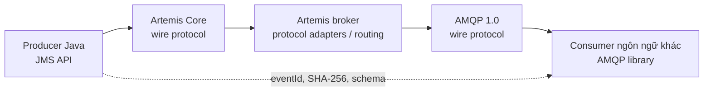
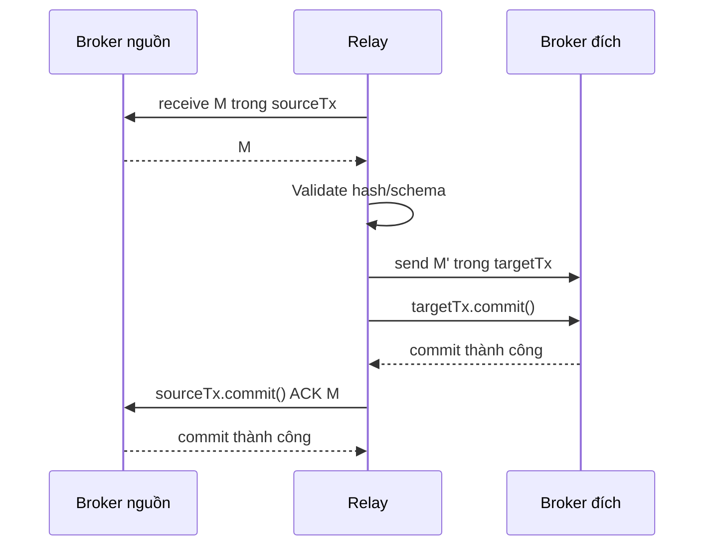

# Chuyển tiếp giữa giao thức và kiểm tra tính toàn vẹn của thông điệp

> **Chương:** Mẫu tích hợp  
> **Bối cảnh:** Apache ActiveMQ Artemis/Classic kết nối producer và consumer Java, JavaScript, Python qua JMS, Artemis Core, AMQP 1.0, OpenWire, STOMP, MQTT.  
> **Mục tiêu:** Thiết kế luồng **chuyển tiếp message giữa giao thức** mà vẫn kiểm soát được payload, metadata, định tuyến, acknowledgment, tính bền vững và **tính toàn vẹn dữ liệu**. Bài tập trung vào những thay đổi khi qua ranh giới giao thức; không lặp lại toàn bộ kiến thức JMS producer/consumer.

## 1. “Broker nhận được message” chưa chứng minh message vẫn nguyên vẹn

Giả sử producer Java gửi event `OrderPlaced` bằng **Artemis Core**. Một service khác nhận qua **AMQP 1.0**, sau đó một relay chuyển event sang broker hoặc hệ thống khác. Message vẫn đến nơi, nhưng có thể gặp các sai lệch:

- Payload Unicode được encode bằng UTF-8 ở đầu gửi nhưng decode sai ở đầu nhận.
- `BytesMessage` bị đổi sang `TextMessage`, AMQP `data` hoặc `amqp-value`; consumer đọc sai body type.
- JSON được parse rồi serialize lại, làm thay đổi byte, định dạng decimal, thứ tự field hoặc cách escape Unicode.
- JMS header như `JMSMessageID`, `JMSExpiration`, `JMSCorrelationID` được hiểu nhầm là metadata luôn chuyển nguyên vẹn.
- Relay ACK message nguồn trước khi message đích được broker xác nhận, gây **mất message** khi đích lỗi.
- Relay commit message đích rồi crash trước khi ACK nguồn, tạo **message trùng** sau redelivery.
- Metadata checksum được tạo từ một body nhưng consumer lại so với body sau khi đã biến đổi.

**Chuyển giao thức thành công** phải có ít nhất ba tiêu chí độc lập:

1. **Khả năng đọc và định tuyến:** client ở giao thức đích nhận được body/hệ thống định tuyến đến đúng queue/topic.
2. **Toàn vẹn nội dung:** các byte hoặc trường nghiệp vụ cần bảo toàn không bị thay đổi ngoài chủ đích.
3. **Delivery/reliability:** quá trình ACK, retry và transaction không gây mất dữ liệu; duplicate được nhận diện và xử lý.

Không thể suy (2) và (3) chỉ từ việc (1) PASS.



## 2. Phân biệt **interoperability trong một broker** và **relay qua hai broker**

Hai kiến trúc có vẻ giống nhau nhưng có mức chịu trách nhiệm rất khác.

### 2.1. Cùng Artemis broker, nhiều protocol acceptor

```text
Java JMS client (Artemis Core, port 61616)
                  |
                  v
     Artemis broker + address/queue
                  |
                  v
Qpid JMS client (AMQP 1.0, port 5672)
```

Một client gửi và một client nhận **cùng queue** trên một Artemis broker. Broker chịu trách nhiệm **protocol adaptation/routing**. Không cần viết một ứng dụng “đọc Core rồi gửi AMQP” chỉ để hai client cùng sử dụng queue đó.

Ưu điểm: không thêm một relay có hai phiên ACK/transaction, giảm hop và vận hành. Tuy nhiên, chuyển đổi body và metadata giữa protocol adapters vẫn phải **kiểm thử contract** với phiên bản broker/client thật (xem tài liệu *Protocols and Interoperability* ở phần tham khảo).

### 2.2. Hai broker hoặc hai hệ thống: một relay chủ động

```text
Broker A / queue lab.bridge.in
        |
        | Artemis Core
        v
Relay Java: receive -> validate -> map -> publish
        |
        | AMQP 1.0
        v
Broker B / queue lab.bridge.out
        |
        v
Consumer đích
```

Relay là một **consumer nguồn + producer đích**. Nó chịu trách nhiệm:

- Giữ/biến đổi body theo hợp đồng.
- Sao chép **allowlist** metadata, không sao chép bừa mọi JMS header.
- Chọn thứ tự commit nguồn/đích và xử lý **kết quả commit không chắc chắn**.
- Giới hạn retry, quarantine message không hợp lệ, tránh tạo vòng lặp forwarding.
- Quan sát latency, số message forward, duplicate, backlog và lỗi mapping.

Nếu broker/địa chỉ đích khác, **hai local JMS transactions không trở thành một transaction nguyên tử** chỉ vì mã Java dùng `Session.SESSION_TRANSACTED` ở cả hai bên.

### 2.3. Khi nào cần relay ứng dụng?

| Nhu cầu | Ưu tiên |
| --- | --- |
| Core producer và AMQP consumer đọc **cùng queue** trong Artemis | Dùng **multi-protocol broker**, kiểm tra tương thích |
| Cần routing/copy sang address trong cùng Artemis | Xem **divert** hoặc cơ chế routing/bridge broker phù hợp |
| Nối **hai broker độc lập**, lọc/chuyển schema, đổi ownership | Relay/bridge có kiểm soát, hoặc broker bridge phù hợp topology |
| Chuyển MQTT event sang workflow cần xác thực nghiệp vụ | Gateway có schema validation, mapping QoS/ACK rõ |
| Chỉ cần đổi endpoint TCP nhưng không đổi nội dung | Đừng dựng relay không cần thiết nếu broker đã hỗ trợ protocol |
| Cần bảo đảm atomic ACK nguồn và publish đích qua nhiều hệ | Đánh giá XA/2PC nếu thực sự hỗ trợ; thường ưu tiên at-least-once + idempotency |

**Tên “bridge” không tự nói lên độ tin cậy.** Bridge broker-native, network-of-brokers của Classic, AMQP federation và application relay có cơ chế ACK, store-and-forward, filter khác nhau; phải mô tả đúng sản phẩm/version.

## 3. Đường chuyển đổi cần tách API, wire protocol và destination

```text
Ứng dụng Java                         Broker                  Ứng dụng khác
  JMS API                              Artemis                      JMS API
    |                                     |                            |
Artemis JMS client -- CORE --------> protocol adapter -- AMQP 1.0 --> Qpid JMS client
    |                                     |                            |
BytesMessage                      address/queue                  BytesMessage?
properties                        routing/cache                 app properties?
```

- **JMS/Jakarta Messaging** là API ứng dụng; không định nghĩa một wire protocol duy nhất.
- **Artemis JMS client** thông thường sử dụng **Core wire protocol**.
- **Qpid JMS 2.x** thực hiện Jakarta Messaging trên **AMQP 1.0**; không nhầm AMQP 1.0 với RabbitMQ AMQP 0-9-1.
- **ActiveMQ Classic JMS client** thường dùng **OpenWire**; Artemis có OpenWire acceptor nhưng nó không tự đổi Classic client thành Artemis Core client.
- STOMP và MQTT có mô hình ACK, header và message type riêng; không dùng `JMSXDeliveryCount` hoặc `JMSMessageID` như contract chung cho mọi protocol.

### 3.1. Ma trận chuyển đổi cần kiểm tra

| Cặp giao thức | Body thường gặp | Điểm cần xác nhận |
| --- | --- | --- |
| Artemis Core JMS → AMQP JMS | `TextMessage`/`BytesMessage` ↔ mapping AMQP body | `data` vs `amqp-value`, type marker, JMS property |
| AMQP 1.0 → Core JMS | AMQP `data`, `amqp-value`, `amqp-sequence` | Có thực sự đọc được đúng JMS type? |
| OpenWire Classic JMS → Artemis AMQP | JMS message type/headers qua hai adapter | Body type, selector, priority, TTL, broker destination |
| STOMP → JMS | Text hoặc bytes, STOMP headers | UTF-8, `content-length` theo **bytes**, escaping header, ACK mode |
| MQTT → JMS/AMQP | Payload byte array, topic QoS/retain | Topic/queue mapping, retain, session và QoS không tương đương JMS transaction |
| Core → Core qua **hai broker** | Có thể giữ BytesMessage | Relay commit, duplicate, hop/loop detection |

Artemis mô tả rõ rằng AMQP-to-AMQP không cần conversion kiểu như khi đi qua protocol khác; muốn AMQP JMS client hiểu body, message cần tuân theo **JMS mapping conventions**. Một AMQP body không nhận diện được có thể được chuyển như binary message. Vì vậy đừng giả định mọi payload cuối cùng là `TextMessage` (xem tài liệu *AMQP* ở phần tham khảo).

## 4. Thiết kế contract bảo toàn nội dung **trước khi** định tuyến

Một event tối thiểu:

```json
{
  "schemaVersion": 1,
  "eventType": "OrderPlaced",
  "eventId": "run-a:7",
  "orderId": "9007199254740993",
  "totalAmount": "129.90",
  "occurredAt": "2026-11-17T07:30:00Z",
  "note": "Giao tới quán Cà phê ☕"
}
```

Quyết định contract:

| Thành phần | Quy ước | Lý do |
| --- | --- | --- |
| `eventId` | String ổn định từ **nguồn nghiệp vụ** | Dedup qua retry/relay; không dựa vào JMSMessageID mới |
| `schemaVersion` | Integer thuộc tập version hỗ trợ | Chọn validator/decoder đúng |
| `orderId` | String dù chỉ chứa chữ số | Tránh mất chính xác số nguyên lớn qua JavaScript Number |
| `totalAmount` | Decimal string | Không dùng binary floating point để tính tiền |
| `occurredAt` | Timestamp RFC 3339 có offset/UTC | Tránh mất múi giờ |
| `note` | Unicode, payload mã hóa UTF-8 | Bảo toàn tiếng Việt/emoji |
| `payloadSha256` | Lowercase hex digest SHA-256 của **raw payload bytes** | Phát hiện thay đổi byte |
| `payloadContentType` | `application/json` | Xác định parser/contract |
| `payloadCharset` | `UTF-8` | Chốt cách giải mã cho bytes |
| `bridgeVersion` | Giá trị ứng dụng tùy chọn | Biết gateway đã thực hiện chuyển đổi kiểu nào |

Các application properties phía JMS là **quy ước của ứng dụng**, không phải tự động là `content-type` chuẩn của AMQP hoặc STOMP. Nếu consumer ngoài JMS cần AMQP `properties.content-type`, phải cấu hình AMQP adapter hoặc gửi theo mapping chuẩn mà client đích hỗ trợ.

### 4.1. Chọn một trong hai chế độ toàn vẹn

**A. Bảo toàn raw bytes** — khuyến nghị khi relay chỉ chuyển transport:

```text
JSON object --serialize 1 lần--> UTF-8 bytes X
      |
      +--> SHA256(X), eventId, schemaVersion
      |
   Core BytesMessage [X] --> relay giữ nguyên X --> AMQP BytesMessage [X]
                                                       |
                                             SHA256(X nhận) == digest?
```

Relay **không parse rồi serialize lại** khi forwarding. Có thể parse để validate nhưng chuyển tiếp **chính mảng byte đã nhận**.

**B. Biến đổi schema có chủ đích** — khi phải đổi dữ liệu:

```text
Payload v1 bytes X -> validate -> transform -> Payload v2 bytes Y
                         |                       |
                    SHA256(X)                  SHA256(Y)
                         \-- trace provenance --/
```

`SHA256(X) != SHA256(Y)` là **dự kiến** nếu transform thay đổi JSON representation. Phải ghi:

- `sourceDigest`: hash dữ liệu v1 gốc.
- `targetDigest`: hash dữ liệu v2 sau transform.
- `sourceSchemaVersion`/`targetSchemaVersion`, transformer version và eventId.
- Contract kiểm tra **ngữ nghĩa** (dữ liệu tiền tệ, ID, timestamp, array, null) ngoài việc so hash.

**Sai lầm thường gặp:** hash JSON string được serialize lại ở consumer rồi so với hash của producer. Thứ tự field, whitespace, escape Unicode và `129.90`/`129.9` có thể khác dù đối tượng gần như tương đương. Nếu cần **hash semantic JSON**, hai đầu phải dùng cùng quy tắc canonicalization được chuẩn hóa (ví dụ JSON Canonicalization Scheme, RFC 8785) và các ràng buộc số/thời gian phù hợp.

## 5. Bảo toàn metadata: chuyển **có chọn lọc**, không clone toàn bộ JMS Message

### 5.1. Bảng xử lý header qua relay

| Trường | Hành động phù hợp | Vì sao |
| --- | --- | --- |
| `eventId` application property | Giữ nguyên | Business identity, idempotency |
| `schemaVersion` | Giữ/đổi có chủ đích | Chọn decoder đúng |
| `payloadSha256` | Giữ khi byte không đổi, **tính lại** nếu đổi byte | Hash gắn với raw content |
| `JMSMessageID` | **Không ép giữ**; broker/provider đích cấp message ID mới | Định danh transport của một lần send |
| `JMSDestination` | Dùng destination đích thực | Hai broker có namespace khác |
| `JMSCorrelationID` | Có thể sao chép nếu contract dùng | Correlation khác business event ID |
| `JMSReplyTo` | Không copy mù quáng | Destination/temporary queue của broker nguồn có thể vô nghĩa ở đích |
| `JMSExpiration`/TTL | Quyết định **remaining TTL** hoặc loại bỏ theo policy | Không biến message đã hết hạn thành không bao giờ hết hạn |
| `JMSPriority` | Chỉ giữ khi đích hỗ trợ và contract yêu cầu | Priority không bảo đảm thứ tự xử lý toàn cục |
| `JMSRedelivered`, `JMSXDeliveryCount` | **Không copy như delivery state** | Đích có chu kỳ redelivery riêng |
| Application properties không nằm trong allowlist | Không copy tự động | Tránh rò PII/secret và mapping kiểu sai |

### 5.2. TTL là lỗi chuyển tiếp điển hình

Giả sử nguồn phát message với TTL 60 giây và relay bị kẹt 55 giây:

```text
Nguồn: JMSExpiration ≈ sendAt + 60s
Relay: nhận sau 55s
Đích: chỉ còn khoảng 5s hữu ích
```

Nếu relay tạo message đích với `timeToLive=0` (nghĩa là **không hết hạn**), nó đã **thay đổi contract**. Một cách tính tương đối:

```java
long expiry = incoming.getJMSExpiration();
if (expiry != 0L) {
    long remainingMillis = expiry - System.currentTimeMillis();
    if (remainingMillis <= 0) {
        // Không forward thành message không expiry.
        // Áp dụng chính sách expired/quarantine/metrics rõ ràng.
    } else {
        // producer.send(target, outgoing, mode, priority, remainingMillis)
    }
}
```

Việc giữ TTL còn chịu sai lệch đồng hồ giữa broker/relay, thời điểm queueing và mapping provider. **Bài lab bên dưới cố ý dùng TTL=0** để tách kiểm thử byte integrity khỏi bài toán expiry. Với production, triển khai chính sách TTL tường minh trước khi đưa relay vào vận hành.

### 5.3. Không dùng JMS selector để kiểm tra field chỉ có trong JSON body

```java
out.setStringProperty("eventType", "OrderPlaced");
out.setIntProperty("schemaVersion", 1);
```

Selector `eventType = 'OrderPlaced'` đọc **JMS properties/header**, không parse body JSON. Khi chuyển qua STOMP/MQTT, tên/kiểu property có thể không còn tồn tại đúng dạng. Nếu destination đích cần filter, phải test mapping property trên đường wire thật.

## 6. Kiểm tra tính toàn vẹn: SHA-256, HMAC, schema và broker receipt

### 6.1. SHA-256 kiểm chứng **byte equality**

```java
import java.security.MessageDigest;
import java.util.HexFormat;

static String sha256(byte[] body) throws Exception {
    return HexFormat.of().formatHex(
            MessageDigest.getInstance("SHA-256").digest(body));
}
```

Tại producer:

```java
byte[] raw = json.getBytes(java.nio.charset.StandardCharsets.UTF_8);
String digest = sha256(raw);
message.writeBytes(raw);
message.setStringProperty("payloadSha256", digest);
```

Tại relay và consumer, đọc toàn bộ bytes rồi tính lại:

```java
String expected = incoming.getStringProperty("payloadSha256");
String actual = sha256(raw);
if (!actual.equals(expected)) {
    throw new IllegalArgumentException("PAYLOAD_DIGEST_MISMATCH");
}
```

**SHA-256 trong message property không phải xác thực nguồn gửi.** Kẻ có quyền thay message có thể thay cả body lẫn checksum. Hash giúp phát hiện sai lệch byte, serialization bug, corruption do adapter. Dùng **TLS + ACL** để bảo vệ kênh và quyền, thêm **HMAC hoặc chữ ký số** nếu cần xác thực nguồn/không thể sửa nội dung ngoài ý muốn ở các hop.

### 6.2. Khi cần tính xác thực, dùng HMAC với khóa quản lý an toàn

Ví dụ thuật toán Java:

```java
import javax.crypto.Mac;
import javax.crypto.spec.SecretKeySpec;
import java.security.MessageDigest;

static byte[] sign(byte[] data, byte[] secret) throws Exception {
    Mac mac = Mac.getInstance("HmacSHA256");
    mac.init(new SecretKeySpec(secret, "HmacSHA256"));
    return mac.doFinal(data);
}

static boolean verify(byte[] data, byte[] secret, byte[] supplied)
        throws Exception {
    return MessageDigest.isEqual(sign(data, secret), supplied);
}
```

**Đừng chỉ ký body nếu các trường như `eventId`, `schemaVersion`, `tenant` cũng quyết định quyền xử lý.** Hãy ký một **envelope được mã hóa nhất quán, có length-prefix hoặc canonicalization**, bao gồm metadata quan trọng và payload; kèm `keyId`/signature algorithm. Khóa lấy từ secret manager, không để trong YAML, source, log hay payload. `MessageDigest.isEqual` giúp tránh cách so sánh từng byte tự viết dễ lộ timing; bảo vệ đầy đủ còn cần rate limit và quy trình key rotation.

HMAC không giải quyết trùng message; eventId + inbox/idempotency vẫn cần.

### 6.3. Schema validation khác checksum

Một message có thể có SHA-256 khớp hoàn hảo nhưng nội dung sai nghiệp vụ:

```json
{"schemaVersion":1,"eventId":"e1","totalAmount":"NaN"}
```

Các lớp kiểm tra tách biệt:

1. **Transport:** TLS, broker connection, receipt/settlement.
2. **Bytes:** giới hạn length, UTF-8 strict, SHA-256/HMAC.
3. **Syntax:** JSON parser, reject malformed/duplicate keys theo policy.
4. **Schema:** required, types, enum, null, date-time, number range.
5. **Business:** tenant, quyền, trạng thái đơn, idempotency.
6. **Processing:** commit DB/JMS và theo dõi redelivery.

**Không ACK message chỉ vì checksum khớp** nếu xử lý nghiệp vụ còn thất bại. Ngược lại, khi checksum sai cố định, đừng rollback vô hạn: dùng quarantine/DLQ với reason `PAYLOAD_DIGEST_MISMATCH`.

## 7. Cấu hình Artemis cho bài lab Core → AMQP 1.0

Bài thử dùng **hai broker Artemis riêng** để có ranh giới giao dịch thật. Có thể bắt đầu bằng **một broker** để test khả năng tương tác protocol, sau đó tách ra hai instance để test relay commit/failure windows.

### 7.1. Broker nguồn: Core trên port 61616

Trong `broker.xml` của **source broker**, fragment thuộc `<acceptors>`:

```xml
<acceptor name="source-core">
    tcp://127.0.0.1:61616?protocols=CORE
</acceptor>
```

Queue thuộc `<addresses>`:

```xml
<address name="lab.bridge.in">
    <anycast>
        <queue name="lab.bridge.in" durable="true"/>
    </anycast>
</address>
```

### 7.2. Broker đích: AMQP 1.0 trên port 5672

Trong `broker.xml` của **destination broker**:

```xml
<acceptor name="sink-amqp">
    tcp://127.0.0.1:5672?protocols=AMQP
</acceptor>
```

Queue đích:

```xml
<address name="lab.bridge.out">
    <anycast>
        <queue name="lab.bridge.out" durable="true"/>
    </anycast>
</address>
```

Lưu ý:

- `127.0.0.1` chỉ phù hợp khi hai broker và client chạy trong lab trên cùng host. Với container/VM khác, bind listener và DNS theo topology test; bật TLS và quyền khi cần.
- `protocols=CORE`/`protocols=AMQP` là cấu hình **broker acceptor**; URL client `tcp://...` hoặc `amqp://...` là cách **client** truy cập.
- Port `61616` và `5672` là ví dụ lab; phải đảm bảo không đụng broker khác.
- Hai broker có **data directory riêng**. Không cho hai instance cùng ghi lên một journal/paging directory.
- Provision queue trước khi chạy lab; tránh auto-create gây nhầm routing type.
- Có thể chạy hai acceptor trên **cùng broker** để kiểm tra protocol adapter; nhưng khi ấy chưa test mất kết nối **giữa hai broker**.
- Artemis cũng hỗ trợ OpenWire/STOMP/MQTT, nhưng **không** mặc nhiên hai broker chuyển tiếp cho nhau chỉ vì mỗi bên có một acceptor.

### 7.3. Security tối thiểu

Trong production:

- Dùng role riêng cho **source consume** và **destination send**; bridge không cần quyền quản trị broker.
- Bật TLS cho đường đi qua mạng không tin cậy, xác minh chứng chỉ và hostname.
- Lưu credential vào secret manager/environment; không hard-code.
- Giới hạn message size và tốc độ forward; quota toàn hệ thống để tránh backlog làm đầy paging/disk.
- Nếu relay có quyền cross-tenant, kiểm tra tenant từ **authenticated identity + schema**, không chỉ tin application property `tenant` do producer tự gắn.

## 8. Maven: một Java/Jakarta JMS application dùng hai provider

Để không trộn `javax.jms` và `jakarta.jms`, bài lab dùng **Jakarta Messaging** thống nhất cho cả hai client:

- Artemis **`artemis-jakarta-client`** 2.50.0: kết nối Core.
- Apache Qpid **`qpid-jms-client`** 2.11.0: kết nối AMQP 1.0, Jakarta Messaging 3.1.
- Jackson cho JSON validation.

```xml
<properties>
    <maven.compiler.release>17</maven.compiler.release>
</properties>

<dependencies>
    <dependency>
        <groupId>org.apache.artemis</groupId>
        <artifactId>artemis-jakarta-client</artifactId>
        <version>2.50.0</version>
    </dependency>

    <dependency>
        <groupId>org.apache.qpid</groupId>
        <artifactId>qpid-jms-client</artifactId>
        <version>2.11.0</version>
    </dependency>

    <dependency>
        <groupId>com.fasterxml.jackson.core</groupId>
        <artifactId>jackson-databind</artifactId>
        <version>2.17.2</version>
    </dependency>
</dependencies>
```

Từ Artemis 2.50.0, Maven groupId chuyển từ `org.apache.activemq` sang `org.apache.artemis`. Qpid JMS **2.x** sử dụng `jakarta.jms`, trong khi Qpid JMS **1.x** dành cho `javax.jms`. Nếu dự án dùng bản khác, kiểm tra dependency tree và API tương thích trước khi chạy (xem tài liệu Maven chính thức của Artemis và Qpid ở phần tham khảo).

**Điều bài lab kiểm tra:** cùng một JMS API nhưng client source nói **Core**, client destination nói **AMQP 1.0**. Mục tiêu không phải benchmark phiên bản dependency này hay thay thế framework quản lý connection pool.

## 9. Java lab hoàn chỉnh: `seed → forward → verify`

Chương trình có ba mode:

- `seed`: gửi 12 `BytesMessage` persistent chứa JSON UTF-8 tới **source broker Core**, mỗi message mang `eventId` và SHA-256.
- `forward`: nhận từng message từ source, **kiểm tra checksum/schema**, gửi **cùng raw bytes** tới target bằng **Qpid JMS/AMQP 1.0**; commit **đích trước, nguồn sau**.
- `verify`: nhận từ target AMQP, xác thực body, hash, schema, metadata và tập event IDs; transaction ACK sau validation.

Tách ba mode giúp đặt fault injection **giữa** các bước mà không cần sửa logic nghiệp vụ. Bài lab giả định **queue đầu vào/đầu ra trống** trước `seed` và không có consumer cạnh tranh.

### 9.1. Code `ProtocolBridgeProbe.java`

```java
import com.fasterxml.jackson.core.JsonFactory;
import com.fasterxml.jackson.core.StreamReadFeature;
import com.fasterxml.jackson.databind.JsonNode;
import com.fasterxml.jackson.databind.ObjectMapper;
import com.fasterxml.jackson.databind.node.ObjectNode;

import jakarta.jms.BytesMessage;
import jakarta.jms.Connection;
import jakarta.jms.ConnectionFactory;
import jakarta.jms.DeliveryMode;
import jakarta.jms.Message;
import jakarta.jms.MessageConsumer;
import jakarta.jms.MessageProducer;
import jakarta.jms.Queue;
import jakarta.jms.Session;

import org.apache.activemq.artemis.jms.client.ActiveMQConnectionFactory;
import org.apache.qpid.jms.JmsConnectionFactory;

import java.nio.ByteBuffer;
import java.nio.charset.CodingErrorAction;
import java.nio.charset.StandardCharsets;
import java.security.MessageDigest;
import java.util.HashSet;
import java.util.HexFormat;
import java.util.Set;

public final class ProtocolBridgeProbe {
    private static final String INPUT = "lab.bridge.in";
    private static final String OUTPUT = "lab.bridge.out";
    private static final int COUNT = 12;
    private static final int MAX_BODY_BYTES = 1024 * 1024;

    private static final ObjectMapper JSON = new ObjectMapper(
            JsonFactory.builder()
                    .enable(StreamReadFeature.STRICT_DUPLICATE_DETECTION)
                    .build());

    private static void require(boolean ok, String why) {
        if (!ok) throw new IllegalStateException(why);
    }

    private static String digest(byte[] raw) throws Exception {
        return HexFormat.of().formatHex(
                MessageDigest.getInstance("SHA-256").digest(raw));
    }

    private static byte[] readBytes(BytesMessage message)
            throws Exception {
        long size = message.getBodyLength();
        require(size > 0 && size <= MAX_BODY_BYTES,
                "Invalid body size: " + size);

        byte[] data = new byte[(int) size];
        int position = 0;
        while (position < data.length) {
            byte[] chunk = new byte[
                    Math.min(4096, data.length - position)];
            int n = message.readBytes(chunk);
            require(n > 0, "Truncated BytesMessage");
            System.arraycopy(chunk, 0, data, position, n);
            position += n;
        }
        return data;
    }

    private static JsonNode validate(Message message, byte[] raw,
                                     String runId) throws Exception {
        require("application/json".equals(
                message.getStringProperty("payloadContentType")),
                "Unexpected content type");
        require("UTF-8".equals(
                message.getStringProperty("payloadCharset")),
                "Unexpected charset");

        String expected = message.getStringProperty("payloadSha256");
        require(expected != null && expected.equals(digest(raw)),
                "PAYLOAD_DIGEST_MISMATCH");

        String text = StandardCharsets.UTF_8.newDecoder()
                .onMalformedInput(CodingErrorAction.REPORT)
                .onUnmappableCharacter(CodingErrorAction.REPORT)
                .decode(ByteBuffer.wrap(raw)).toString();

        JsonNode root = JSON.readTree(text);
        require(root != null && root.isObject(),
                "JSON root must be object");

        JsonNode version = root.path("schemaVersion");
        require(version.isInt() && version.intValue() == 1,
                "Unsupported schema version");
        require(message.getIntProperty("schemaVersion") == 1,
                "Invalid header schema version");

        require("OrderPlaced".equals(root.path("eventType").asText()),
                "Invalid event type");
        require(runId.equals(message.getStringProperty("runId")),
                "Wrong message runId");

        String eventId = root.path("eventId").asText(null);
        require(eventId != null && eventId.equals(
                message.getStringProperty("eventId")),
                "Body/property eventId mismatch");
        return root;
    }

    private static Connection open(ConnectionFactory factory,
                                   String prefix) throws Exception {
        String user = System.getenv(prefix + "_USER");
        String pass = System.getenv(prefix + "_PASSWORD");
        if (user == null) return factory.createConnection();
        require(pass != null, "Missing " + prefix + "_PASSWORD");
        return factory.createConnection(user, pass);
    }

    private static ConnectionFactory sourceFactory() {
        String url = System.getenv().getOrDefault(
                "SOURCE_CORE_URL", "tcp://localhost:61616");
        return new ActiveMQConnectionFactory(url);
    }

    private static ConnectionFactory targetFactory() {
        String url = System.getenv().getOrDefault(
                "TARGET_AMQP_URL", "amqp://localhost:5672");
        return new JmsConnectionFactory(url);
    }

    private static void seed(String runId) throws Exception {
        try (Connection cn = open(sourceFactory(), "SOURCE")) {
            Session tx = cn.createSession(
                    true, Session.SESSION_TRANSACTED);
            Queue input = tx.createQueue(INPUT);
            MessageProducer producer = tx.createProducer(input);
            producer.setDeliveryMode(DeliveryMode.PERSISTENT);

            for (int i = 0; i < COUNT; i++) {
                String eventId = runId + ":" + i;

                ObjectNode event = JSON.createObjectNode();
                event.put("schemaVersion", 1);
                event.put("eventType", "OrderPlaced");
                event.put("eventId", eventId);
                event.put("orderId", "9007199254740993");
                event.put("totalAmount", "129.90");
                event.put("occurredAt", "2026-11-17T07:30:00Z");
                event.put("note", "Cà phê ☕");

                byte[] raw = JSON.writeValueAsBytes(event);
                BytesMessage out = tx.createBytesMessage();
                out.writeBytes(raw);
                out.setStringProperty("eventId", eventId);
                out.setStringProperty("runId", runId);
                out.setStringProperty(
                        "payloadContentType", "application/json");
                out.setStringProperty("payloadCharset", "UTF-8");
                out.setStringProperty("payloadSha256", digest(raw));
                out.setIntProperty("schemaVersion", 1);
                out.setIntProperty("sequence", i);
                out.setJMSCorrelationID(eventId);

                producer.send(out);
            }

            tx.commit();
            System.out.println("SEED PASS: " + COUNT);
        }
    }

    private static void forward(String runId) throws Exception {
        try (Connection source = open(sourceFactory(), "SOURCE");
             Connection target = open(targetFactory(), "TARGET")) {

            Session sourceTx = source.createSession(
                    true, Session.SESSION_TRANSACTED);
            Session targetTx = target.createSession(
                    true, Session.SESSION_TRANSACTED);

            Queue input = sourceTx.createQueue(INPUT);
            Queue output = targetTx.createQueue(OUTPUT);

            // runId bị giới hạn ký tự ở main; không thể chèn dấu nháy
            // hoặc câu lệnh JMS selector vào giá trị này.
            MessageConsumer sourceConsumer = sourceTx.createConsumer(
                    input, "runId = '" + runId + "'");
            MessageProducer targetProducer =
                    targetTx.createProducer(output);

            source.start();
            for (int i = 0; i < COUNT; i++) {
                Message incoming = sourceConsumer.receive(10_000);
                require(incoming instanceof BytesMessage,
                        "Expected BytesMessage from source");

                boolean targetCommitted = false;
                try {
                    // Lab chỉ chuyển message không có TTL. Production
                    // phải xử lý remaining TTL, scheduled delivery riêng.
                    require(incoming.getJMSExpiration() == 0L,
                            "TTL mapping not implemented in lab");

                    byte[] raw = readBytes((BytesMessage) incoming);
                    JsonNode parsed = validate(incoming, raw, runId);
                    String eventId = parsed.get("eventId").asText();

                    // Giữ nguyên byte; KHÔNG serialize JSON lại.
                    BytesMessage out = targetTx.createBytesMessage();
                    out.writeBytes(raw);
                    out.setStringProperty("eventId", eventId);
                    out.setStringProperty("runId", runId);
                    out.setStringProperty(
                            "payloadContentType", "application/json");
                    out.setStringProperty("payloadCharset", "UTF-8");
                    out.setStringProperty(
                            "payloadSha256", digest(raw));
                    out.setIntProperty("schemaVersion", 1);
                    out.setIntProperty(
                            "sequence",
                            incoming.getIntProperty("sequence"));
                    out.setStringProperty(
                            "sourceMessageId",
                            incoming.getJMSMessageID());

                    String correlation = incoming.getJMSCorrelationID();
                    if (correlation != null) {
                        out.setJMSCorrelationID(correlation);
                    }

                    // Send persistent với priority đã nhận, TTL=0.
                    targetProducer.send(
                            out, DeliveryMode.PERSISTENT,
                            incoming.getJMSPriority(), 0L);

                    // Quan trọng: commit ĐÍCH trước khi ACK NGUỒN.
                    targetTx.commit();
                    targetCommitted = true;
                    sourceTx.commit();
                    System.out.println("FORWARDED " + eventId);

                } catch (Exception failure) {
                    // Nếu target commit báo lỗi, kết quả có thể đã
                    // commit nhưng response bị mất; duplicate vẫn có thể.
                    if (!targetCommitted) {
                        try { targetTx.rollback(); }
                        catch (Exception rollbackError) {
                            failure.addSuppressed(rollbackError);
                        }
                    }
                    try { sourceTx.rollback(); }
                    catch (Exception rollbackError) {
                        failure.addSuppressed(rollbackError);
                    }
                    throw failure;
                }
            }
            System.out.println("FORWARD PASS: " + COUNT);
        }
    }

    private static void verify(String runId) throws Exception {
        try (Connection cn = open(targetFactory(), "TARGET")) {
            Session tx = cn.createSession(
                    true, Session.SESSION_TRANSACTED);
            Queue queue = tx.createQueue(OUTPUT);
            MessageConsumer consumer = tx.createConsumer(
                    queue, "runId = '" + runId + "'");
            cn.start();

            Set<String> eventIds = new HashSet<>();
            try {
                for (int i = 0; i < COUNT; i++) {
                    Message incoming = consumer.receive(10_000);
                    require(incoming instanceof BytesMessage,
                            "Missing or wrong message type");

                    byte[] raw = readBytes((BytesMessage) incoming);
                    JsonNode root = validate(incoming, raw, runId);
                    String id = root.get("eventId").asText();

                    require(eventIds.add(id),
                            "Duplicate destination eventId: " + id);
                    require("129.90".equals(
                            root.get("totalAmount").asText()),
                            "Decimal representation changed");
                    require("9007199254740993".equals(
                            root.get("orderId").asText()),
                            "Large identifier changed");

                    tx.commit(); // ACK sau validate thành công.
                    System.out.println("VERIFIED " + id);
                }

                require(consumer.receive(1_000) == null,
                        "Unexpected extra destination messages");
                System.out.println("VERIFY PASS: " + eventIds.size());
            } catch (Exception failure) {
                tx.rollback();
                throw failure;
            }
        }
    }

    public static void main(String[] args) throws Exception {
        require(args.length == 2,
                "Usage: <seed|forward|verify> <runId>");
        String mode = args[0];
        String runId = args[1];

        require(runId.matches("[A-Za-z0-9_-]{1,32}"),
                "Invalid runId");

        switch (mode) {
            case "seed" -> seed(runId);
            case "forward" -> forward(runId);
            case "verify" -> verify(runId);
            default -> throw new IllegalArgumentException(
                    "Unknown mode: " + mode);
        }
    }
}
```

### 9.2. Vì sao code này kiểm tra được hai ranh giới khác nhau?

**Ranh giới protocol:**

- Source client là Artemis Jakarta JMS client dùng `tcp://localhost:61616` (Core).
- Target client là Qpid JMS dùng `amqp://localhost:5672` (AMQP 1.0).
- `BytesMessage` được tạo lại phía đích từ **cùng raw byte array**, không phụ thuộc serialized Java object.
- `verify` nhận bằng Qpid JMS, yêu cầu type `BytesMessage`, so SHA-256 và validate JSON. Nếu AMQP/JMS type mapping không tương thích, test **thất bại rõ ràng**.

**Ranh giới reliability:**

- `seed` chỉ báo PASS khi `sourceTx.commit()` trả thành công.
- `forward` chỉ ACK nguồn bằng `sourceTx.commit()` **sau** khi `targetTx.commit()` trả thành công.
- `verify` chỉ ACK đích sau khi validate body/schema thành công.
- Mỗi hop có message ID riêng; `eventId` của nghiệp vụ giữ nguyên.

Đây là **at-least-once relay pattern trong điều kiện nguồn persistent, cấu hình broker đáng tin và consumer có redelivery**; chưa phải exactly-once. Nếu destination commit đã thành công rồi source commit thất bại, lần chạy sau có thể forward **lại cùng eventId**.

### 9.3. Điều code lab **cố ý chưa xử lý**

- Message có TTL/expiry khác 0.
- Scheduled delivery, delayed retry và priority policy phức tạp.
- Message không phải `BytesMessage` hoặc payload vượt 1MiB.
- Payload checksum sai/vĩnh viễn: code ném lỗi và rollback; production cần **quarantine + DLQ** có giới hạn, không chạy vòng rollback vô tận.
- Failover HA của từng broker hoặc bảo mật TLS/mTLS.
- Dedup tại consumer sản xuất: `verify` phát hiện duplicate và báo lỗi để test, **không thay cho inbox table**.
- HMAC/signature và quản lý khóa; mẫu code chỉ dùng SHA-256.
- Atomicity với DB/HTTP downstream. Local JMS transaction không chứa hệ thống đó.

**Không dùng probe này trực tiếp làm daemon production**: nó chỉ chuyển một tập cố định `COUNT=12` và dừng sau lỗi; relay thật cần vòng đời, polling timeout, retry policy, metric, concurrency và runbook.

## 10. Quy trình chạy bài lab có đối chứng

Dùng queue mới/trống trong **hai instance broker lab**; một `runId` cố định không trùng với lần trước, ví dụ `demo20261117a`.

| Bước | Việc làm | Kết quả |
| --- | --- | --- |
| 1 | Start source Artemis Core 61616 và target Artemis AMQP 5672; provision queue như phần 7 | Hai broker phục vụ đúng giao thức |
| 2 | Chạy Java main: `seed demo20261117a` | `SEED PASS: 12`; source queue có 12 message persistent |
| 3 | Kiểm tra broker nguồn: message count, persistence/queue | Không có consumer thực khác |
| 4 | Chạy `forward demo20261117a` | `FORWARDED ...` 12 lần, `FORWARD PASS: 12` |
| 5 | Kiểm tra source queue và target queue | Source đã ACK 12; target có 12 message |
| 6 | Chạy `verify demo20261117a` | `VERIFIED ...` 12 lần, `VERIFY PASS: 12` |
| 7 | Đối chiếu `eventId`, hash, body field, queue metrics | Không thiếu/sai dữ liệu trong lần không lỗi |

Nếu broker bật authentication, đặt `SOURCE_USER`/`SOURCE_PASSWORD` và `TARGET_USER`/`TARGET_PASSWORD`; hai tài khoản có thể khác nhau. Đặt `SOURCE_CORE_URL`/`TARGET_AMQP_URL` theo topology, không dùng localhost nếu process ở container khác.

**Cẩn trọng:** `verify` ACK message đích; nếu muốn so sánh body trước khi tiêu thụ, dùng browser hoặc inspection API của broker và tuyệt đối không sửa message. Test tích hợp nên có queue namespace riêng, không chạy trên queue nghiệp vụ đang có consumer.

### 10.1. Thử trước trên **cùng một Artemis broker**

Để cô lập chuyển đổi protocol khỏi relay reliability:

```text
Artemis broker:
  CORE acceptor: 61616
  AMQP acceptor: 5672
  address: lab.interop.orders
  anycast queue: lab.interop.orders

Artemis JMS/Core producer -> lab.interop.orders
Qpid JMS/AMQP consumer   -> lab.interop.orders
```

Không có relay: producer tạo BytesMessage/checksum, AMQP consumer đọc **cùng queue**. Kiểm tra contract bằng logic `validate/readBytes` ở phần 9. Khi cùng broker, JMS message body có thể được adapter map khác so với đường relay “tạo BytesMessage mới”; vì vậy hai bài test **bổ sung nhau**, không thay thế nhau.

### 10.2. Fault injection có chủ đích

Trên hai broker lab:

1. **Tắt target trước khi forward:** source chưa ACK; kỳ vọng message vẫn còn hoặc được redeliver sau khi kết nối lại.
2. **Target commit xong, làm relay crash trước source ACK:** destination có thể có một bản; source sẽ giao lại, tạo bản **trùng eventId**.
3. **Làm hỏng một byte payload nhưng giữ nguyên `payloadSha256`:** validator báo mismatch; đưa vào quarantine thay vì retry nóng trong bản production.
4. **Đổi field amount từ string sang number và tính lại hash:** checksum có thể PASS nhưng **schema contract** phải FAIL.
5. **Dùng AMQP client khác hoặc STOMP/MQTT gateway:** test body type, property, TTL, settlement riêng — không suy từ Qpid JMS.

Chỉ fault injection trong môi trường cô lập và có dữ liệu tái tạo. Tính ổn định phải được đánh giá từ **tập business event IDs**, không chỉ số message count một thời điểm.

## 11. Cross-broker local transactions: ba cửa sổ lỗi không thể bỏ qua

Một relay có hai transaction độc lập:

```text
sourceTx (Broker A): receive M, ACK khi commit
targetTx (Broker B): send M', message tồn tại khi commit
```

Đường “đích trước, nguồn sau”:



| Điểm lỗi | Trạng thái có thể xảy ra | Hành động |
| --- | --- | --- |
| Trước target commit | Nguồn chưa ACK, đích chưa chắc có message | Rollback/retry nguồn; kết quả target cần xác minh nếu connection lỗi |
| **Target commit thành công, trước source commit** | **Cả nguồn và đích cùng có event** | Redelivery nguồn có thể gửi trùng; consumer đích dedup |
| Target commit timeout/connection reset | Không biết broker đích đã commit hay chưa | Xem là **unknown outcome**, rollback nguồn; chấp nhận duplicate và reconcile theo eventId |
| Source commit timeout sau target commit | Đích đã có event, ACK nguồn chưa chắc | Retry có thể duplicate; theo dõi pending source |
| Source commit thành công | Nguồn ACK, target đã được commit trước đó | Đúng happy path; vẫn phải xử lý duplicate từ producer/upstream |

**Tuyệt đối tránh:** commit/ACK **nguồn trước**, sau đó mới gửi/commit đích. Khi target gặp lỗi giữa hai bước, event nguồn đã biến mất mà đích chưa có bản sao — **mất message**.

**Cũng không được tuyên bố “target commit first = exactly once”.** Thứ tự đó chọn **nguy cơ duplicate thay cho nguy cơ loss**, thường chấp nhận được nếu consumer có idempotency.

### 11.1. Khi nào cần XA/2PC?

XA distributed transaction có thể phối hợp các tài nguyên hỗ trợ XA theo two-phase commit, nhưng đòi hỏi:

- **XA-capable connection factories** thực sự được provider hỗ trợ.
- Transaction manager với recovery log bền vững.
- Chính sách xử lý in-doubt/heuristic transactions.
- Tương thích giữa hai broker/provider/protocol; không phải mọi client AMQP 1.0 mapping JMS đều hỗ trợ XA theo cùng cách.

Do chi phí và phức tạp, nhiều hệ tích hợp chọn **at-least-once + idempotent sink + inbox/outbox**, chỉ dùng XA khi lợi ích đủ lớn và đã thử recovery.

### 11.2. Cách dedup ở đích

Một bảng **inbox** có khóa unique:

```sql
CREATE TABLE processed_events (
    event_id VARCHAR(128) PRIMARY KEY,
    processed_at TIMESTAMP NOT NULL
);
```

Xử lý business event trong **DB transaction**:

```text
BEGIN DB TX
  INSERT eventId vào inbox (unique)
  Nếu event đã tồn tại: kiểm tra trạng thái và bỏ qua side effect
  Nếu mới: cập nhật nghiệp vụ
COMMIT DB TX
Sau đó ACK/commit JMS
```

Nếu DB commit thành công nhưng JMS ACK thất bại, message có thể redeliver; bảng inbox ngăn side effect trùng. Đừng dựa vào JMSMessageID để dedup vì relay tạo message mới hoặc producer retry có thể cấp ID khác cho **cùng eventId**.

## 12. Một số rủi ro khi chuyển sang STOMP hoặc MQTT

### 12.1. STOMP: text frame nhưng body có thể là bytes

STOMP có frame, header và body; một số client dùng `content-length`. Khi chuyển binary JSON UTF-8:

- `content-length` đếm **byte**, không phải Java `String.length()`.
- Nếu body chứa byte NULL, STOMP frame cần có `content-length` phù hợp và parser đúng phiên bản protocol.
- Header STOMP không có type system phong phú như JMS application property; `schemaVersion=1` có thể tới dưới dạng string `"1"`, không phải integer.
- Chế độ STOMP `ack=auto/client/client-individual` không tương đương trực tiếp toàn bộ JMS ACK modes hoặc transaction broker.
- Dùng `content-type: application/json` cho client STOMP theo contract, kiểm tra mapping bên Artemis.

**Không** copy `JMSXDeliveryCount` sang STOMP rồi coi đó là counter chính thức của client nếu adapter không có contract như vậy.

### 12.2. MQTT: QoS và retained message khác JMS durable

MQTT thường mang **payload bytes** cùng topic, QoS và session properties. Khi gateway từ JMS/AMQP sang MQTT:

- **QoS 0:** không có đảm bảo giao lại trên đường MQTT.
- **QoS 1:** có thể giao trùng.
- **QoS 2:** handshake giảm duplicate ở tầng MQTT protocol, **không bảo đảm exactly-once cập nhật DB của consumer**.
- MQTT retained message là “giá trị giữ lại cuối cùng” theo topic, không phải durable JMS subscription backlog tương đương một-một.
- MQTT topic name có wildcard/routing riêng; phải định nghĩa cách ánh xạ sang Artemis address/queue.

Để chứng minh integrity, consumer MQTT cần biết checksum nằm ở đâu: MQTT 3.1.1 không có JMS-style typed application property; có thể đưa metadata vào **envelope payload**. MQTT 5 có user properties, nhưng chúng vẫn là chuỗi và cần test end-to-end.

### 12.3. Đừng biến mọi thứ thành “JMS TextMessage”

Một AMQP `data` section, STOMP binary body và MQTT payload bytes có thể cùng chứa **UTF-8 JSON**. Kiểu JMS mà adapter tạo ra là kết quả **mapping cụ thể**; không đảm bảo TextMessage. Thiết kế contract theo **payload bytes, encoding, content-type và eventId**, rồi thêm adapter cho API từng bên.

## 13. Observability: điều tra khác biệt byte, schema hay delivery

Một relay có thể báo “đã chuyển 1000 message” nhưng đích chỉ xử lý 990 event. Phải chia metric theo tầng:

| Tầng | Metric cần thu | Giải thích |
| --- | --- | --- |
| Source queue | Pending, delivering, consumer count, redelivery | Message còn ở nguồn hay đang giao? |
| Relay receive | Received, validated, rejected, oversized, schema errors | Payload có lỗi trước khi forward? |
| Integrity | SHA mismatch, HMAC fail, UTF-8 parse fail | Sai byte, thiếu xác thực hay mapping? |
| Target publish | Target commit success/failure/unknown outcome | Đã ghi nhận được ở đích chưa? |
| Source ACK | Source commit success/failure | Có nguy cơ redelivery tạo duplicate? |
| Destination consume | Unique event IDs, duplicate IDs, processing success, DLQ | Business side effect được bảo vệ chưa? |
| Network | TCP reconnect, TLS failures, protocol negotiation | Lỗi vận chuyển hay lỗi schema? |
| Storage | Journal/paging/queue depth, free disk, send latency | Backlog có tích tụ vì đích chậm không? |

Log có cấu trúc, ví dụ:

```json
{
  "eventId": "run-a:7",
  "bridgeId": "core-amqp-v1",
  "sourceProtocol": "CORE",
  "targetProtocol": "AMQP-1.0",
  "sourceDestination": "lab.bridge.in",
  "targetDestination": "lab.bridge.out",
  "payloadSha256": "ab...redacted-for-example",
  "targetCommit": "SUCCESS",
  "sourceCommit": "SUCCESS",
  "elapsedMillis": 48
}
```

Đây là **minh họa schema log**; chuỗi `ab...` không phải SHA hợp lệ và không dùng làm vector kiểm chứng. Tránh log body raw, token hoặc secret. Có thể lưu full hash phục vụ đối soát, nhưng nếu payload nhạy cảm hãy áp dụng retention/ACL phù hợp.

### 13.1. Khi checksum không khớp, điều tra theo thứ tự

1. Có cùng **eventId/runId** và body cần so sánh không?
2. Hash ở producer được tạo trên **bytes nào**: trước hay sau compression/serialization?
3. Client nhận `BytesMessage`, `TextMessage` hay AMQP body dạng khác?
4. Encoding UTF-8, Unicode normalization, JSON formatting có bị thay đổi?
5. Gateway có giải nén, redact, thêm field hoặc đổi schema không?
6. Hash metadata có bị overwrite/recompute sai, hoặc bị copy từ message khác?
7. Có replay/duplicate của version cũ khiến so nhầm hai bản event?

Không kết luận “broker tự sửa payload” khi chưa đối chiếu raw bytes ở từng ranh giới. Tạo **fixture cố định** gồm JSON tiếng Việt, số lớn, decimal, timestamp, null và binary byte để test type mapping.

## 14. Ma trận kiểm thử chấp nhận

| ID | Kiểm thử | Kỳ vọng |
| --- | --- | --- |
| I1 | Core JMS producer → AMQP JMS consumer trên **cùng Artemis queue** | Đúng body type và SHA-256, không cần app relay |
| I2 | Core source → relay → Qpid AMQP target | Giữ raw bytes, eventId và digest |
| I3 | JSON chứa `"Cà phê ☕"` | Strict UTF-8 decode đúng Unicode |
| I4 | `orderId="9007199254740993"` và `totalAmount="129.90"` | Không làm tròn/cast sang Number/float |
| I5 | Sửa một byte, giữ checksum cũ | Checksum FAIL; quarantine có reason |
| I6 | Sửa schema type rồi **tính lại checksum** | Hash PASS nhưng schema FAIL |
| I7 | Target broker tắt trước commit | Source chưa ACK, có thể retry |
| I8 | Target commit thành công, relay crash trước source commit | Có thể duplicate eventId ở đích; inbox loại side effect lặp |
| I9 | Target commit báo timeout không rõ kết quả | Không claim loss/success; reconcile và retry an toàn |
| I10 | TTL khác 0 | Relay xử lý remaining TTL hoặc quarantine theo contract, không biến thành infinite TTL |
| I11 | Copy JMS header qua broker khác | `JMSMessageID` mới, `sourceMessageId` chỉ lưu trace |
| I12 | AMQP message không theo JMS mapping | Consumer phát hiện body type không hỗ trợ, không âm thầm parse sai |
| I13 | STOMP body có Unicode/byte NULL | `content-length` đúng theo bytes và parser hoạt động |
| I14 | MQTT QoS1 retry | Sink dedup bằng event ID, không suy QoS là business exactly-once |
| I15 | Thay protocol/client version | Chạy lại interoperability matrix, schema/digest và error tests |
| I16 | Queue lớn + target chậm | Backpressure, alert backlog/paging/disk không gây loop không giới hạn |

### 14.1. Evidence để tuyên bố PASS

- Broker/client/version và protocol acceptors **thực sự được dùng**.
- Danh sách `eventId` đã gửi, đã forward, đã nhận đích và đã xử lý nghiệp vụ.
- SHA-256 của raw payload tại **producer → relay → consumer**, không chỉ hash tái serialize.
- Session commit/ACK logs tương ứng mỗi hop.
- Số message pending/acknowledged trên source/target queue, DLQ/quarantine.
- Kết quả fault injection “sau target commit, trước source commit”.
- Bằng chứng duplicate không tạo side effect trùng (inbox DB).

**Không dùng số lần hàm `send()` được gọi làm bằng chứng message đã durable commit**. Với transacted session, cần `commit()` trả thành công và broker persistence đáp ứng chính sách; trường hợp mất response vẫn cần reconciliation.

## 15. Checklist triển khai production

- [ ] Đã phân biệt một-broker multiprotocol với hai-broker relay.
- [ ] Đã mô tả **wire protocol** ở từng hop, không nhầm JMS API với protocol.
- [ ] Cùng-broker đã test Core ↔ AMQP body/metadata mapping trên **cùng queue**, tránh relay thừa.
- [ ] Nếu dùng relay, có **one-way routing và hop limit/loop detection**, không forward ngược vô hạn.
- [ ] Payload contract quy định body type, UTF-8, schemaVersion, eventId và property mapping.
- [ ] Hash được tính trên **đúng raw bytes**; khi transform, ghi cả source/target hash.
- [ ] Có strict UTF-8, JSON/schema validation, size/depth limits, reject duplicate keys khi cần.
- [ ] Không copy mù quáng `JMSMessageID`, `JMSReplyTo`, TTL, delivery count hoặc toàn bộ properties.
- [ ] Nếu cần nguồn xác thực, dùng TLS/ACL và HMAC/chữ ký với canonical envelope và key rotation.
- [ ] Đích commit/persist trước khi ACK nguồn; hiểu duplicate window và unknown-commit outcome.
- [ ] Sink có idempotency/inbox theo business event ID, không chỉ JMSMessageID.
- [ ] Payload lỗi cố định vào quarantine/DLQ, không rollback vô hạn.
- [ ] Có chiến lược redelivery/backoff/circuit breaker khi broker đích lỗi diện rộng.
- [ ] Có metric và alert ở cả source, relay, target, paging/disk và DLQ.
- [ ] Chạy cross-protocol/fault tests với **client/broker/version cụ thể**, không dựa vào tên tính năng chung.
- [ ] Kiểm tra TLS, quyền send/consume, retention, PII và audit re-drive.

## 16. Câu hỏi tự kiểm tra

1. Vì sao cùng một Artemis broker có thể nhận Core producer và AMQP consumer mà không cần relay Java?
2. JMS API có định nghĩa Core/OpenWire/AMQP wire protocol không?
3. Vì sao một Qpid JMS consumer có thể thấy `BytesMessage` thay vì `TextMessage` dù nội dung là JSON?
4. Vì sao nên hash **raw UTF-8 bytes** thay vì JSON object được serialize lại?
5. Hash SHA-256 đúng có chứng minh message chắc chắn đến từ producer đáng tin không?
6. Tại sao không nên sao chép `JMSMessageID` như ID mới của message đích?
7. Vì sao phải commit target trước source trong relay hai broker?
8. Nếu target commit thành công nhưng source ACK thất bại, consumer đích cần biện pháp gì?
9. TTL nguồn còn 5 giây; relay gửi đích với TTL=0 gây lỗi semantics gì?
10. Phải làm gì khi payload SHA sai qua mọi retry?
11. MQTT QoS 2 có bảo đảm một business event cập nhật DB đúng một lần không?
12. Bằng chứng nào cho thấy integrity, schema và delivery đều đạt?

**Định hướng:** (1) broker có nhiều protocol adapters trên cùng routing store; (2) không; (3) AMQP JMS mapping phụ thuộc body type; (4) serialization có thể đổi bytes; (5) không, cần HMAC/chữ ký + ACL/TLS; (6) provider cấp message ID mới; (7) tránh ACK nguồn khi đích chưa durable; (8) idempotency theo eventId; (9) vô hiệu hóa expiry; (10) quarantine/điều tra, không retry nóng; (11) không; (12) raw hash cùng eventId + schema validation + commit/ACK/inbox evidence.

## 17. Tài liệu đối chiếu

- [Apache ActiveMQ Artemis — Protocols and Interoperability](https://artemis.apache.org/components/artemis/documentation/latest/protocols-interoperability.html): Core, OpenWire, AMQP, MQTT, STOMP, acceptor và protocol adapters.
- [Apache ActiveMQ Artemis — AMQP](https://artemis.apache.org/components/artemis/documentation/latest/amqp.html): AMQP 1.0, JMS mapping conventions và body conversion.
- [Apache ActiveMQ Artemis — Address Model](https://artemis.apache.org/components/artemis/documentation/latest/address-model.html): address, ANYCAST/MULTICAST và queue.
- [Apache ActiveMQ Artemis — The Client Classpath](https://artemis.apache.org/components/artemis/documentation/latest/client-classpath.html): `artemis-jms-client` và `artemis-jakarta-client`.
- [Apache Artemis — Maven groupId migration](https://artemis.apache.org/artemis-tlp-groupid-migration): groupId `org.apache.artemis` từ 2.50.0.
- [Apache Qpid — Qpid JMS](https://qpid.apache.org/components/jms/index.html): AMQP 1.0 client, Jakarta Messaging và cấu hình.
- [Apache Qpid — Maven dependencies](https://qpid.apache.org/maven.html): Qpid JMS 2.x `jakarta.jms`, Qpid JMS 1.x `javax.jms`.
- [RFC 8259 — JSON](https://www.rfc-editor.org/rfc/rfc8259): JSON, encoding UTF-8 và số.
- [RFC 8785 — JSON Canonicalization Scheme](https://www.rfc-editor.org/rfc/rfc8785): cách biểu diễn JSON nhất quán nếu cần hash/sign trên canonical data.
- [Jakarta Messaging Specification](https://jakarta.ee/specifications/messaging/): JMS message body/headers, acknowledgment, transaction, selector.

> **Ghi nhớ:** **Đổi giao thức không đồng nghĩa giữ nguyên mọi metadata**, và **nhận được message không đồng nghĩa dữ liệu chưa bị biến đổi hay đã xử lý đúng một lần**. Khi cùng Artemis broker, ưu tiên protocol adapters/routing có sẵn; khi cần relay giữa hai broker, giữ raw payload bytes, validate schema + SHA-256/HMAC, **commit đích trước ACK nguồn** và dùng **eventId/idempotency** để xử lý duplicate.
