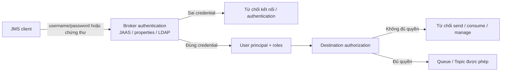
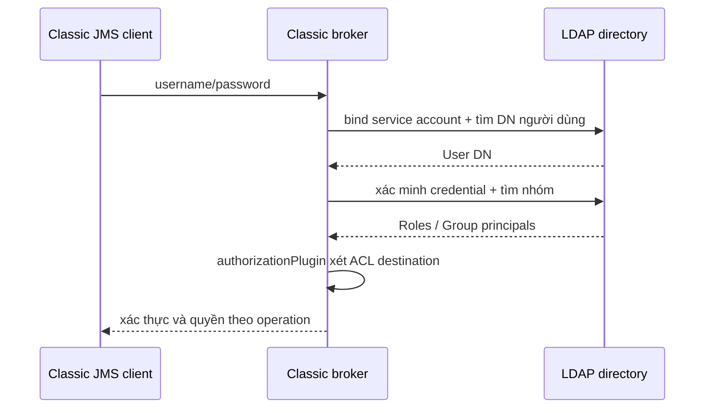

# Tài khoản, JAAS, LDAP và cấu hình xác thực theo broker

> **Chương:** Bảo mật  
> **Phạm vi:** Apache ActiveMQ **Classic** và Apache ActiveMQ **Artemis** trong hệ thống Java/JMS. Bài tập trung vào danh tính của client, cơ chế JAAS/LDAP và những điểm cấu hình **khác nhau giữa hai broker**; ví dụ phân quyền chỉ dùng để kiểm chứng rằng xác thực có ý nghĩa vận hành.  
> **Mục tiêu:** Tạo service accounts riêng cho producer/consumer; cấu hình Classic `simpleAuthenticationPlugin` hoặc `jaasAuthenticationPlugin`; cấu hình Artemis qua `bootstrap.xml`, `login.config` và `broker.xml`; tích hợp LDAP an toàn; dùng Java JMS/Spring Boot để kiểm tra đúng và sai thông tin đăng nhập, quyền gửi/nhận, luân chuyển credential.

## 1. Tình huống: cùng một queue, ba danh tính khác nhau

Dịch vụ `Order API` gửi lệnh vào queue `orders.commands`, trong khi `Order Worker` tiêu thụ lệnh. Người vận hành chỉ nên được dùng tài khoản quản trị có kiểm soát, không dùng credential của worker.

| Danh tính | Vai trò nghiệp vụ | Cần làm được | Không được làm |
|---|---|---|---|
| `svc-orders-pub` | Producer | Kết nối và **send** vào `orders.commands` | Consume lệnh, quản trị queue, đọc DLQ |
| `svc-orders-cons` | Consumer | Kết nối và **consume** từ `orders.commands` | Publish lệnh, xóa queue, xem dữ liệu quản trị |
| `broker-admin` | Operations | Provision/monitor theo quyền đã duyệt | Không dùng làm credential chung cho ứng dụng |
| `unknown-client` | Không được cấp danh tính | Không có quyền | Không được kết nối bằng credential sai hoặc rỗng |

Luồng kiểm soát truy cập có hai cổng, không chỉ một:



- **Authentication (xác thực):** chứng minh client là ai; thường phát sinh từ username/password khi `ConnectionFactory.createConnection(user, pass)` hoặc từ certificate/security mechanism khác.
- **Authorization (phân quyền):** principal/role đã xác thực có được phép **send, consume, tạo/xóa destination, browse, manage** hay không.
- **Transport security:** TLS bảo vệ thông tin đăng nhập và payload trên đường mạng. JAAS/LDAP **không tự bật TLS** giữa client và broker.
- **Audit:** ghi nhận tài khoản nào làm thao tác nào. Không phải mọi protocol tự ghi đầy đủ thông tin audit; cần chính sách log/metrics riêng.

**Cảnh báo:** client **kết nối thành công** chưa chứng minh nó có quyền send/consume một queue cụ thể. Test phải có cả **positive** và **negative authorization**.

## 2. JAAS nằm ở đâu trong kiến trúc Classic và Artemis?

JAAS (Java Authentication and Authorization Service) xác định một **login domain**, ví dụ `ClassicDomain` hoặc `ArtemisProperties`, và chuỗi `LoginModule` xác thực credential rồi thêm principal/role.

```text
JMS client
    |
    +-- credentials qua giao thức broker
           |
           v
     JAAS login domain --------------+
           |                         |
           +-- PropertiesLoginModule |
           +-- LDAPLoginModule       |
           +-- module khác nếu cấu hình
           |                         |
           v                         |
     Subject (user + roles)          |
           |                         |
           +------------> Broker authorization rules
                                  |
                                  v
                         send / consume / manage
```

Điểm dễ nhầm: **JAAS login.config chỉ nói cách xác thực/ánh xạ role**; nó không tự áp quyền “producer chỉ được gửi orders.commands”. Quyền theo destination vẫn do broker security configuration quyết định.

### 2.1. Khác biệt cấu trúc tệp

| Thành phần | ActiveMQ Classic | ActiveMQ Artemis |
|---|---|---|
| Cấu hình broker authentication | `<simpleAuthenticationPlugin>` hoặc `<jaasAuthenticationPlugin>` trong `activemq.xml` | JAAS security manager được chọn bằng `<jaas-security domain="...">` trong `bootstrap.xml` |
| Cấu hình JAAS login domain | `login.config` qua `java.security.auth.login.config`/classpath | `etc/login.config` hoặc đường dẫn JAAS JVM đã cấu hình từ broker profile |
| Module properties | `org.apache.activemq.jaas.PropertiesLoginModule` | `org.apache.activemq.artemis.spi.core.security.jaas.PropertiesLoginModule` |
| Khóa file người dùng | `org.apache.activemq.jaas.properties.user` | `org.apache.activemq.jaas.properties.user` |
| **Khóa file nhóm/role** | **`org.apache.activemq.jaas.properties.group`** | **`org.apache.activemq.jaas.properties.role`** |
| Module LDAP | `org.apache.activemq.jaas.LDAPLoginModule` | `org.apache.activemq.artemis.spi.core.security.jaas.LDAPLoginModule` |
| ACL gửi/nhận | `<authorizationPlugin>` / `authorizationMap` | `<security-settings>` / `<security-setting>` trong `broker.xml` |
| Quyền tạo destination | Classic `admin` | Artemis tách `createAddress`, `createDurableQueue`, `createNonDurableQueue`... |
| Phân quyền broker console/JMX | Cấu hình quản trị bổ sung, có thể khác JMS | Management security riêng; `manage`/`view`/`edit` và console realm cần kiểm chứng |

Tên module và option trông giống nhau nhưng **không tương đương hoàn toàn**. Sao chép `.group` của Classic sang Artemis có thể làm login thành công mà user **không có role mong muốn**, hoặc gây lỗi cấu hình theo phiên bản.

## 3. ActiveMQ Classic: tài khoản trực tiếp bằng `simpleAuthenticationPlugin`

Phương pháp đơn giản nhất để lab là đặt các user vào broker configuration. Ví dụ **đoạn trong `<plugins>` của `activemq.xml` Classic**, không phải một file XML độc lập:

```xml
<!-- Classic activemq.xml; chỉ dùng placeholder trong lab.
     Production không lưu password rõ trong repo/config chung. -->
<plugins>
  <simpleAuthenticationPlugin anonymousAccessAllowed="false">
    <users>
      <authenticationUser
          username="svc-orders-pub"
          password="REPLACE_WITH_TEST_SECRET"
          groups="orders-writers"/>
      <authenticationUser
          username="svc-orders-cons"
          password="REPLACE_WITH_TEST_SECRET"
          groups="orders-readers"/>
      <authenticationUser
          username="broker-admin"
          password="REPLACE_WITH_ADMIN_SECRET"
          groups="ops-admin"/>
    </users>
  </simpleAuthenticationPlugin>
</plugins>
```

Đây là **cơ chế xác thực**: broker so username/password và cấp group principals tương ứng. `anonymousAccessAllowed="false"` giúp không tạo danh tính khách tự động khi client không cung cấp credential.

**Giới hạn:**

1. Credential rõ nằm trong file cấu hình, dễ lộ qua backup, container image, secret scanning hoặc công cụ hỗ trợ. Chỉ dùng cho lab hoặc triển khai có quy trình inject/bao vệ secret chặt chẽ.
2. Sửa XML cần tuân thủ lifecycle reload/restart thực tế; không mặc định user/password tự thay đổi ngay khi lưu file.
3. `groups="orders-writers"` chưa tự tạo quyền gửi; cần **authorization plugin**.
4. Không cấu hình cả simple plugin và JAAS plugin cùng lúc chỉ vì muốn “tăng bảo mật”; thứ tự và cơ chế xác thực phải được thiết kế rõ.

### 3.1. Classic authorization đi kèm cho chính bài lab

Đây là **đoạn plugin thay thế/được thêm bên trong cùng phần tử `<plugins>`**, không tạo thêm một khối `<plugins>` độc lập:

```xml
<authorizationPlugin>
  <map>
    <authorizationMap>
      <authorizationEntries>
        <authorizationEntry
            queue="orders.commands"
            read="orders-readers,ops-admin"
            write="orders-writers,ops-admin"
            admin="ops-admin"/>

        <authorizationEntry
            queue="ActiveMQ.DLQ"
            read="ops-admin"
            write="ops-admin"
            admin="ops-admin"/>

        <!-- Advisory destinations có thể được tạo như side effect.
             Cho phép tạo nếu client cần, nhưng không cấp quyền đọc
             Advisory tràn lan cho ứng dụng thường. -->
        <authorizationEntry
            topic="ActiveMQ.Advisory.>"
            read="ops-admin"
            write="ops-admin"
            admin="orders-writers,orders-readers,ops-admin"/>
      </authorizationEntries>
      <tempDestinationAuthorizationEntry>
        <tempDestinationAuthorizationEntry
            read="ops-admin" write="ops-admin" admin="ops-admin"/>
      </tempDestinationAuthorizationEntry>
    </authorizationMap>
  </map>
</authorizationPlugin>
```

**Kết quả dự kiến:**

- `svc-orders-pub` được **write** vào `orders.commands` nhưng không có **read**.
- `svc-orders-cons` được **read** nhưng không có **write**.
- `broker-admin` có quyền quản trị trong **phạm vi các destination đã nêu**, không nhất thiết có toàn quyền mọi destination trên broker.
- Chỉ role quản trị có quyền đọc queue DLQ ở ví dụ này.

**Điểm phải kiểm chứng:** Classic dùng `read/write/admin` theo destination; `admin` còn liên quan việc *lazy creation* destination. Advisory destinations được broker/client tạo phụ theo thao tác, nên ACL Advisory quá hẹp có thể khiến client gặp lỗi phụ, còn mở `read="*"` có thể rò thông tin topology. Đừng cấp wildcard rộng mà chưa test.

Nếu cần chính sách bao trùm tất cả destination, thiết kế default/wildcard entries với deny-by-default theo broker policy thực tế; **không** cho rằng ba dòng ACL ở ví dụ đã mô tả toàn bộ bảo mật của một broker production.

### 3.2. Thử đúng và sai trong Classic

Chạy bằng client Classic tương thích broker:

1. Login `svc-orders-pub` với đúng password → kết nối thành công.
2. Producer gửi vào `orders.commands` → thành công nếu destination đã được provision và ACL hợp lệ.
3. Cùng account thử `createConsumer` trên queue → phải **bị từ chối**.
4. `svc-orders-cons` thử consume → thành công; thử send → bị từ chối.
5. Password sai/không có credential → authentication bị từ chối.
6. Client thường thử đọc `ActiveMQ.DLQ` → bị từ chối.

Tách kết quả **authentication failure** (chưa đăng nhập được) và **authorization failure** (đã đăng nhập nhưng bị từ chối operation). Không xem `receive()==null` là phép thử chứng minh bị từ chối: message có thể chỉ đang vắng.

## 4. ActiveMQ Classic: JAAS `PropertiesLoginModule` thay cho tài khoản nhúng XML

Khi cần tách tài khoản khỏi `activemq.xml`, cấu hình plugin JAAS:

```xml
<!-- Classic activemq.xml, trong <plugins>.
     Thay simpleAuthenticationPlugin, không chồng vô ý. -->
<jaasAuthenticationPlugin configuration="ClassicDomain"/>
```

`ClassicDomain` phải khớp chính xác một entry trong `login.config` được broker JVM nạp. Ví dụ:

```text
ClassicDomain {
    org.apache.activemq.jaas.PropertiesLoginModule required
        org.apache.activemq.jaas.properties.user="users.properties"
        org.apache.activemq.jaas.properties.group="groups.properties"
        reload=true
        debug=false;
};
```

`users.properties` — **mẫu cấu trúc**, thay credential bằng secret thử nghiệm từ kênh triển khai an toàn:

```properties
svc-orders-pub=REPLACE_WITH_TEST_SECRET
svc-orders-cons=REPLACE_WITH_TEST_SECRET
broker-admin=REPLACE_WITH_ADMIN_SECRET
```

`groups.properties` — nhóm ở bên trái, **danh sách username** ở bên phải:

```properties
orders-writers=svc-orders-pub
orders-readers=svc-orders-cons
ops-admin=broker-admin
```

**Tuyến liên kết:**

```text
JMS createConnection("svc-orders-pub", password)
    -> Classic JAAS login domain "ClassicDomain"
    -> PropertiesLoginModule đọc users.properties
    -> GroupPrincipal("orders-writers") từ groups.properties
    -> authorizationPlugin kiểm tra write trên orders.commands
```

Plugin JAAS giải quyết **authentication**; tiếp tục giữ `authorizationPlugin` tương ứng (ví dụ phần 3.1). Nếu bỏ authorization hoàn toàn hoặc ACL quá rộng, “login được bằng JAAS” chưa mang lại least privilege.

### 4.1. Nạp `login.config` đúng JVM

Có thể đặt system property **khi khởi động broker**, không phải trên producer:

```text
-Djava.security.auth.login.config=/secure/config/classic-login.config
```

Trong Java `login.config`, tên file property có thể được giải theo resource/classpath hoặc cách module xác định path. Kiểm tra broker distribution, classloader và cấu hình đang chạy. Không giả định working directory của process trùng thư mục chứa `login.config`.

**Bẫy production:** truyền `-Djava.security.auth.login.config` **chỉ cho JVM client** không làm thay đổi JAAS login domain của broker. Broker cần nạp file và module trên classpath của chính broker.

### 4.2. `reload=true` không phải quản trị phiên đăng nhập tức thời

Classic `PropertiesLoginModule` từ nhánh 5.12 có tùy chọn `reload=true` để reload file credentials/roles khi thay đổi. Khi không bật, thông thường chúng được nạp khi broker khởi động.

Dù reload hoạt động, **những Connection đã xác thực có thể còn tồn tại** và giữ security context; không giả định xóa user khỏi file làm mọi socket đang mở bị cắt ngay. Khi thu hồi khẩn cấp, cần kiểm soát Connection sessions, restart/reconnect và kiểm tra lại quyền thực tế.

## 5. Classic + LDAP: xác thực qua directory, giữ ACL tại broker

Với tổ chức có Active Directory/OpenLDAP, JAAS có thể tìm user và role trong LDAP. Sơ đồ:



Cấu hình Classic JAAS plugin:

```xml
<!-- Classic activemq.xml, trong <plugins> -->
<jaasAuthenticationPlugin configuration="ClassicLdapDomain"/>
```

Ví dụ `login.config` cho directory dạng `groupOfNames` lưu group member bằng **full user DN**:

```text
ClassicLdapDomain {
    org.apache.activemq.jaas.LDAPLoginModule required
        initialContextFactory="com.sun.jndi.ldap.LdapCtxFactory"
        connectionURL="ldaps://ldap.internal.example:636"
        authentication="simple"
        connectionUsername="cn=mq-bind,ou=ServiceAccounts,dc=example,dc=org"
        connectionPassword="INJECT_SECRET_AT_DEPLOYMENT"
        userBase="ou=People,dc=example,dc=org"
        userSearchMatching="(uid={0})"
        userSearchSubtree=true
        roleBase="ou=Groups,dc=example,dc=org"
        roleName="cn"
        roleSearchMatching="(member={0})"
        roleSearchSubtree=true;
};
```

- `userBase` là DN gốc để tìm user; `(uid={0})` dùng username từ client để tạo filter.
- `roleBase` là DN gốc chứa các group; `roleSearchMatching="(member={0})"` đối chiếu **full DN của user** khi directory lưu `member` là DN.
- `roleName="cn"` lấy tên nhóm cho role. Nếu group có `cn=orders-writers` thì role phải **khớp chính xác** `orders-writers` ở Classic ACL.
- `connectionUsername` là **bind account của broker** dùng để tra directory, không phải tài khoản service application.
- `connectionPassword` trong đoạn minh họa **không tự động đọc environment variable**. Đây chỉ là placeholder: cần inject/template secret an toàn **trước** khi broker nạp file, hoặc dùng cơ chế secret integration đã kiểm chứng.

**Không lấy cấu hình mẫu làm cấu hình LDAP dùng được ngay.** Directory có thể dùng `sAMAccountName` thay `uid`, nhóm `memberOf` trên user, nested groups, DN khác hoặc ACL hạn chế search. Phải điều chỉnh filter theo **schema thật**, xác nhận bind/TLS và test mappings.

### 5.1. LDAP auth khác LDAP authorization map

Classic `LDAPLoginModule` dùng directory để **xác thực và tạo group principals**. ACL destination vẫn có thể là **`authorizationPlugin` với XML map** như ví dụ phần 3.1.

Nếu muốn **destination ACL cũng nằm trong LDAP**, Classic có thêm các cơ chế như `LDAPAuthorizationMap` hoặc `cachedLDAPAuthorizationMap` theo phiên bản. Đây là **một cấu hình riêng**, không tự được kích hoạt chỉ vì dùng `LDAPLoginModule`. Đừng ghép tên class hoặc ACL format từ Artemis sang Classic mà chưa kiểm tra cấu trúc directory.

### 5.2. LDAP service account và quyền tối thiểu

Bind account chỉ cần **read/search** tại subtree user/group phục vụ xác thực. Không cấp quyền sửa group hoặc password cho broker. Trong mạng production:

- Dùng **LDAPS hoặc LDAP + StartTLS** theo cách module/JNDI và directory hỗ trợ thực tế.
- Cài truststore tin cậy cho **JVM broker** và kiểm chứng certificate/hostname.
- Đặt connect/read timeout có kiểm soát; không để request login treo vô hạn.
- Cho directory filter và role mapping vào contract security được review.
- Không ghi bind password, user password hoặc raw DN nhạy cảm trong log debug.

## 6. Artemis: ba mảnh cấu hình không được đặt nhầm tệp

Artemis dùng cơ chế JAAS Security Manager và định nghĩa quyền trong broker XML:

```text
Artemis broker instance
  |
  +-- etc/bootstrap.xml
  |     +-- <jaas-security domain="ArtemisProperties"/>
  |
  +-- etc/login.config
  |     +-- ArtemisProperties { PropertiesLoginModule ...; };
  |
  +-- etc/artemis-users.properties
  |     +-- username -> password/hash
  |
  +-- etc/artemis-roles.properties
  |     +-- role -> comma-separated usernames
  |
  +-- etc/broker.xml
        +-- <security-enabled>true</security-enabled>
        +-- <security-settings><security-setting ...>
        +-- addresses/queues/acceptors
```

**Khác Classic:** đừng đặt `<jaasAuthenticationPlugin>` của Classic vào `broker.xml` Artemis. Artemis `<jaas-security>` nằm trong `bootstrap.xml` (hoặc được điều khiển bằng system properties theo phiên bản), còn quyền `send/consume/create*` nằm trong `broker.xml`.

### 6.1. Chọn JAAS domain trong `bootstrap.xml`

Trong bootstrap hiện có của broker instance:

```xml
<!-- Đặt vào security-manager configuration của bootstrap.xml
     theo cấu trúc có sẵn; không tạo hai security managers. -->
<jaas-security domain="ArtemisProperties"/>
```

`ArtemisProperties` phải trùng tên entry trong `login.config`. Đường dẫn file JAAS thường được thiết lập qua JVM option trong Artemis broker profile hoặc tham số khởi động; ví dụ:

```text
-Djava.security.auth.login.config=/opt/artemis-instance/etc/login.config
```

Sửa `bootstrap.xml` mà không sửa `login.config`, hoặc chỉ sửa `broker.xml` rồi kỳ vọng login module tự thay đổi, đều có thể khiến xác thực không hoạt động đúng.

### 6.2. Artemis `PropertiesLoginModule` và role file

`login.config`:

```text
ArtemisProperties {
    org.apache.activemq.artemis.spi.core.security.jaas.PropertiesLoginModule required
        debug=false
        reload=true
        org.apache.activemq.jaas.properties.user="artemis-users.properties"
        org.apache.activemq.jaas.properties.role="artemis-roles.properties";
};
```

`artemis-users.properties`:

```properties
svc-orders-pub=REPLACE_WITH_HASH_OR_TEST_SECRET
svc-orders-cons=REPLACE_WITH_HASH_OR_TEST_SECRET
broker-admin=REPLACE_WITH_HASH_OR_TEST_SECRET
```

`artemis-roles.properties`:

```properties
orders-writers=svc-orders-pub
orders-readers=svc-orders-cons
ops-admin=broker-admin
```

**Điểm phân biệt phải thuộc lòng:**

- Classic PropertiesLoginModule dùng **`org.apache.activemq.jaas.properties.group`**.
- Artemis PropertiesLoginModule dùng **`org.apache.activemq.jaas.properties.role`**.
- Cả hai dạng property file ở đây có mapping **`roleName=username1,username2`**; không đảo thành `username=role`.
- `reload=true` là quyền năng của login module/version, không có nghĩa credential đã bị thu hồi trên mọi Connection đang hoạt động.

### 6.3. Đừng lưu password rõ trên Artemis production

Artemis hỗ trợ lưu password hash trong `artemis-users.properties` theo cú pháp `ENC(...)` do codec tương ứng diễn giải. Không tự gõ một hash giả vào file rồi kỳ vọng đăng nhập hoạt động.

Với broker instance đang chạy, Artemis CLI có các lệnh quản trị user như `artemis user add`, `user reset`, `user remove` theo phiên bản. Dùng CLI/admin interface đúng **broker instance**, quyền filesystem phù hợp và quy trình secrets của tổ chức để tạo/đổi hash; sau đó xác minh user login thực tế.

Cần phân biệt **password hashing** (một chiều để kiểm tra credential) với **masking/encoding có thể giải mã** các giá trị cấu hình. Đừng cho rằng chữ `ENC(...)` tự bảo đảm an toàn toàn bộ credential hoặc cho phép bỏ TLS.

## 7. Artemis: bật authentication và gán role thành quyền thật

Trong `broker.xml` Artemis, đặt **`security-enabled`** và ACL theo address. Ví dụ cho queue tồn tại sẵn:

```xml
<!-- Fragment thuộc <core> của broker.xml Artemis. -->
<security-enabled>true</security-enabled>

<security-settings>
    <!-- Mặc định chỉ ops-admin được thao tác.
         Rule cụ thể bên dưới không tự kế thừa quyền từ #. -->
    <security-setting match="#">
        <permission type="send" roles="ops-admin"/>
        <permission type="consume" roles="ops-admin"/>
        <permission type="browse" roles="ops-admin"/>
        <permission type="createAddress" roles="ops-admin"/>
        <permission type="createDurableQueue" roles="ops-admin"/>
        <permission type="deleteAddress" roles="ops-admin"/>
        <permission type="deleteDurableQueue" roles="ops-admin"/>
    </security-setting>

    <!-- Chính sách chính xác cho orders.commands. -->
    <security-setting match="orders.commands">
        <permission type="send" roles="orders-writers,ops-admin"/>
        <permission type="consume" roles="orders-readers,ops-admin"/>
        <permission type="browse" roles="ops-admin"/>
        <permission type="createAddress" roles="ops-admin"/>
        <permission type="createDurableQueue" roles="ops-admin"/>
        <permission type="deleteAddress" roles="ops-admin"/>
        <permission type="deleteDurableQueue" roles="ops-admin"/>
    </security-setting>

    <security-setting match="DLQ">
        <permission type="send" roles="ops-admin"/>
        <permission type="consume" roles="ops-admin"/>
        <permission type="browse" roles="ops-admin"/>
    </security-setting>
</security-settings>

<addresses>
    <address name="orders.commands">
        <anycast>
            <queue name="orders.commands" durable="true"/>
        </anycast>
    </address>
    <address name="DLQ">
        <anycast>
            <queue name="DLQ" durable="true"/>
        </anycast>
    </address>
</addresses>
```

**Ý nghĩa:**

1. `security-enabled=true` giữ kiểm tra bảo mật được bật. Tắt `security-enabled` để “sửa lỗi login” là một bước rất nguy hiểm.
2. `send` và `consume` phân biệt producer và consumer. `browse` cho phép xem queue mà không remove; cũng có thể lộ payload, nên không mặc định cấp cho producer.
3. `createAddress`/`createDurableQueue` điều khiển việc tạo address/queue. Ví dụ **đã provision queue** từ XML, nên service producer/consumer không cần quyền tạo resources.
4. Rule `match="orders.commands"` **cụ thể hơn** `match="#"`, và Artemis **không tự kế thừa toàn bộ permission** từ rule tổng quát; đã liệt kê tường minh các quyền admin cần giữ.
5. `DLQ` vẫn có thể cần broker-internal routing/auto-create và security policy phù hợp. Nếu broker tự quản lý dead-letter, không mặc định phải cấp send DLQ cho mọi app.
6. Quản trị console/JMX/management messages là **một mặt phẳng quyền riêng**; đoạn ví dụ chưa là hệ chính sách quản trị hoàn chỉnh.

### 7.1. Không nhầm FQQN với address ACL

Artemis có thể phân quyền **consume/browse** cụ thể theo Fully Qualified Queue Name, ví dụ `orders.events::billing.orders`, khi một address có nhiều queues. Nhưng:

- `send` vào **address chung** có thể route tới nhiều queues; FQQN security rule không thay thế kiểm soát quyền gửi vào address.
- Wildcard matching của FQQN khác rule matching address thông thường; cần exact FQQN khi dùng.
- Nếu chỉ một queue `orders.commands` cùng tên address, ví dụ phần 7 là đủ để học cơ chế chính.

**Selector `tenantId = 'tenant-17'` không phải authentication hay ACL**: client có quyền consume rộng có thể đổi selector.

## 8. Artemis + LDAP: JAAS login module với user DN và group mapping

Nếu doanh nghiệp dùng LDAP, thay `ArtemisProperties` bằng domain LDAP mà broker đã khai báo, ví dụ:

```xml
<!-- bootstrap.xml: thay domain hiện có, không khai báo chồng -->
<jaas-security domain="ArtemisLdap"/>
```

Trong `login.config`, ví dụ directory theo `groupOfNames` và `member` chứa full user DN:

```text
ArtemisLdap {
    org.apache.activemq.artemis.spi.core.security.jaas.LDAPLoginModule required
        initialContextFactory="com.sun.jndi.ldap.LdapCtxFactory"
        connectionURL="ldaps://ldap.internal.example:636"
        connectionProtocol=""
        authentication="simple"
        connectionUsername="cn=mq-bind,ou=ServiceAccounts,dc=example,dc=org"
        connectionPassword="INJECT_SECRET_AT_DEPLOYMENT"
        connectionTimeout="5000"
        readTimeout="5000"
        userBase="ou=People,dc=example,dc=org"
        userSearchMatching="(uid={0})"
        userSearchSubtree=true
        roleBase="ou=Groups,dc=example,dc=org"
        roleName="cn"
        roleSearchMatching="(member={0})"
        roleSearchSubtree=true;
};
```

Lưu ý riêng Artemis:

- `LDAPLoginModule` này thuộc package **`org.apache.activemq.artemis.spi.core.security.jaas`**, khác Classic.
- `connectionProtocol=""` là tùy chọn được Artemis documentation mô tả cho module này; không sao chép `connectionProtocol=s` từ ví dụ Classic cũ sang một broker Artemis hiện đại.
- `ldaps://...` yêu cầu **JVM broker tin cậy chứng thư LDAP server**. Không tắt xác minh TLS để khắc phục lỗi truststore; sửa trust chain, hostname và cấu hình SSL của JNDI.
- `userSearchMatching` và `roleSearchMatching` phải khớp LDAP schema và quyền search. Với AD, cần xem `sAMAccountName`, `memberOf`, referral, nested group và cách role được ánh xạ. Không sao chép filter demo vào production nếu directory khác.
- `connectionTimeout` và `readTimeout` giúp fail bounded khi directory chậm, nhưng giá trị phải được đo theo latency/availability mục tiêu.
- `connectionPassword` là **placeholder**, không phải cú pháp biến môi trường. Cần inject secret từ deployment/secret manager được kiểm soát trước khi broker đọc login config.

**Phân biệt authentication và authorization một lần nữa:** module LDAP cung cấp user/roles như `orders-writers`. `broker.xml` vẫn cần `<security-settings>` dùng đúng các role names đó. Nếu LDAP trả `cn=app-queue-publishers` mà ACL chờ `orders-writers`, login có thể hợp lệ nhưng send bị từ chối. Artemis hỗ trợ role mapping bên phía broker khi cần ánh xạ role bên ngoài sang role nội bộ; phải test role mapping thật, không chỉ test bind thành công.

### 8.1. Khi LDAP không trả group nào

Các tình huống hay gặp:

1. User search tìm đúng DN, mật khẩu được chấp nhận, nhưng role search filter sai schema.
2. Bind account không có quyền đọc membership.
3. Group được đặt ngoài `roleBase`.
4. Nested groups không được mở rộng theo cấu hình.
5. Module trả về DN/attribute khác giá trị role trong security settings.

Kết quả: client **authenticate được** nhưng **không có role để authorize**. Khi điều tra, tách log identity validation và role resolution; không vội cấp quyền rộng `roles="*"` chỉ để test pass.

### 8.2. LDAP outage, cache và fail-closed

Một số bản Artemis có cache authentication/authorization để giảm tải directory. Khi LDAP không sẵn sàng, cách xử lý tùy cache TTL/invalidation và policy đã cấu hình. Không giả định mọi cache hit là tài khoản vẫn hợp lệ hoặc mọi thay đổi role trên LDAP có hiệu lực ngay.

Cần có chính sách cụ thể:

- Cơ chế xử lý khi directory timeout: fail closed hay dùng cache hợp lệ còn hạn?
- Cách thu hồi khẩn cấp account đã bị lộ credential.
- Thời gian chờ revoke trên Connections đang tồn tại.
- Cache invalidation và restart có kiểm chứng.
- Hệ thống alert khi LDAP unreachable, role mapping rỗng bất thường hoặc authentication failures tăng đột ngột.

**Không tự thêm GuestLoginModule cho production chỉ để “LDAP down vẫn login được”.** Đây có thể mở ra đường truy cập ngoài ý muốn.

## 9. JAAS control flags: `required`, `requisite`, `sufficient`, `optional`

Một JAAS domain có thể chứa **nhiều LoginModule**. Cờ điều khiển ảnh hưởng đến kết quả chung:

| Cờ | Ý nghĩa ngắn | Rủi ro khi phối hợp sai |
|---|---|---|
| `required` | Module phải thành công; nếu fail có thể tiếp tục đánh giá module khác rồi kết luận thất bại | Có thể log sau nhiều module, phải hiểu toàn chuỗi |
| `requisite` | Module phải thành công; khi fail kết thúc chuỗi sớm | Cấu hình sai thứ tự làm không tới module dự kiến |
| `sufficient` | Khi thành công và không có required/requisite thất bại trước đó, có thể kết thúc sớm với success | Guest fallback đặt sau module failed có thể chấp nhận mật khẩu sai |
| `optional` | Module có thể thành công/thất bại, phụ thuộc kết hợp chung | Một optional module duy nhất có thể bị hiểu sai về chính sách |

### 9.1. Bẫy GuestLoginModule

Cấu hình dạng sau có thể cho **credential sai** thành user guest nếu module guest được phép chấp nhận:

```text
DemoUnsafeDomain {
    org.apache.activemq.artemis.spi.core.security.jaas.PropertiesLoginModule sufficient
        org.apache.activemq.jaas.properties.user="artemis-users.properties"
        org.apache.activemq.jaas.properties.role="artemis-roles.properties";
    org.apache.activemq.artemis.spi.core.security.jaas.GuestLoginModule sufficient
        org.apache.activemq.jaas.guest.user="guest"
        org.apache.activemq.jaas.guest.role="guests";
};
```

**Đây là ví dụ chống mẫu, không triển khai production.** Nếu thực sự cần guest cho client **không có credential**, Artemis có tùy chọn `credentialsInvalidate=true` trên GuestLoginModule cùng thứ tự/control flags được tài liệu hỗ trợ để **không biến password sai thành guest**. Với broker sản xuất nhạy cảm, phương án đơn giản nhất là **không có guest domain**.

Không đưa một user đã bị từ chối ở LDAP sang một local admin fallback ngoài ý muốn. Mọi fallback cần explicit design, threat model và negative tests cho password sai, account disabled và role revoked.

## 10. Java JMS: kết nối bằng credential, thử quyền gửi và quyền đọc

Ví dụ dưới đây dùng Jakarta Messaging 3.x (`jakarta.jms`) với provider `ConnectionFactory` phù hợp Classic/Artemis. Broker URL/ConnectionFactory creation là phần provider-specific được cấu hình bên ngoài.

### 10.1. Producer dùng service account

```java
import jakarta.jms.Connection;
import jakarta.jms.ConnectionFactory;
import jakarta.jms.DeliveryMode;
import jakarta.jms.JMSException;
import jakarta.jms.MessageProducer;
import jakarta.jms.Queue;
import jakarta.jms.Session;
import jakarta.jms.TextMessage;

public final class AuthenticatedOrderPublisher {

    public static void send(
            ConnectionFactory factory,
            String username,
            String password,
            String orderId) throws JMSException {

        Connection connection = factory.createConnection(username, password);
        try {
            Session session = connection.createSession(
                false, Session.AUTO_ACKNOWLEDGE);
            try {
                Queue queue = session.createQueue("orders.commands");
                MessageProducer producer = session.createProducer(queue);
                try {
                    producer.setDeliveryMode(DeliveryMode.PERSISTENT);

                    TextMessage m = session.createTextMessage(orderId);
                    m.setStringProperty("eventType", "CreateOrder");
                    m.setStringProperty("eventId", "create:" + orderId);

                    producer.send(m); // Đây mới là bước kiểm tra quyền send.
                } finally {
                    producer.close();
                }
            } finally {
                session.close();
            }
        } finally {
            connection.close();
        }
    }

}
```

Đây là lớp tiện ích có method `send(...)` thực sự, không phải chương trình `main` tự chạy: caller cung cấp provider `ConnectionFactory` và credentials qua cấu hình an toàn. Trong Spring Boot, dùng `JmsTemplate` qua broker `ConnectionFactory` đã cấu hình user/password; không phải mỗi lần publish đều tạo Connection mới.

### 10.2. Consumer dùng account riêng

```java
import jakarta.jms.Connection;
import jakarta.jms.ConnectionFactory;
import jakarta.jms.JMSException;
import jakarta.jms.Message;
import jakarta.jms.MessageConsumer;
import jakarta.jms.Queue;
import jakarta.jms.Session;

public final class AuthenticatedOrderConsumer {

    public static Message receiveOne(
            ConnectionFactory factory,
            String username,
            String password) throws JMSException {

        Connection connection = factory.createConnection(username, password);
        try {
            Session session = connection.createSession(
                true, Session.SESSION_TRANSACTED);
            try {
                Queue queue = session.createQueue("orders.commands");
                MessageConsumer consumer = session.createConsumer(queue);
                try {
                    connection.start();

                    Message m = consumer.receive(3_000L);
                    if (m != null) {
                        // Demo: commit ngay. Production phải thực hiện
                        // business effect idempotent trước JMS commit.
                        session.commit();
                    }
                    return m;
                } finally {
                    consumer.close();
                }
            } finally {
                session.close();
            }
        } finally {
            connection.close();
        }
    }
}
```

**Kiểm tra quyền:** với `svc-orders-cons`, tạo consumer và receive được; dùng `svc-orders-pub` để createConsumer thì phải gặp **authorization failure** theo provider/broker. JMS exception có thể phát sinh tại `createConsumer`, `start`, `send` hoặc thời điểm broker xử lý; không viết test cứng rằng nó nhất thiết xảy ra ở một dòng duy nhất.

Với tài khoản sai password, lỗi có thể xuất hiện ngay ở `createConnection` hoặc trong quá trình khởi tạo/start connection tùy client/protocol. Một `JMSException` có linked cause/security error; đừng log password để điều tra.

### 10.3. Không dùng credentials trong URL/log

Không ghép `username:password@host` vào broker URL nếu client library không yêu cầu và chưa có cơ chế masking thích hợp. Ưu tiên `ConnectionFactory.createConnection(user, pass)` hoặc provider factory có credentials được inject qua secret manager. Tránh in `ConnectionFactory.toString()` nếu implementation có thể lộ thông tin kết nối nhạy cảm.

## 11. Spring Boot: truyền account khác nhau cho Classic và Artemis

Spring Boot chỉ cấu hình **credential cho client**, không thay thế JAAS broker.

### 11.1. Client Artemis — Spring Boot 3

```yaml
spring:
  artemis:
    mode: native
    broker-url: tcp://127.0.0.1:61616
    user: ${JMS_USERNAME}
    password: ${JMS_PASSWORD}
```

### 11.2. Client Classic — Spring Boot 3

```yaml
spring:
  activemq:
    broker-url: tcp://127.0.0.1:61616
    user: ${JMS_USERNAME}
    password: ${JMS_PASSWORD}
```

Dùng **một provider đúng phiên bản client** cho từng ứng dụng: Spring Boot 3 dùng `jakarta.jms`, nên không ghép client Classic 5.x legacy chỉ hỗ trợ `javax.jms` vào code Boot 3.

Biến môi trường `JMS_USERNAME`/`JMS_PASSWORD` được Spring resolve **ở JVM ứng dụng**. Chúng **không tự được chuyển vào** broker JAAS `login.config`. Khi triển khai Kubernetes/VM, bí mật nên được secret manager/OS permission kiểm soát, tránh đưa vào Git, image, `docker inspect`/command line hoặc file log.

### 11.3. Không dùng một admin account cho tất cả microservices

Một service publisher chỉ cần quyền `send`; một consumer chỉ cần `consume`. Nếu tất cả dùng `broker-admin`:

- Bị lộ một application credential có thể dẫn đến đọc/xóa mọi queue hoặc DLQ.
- Không phân biệt được service nào thực hiện thao tác trong audit.
- Luân chuyển password cho một service buộc restart nhiều service không liên quan.
- Một lỗi cấu hình có thể làm client tự tạo destination ngoài phạm vi dự kiến.

Tài khoản riêng theo service/vai trò, quyền tối thiểu và rotation độc lập giúp giới hạn blast radius.

## 12. TLS của broker và TLS tới LDAP là hai đường khác nhau

```text
[Java JMS client] --TLS 1--> [ActiveMQ broker]
                                   |
                                   +--TLS 2--> [LDAP/AD directory]
```

- **TLS 1** bảo vệ credential/payload giữa JMS client và broker (Classic `ssl://` transport hoặc Artemis TLS-enabled acceptor, tùy protocol/client).
- **TLS 2** bảo vệ LDAP bind credentials và các truy vấn directory. Dùng `ldaps://...` hoặc StartTLS được module/JNDI hỗ trợ, kèm truststore/hostname validation ở broker JVM.
- **Authentication** kiểm tra username/password/subject; **authorization** kiểm tra role; cả hai không thay thế việc mã hóa kênh truyền.

Nếu chỉ bật TLS JMS mà broker vẫn truy vấn LDAP bằng `ldap://` không có TLS, bind secret có thể vẫn lộ trên đoạn broker–directory. Nếu chỉ bật LDAPS mà JMS client nối `tcp://` không TLS, client credential có thể không được bảo vệ trên đoạn đầu.

### 12.1. Chứng thư và truststore phải do đúng JVM sở hữu

Để broker tin cậy LDAP server, cấu hình truststore/cert chain cho **JVM broker** hoặc cơ chế JNDI đã được xác minh; cấu hình truststore ở **JVM ứng dụng JMS** không giúp broker xác minh server LDAP.

Một số môi trường yêu cầu LDAPS hostname verification/certificate SAN phù hợp. Không tắt kiểm tra certificate hoặc đặt trust-all làm “biện pháp sửa nhanh”.

### 12.2. Không nhầm mTLS với JAAS user/password

Artemis có thể cấu hình certificate-based JAAS domain bên cạnh password-based domain, nhưng cần module/chứng thư mapping riêng. Không mặc định việc bật `sslEnabled=true` sẽ tự tạo user/role từ client certificate; việc yêu cầu client certificate và map certificate DN vào broker principal là các bước khác.

## 13. Account lifecycle, rotate secret và thu hồi quyền

Một hệ thống có tài khoản đúng lúc deploy nhưng không có runbook thu hồi/luân chuyển vẫn chưa đủ bảo mật.

### 13.1. Quy trình rotate an toàn

1. Kiểm kê service sử dụng credential, broker endpoints và quyền truy cập.
2. Tạo credential mới bằng secrets workflow; ưu tiên **tài khoản mới song song** khi hệ thống/LDAP không hỗ trợ hai password đồng thời.
3. Cấp role/ACL tối thiểu cho account mới; thử connect/send/consume với test destination.
4. Cập nhật secret tại client app, rolling restart/reconnect và kiểm tra broker connection identity.
5. Xác nhận mọi instance đã dùng account mới; thu hồi account cũ và đóng những connections/session còn tồn tại.
6. Chạy negative test với credential cũ; đối chiếu audit và security cache/invalidation.
7. Lưu audit thay đổi mà **không lưu password**.

Việc đổi file properties hoặc LDAP role không đồng nghĩa một Connection đang mở sẽ tự mất quyền tức thì. Nếu cần thu hồi khẩn, phối hợp **ngắt Connections**, cache invalidation và broker/client reconnect theo khả năng của phiên bản.

### 13.2. Directory outage, caching và không biến lỗi thành anonymous

Nếu LDAP không sẵn sàng:

- Login mới có thể thất bại hoặc chậm; đặt timeout có giới hạn.
- Connections đang mở có thể hoạt động tiếp theo authorization state/cache hiện có.
- Không bật `GuestLoginModule` hoặc `anonymousAccessAllowed` để “không gián đoạn” mà không có threat model/ACL deny phù hợp.
- Alert phải phân biệt bad password, thiếu role và directory timeout.
- Recovery test nên gồm LDAP down, LDAP restored, account disabled và role revoked.

### 13.3. Ngoài JMS còn có admin/management plane

JMX, web console, Hawtio, management address/API, exporter, broker bridges/network connectors là các entry points khác nhau. Chúng có thể dùng credential/realm và permission riêng. Không tuyên bố “JAAS xong là bảo vệ hết broker” khi chưa kiểm tra:

- Console login và authorization;
- JMX remote access;
- Broker-to-broker connection credential;
- AMQP/STOMP/OpenWire/Core acceptors, anonymous mechanisms;
- Advisory/management destinations;
- Secret trong backup, log và monitoring.

## 14. Bộ bài kiểm chứng có tiêu chí rõ

Chạy **trên broker Classic hoặc Artemis staging riêng**, không trên production. Provision `orders.commands` trước khi test để không lẫn lỗi quyền tạo queue với lỗi send/consume. Với Artemis, chuẩn bị role file/JAAS/`security-settings` như trên. Với Classic, chọn **một** cơ chế simple hoặc JAAS và giữ authorization map.

### Bài A — Authentication: đúng password, sai password, không credential

1. Dùng `svc-orders-pub`/password hợp lệ kết nối.
2. Thử cùng username với password sai.
3. Thử không có credential.
4. Ghi loại lỗi: authentication failure tại create/start/handshake.
5. Đối chiếu broker log không in password.

**PASS:** chỉ credential hợp lệ được broker xác thực; không có guest/anonymous fallback ngoài ý muốn.

### Bài B — Authorization: producer chỉ send, consumer chỉ consume

1. `svc-orders-pub` gửi test message vào `orders.commands`; phải thành công.
2. Cùng user tạo consumer trên queue đó; phải bị từ chối.
3. `svc-orders-cons` nhận message; phải thành công.
4. Cùng user thử publish vào queue; phải bị từ chối.
5. Hai account thử browse DLQ; phải bị từ chối nếu policy không cấp quyền.

**PASS:** tách được authentication thành công khỏi authorization bị từ chối ở thao tác cụ thể.

### Bài C — Classic simple authentication so với JAAS properties

1. Dùng `simpleAuthenticationPlugin` trên Classic test và chạy A/B.
2. Thay bằng `jaasAuthenticationPlugin configuration="ClassicDomain"` và hai file properties.
3. Restart broker theo lifecycle cần thiết.
4. Lặp lại A/B, kiểm tra group name chính xác.
5. Sửa `groups.properties` trong môi trường test; quan sát sự khác nhau khi `reload=true` và khi chưa reload, kể cả connections cũ.

**PASS:** hiểu cơ chế lưu danh tính thay đổi nhưng ACL destination vẫn do authorization plugin quyết định.

### Bài D — Artemis role file: sai key `group`/`role`

1. Dùng JAAS Artemis `PropertiesLoginModule` với `org.apache.activemq.jaas.properties.role` đúng.
2. Xác nhận `svc-orders-pub` có role `orders-writers` và send được.
3. Trên một broker test sạch, cố ý dùng option **`.group` của Classic** thay `.role`.
4. Kiểm tra warning/login/role resolution và khả năng authorize.
5. Khôi phục đúng option, đọc lại broker config và thử lần nữa.

**PASS:** hiểu không được copy nguyên JAAS properties module Classic sang Artemis.

### Bài E — LDAP user bind thành công nhưng role mapping sai

1. Thiết lập directory test có user `svc-orders-pub` và group `orders-writers`.
2. Dùng LDAP JAAS login domain, xác nhận user bind thành công.
3. Đổi `roleBase` hoặc `roleSearchMatching` thành giá trị không khớp.
4. Kiểm tra login có thể thành công nhưng send bị từ chối do thiếu role.
5. Khôi phục mapping, xác minh role và ACL khớp lại.

**PASS:** có bằng chứng riêng cho **credential authentication** và **role-based authorization**.

### Bài F — LDAP timeout và thu hồi user

1. Bật LDAP với connect/read timeout hợp lý ở broker test.
2. Ngắt đường broker–LDAP có kiểm soát, thử login mới.
3. Khôi phục LDAP, xác nhận login có thể phục hồi.
4. Disable account ở directory; kiểm tra login mới và connections đang sống.
5. Theo cơ chế broker đang dùng, invalidate/close connections rồi thử lại.

**PASS:** không có anonymous fallback; biết giới hạn của cache và connection lifecycle.

### Bài G — TLS độc lập trên hai chặng

1. Bật TLS client–broker và dùng client truststore hợp lệ.
2. Thử client với truststore thiếu CA; kết nối phải thất bại ở TLS handshake.
3. Bật LDAPS broker–LDAP; xác minh broker truststore chứa đúng CA.
4. Thử broker dùng truststore LDAP sai ở staging; quan sát lỗi riêng.
5. Khôi phục cấu hình cả hai chặng, thử A/B.

**PASS:** phân biệt TLS handshake failure với sai password hoặc thiếu role.

### Bài H — Không vô tình cấp quyền tạo destination và DLQ

1. Với client producer/consumer thông thường, thử gửi/nhận `orders.commands` đã provision: thành công đúng vai trò.
2. Cố tạo một queue mới ngoài quyền cho phép; phải bị từ chối.
3. Cố browse/consume `DLQ`; phải bị từ chối.
4. Kiểm tra advisory/management operations không bị mở rộng ngoài ý muốn.
5. Rà soát authorization map/security-setting cụ thể và wildcard defaults.

**PASS:** quyền tạo/xóa và quyền quan sát DLQ không được tự động cấp chỉ vì user có quyền send/consume.

### Ma trận báo cáo

| Case | Broker | Danh tính | Thao tác | Expected | Actual |
|---|---|---|---|---|---|
| A1 | Classic/Artemis | svc-orders-pub đúng pass | Connect | Allow | |
| A2 | Classic/Artemis | svc-orders-pub sai pass | Connect | Deny | |
| A3 | Classic/Artemis | Anonymous | Connect | Deny | |
| B1 | Classic/Artemis | svc-orders-pub | Send orders.commands | Allow | |
| B2 | Classic/Artemis | svc-orders-pub | Consume orders.commands | Deny | |
| B3 | Classic/Artemis | svc-orders-cons | Consume orders.commands | Allow | |
| B4 | Classic/Artemis | svc-orders-cons | Send orders.commands | Deny | |
| D | Artemis | Role file cấu hình sai | Send | Deny/error | |
| E | Classic/Artemis LDAP | User đúng, role sai | Send | Deny | |
| F | Classic/Artemis LDAP | Directory down | Login mới | Theo fail-closed policy | |
| G | Classic/Artemis | Truststore TLS sai | Handshake | Deny | |
| H | Classic/Artemis | App user | Browse DLQ | Deny | |

**Ghi bằng chứng:** broker/client version, protocol (`OpenWire`/`Core`/`AMQP`), user *không có secret*, roles thực tế, destination, operation, exception class, security audit IDs, cache/reload config và latency login. Không biến bản ghi kết quả test thành nơi thu thập credential.

## 15. Troubleshooting theo điểm hỏng

| Triệu chứng | Tầng lỗi | Cần kiểm tra |
|---|---|---|
| Sai password nhưng vẫn vào broker | Authentication fallback / anonymous | `GuestLoginModule`, `anonymousAccessAllowed`, JAAS flags và domain thực tế |
| Credential đúng nhưng connect bị từ chối | Authentication/transport | Đúng domain, password, broker profile, TLS handshake, LDAP lookup |
| Connect thành công nhưng send bị denied | Authorization | User roles vs `write` Classic / `send` Artemis, destination thật, ACL wildcard |
| Consumer không nhận, không có security exception | Chưa đủ bằng chứng lỗi quyền | Selector, queue pending, connection.start, consumer count, destination |
| User có role nhưng create queue thất bại | Authorization tạo resource | Classic `admin`, Artemis `createAddress`/`create*Queue` |
| Artemis dùng JAAS đúng nhưng role luôn rỗng | LoginModule options | `.role` thay vì `.group`; file path, Role=UserList |
| Classic dùng `.role` và không có nhóm | LoginModule options | Classic cần `.group`, kiểm tra users/groups file |
| LDAP bind được nhưng không đủ quyền | Role search/ACL | `roleBase`, group membership, `roleName`, mapping role-to-ACL |
| LDAP login timeout dài | Directory/LDAP transport | `connectionTimeout`, `readTimeout`, DNS/network, LDAP responsiveness |
| TLS lỗi “PKIX path building failed” | JVM truststore/chain | Broker JVM truststore cho LDAPS; client JVM truststore cho JMS TLS |
| Đổi password nhưng connection cũ vẫn hoạt động | Session/cache lifecycle | Cache/reload, existing connections, force reconnect, revoke procedure |
| Sửa `broker.xml` mà JAAS domain không đổi | Sai tệp cấu hình | Artemis `bootstrap.xml` + `login.config`, startup JVM property |
| Classic plugin không được sử dụng | Sai cấu hình broker | `activemq.xml` thực sự load, `<plugins>`, plugin ordering/entry |
| App Boot dùng credential cũ | Client config/deploy | `spring.activemq.*` hoặc `spring.artemis.*`, env resolution, connection pool |
| DLQ/advisory mở cho mọi user | Authorization map | Wildcards, role groups, management/advisory permissions |

## 16. Checklist production và tài liệu tham khảo

### Checklist

- [ ] Mỗi ứng dụng có **service account** riêng; producer/consumer không dùng admin account.
- [ ] Authentication và authorization được kiểm thử **độc lập**.
- [ ] Classic chỉ dùng một strategy có chủ đích: `simpleAuthenticationPlugin` hoặc JAAS; không chồng plugin vô tình.
- [ ] Classic `PropertiesLoginModule` dùng option `.group`; Artemis dùng `.role`.
- [ ] Artemis JAAS domain được khai báo tại `bootstrap.xml`, module tại `login.config` và quyền tại `broker.xml`.
- [ ] Role/group từ properties/LDAP **khớp chính xác** ACL destination.
- [ ] `security-enabled` không bị tắt để né lỗi; anonymous/guest fallback không mở không kiểm soát.
- [ ] LDAP dùng LDAPS/StartTLS có kiểm chứng, bind account read-only, truststore đúng JVM và timeout giới hạn.
- [ ] Password/bind secret không nằm trong source, image, log hoặc CLI arguments đọc được bởi người không có quyền.
- [ ] Tài khoản thay đổi/thu hồi có quy trình quản lý existing Connections và security caches.
- [ ] Negative tests bao phủ password sai, user không role, producer consume, consumer send, DLQ và tạo queue.
- [ ] Management/console/JMX/bridges/advisory/acceptors được kiểm tra như các bề mặt riêng.
- [ ] Credential rotation, audit, alert tăng login failure và LDAP outage có owner rõ ràng.
- [ ] Security tests chạy theo đúng broker, JMS client version, protocol và JAAS login modules của production.

### Tài liệu chính thức

1. [ActiveMQ Classic — Security](https://activemq.apache.org/components/classic/documentation/security): `simpleAuthenticationPlugin`, JAAS plugin, `PropertiesLoginModule`, `authorizationPlugin` và LDAP examples.
2. [ActiveMQ Classic — Cached LDAP Authorization Module](https://activemq.apache.org/components/classic/documentation/cached-ldap-authorization-module): cơ chế lưu ACL trong LDAP riêng với login module.
3. [Apache ActiveMQ Artemis — Security](https://artemis.apache.org/components/artemis/documentation/latest/security.html): `bootstrap.xml`, JAAS security manager, `PropertiesLoginModule`, `LDAPLoginModule`, role permissions và security settings.
4. [Apache ActiveMQ Artemis — Configuring Transports](https://artemis.apache.org/components/artemis/documentation/latest/configuring-transports.html): transport acceptors và TLS.
5. [JAAS LoginModule Control Flags — Oracle](https://docs.oracle.com/en/java/javase/21/docs/api/java.base/javax/security/auth/login/Configuration.html): các flags `required/requisite/sufficient/optional` trong hệ JAAS.

> **Ghi nhớ:** **Broker phải biết client là ai trước, rồi mới quyết định client được phép thao tác gì.** Classic chọn authentication plugin trong `activemq.xml`; Artemis chọn JAAS domain trong `bootstrap.xml` và thực thi role ACL trong `broker.xml`. LDAP chỉ cung cấp danh tính/nhóm nếu đã cấu hình đúng search/bind; **TLS, authorization, quản lý secret và thu hồi quyền** vẫn phải được thiết kế, kiểm chứng và vận hành riêng.
