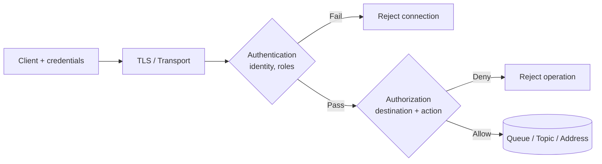

# Authorization policy của Classic và security settings của Artemis

> **Chương:** Bảo mật  
> **Phạm vi:** Phân quyền producer, consumer và quản trị destination trên **Apache ActiveMQ Classic 5.x** và **Apache ActiveMQ Artemis**. Tập trung vào authorization theo queue/topic/address, ánh xạ identity → role, temporary destination, DLQ, kiểm chứng quyền được cấp và quyền bị từ chối. Ví dụ Java dùng **ActiveMQ Classic 5.x / `javax.jms`**; minh họa Artemis phân biệt API `jakarta.jms` theo client tương thích.

## 1. Vấn đề nghiệp vụ: producer không được tự đọc dữ liệu

Trong luồng xử lý đơn hàng, ba identity tương ứng với ba phạm vi:

- `orders-publisher`: chỉ gửi job vào queue `lab.sec.orders`.
- `orders-worker`: chỉ consume job từ queue `lab.sec.orders`.
- `broker-operator`: quản trị destination theo quyền được cấp, không mặc nhiên là quản trị toàn bộ console/JMX.

Ma trận quyền cần đạt:

| Thao tác | Publisher | Worker | Operator |
|---|:---:|:---:|:---:|
| SEND vào `lab.sec.orders` | Cho phép | Từ chối | Cho phép |
| CONSUME từ `lab.sec.orders` | Từ chối | Cho phép | Cho phép |
| BROWSE không dequeue | Từ chối | Cho phép | Cho phép |
| Tạo/xóa queue | Từ chối | Từ chối | Theo quyền quản trị cụ thể |
| Truy cập queue ngoài phạm vi | Từ chối | Từ chối | Theo allowlist cụ thể |
| Truy cập console/JMX | Từ chối | Từ chối | Cấu hình quản trị **riêng** |

**Authentication** chứng minh kết nối thuộc identity nào; **authorization** quyết định identity đó được thao tác gì lên destination. TLS bảo vệ kết nối, **không tự cấp quyền**. Kết nối có thể đăng nhập thành công nhưng bị broker từ chối khi gọi `send`, `createConsumer` hoặc `createBrowser`.



Tên role `broker-operator` **không tạo đặc quyền thần kỳ**. Broker chỉ cho thao tác nằm trong permission mà policy map đến role đó. Đặc biệt, `admin` của Classic không đồng nghĩa quyền quản trị web console/JMX; `manage` trong Artemis cũng không tự cấp quyền trên mọi hệ thống quản trị bên ngoài broker.

## 2. Từ mô hình Classic sang mô hình Artemis

### 2.1 ActiveMQ Classic: `authorizationPlugin`

Classic cho phép cấu hình `authorizationMap` với các `authorizationEntry` dành riêng cho **JMS queue/topic destination**. Ba thuộc tính chính:

| Quyền Classic | Nghĩa trong thực hành | Lưu ý |
|---|---|---|
| `read` | Consume; thường bao gồm duyệt QueueBrowser | Không có `browse` permission riêng như Artemis |
| `write` | Gửi message đến destination | Chưa chắc có quyền tạo destination mới |
| `admin` | Quyền liên quan tạo/quản lý destination theo cơ chế Classic | Không tự cộng thêm `read` và `write`, không thay security của JMX |

Classic hỗ trợ destination wildcard như `lab.sec.>` và `lab.sec.*`. Cần kiểm tra pattern match và các rule chồng lắp trên đúng phiên bản thay vì suy rằng một entry cụ thể luôn ghi đè entry rộng. Tên queue mới được tạo sau này có thể vô tình nằm trong wildcard đã được cấp.

### 2.2 ActiveMQ Artemis: `security-settings`

Artemis dùng **address + queue**: một address có thể có các queue ANYCAST hoặc MULTICAST. Chính sách `security-settings` khớp với **address pattern**, thường dùng `#` cho nhiều phân cấp và `*` cho một phân cấp.

| Quyền Artemis | Thao tác được kiểm soát |
|---|---|
| `send` | Gửi message vào address |
| `consume` | Nhận message từ queue/subscription |
| `browse` | Đọc danh sách/nội dung message mà không dequeue |
| `createDurableQueue` / `deleteDurableQueue` | Tạo/xóa durable queue |
| `createNonDurableQueue` / `deleteNonDurableQueue` | Tạo/xóa non-durable queue |
| `createAddress` / `deleteAddress` | Tạo/xóa address trong những phiên bản hỗ trợ |
| `manage` | Quyền thao tác quản lý broker qua cơ chế quản lý tương ứng |

Đừng dùng `read/write/admin` của Classic trong `broker.xml` Artemis. Ngược lại, `send/consume/browse` cũng không phải tên thuộc tính thay thế được trong `authorizationEntry` Classic.

### 2.3 Bảng ánh xạ mục tiêu, không phải ánh xạ cú pháp tuyệt đối

| Mục tiêu | Classic | Artemis |
|---|---|---|
| Gửi queue | `authorizationEntry queue="..." write="..."` | `security-setting match="address"` + `send` |
| Consume queue | `read` | `consume` |
| Browse | Thường kiểm bằng `read` | `browse` riêng |
| Tạo queue | `admin` + policy tạo destination | `createDurableQueue`/`createNonDurableQueue`, có thể cả `createAddress` |
| Tạo temporary reply queue | `tempDestinationAuthorizationEntry` | Quyền tạo non-durable queue/address và SEND/CONSUME phù hợp |
| Phân cấp tên | `>` / `*` | `#` / `*` |
| Tên cần match | Classic queue/topic destination | Artemis address và routing/queue mapping |
| Điều khiển management plane | Web/JMX và broker-specific ACL riêng | `manage` cùng chính sách console/JMX/HTTP security riêng |

**Bẫy kiểm thử:** nếu queue chưa tồn tại, thao tác “chỉ gửi” có thể cần **quyền tạo queue/address** do auto-create. Kết nối bị từ chối ở bước tạo destination chưa chứng minh rằng permission gửi đã sai. Hãy có một queue được provisioning sẵn để test phân tách SEND/CONSUME với CREATE.

## 3. Classic: policy theo queue với least privilege

### 3.1 Pre-create queue để tách quyền ghi và quyền tạo

Một đoạn con `activemq.xml` trong broker Classic:

```xml
<!-- Chèn trong cấu hình <broker> Classic hiện có. -->
<destinations>
    <queue physicalName="lab.sec.orders"/>
</destinations>
```

Queue được tạo trước giúp identity publisher chỉ cần `write`, worker chỉ cần `read`. Không mặc định mọi ứng dụng đều cần `admin` trên pattern wildcard để “tự tạo queue khi cần”.

### 3.2 Authentication và authorization trong `<plugins>`

Ví dụ **chỉ cho broker Classic chạy lab** dùng `simpleAuthenticationPlugin` và `authorizationPlugin`. Password minh họa **không được dùng trong production**:

```xml
<!-- Các phần tử bên trong <plugins> Classic đã tồn tại. -->
<simpleAuthenticationPlugin anonymousAccessAllowed="false">
    <users>
        <authenticationUser username="demo-writer"
                            password="writer-local-lab-only"
                            groups="orders-writer"/>
        <authenticationUser username="demo-reader"
                            password="reader-local-lab-only"
                            groups="orders-reader"/>
        <authenticationUser username="demo-admin"
                            password="admin-local-lab-only"
                            groups="security-admin"/>
    </users>
</simpleAuthenticationPlugin>

<authorizationPlugin>
    <map>
        <authorizationMap>
            <authorizationEntries>
                <authorizationEntry
                    queue="lab.sec.orders"
                    read="orders-reader,security-admin"
                    write="orders-writer,security-admin"
                    admin="security-admin"/>
            </authorizationEntries>
            <tempDestinationAuthorizationEntry>
                <tempDestinationAuthorizationEntry
                    read="security-admin"
                    write="security-admin"
                    admin="security-admin"/>
            </tempDestinationAuthorizationEntry>
        </authorizationMap>
    </map>
</authorizationPlugin>
```

Đây là snippet của **Classic XBean configuration**, không phải XML tài liệu độc lập. Nếu broker đã có `<plugins>`, JAAS/LDAP hay authorization map khác, phải hợp nhất cấu hình và kiểm tra startup log; **không thêm một block song song** rồi giả sử cả hai tự hoạt động. Trong production, dùng backend identity do tổ chức quản lý, secret injection/rotation, TLS và giám sát authentication failures. `simpleAuthenticationPlugin` với password rõ chỉ phục vụ minh họa trong broker lab biệt lập.

**Đọc rule theo role chứ không theo tên username:**

1. `demo-writer` được xác thực thành công và có role `orders-writer`. Quyền `write` trên `lab.sec.orders` được cho phép, nhưng `read`/`admin` không được cấp.
2. `demo-reader` có role `orders-reader`. Quyền `read` được phép, bao gồm việc tạo consumer và thường cả QueueBrowser; `write` không có.
3. `demo-admin` có role `security-admin` được **liệt kê ở cả `read`, `write` và `admin`**. Không giả định chỉ ghi role vào `admin` là được mọi quyền.
4. `anonymousAccessAllowed="false"` nghĩa là kết nối anonymous bị từ chối tại authentication, **chưa cần xét ACL**.
5. `tempDestinationAuthorizationEntry` trong ví dụ chỉ cấp cho `security-admin`; writer/reader **không dùng được temporary reply queues theo policy này**. Đó là một trường hợp cần kiểm thử riêng nếu sau này bật request–reply.

**Rule không có match:** kỳ vọng destination ngoài danh sách bị từ chối, nhưng phải kiểm tra cả các authorization entries khác, wildcard, role/default policy do broker đang thực sự load. Không chứng minh deny bằng một snippet đọc rời khỏi cấu hình hiện hành.

### 3.3 Topic, wildcard và rủi ro lộ quyền theo nhánh

Nếu có topic audit riêng, bổ sung entry vào **chính `authorizationEntries`**:

```xml
<authorizationEntry
    topic="lab.sec.audit"
    read="auditors,security-admin"
    write="audit-publisher,security-admin"
    admin="security-admin"/>
```

User có `read` trên queue `lab.sec.orders` **không tự có quyền** đọc topic `lab.sec.audit`. Durable topic consumer có thể cần quyền bổ sung liên quan tới tạo/duy trì subscription; kiểm chứng ở API/client version thực tế.

Một rule wildcard cần review kỹ:

```xml
<!-- Ví dụ cần ĐÁNH GIÁ RỦI RO, không áp dụng mặc định. -->
<authorizationEntry queue="lab.sec.>"
                    read="security-admin"
                    write="orders-writer,security-admin"
                    admin="security-admin"/>
```

Rule như trên có thể cho writer gửi cả `lab.sec.payment-command` hoặc `lab.sec.admin-task` nếu về sau ai đó tạo các queue đó. Khi nhiều rule trùng/bao phủ nhau, không tự suy “rule cụ thể thắng rule rộng”; kiểm tra cách cấu hình được nạp và thực hiện **negative test** trên đúng destination nhạy cảm.

### 3.4 Temporary destinations, advisory và reply

Spring JMS `JmsTemplate.sendAndReceive` thường dùng `TemporaryQueue` làm reply destination. Người gọi cần có quyền tạo/sử dụng temp destination phù hợp, worker trả lời cần quyền gửi reply vào đích đó. `tempDestinationAuthorizationEntry` chính là phần dễ bị quên trong cấu hình Classic.

Không khắc phục một lỗi reply bằng cách cấp temp rights cho anonymous hoặc mọi service. Hãy xác định chính xác role requester/responder cần create/read/write, hoặc chọn shared reply queue có ACL cụ thể và quy tắc `JMSCorrelationID`. Đích `JMSReplyTo` do client cung cấp **không phải bằng chứng requester được phép nhận nội dung nhạy cảm**.

Classic có các advisory topics, thường nằm dưới namespace `ActiveMQ.Advisory.>`. Một số client/plugin quan sát metadata qua advisory. Nếu ACL quá chặt, chức năng phụ có thể lỗi; nếu ACL quá rộng, metadata destination/consumer có thể bị lộ. Giới hạn quyền advisory theo nhu cầu được kiểm chứng, **không mở toàn bộ topic`>` chỉ để loại cảnh báo**.

## 4. Artemis: bảo vệ address bằng security settings

### 4.1 Provisioning queue ANYCAST trước khi kiểm quyền

Để đối chiếu, trong `broker.xml` của Artemis có thể định nghĩa:

```xml
<!-- Đoạn con của phần <addresses> đã tồn tại. -->
<address name="lab.sec.orders">
    <anycast>
        <queue name="lab.sec.orders" durable="true"/>
    </anycast>
</address>
```

Artemis tách **address** khỏi **queue**. Trong ví dụ, một address ANYCAST và queue cùng tên giúp dễ kiểm chứng quyền. Với topic/MULTICAST, nhiều subscription queues có thể tồn tại trên **cùng address**; chỉ nhìn tên queue bên client dễ dẫn đến match policy sai.

### 4.2 Cấu hình `<security-settings>`

Giả sử authentication backend đã gán chính xác role `orders-writer`, `orders-reader` và `security-admin`. Trong phần `<security-settings>` của Artemis `broker.xml`:

```xml
<!-- Chèn vào <security-settings> hiện hữu. -->
<security-setting match="lab.sec.#">
    <permission type="send" roles="orders-writer,security-admin"/>
    <permission type="consume" roles="orders-reader,security-admin"/>
    <permission type="browse" roles="orders-reader,security-admin"/>

    <permission type="createDurableQueue" roles="security-admin"/>
    <permission type="deleteDurableQueue" roles="security-admin"/>
    <permission type="createNonDurableQueue" roles="security-admin"/>
    <permission type="deleteNonDurableQueue" roles="security-admin"/>
    <permission type="createAddress" roles="security-admin"/>
    <permission type="deleteAddress" roles="security-admin"/>
    <permission type="manage" roles="security-admin"/>
</security-setting>
```

**Diễn giải:** writer chỉ có `send`; reader có `consume` và `browse`; admin được liệt kê ở tất cả quyền cần thiết. Ở Artemis, **`consume` không tự đồng nghĩa `browse`**; nếu chỉ cần một worker nhận công việc mà không cần xem message từ giao diện duyệt, có thể cân nhắc không cấp `browse`. Các permission create/delete cụ thể và sự hỗ trợ các thuộc tính quản lý phụ thuộc phiên bản broker; kiểm tra schema/effective settings của đúng bản Artemis.

**Rule match:** `match="lab.sec.#"` dựa trên address hierarchy. Phải xem cùng lúc các setting `match="#"`, setting cụ thể hơn và cơ chế lựa chọn policy của phiên bản Artemis. **Không giả định policy được cộng dồn** với rule khác chỉ vì nhiều pattern cùng match. Mọi ca cho phép **và** từ chối phải được thử trên instance đã reload/restart cấu hình thực sự.

### 4.3 Authentication backend mới quyết định user có role nào

`<permission ... roles="orders-writer"/>` **không tự tạo user**. Role xuất phát từ JAAS/security manager, LDAP hoặc backend xác thực do broker cấu hình. Khi Artemis dùng **PropertiesLoginModule**, file role (đường dẫn xác định theo cấu hình JAAS) có thể có mapping dạng:

```properties
# Ví dụ role=users, không phải cấu hình password.
orders-writer=demo-writer
orders-reader=demo-reader
security-admin=demo-admin
```

Quản lý password và phương pháp lưu hashed credentials qua công cụ/backend được tổ chức phê duyệt; **đừng tạo file password plaintext rồi giả định Artemis đang load nó**. Không đồng nhất username với role: một principal có thể thuộc nhiều role; broker kiểm tra tập role sau authentication.

### 4.4 Address/queue/FQQN và durable subscription

Ví dụ multicast có thể có:

```text
Address: lab.sec.events
  Queue: subscription.invoice
  Queue: subscription.audit

JMS/Core client có thể tham chiếu FQQN dạng:
  lab.sec.events::subscription.audit
```

Security settings phải phù hợp **address và thao tác**; không đơn thuần dựa vào chuỗi queue name nếu broker giải quyết destination thành address và queue khác. Cần kiểm chứng FQQN, routing type, auto-create và effective permissions trên đúng client/protocol.

Đối với durable topic subscription, quyền `consume` chưa chắc đủ để **tạo durable queue lần đầu**. Nếu ứng dụng không cần tự tạo queue, provisioning bằng admin rồi cấp chỉ consume. Nếu cần tự tạo, cấp quyền `createDurableQueue` giới hạn tại address và có quota/retention/provisioning rules.

### 4.5 Temporary queue, DLQ và management

- **Reply queues:** có thể cần tạo non-durable queue/address, gửi và nhận trên temp destination. Test requester tạo/đọc và responder gửi, không chỉ SEND request.
- **DLQ/expiry:** các address này có thể lưu toàn bộ payload nhạy cảm; chỉ role xử lý sự cố được consume/browse, không mở quyền cho mọi worker.
- **Auto-create:** một ứng dụng tưởng chỉ send/consume có thể đụng create queue/address. Hạn chế auto-create và phân quyền provisioning để dễ kiểm soát.
- **Management:** `manage` không thay thế security của console/Jolokia/JMX, cũng không tự cấp mọi quyền gửi/nhận. Bảo vệ management plane riêng.

## 5. Lab Java JMS Classic: chứng minh cả allow lẫn deny

**Mục tiêu:** chạy một chương trình Java với ba thao tác `send`, `receive`, `browse` trên `lab.sec.orders`. Đổi identity và xác nhận đúng ma trận ở mục 1. Lab sử dụng:

- ActiveMQ Classic 5.x có cấu hình ở mục 3, OpenWire tại `tcp://127.0.0.1:61616`.
- Java 17, Gradle 8.x, Classic JMS client namespace **`javax.jms`**.
- Chỉ queue lab, không chạy với dữ liệu khách hàng hoặc broker production.
- Broker đã pre-create queue và cho phép các identity đăng nhập; credential ví dụ hoàn toàn chỉ dùng cho lab.

### 5.1 Gradle

`settings.gradle`:

```groovy
rootProject.name = 'classic-acl-probe'
```

`build.gradle`:

```groovy
plugins {
    id 'java'
    id 'application'
}

repositories {
    mavenCentral()
}

java {
    toolchain {
        languageVersion = JavaLanguageVersion.of(17)
    }
}

dependencies {
    implementation 'org.apache.activemq:activemq-client:5.18.3'
    runtimeOnly 'org.slf4j:slf4j-simple:1.7.36'
}

application {
    mainClass = 'lab.AclProbe'
}
```

Đây là mốc client để minh họa API, **không khẳng định là phiên bản mới nhất hay đã được duyệt cho production**. Khi đưa vào hệ thống thật phải kiểm tra compatibility, CVE của client/broker và cách quản lý dependency.

### 5.2 `AclProbe.java`: SEND, RECEIVE, BROWSE

Tạo `src/main/java/lab/AclProbe.java`:

```java
package lab;

import java.util.Enumeration;
import java.util.UUID;
import javax.jms.Connection;
import javax.jms.DeliveryMode;
import javax.jms.JMSException;
import javax.jms.Message;
import javax.jms.MessageConsumer;
import javax.jms.MessageProducer;
import javax.jms.Queue;
import javax.jms.QueueBrowser;
import javax.jms.Session;
import javax.jms.TextMessage;
import org.apache.activemq.ActiveMQConnectionFactory;

public final class AclProbe {
    private static final String QUEUE = "lab.sec.orders";

    private AclProbe() { }

    public static void main(String[] args) throws Exception {
        if (args.length != 1
                || !("send".equals(args[0])
                || "receive".equals(args[0])
                || "browse".equals(args[0]))) {
            System.err.println("Usage: send | receive | browse");
            return;
        }

        String url = env("BROKER_URL", "tcp://127.0.0.1:61616");
        String user = System.getenv("BROKER_USER");
        String password = System.getenv("BROKER_PASSWORD");
        ActiveMQConnectionFactory factory =
                new ActiveMQConnectionFactory(url);

        // Không có BROKER_USER thì thử anonymous: broker lab từ chối.
        Connection connection = user == null || user.isBlank()
                ? factory.createConnection()
                : factory.createConnection(user, password);
        try {
            connection.start();
            Session session = connection.createSession(
                    false, Session.AUTO_ACKNOWLEDGE);
            try {
                Queue queue = session.createQueue(QUEUE);
                switch (args[0]) {
                    case "send":
                        send(session, queue);
                        break;
                    case "receive":
                        receive(session, queue);
                        break;
                    case "browse":
                        browse(session, queue);
                        break;
                    default:
                        throw new IllegalStateException("Unsupported");
                }
            } finally {
                session.close();
            }
        } catch (JMSException e) {
            // Không ghi body hay password vào log.
            System.err.println("JMS failed: "
                    + e.getClass().getSimpleName());
            throw e;
        } finally {
            connection.close();
        }
    }

    private static void send(Session session, Queue queue)
            throws JMSException {
        MessageProducer producer = session.createProducer(queue);
        try {
            String jobId = UUID.randomUUID().toString();
            TextMessage message = session.createTextMessage(
                    "acl-test-job:" + jobId);
            message.setStringProperty("jobId", jobId);
            producer.send(message, DeliveryMode.PERSISTENT, 4, 60_000L);
            System.out.println("SEND OK jobId=" + jobId);
        } finally {
            producer.close();
        }
    }

    private static void receive(Session session, Queue queue)
            throws JMSException {
        MessageConsumer consumer = session.createConsumer(queue);
        try {
            Message message = consumer.receive(5_000L);
            if (message == null) {
                System.out.println("RECEIVE permitted; no message in 5s");
            } else {
                System.out.println("RECEIVE OK id="
                        + message.getJMSMessageID());
            }
        } finally {
            consumer.close();
        }
    }

    private static void browse(Session session, Queue queue)
            throws JMSException {
        QueueBrowser browser = session.createBrowser(queue);
        try {
            Enumeration<?> found = browser.getEnumeration();
            int count = 0;
            while (found.hasMoreElements() && count < 10) {
                Message message = (Message) found.nextElement();
                System.out.println("BROWSE id="
                        + message.getJMSMessageID());
                count++;
            }
            System.out.println("BROWSE OK sampled=" + count);
        } finally {
            browser.close();
        }
    }

    private static String env(String key, String fallback) {
        String value = System.getenv(key);
        return value == null || value.isBlank() ? fallback : value;
    }
}
```

**Chú ý:** `AUTO_ACKNOWLEDGE` trong lab có thể dequeue message khi `receive()` trả về; không chạy lệnh này trên queue production chỉ để kiểm quyền. `browse()` không dequeue nhưng cũng có thể đọc nội dung message nếu mã ứng dụng yêu cầu — vì vậy **đừng cấp quyền browse cho observer metadata chỉ vì muốn xem queue depth**. Trong một số client, authorization lỗi có thể phát sinh ở `createProducer`, `createConsumer`, `createBrowser` hoặc `send/receive`; test cần quan sát exception và broker log, không suy từ thời điểm lỗi.

### 5.3 Chạy với hai role

Trong ba terminal được cấu hình với broker lab:

```bash
# Publisher gửi được một job thử.
export BROKER_USER=demo-writer
export BROKER_PASSWORD=writer-local-lab-only
gradle run --args="send"

# Cùng identity publisher: RECEIVE bị từ chối.
gradle run --args="receive"

# Chuyển sang reader để browse trước, consume sau.
export BROKER_USER=demo-reader
export BROKER_PASSWORD=reader-local-lab-only
gradle run --args="browse"
gradle run --args="receive"

# Reader không được gửi.
gradle run --args="send"
```

Với PowerShell, thay `export BROKER_USER=...` bằng `$env:BROKER_USER = "..."` và đặt `$env:BROKER_PASSWORD` tương tự. Ví dụ đặt credential vào environment chỉ dùng cho **lab cục bộ**; ở production dùng secret store/injection, không đưa password vào process arguments hoặc commit vào repo.

Kỳ vọng: publisher **send thành công** nhưng consume/browse bị deny; reader **browse/consume thành công** nhưng send bị deny. Để kiểm anonymous, chạy trên terminal không có hai biến credential; broker lab được đặt `anonymousAccessAllowed=false` nên connection/start phải bị từ chối.

**Một phép thử deny phải thấy lỗi quyền** (authorization failure), không phải chỉ thấy `receive()` trả `null`. Queue có thể trống mà identity vẫn được cấp quyền; cần dùng message thử và broker-side log. Sau mỗi ca test, đối chiếu trạng thái queue để bảo đảm thao tác bị từ chối **không tạo tác động**.

### 5.4 Đoạn client Artemis Jakarta JMS tương đương cho SEND

Nếu chuyển phép thử sang Artemis, dùng **Artemis Jakarta JMS client** thuộc version tương thích với broker, không dùng Classic `activemq-client` từ `build.gradle` trên. Ví dụ bên trong một method Java:

```java
import jakarta.jms.JMSContext;
import org.apache.activemq.artemis.jms.client.ActiveMQConnectionFactory;

ActiveMQConnectionFactory factory =
        new ActiveMQConnectionFactory("tcp://127.0.0.1:61616");

try (JMSContext context = factory.createContext(
        "demo-writer", "credential-from-lab-secret-store")) {
    context.createProducer().send(
            context.createQueue("lab.sec.orders"), "artemis-acl-probe");
}
```

`ActiveMQConnectionFactory` ở trên thuộc **Artemis**, dù tên đơn giản trùng với một class của Classic; `JMSContext` thuộc `jakarta.jms`. Đây là snippet tập trung vào SEND và phải được đặt trong code có import/dependency phù hợp, **không phải file standalone**. Nếu ứng dụng dùng Spring Boot 3, starter `spring-boot-starter-artemis` có thể quản lý client tương thích; phải xác minh acceptor/protocol, credentials và queue routing trên broker Artemis thực tế.

## 6. Ma trận kiểm thử: bắt buộc có trường hợp bị từ chối

Không nghiệm thu authorization chỉ bằng “writer gửi được một message”. Các ca negative cần xác nhận broker **thực sự từ chối operation**:

| Mã | Identity / thao tác | Classic | Artemis | Kỳ vọng |
|---|---|---|---|---|
| A1 | Writer SEND `lab.sec.orders` | `write` | `send` | **Allow** |
| A2 | Writer CONSUME `lab.sec.orders` | Thiếu `read` | Thiếu `consume` | **Deny** |
| A3 | Reader CONSUME `lab.sec.orders` | `read` | `consume` | **Allow** |
| A4 | Reader SEND `lab.sec.orders` | Thiếu `write` | Thiếu `send` | **Deny** |
| A5 | Reader BROWSE queue | `read` | `browse` | **Allow** |
| A6 | Writer BROWSE queue | Thiếu `read` | Thiếu `browse` | **Deny** |
| A7 | Writer tạo queue chưa tồn tại | Thiếu `admin` | Thiếu create queue/address | **Deny** |
| A8 | Operator SEND, CONSUME, BROWSE queue lab | Được liệt kê ba quyền | Được liệt kê ba quyền | **Allow** |
| A9 | Anonymous connection | `anonymousAccessAllowed=false` | Realm/security manager không cấp identity anonymous | **Deny** |
| A10 | Reader truy cập destination ngoài `lab.sec.orders` | Không có entry cho phép | Không có permission ngoài scope | **Deny** sau kiểm cả default |
| A11 | Writer tạo TemporaryQueue | Temp rule chỉ cấp admin | Chưa cấp quyền create temp phù hợp | **Deny** |
| A12 | Reader xem DLQ chứa dữ liệu ngoài scope | ACL DLQ riêng | Security setting của DLQ riêng | **Deny**, trừ role chuyên biệt |
| A13 | Client tạo durable topic subscription mới | Quyền read và quyền tạo liên quan | `consume` và create durable queue nếu cần | Theo chính sách provisioning |
| A14 | Thay đổi role khi connection đang sống | Kiểm role cache/session | Kiểm role cache/session | Xác minh quyền mới đã có hiệu lực |

**Bằng chứng cho một ca negative:** client đã **authentication thành công** nhưng thao tác bị deny, broker ghi lại principal/destination/action và không có tác động lên queue. Nếu kết nối thất bại ngay ở password/TLS, đó là **test authentication**, chưa chứng minh authorization.

Provider có thể báo `JMSSecurityException`, `JMSException` với linked cause, hoặc lỗi ở thời điểm tạo consumer/producer. Không yêu cầu mọi connector đều tạo cùng một subclass exception. Phân loại dựa vào root cause và log broker, **không** coi một `receive()` trả `null` là bị chặn.

### 6.1 Test phải phân biệt queue đã tồn tại và auto-create

Hãy chạy A1–A6 trên queue đã được pre-create. Sau đó thử một queue mới như `lab.sec.orders-extra` dưới đúng tài khoản publisher. Có thể việc tạo destination bị từ chối vì thiếu `admin` (Classic) hoặc create queue/address (Artemis). Nếu queue không được tự tạo theo chính sách broker, lỗi destination-not-found cũng cần được phân biệt với lỗi thiếu quyền `send`.

Khi thiết kế least privilege, ưu tiên **provisioning queue/address** bởi operator hoặc pipeline riêng thay vì trao quyền create wildcard cho mọi service chỉ để container listener khởi động.

### 6.2 Test cả tình huống durable topic và temporary reply

Với một consumer durable mới:

1. Tạo subscription trong broker lab bằng principal/role đúng.
2. Xác định queue subscription được tạo thuộc **address nào** trên Artemis.
3. Ngắt kết nối, publish persistent message khi subscriber offline.
4. Kết nối lại, kiểm consume và backlog; nếu fail ở bước đầu, phân biệt **create permission** với **consume permission**.
5. Thử deny với principal không có quyền đọc topic/address đó.

Với request–reply:

1. Requester tạo `TemporaryQueue`, set `JMSReplyTo`.
2. Worker nhận request, gửi response tới destination trong `JMSReplyTo`.
3. Kiểm requester đọc được response và correlation khớp.
4. Thử requester thiếu quyền create temp, responder thiếu quyền write temp và xác minh cả hai lỗi.
5. Nếu dùng shared reply queue, kiểm ACL destination và selector `JMSCorrelationID` riêng; selector là routing filter, **không phải authorization**.

## 7. Những bẫy bảo mật mà ACL đúng cú pháp vẫn có thể mắc

### 7.1 Wildcard rộng làm lộ quyền ở destination tương lai

Hai cấu hình sau **không phải ví dụ để áp dụng nguyên xi**:

```xml
<!-- Classic: writer có quyền ghi cả nhánh. -->
<authorizationEntry
    queue="lab.sec.>"
    write="orders-writer"/>
```

```xml
<!-- Artemis: send vào cả nhánh address. -->
<security-setting match="lab.sec.#">
    <permission type="send" roles="orders-writer"/>
</security-setting>
```

Nếu sau này tạo `lab.sec.payment-command` hoặc `lab.sec.admin-task`, một role producer cũ có thể nhận quyền lên destination mới mà không có review tương ứng. Tách namespace theo domain/tenant/sensitivity; dùng pattern hẹp, inventory các destination hiện tại **và dự kiến**, kiểm thử deny với tên queue mới cùng prefix.

**Không dùng JMS selector để cô lập tenant.** Nếu hai tenant cùng có `consume` trên queue chứa message của nhau, một client có thể bỏ selector hoặc thay điều kiện. Security boundary nên dựa vào destination/address ACL, identity/tenant authorization ở gateway và quyền dữ liệu thực, không chỉ vào property `tenantId` trong payload.

### 7.2 Quyền browse có thể làm lộ PII dù không ACK

QueueBrowser hoặc Artemis `browse` thường cho phép xem metadata và **nội dung message**. Một tài khoản dashboard chỉ cần số pending/dequeue **không nên được cấp quyền browse/read body** cho toàn bộ queue nhạy cảm. Tách quyền **observe metrics** ở management plane khỏi quyền **read message** ở data plane. Che payload trong log, audit thao tác browse/replay, giới hạn quyền truy cập DLQ chứa PII.

### 7.3 DLQ và expiry destination cần security riêng

Message lỗi hoặc hết hạn có thể được broker đưa sang DLQ/expiry queue/address. Payload ở đó có thể bao gồm token, email, số định danh hoặc dữ liệu nghiệp vụ nhạy cảm. Quyền đọc/sửa/replay nên cấp cho một role vận hành chuyên biệt, không kế thừa từ mọi worker.

Lưu ý broker-internal forwarding/dead-letter handling có thể sử dụng identity hoặc đường xử lý đặc biệt; cần xác minh hành vi nội bộ trên đúng bản broker. Đừng kết luận “worker không có quyền send DLQ nên broker sẽ không đẩy vào DLQ” chỉ từ test client thông thường.

### 7.4 Quyền trong cluster không tự đồng bộ theo mong muốn

Với nhiều broker node hoặc HA:

- Mỗi node có thể load **cấu hình security khác nhau** hoặc cache role cũ.
- Client failover sang node khác có thể gặp deny dù chạy tốt trước đó.
- Một broker trong network of brokers có thể nhìn destination/message qua đường nội bộ khác với client trực tiếp.
- Broker management, JAAS/LDAP và bộ nhớ cache có thời điểm refresh khác nhau.

Hãy test identity trên **từng node/đường failover**, xác nhận thay đổi role được áp lên connection đang sống hay chỉ sau reconnect/restart, và lưu bằng chứng thay đổi effective policy. Đừng nới wildcard để che lỗi đồng bộ cấu hình.

### 7.5 Role và permission không thay thế TLS, quản lý bí mật

- TLS/mTLS bảo vệ kết nối client–broker, cần kiểm chứng certificate/hostname và cấu hình cipher phù hợp.
- Broker credentials và role mapping phải có ACL filesystem, secret rotation và audit.
- Không dùng password minh họa từ bài này trong môi trường thật; không đưa credential vào URL hoặc log.
- Cấm anonymous hoặc xác định rõ phạm vi anonymous nếu môi trường đặc biệt thực sự cần; kiểm negative test.
- Bảo vệ riêng web console, Jolokia/JMX, backup và dữ liệu trong journal.
- Kiểm soát số connection/consumer và rate limits; ACL đúng nhưng một principal được phép vẫn có thể gửi quá nhiều message nếu không có quota.

## 8. Runbook khi thay đổi quyền trên broker đang hoạt động

**Bước 1 — Kiểm kê:** liệt kê principal, role, queue/topic/address, subscription, temporary destinations, DLQ, management clients và owner của từng service. Xác nhận **broker thực sự dùng Classic hay Artemis**, không suy từ tên artifact client.

**Bước 2 — Xây ma trận:** ghi rõ role nào được SEND, CONSUME, BROWSE, CREATE, DELETE, MANAGE. Phân biệt queue pre-created với auto-create và address với queue của Artemis.

**Bước 3 — Review mức tối thiểu:** không cấp wildcard quyền lớn hơn cần thiết; kiểm quyền cần cho request–reply, durable subscriptions, DLQ. Xác định các ca “phải từ chối”.

**Bước 4 — Thử trong staging:** chạy A1–A14 với cả đúng/sai role. Kiểm loại lỗi, queue depth, message audit, broker log và JMX trước/sau.

**Bước 5 — Rollout có rollback:** backup cấu hình hiệu lực, áp authentication backend và authorization policy một cách đồng bộ, restart/reload có kiểm soát theo khả năng phiên bản, theo dõi lỗi mới.

**Bước 6 — Hậu kiểm:** giám sát số consumer, enqueue/dequeue, denial log, temporary destination errors, DLQ, durable subscriptions và traffic sau failover. Ghi nhận bằng chứng không chứa mật khẩu/body.

### 8.1 Dấu hiệu để phân loại lỗi

| Dấu hiệu | Cách điều tra |
|---|---|
| Login/TLS failure | Credential, identity backend, certificate, anonymous policy |
| Authorization denied khi SEND | Principal/roles, destination/address, `write` hoặc `send` |
| Consumer không start | `read`/`consume`, create queue/subscription, queue tồn tại hay không |
| QueueBrowser lỗi | Classic `read` hoặc Artemis `browse`, management khác với data access |
| Request–reply timeout | Temporary reply create/read/write, `JMSReplyTo`, correlation, timeout |
| DLQ không có dữ liệu mong đợi | Redelivery policy, forwarding/expiry, security và metric |
| Thay role nhưng quyền chưa đổi | Connection đang sống, policy cache, reload/restart, node khác |
| ConnectionFactory lỗi khi đổi Classic ↔ Artemis | API client, protocol/acceptor, không phải tự động do authorization |

Log sự kiện từ chối nên có **principal, action, destination và broker node**, không có raw password hoặc payload. Nếu broker báo “not authorized”, đừng tự nâng service lên role `security-admin` trước khi xác định quyền thiếu và đường gọi gây lỗi.

## 9. Phân biệt các khẳng định sai

| Nhận định sai | Diễn giải đúng |
|---|---|
| “Đăng nhập được thì gửi và nhận được.” | Authentication và authorization là hai bước khác nhau. |
| “Classic `admin` tương đương full read/write.” | Chỉ cấp những quyền ghi rõ trong `read`, `write`, `admin` theo policy. |
| “Artemis `consume` đã đủ để browse.” | `browse` là permission riêng. |
| “Classic wildcard `>` có cùng syntax với Artemis `#`.” | Hai broker có matcher riêng; kiểm effective policy. |
| “Writer có quyền gửi thì được auto-create queue.” | Tạo destination là một quyền khác, chịu ảnh hưởng settings. |
| “Selector `tenantId='X'` chặn tenant khác.” | Selector là phân phối/lọc, không phải security boundary. |
| “DLQ không cần ACL vì chỉ chứa message lỗi.” | DLQ có thể chứa đầy đủ dữ liệu nhạy cảm và message cần replay. |
| “`JMSReplyTo` bảo đảm requester nhận reply an toàn.” | Còn phải có quyền temp/shared reply và xác thực scope dữ liệu. |
| “`manage` của Artemis là tài khoản admin web.” | Management console/JMX và các quyền broker phải xem riêng. |
| “Một broker node được đổi rule là cả cluster xong.” | Phải kiểm role/cache/policy của từng node và đường failover. |
| “`receive()` trả null chứng tỏ quyền consume bị từ chối.” | Queue có thể trống; cần chứng cứ authorization failure. |

## 10. Câu hỏi tự kiểm tra và checklist

### Bài tập

1. Publisher có `write` trên `lab.sec.orders` nhưng không gửi được khi queue chưa tồn tại. Hãy phân biệt **write** với **admin/create** và đề xuất cách provisioning không cấp wildcard admin.
2. Worker có `consume` trên Artemis nhưng `QueueBrowser` bị chặn. Tại sao đây có thể là behavior đúng?
3. Vì sao cấp role `security-admin` chỉ vào thuộc tính `admin` của Classic không bảo đảm nó đọc/ghi queue được?
4. Một client nhận request rồi gửi reply tới `JMSReplyTo`. Những quyền gì cần kiểm ở Classic temporary destinations và Artemis non-durable queues?
5. Durable topic subscriber cần quyền nào khi subscription chưa tồn tại? Cách tạo trước bằng operator giúp giảm quyền cho application ra sao?
6. Hai tenant chia sẻ queue có selector theo `tenantId`. Tại sao thiết kế đó chưa đạt phân quyền tenant?
7. Artemis có address `lab.sec.events` và queue subscription `audit-reader`. Vì sao match security chỉ bằng queue name có thể không đúng?
8. Broker vừa thêm wildcard `lab.sec.>` cho writer. Destination nhạy cảm nào có thể bị ảnh hưởng trong tương lai?
9. Khi worker chuyển sang node dự phòng và bị deny, cần kiểm những state/cấu hình nào trước khi nới quyền?
10. Một user `security-admin` đọc message qua JMX không được dù có `manage` Artemis. Hãy xác định các lớp security phải phân tích.

### Checklist review

- [ ] Xác nhận đúng broker Classic/Artemis và identity backend thật.
- [ ] Có ma trận allow/deny theo principal/role và destination/address.
- [ ] Phân biệt Classic `read/write/admin` với Artemis `send/consume/browse/create/delete/manage`.
- [ ] Đã kiểm match wildcard, rule chồng lắp và auto-create behavior.
- [ ] Queue/address/subscription được provisioning trước khi test send/consume nếu phù hợp.
- [ ] Negative tests chạy sau authentication thành công và xác nhận broker từ chối thao tác.
- [ ] Bảo vệ temporary reply queues, `JMSReplyTo`, DLQ/expiry và durable subscriptions.
- [ ] Selector/tenant property không được dùng thay cơ chế security.
- [ ] Browse/read payload chỉ cấp cho người thực sự cần; monitoring metadata có quyền riêng.
- [ ] TLS, secret store, management console/JMX và storage có biên kiểm soát riêng.
- [ ] Kiểm thử policy trên mọi node và đường failover; có rollback runbook.

**Kết luận:** **ActiveMQ Classic** dùng `authorizationPlugin`/`authorizationEntry` theo queue/topic với `read`, `write`, `admin` và policy riêng cho temporary destinations. **ActiveMQ Artemis** dùng `security-settings` theo address với `send`, `consume`, `browse`, create/delete và `manage`. Cả hai đều dựa vào role từ bước authentication, nhưng **không thể chép chính sách nguyên xi giữa hai broker**. Quyền tối thiểu chỉ được chứng minh khi **thao tác hợp lệ được cho phép và thao tác trái quyền bị từ chối**, đồng thời đã kiểm tra queue creation, reply, DLQ, durable subscription, wildcard và management plane.
