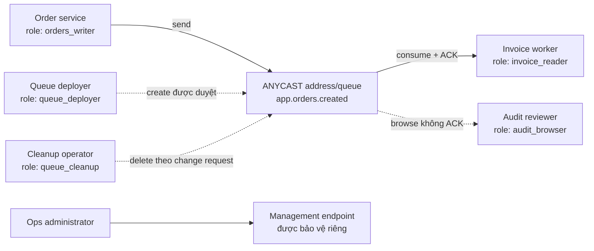

# Quyền gửi, nhận, tạo, xóa và quản trị theo nguyên tắc tối thiểu

> **Chương:** Bảo mật  
> **Phạm vi:** Kiểm soát truy cập dựa trên vai trò (**RBAC**) cho Apache ActiveMQ **Artemis** và **Classic** trong mô-đun `INTEGRATION_MESSAGING_MESSAGE_BROKER_ACTIVEMQ`: xác thực danh tính, quyền `send`/`consume`/`browse`, tạo/xóa address/queue, thao tác quản trị broker, và kiểm thử quyền cho producer/consumer Java JMS.  
> **Mục tiêu:** Từ yêu cầu nghiệp vụ suy ra **ma trận quyền tối thiểu**, triển khai ACL có phạm vi destination rõ ràng, phát hiện quyền dư và kiểm chứng cả trường hợp **được phép** lẫn **bị từ chối**. Cơ chế bảo mật không được đánh đổi tính tin cậy của queue, topic, acknowledgment, transaction, redelivery và DLQ.

## 1. Bài toán: producer chỉ cần gửi, consumer chỉ cần nhận

Hệ thống xử lý đơn hàng có bốn loại actor:

- **`order-service`:** chỉ **gửi** `OrderCreated` tới queue `app.orders.created`.
- **`invoice-worker`:** chỉ **nhận** và ACK job từ queue ấy.
- **`audit-reviewer`:** chỉ **xem** nội dung đang chờ để điều tra, không được consume/ACK.
- **`queue-deployer` / `queue-cleanup`:** tạo và xóa destination theo quy trình phát hành/vận hành; không được dùng tài khoản của ứng dụng để xóa queue.

Một tài khoản “admin” dùng chung cho tất cả dịch vụ có thể làm hệ thống chạy, nhưng khi order-service bị lộ credential, kẻ tấn công sẽ có thể đọc dữ liệu nhạy cảm, xóa queue hoặc truy cập mặt phẳng quản trị. **Least privilege** yêu cầu mỗi danh tính chỉ được cấp **đúng hành động, đúng destination và đúng thời gian** cần thiết.



**Ba lớp không được đánh đồng:**

1. **Authentication:** “Bạn là ai?” Ví dụ mTLS/JAAS xác nhận `svc_order`.
2. **Authorization:** “Bạn được làm gì với resource nào?” Broker so role của user với ACL của address/queue hoặc management resource.
3. **Network/transport protection:** TLS, firewall, secret rotation và hạn chế management port giúp bảo vệ đường truyền/cấp quyền; **TLS một mình không chứng minh user có quyền xóa queue**.

Bài tập trung lớp **authorization**, chỉ đề cập authentication/TLS khi cần để ACL thực sự có hiệu lực.

## 2. Lập ma trận quyền tối thiểu trước khi viết XML

### 2.1. Ma trận cho queue đơn hàng

| Hành động | `orders_writer` | `invoice_reader` | `audit_browser` | `queue_deployer` | `queue_cleanup` | `ops_admin` |
| --- | :---: | :---: | :---: | :---: | :---: | :---: |
| Gửi vào `app.orders.created` | **Có** | Không | Không | Không | Không | Chỉ khi có lý do vận hành |
| Consume + ACK | Không | **Có** | Không | Không | Không | Chỉ khi có lý do vận hành |
| Browse nội dung pending | Không | Không | **Có** | Không | Không | Có thể cấp riêng |
| Tạo address/queue | Không | Không | Không | **Có** | Không | Có thể quản trị |
| Xóa address/queue | Không | Không | Không | Không | **Có** | Có thể quản trị |
| Gọi API quản trị | Không | Không | Không | Theo scope provisioning | Theo scope cleanup | **Có**, giới hạn theo thao tác |
| Đọc metric không lộ payload | Không | Không | Không | Theo nhu cầu | Theo nhu cầu | `ops_observer` riêng |

**Không cấp quyền chỉ dựa trên tên chức danh “developer”, “service” hoặc “admin”.** Quyền cần gắn với **use case thực tế**. Một dashboard theo dõi queue depth không cần mặc nhiên `browse` payload, `consume` job, hay quyền `deleteDurableQueue`.

### 2.2. Vai trò hệ thống và danh tính phải tách rời

```text
User / service account                 Role             Scope
----------------------------------------------------------------
svc_order_producer                    orders_writer    app.orders.created
svc_invoice_consumer                  invoice_reader   app.orders.created
svc_audit_review                      audit_browser    app.orders.created
svc_order_deployment                   queue_deployer   app.orders.created
svc_cleanup_operator                   queue_cleanup    app.orders.created
svc_broker_operations                  ops_admin        management endpoint
```

Một người hoặc workload có thể sở hữu nhiều role, nhưng nên tránh tích lũy quyền vô thời hạn. **Service account** dành cho workload; **human operator** dùng danh tính cá nhân và quyền nâng cao có thời hạn, không chia sẻ mật khẩu mặc định giữa các nhóm.

**Phạm vi quyền:** `app.orders.created` là resource cụ thể. Cấp `app.#` hoặc `>` chỉ vì dễ cấu hình sẽ cho phép truy cập nhiều queue khác ngoài mục tiêu; wildcard là một quyết định bảo mật phải được review.

## 3. Artemis: phân biệt từng quyền có tên chính xác

Apache ActiveMQ **Artemis** dùng `<security-setting>` để phân quyền theo **address**, có thể dùng exact match/wildcard; trong một số trường hợp có thể dùng **fully qualified queue name** (FQQN) để phân quyền tới từng queue.

| Artemis permission | Hành vi được kiểm tra | Ghi chú least privilege |
| --- | --- | --- |
| `send` | Gửi message vào address phù hợp | Chỉ cấp cho producer của luồng đó |
| `consume` | Nhận/ACK message từ queue thuộc address | Chỉ cấp cho worker; không tự đồng nghĩa có `browse` |
| `browse` | Xem message trong queue mà không remove | Có thể lộ **toàn bộ payload**; không phải read-only metric |
| `createAddress` | Tạo address trong phạm vi `match` | Không trao cho ứng dụng chỉ làm producer |
| `deleteAddress` | Xóa address trong phạm vi `match` | Rủi ro gián đoạn routing, chỉ dùng role cleanup |
| `createDurableQueue` | Tạo **durable queue** dưới address | Chỉ cấp provisioner; durable queue ảnh hưởng storage/recovery |
| `deleteDurableQueue` | Xóa durable queue | Có thể làm mất backlog cần xử lý |
| `createNonDurableQueue` | Tạo non-durable queue | Không tự cho mọi app quyền tạo temporary/reply destinations |
| `deleteNonDurableQueue` | Xóa non-durable queue | Tách khỏi quyền consume |
| `manage` | Gửi **management messages** để thao tác qua management address | Không phải chỉ “xem số liệu”; cần bảo vệ rất chặt |
| `view`, `edit` | Phân biệt read-only/mutating operations ở management API khi bật RBAC tương ứng | Không thay thế `send`/`consume`/`browse` của destination |

### 3.1. Quyền độc lập, không tự “nâng cấp”

- User chỉ có `send` **không tự có** `consume` hay `browse`.
- User chỉ có `consume` **không tự có** `browse` trên Artemis; đây là lợi thế để tạo role auditor không được ACK.
- User có `browse` **không tự có** quyền nhận/ACK.
- User có `createDurableQueue` **không tự có** `deleteDurableQueue`.
- `manage` dùng cho kênh management-message; **không** nên hiểu là một bit “đọc monitoring”. Việc truy cập JMX/Console còn có cấu hình bảo vệ riêng.

**Lưu ý về auto-creation:** Khi `auto-create-addresses`/`auto-create-queues` được bật, một thao tác gửi/consume trên destination chưa tồn tại có thể kích hoạt logic tự tạo qua từng protocol/JMS mapping. Việc cho phép tự tạo còn phụ thuộc cấu hình, loại client và permission. **Không suy ra rằng chỉ vì Java gọi `createQueue(name)` thì user đã được quyền quản trị để tạo queue vật lý.** Với hệ thống cần topology bất biến, nên **pre-provision** queue và tắt auto-create ở namespace ứng dụng; kiểm thử thực tế với đúng client/protocol.

## 4. Artemis: cấu hình triển khai theo ma trận quyền

### 4.1. Pre-provision destination trong `broker.xml`

Dùng một **ANYCAST address với một durable queue**. Các worker cùng consume queue, không cần tự tạo queue khi mỗi instance khởi động.

Trích đoạn đặt vào phần `<addresses>` **đã có** của `<core>`:

```xml
<addresses>
    <address name="app.orders.created">
        <anycast>
            <queue name="app.orders.created">
                <durable>true</durable>
            </queue>
        </anycast>
    </address>
</addresses>
```

**Không tạo một `<addresses>` thứ hai trong file có sẵn.** Nếu tên queue đã được provision, sửa cấu hình hiện có và cân nhắc dữ liệu/consumer còn tồn tại trước khi đổi routing type.

Tại phần `<address-settings>` hiện có, khóa tự tạo/tự xóa ngoài ý muốn trong namespace app:

```xml
<address-settings>
    <address-setting match="app.orders.#">
        <auto-create-addresses>false</auto-create-addresses>
        <auto-create-queues>false</auto-create-queues>
        <auto-delete-addresses>false</auto-delete-addresses>
        <auto-delete-queues>false</auto-delete-queues>
    </address-setting>
</address-settings>
```

Điểm cần hiểu:

- `auto-create-* = false` là **chính sách topology**, không thay thế ACL. Client vẫn phải được cấp `send`/`consume` đúng destination.
- `auto-delete-* = false` giúp tránh tự dọn các destination auto-created trong phạm vi rule; quyền **xóa chủ động** vẫn do ACL/management kiểm soát.
- Một số **JMS subscription queues** có vòng đời riêng mà provider phải tạo cho hoạt động topic bình thường; cần kiểm tra broker và protocol thay vì áp dụng quy tắc queue ANYCAST này cho mọi topic.
- `app.orders.#` là wildcard theo từng phần tên, dùng dấu `.` làm dấu phân cách trong cấu hình mặc định. Không đặt wildcard phủ cả `activemq.management`.

### 4.2. `security-settings`: chỉ cấp hành động được yêu cầu

Trích đoạn đặt trong **`<security-settings>` hiện có**:

```xml
<security-settings>
    <security-setting match="app.orders.created">
        <!-- Producer nghiệp vụ chỉ được gửi -->
        <permission type="send" roles="orders_writer"/>

        <!-- Worker nghiệp vụ chỉ được nhận -->
        <permission type="consume" roles="invoice_reader"/>

        <!-- Auditor có thể xem body nhưng không ACK -->
        <permission type="browse" roles="audit_browser"/>

        <!-- Provisioner chỉ có quyền tạo -->
        <permission type="createAddress" roles="queue_deployer"/>
        <permission type="createDurableQueue" roles="queue_deployer"/>
        <permission type="createNonDurableQueue" roles="queue_deployer"/>

        <!-- Cleanup operator tách khỏi provisioner -->
        <permission type="deleteAddress" roles="queue_cleanup"/>
        <permission type="deleteDurableQueue" roles="queue_cleanup"/>
        <permission type="deleteNonDurableQueue" roles="queue_cleanup"/>
    </security-setting>

    <!-- Quản trị bằng management messages: namespace RIÊNG -->
    <security-setting match="activemq.management">
        <permission type="manage" roles="ops_admin"/>
    </security-setting>
</security-settings>
```

**Đây là trích đoạn để gộp**, không thêm `<security-settings>` trùng trong `broker.xml`. Trong cấu hình thực tế cần đối chiếu các rule có sẵn (kể cả wildcard `#`) và rà soát role hiệu lực sau khi reload/restart.

Vì `app.orders.created` **đã được tạo sẵn**, producer và consumer bình thường không cần các quyền `create*`/`delete*`. Provisioner/cleanup là tài khoản vận hành riêng, phải dùng trong workflow được kiểm soát, không inject vào process sản xuất như credential mặc định.

### 4.3. Quy tắc match: **cụ thể hơn thắng, không kế thừa**

Artemis áp dụng **security-setting cụ thể nhất** cho resource. Nếu có:

```xml
<security-setting match="app.orders.#">
    <permission type="send" roles="orders_writer"/>
    <permission type="consume" roles="invoice_reader"/>
</security-setting>

<security-setting match="app.orders.created">
    <permission type="send" roles="orders_writer"/>
</security-setting>
```

thì `app.orders.created` dùng rule **thứ hai**; nó **không kế thừa** `consume` từ rule thứ nhất. Do đó `invoice_reader` bị từ chối consume. Đây có thể là cách **deny có chủ đích**, nhưng cũng là lỗi cấu hình phổ biến khi thêm rule “chỉ override send”.

**Hướng kiểm tra:** Lập bảng **resource → rule match cuối cùng → role/permission hiệu lực**. Khi sửa ACL, luôn chạy lại cả positive và negative tests; đừng chỉ nhìn một đoạn XML rồi kết luận mọi permission ở wildcard được cộng dồn.

### 4.4. Identity/role mapping: role trong XML phải thật sự tồn tại

`security-setting` tham chiếu **role**, không trực tiếp tham chiếu tên user. Với Artemis JAAS `PropertiesLoginModule`, `artemis-roles.properties` có dạng:

```properties
orders_writer=svc_order_producer
invoice_reader=svc_invoice_consumer
audit_browser=svc_audit_review
queue_deployer=svc_queue_deployment
queue_cleanup=svc_cleanup_operator
ops_admin=svc_broker_operations
```

Đây chỉ là **minh họa ánh xạ role → danh sách user**, không phải lệnh tự động tạo tài khoản. Trong Artemis, `artemis-users.properties` cần chứa tài khoản tương ứng với **mật khẩu/hash hợp lệ** được thiết lập qua cơ chế IAM/JAAS hoặc CLI của instance broker. Không chèn plaintext password thật vào bài hoặc commit file credentials lên Git.

**Vận hành thực tế:**

- Production nên dùng JAAS/LDAP/Kerberos, SCRAM hoặc mTLS phù hợp kiến trúc và quản lý secret tập trung.
- Dùng user khác cho producer, consumer, deployer, auditor và quản trị; không gắn tất cả vào role `admin` mặc định.
- Quyền có thể được **cache** để tối ưu hiệu năng; Artemis có `authorization-cache-size` và `security-invalidation-interval`. Khi thu hồi role, cần đo thời gian cache hết hiệu lực và xem lại active connections.
- Authentication chỉ xác nhận identity. **Cùng account có nhiều role** sẽ nhận hợp của các permission hiệu lực; cấp nhầm role provisioning là cấp quyền rộng dù rule XML vẫn đúng.

## 5. Browse, consume và quản trị không phải một thao tác đọc

### 5.1. `browse` nhìn thấy dữ liệu, có thể xâm phạm riêng tư

`QueueBrowser` cho phép nhìn message trong queue **không remove/ACK**. Nhưng “read-only” chỉ có nghĩa **không thay đổi queue**; người browse có thể đọc số tiền, email, địa chỉ hoặc PII bên trong payload.

```text
queue app.orders.created:
    M1: {"orderId":"O-1","customerEmail":"..."}
    M2: {"orderId":"O-2","customerEmail":"..."}

invoice_reader: consume + ACK  -> M1 rời queue sau xử lý
audit_browser: browse          -> quan sát M1/M2, không ACK
ops_observer: queueCount=2     -> chỉ cần metric, không nên xem body
```

**Đề xuất:** Tạo role riêng cho metrics/monitoring chỉ có `view` qua management RBAC/JMX phù hợp, còn `browse` chỉ cấp cho người thật sự phải điều tra payload và có quy trình audit. Không mặc nhiên cấp `browse` cho mọi consumer hoặc đội vận hành.

### 5.2. `consume` có tác dụng phụ

Một consumer được phép nhận có thể:

- Xác nhận/commit message làm message không còn trong queue.
- Rollback liên tục gây redelivery/DLQ.
- Nhận trước message vào buffer hoặc tạo giao dịch treo.
- Với nhiều consumer, làm thay đổi đối tượng thực sự xử lý job.

Do đó một công cụ “chỉ muốn xem thử queue” **không nên** tạo `MessageConsumer` rồi gọi `receive()`; dùng `QueueBrowser` hoặc management metric nếu được phép. Trên Classic, quyền `read` gộp browse và consume nên cần giải pháp kiểm soát bổ sung nếu muốn tách hai khả năng này.

### 5.3. Quản trị có thể nguy hiểm hơn gửi/nhận

Mặt phẳng management có thể cho phép: purge queue, move message, xóa durable queue, tạo bridge, tạm dừng address, điều chỉnh bảo mật hoặc người dùng, tùy phiên bản và role. **Không cấp quyền `manage` cho service app** chỉ vì cần xem độ sâu queue.

Tách hai vai trò:

- **Observer:** Chỉ `view`/read-only trên management API đã cấu hình RBAC.
- **Operator:** Chỉ các lệnh thay đổi thật sự được phê duyệt; không nên cấp toàn quyền mà không có audit.

Đối với Artemis, `manage` **điều khiển management messages** gửi tới `activemq.management`. Với JMX, Jolokia/Web Console và message management có **cơ chế bảo vệ và ánh xạ role riêng**. Cấp `manage` cho management address không tự tạo một chính sách “JMX read-only”; ngược lại, có JMX config thiếu bảo vệ có thể cho phép truy cập vượt ACL message.

## 6. Artemis: quản trị chỉ đọc và quản trị chỉnh sửa

### 6.1. `view`/`edit` chỉ có hiệu lực khi kích hoạt đúng RBAC

Artemis hỗ trợ `view` cho các lệnh/thuộc tính management **đọc**, `edit` cho lệnh có khả năng thay đổi trạng thái. Tập các operation được phân loại là `view` phụ thuộc regex cấu hình `view-permission-method-match-pattern`.

**Khi bật RBAC quản trị qua management messages**, cần cấu hình `management-message-rbac=true` trong `<core>` và phân quyền phù hợp cho **cả management address lẫn namespace mops**:

```xml
<!-- Đặt trong core hiện có -->
<management-message-rbac>true</management-message-rbac>

<!-- Đặt trong security-settings hiện có -->
<security-setting match="activemq.management">
    <permission type="manage" roles="ops_observer,ops_admin"/>
</security-setting>

<security-setting match="mops.#">
    <permission type="manage" roles="ops_observer,ops_admin"/>
    <permission type="view" roles="ops_observer,ops_admin"/>
    <permission type="edit" roles="ops_admin"/>
</security-setting>
```

Đây là **ví dụ lựa chọn chính sách quản trị**, **thay thế** block `activemq.management` tối giản ở mục 4.2 khi chủ động triển khai management-message RBAC; không để hai `<security-setting match="activemq.management">` trùng nhau. Tùy loại management client, tạo **reply queue** hoặc sử dụng management message có thể cần permission `send`, `consume`, `createNonDurableQueue`/`createAddress` phù hợp trên **resource tương ứng**. Chỉ cấp khi đã xác minh luồng management cụ thể, không mở toàn broker theo wildcard.

**Tại sao `manage` + `view` vẫn cần thận trọng?** Nếu `management-message-rbac=false`, chỉ có `manage` là quyền rất rộng cho management messages; một tài khoản được cho `manage` vì “chỉ xem” có thể thực hiện thao tác thay đổi. `view`/`edit` không tự được enforce cho management messages nếu cơ chế finer-grained RBAC chưa bật.

### 6.2. JMX MBeans: đừng nhầm với management messages

Artemis có thể kiểm soát JMX theo:

1. `management.xml` (authorization cho MBean operations), hoặc
2. **RBAC theo `security-settings`** dùng prefix `mops.#` khi cấu hình MBeanServer interceptor đặc biệt.

Để bật cơ chế thứ hai, tài liệu Artemis yêu cầu JVM property:

```text
-Djavax.management.builder.initial=org.apache.activemq.artemis.core.server.management.ArtemisRbacMBeanServerBuilder
```

Khi dùng builder này, phần `authorization` trong `management.xml` tương ứng **phải được bỏ** để tránh hai interceptor xung đột. Ví dụ `mops.#` ở trên chỉ có ý nghĩa cho JMX khi cơ chế này đã được kích hoạt. **Không bật JVM property cho production rồi bỏ management.xml mà chưa chạy kiểm thử read-only/mutating operations.**

Ví dụ kiểm thử RBAC:

- `ops_observer` gọi operation đọc như xem `messageCount`: **PASS**.
- `ops_observer` gọi operation thay đổi như `removeMessages`: **DENY**.
- `ops_admin` gọi một lệnh quản trị đã được phê duyệt: **PASS**, sau khi xác thực thao tác không gây mất dữ liệu.

**Không lấy việc đăng nhập thành công Web Console làm chứng cứ mọi MBean operation đã bị hạn chế.** Console/Hawtio có lớp xác thực/ủy quyền riêng, cần kiểm tra đúng endpoint thực được dùng.

## 7. FQQN: giới hạn quyền tới queue dưới cùng một address

Khi Artemis dùng một **MULTICAST address** với hai subscription queues, ví dụ:

```xml
<address name="app.orders.events">
    <multicast>
        <queue name="billing.q"/>
        <queue name="analytics.q"/>
    </multicast>
</address>
```

Nếu chỉ đặt `consume` theo **address** `app.orders.events`, role có thể nhận từ các queue thuộc address đó (tùy cách subscribe). Có thể giới hạn ở **fully qualified queue name**:

```xml
<security-setting match="app.orders.events::billing.q">
    <permission type="consume" roles="billing_worker"/>
</security-setting>

<security-setting match="app.orders.events::analytics.q">
    <permission type="consume" roles="analytics_worker"/>
</security-setting>
```

FQQN `address::queue` giúp giới hạn quyền **consume** tới queue chính xác. Nhưng có hai cảnh báo:

1. **Không dùng wildcard trong FQQN** rồi kỳ vọng match theo `#`/`*` — FQQN security match được thiết kế để nhắm tên queue cụ thể.
2. **Không thể dùng `send` ở FQQN để ngăn fan-out của message gửi vào address.** Producer có `send` trên `app.orders.events` có thể gửi một message được broker route tới **cả hai subscription queues**, dù producer không có quyền `send` trên từng FQQN. `send` theo address và `consume` theo FQQN giải quyết hai câu hỏi **khác nhau**.

Nếu payload của Analytics không được phép tới Billing về mặt pháp lý/quyền riêng tư, phải **tách address/destination hoặc lọc/biến đổi dữ liệu trước routing**, không coi ACL consumer là công cụ ngăn message được ghi vào mọi queue.

## 8. ActiveMQ Classic: `read`, `write`, `admin` khác Artemis

ActiveMQ **Classic** dùng `authorizationPlugin` với ba permission chính:

| Classic | Tương ứng về mục đích | Điểm khác biệt |
| --- | --- | --- |
| `read` | Consume **và browse** destination | **Không tách** `consume` và `browse` như Artemis |
| `write` | Gửi message vào destination | Không đồng nghĩa quản trị broker |
| `admin` | Cho phép **tạo destination động/lazily** khi cần | **Không tương đương** toàn quyền JMX/Console; không đơn giản ánh xạ thành Artemis `manage` |

Classic kiểm soát queue/topic qua `authorizationEntry`, có wildcard theo tên destination. Đừng copy `<security-setting>`/`<permission type="consume">` từ Artemis sang `activemq.xml` Classic; hai schema XML khác nhau.

### 8.1. XBean XML: ACL cho queue đã được provision

Ví dụ `conf/activemq.xml`, đoạn **`<plugins>` trong broker hiện có**; phần authentication/JAAS là trách nhiệm riêng:

```xml
<plugins>
    <!-- JAAS domain phải tồn tại trong login.config của broker -->
    <jaasAuthenticationPlugin configuration="activemq"/>

    <authorizationPlugin>
        <map>
            <authorizationMap>
                <authorizationEntries>
                    <!-- Queue nghiệp vụ đã được tạo trước -->
                    <authorizationEntry
                        queue="app.orders.created"
                        read="invoice_readers,audit_readers"
                        write="orders_writers"
                        admin="queue_deployers"/>

                    <!-- Advisory: broker/client cần tạo các topic phụ trợ -->
                    <authorizationEntry
                        topic="ActiveMQ.Advisory.>"
                        read="broker_admins"
                        write="broker_admins"
                        admin="*"/>

                    <!-- Tùy client, có thể cần quyền advisory cho temp -->
                    <authorizationEntry
                        topic="ActiveMQ.Advisory.TempQueue"
                        read="reply_clients"
                        write="reply_clients"
                        admin="*"/>
                    <authorizationEntry
                        topic="ActiveMQ.Advisory.TempTopic"
                        read="reply_clients"
                        write="reply_clients"
                        admin="*"/>
                </authorizationEntries>

                <tempDestinationAuthorizationEntry>
                    <tempDestinationAuthorizationEntry
                        read="reply_clients"
                        write="reply_clients"
                        admin="reply_clients"/>
                </tempDestinationAuthorizationEntry>
            </authorizationMap>
        </map>
    </authorizationPlugin>
</plugins>
```

**Đây là một cấu hình ACL minh họa**, cần gộp vào `<plugins>` hiện có; không tạo plugin authentication/authorization trùng. `jaasAuthenticationPlugin configuration="activemq"` yêu cầu JAAS domain `activemq` đã được cấu hình (ví dụ `PropertiesLoginModule`/LDAP) với user và group đúng; nếu chưa có, chỉ thêm XML này sẽ không tự tạo credential.

**Những điểm dễ sai:**

- Classic `read` bao gồm browse **và** consume. Vai trò `audit_readers` trong ví dụ **không thể bảo đảm chỉ browse**: nếu account auditor cần browse nhưng không bao giờ consume, dùng broker/kiến trúc hoặc công cụ giám sát có lớp kiểm soát bổ sung; không quảng cáo role này là read-only ở mức queue.
- `admin="queue_deployers"` cho phép **dynamic destination creation** trong namespace được match, **không** cho phép người đó đương nhiên purge/xóa queue qua JMX.
- Advisory topics `ActiveMQ.Advisory.>` cần **`admin`** phù hợp để các advisory destination được tạo lúc client thực hiện thao tác. Cấp `read/write` cho mọi user trên tất cả advisories là **không cần thiết và dễ lộ metadata**.
- Temporary destinations có ACL **riêng**; nếu không cấu hình `tempDestinationAuthorizationEntry`, theo tài liệu Classic quyền read/write/admin với temp destinations có thể được cấp quá rộng. Nhưng đặt quá chặt cũng có thể làm JMS request/reply và `TemporaryQueue` lỗi; phân quyền `reply_clients` theo luồng thật.
- Một số client Classic lắng nghe advisory về temp destinations; **có thể cần** quyền đọc advisory temp hoặc tắt advisory watch trên client. Test đúng protocol/client chứ không nới wildcard `read="*"` cho tất cả advisory khi chưa có lý do.

### 8.2. Classic: quyền xóa và quản trị không nằm trong ba ACL trên

Không thể suy rằng user có Classic `admin` thì được xóa queue production hoặc gọi mọi JMX MBean. Các operation xóa/purge/stop broker qua **JMX, Web Console, Jolokia** có authentication/authorization và network exposure riêng. Cần:

- Hạn chế network tới cổng quản trị/JMX; bật TLS/xác thực phù hợp.
- Phân role quản trị người thật và máy CI/CD; không tái dùng tài khoản `orders_writers`/`invoice_readers`.
- Nếu quản trị qua web/HTTP, kiểm tra chính sách quyền và phiên bản Classic cụ thể; không coi authorizationPlugin trên queue đủ để bảo vệ endpoint JMX.
- Giữ danh sách thao tác nguy hiểm cần approval: `purgeQueue`, `removeQueue`, thay ACL, bridge/network connector, restart broker.

**Đặc biệt:** Không cấp `admin="*"` ở queue nghiệp vụ nhằm giải quyết một lỗi producer gửi vào destination chưa tạo. Cách đúng là **provision queue trước** và kiểm tra tên, client/session, connection ACL; chỉ cấp dynamic creation cho tài khoản triển khai.

## 9. Bài thực hành Java 17/Jakarta JMS: thử được phép và bị từ chối

Để thấy ACL thật sự có hiệu lực, dùng một chương trình độc lập kết nối **Artemis** bằng nhiều service account khác nhau. Broker được cấu hình như mục 4 và tồn tại queue `app.orders.created`.

### 9.1. Maven dependencies

```xml
<project xmlns="http://maven.apache.org/POM/4.0.0"
         xmlns:xsi="http://www.w3.org/2001/XMLSchema-instance"
         xsi:schemaLocation="http://maven.apache.org/POM/4.0.0
                             https://maven.apache.org/xsd/maven-4.0.0.xsd">
    <modelVersion>4.0.0</modelVersion>
    <groupId>example.messaging</groupId>
    <artifactId>artemis-security-acl-probe</artifactId>
    <version>1.0.0</version>
    <properties>
        <maven.compiler.release>17</maven.compiler.release>
    </properties>
    <dependencies>
        <dependency>
            <groupId>org.apache.activemq</groupId>
            <artifactId>artemis-jakarta-client</artifactId>
            <version>2.38.0</version>
        </dependency>
    </dependencies>
    <build>
        <plugins>
            <plugin>
                <groupId>org.apache.maven.plugins</groupId>
                <artifactId>maven-compiler-plugin</artifactId>
                <version>3.13.0</version>
            </plugin>
            <plugin>
                <groupId>org.codehaus.mojo</groupId>
                <artifactId>exec-maven-plugin</artifactId>
                <version>3.5.0</version>
            </plugin>
        </plugins>
    </build>
</project>
```

Phiên bản 2.38.0 là **pin của ví dụ**, không khẳng định mới nhất. API dùng `jakarta.jms`; Classic 5.x phổ biến dùng `javax.jms` và dependency khác. Không trộn hai namespace khi biên dịch.

### 9.2. `AuthorizationProbe.java`

Tạo `src/main/java/example/messaging/AuthorizationProbe.java`:

```java
package example.messaging;

import java.util.Enumeration;
import java.util.UUID;

import jakarta.jms.ConnectionFactory;
import jakarta.jms.DeliveryMode;
import jakarta.jms.JMSConsumer;
import jakarta.jms.JMSContext;
import jakarta.jms.JMSRuntimeException;
import jakarta.jms.JMSSecurityRuntimeException;
import jakarta.jms.Message;
import jakarta.jms.Queue;
import jakarta.jms.QueueBrowser;
import jakarta.jms.TextMessage;

import org.apache.activemq.artemis.jms.client.ActiveMQConnectionFactory;

public final class AuthorizationProbe {
    private static final String DESTINATION = "app.orders.created";

    private AuthorizationProbe() {}

    public static void main(String[] args) {
        if (args.length != 1 ||
                !(args[0].equals("send")
                || args[0].equals("receive")
                || args[0].equals("browse"))) {
            throw new IllegalArgumentException(
                    "Usage: AuthorizationProbe send|receive|browse");
        }

        String action = args[0];
        String url = System.getenv().getOrDefault(
                "BROKER_URL", "tcp://127.0.0.1:61616");
        String user = requiredEnv("BROKER_USER");
        String password = requiredEnv("BROKER_PASSWORD");

        ConnectionFactory factory = new ActiveMQConnectionFactory(url);
        int mode = action.equals("browse")
                ? JMSContext.AUTO_ACKNOWLEDGE
                : JMSContext.SESSION_TRANSACTED;

        try (JMSContext context =
                factory.createContext(user, password, mode)) {

            // createQueue(String) tạo handle JMS. Nó KHÔNG chứng minh
            // queue vật lý vừa được tạo hoặc user có quyền create.
            Queue queue = context.createQueue(DESTINATION);

            switch (action) {
                case "send" -> {
                    String testId = UUID.randomUUID().toString();
                    TextMessage message = context.createTextMessage(
                            "ACL-PROBE eventId=" + testId);
                    message.setStringProperty("eventId", testId);
                    context.createProducer()
                            .setDeliveryMode(DeliveryMode.PERSISTENT)
                            .send(queue, message);
                    context.commit();
                    System.out.println("SEND PASS eventId=" + testId);
                }

                case "receive" -> {
                    try (JMSConsumer consumer =
                            context.createConsumer(queue)) {
                        Message received = consumer.receive(2000);
                        if (received == null) {
                            System.out.println(
                                    "RECEIVE AUTHENTICATED, queue empty");
                        } else {
                            System.out.println("RECEIVE messageId="
                                    + received.getJMSMessageID());
                            // Đây là message lab; ACK bằng commit JMS.
                            context.commit();
                            System.out.println("RECEIVE COMMIT PASS");
                        }
                    }
                }

                case "browse" -> {
                    try (QueueBrowser browser = context.createBrowser(queue)) {
                        Enumeration<?> messages = browser.getEnumeration();
                        int count = 0;
                        while (messages.hasMoreElements() && count < 3) {
                            Object item = messages.nextElement();
                            Message m = (Message) item;
                            System.out.println("BROWSE id="
                                    + m.getJMSMessageID());
                            count++;
                        }
                        System.out.println("BROWSE PASS samples=" + count);
                        // Browser không ACK/remove message.
                    }
                }

                default -> throw new IllegalStateException("Unexpected");
            }

        } catch (JMSSecurityRuntimeException denied) {
            System.err.println("ACL DENY: " + denied.getMessage());
            System.exit(4);
        } catch (JMSRuntimeException transportOrProviderError) {
            System.err.println(
                    "JMS ERROR: " + transportOrProviderError.getMessage());
            System.exit(5);
        }
    }

    private static String requiredEnv(String key) {
        String value = System.getenv(key);
        if (value == null || value.isBlank()) {
            throw new IllegalStateException(
                    "Missing environment variable: " + key);
        }
        return value;
    }
}
```

**Giải thích về hành vi test:**

- User/role được đổi qua `BROKER_USER`/`BROKER_PASSWORD` trên **mỗi lần chạy**; không hardcode credential trong mã hoặc command-line history.
- `createQueue("app.orders.created")` là cách lấy **đối tượng JMS Queue**; không phải thao tác provisioning vật lý để kiểm tra `createDurableQueue`. Muốn test create/delete phải dùng management/Core API với role tương ứng.
- `send` và `receive` dùng transacted `JMSContext` để gửi/ACK tại ranh giới rõ ràng; exception có thể được ném lúc tạo consumer/browser, lúc send hoặc commit tùy provider.
- `browse` chỉ liệt kê **JMSMessageID**, không in payload để giảm lộ PII. Browser có thể không trả một snapshot nhất quán khi producer/consumer khác đang hoạt động.
- Lỗi `JMSSecurityRuntimeException` là dấu hiệu bị từ chối dự kiến; nhưng một broker/provider có thể bọc lỗi quyền trong `JMSRuntimeException` khác. **Phải đối chiếu audit/log broker** để phân biệt denied với connection timeout, sai destination hay broker offline.
- Dùng queue **chỉ cho lab**: lệnh `receive` sẽ ACK và lấy đi một message thực. Không chạy tool này trên production queue chỉ để test ACL.

### 9.3. Lệnh và ma trận kiểm thử

Trước mỗi lệnh, cấu hình environment chứa credential đúng role rồi chạy:

```bash
mvn -q compile exec:java -Dexec.mainClass=example.messaging.AuthorizationProbe -Dexec.args=send
mvn -q compile exec:java -Dexec.mainClass=example.messaging.AuthorizationProbe -Dexec.args=receive
mvn -q compile exec:java -Dexec.mainClass=example.messaging.AuthorizationProbe -Dexec.args=browse
```

Chạy **một lệnh phù hợp mỗi lần**, không cần chạy cả ba liên tiếp bằng cùng account. Thiết lập account/role dùng để thử:

| Account / role | `send` | `receive` | `browse` | Kết quả mong đợi |
| --- | :---: | :---: | :---: | --- |
| `svc_order_producer` / `orders_writer` | **PASS** | **DENY** | **DENY** | Chỉ producer |
| `svc_invoice_consumer` / `invoice_reader` | **DENY** | **PASS** | **DENY** | Chỉ worker |
| `svc_audit_review` / `audit_browser` | **DENY** | **DENY** | **PASS** | Chỉ queue browser |
| `svc_queue_deployment` / `queue_deployer` | **DENY** | **DENY** | **DENY** | Chỉ provision destination |
| User sai password hoặc không tồn tại | **DENY AUTHN** | **DENY AUTHN** | **DENY AUTHN** | Không vào được broker |

**Để kiểm chứng `receive` PASS**: producer gửi trước một message lab. Khi queue trống, `receive()` trả `null` là kết quả bình thường, **không chứng minh việc nhận dữ liệu đang đầy đủ**; sự kiện “consumer được tạo thành công” và broker không báo ACL deny vẫn có giá trị, nhưng nên xác nhận bằng delivery thực.

**Để kiểm chứng browse PASS**: gửi message trước, chạy browser, kiểm tra message còn trong queue sau browse và chỉ biến mất sau khi consumer được phép ACK.

### 9.4. Kiểm thử quyền tạo và xóa: không nhầm với `JMSContext.createQueue`

Trên **broker lab riêng**, kiểm tra bằng **Artemis management API hoặc Core `ClientSession.createQueue(QueueConfiguration)` / `deleteQueue`** (tùy phiên bản) thay vì dùng JMS `createQueue(String)`:

| Tình huống | Kết quả cần có |
| --- | --- |
| `orders_writer` cố tạo durable queue phụ | **DENY** |
| `invoice_reader` cố xóa durable queue phụ | **DENY** |
| `queue_deployer` tạo durable queue **được cấp đúng scope** | **PASS** |
| `queue_deployer` xóa queue đó | **DENY** |
| `queue_cleanup` xóa **queue lab đã trống** | **PASS** |
| `queue_cleanup` tạo queue mới | **DENY** |
| `ops_observer` gọi management read-only | **PASS** nếu đã bật RBAC thích hợp |
| `ops_observer` gọi management mutating | **DENY** |
| `ops_admin` gọi một operation đã được approve | **PASS**, ghi audit đầy đủ |

**Không thử xóa `app.orders.created` có dữ liệu hoặc listener thật.** Có thể tạo một address/queue dùng riêng cho lifecycle test và **một security-setting cùng cấu trúc** cho tên thử nghiệm. Kịch bản dọn queue phải yêu cầu queue đã ngừng nhận và backlog bằng 0, có xác minh operator identity và ghi nhận thay đổi.

## 10. Negative testing và vận hành ACL không làm gián đoạn JMS

### 10.1. Trình tự cập nhật chính sách khi triển khai

1. **Liệt kê danh tính hiện hữu:** producer, consumer, audit, bridge, console, DLQ/retry service, CI provisioner, monitoring và automation.
2. **Lập bảng destination thực tế:** Queue/topic nào được gửi/nhận, có subscription FQQN, temporary reply-to, virtual destination hay dynamic bridge không?
3. **Tạo role hẹp:** Role **theo chức năng**, không dùng một shared role `admin`.
4. **Provision queue trước:** Tránh grant create cho client chỉ vì hệ thống đang phụ thuộc auto-create khi startup.
5. **Chạy positive/negative tests:** Cả `SEND PASS`/`CONSUME PASS` và `SEND DENY`/`CONSUME DENY`; kiểm tra browse riêng.
6. **Thử failover/reconnect:** Credential/role còn hiệu lực sau reconnect? Auth cache hết hạn thế nào? Client có retry vô hạn khi bị deny không?
7. **Thử rollback/DLQ:** Worker có consume source queue và quyền phù hợp khi broker **nội bộ** route failed message đến DLQ? Dịch vụ replay từ DLQ là principal khác, cấp `consume` DLQ + `send` source theo scope được duyệt.
8. **Triển khai theo canary:** Theo dõi auth failure, denied operations, queue depth, ACK throughput, redelivery/DLQ và thay đổi latency; có kế hoạch revert chính sách nếu lỡ chặn business flow.

**Cảnh báo:** Một error ACL thường là lỗi cấu hình **không thể hồi phục chỉ bằng retry nhanh**. Producer gửi bị deny rồi retry mỗi 10 ms có thể tạo flood log và tăng tải; consumer không tạo được Session/MessageConsumer có thể làm container Spring recovery loop mãi. Phân biệt `authentication failure`, `authorization denied` và lỗi mạng tạm thời để alert/stop đúng.

### 10.2. Spring JMS: quyền và quá trình recovery

Ví dụ `@JmsListener(destination = "app.orders.created")` sử dụng credential của **ConnectionFactory** được cấu hình trong ứng dụng. Nếu principal chỉ có `send`:

- Container có thể kết nối thành công (authentication PASS) nhưng **không được tạo consumer** (authorization DENY).
- Container Spring có thể tiếp tục recovery/retry; log dạng “could not refresh JMS Connection” hoặc lỗi broker security tùy phiên bản/cơ chế.
- Tăng `concurrency` hoặc `receiveTimeout` **không khắc phục** thiếu quyền consume.
- Dùng một principal khác cho producer `JmsTemplate` nếu cần; **không** cấp cả `send` và `consume` chỉ để tái dùng ConnectionFactory toàn ứng dụng một cách tiện tay.

Một ứng dụng cần vừa gửi event A vừa consume queue B có thể dùng hai principal/ConnectionFactory độc lập theo ranh giới dịch vụ. Nếu buộc dùng một identity, chỉ cấp **`send` cho A** và **`consume` cho B**, không áp wildcard trên mọi namespace.

### 10.3. Tài nguyên đặc biệt cần rà soát

| Tài nguyên | Rủi ro | Kiểm tra cụ thể |
| --- | --- | --- |
| **DLQ** | Bất kỳ consumer nào đọc được payload lỗi có thể chứa PII | Chỉ ops/replay service có `browse`/`consume` phù hợp; kiểm soát requeue |
| **TemporaryQueue / ReplyTo** | Một tài khoản có thể xem/truy cập reply của workload khác | Kiểm soát tạo/xóa/đọc temp theo client, advisory và provider |
| **Topic multicast** | Một message gửi tới address được fan-out nhiều queue | Phân quyền `send` ở address, `consume` theo FQQN |
| **Classic Advisory.>** | Lộ tên destination, thông tin consumer/producer | Admin tạo advisory khác quyền read/write; tránh wildcard dữ liệu |
| **Bridge/cluster user** | Principal có thể route dữ liệu giữa broker/namespace | Tài khoản riêng, chỉ quyền nguồn/đích cần thiết |
| **Management port** | Có thể purge queue, sửa role hoặc shutdown | ACL mạng, TLS, authentication, RBAC management |
| **Wildcard `#`/`>`** | Quyền gửi/đọc vượt namespace | Kiểm tra specificity, precedence, negative cases |
| **Shared credential** | Không truy được ai thực hiện xóa/ACK | Identity riêng và audit log không chứa secret |

## 11. Audit: làm sao chứng minh “quyền tối thiểu” đã đúng?

Không đủ để xem XML và nói “writer chỉ có send”. Cần bằng chứng vận hành:

- **Snapshot ACL hiệu lực** theo resource, role, user tại thời điểm release, bao gồm quy tắc wildcard cụ thể nhất.
- **Báo cáo negative tests:** writer bị deny consume/browse/create/delete/manage; reader bị deny send/create/delete/manage; auditor bị deny consume.
- **Authentication logs và authorization denials** tại broker, không chứa plaintext password.
- **Audit hoạt động quản trị:** user nào tạo/xóa destination, lúc nào, trên broker nào, theo change request nào. Artemis có các tùy chọn audit logger; bật theo nhu cầu và bảo vệ log.
- **Kiểm tra quyền sau xoay khóa/thu hồi role:** cache authorization, active connection, re-authentication và tác động lên consumer failover.
- **Kiểm tra dữ liệu:** Browse có thể xem payload; token read-only không được gọi HTTP management có khả năng move/purge; staging/production tách credential.
- **Mốc nâng cấp phiên bản:** Security behavior có thể thay đổi do bản vá; theo dõi security advisories và thử lại ma trận sau broker/client upgrade.

**Chỉ số phát hiện sự cố:** `authentication_failures_total`, `authorization_denied_total` theo action/resource, số credential gần hạn, `queue_depth`, `ACK/s` và `redelivery`. Nếu producer bị deny gửi, queue có thể **giảm message vào**, khiến dashboard “queue healthy” trong khi dữ liệu đã bị chặn ngay ở đầu nguồn — cần đo lỗi producer song song.

## 12. Các thiết kế sai và cách sửa

| Thiết kế | Hậu quả | Thay thế |
| --- | --- | --- |
| Mọi microservice dùng credential `admin` | Lộ một service có thể ảnh hưởng toàn broker | Service account + role chỉ đúng chức năng |
| Reader được cả `send`, `consume`, `deleteQueue` | Có thể thay đổi/tẩy dữ liệu ngoài ý định | Ma trận quyền tách write/consume/lifecycle |
| Auditor dùng `MessageConsumer.receive()` để “xem” | Có thể ACK, gây mất message nghiệp vụ | Artemis `browse` riêng, Console read-only RBAC |
| Nghĩ Classic `read` chỉ browse | Classic read còn cho phép consume | Kiểm soát thêm ở công cụ/kiến trúc |
| Nghĩ Classic `admin` là toàn quyền JMX | Nhầm dynamic destination creation với management | Bảo vệ management API riêng |
| Chỉ grant `send` rồi phụ thuộc auto-create queue không kiểm soát | Resource phát sinh ngoài topology/ACL dự kiến | Pre-provision + khóa auto-create namespace |
| Đặt một rule wildcard rộng, quên exact-match override | Một queue có quyền thừa/thiếu | Review rule hiệu lực; negative tests |
| Đặt quyền `send` trên FQQN để ngăn fan-out | Gửi vào address vẫn có thể route mọi queue | Tách address theo dữ liệu và consumer scope |
| Tạo role “monitor” nhưng grant `manage` không bật RBAC chi tiết | Monitor có thể gọi lệnh mutation | JMX view-only đúng config hoặc bật management-message-rbac |
| Grant `browse` cho mọi operator | Payload/PII bị lộ | Metric read-only và access logs, browse có approval |
| Cấp quyền xóa cho CI/CD producer | Script deploy lỗi có thể xóa queue đang có backlog | Provisioner/cleanup riêng, approval và drain |
| Không kiểm thử denied operation | ACL sai chỉ lộ khi deploy | Negative tests trong pipeline/canary |
| Chỉ bật TLS mà không xác thực/ủy quyền | Traffic mã hóa nhưng principal có thể quá quyền | TLS + authn + RBAC + secrets management |

## 13. Bài tập có tiêu chí nghiệm thu

### Bài tập A — Viết ma trận quyền hẹp

Hệ thống có `catalog-publisher` gửi `ProductChanged`, `search-indexer` consume, `support-dashboard` chỉ cần số lượng message, `support-investigator` cần browse payload khi có ticket.

**Yêu cầu:** Viết bốn role riêng, chỉ ra ai cần `send`/`consume`/`browse`/`view` và quyền nào **không** nên cấp cho dashboard.

*Đáp án định hướng:* Producer chỉ `send`, indexer chỉ `consume`, dashboard chỉ management `view` thích hợp, investigator chỉ `browse` có phê duyệt; không ai cần create/delete queue thường xuyên.

### Bài tập B — Positive/negative tests của Artemis

Dùng cấu hình ở mục 4 và Java `AuthorizationProbe`. Với ba tài khoản writer, reader, auditor, thử `send`/`receive`/`browse`.

**Yêu cầu:** Lập ma trận 3×3 và xác minh đúng ba ô PASS, sáu ô DENY. Đối chiếu log broker để phân biệt authn/authz/transport.

*Đáp án định hướng:* Writer PASS send, reader PASS receive, auditor PASS browse; mọi kết hợp khác DENY. Mỗi phép nhận/browse có message lab riêng để không lẫn queue trống với quyền bị từ chối.

### Bài tập C — Kiểm tra exact match và inheritance

Có `security-setting match="app.orders.#"` cho `send`, `consume`; bổ sung `match="app.orders.created"` chỉ định `send`.

**Hỏi:** User role consumer có còn consume được `app.orders.created` không? Vì sao?

*Đáp án định hướng:* Không, nếu rule cụ thể nhất không có `consume`; Artemis không kế thừa permission từ wildcard rule kém cụ thể hơn.

### Bài tập D — Quyền tạo và xóa

`queue_deployer` cần tạo queue mới, `queue_cleanup` cần xóa queue lab đã drained. Producer chỉ gửi.

**Yêu cầu:** Chọn đúng `createAddress`, `createDurableQueue`, `deleteDurableQueue`, `deleteAddress` theo resource, và chỉ ra vì sao `JMSContext.createQueue(String)` không phải phép thử quyền tạo vật lý.

*Đáp án định hướng:* Hai nhóm quyền lifecycle tách biệt; Java `createQueue` tạo JMS handle, để test provisioning phải gọi API management/Core tạo/xóa thật trên broker lab với role tương ứng.

### Bài tập E — Bảo vệ luồng multicast

`app.orders.events` có hai queue `billing.q` và `analytics.q`. Producer được gửi vào address, Billing chỉ được consume `billing.q`.

**Yêu cầu:** Viết ACL FQQN cho consume, giải thích tại sao `send` của producer tại address vẫn có thể làm message vào cả hai queue.

*Đáp án định hướng:* `match="app.orders.events::billing.q"` cấp `consume` Billing. Định tuyến multicast của address vẫn fan-out; muốn chia phạm vi dữ liệu phải tách address/payload.

### Bài tập F — Quản trị chỉ đọc

Một nhân viên cần xem queue depth qua Console/JMX nhưng không được purge queue.

**Yêu cầu:** Vì sao không thể chỉ cấp Artemis `manage` trên `activemq.management` rồi cho là read-only? Hãy mô tả hai cơ chế `view/edit` và cách kiểm tra lệnh mutation bị deny.

*Đáp án định hướng:* `manage` là quyền gọi management messages; cần bật RBAC chi tiết khi dùng kênh này hoặc bảo vệ JMX bằng `management.xml`/MBeanServer RBAC. Test read operation PASS và purge/removeMessages DENY, trên môi trường lab không dữ liệu thật.

### Bài tập G — Classic khác Artemis

Chuyển từ Classic sang Artemis. Cấu hình Classic: `read="auditors"`, `write="producers"`, `admin="deployers"`.

**Yêu cầu:** Ánh xạ tối thiểu sang Artemis và chỉ ra một quyền **không thể tách riêng** trong Classic destination ACL.

*Đáp án định hướng:* Classic `write` gần Artemis `send`; Classic `read` gồm `consume` lẫn `browse`, Artemis tách được; Classic `admin` chủ yếu dynamic creation, Artemis có create/delete address/queue riêng; không tự map thành `manage` broker.

### Bài tập H — Phản ứng khi ACL chặn ứng dụng

Sau nâng cấp ACL, Spring `@JmsListener` liên tục recovery, `ConsumerCount=0` và queue tăng. Một kỹ sư đề xuất tăng `receiveTimeout`.

**Yêu cầu:** Điều tra theo thứ tự nào? Vì sao tăng timeout không giải quyết vấn đề?

*Đáp án định hướng:* Kiểm tra identity và role, destination/ACL match, log authz denied, ConnectionFactory credentials, pre-provision queue, sau đó network/transport; timeout không tạo permission `consume`.

## 14. Tài liệu tham khảo

1. Apache ActiveMQ Artemis — [Authentication & Authorization](https://artemis.apache.org/components/artemis/documentation/latest/security.html): RBAC theo address, `send`/`consume`/`browse`, lifecycle permissions, FQQN, precedence, `manage` và `view`/`edit`.
2. Apache ActiveMQ Artemis — [Address Settings](https://artemis.apache.org/components/artemis/documentation/latest/address-settings.html): `auto-create-addresses`, `auto-create-queues`, `auto-delete-*` và semantics theo client/protocol.
3. Apache ActiveMQ Artemis — [Management](https://artemis.apache.org/components/artemis/documentation/latest/management.html): management messages, `management-message-rbac`, `mops.#` và JMX RBAC.
4. Apache ActiveMQ Artemis — [Address Model](https://artemis.apache.org/components/artemis/documentation/latest/address-model.html): ANYCAST, MULTICAST và fully qualified queue names.
5. Apache ActiveMQ Classic — [Security](https://activemq.apache.org/components/classic/documentation/security): authentication plugin, `authorizationEntry`, `read/write/admin`, advisory và temporary destination ACL.
6. Apache ActiveMQ Classic — [JMX](https://activemq.apache.org/components/classic/documentation/jmx): vận hành và bề mặt quản trị cần bảo vệ riêng.
7. Jakarta Messaging — [JMSContext API 3.1](https://jakarta.ee/specifications/messaging/3.1/apidocs/jakarta.messaging/jakarta/jms/jmscontext): `createProducer`, `createConsumer`, `createBrowser` và local JMS transaction.
8. Jakarta Messaging — [QueueBrowser API](https://jakarta.ee/specifications/platform/11/apidocs/jakarta/jms/queuebrowser): browse không remove và giới hạn tính nhất quán của enumeration.
9. Apache ActiveMQ Artemis — [Latest Security Advisories](https://artemis.apache.org/components/artemis/documentation/latest/security.html) và [Classic Security Advisories](https://activemq.apache.org/components/classic/security): rà soát bản vá trước khi expose broker/management endpoints.

> **Ghi nhớ:** Quyền tối thiểu là bài toán **identity × hành động × destination × vòng đời**. Với Artemis, tách `send`, `consume`, `browse`, quyền tạo/xóa address/queue và `manage`/`view`/`edit`; với Classic, hiểu rõ `read/write/admin` không tương đương toàn bộ permission của Artemis. Pre-provision destination khi có thể, khóa auto-create không cần thiết, bảo vệ management API tách biệt, và **chứng minh bằng positive/negative tests** rằng mỗi principal chỉ thực hiện được đúng tác vụ đã được cấp.
