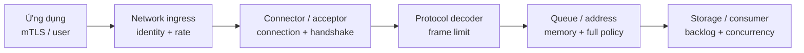

# Giới hạn kết nối, kích thước bản tin và tài nguyên theo ứng dụng

> **Chương:** Bảo mật  
> **Phạm vi:** ActiveMQ Classic (OpenWire) và Artemis (CORE). Bài tập trung vào giới hạn **connections**, **payload/frame size**, **address/destination memory**, **consumer concurrency** và cách thực thi quota theo ứng dụng. Các trị số XML/Java là ví dụ lab, phải đo theo broker/version và tải thật trước khi đưa production.

## 1. Mô hình đe dọa: một ứng dụng làm nghẽn broker dùng chung

Giả sử `billing-service` và `reporting-job` cùng gửi tới một broker. `reporting-job` có lỗi reconnect liên tục, tạo nhiều kết nối; sau đó phát hàng nghìn message JSON 4 MiB trong khi consumer chậm. Nếu không có giới hạn, việc sử dụng connection, heap, journal, paging và disk của reporting có thể làm billing không còn gửi/nhận được.



| Mục đích | Điểm cưỡng chế | Điều **không** nên nhầm |
| --- | --- | --- |
| Giới hạn số socket đồng thời | Classic `maximumConnections` / Artemis `connectionsAllowed` | Đó là giới hạn **cổng/acceptor**, không mặc nhiên theo user |
| Tránh gói wire khổng lồ | `wireFormat.maxFrameSize` trên OpenWire; giới hạn riêng của từng giao thức | Frame size không phải kích thước business payload tuyệt đối |
| Chặn một địa chỉ tạo áp lực tài nguyên | Classic `memoryLimit`/`producerFlowControl`; Artemis `max-size-bytes` + `address-full-policy` | Address memory không phải disk quota hay max một message |
| Giới hạn người tiêu thụ | Queue `max-consumers` (Artemis); client listener concurrency | Consumer khác connection và session |
| Quota theo ứng dụng | Principal riêng + ACL + đường ingress hoặc gateway/rate limiter gắn identity | ACL chỉ kiểm tra **quyền**, không tự giới hạn message/giây |

**Nguyên tắc bảo mật:** nếu hai ứng dụng dùng chung credential và có thể đi vào bất cứ cổng/destination nào, không thể tin các limit tổng hợp là **quota riêng theo ứng dụng**. Phải xây dựng ranh giới identity và đường ingress trước khi đặt ngưỡng.

## 2. Định nghĩa “một ứng dụng” bằng danh tính và destination

Thiết kế thử nghiệm:

| Thành phần | Billing | Reporting |
| --- | --- | --- |
| Principal/role gửi | `billing-publisher` | `reporting-publisher` |
| Principal/role nhận | `billing-worker` | `reporting-worker` |
| Queue | `app.billing.orders` | `app.reporting.events` |
| Network path | Ingress billing/cổng giới hạn | Ingress reporting/cổng riêng |
| Giám sát | Backlog, rate, rejects của billing | Backlog, rate, rejects của reporting |

Cần cấu hình **authentication**, map principal vào role và **authorization** cho prefix đích. Chỉ đặt tên queue riêng không ngăn reporting gửi sang billing nếu ACL vẫn cấp quyền viết.

Đơn vị đo phải rõ:

- **Connection:** physical broker connection, có thể có nhiều JMS sessions, producers và consumers.
- **Session:** phạm vi tuần tự xử lý/transaction, không phải socket. Một session không dành để nhiều thread dùng đồng thời.
- **Consumer:** client/queue consumer; một connection có thể tạo nhiều consumers.
- **Payload bytes:** byte sau serialize/UTF-8. Chúng khác byte của protocol frame và journal record.
- **Address size:** tài nguyên do broker tính toán cho address, không bằng tổng size của mọi message trong disk một cách đơn giản.

Ví dụ có 4 replicas, mỗi replica có pool tối đa 5 physical connections và thêm listener connection riêng: budget phải tính **tổng** cộng headroom reconnect/admin. Đặt connector cap 10 rồi scale 20 connections hợp lệ sẽ gây lỗi ngay cả khi không có tấn công.

## 3. ActiveMQ Classic: transport connection limit và wire frame limit

Trong `activemq.xml`, phần `<broker>` có `transportConnectors`. Ví dụ cho một listener OpenWire dành cho billing:

```xml
<transportConnectors>
    <transportConnector
        name="billing-openwire"
        uri="tcp://0.0.0.0:61626?maximumConnections=80&amp;wireFormat.maxFrameSize=1048576"/>
</transportConnectors>
```

- `maximumConnections=80` giới hạn **kết nối tới connector này**. Nó **không** giới hạn 80 kết nối cho từng JMS username.
- `wireFormat.maxFrameSize=1048576` giới hạn một **OpenWire frame** khoảng 1 MiB, giúp giảm nguy cơ DoS do frame lớn. Đây không phải thông số dùng chung cho Artemis CORE, AMQP hay mọi trường hợp message được chia thành nhiều frame.
- `&amp;` là cách escape ký tự `&` hợp lệ trong XML attribute URI.
- Cần tránh để billing có thể bỏ qua `61626` rồi truy cập một connector khác cùng broker mà không có hạn mức tương đương.

**Quy tắc:** cap theo port chỉ trở thành cap theo ứng dụng nếu ingress/network policy bảo đảm **chỉ ứng dụng đó** sử dụng port ấy và không có đường vòng. Với nhiều tenants trên cùng port, dùng ingress/proxy kiểm tra identity hoặc broker extension hỗ trợ quota theo authenticated principal.

### 3.1. Classic: giới hạn theo queue và backpressure

Trong `<destinationPolicy>` của `<broker>`:

```xml
<destinationPolicy>
    <policyMap>
        <policyEntries>
            <policyEntry
                queue="app.billing.>"
                memoryLimit="32mb"
                producerFlowControl="true"
                sendFailIfNoSpaceAfterTimeout="3000"/>
        </policyEntries>
    </policyMap>
</destinationPolicy>
```

`queue="app.billing.>"` dùng wildcard Classic `>` để áp policy cho queue thuộc prefix `app.billing.`. Tên queue phải khớp đúng pattern. Với topic, cần policy `topic="..."` phù hợp.

- `memoryLimit="32mb"` điều chỉnh giới hạn **cursor memory** của destination. Nó không phải hard cap message body hoặc disk backlog.
- `producerFlowControl="true"` tạo backpressure khi destination hoặc broker cạn tài nguyên; `send` có thể block hoặc báo lỗi theo chính sách.
- `sendFailIfNoSpaceAfterTimeout="3000"` (Classic 5.16+ theo policy per-destination) có thể làm `send` thất bại sau thời gian chờ không đủ tài nguyên khoảng 3 giây. Nó **không** thay TCP connection timeout, failover timeout hay deadline end-to-end.
- Với async/nonpersistent send, producer có thể không thấy broker-side rejection ngay. Cần xem `producerWindowSize` hoặc synchronous send tùy client Classic và mô hình bảo đảm.

Giới hạn toàn broker được cấu hình riêng:

```xml
<systemUsage>
    <systemUsage>
        <memoryUsage>
            <memoryUsage limit="256 mb"/>
        </memoryUsage>
        <storeUsage>
            <storeUsage limit="20 gb"/>
        </storeUsage>
        <tempUsage>
            <tempUsage limit="5 gb"/>
        </tempUsage>
    </systemUsage>
</systemUsage>
```

`memoryUsage`/`storeUsage`/`tempUsage` là ngân sách **toàn broker**, không tự phân disk thành quota cho từng principal. Khi broker/volume hết tài nguyên, ứng dụng không liên quan vẫn có thể bị ảnh hưởng. Không tắt `producerFlowControl` như một mẹo chữa send bị chặn: điều đó có thể dồn áp lực sang store/temp disk.

### 3.2. Classic authorization đi kèm phân vùng

Trích đoạn **bên trong `authorizationMap`** của Classic authorization plugin:

```xml
<authorizationEntries>
    <authorizationEntry
        queue="app.billing.>"
        read="billing-worker"
        write="billing-publisher"
        admin="broker-admin"/>
    <authorizationEntry
        queue="app.reporting.>"
        read="reporting-worker"
        write="reporting-publisher"
        admin="broker-admin"/>
</authorizationEntries>
```

Ví dụ giả định đã cấu hình authentication và map username sang các group/role này. Quyền `write` ngăn cross-app publish, nhưng **không** giới hạn tốc độ hay số connections của một principal. Hạn mức transport và destination cần được thiết kế cùng ACL.

## 4. Artemis: acceptor connection cap, handshake và address budget

Artemis dùng `acceptor`, không dùng Classic `transportConnector`. Ví dụ `broker.xml`:

```xml
<acceptors>
    <acceptor name="billing-core">tcp://0.0.0.0:61626?protocols=CORE;connectionsAllowed=80;handshake-timeout=10</acceptor>
</acceptors>
```

- `protocols=CORE`: giới hạn giao thức của acceptor này về CORE, dùng với Artemis native client.
- `connectionsAllowed=80`: tối đa 80 connections **trên acceptor**, không theo username. Giá trị `-1` có nghĩa không giới hạn từ tham số này.
- `handshake-timeout=10`: timeout handshake của Netty acceptor, **đơn vị giây**, giúp chống connection chưa xác thực giữ socket quá lâu.
- Muốn billing có quota riêng, phải làm rõ đường ingress/ACL/NetworkPolicy để billing không chuyển qua listener chung không giới hạn.
- URI mẫu là TCP thường để tập trung vào resource caps. Trong production cần TLS/mTLS và authentication phù hợp; quota **không** thay thế encryption.

### 4.1. Artemis `address-settings`: FAIL, BLOCK, PAGE

Trong phần `<address-settings>` của `broker.xml`:

```xml
<address-settings>
    <address-setting match="app.billing.#">
        <max-size-bytes>67108864</max-size-bytes>
        <address-full-policy>FAIL</address-full-policy>
        <default-max-consumers>4</default-max-consumers>
        <auto-create-addresses>false</auto-create-addresses>
        <auto-create-queues>false</auto-create-queues>
    </address-setting>
</address-settings>
```

- `match="app.billing.#"` dùng wildcard mặc định Artemis `#` cho nhiều segment, **không** dùng wildcard `>` của Classic.
- `max-size-bytes=67108864` (64 MiB) là ngưỡng **memory accounting của address** trước khi áp `address-full-policy`; không phải max kích thước từng message hoặc hard cap disk.
- `address-full-policy=FAIL`: khi address đầy theo accounting, broker từ chối message thay vì tiếp tục tích backlog. Client phải xử lý lỗi; không retry vô hạn.
- `default-max-consumers=4`: tối đa **4 consumers trên mỗi queue** (nếu queue không override bằng `max-consumers`); không phải giới hạn connections.
- `auto-create-addresses/queues=false`: chống mở rộng không kiểm soát do lỗi tên destination hoặc client tự tạo quá nhiều queue. Cần provision address/queue trước khi gửi.

Ví dụ queue được provision tường minh:

```xml
<addresses>
    <address name="app.billing.orders">
        <anycast>
            <queue name="app.billing.orders" durable="true"
                   max-consumers="4"/>
        </anycast>
    </address>
</addresses>
```

**Không copy trọn các đoạn `<acceptors>`, `<address-settings>`, `<addresses>` thành các phần tử duplicate** nếu broker đã có các section này; cần gộp vào cấu hình đúng schema của instance.

| `address-full-policy` | Khi address đạt ngưỡng | Trade-off |
| --- | --- | --- |
| `FAIL` | Broker từ chối gửi, phía client có lỗi | Dễ kiểm soát backlog nhưng producer cần retry/backpressure |
| `BLOCK` | Producer bị chặn chờ tài nguyên | Dễ giữ dòng message nhưng có nguy cơ giữ thread quá lâu |
| `PAGE` | Broker page message sang disk | Không giới hạn tổng disk backlog; phải theo dõi disk/IOPS |
| `DROP` | Message mới có thể bị bỏ mà không báo lỗi tương xứng | Chỉ khi nghiệp vụ thật sự chấp nhận mất sự kiện |

Dùng `PAGE` cho công việc background cần tích backlog có kiểm soát; `FAIL` cho kênh ưu tiên phản hồi rõ khi quota cạn. Không dùng `DROP` cho nghiệp vụ yêu cầu lưu message tin cậy.

### 4.2. Artemis authorization tách ứng dụng

Trong `<security-settings>`:

```xml
<security-settings>
    <security-setting match="app.billing.#">
        <permission type="send" roles="billing-publisher"/>
        <permission type="consume" roles="billing-worker"/>
        <permission type="createAddress" roles="broker-admin"/>
        <permission type="createDurableQueue" roles="broker-admin"/>
        <permission type="deleteAddress" roles="broker-admin"/>
        <permission type="deleteDurableQueue" roles="broker-admin"/>
    </security-setting>
</security-settings>
```

Các roles phải được gắn với users trong cơ chế authentication; đoạn trên **không** tạo users. Reporting có security setting và roles riêng. Nếu billing và reporting cùng được send vào **một** address, chúng **chia sẻ ngân sách address**; đó chưa phải một quota công bằng theo producer.

## 5. Kích thước message: ba giới hạn ở ba tầng khác nhau

| Giới hạn | Ví dụ | Được bảo vệ | Không phải |
| --- | --- | --- | --- |
| **Payload sau encode** | JSON UTF-8 ≤256 KiB | Contract và tài nguyên ứng dụng | Giới hạn thực thi với client có thể truy cập broker trực tiếp |
| **Protocol frame** | Classic `wireFormat.maxFrameSize=1048576` | Parser/transport OpenWire | JMS body size tuyệt đối cho mọi protocol và framing |
| **Address memory** | Artemis `max-size-bytes=67108864` | Ngưỡng backpressure/paging/fail trên address | Kích thước tối đa một message hoặc disk quota cứng |

Message thực tế còn có headers, properties, encoding và frame overhead. Một JSON có đúng 262.144 byte chưa chắc truyền đi chỉ bằng đúng 262.144 byte trên wire. `String.length()` đếm UTF-16 code units, **không** bằng kích thước UTF-8 khi có tiếng Việt, emoji hoặc ký tự ngoài ASCII.

Ở Artemis, một tham số như `amqpMaxFrameSize` là giới hạn frame của AMQP (nếu đang dùng AMQP); `amqpMinLargeMessageSize` hoặc ngưỡng large-message là cơ chế đổi cách xử lý body, **không** mặc nhiên là max message bytes. Nếu cần hard cap sau giải mã cho **mọi client**, phải có trusted ingress/protocol-aware proxy hoặc broker plugin/interceptor kiểm tra identity và tổng decoded payload trước khi chấp nhận.

## 6. Code Java Spring JMS: giới hạn payload và số lần gửi đồng thời

Ví dụ Spring Boot 3.x / Java 17+, một `JmsTemplate` đang kết nối broker đúng protocol và queue `app.billing.orders`. Đây là **client-side guard** để ứng dụng hợp tác không tự gây nghẽn; nó không chặn một client khác kết nối thẳng tới broker.

### 6.1. Publisher có byte budget và bounded concurrency

```java
package demo.billing;

import java.nio.charset.StandardCharsets;
import java.util.Objects;
import java.util.concurrent.RejectedExecutionException;
import java.util.concurrent.Semaphore;
import java.util.concurrent.TimeUnit;

import org.springframework.jms.core.JmsTemplate;
import org.springframework.stereotype.Service;

@Service
public final class BillingEventPublisher {
    private static final String DESTINATION = "app.billing.orders";
    private static final int MAX_BODY_BYTES = 256 * 1024;
    private static final Semaphore IN_FLIGHT = new Semaphore(8, true);

    private final JmsTemplate template;

    public BillingEventPublisher(JmsTemplate template) {
        this.template = template;
    }

    public void publish(String eventId, String json) {
        Objects.requireNonNull(eventId, "eventId");
        Objects.requireNonNull(json, "json");

        int bytes = json.getBytes(StandardCharsets.UTF_8).length;
        if (bytes > MAX_BODY_BYTES) {
            throw new IllegalArgumentException(
                    "JSON too large: " + bytes + " bytes");
        }

        boolean acquired;
        try {
            acquired = IN_FLIGHT.tryAcquire(250, TimeUnit.MILLISECONDS);
        } catch (InterruptedException interrupted) {
            Thread.currentThread().interrupt();
            throw new RejectedExecutionException(
                    "Interrupted while waiting for send budget",
                    interrupted);
        }

        if (!acquired) {
            throw new RejectedExecutionException(
                    "Too many concurrent JMS sends");
        }

        try {
            template.convertAndSend(DESTINATION, json, message -> {
                message.setStringProperty("eventId", eventId);
                message.setStringProperty(
                        "eventType", "OrderCreated");
                message.setStringProperty(
                        "contentType", "application/json");
                return message;
            });
        } finally {
            IN_FLIGHT.release();
        }
    }
}
```

**Đọc đúng contract:**

- `MAX_BODY_BYTES` giới hạn **JSON body UTF-8**, không tính metadata hoặc toàn frame.
- `IN_FLIGHT=8` giới hạn tối đa **8 lời gọi đồng thời trong JVM**; không phải 8 JMS connections và không phải 8 messages/giây.
- `tryAcquire(250 ms)` chỉ giới hạn thời gian chờ permit; một `send` đang thực thi vẫn có thể block lâu nếu broker ở chế độ `BLOCK` hoặc failover.
- `finally` bảo đảm trả permit; lỗi broker không bị nuốt. Payload vượt cap được từ chối **trước** khi gửi.
- Nhiều replicas mỗi nơi có 8 permits có thể khiến tổng send đồng thời lớn hơn 8. Với quota toàn ứng dụng phải có rate/concurrency limiter **phân tán**, hoặc chia budget per replica và kiểm soát tổng.

Nếu cần rate limiting **messages/giây** chứ không phải concurrency, dùng token bucket ở gateway/ingress hoặc thư viện ứng dụng có cấu hình theo authenticated identity. Không bận vòng lặp retry khi broker trả lỗi tài nguyên.

### 6.2. Consumer concurrency không bằng connection cap

```java
package demo.billing;

import org.springframework.jms.annotation.JmsListener;
import org.springframework.stereotype.Component;

@Component
public class BillingEventConsumer {
    @JmsListener(
        destination = "app.billing.orders",
        concurrency = "2-4")
    public void handle(String json) {
        // Validate JSON, idempotency, transaction theo contract.
    }
}
```

`concurrency="2-4"` đặt số consumers của **listener này trên một instance**. Với 3 replicas, tổng consumers có thể lên tới 12. Nếu queue Artemis có `max-consumers=4`, các consumer được tạo sau ngưỡng sẽ không được broker nhận; đây là vấn đề cấu hình tổng của ứng dụng, không phải lỗi body JSON.

### 6.3. Cấu hình Spring Boot nối đúng cổng

Artemis native CORE với `spring-boot-starter-artemis`:

```yaml
spring:
  artemis:
    mode: native
    broker-url: tcp://broker-billing:61626
    user: ${BILLING_JMS_USER}
    password: ${BILLING_JMS_PASSWORD}
```

Classic OpenWire với `spring-boot-starter-activemq`:

```yaml
spring:
  activemq:
    broker-url: tcp://broker-billing:61626
    user: ${BILLING_JMS_USER}
    password: ${BILLING_JMS_PASSWORD}
```

Tên host/port ở đây chỉ là ví dụ. Chọn **một** starter tương thích với broker và listener, đồng thời quản lý secrets ngoài source code. Các property client **không** tự bật giới hạn trên broker.

## 7. Cái gì thực sự là quota *theo ứng dụng*?

| Budget mẫu | Vị trí áp dụng | Phạm vi thật |
| --- | --- | --- |
| 80 connections | Connector/acceptor dành riêng cho billing | **Theo cổng**, chỉ thành theo app nếu không thể đi đường vòng |
| JSON ≤256 KiB | Publisher + trusted validation ở ingress | App-local nếu broker còn mở cho client không tin cậy |
| 8 concurrent sends | Semaphore publisher | Một JVM, không cộng gộp nhiều pods |
| 4 consumers | Artemis queue `max-consumers` | **Theo queue** |
| 64 MiB rồi FAIL | Artemis address policy | **Theo address**, không theo username |
| 32 MiB memory cursor | Classic destination policy | **Theo destination**, dưới memory toàn broker |
| 1.000 messages/giây cho billing | Gateway/rate limiter hoặc broker extension có identity | Per-app chỉ khi dựa vào authenticated principal |

Một thiết kế thực thi quota đáng tin cậy thường kết hợp:

1. **Principal riêng và ACL:** billing không có quyền ghi queue reporting, app không tự tạo queue bất kỳ.
2. **Ingress identity-bound:** cổng/NetworkPolicy/LB hoặc broker extension giữ được danh tính và không có bypass sang cổng chung.
3. **Admit connections:** giới hạn số physical connections; capacity tính cả replicas và burst failover.
4. **Validate payload:** app kiểm tra byte/JSON schema; trusted ingress kiểm tra lại nếu client không tin cậy.
5. **Backpressure:** address/destination full policy cùng retry budget, outbox và theo dõi backlog.
6. **Rate/quota:** token bucket theo principal tại điểm tập trung hoặc ngân sách per-replica được tổng hợp có kiểm soát.
7. **Quan sát/audit:** metrics theo destination, principal, ingress, error category, message size, connection count.
8. **Cô lập mạnh hơn khi cần:** broker instance riêng nếu khác biệt SLA/độ tin cậy không thể chịu chung JVM/disk.

**Giới hạn chia theo address không cô lập được những ứng dụng cùng gửi vào address ấy**; app gây tải vẫn có thể làm app còn lại bị `FAIL`. Muốn công bằng theo principal, phải có quota theo principal ở ingress/extension.

## 8. Hành vi lúc chạm giới hạn và chiến lược retry

| Tình huống | Quan sát client | Nên xử lý |
| --- | --- | --- |
| Connection cap | Connect bị từ chối, timeout hoặc lỗi handshake | Pool/reuse connection, backoff có jitter |
| OpenWire frame vượt cap | Decoder/transport từ chối, có thể đóng socket | Không retry cùng frame khổng lồ; sửa payload |
| Address `FAIL` | Send/commit báo lỗi tài nguyên | Backpressure/retry bounded; giữ eventId ổn định |
| Address `BLOCK` | `send` chờ lâu dù TCP còn sống | Deadline, circuit breaker, giảm upstream load |
| Address `PAGE` | Thêm page files, backlog/disk tăng | Disk alert, capacity và giới hạn retention |
| Global store/temp disk đầy | Broker block hoặc lỗi tùy policy | Giảm ingress, xử lý storage, không tắt bảo vệ |
| Consumer cap | Listener mới không tạo được consumer | Tính số consumer trên toàn replicas |

Nếu mất mạng/timeout đúng lúc `commit`, kết quả gửi có thể **không rõ**: broker có thể đã chốt nhưng client không nhận response. Retry phải dùng `eventId` nghiệp vụ ổn định và consumer idempotent; không dùng một exception để khẳng định broker chưa nhận. Ngược lại, lỗi payload quá lớn được xác nhận là **không retryable** cho cùng dữ liệu chưa sửa.

## 9. Metrics và cảnh báo theo application

| Metric/quan sát | Key cần phân nhóm | Cảnh báo điều gì? |
| --- | --- | --- |
| Active connections / max | Cổng/acceptor + source/identity nếu có | Leak, reconnect storm, nearing cap |
| Auth failures / handshake timeouts | Principal/port/source | Credential sai, abuse hoặc protocol mismatch |
| Send error và thời gian block | App + destination | Quota cạn, flow control, broker pressure |
| Payload size p50/p95/p99 | App + event type | Payload tăng bất thường, schema thay đổi |
| Queue depth, enqueue/dequeue rate | Destination | Backlog tăng nhanh hơn consumer drain |
| Address size, paging, disk | Address, volume, broker | Near full, I/O pressure, expiry |
| Consumer count | Queue + app/replica | Vượt concurrency/limit |
| Retry/timeout/duplicate rate | Principal + event type | Retry storm hoặc unknown outcome |

Tên metric cụ thể khác giữa Classic/Artemis và phiên bản. Theo dõi **cả broker và ứng dụng**: một metric queue không chứng minh được identity nào đang dùng tài nguyên nếu nhiều producer cùng gửi. Log mã lỗi, principal, `eventId` và byte count; **không log toàn bộ body hoặc credential** để “debug limit”.

## 10. Thực hành chứng minh giới hạn có hiệu lực

**Chuẩn bị:** một broker Classic lab và một broker Artemis lab, queue `app.billing.orders`; quyền sửa cấu hình, xem management metrics, JVM client test. Không stress-test trên production.

### Lab A — Connection cap không phải per-user

1. Classic: đặt `maximumConnections=3` trên connector test; Artemis: `connectionsAllowed=3` trên acceptor test.
2. Mở **3 physical connections** và giữ chúng tồn tại; không tính 3 sessions trên 1 connection là 3.
3. Thử connection thứ tư; quan sát broker từ chối. Đóng một connection và thử lại.
4. Dùng hai usernames khác nhau trên cùng cổng: tổng connections vẫn dùng chung cap.
5. Nếu broker còn một acceptor/connector khác, thử từ client lab được phép kết nối cổng đó để thấy vì sao cap cổng **không phải per-app quota** nếu ingress còn bypass.

**PASS:** limit hoạt động theo số physical connections của đúng connector/acceptor, bất kể username.

### Lab B — Frame cap so với JSON byte cap

1. Classic test: đặt `wireFormat.maxFrameSize=1048576`, gửi một message nhỏ trước để xác nhận giao thức đúng.
2. Tăng payload đủ lớn để frame vượt giới hạn; ghi lỗi decoder/transport. Không suy ngưỡng frame từ `String.length()`.
3. Gửi JSON 256 KiB và 256 KiB + 1 byte qua `BillingEventPublisher`; xác minh body vượt budget bị từ chối **trước convertAndSend**.
4. Dùng client test không có validator riêng để chứng minh client-side cap không bảo vệ được broker nếu cổng vẫn mở.
5. Với Artemis, áp limit của protocol thực tế/gateway thay vì coi `max-size-bytes` là max message size.

### Lab C — Address/destination pressure

1. Artemis: queue không có consumer, `max-size-bytes` nhỏ và `FAIL`. Gửi một tập message persistent cho đến khi broker từ chối; ghi address metrics.
2. Chuyển sang `PAGE` trên **broker test**; quan sát paging và disk tăng, không tuyên bố disk đã được quota.
3. Classic: `memoryLimit` thấp và `producerFlowControl=true`; đo thời gian block/exception khi backlog tích tụ.
4. Đăng nhập bằng principal reporting, thử send vào billing; phải bị ACL từ chối.
5. Gỡ backlog test có chủ đích rồi xác nhận producer hoạt động lại.

### Lab D — Scale và consumer limit

1. Artemis: đặt queue `max-consumers=2`; mở 2 consumers rồi thử consumer thứ ba.
2. Chạy listener concurrency `2-4` trên 2 pods: tổng consumer tiềm năng vượt cap; quan sát lỗi scaling.
3. Chỉnh tổng concurrency và connection budgets hợp lý, không chỉ tăng cap bừa bãi.

### Lab E — Lỗi và khôi phục

1. Gây `FAIL` có kiểm soát; client phải phản hồi backpressure, không retry spin.
2. Khôi phục consumer để giảm backlog; đo thời gian khôi phục.
3. Gửi payload quá lớn; phân loại lỗi không retryable.
4. Restart broker test khi client reconnect; đo peak connections và verify exponential backoff/jitter.
5. Kiểm tra ACL/ingress không cho bypass quota bằng username hoặc port khác.

## 11. Các ngộ nhận nguy hiểm

| Ngộ nhận | Thực tế |
| --- | --- |
| `maximumConnections` đặt quota cho từng Classic username | Nó giới hạn **transportConnector** |
| `connectionsAllowed` áp theo Artemis principal | Nó giới hạn **acceptor** |
| `max-size-bytes` là max message bytes | Đó là **address memory resource budget** |
| `memoryLimit` là hard disk quota của Classic queue | Nó là **cursor memory limit** |
| `wireFormat.maxFrameSize` giới hạn mọi JMS provider | Nó liên quan OpenWire frame |
| `Semaphore(8)` nghĩa là tối đa 8 connections toàn cluster | Chỉ giới hạn các lời gọi in-flight trong một JVM |
| `producerFlowControl=false` giúp broker “không treo” | Có thể chuyển nghẽn sang disk và làm sự cố nặng hơn |
| Có ACL là đã giới hạn byte/giây | ACL chỉ quyết định quyền |
| `PAGE` là cách đặt tổng disk quota | Paging làm disk tiếp tục tăng nếu backlog không drain |
| `FAIL` rồi retry vô hạn là an toàn | Retry storm có thể làm mất khả năng phục hồi |

## 12. Checklist production

- [ ] Danh tính app và group/role riêng; queue/address namespacing ổn định.
- [ ] ACL send/consume/create chỉ cấp đúng nhu cầu.
- [ ] Connection cap áp đúng connector/acceptor và không thể đi đường vòng qua cổng khác.
- [ ] Tính tổng connections theo replicas, pool, listeners và failover headroom.
- [ ] Có giới hạn byte payload sau encode và server-side enforcement nếu client không tin cậy.
- [ ] Không đánh đồng message body, wire frame và address resource accounting.
- [ ] Classic: `memoryLimit` + `producerFlowControl` + `systemUsage` được benchmark.
- [ ] Artemis: `max-size-bytes` + `address-full-policy` + `max-consumers`/auto-create policy phù hợp.
- [ ] Đã chọn rõ `FAIL`, `BLOCK` hoặc `PAGE` theo SLO và khả năng chịu mất dữ liệu.
- [ ] Có rate/concurrency budget, retry hữu hạn, jitter và eventId idempotent.
- [ ] Dashboard có connection count, rejected sends, queue age, paging/disk và latency.
- [ ] Đã thử vượt cap, oversized message, ACL denied và scale nhiều replicas.
- [ ] Chấp nhận rằng các ứng dụng trên cùng JVM/disk vẫn chia sẻ failure domain; nếu SLA yêu cầu, tách broker instance.

## Tài liệu tham khảo

- [ActiveMQ Classic — Configure Version 5 Brokers](https://activemq.apache.org/components/classic/documentation/configure-version-5-brokers): `maximumConnections` và `wireFormat.maxFrameSize`.
- [ActiveMQ Classic — Configuring Wire Formats](https://activemq.apache.org/components/classic/documentation/configuring-wire-formats): frame protection của OpenWire.
- [ActiveMQ Classic — Per Destination Policies](https://activemq.apache.org/components/classic/documentation/per-destination-policies): `memoryLimit`, `producerFlowControl` và chính sách send timeout.
- [ActiveMQ Classic — Producer Flow Control](https://activemq.apache.org/components/classic/documentation/producer-flow-control): backpressure và `systemUsage`.
- [ActiveMQ Artemis — Configuring the Transport](https://artemis.apache.org/components/artemis/documentation/latest/configuring-transports.html): `connectionsAllowed`, `handshake-timeout`, `protocols`.
- [ActiveMQ Artemis — Address Settings](https://artemis.apache.org/components/artemis/documentation/latest/address-settings.html): `max-size-bytes`, `address-full-policy`, `default-max-consumers`.
- [ActiveMQ Artemis — Security](https://artemis.apache.org/components/artemis/documentation/latest/security.html): identity và ACL theo address.
