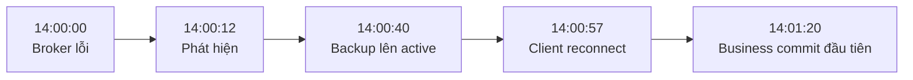
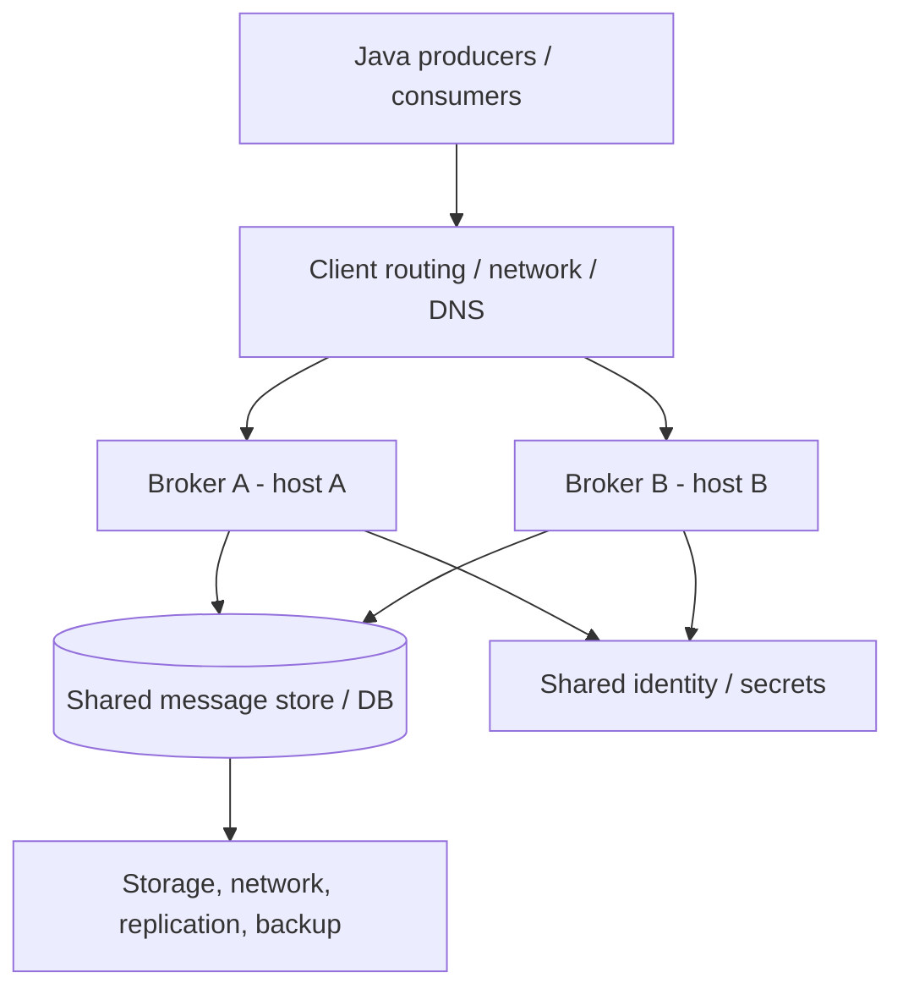

# Xác định mục tiêu phục hồi RTO, mất dữ liệu RPO và các miền lỗi

> **Chương:** Sẵn sàng cao  
> **Bối cảnh:** ActiveMQ Classic và ActiveMQ Artemis cung cấp queue/topic bền vững cho ứng dụng Java/JMS. Bài này tập trung vào **đặt mục tiêu phục hồi có thể kiểm chứng**, **định nghĩa thế nào là mất dữ liệu** và **nhận diện miền lỗi** trước khi chọn mô hình HA. Các cấu hình chỉ nhằm minh họa lựa chọn kiến trúc và phương pháp kiểm thử, không phải bộ tham số áp dụng nguyên xi cho production.

## 1. “Broker có backup” chưa phải mục tiêu sẵn sàng cao

Hệ thống thanh toán gửi lệnh `PaymentRequested` vào queue `payments.commands`. Nếu ActiveMQ mất kết nối trong 40 giây rồi hoạt động lại, câu hỏi không chỉ là “broker backup đã lên chưa” mà gồm:

- API có nhận thêm lệnh thanh toán mới được không?
- Các lệnh **đã được producer xác nhận commit** trước sự cố có còn không?
- Consumer có kết nối lại, xử lý được lệnh và xác nhận giao dịch nghiệp vụ không?
- Một số lệnh có bị giao lại hoặc xử lý trùng không?
- Sự cố broker, máy chủ, đĩa, mạng hay cả vùng triển khai có làm **cả hai node** cùng ngừng hoạt động không?

Hai đại lượng cần quy định:

| Khái niệm | Câu hỏi đo được | Ví dụ mục tiêu |
|---|---|---|
| **RTO — Recovery Time Objective** | Sau sự cố, **tối đa bao lâu** chức năng nghiệp vụ trọng yếu phải khôi phục? | Không quá **120 giây** khi một máy broker bị lỗi |
| **RPO — Recovery Point Objective** | Khi phục hồi, chấp nhận mất tối đa **bao nhiêu dữ liệu đã được hệ thống chấp nhận thành công**? | **RPO = 0** đối với persistent message đã được JMS transaction commit xác nhận, trong phạm vi lỗi một node với store còn nguyên |
| **Miền lỗi — failure domain** | Những thành phần nào có thể **hỏng cùng lúc vì cùng một nguyên nhân**? | Hai broker khác VM nhưng dùng cùng một database chưa có HA vẫn chia sẻ miền lỗi DB |

**RTO không phải cam kết tự động của cấu hình failover. RPO không phải một tùy chọn `true/false` đơn lẻ trong broker.** Đây là tiêu chí nghiệm thu end-to-end của cả hệ thống, gắn với mô hình lỗi đã thỏa thuận.

### 1.1. Chọn ranh giới dịch vụ trước khi đặt số

Một ứng dụng có ít nhất ba mức “phục hồi” khác nhau:

```text
Broker process khởi động
       ↓
JMS client kết nối và có thể send/receive
       ↓
Business handler xử lý/commit thành công một lệnh thật
       ↓
Backlog cũ được xử lý hết hoặc queue age về SLO
```

Nếu hợp đồng nói **“thanh toán tiếp tục hoạt động trong 120 giây”**, RTO nên dừng ở **một giao dịch nghiệp vụ mới hoàn tất thành công**, không phải lúc cổng TCP bắt đầu lắng nghe. Việc xả hết backlog có thể có **một mục tiêu riêng**.

Ví dụ SLO được định nghĩa rõ:

> Với lỗi **crash một broker host**, persistent store và database nghiệp vụ còn nguyên, hệ thống phải xử lý thành công trở lại một lệnh `PaymentRequested` mới trong **120 giây**; không mất message mà producer đã được xác nhận commit; backlog cũ phải trở về mức queue age chấp nhận được trong **10 phút**.

Đây là ba chỉ tiêu **khác nhau**: RTO nghiệp vụ, RPO message store và mục tiêu xả backlog.

## 2. Định nghĩa RTO: lấy mốc đầu và mốc cuối có thể đo

Đặt:

- `t_failure`: thời điểm bắt đầu **mất chức năng** theo SLI đã công bố.
- `t_recovered`: thời điểm chức năng đó **khôi phục đúng tiêu chí**, không phải chỉ “process running”.

Khi đó:

\[
RTO_{\mathrm{observed}}=t_{\mathrm{recovered}}-t_{\mathrm{failure}}
\]

**Mục tiêu** là `RTO_target`; kết quả diễn tập là `RTO_observed`. Một lần kiểm thử đạt không chứng minh mọi sự cố sau này đều nằm trong RTO.

### 2.1. Ví dụ đo thành phần thời gian



Trong ví dụ:

| Giai đoạn | Khoảng thời gian | Nguyên nhân có thể chi phối |
|---|---:|---|
| Phát hiện lỗi | 12 giây | TCP timeout, heartbeat, health check |
| Promote/đổi active | 28 giây | Election, journal recovery, lock, quorum |
| Client reconnect | 17 giây | DNS/VIP, transport retry, authentication |
| Handler xử lý thành công | 23 giây | Consumer restart, DB, backlog, ứng dụng |
| **RTO nghiệp vụ quan sát** | **80 giây** | Từ `14:00:00` đến `14:01:20` |

Tổng này chỉ đúng vì các mốc được vẽ **không chồng lấp**. Trong hệ thống thật, backup promotion và client reconnect có thể diễn ra đồng thời; hãy đo bằng timestamp end-to-end, **không cộng máy móc** các số liệu độc lập từ dashboard.

### 2.2. Broker RTO và business RTO không được tráo đổi

```text
14:00:40  backup trở thành active    -> broker activation metric
14:00:57  producer có thể gửi lại   -> messaging availability metric
14:01:20  một nghiệp vụ commit OK   -> business RTO
14:09:00  backlog về ngưỡng SLO     -> backlog recovery metric
```

Một thiết kế có “failover broker 5 giây” vẫn có thể **trượt RTO 2 phút** nếu client retry chậm, consumer khởi động mất nhiều thời gian hoặc DB phía sau bị quá tải.

### 2.3. RTO phải có điều kiện phạm vi lỗi

Viết `RTO ≤ 2 phút` mà không nói **lỗi nào** thì không kiểm chứng được. Hãy gắn mục tiêu với tập sự cố cụ thể, ví dụ:

- Một JVM/container broker chết đột ngột.
- Một host của cặp active/backup ngừng hoạt động.
- Một network interface bị lỗi, nhưng các đường mạng khác còn.
- **Không** mặc nhiên bao gồm mất toàn bộ database chung, mất cả availability zone hoặc xóa nhầm dữ liệu.

Những sự cố ngoài phạm vi phải có **mục tiêu disaster recovery riêng**, không bị che bằng quảng cáo “có hai broker”.

## 3. RPO: xác định dữ liệu nào được tính là “đã chấp nhận”

RPO là mức dữ liệu có thể bị mất sau khi phục hồi, thường diễn đạt bằng **cửa sổ thời gian**. Với messaging, nên đo đồng thời **khoảng thời gian thiếu dữ liệu** và **số event đã được xác nhận nhưng không phục hồi được**.

Phân loại message:

| Trạng thái trước sự cố | Có tính là “đã được hệ thống chấp nhận thành công”? | Cách diễn giải |
|---|---|---|
| Producer tạo object `Message` nhưng chưa gọi `send()` | **Không** | Chưa rời ứng dụng |
| Producer đã gọi `send()` nhưng transaction chưa commit | **Không được coi là committed** | Broker có thể chưa giữ durable record |
| `send()/Session.commit()` chưa biết kết quả vì đứt kết nối | **Chưa xác định** | Không tự kết luận mất dữ liệu hay đã thành công |
| Persistent message được broker xác nhận theo contract | **Có**, nếu thao tác gửi/commit đã được xác nhận thành công | Là tập dữ liệu cần đối chiếu sau phục hồi |
| Broker giao message nhưng consumer chưa ACK/commit | Vẫn là delivery có thể phải phát lại | Không tự xem là message mất |
| Consumer DB đã commit nhưng JMS ACK chưa chắc chắn | Có thể bị redeliver | Chủ yếu là rủi ro **duplicate effect**, không phải RPO của broker |

**RPO = 0 không phải “consumer chỉ nhận đúng một lần”.** Duplicates và data loss là hai rủi ro khác nhau; một hệ thống có thể không mất message nào nhưng vẫn giao lại message nhiều lần.

### 3.1. RPO theo event ledger

Trong một phép thử, producer xác nhận commit thành công cho các business event có số thứ tự:

```text
Confirmed by producer:
1001, 1002, 1003, 1004, 1005

Recovered and readable after outage:
1001, 1002, 1003
```

Hai event `1004` và `1005` đã được xác nhận trước sự cố nhưng không còn trong nguồn dữ liệu được phục hồi; **RPO=0 đã bị vi phạm** theo định nghĩa accepted-event. Cần truy bằng business `eventId` và xác định tại sao thiếu, không dùng `JMSMessageID` làm dãy số.

Nếu 1004/1005 **chưa từng được client xác nhận commit** mà chỉ đang in-flight, sự cố này tạo **kết quả không xác định**, không được thống kê thành “mất hai event đã xác nhận” nếu chưa có bằng chứng. Producer cần idempotent retry và đối soát trạng thái.

### 3.2. RPO theo thời gian có một giới hạn quan trọng

Giả sử event mới nhất đã được producer xác nhận ở `14:00:04`, còn bản phục hồi mới nhất tồn tại từ `14:00:01`. Cửa sổ dữ liệu mất ở **đuôi lịch sử** có thể được báo là khoảng **3 giây**, **nếu** đã xác minh không có các event bị mất rời rạc ở giữa.

Chỉ nhìn “timestamp của event cuối cùng” có thể bỏ sót **lỗ hổng ở giữa**:

```text
Recovered: 1001, 1002, 1004, 1005
Missing:   1003
```

RPO thời gian nhìn theo event mới nhất có vẻ bằng 0, nhưng thực tế **mất event 1003**. Vì vậy, trong phép thử messaging nên có **tập confirmed IDs**, so sánh tập ID được phục hồi, kiểm tra gap và số lượng. Đồng hồ của các node phải được đồng bộ khi tính khoảng thời gian.

### 3.3. Khi nào có thể đặt RPO = 0?

Chỉ đặt mục tiêu `RPO=0` sau khi **giới hạn lỗi và điều kiện durability** rõ ràng:

- Producer dùng `DeliveryMode.PERSISTENT` và quan sát được **kết quả commit thành công**.
- Broker thực sự bật persistence, ghi vào store bền vững phù hợp.
- Dữ liệu đã commit không phụ thuộc hoàn toàn vào máy bị mất trong fault model.
- Nếu dùng replication, phải xác minh **khi nào broker gửi ACK producer so với lúc bản sao đủ bền vững**; chữ “replicated” tự nó chưa chứng minh không mất các message đã xác nhận.
- Replication/backup và storage không bị lỗi vượt quá mô hình đã cam kết.
- Không có administrator xóa queue, TTL/expiry hoặc quy tắc nghiệp vụ cố tình loại message trước khi phép đo bắt đầu.

Ở **một cặp shared-store có store còn nguyên**, mất một broker process thường cho phép phục hồi message đã commit. Nhưng nếu **chính shared store hỏng**, mục tiêu này có thể không còn đạt; đó là failure domain khác.

## 4. Miền lỗi: xác định thứ gì thực sự độc lập

**Failure domain** là tập thành phần có thể dừng hoặc mất tính đúng đắn cùng lúc bởi một nguyên nhân chung. Hai thành phần ở hai máy **không nhất thiết** thuộc hai miền lỗi độc lập.



Nếu host A lỗi, B có thể thay thế. Nhưng nếu `ST` hoặc mạng tới `ST` lỗi, **cả A lẫn B** có thể mất khả năng phục vụ persistent messages. Đó là **single point of failure** dù có hai broker.

### 4.1. Ma trận miền lỗi thực tế

| Miền lỗi | Một sự cố đại diện | HA broker có giải quyết trực tiếp không? | Cần bổ sung |
|---|---|---|---|
| **Process/JVM** | Broker crash, OOM, deadlock | Có thể, với backup đã sẵn sàng | Health check, restart, takeover |
| **Host/VM** | OS kernel panic, máy chết | Có thể, nếu backup ở host khác | Anti-affinity, hạ tầng độc lập |
| **Persistent store** | Disk array, SAN/NFS, JDBC DB mất | **Không** nếu cả hai broker dùng chung store không HA | Storage/DB HA, restore strategy |
| **Network** | Một switch/router, partition mạng | Không mặc nhiên | Đường mạng dự phòng, fencing/quorum |
| **Availability zone** | Mất toàn bộ zone | Chỉ nếu broker **và dữ liệu cần thiết** nằm ngoài zone lỗi | Đa AZ, replication/backup độc lập |
| **Identity/secrets/TLS** | Secret hết hạn, CA/cert sai, IAM outage | Thường không: hai broker có thể lỗi đồng thời | Rotation có kiểm soát, health check |
| **Deployment/config** | Cùng bản release sai được rollout lên cả hai | Không | Canary, rollback, test config |
| **Client/API** | Producer/consumer không reconnect hoặc bị stuck | Broker HA không chữa được code client | Failover URI, timeout, circuit breaker |
| **Business DB** | Database của consumer down | Broker vẫn có thể nhận tin nhưng nghiệp vụ không hoàn tất | DB HA, idempotency, queue lag policy |
| **Thao tác con người** | Xóa nhầm queue, đổi retention, xóa dữ liệu store | Replication có thể lan truyền thao tác sai | Backup/PITR, phê duyệt thay đổi, audit |

Bài tập thiết kế quan trọng: **vẽ cả đường đi dữ liệu và mọi phụ thuộc dùng chung**, không chỉ khoanh hai hình chữ nhật “broker A/B”.

### 4.2. Common-mode failure khó nhìn thấy

Hai broker có thể khác host nhưng cùng:

- Một datastore NFS hoặc PostgreSQL primary.
- Một vùng đặt máy, một nguồn điện hoặc switch.
- Một kho certificate hết hạn và một chính sách deploy đồng thời.
- Một DNS zone hoặc load balancer đặt sai health check.
- Một automation script dừng cả hai instance.
- Một consumer database trở thành bottleneck cho tất cả các luồng.

“Triển khai hai broker” chỉ giảm khả năng lỗi của **từng broker**, không tự loại bỏ rủi ro các phụ thuộc này.

### 4.3. Phân biệt lỗi fail-stop và network partition

- **Fail-stop:** node active chết hẳn, không còn ghi vào store. Backup takeover tương đối dễ lập luận.
- **Network partition:** node active vẫn chạy nhưng một phần mạng không tới được nó; backup không thể biết chắc node active đã chết hay chỉ bị cô lập.

Nếu cả hai tự nghĩ mình là active và cùng ghi, có nguy cơ **split-brain**. Với shared store, cơ chế **lock/fencing** phải bảo đảm chỉ một writer; với replication, có thể cần quorum/voting hoặc một cơ chế phân xử đáng tin. **Hai node đơn thuần thường không đủ thông tin để phân biệt lỗi node với lỗi mạng.**

## 5. So sánh hai hướng HA cho ActiveMQ Classic và Artemis

| Kiến trúc | Dữ liệu nằm ở đâu? | RPO cần xét | RTO bị chi phối bởi | Miền lỗi nổi bật |
|---|---|---|---|---|
| **Classic shared JDBC store (active/standby)** | Broker dùng chung một database JDBC | Có thể 0 đối với commit đã durable khi **DB store còn nguyên** | DB lock release/takeover, startup, client reconnect | DB, kết nối DB, lock service |
| **Classic shared file-store (active/standby)** | Hai broker dùng chung kho file được hỗ trợ | Có thể 0 khi shared store an toàn và còn nguyên | File lock, mount/storage recovery, client reconnect | Shared storage/NFS/SAN |
| **Artemis shared-store primary/backup** | Cùng journal/bindings/paging/large-message storage | Phụ thuộc độ bền và tính sẵn sàng của shared store | Khóa store, backup activation, consumer recovery | Shared filesystem hoặc storage |
| **Artemis replicated primary/backup** | Mỗi broker có store riêng, đồng bộ qua network | Phụ thuộc checkpoint/replication semantics và thời điểm xác nhận commit | Backup synchronization, election/quorum, reconnect | Replication link, hai host, quorum/fencing |
| **Broker ở hai region với async DR** | Dữ liệu sao chép trễ qua vùng | Thường **không thể mặc định RPO=0** | Region routing, replication lag, recovery operation | Region failure, WAN, lag |

**Tên HA mode không đủ để suy ra RTO/RPO.** Phải đối chiếu điều kiện ack/commit, thời gian phát hiện lỗi, recovery journal, replica state, quorum/fencing và client reconnect trên **phiên bản triển khai thực tế**.

### 5.1. ActiveMQ Classic: shared JDBC store không đồng nghĩa DB đã HA

Ví dụ **minh họa đoạn cấu hình** trong broker Classic `activemq.xml` khi hai broker dùng cùng JDBC store (Spring DataSource `sharedDataSource` được khai báo đúng ở cấu hình môi trường):

```xml
<broker xmlns="http://activemq.apache.org/schema/core"
        brokerName="payments-classic"
        persistent="true">

  <persistenceAdapter>
    <jdbcPersistenceAdapter
        dataSource="#sharedDataSource"
        useDatabaseLock="true"
        createTablesOnStartup="false"/>
  </persistenceAdapter>

  <transportConnectors>
    <transportConnector name="openwire"
                        uri="tcp://0.0.0.0:61616"/>
  </transportConnectors>
</broker>
```

Mỗi broker process có endpoint riêng (host A hoặc B); cả hai cùng trỏ **đúng một database/schema** đã được bootstrap. Đây là **mảnh cấu hình HA**, không phải toàn bộ `activemq.xml`; hệ thống cần Security, DataSource, usage/transport, lock strategy và cấu hình phù hợp version.

**Yêu cầu tối thiểu để luận RPO:**

1. Cấu hình `persistent=true` và JDBC store bền vững.
2. `useDatabaseLock=true` (hoặc cơ chế locking tương đương đã kiểm chứng) ngăn hai broker hoạt động như hai writer trên cùng kho.
3. DB phải sống qua lỗi **host broker**; nếu DB chính cũng chết thì không còn cùng fault model.
4. PostgreSQL/MySQL replication và failover có thể tác động độ bền transaction; không xem “DB primary có replica” là bằng chứng RPO=0.
5. Backup broker phải thực sự lấy được lock và phục hồi trạng thái trước khi nhận lưu lượng.

**Điểm cần cảnh giác:** nếu đổi sang KahaDB local riêng trên hai node mà vẫn coi là shared-store HA, backup sẽ không tự có message đã ghi ở active. ActiveMQ Classic có những mẫu HA khác nhau theo version; không tráo cơ chế lưu mà giữ nguyên giả định RPO.

### 5.2. Classic client: failover URI giúp reconnect, không giải quyết lưu dữ liệu

Với client Classic OpenWire:

```text
failover:(tcp://classic-a.internal:61616,tcp://classic-b.internal:61616)?randomize=false&initialReconnectDelay=1000&maxReconnectDelay=30000&maxReconnectAttempts=-1
```

Ví dụ này cho phép client thử lại khi một endpoint lỗi; **không** biến hai broker thành HA nếu store/locking chưa được thiết kế đúng. `maxReconnectAttempts=-1` cho phép thử liên tục theo semantics của client được dùng, nhưng:

- Một request HTTP **không** nên đợi không giới hạn chỉ vì transport thử lại.
- `send()` hoặc `Session.commit()` có thể bị block và kết quả commit có thể không chắc chắn khi đứt kết nối.
- Logic producer phải có business `eventId` ổn định để đối soát khi retry.
- Nếu đặt URI vào XML attribute, các dấu `&` phải được escape thành `&amp;`; trong `application.yml` hoặc Java String thì giữ dấu `&` bình thường.

RTO còn phụ thuộc việc ứng dụng **thực sự reconnect, tạo lại consumer và tiếp tục xử lý**, không chỉ việc failover transport còn chạy.

### 5.3. Artemis: shared-store và replicated store là hai mô hình khác nhau

Ở Artemis, cách tổ chức primary/backup phụ thuộc HA policy và phiên bản broker. Ví dụ **cấu trúc tối giản** của shared-store trong `broker.xml` ở dòng phiên bản dùng tên `primary/backup`:

Broker primary:

```xml
<ha-policy>
  <shared-store>
    <primary/>
  </shared-store>
</ha-policy>
```

Broker backup:

```xml
<ha-policy>
  <shared-store>
    <backup/>
  </shared-store>
</ha-policy>
```

Đây **không phải** cấu hình broker.xml tự đủ để chạy: cả hai broker phải cấu hình đúng các đường dẫn **journal, bindings, paging, large messages** trên cùng loại shared storage được Artemis hỗ trợ, các connector/acceptor, quyền file/lock và version-compatible HA settings. Không copy hai đoạn này rồi dùng **hai ổ đĩa local khác nhau** mà mong backup có dữ liệu.

Với **replication**, mỗi node có store riêng và primary phải truyền trạng thái cần thiết cho backup. Khi kiểm chứng RPO cần phân tích:

- Backup đã **đồng bộ** và đủ điều kiện failover hay vẫn trong quá trình initial synchronization?
- Ack producer xuất hiện trước hay sau khi thao tác lưu cần thiết đã durable ở bản sao?
- Nếu replication link đứt, node nào được tiếp tục làm primary?
- Có cơ chế quorum/voting/fencing tránh promote nhầm hay không?
- Restart/failback có làm lộ ra một bản dữ liệu stale không?

Không nên tự áp cùng một giả định “RPO=0” cho **mọi replication mode/version/failure**. Thử nghiệm mất primary **ngay sát thời điểm commit** mới cung cấp bằng chứng có giá trị.

### 5.4. Client protocol ảnh hưởng phần RTO

Classic client nói OpenWire có cú pháp `failover:(...)` nêu trên; Artemis native JMS/Core, AMQP và OpenWire có **khác biệt về topology awareness, reconnect và session recovery**. Vì vậy:

- Dùng client/protocol phù hợp broker.
- Kiểm tra consumer có được tạo lại, subscription có còn không và destination binding có phục hồi không.
- Không đem trực tiếp toàn bộ tùy chọn Classic Failover Transport sang Artemis native hoặc AMQP 1.0.
- Với load balancer/VIP, health check phải hướng tới **broker đang active/ready**, không chỉ process đang mở cổng.

**Client HA có thể là nút thắt RTO** dù broker failover thành công.

## 6. Fault-domain mapping: từ sơ đồ hệ thống tới cam kết

Một bảng thiết kế thực tế nên ghi rõ:

| Thành phần | Đang đặt ở đâu? | Phụ thuộc dùng chung | Miền lỗi phải chịu được |
|---|---|---|---|
| Classic A | VM-A, zone-1 | DB `amq-store`, IAM, network | Process/host A |
| Classic B | VM-B, zone-2 | **Cùng DB `amq-store`** | Process/host B |
| PostgreSQL store | DB primary ở zone-1 | Disk, network, replication | Chưa chắc chịu mất zone-1 |
| Java API | 3 replicas, nhiều host | Broker endpoint, auth, DNS | Một API pod |
| Billing consumer | 4 replicas | Broker + billing DB | Một worker instance |
| Billing DB | Primary + standby | Replication/failover policy | Cần kiểm chứng riêng |

**Phát hiện ngay:** nếu database broker chỉ hiện hữu ở zone-1, cặp broker đặt hai zone **chưa đáp ứng** mục tiêu chịu mất hoàn toàn zone-1. Hãy thay đổi kiến trúc DB/store hoặc **thu hẹp phạm vi cam kết**; đừng viết SLA đa zone chỉ vì broker B ở zone-2.

### 6.1. Dùng bảng FMEA đơn giản

```text
Failure mode        = shared DB primary down
Affected paths      = broker A and B cannot persist messages
Detection           = JDBC errors, failed commit, lock lost
Recovery mechanism  = DB failover and JDBC reconnect
RTO owner           = DB failover + broker recovery + client retry
RPO risk            = asynchronous DB replica missing committed writes
Mitigation          = configured durability/replication, restore test
Acceptance evidence = committed event ledger vs recovered queue
```

Nếu không có **cơ chế phục hồi thực tế** cho một failure mode, không nên gán RTO/RPO có vẻ chính xác bằng cách ước lượng cảm tính.

## 7. Đặt mục tiêu theo lớp ưu tiên và failure scenario

Không phải mọi queue đều cần RPO=0 và RTO=60 giây. Hãy phân loại dựa trên khả năng tái tạo dữ liệu:

| Luồng | Ảnh hưởng mất dữ liệu | Ví dụ RPO mục tiêu | Ví dụ RTO mục tiêu | Cơ chế bổ sung |
|---|---|---|---|---|
| Lệnh thu tiền đã được API xác nhận | Cao, không thể bỏ sót | **0 confirmed events** trong fault model một broker host | ≤ 120 giây nghiệp vụ | Persistent store, producer idempotency key, inbox |
| Event cập nhật search index có thể replay từ DB | Có thể tái tạo | Có thể chịu một cửa sổ mất nếu có replay đáng tin | ≤ 15 phút | Rebuild/replay từ source of truth |
| Metrics/telemetry không trọng yếu | Chấp nhận rơi một phần | Theo ngân sách dữ liệu telemetry | Theo ngân sách quan sát | Sampling, store-and-forward |
| Batch reconciliation | Có thể chạy lại từ bản gốc | Theo độ bền dữ liệu gốc | ≤ vài giờ | Checkpoint, replay, audit |

Các con số là **ví dụ xác định mục tiêu**, không phải khả năng mặc định của ActiveMQ. Đội product, SRE và data owner phải duyệt chúng dựa trên thiệt hại kinh doanh, chi phí hạ tầng, khả năng phục hồi và thời gian vận hành thực tế.

### 7.1. Một hợp đồng RTO/RPO đủ rõ

```text
Service: payment-command-messaging
Sự cố thuộc phạm vi:
  - Một JVM/VM broker active chết đột ngột
  - Không hỏng shared store, billing DB, network zone còn lại
Mục tiêu:
  - Business RTO <= 120 s
  - RPO = 0 message đã được producer xác nhận JMS commit
  - Backlog age p95 trở về <= 30 s trong 10 phút
Tiêu chí phục hồi:
  - API publish một event mới, broker chấp nhận bền vững
  - Consumer xử lý event và commit DB nghiệp vụ
  - Không có confirmed event ID bị thiếu
  - Duplicate được xử lý lũy đẳng
Không nằm trong cam kết này:
  - Mất cả shared database hoặc toàn region
  - Administrator xóa dữ liệu, corruption từ ứng dụng
```

Việc ghi **ngoại lệ** không phải lách trách nhiệm: nó giúp tạo **bộ test tương ứng**, biết chỗ nào phải đầu tư DR riêng.

## 8. Java JMS: tạo bằng chứng để kiểm thử RTO và RPO

Đo bằng message nghiệp vụ có `runId` và `sequence`, **không** suy từ `JMSMessageID` hay `JMSTimestamp` rằng message đã được chấp nhận và vẫn còn. Ví dụ sử dụng **ActiveMQ Classic client 5.x**, OpenWire; có thể kết nối Artemis nếu broker đó bật **OpenWire acceptor tương thích**.

### 8.1. Maven dependency

```xml
<dependency>
  <groupId>org.apache.activemq</groupId>
  <artifactId>activemq-client</artifactId>
  <version>5.18.5</version>
</dependency>
```

Dùng `javax.jms` theo client Classic 5.x được chọn. Nếu dự án đang dùng Spring Boot 3.x/`jakarta.jms`, thay bằng client tương thích Jakarta — **không** trộn package namespace. Phiên bản là ví dụ cố định, không phải bản mới nhất.

### 8.2. Chương trình `HaRtoRpoProbe.java`

Chạy hai mode ở hai thời điểm khác nhau: `produce` gửi persistent messages và in bằng chứng sau `Session.commit()`; `drain` nhận các message của một `runId` sau khi broker phục hồi.

```java
import java.time.Instant;
import java.util.HashSet;
import java.util.Set;
import java.util.UUID;

import javax.jms.Connection;
import javax.jms.DeliveryMode;
import javax.jms.JMSException;
import javax.jms.Message;
import javax.jms.MessageConsumer;
import javax.jms.MessageProducer;
import javax.jms.Queue;
import javax.jms.Session;
import javax.jms.TextMessage;

import org.apache.activemq.ActiveMQConnectionFactory;

public final class HaRtoRpoProbe {
    private static final String QUEUE = "ha.rto-rpo.probe";

    public static void main(String[] args) throws Exception {
        if (args.length < 3) {
            throw new IllegalArgumentException(
                "Usage: produce|drain <run-uuid> <count> [broker-uri]");
        }

        String mode = args[0];
        UUID runId = UUID.fromString(args[1]);
        int count = Integer.parseInt(args[2]);
        if (count <= 0 || (!mode.equals("produce")
                && !mode.equals("drain"))) {
            throw new IllegalArgumentException("Invalid mode/count");
        }

        String uri = args.length > 3 ? args[3]
            : "tcp://localhost:61616";

        ActiveMQConnectionFactory factory =
                new ActiveMQConnectionFactory(uri);

        String user = System.getenv("BROKER_USER");
        String password = System.getenv("BROKER_PASSWORD");

        Connection connection = user == null || user.isEmpty()
            ? factory.createConnection()
            : factory.createConnection(user, password);

        try {
            Session session = connection.createSession(
                true, Session.SESSION_TRANSACTED);
            try {
                Queue queue = session.createQueue(QUEUE);
                if (mode.equals("produce")) {
                    produce(session, queue, runId, count);
                } else {
                    connection.start();
                    drain(session, queue, runId, count);
                }
            } finally {
                session.close();
            }
        } finally {
            connection.close();
        }
    }

    private static void produce(
            Session session, Queue queue, UUID runId, int count)
            throws JMSException {

        MessageProducer producer = session.createProducer(queue);
        try {
            for (int i = 1; i <= count; i++) {
                String eventId = runId + ":" + i;

                TextMessage message =
                        session.createTextMessage("event:" + eventId);
                message.setStringProperty("runId", runId.toString());
                message.setStringProperty("eventId", eventId);
                message.setIntProperty("sequence", i);

                try {
                    producer.send(message,
                        DeliveryMode.PERSISTENT, 4, 0L);
                    session.commit();

                    // Chỉ in CONFIRMED sau khi commit trả thành công.
                    System.out.printf(
                        "%s CONFIRMED seq=%d eventId=%s%n",
                        Instant.now(), i, eventId);
                } catch (JMSException failure) {
                    try {
                        session.rollback();
                    } catch (JMSException rollbackError) {
                        failure.addSuppressed(rollbackError);
                    }

                    // Không tự phán đoán kết quả commit khi lỗi mạng.
                    System.err.println("UNKNOWN/FAILED seq=" + i);
                    throw failure;
                }
            }
        } finally {
            producer.close();
        }
    }

    private static void drain(
            Session session, Queue queue, UUID runId, int maxMessages)
            throws JMSException {

        String selector = "runId = '" + runId + "'";
        MessageConsumer consumer =
                session.createConsumer(queue, selector);
        Set<Integer> observed = new HashSet<>();

        try {
            for (int n = 0; n < maxMessages; n++) {
                Message message = consumer.receive(5000L);
                if (message == null) {
                    System.out.println("NO_MORE_MESSAGES");
                    break;
                }

                try {
                    int seq = message.getIntProperty("sequence");
                    String eventId = message.getStringProperty("eventId");

                    if (!((runId + ":" + seq).equals(eventId))) {
                        throw new IllegalStateException(
                                "Corrupt event identity");
                    }

                    // Probe chỉ kiểm tra delivery, không ghi DB nghiệp vụ.
                    session.commit();
                    boolean first = observed.add(seq);

                    System.out.printf(
                        "%s CONSUMED seq=%d eventId=%s duplicate=%s%n",
                        Instant.now(), seq, eventId, !first);
                } catch (JMSException | RuntimeException failure) {
                    try {
                        session.rollback();
                    } catch (JMSException rollbackError) {
                        failure.addSuppressed(rollbackError);
                    }
                    throw failure;
                }
            }

            System.out.println(
                "UNIQUE_SEQUENCES=" + observed.size());
        } finally {
            consumer.close();
        }
    }
}
```

**Giải thích chính xác phạm vi code:**

- `UUID.fromString` chuẩn hóa `runId` trước khi đưa vào selector, tránh ghép input tùy ý vào selector.
- Producer dùng **một JMS transacted session**, gửi persistent và `commit()` **từng message**, để ranh giới confirmed rõ ràng.
- Nếu `commit()` ném exception, kết quả có thể **không chắc chắn**. Dòng `UNKNOWN/FAILED` không được xem là bằng chứng message đã mất.
- `drain` commit sau mỗi delivery và ghi `sequence` đã nhận; message có cùng sequence nhiều lần sẽ được đánh dấu duplicate trong một phiên drain.
- Chương trình **không** cung cấp ledger bền vững bên ngoài, không quản lý mất log ở thời điểm crash và không kiểm tra transaction DB nghiệp vụ. Nó là **probe thực hành**, không phải hệ thống chứng minh RPO tuyệt đối trong production.
- `maxMessages` chỉ giới hạn số lượt receive; nếu có nhiều duplicate, có thể cần drain nhiều lượt. Với bài kiểm chứng durability sạch, không có consumer khác trước failover, số message kỳ vọng bằng count đã xác nhận.
- Các message trong queue thử nghiệm có TTL bằng 0. Sau bài test, dọn tài nguyên có kiểm soát; không dùng queue production.

### 8.3. Kịch bản A: kiểm chứng độ bền khi broker restart

1. Tạo một `runId` mới; bảo đảm queue `ha.rto-rpo.probe` không có consumer khác đang nhận các message của runId này.
2. Chạy mode `produce` với ví dụ 100 event; giữ log `CONFIRMED` ở nơi đáng tin cậy.
3. Đợi producer hoàn thành, rồi **kill broker active**; backup nếu có sẽ tiếp quản hoặc khởi động lại broker trên **chính store cũ**.
4. Sau khi broker ready, chạy mode `drain` với **cùng runId**.
5. So sánh **set confirmed eventIds** với **set consumed eventIds**. Nếu mọi confirmed ID đều được phục hồi, `lostConfirmed=0` cho lần thử này.
6. Kiểm tra các sự kiện trùng, các `UNKNOWN/FAILED` và message tồn đọng, tránh đồng nhất chúng với loss.
7. Lặp lại với các kịch bản lỗi quy định trong bảng fault injection; **một lần PASS chỉ là một bằng chứng thử nghiệm**.

Ví dụ các lệnh (sau khi biên dịch và chuẩn bị classpath):

```bash
# Producer gửi trước khi kill broker.
java -cp "target/classes:target/dependency/*" \
  HaRtoRpoProbe produce \
  11111111-1111-1111-1111-111111111111 100 \
  tcp://broker-a:61616

# Sau khi restart/takeover, drain các event của runId đó.
java -cp "target/classes:target/dependency/*" \
  HaRtoRpoProbe drain \
  11111111-1111-1111-1111-111111111111 100 \
  tcp://broker-b:61616
```

Trên Windows, separator của classpath là `;` thay cho `:`. Ví dụ giả định đã có dependency JAR trong `target/dependency`; bài này **không chạy Maven/build/test**. Tên host, cổng và backup phải là endpoint thật được dùng trong môi trường thử nghiệm.

### 8.4. Kịch bản B: kiểm chứng RTO khi đang có traffic

Kịch bản A đo tốt **RPO sau mất broker** nhưng không đo đầy đủ **RTO nghiệp vụ**, vì producer đã dừng trước sự cố. Với RTO cần một harness riêng:

- Một producer phát đều lệnh mới và ghi timestamp khi từng commit được xác nhận.
- Một consumer/business test worker ghi timestamp khi event mới được xử lý và **DB commit** thành công.
- Đúng thời điểm `t_failure`, fault injector kill active broker.
- Quan sát backup activation, client reconnect và thời điểm **lần xử lý nghiệp vụ đầu tiên sau sự cố** thành công (`t_recovered`).
- So sánh `t_recovered-t_failure` với RTO mục tiêu.

Nếu dùng failover URI, producer có thể tiếp tục ở cùng process sau failover, nhưng thao tác gửi/commit đang treo có thể bị block. Đặt **deadline của bài test và của request** riêng; không để indefinite retry che giấu failure. Nhiều producer vẫn gửi được không có nghĩa consumer đã phục hồi hoàn chỉnh.

**Để đo RPO thật:** ledger confirmed ID cần bền vững, không chỉ log cục bộ có thể mất khi kill cùng máy. Tốt nhất harness chạy **ngoài miền lỗi** đang thử và ghi confirmation vào hệ thống quan sát độc lập; xử lý trường hợp “commit thành công nhưng log chưa kịp ghi” như **unknown**, không kết luận mất dữ liệu nếu không đối soát đủ.

## 9. Thiết kế thí nghiệm lỗi: kiểm đúng failure domain

| Fault injection | Phạm vi cần cô lập | Điều đo RTO | Điều đối chiếu RPO |
|---|---|---|---|
| **Kill broker JVM active** | Broker process, store còn | Promotion, reconnect, first business success | Confirmed persistent event IDs còn đủ |
| **Tắt host active** | Host/VM, backup khác host | Thời điểm backup hoạt động và consumer sẵn sàng | Store/replica có message đã commit |
| **Ngắt một đường mạng broker** | Chỉ một link/NIC | Client timeout, reconnection | Không sinh split-brain và không mất confirmed messages |
| **Ngắt replication link Artemis** | Chỉ đường sao chép | Policy sau mất sync, recovery availability | ACK khi replica chưa sync có rủi ro gì? |
| **Ngắt JDBC/shared store** | DB hoặc shared storage | Hai broker có thể cùng không đáp ứng | Không tuyên bố RPO=0 nếu store hỏng |
| **Mất một AZ** | Toàn zone A | Dịch vụ ở zone B có xử lý được không? | Store và quorum có còn dữ liệu xác nhận không? |
| **DB failover** | Database persistence hoặc business DB | Thời gian DB + broker/client hồi phục | DB replication có mất transaction đã ACK không? |
| **DNS/VIP sai route** | Client ingress | Client có tới đúng active node? | Message gửi tới sai endpoint có được xử lý không? |
| **Cert hết hạn** | Cấu hình dùng chung | Hai broker/client có cùng ngừng hoạt động không? | Không chủ yếu là RPO; là common-mode outage |
| **Rolling deployment sai** | Release/config | Có tự rollback và phục vụ tiếp không? | Có nhầm store/destination/retention không? |
| **Producer commit lúc failover** | Ranh giới kết quả không chắc chắn | Độ trễ/thời gian chờ commit | Đối soát UNKNOWN với confirmed, đo duplicates |
| **Consumer DB commit trước JMS ACK** | Hai transaction tách biệt | Handler tiếp tục sau restart | Đo duplicate side effects, không đánh đồng với mất message |

**Quy tắc an toàn:** fault injection chỉ thực hiện trong môi trường test/staging được cấp quyền và có kế hoạch khôi phục. Với failover storage, network partition hoặc tắt host, phải chuẩn bị đường rollback/restore, không thử bừa trên hệ thống đang xử lý tiền thật.

### 9.1. Đối chiếu log đa lớp

Mỗi lần thử nên thu:

```text
testRunId
faultType
tFailure
tDetection
tBackupActive
tClientReconnected
tFirstProducerCommitAfterFailure
tFirstBusinessCommitAfterFailure
tBacklogRecovered
confirmedEventIds
recoveredEventIds
unknownCommitAttempts
duplicateEventIds
missingConfirmedEventIds
brokerVersion
clientProtocol
haPolicy
storageDurabilityMode
faultDomainScope
```

Không có tập confirmed/recovered event ID thì câu “RPO=0” thường chỉ là suy luận từ queue count. Không có mốc business commit thì câu “RTO=30 giây” thường chỉ phản ánh tốc độ process restart.

## 10. RTO/RPO và những yếu tố dễ đánh lừa việc đo

### 10.1. Producer retry: thiếu hoặc trùng?

Đứt kết nối ngay lúc gửi có thể tạo ba trường hợp:

1. Broker chưa ghi message, producer retry cùng `eventId` là cần thiết.
2. Broker đã ghi và xác nhận, producer biết thành công — không retry.
3. Broker đã ghi nhưng reply xác nhận mất; producer **không biết**, retry có thể tạo duplicate.

Trong trường hợp 3, **RPO của message store vẫn có thể bằng 0** dù business event bị gửi hai lần. Consumer phải có idempotency theo eventId để không tạo side effect trùng. Đừng dùng “số message sau recovery > số lần send API” để kết luận HA thất bại; cần đối chiếu xác nhận và retries.

### 10.2. Consumer redelivery không đồng nghĩa data loss

Nếu consumer đã cập nhật DB nhưng chưa JMS ACK, broker failover có thể gửi lại message. Việc trả về đúng message là mục tiêu của at-least-once delivery; mất dữ liệu nghiệp vụ xảy ra khi handler **ACK trước khi commit side effect** hoặc khi logic bỏ qua message sai.

Đặt **hai phép đo riêng**:

- **Store RPO:** confirmed persistent messages còn khả năng được deliver hay không.
- **Business correctness:** side effect có bị mất/nhân đôi hay không.

### 10.3. Queue backlog sau failover

Backup chuyển active trong 15 giây nhưng consumer mất 5 phút xả backlog thì:

- **RTO về khả năng xử lý mới** có thể đạt nếu business command mới được xử lý thành công trong mục tiêu.
- **SLO độ trễ cho message cũ** có thể vẫn vi phạm nghiêm trọng.
- Cần mục tiêu riêng cho **backlog age/drain**, không dùng chỉ số failover broker thay thế.

### 10.4. Sự kiện hết hạn và purge

Nếu message có TTL ngắn, bị chuyển DLQ hay purge theo chính sách, phép đối soát RPO phải phân loại đúng. **Một message đã hết hạn theo hợp đồng** không thể mặc nhiên tính là lost-on-crash; nhưng nghiệp vụ vẫn cần biết vì sao message không được xử lý.

Khi test RPO, tốt nhất dùng queue riêng và **TTL=0** cho test messages; không có consumer cạnh tranh ngoài probe.

### 10.5. Planned failover khác unplanned outage

Một lần chuyển active có kế hoạch có thể đợi drain, quiesce producer hoặc đồng bộ state trước khi shutdown. Đây thường là đường dễ hơn **kill -9**, mất host đột ngột hoặc split network.

Báo cáo RTO/RPO phải phân biệt **planned switch**, **abrupt fail-stop** và **partition**, không lấy kết quả đẹp của graceful switchover làm đại diện cho mọi lỗi.

## 11. Runbook rút gọn khi một broker active lỗi

**Trước khi có sự cố**, cần có:

- Danh sách broker endpoints, active/backup roles và vị trí store/replication.
- Health checks phân biệt process running với active/ready to send.
- Ngưỡng cảnh báo queue age, backlog, store/disk và client reconnection.
- Quy trình xác nhận **không có hai active writers**.
- Danh sách producer/consumer quan trọng, người chịu trách nhiệm business DB.
- Công cụ truy vấn/đối soát confirmed `eventId` mà không ghi vào broker internals.

**Khi sự cố xảy ra:**

1. Ghi thời điểm bắt đầu mất chức năng `t_failure` và scope tác động.
2. Xác định đây là process fault, host fault, store outage hay partition; **không promote mù** nếu có rủi ro split-brain.
3. Kiểm tra store/quorum/lock và node đang giữ vai trò active.
4. Kiểm tra producer/consumer reconnect và lỗi `send()/commit()`.
5. Gửi một probe hợp lệ, quan sát **business commit** thành công.
6. Ghi `t_recovered`, tính RTO_observed; tiếp tục theo dõi backlog.
7. Đối soát confirmed IDs với recovered/processed IDs để tính loss, duplicate và unknowns.
8. Nếu có sự kiện đã xác nhận bị thiếu, **đừng cố che bằng replay không kiểm soát**; cô lập nguồn dữ liệu, xác định version/store và thực hiện phục hồi có audit.
9. Tạo postmortem: component/shared dependency nào phá mục tiêu, liệu cần sửa fault-domain architecture hay chỉ tuning timeout.

### 11.1. Checklist trước khi công bố “đạt HA”

- [ ] RTO được đo từ **mất dịch vụ** tới **business success**, không chỉ broker startup.
- [ ] RPO xác định **committed/confirmed event** và đối chiếu tập event ID.
- [ ] Fault model ghi rõ: broker process, host, storage, network, zone, region.
- [ ] Có thiết kế fencing/quorum hoặc shared-store locking ngăn split-brain.
- [ ] HA của **storage/DB** được đánh giá riêng với HA broker.
- [ ] Client reconnect/failover URI, auth/TLS và session recovery đã được thử.
- [ ] Producer xử lý unknown commit outcome với business ID ổn định.
- [ ] Consumer chịu được redelivery bằng idempotency.
- [ ] Có mục tiêu riêng cho backlog drain và message age.
- [ ] Đã chạy nhiều lần fault injection sát thời điểm gửi/commit.
- [ ] Có rollback, restore, backup và cơ chế kiểm chứng dữ liệu sau failover.
- [ ] Mục tiêu production không dựa chỉ trên kết quả một lần planned failover.

## 12. Bài tập vận dụng

1. Broker A và B khác VM nhưng đều dùng một PostgreSQL primary không có standby. Miền lỗi nào vẫn là single point of failure? Mục tiêu chịu mất cả AZ có hợp lý không?
2. Từ `14:00:00` đến `14:01:20` không có giao dịch thành công. Backup active ở `14:00:40`. Business RTO quan sát là bao nhiêu và vì sao không phải 40 giây?
3. Producer xác nhận commit thành công cho E1–E100, sau recovery chỉ đọc được E1–E98. Nếu không có TTL/consumer/retention, RPO=0 đã đạt chưa? Bạn cần chứng minh gì?
4. Một lần `Session.commit()` ném exception khi broker failover. Có được tính message đó là “confirmed but lost” ngay không? Phân loại trạng thái nào hợp lý?
5. Hai node Artemis replication ở hai host và chỉ có hai node để phân xử. Nếu mất kết nối giữa chúng nhưng cả hai còn sống, rủi ro gì cần được kiểm soát?
6. Client dùng Classic Failover Transport; backup lên active sau 15 giây nhưng API phải đợi 4 phút để hoàn tất một lệnh mới. Tầng nào đang chi phối RTO?
7. Một hệ thống dùng queue persistent nhưng consumer commit database trước JMS ACK. Failover dẫn tới event được giao lại. Đây là vi phạm RPO hay cần một cơ chế business idempotency?
8. Bạn chọn RTO ≤ 2 phút và RPO=0 cho payment commands dưới lỗi một broker host. Hãy mô tả ba ca fault injection, mốc thời gian đo và tập ID phải đối chiếu.
9. Shared-store của Classic được replicate **bất đồng bộ** sang DB ở region khác. Có thể hứa RPO=0 cho mất toàn region không? Cần điều kiện nào để đưa ra cam kết?
10. Đề xuất bảng SLA riêng cho ba luồng: thanh toán không được mất dữ liệu, search index tái tạo được và telemetry có thể sampling.

## 13. Tài liệu tham khảo

- [ActiveMQ Classic — High Availability](https://activemq.apache.org/components/classic/documentation/high-availability): các phương án HA của Classic và các điều kiện lưu trữ.
- [ActiveMQ Classic — JDBC Master Slave](https://activemq.apache.org/components/classic/documentation/jdbc-master-slave): shared JDBC store và database lock.
- [ActiveMQ Classic — Shared File System Master Slave](https://activemq.apache.org/components/classic/documentation/shared-file-system-master-slave): shared file store.
- [ActiveMQ Classic — Failover Transport Reference](https://activemq.apache.org/components/classic/documentation/failover-transport-reference): failover URI và reconnect behavior của client Classic.
- [ActiveMQ Artemis — High Availability and Failover](https://artemis.apache.org/components/artemis/documentation/latest/ha.html): shared-store, replication, primary/backup và cơ chế HA.
- [ActiveMQ Artemis — Client Reconnection and Session Reattachment](https://artemis.apache.org/components/artemis/documentation/latest/client-reconnection.html): các vấn đề reconnect/re-attach của Artemis client.
- [Jakarta Messaging Specification](https://jakarta.ee/specifications/messaging/): persistent delivery, transactions và acknowledgment semantics.

**Ghi nhớ:** Sẵn sàng cao phải được thiết kế từ **RTO nghiệp vụ**, **RPO của message đã được xác nhận** và **các miền lỗi thực sự độc lập**. Một cặp broker chưa đủ nếu cùng dùng kho dữ liệu/mạng/secret có thể hỏng chung; failover nhanh chưa đủ nếu consumer chưa commit được nghiệp vụ; replication chưa đủ để tuyên bố RPO=0 nếu chưa kiểm chứng **thời điểm xác nhận dữ liệu và tình trạng bản sao**. Đặt mục tiêu theo từng fault model, chạy fault injection, đo timestamp và đối chiếu business event ID — rồi mới tuyên bố hệ thống đạt HA.
