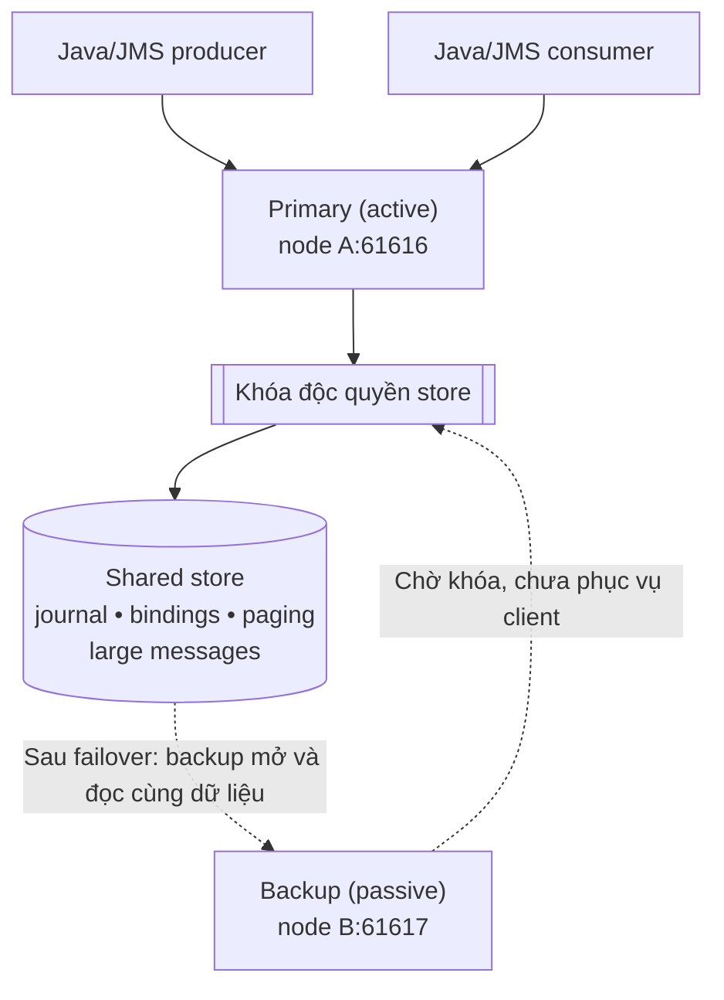
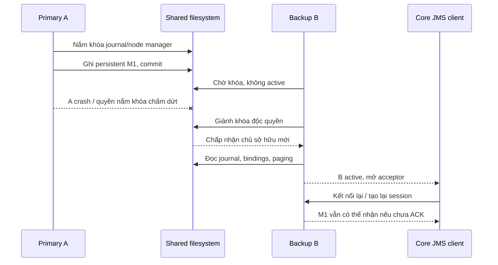
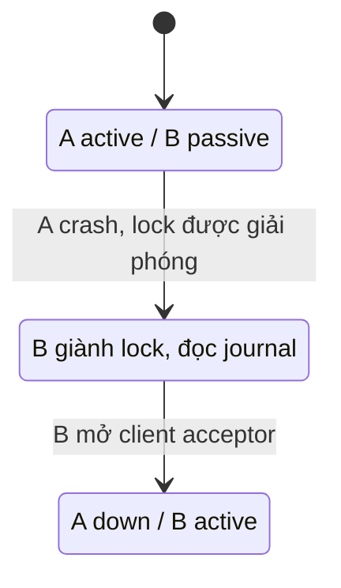

# Artemis primary/backup với shared store

> **Chương:** Sẵn sàng cao  
> **Sản phẩm:** Apache ActiveMQ **Artemis** (không phải ActiveMQ Classic/KahaDB).  
> **Mục tiêu:** Hiểu chính xác cặp **primary/backup sử dụng cùng shared store**, vai trò khóa journal, cấu hình `ha-policy` và các directory, cách client phát hiện backup, failover/failback, giới hạn khi storage lỗi và phép thử Java/JMS chứng minh **message persistent vẫn có thể nhận sau khi broker active thay đổi**.

## 1. Kịch bản: một node broker hỏng nhưng queue không được biến mất

Hệ thống có producer gửi `OrderPlaced` vào queue `ha.orders`. Một broker Artemis đang **active**, giữ kết nối client và ghi message persistent. Một broker còn lại **passive**, chờ quyền trở thành active. Hai tiến trình chạy trên hai máy/VM khác nhau nhưng sử dụng **chính xác cùng vùng dữ liệu** của Artemis.



Khi primary process/máy gặp sự cố:

1. Primary không còn giữ khóa hợp lệ trên shared journal.
2. Backup giành quyền sở hữu **độc quyền** đối với shared store.
3. Backup tải journal, bindings, page store và trạng thái cần thiết.
4. Backup trở thành **active**, mở kết nối cho client.
5. Core JMS client đã cấu hình HA có thể tìm và kết nối tới backup; nghiệp vụ tiếp tục từ những message đã được ghi bền vững.

**Điểm cốt lõi:** backup **không liên tục sao chép message** từ primary. Hai broker đã nhìn **cùng dữ liệu vật lý**, và cơ chế chuyển vai dựa trên quyền nắm khóa. Đây là **shared-store HA**, khác hẳn HA bằng **replication** giữa hai journal riêng.

Nếu cả hai broker mất truy cập tới shared storage, hệ thống vẫn ngừng hoạt động. Shared store loại bỏ phụ thuộc vào **một process broker**, nhưng có thể đưa storage thành **điểm lỗi chung**.

## 2. Thuật ngữ cần phân biệt khi đọc log và thiết kế HA

| Thuật ngữ | Ý nghĩa đúng trong Artemis | Nhầm lẫn phổ biến |
| --- | --- | --- |
| `primary` | **Cấu hình** vai trò broker chính trong cặp HA | Primary luôn là node active kể cả sau sự cố |
| `backup` | **Cấu hình** vai trò dự phòng | Backup luôn passive |
| `active` | **Trạng thái runtime**: broker hiện đang chấp nhận client | Chỉ broker được khai báo `primary` mới có thể active |
| `passive` | **Trạng thái runtime**: đang chờ kích hoạt | Process không chạy |
| `failover` | Quyền phục vụ chuyển từ primary sang backup sau lỗi/ngừng theo policy | Dữ liệu tự động được copy sang disk mới |
| `failback` | Primary cũ quay lại và có thể lấy lại vai active theo chính sách | Primary khởi động lại là chắc chắn active ngay |
| `shared store` | **Một bộ dữ liệu** được hai node truy cập trên file system dùng chung | Hai thư mục local “có tên giống nhau” |

Có thể có tình huống:

```text
Trước lỗi:    node A = configured primary, active
              node B = configured backup, passive

Sau lỗi A:    node A = down
              node B = configured backup, active

Sau A trở lại:
              node B vẫn có thể active trong lúc A chờ failback
              (tùy policy, không được mở hai active trên cùng store)
```

Artemis documentation dùng “primary/backup” để chỉ **role cấu hình**, còn “active/passive” chỉ **trạng thái thực lúc đó**. Không dùng công thức “primary = active” khi xây health checks hoặc tự động điều phối failback.

## 3. Cơ chế khóa store: vì sao chỉ một broker được phép ghi?

### 3.1. Hai process, một tập file

Trong shared-store mode, **cả hai** cấu hình broker phải trỏ về **cùng vùng lưu trữ**:

```text
/shared/artemis-ha/
  ├── journal/        # Message journal, transaction state
  ├── bindings/       # Queue/address bindings, sequence metadata
  ├── paging/         # Page stores và cursor state liên quan
  └── largemessages/  # Payload của large messages
```

Tùy cấu hình còn có **node manager lock directory**. Mặc định `node-manager-lock-directory` trùng `journal-directory`; nếu tách, các node trong cùng cặp **phải dùng cùng miền khóa hợp lệ**, không đặt khóa local riêng.

**Không** chỉ share `journal/` nhưng để `bindings/`, `paging/` hoặc `largemessages/` trên disk riêng của từng node. Khi backup kích hoạt, bindings không tương ứng journal hoặc một page file/payload không tồn tại trên backup sẽ làm message không thể phục hồi nhất quán.

### 3.2. Mốc chuyển vai



Khả năng ngăn **hai active cùng sửa journal** phụ thuộc vào **cơ chế khóa và filesystem chia sẻ đúng chuẩn**. Tài liệu Artemis mô tả shared-store được bảo vệ tự nhiên khỏi split-brain nhờ khóa trên dữ liệu chung; điều đó **không** cho phép dùng storage có cơ chế khóa không đáng tin hoặc mount hai bản sao độc lập rồi tuyên bố an toàn.

### 3.3. Khi primary mất mạng nhưng vẫn nhìn thấy disk

Cần tách hai loại lỗi:

- **Mất liên lạc client/cluster nhưng primary vẫn giữ store lock:** backup không được tự mở cùng store để ghi; failover có thể chưa diễn ra dù client không kết nối được.
- **Primary process chết và khóa được giải phóng hợp lệ:** backup có thể kích hoạt.
- **Primary bị treo I/O/NFS, lock không giải phóng hoặc filesystem không đồng bộ:** backup có thể bị chặn lâu, hoặc nếu storage vi phạm tính độc quyền có nguy cơ hỏng dữ liệu.
- **Node A và B cùng “có thư mục /shared” nhưng thực ra là hai ổ riêng:** không phải shared store; cả hai có thể mở dữ liệu khác nhau, tạo **hai thực thể broker**, phá giả định HA.

**Fencing/lease và storage lock correctness** phải được nghiệm thu với platform SAN/NAS thực tế. Không sửa bằng cách **xóa file khóa thủ công** trong lúc một broker có thể còn ghi.

## 4. Shared-store HA khác replication và clustering ở đâu?

| Khía cạnh | Shared-store primary/backup | Replication primary/backup | Cluster nhiều active |
| --- | --- | --- | --- |
| Số data store | **Một** tập journal/bindings/page | Mỗi broker có **bản dữ liệu riêng**, đồng bộ qua mạng | Mỗi active node thường có state riêng |
| Cơ chế bảo vệ active | Khóa chung trên shared storage | Quorum/lock manager/cơ chế HA của replication | Nhiều active được thiết kế cùng hoạt động |
| Backup nhận dữ liệu bằng | Đọc trực tiếp cùng filesystem khi active | Nhận dữ liệu đã replication, phải xét bản mới nhất | Không có khái niệm backup toàn bộ mặc định |
| I/O mạng lúc hoạt động | Client + shared-storage I/O, **không nhân đôi message qua broker replication** | Traffic replication giữa nodes | Cluster bridge/load-balancing traffic |
| Ưu điểm | Dễ tránh hai broker ghi cùng journal nếu lock đúng; failover không cần copy toàn bộ store | Không phụ thuộc một shared journal filesystem | Tăng throughput ngang qua nhiều broker active |
| Rủi ro chính | **Shared storage** thành dependency chung, latency/journal scan | Sync lag/quorum/split brain; recovery phức tạp | Message distribution không tự bảo vệ mất một node |
| Dùng làm công cụ backup? | Không | Không thay thế backup độc lập | Không |

Một **cặp HA** thường chỉ có **một** broker active cho khối dữ liệu ấy tại một thời điểm; nó giúp **availability**, **không tự nhân đôi throughput của queue**. Artemis yêu cầu cluster topology/configuration phù hợp để các node công bố thông tin tới nhau và để Core client học địa chỉ backup. Đừng hiểu `<cluster-connections>` là “hai broker cùng tiêu thụ một queue như competing consumers”.

## 5. Điều kiện hạ tầng trước khi chỉnh `broker.xml`

Cấu hình đúng trên giấy nhưng storage sai còn nguy hiểm hơn không có HA. Trước khi deploy:

1. **Hai runtime độc lập:** node A và B trên **hai host/VM khác nhau** để chịu lỗi máy; chạy cùng máy chỉ phù hợp lab về process failover.
2. **Một filesystem chung, được chứng thực:** ví dụ SAN/shared block volume với filesystem/lock manager hỗ trợ đúng kiểu access, hoặc NAS/NFS đã kiểm chứng. Không dùng hai PVC không có chia sẻ thực.
3. **Cùng đường dẫn hiệu lực:** ví dụ `/srv/artemis-ha/journal` ở **cả hai node**, phải cùng underlying files; cùng chuỗi path chưa đủ.
4. **Journal lock hoạt động xuyên node:** thử lock exclusivity và tình huống host chết/treo, tránh đồng thời active.
5. **Quyền file thống nhất:** UID/GID, mode, SELinux/AppArmor, mount options cho cả hai process.
6. **Durability và fsync:** storage phải thực sự đáp ứng sync/ordering/flush của journal. Tránh file cache tạo cảm giác commit thành công nhưng chưa durable.
7. **Độ trễ đọc/ghi đủ thấp:** journal sync latency, throughput và I/O tail khi shared store phục vụ tải thật.
8. **Hai endpoint client truy cập được:** DNS, route, TLS và connector được broker quảng bá, không dùng `localhost` giữa hai host.
9. **Cluster security:** account/secret cho intra-cluster phải thống nhất, không dùng credential mặc định.
10. **Dung lượng và backup:** shared store cần snapshot/backup nhất quán; việc có standby process **không tạo bản sao dữ liệu**.

### 5.1. NFS: “mount được” chưa phải “an toàn”

Tài liệu Artemis có khuyến nghị NFS như `sync`, `noac`, `lookupcache=none` và điều chỉnh `timeo`/`retrans` để rút ngắn thời gian phát hiện lỗi. Tùy môi trường còn cân nhắc `soft`, nhưng cần đánh giá kỹ failure semantics của NFS và ứng dụng filesystem; mount flags **không phải** một công thức an toàn chung cho mọi Linux/NFS/SAN. Chọn theo platform được hỗ trợ và fault test thật.

Không lấy mount NFS trên máy dev rồi bảo đảm split-brain prevention và RPO trên hạ tầng production. Cần thử ngắt network-storage, reboot storage server, treo I/O và lock recovery.

### 5.2. Không biến một điểm lỗi thành hai

Nếu A và B độc lập nhưng đều dùng **một NAS head không HA**, sự cố NAS khiến cả hai broker mất dữ liệu. Cần đánh giá chuỗi phụ thuộc:

```text
Client network -> broker process -> shared-storage network
                                      -> SAN/NAS controller
                                      -> disk/RAID
                                      -> filesystem/lock manager
```

Một thiết kế HA chỉ mạnh bằng điểm yếu nhất trong chuỗi này. Với yêu cầu chịu **mất toàn bộ storage site**, cân nhắc replication sang failure domain độc lập, backup và disaster-recovery riêng.

## 6. Cấu hình Artemis: hai `broker.xml`, cùng dữ liệu, khác role

Bài lab có **hai Artemis broker instances**, mỗi instance giữ file `broker.xml`, log, management/UI ports và lifecycle riêng. Hai instance dùng chung một volume **dữ liệu**:

```text
node-A: Artemis instance /opt/artemis-primary/
  etc/broker.xml        # cấu hình primary riêng
  log/                  # log riêng
  <shared data mounted at /srv/artemis-ha>

node-B: Artemis instance /opt/artemis-backup/
  etc/broker.xml        # cấu hình backup riêng
  log/                  # log riêng
  <same shared data mounted at /srv/artemis-ha>
```

Các đoạn XML dưới đây là **fragments đặt vào `<core>` trong `broker.xml` Artemis**, không phải XML đầy đủ để tạo instance từ đầu. Nếu dùng cặp broker trên cùng host trong lab, chọn port khác nhau. Nếu dùng hai host khác nhau, dùng DNS/IP reachable thay vì `127.0.0.1`.

### 6.1. Các thư mục dữ liệu phải đồng nhất

**Cùng fragment** trên **cả primary lẫn backup**:

```xml
<!-- Trong <core> của broker.xml, giống nhau ở cả hai node -->
<persistence-enabled>true</persistence-enabled>

<journal-directory>/srv/artemis-ha/journal</journal-directory>
<bindings-directory>/srv/artemis-ha/bindings</bindings-directory>
<paging-directory>/srv/artemis-ha/paging</paging-directory>
<large-messages-directory>/srv/artemis-ha/largemessages</large-messages-directory>

<!-- Nếu tùy biến lock dir, giá trị này cũng phải trỏ cùng storage
     và cùng miền lock của cặp HA. Mặc định theo journal-directory. -->
<!-- <node-manager-lock-directory>/srv/artemis-ha/journal</node-manager-lock-directory> -->
```

**Không** đưa `journal-directory` của backup thành `/srv/artemis-backup/journal` với một ổ local riêng; đó là mô hình khác. Không dùng `persistence-enabled=false` rồi kỳ vọng backup giữ message durable sau failover.

### 6.2. Primary HA policy

Trong `broker.xml` của node **A**:

```xml
<ha-policy>
    <shared-store>
        <primary>
            <!-- Chỉ bật trong lab muốn thử failover bằng stop sạch. -->
            <failover-on-shutdown>true</failover-on-shutdown>
        </primary>
    </shared-store>
</ha-policy>
```

- `<shared-store><primary>`: khai báo đây là broker primary của cặp shared-store.
- `failover-on-shutdown=true`: khi primary dừng **gracefully**, cho phép backup kích hoạt. Hữu ích để test chuyển vai chủ động.
- **Mặc định** `failover-on-shutdown=false`: shutdown sạch **không tự kích hoạt** standby theo cùng cách. Nếu test bằng lệnh stop thông thường mà chưa bật tùy chọn, đừng kết luận HA lỗi chỉ vì backup tiếp tục passive.
- Khi primary **crash**, failover còn phụ thuộc lock release/recovery và storage khỏe.

**Không khuyến nghị bật `failover-on-shutdown=true` một cách vô điều kiện trong production**: maintenance stop của primary sẽ làm backup nhận vai active, ảnh hưởng client và có thể tác động các quy trình rolling upgrade. Cần xác định rõ hành vi mong muốn.

### 6.3. Backup HA policy

Trong `broker.xml` của node **B**:

```xml
<ha-policy>
    <shared-store>
        <backup>
            <allow-failback>true</allow-failback>
        </backup>
    </shared-store>
</ha-policy>
```

- Backup khởi động và **chờ khóa** nếu primary đang active.
- Nếu primary chết, backup có thể giành khóa và trở thành active.
- `allow-failback=true`: khi primary quay lại yêu cầu nhận vai, backup đang active có thể nhường lại.
- **Mặc định** của `allow-failback` là `true`; để có quy trình failback có người kiểm soát, có thể chọn `false` sau khi hiểu chính sách vận hành.
- `allow-failback` **không** đồng nghĩa “backup tự gửi journal mới nhất cho primary qua network”: trong shared-store, cả hai đọc **cùng dữ liệu**.

Các option `group-name`, `check-for-active-server` và quorum voting thường thấy trong tài liệu replication **không nên sao chép nguyên sang `shared-store`**. Cơ chế pairing chính của shared-store là cùng storage và lock, không phải so nhóm journal replication.

### 6.4. Connectors/acceptors: endpoint phải khác, tên phải nhất quán

**Ví dụ hai instance cùng máy lab** (port 61616, 61617; client chạy ngoài hai process). Trên **primary**:

```xml
<connectors>
    <connector name="node-primary">tcp://127.0.0.1:61616</connector>
    <connector name="node-backup">tcp://127.0.0.1:61617</connector>
</connectors>

<acceptors>
    <acceptor name="core-primary">tcp://127.0.0.1:61616?protocols=CORE</acceptor>
</acceptors>

<cluster-connections>
    <cluster-connection name="ha-topology">
        <address/>
        <connector-ref>node-primary</connector-ref>
        <static-connectors>
            <connector-ref>node-backup</connector-ref>
        </static-connectors>
    </cluster-connection>
</cluster-connections>
```

Trên **backup**:

```xml
<connectors>
    <connector name="node-primary">tcp://127.0.0.1:61616</connector>
    <connector name="node-backup">tcp://127.0.0.1:61617</connector>
</connectors>

<acceptors>
    <acceptor name="core-backup">tcp://127.0.0.1:61617?protocols=CORE</acceptor>
</acceptors>

<cluster-connections>
    <cluster-connection name="ha-topology">
        <address/>
        <connector-ref>node-backup</connector-ref>
        <static-connectors>
            <connector-ref>node-primary</connector-ref>
        </static-connectors>
    </cluster-connection>
</cluster-connections>
```

Giải thích:

- `connector` mô tả **địa chỉ được quảng bá** trong topology, không phải socket server đang bind.
- `acceptor` mô tả port/interface mà một broker **active** nhận client; backup passive chưa phục vụ client như active.
- `connector-ref` trong cluster connection của mỗi node trỏ tới **connector chính nó**; static connector trỏ node còn lại để khám phá.
- Tài liệu Artemis yêu cầu **cluster configuration phù hợp** cho HA; ví dụ sử dụng static connectors, không cần UDP discovery.
- Khi cluster transport cần authentication, đặt **`cluster-user` và `cluster-password` thống nhất** ở hai node, sử dụng secrets không phải mặc định của broker.
- Trên **hai host thật**, `127.0.0.1` sẽ sai: cả URL được quảng bá và acceptor bind phải được đổi theo hostname/đường truyền. `localhost` chỉ hợp lệ trong topology lab cùng host.

Hai ví dụ `<connectors>`/`<acceptors>` là **đoạn thay thế** trong `broker.xml` đã có sẵn, không chèn thêm một khối trùng lặp tên/port với cấu hình hiện hành. Các port web console/JMX/management của hai instances cũng cần tách riêng.

### 6.5. Address/queue dùng để kiểm chứng

Có thể khai báo ở primary và backup theo **cùng một contract**, nhưng dữ liệu bindings thực tế thuộc shared store. Fragment trong `<addresses>`:

```xml
<address name="ha.orders">
    <anycast>
        <queue name="ha.orders" durable="true"/>
    </anycast>
</address>
```

Đây là **queue bền vững** để gửi/nhận message persistent khi active node chuyển vai. Không đặt static queue có định nghĩa mâu thuẫn giữa hai broker rồi kỳ vọng “backup sẽ sửa hộ”.

Việc `Session.createQueue("ha.orders")` trong Java **chỉ tạo destination object**. Để lab đáng tin, provision queue và kiểm tra trên Artemis Console/management trước khi gửi.

## 7. Client failover: biết **cả hai connector**, không chỉ biết primary

Core JMS client có thể học topology primary/backup từ broker và tự tái tạo connection/session/consumer trong các điều kiện hỗ trợ. Nhưng URL/connector được quảng bá phải đúng và reachable; nếu broker quảng bá `127.0.0.1` trong một cluster khác host, remote client sẽ thử kết nối tới **chính máy của nó**.

### 7.1. URL HA minh họa cho Artemis native JMS client

```text
(tcp://127.0.0.1:61616?name=node-primary,tcp://127.0.0.1:61617?name=node-backup)?ha=true&reconnectAttempts=-1
```

- Hai endpoint trong ngoặc là danh sách bootstrap/reconnect.
- `name=node-primary`/`name=node-backup` tương ứng **connector names broker công bố**.
- `ha=true` yêu cầu hành vi client HA.
- `reconnectAttempts=-1` cho phép retry không giới hạn trong **lab**; production nên có timeout, circuit breaker, deadline và shutdown behavior phù hợp.
- Có thể cần điều chỉnh `failoverAttempts`, `retryInterval`, `retryIntervalMultiplier` và reconnect behavior theo **đúng Artemis client version**.

Đây là **Core Artemis URI**, không phải URI cho Classic OpenWire, Qpid JMS AMQP, STOMP hay MQTT. Nếu dùng AMQP 1.0/JMS provider khác, failover URI và settlement semantics phải theo **provider đó**.

### 7.2. Client khôi phục kết nối không có nghĩa toàn bộ in-flight operation được replay

Sau failover:

- Core client có thể tạo lại session/consumer, nhưng **in-flight send, ACK và transaction** chưa ghi bền vững có thể mất hoặc không có kết quả chắc chắn.
- Một `commit()` đang bị chặn có thể ném `TransactionRolledBackException` hoặc `JMSException`; đừng biến mọi exception thành “broker chắc chắn chưa commit” khi có timeout/network partition.
- Nên theo dõi `ExceptionListener`, làm rõ retry policy và dựa vào **business event ID** để dedup khi producer gửi lại.
- Nếu consumer đã commit DB bên ngoài nhưng JMS ACK chưa được broker ghi nhận, message có thể redeliver sau failover.
- **HA không tạo exactly-once end-to-end** với DB/payment service.

Trong Java/JMS, nên dùng **JMS transacted session** cho bài toán cần ACK sau khi xử lý. Local JMS transaction **không bao gồm database**. Với side effect ngoài broker vẫn cần inbox/outbox/idempotency hoặc giao dịch phối hợp phù hợp.

## 8. Lab Java/Jakarta JMS: gửi persistent → failover → nhận và commit ACK

Bài lab tách rõ **kiểm chứng dữ liệu lưu trữ** và **kiểm chứng reconnect đang có session**:

1. `seed` gửi 20 message PERSISTENT trong một JMS transaction, commit xong thì đóng client.
2. Chuyển vai broker (graceful với `failover-on-shutdown=true` hoặc crash process trong môi trường cô lập).
3. `drain` mở **connection mới**, nhận đủ 20 message từ node active mới và commit ACK.
4. `empty` mở connection mới, quan sát queue đã rỗng sau ACK.
5. Kiểm tra failback riêng, không trộn với phép kiểm persistence.

**Vì sao mở connection mới cho `drain`?** Để kết luận chính xác **shared store giữ dữ liệu qua thay đổi active broker**, không phụ thuộc ngay lập tức vào sự phức tạp của session auto-recreation. Sau khi storage test PASS mới chạy fault injection trên một client sống liên tục.

### 8.1. Dependency Maven và API

Ví dụ Java 17, Artemis 2.50.0 theo namespace `jakarta.jms`:

```xml
<properties>
    <maven.compiler.release>17</maven.compiler.release>
</properties>

<dependencies>
    <dependency>
        <groupId>org.apache.artemis</groupId>
        <artifactId>artemis-jakarta-client</artifactId>
        <version>2.50.0</version>
    </dependency>
</dependencies>
```

Artemis 2.50.0 chuyển Maven groupId sang `org.apache.artemis`. Với phiên bản cũ, phải kiểm tra đúng groupId/artifact/JMS namespace. Không trộn `javax.jms` và `jakarta.jms` trong một ví dụ build. Một ứng dụng dùng Spring Boot 3.x cũng cần Jakarta client tương thích với BOM đang dùng.

Broker lab có Core acceptors trên hai endpoint. Nếu bật authentication, code đọc `ARTEMIS_USER` và `ARTEMIS_PASSWORD`; hạn chế quyền theo queue test.

### 8.2. Mã Java hoàn chỉnh

```java
import jakarta.jms.Connection;
import jakarta.jms.DeliveryMode;
import jakarta.jms.Message;
import jakarta.jms.MessageConsumer;
import jakarta.jms.MessageProducer;
import jakarta.jms.Queue;
import jakarta.jms.QueueBrowser;
import jakarta.jms.Session;
import jakarta.jms.TextMessage;

import org.apache.activemq.artemis.jms.client.ActiveMQConnectionFactory;

import java.util.Enumeration;
import java.util.HashSet;
import java.util.Set;

public final class SharedStoreHaProbe {
    private static final String QUEUE = "ha.orders";
    private static final int COUNT = 20;

    private static void require(boolean ok, String reason) {
        if (!ok) throw new IllegalStateException(reason);
    }

    private static Connection open(ActiveMQConnectionFactory factory)
            throws Exception {
        String user = System.getenv("ARTEMIS_USER");
        String password = System.getenv("ARTEMIS_PASSWORD");
        if (user == null) return factory.createConnection();
        require(password != null, "ARTEMIS_PASSWORD missing");
        return factory.createConnection(user, password);
    }

    private static void seed(ActiveMQConnectionFactory factory,
                             String runId) throws Exception {
        try (Connection connection = open(factory)) {
            Session session = connection.createSession(
                    true, Session.SESSION_TRANSACTED);
            Queue queue = session.createQueue(QUEUE);

            MessageProducer producer = session.createProducer(queue);
            producer.setDeliveryMode(DeliveryMode.PERSISTENT);
            try {
                for (int i = 0; i < COUNT; i++) {
                    String eventId = runId + ":" + i;
                    TextMessage message =
                            session.createTextMessage("payload-" + i);
                    message.setStringProperty("runId", runId);
                    message.setStringProperty("eventId", eventId);
                    message.setIntProperty("sequence", i);
                    producer.send(message);
                }
                session.commit();
                System.out.println("SEED COMMITTED " + COUNT);
            } catch (Exception failure) {
                session.rollback();
                throw failure;
            } finally {
                producer.close();
            }
        }
    }

    private static void drain(ActiveMQConnectionFactory factory,
                              String runId) throws Exception {
        try (Connection connection = open(factory)) {
            Session session = connection.createSession(
                    true, Session.SESSION_TRANSACTED);
            Queue queue = session.createQueue(QUEUE);

            // Lab: runId được giới hạn ASCII trước khi ghép selector.
            MessageConsumer consumer = session.createConsumer(
                    queue, "runId = '" + runId + "'");
            Set<String> seen = new HashSet<>();

            connection.start();

            try {
                for (int i = 0; i < COUNT; i++) {
                    Message message = consumer.receive(10_000);
                    require(message instanceof TextMessage,
                            "Timeout hoặc sai type");

                    String eventId =
                            message.getStringProperty("eventId");
                    int seq = message.getIntProperty("sequence");
                    String body = ((TextMessage) message).getText();

                    require((runId + ":" + seq).equals(eventId),
                            "eventId không khớp");
                    require(("payload-" + seq).equals(body),
                            "Body bị thay đổi");
                    require(seq >= 0 && seq < COUNT
                            && seen.add(eventId),
                            "Thiếu/trùng message " + eventId);

                    System.out.println("RECEIVED " + eventId);
                }

                // ACK 20 messages khi JMS commit thành công.
                session.commit();
                System.out.println("DRAIN COMMITTED " + seen.size());
            } catch (Exception failure) {
                session.rollback();
                throw failure;
            } finally {
                consumer.close();
            }
        }
    }

    private static void empty(ActiveMQConnectionFactory factory,
                              String runId) throws Exception {
        try (Connection connection = open(factory)) {
            Session session = connection.createSession(
                    false, Session.AUTO_ACKNOWLEDGE);
            Queue queue = session.createQueue(QUEUE);
            QueueBrowser browser = session.createBrowser(
                    queue, "runId = '" + runId + "'");

            connection.start();
            try {
                Enumeration<?> e = browser.getEnumeration();
                require(!e.hasMoreElements(),
                        "Vẫn còn message chưa ACK của runId " + runId);
                System.out.println("EMPTY PASS");
            } finally {
                browser.close();
            }
        }
    }

    public static void main(String[] args) throws Exception {
        require(args.length >= 2 && args.length <= 3,
                "Usage: <seed|drain|empty> <runId> [brokerURL]");
        String mode = args[0];
        String runId = args[1];
        require(runId.matches("[A-Za-z0-9_-]{1,32}"),
                "runId phải là ASCII an toàn, tối đa 32 ký tự");

        String url = args.length == 3
                ? args[2]
                : "(tcp://127.0.0.1:61616?name=node-primary,"
                  + "tcp://127.0.0.1:61617?name=node-backup)"
                  + "?ha=true&reconnectAttempts=-1";

        try (ActiveMQConnectionFactory factory =
                     new ActiveMQConnectionFactory(url)) {

            switch (mode) {
                case "seed" -> seed(factory, runId);
                case "drain" -> drain(factory, runId);
                case "empty" -> empty(factory, runId);
                default -> throw new IllegalArgumentException(
                        "Unknown mode: " + mode);
            }
        }
    }
}
```

**Điểm được kiểm chứng:**

- Producer dùng `DeliveryMode.PERSISTENT` và **transaction commit** trước khi failover.
- Message có `eventId` ổn định, `sequence` và body để so sánh dữ liệu, không dùng `JMSMessageID` làm business identity.
- Consumer sau failover dùng **connection mới** vào endpoint active hiện tại; nếu backup chưa active, client có thể retry tùy URI.
- `drain` kiểm tra **đủ 20** trước khi commit ACK. Nếu exception, transaction phần nhận chưa commit có thể redeliver.
- `empty` dùng `QueueBrowser` để kiểm tra queue lab **không có consumer/producer khác**; không dùng enumeration thay metric queue depth trong production.

**Giới hạn chủ đích:** Bài lab không tạo ra lỗi giữa DB commit và JMS commit; nó chứng minh tính bền vững của shared store và ACK state trong điều kiện cô lập. Với `runId` khác, cùng queue có thể chứa dữ liệu test cũ; nên dọn queue lab đúng quy trình trước khi chạy.

### 8.3. Trình tự chạy lab

| Bước | Hành động | Chứng cứ |
| --- | --- | --- |
| 1 | Mount cùng shared filesystem cho cả hai Artemis instances; cấu hình khác port và role | Đường dẫn cùng underlying files, lock hoạt động |
| 2 | Start **primary A trước**, chờ báo active | A nhận client trên `61616` |
| 3 | Start **backup B**, chờ trạng thái passive | B không tự thành active khi A giữ lock |
| 4 | Gọi Java `SharedStoreHaProbe seed run42` | `SEED COMMITTED 20` |
| 5 | Kiểm tra queue `ha.orders` có 20 message persistent | Metric broker, tập `eventId` |
| 6 | Dừng A sạch với `failover-on-shutdown=true` | B được quyền kích hoạt |
| 7 | Xác nhận B active và nhận client trên `61617` | Broker log/management + kết nối thật |
| 8 | Chạy `drain run42` | `DRAIN COMMITTED 20`, đủ ID/body |
| 9 | Chạy `empty run42` | `EMPTY PASS` trên queue lab |
| 10 | Start A lại và kiểm tra failback theo policy | Không hai active cùng giữ journal |
| 11 | Sau failback, chạy lại `empty run42` | ACK state vẫn phản ánh queue rỗng |

Tại bước 6, nếu `failover-on-shutdown=false` (mặc định), **stop sạch không nhất thiết chuyển vai**. Để kiểm thử backup tự kích hoạt khi **crash**, thử dừng process A không graceful trên **môi trường lab riêng**, không ngắt/bẻ khóa storage. Đây là test khác với shutdown có chủ đích.

**Không dùng cùng một `runId` để seed lần hai nếu lần trước chưa clear dữ liệu**. Một lần chạy có 40 message thay vì 20 sẽ làm test fail mà không chứng minh lỗi HA.

### 8.4. Nếu Java client vẫn đang chạy khi primary biến mất

Bài test khó hơn:

```text
Client đã kết nối A
  -> A crash
  -> client phát hiện connection failure
  -> backup B lấy lock + recover store
  -> client reconnect / reattach session (nếu provider hỗ trợ)
  -> code bắt lỗi operations bị gián đoạn
  -> xác định business eventId đã xử lý hay chưa
  -> retry một cách idempotent
```

Nên tách ra một integration test có producer/consumer chạy **liên tục trong lúc chuyển vai**, với fault injection trước/sau `send`, `session.commit` và DB commit. Bất kỳ lỗi `TransactionRolledBackException` hoặc timeout nào phải được phân loại; không bao toàn bộ trong một vòng `while(true)` rồi gửi lại không có event ID.

## 9. Failover và failback: hai đường chuyển vai có semantics khác nhau

### 9.1. Failover khi primary gặp lỗi



Điều kiện backup thật sự active:

- Broker B process khỏe, có file permission và truy cập storage đúng.
- Lock của A đã hết hiệu lực và B giành được quyền độc quyền.
- Journal/bindings/paging/large-message data nhất quán, đọc được.
- A không còn quyền ghi cùng store.
- Network/acceptor/cert/ACL của B hoạt động cho client.

**Tình huống quan trọng:** storage bị ngắt trong lúc A còn giữ lock; B cũng không đọc được shared store. Khi đó cặp broker không thể phục hồi bằng failover, mặc dù B process vẫn chạy.

### 9.2. Failback khi primary A khởi động lại

Sau khi B active, A quay lại:

```text
B đang active, giữ shared lock
A restart với role <primary>
    |
    +-- allow-failback=true trên B:
    |      B có thể nhường vai theo yêu cầu failback
    |      A lấy lock và khôi phục cùng shared data
    |
    +-- allow-failback=false trên B:
           Hạn chế failback tự động;
           cần quy trình vận hành có kiểm soát
```

Vì cùng dùng store, không có bước **replicate journal từ B về A** như replication HA. Nhưng **client có thể bị gián đoạn lần thứ hai** khi chuyển active từ B về A. Đừng bật automatic failback nếu ứng dụng nhạy cảm với nhiều lần reconnect mà chưa có runbook/test.

Các cấu hình như `restart-backup` có thể ảnh hưởng vòng đời backup sau khi failback; chỉ dùng sau khi kiểm tra version và quy trình operator. Không suy đơn giản “failback xong B luôn trở lại passive theo đúng thời điểm mong muốn” nếu process B đã dừng và chưa được supervisor khởi động lại.

### 9.3. Shutdown sạch không phải crash

| Trường hợp | Chính sách chính | Kỳ vọng |
| --- | --- | --- |
| A bị kill/process crash | Store lock được giải phóng, B đủ điều kiện active | B takeover khi phục hồi được shared store |
| A shutdown sạch, `failover-on-shutdown=false` | Mặc định | Backup không tự kích hoạt chỉ do stop sạch |
| A shutdown sạch, `failover-on-shutdown=true` | Đã chọn chuyển vai chủ động | B có thể takeover sau shutdown |
| A restart khi B active và `allow-failback=true` | Tự động failback | B có thể nhường vai cho A |
| A restart khi B active và `allow-failback=false` | Failback có kiểm soát | B tiếp tục active cho đến khi operator thực hiện chuyển vai |
| Shared filesystem hỏng/đứt | Không có storage nhất quán | Không có bảo đảm B có thể active |

**Đừng tự động khởi động lại A vào cùng thời điểm B mới active nếu chưa hiểu failback.** Một crash của A có thể kéo theo thêm một lần failback ngay khi supervisor restart A; điều này làm tăng số lần reconnect của toàn bộ client.

## 10. Thứ được bảo vệ sau failover và thứ không được bảo vệ

### 10.1. Message persistent có transaction commit

Dữ liệu được broker **ghi bền vững** vào shared store là thứ backup có thể khôi phục. Ví dụ:

```text
M1: producer send PERSISTENT + commit thành công -> pending
M2: consumer receive + JMS commit ACK thành công -> không pending
M3: producer gửi nhưng commit đang chờ phản hồi -> kết quả chưa chắc
M4: NON_PERSISTENT đang ở RAM -> không có cam kết còn sau crash
```

Sau failover:

- **M1:** cần còn để nhận nếu chưa ACK và dữ liệu đã durable.
- **M2:** không được “sống lại” nếu ACK/transaction đã được lưu bền vững, theo policy journal.
- **M3:** phải xử lý theo **unknown transaction outcome**, không đoán từ timeout.
- **M4:** có thể mất; HA không biến non-persistent thành persistent.

### 10.2. Session và transaction đang bay

Backup không sao chép **toàn bộ trạng thái RAM/in-flight** của primary. Core client có thể tạo lại session/consumer nhưng không bảo đảm replay nguyên các thao tác chưa hoàn tất.

| Window lỗi | Kết quả có thể xảy ra | Phương án ứng dụng |
| --- | --- | --- |
| Producer send trước commit | Transaction có thể bị rollback | Bắt exception, retry với ID/duplicate detection |
| Producer commit gửi nhưng response mất | Không chắc broker đã commit | Reconcile theo eventId, dedup |
| Consumer đã nhận, chưa ACK | Message có thể redeliver | Handler idempotent |
| DB đã commit, JMS ACK chưa commit | Side effect có thể lặp sau redelivery | Inbox/unique business key |
| Client lost connection giữa request/reply | Reply có thể mất hoặc gửi tới reply-to không còn tồn tại | Correlation ID + timeout/retry có kiểm soát |
| Transaction prepared/XA | Phải dùng transaction manager recovery chuẩn | Không tự xóa in-doubt transaction |

**Không** chỉ đặt `ha=true` rồi tuyên bố exactly-once. HA giải quyết **broker availability**, còn exactly-once ở nghiệp vụ cần transaction/idempotency và kiểm chứng cửa sổ crash thực.

### 10.3. Persistent queue khác durable consumer backlog

Với queue ANYCAST, message persistent chưa ACK cần được khôi phục. Với topic MULTICAST durable subscription, cả **subscription metadata và pending references** phải tồn tại trên shared store. Vì vậy backup cần cùng `bindings-directory` và `paging-directory`, không chỉ journal; một subscriber offline có thể đang giữ backlog paged.

Nếu thử durable subscription, phải tạo subscription **trước** lúc publish để có backlog cần giữ, rồi kiểm tra subscription còn nguyên qua failover.

## 11. Hiệu năng và capacity của shared-store HA

### 11.1. Vì sao không nhân đôi broker throughput?

Chỉ một broker active trên store, nên CPU của passive backup **không trực tiếp chia tải cho queue**. Khi A hỏng, B phải đủ CPU/RAM/IOPS để gánh **toàn bộ** workload, không được chỉ cấu hình “nửa tài nguyên” vì B chủ yếu đứng chờ.

### 11.2. Journal I/O có thể là nút thắt

So với journal trên local SSD, shared SAN/NFS có thể thêm:

- Latency ghi đồng bộ ở thời điểm producer commit.
- Throughput đọc journal khi backup takeover.
- Độ trễ metadata/lock khi mở store.
- Network storage jitter ảnh hưởng p99 send/commit.
- Thời gian phục hồi dài nếu journal lớn và tốc độ read thấp.

Tài liệu Artemis lưu ý **shared-store journal có thể bị đọc nhiều khi broker startup**, vì vậy RTO phụ thuộc đáng kể storage read performance. Không tuyên bố failover “tức thời” chỉ vì backup process đã chạy từ trước. Cần đo `primary failure detected → lock acquired → journal loaded → acceptor ready → client healthy`.

### 11.3. Ước lượng RTO đúng

```text
RTO thực tế ~ thời gian phát hiện lỗi
           + thời gian lock release/acquisition
           + thời gian load/recovery store
           + thời gian acceptor/cluster availability
           + thời gian client reconnect/recreate
           + thời gian nghiệp vụ ổn định
```

Đây là **mô hình cộng các thành phần**, không phải SLA mặc định từ Artemis. Một NFS mount đợi timeout dài có thể khiến thời gian release lock vượt xa kỳ vọng.

### 11.4. Dung lượng storage không nhân đôi

Shared-store không chứa “bản sao B” của các message. Vì vậy:

- Disk shared có nguy cơ đầy do backlog, paging, DLQ và large messages.
- Hỏng volume có thể mất **cả primary lẫn backup** cùng lúc.
- Không thể dùng passive broker như backup lịch sử khi operator xóa nhầm queue — deletion đã ghi vào **cùng store**.
- Cần snapshot/backup nhất quán và quy trình khôi phục độc lập với HA failover.

## 12. Observability: xác định ai đang active và vì sao không takeover

### 12.1. Bộ metric cần theo dõi

| Lớp | Tín hiệu | Câu hỏi |
| --- | --- | --- |
| Broker A/B | Runtime state **active/passive**, uptime và restart count | Chỉ một node active hay cả hai đều passive? |
| HA | Failover/failback events, thời gian chuyển vai | RTO thực tế là bao nhiêu? |
| Storage | Lock wait/acquire, journal recovery time | Backup đang chờ khóa hay bị kẹt I/O? |
| Filesystem | Mount health, read/write latency, free space, fsync time | Shared volume có phải nguyên nhân chung? |
| Topology | Core connector advertised addresses, cluster connection status | Client có học đúng B endpoint không? |
| Client | Reconnect attempts, exception listener, send/commit errors | App tự phục hồi hay bị lỗi kéo dài? |
| Queue | Pending/delivering count, redelivery, DLQ, paging | Message có còn đủ trước/sau failover? |
| Nghiệp vụ | Unique event IDs, DB inbox, duplicate count | Failover tạo side effect trùng hay mất event? |

### 12.2. Runbook khi backup không active

1. Xác minh A thật sự down hay chỉ mất mạng từ phía client.
2. Xem process B còn chạy và đang **passive waiting for lock** hay đã exit.
3. Kiểm tra **cùng underlying filesystem**; tránh nhầm mount path local.
4. Xác minh filesystem khỏe, quyền ghi, disk không full, node manager lock không bị kẹt.
5. Kiểm tra journal recovery log; có corruption/missing file hay không.
6. Kiểm tra B acceptor đã mở **sau** khi active, TLS/ACL, connector được công bố.
7. Kiểm tra Core client HA URL và retry budget; không dùng một endpoint A cố định.
8. Nếu lock bị kẹt, **không xóa lock file ngay**. Điều tra fencing/lease và trạng thái A theo hướng dẫn storage/broker.

Nếu B đã active mà client vẫn fail, vấn đề có thể nằm ở **client topology, DNS, certificate hoặc provider failover** thay vì HA store.

### 12.3. Health check không được nhận nhầm passive thành active

Với Kubernetes/VM supervisor:

- Liveness của passive process chỉ xác nhận **process khỏe**, không yêu cầu nó phải mở client port.
- Readiness để **nhận traffic JMS** chỉ nên báo healthy khi broker **active** và có thể phục vụ.
- Không restart backup vô hạn chỉ vì port 61617 chưa mở lúc nó đang passive; như vậy có thể khiến backup không bao giờ đủ ổn định để takeover.
- Một TCP connect đến A không chứng minh volume còn an toàn hoặc B có thể takeover.
- Sau failover, kiểm tra queue/message state và business ID, không chỉ port đang listen.

## 13. Kiểm thử bắt buộc: không chỉ dừng một process rồi nhìn port

| Ca | Kịch bản | Kỳ vọng |
| --- | --- | --- |
| H1 | Start A trước, start B sau | A active, B passive, **một store owner** |
| H2 | Seed 20 persistent messages, commit | Message có trong queue `ha.orders` |
| H3 | Stop A sạch, `failover-on-shutdown=true` | B takeover, `drain` nhận đủ 20 |
| H4 | Stop A sạch, `failover-on-shutdown=false` | Không kỳ vọng automatic failover chỉ do shutdown sạch |
| H5 | Crash A sau commit (lab riêng) | B takeover khi lock release, không mất message durable |
| H6 | Consumer xử lý DB xong, crash A trước ACK | Redelivery có thể xảy ra, inbox ngăn side effect trùng |
| H7 | Producer commit response mất | Dedup/reconciliation theo event ID |
| H8 | A restart khi B active, `allow-failback=true` | Failback theo policy; không hai active |
| H9 | A restart khi B active, `allow-failback=false` | B vẫn có thể tiếp tục active, có runbook chuyển vai |
| H10 | Tách mount/storage network trong lab | Xác định thời gian lỗi và giới hạn HA; không tuyên bố RTO thấp nếu lock/storage treo |
| H11 | Sai connector advertised address | Broker có thể active nhưng client không tự reconnect đúng |
| H12 | Disk shared đầy | Có cảnh báo và hành vi broker theo policy, không tự xóa file |
| H13 | Durable subscription backlog, failover | Queue/subscription bindings và pending data còn |
| H14 | Cả hai broker cùng down rồi start B trước | Kiểm tra B có quyền activate từ shared store và dữ liệu còn nguyên |
| H15 | Long-lived consumer trong failover | Session/transaction errors được xử lý, không retry side effect mù quáng |

### 13.1. Điều kiện để nói “PASS”

Mỗi test ghi:

- Artemis broker/client version, mode `shared-store`, topology, địa chỉ mount.
- Node nào được cấu hình `primary/backup` và node nào **active/passive** tại mỗi thời điểm.
- Giá trị `failover-on-shutdown`/`allow-failback`.
- Thời điểm A dừng, B lấy lock, B nhận client và client xử lý thành công.
- Tập `eventId` producer đã commit, message còn pending, đã ACK và chuyển DLQ nếu có.
- Journal/paging/bindings recovery logs và metric storage.
- Kết quả retry khi commit/ACK bị gián đoạn; business side effect có bị trùng không.

**Chỉ dùng queue lab**; không chạy stress, kill, unmount shared volume hoặc xóa file trên môi trường production.

## 14. Những lỗi cấu hình có thể gây hậu quả nghiêm trọng

### 14.1. Hai directory trông giống nhau nhưng không phải cùng storage

`/srv/artemis-ha/journal` ở A và B có thể là hai thư mục trên hai local SSD khác nhau nếu mount bị fail. Đây không phải một shared store; thử kiểm tra mount source, file identity và cơ chế khóa xuyên node trước khi khởi động.

### 14.2. Chỉ chia sẻ journal, không chia sẻ bindings/paging

Message journal có thể chứa record nhưng queue bindings, page cursor hay payload large-message không tồn tại ở node khác. Dữ liệu khôi phục không đầy đủ; **phải dùng chung toàn bộ miền dữ liệu** của broker cặp HA.

### 14.3. Backup có client acceptor nhưng chưa active

Không xây routing dựa trên giả định backup sẽ nhận và xử lý message ngay khi process started. Passive broker **chưa phục vụ JMS như active**. Đừng gán app trực tiếp tới backup mà bỏ HA URL/topology phù hợp.

### 14.4. Dùng hai broker như cluster active-active

Hai broker cùng shared journal không phải hai consumers của queue. Không cố cho cả hai active để tăng throughput: điều đó phá vai trò độc quyền và có nguy cơ journal corruption.

### 14.5. Quên `failover-on-shutdown` khi test stop sạch

Với giá trị mặc định false, stop sạch không phải test tự động promotion. Phải bật true **trong kịch bản thử chủ động**, hoặc làm crash test trong môi trường cô lập.

### 14.6. Quên `allow-failback` khi A quay lại

Mặc định true có thể tạo thêm một lần chuyển vai, khiến client reconnect lần nữa. Nếu cần thời điểm failback có kiểm soát, chọn policy phù hợp và vận hành theo runbook; không đánh giá tự động failback là “broker flapping” khi chính mình đã bật policy.

### 14.7. Lỗi của storage bị gọi nhầm là lỗi broker

Nếu shared SAN/NAS hỏng, cả A và B đều không thể khôi phục message; restart liên tục có thể làm tình trạng tệ hơn. Cần quan sát filesystem, journal I/O và lock semantics trước khi điều chỉnh retry client.

### 14.8. Tin rằng HA thay thế backup

HA bảo vệ **khả năng tiếp tục phục vụ** khi một broker node lỗi, không bảo vệ khỏi xóa nhầm dữ liệu, ransomware, hỏng chung shared storage hoặc bug ghi journal. Snapshot/backup/restore drills là yêu cầu **độc lập**.

## 15. Checklist review cấu hình production

- [ ] Hai node chạy trên failure domain đủ độc lập, nhưng **thật sự chung một shared filesystem**.
- [ ] Đã xác minh filesystem/lock manager đủ semantics exclusivity, sync và crash release.
- [ ] `journal-directory`, `bindings-directory`, `paging-directory`, `large-messages-directory` cùng underlying data ở cả hai node.
- [ ] Nếu tùy biến `node-manager-lock-directory`, đó là **cùng lock domain**, không phải hai thư mục local.
- [ ] Role cấu hình: primary dùng `<shared-store><primary>`, backup dùng `<shared-store><backup>`.
- [ ] Có explicit decision về `failover-on-shutdown` và `allow-failback`.
- [ ] Connectors/acceptors có tên/host/port đúng, reachable từ **client**.
- [ ] Có cluster configuration và cluster credentials theo yêu cầu HA, không dùng mật khẩu mặc định.
- [ ] Broker `persistent=true`, producer cần durability sử dụng `PERSISTENT` và transaction commit.
- [ ] Backup capacity đủ xử lý **100%** workload khi primary lỗi.
- [ ] Shared storage đủ IOPS, read latency, space, alert và RTO đã đo.
- [ ] Passive process không bị health check restart vô hạn vì chưa mở acceptor.
- [ ] Core client HA URL/reconnect policy được thử đúng phiên bản; các protocol khác có test riêng.
- [ ] Consumer/producer xử lý blocked call, rollback, retry và idempotency theo business event ID.
- [ ] Có backup/snapshot **nhất quán** và restore drill; shared-store HA không có data replica độc lập.
- [ ] Đã test stop sạch vs crash, storage outage, failback, ACK sau DB commit và duplicate.
- [ ] Có runbook fencing/storage lock; **không xóa journal/lock file thủ công** khi chưa chắc node cũ đã ngừng ghi.

## 16. Câu hỏi tự kiểm tra

1. Vì sao một cặp shared-store HA chỉ nên có **một active broker**?
2. Backup có copy message từ primary qua network liên tục giống replication không?
3. Vì sao cả `bindings`, `paging` và `large messages` cần dùng chung với journal?
4. `primary`/`backup` khác `active`/`passive` ở đâu sau failover?
5. Vì sao hai host cùng có đường dẫn `/srv/artemis-ha` chưa đủ chứng minh là shared store?
6. Nếu primary mất network nhưng vẫn giữ journal lock, backup có chắc được active ngay không?
7. Mặc định `failover-on-shutdown=false` có ảnh hưởng gì tới bài test stop sạch?
8. Vì sao `allow-failback=true` có thể gây một lần gián đoạn client **thứ hai**?
9. Vì sao Core JMS client có `ha=true` vẫn có thể cần idempotency sau failover?
10. Khi SAN/NAS chung chết hoàn toàn, cặp shared-store có thể khôi phục nhờ backup broker không?
11. Nếu consumer đã commit DB nhưng chưa ACK JMS trước crash, message có thể xuất hiện ở backup không?
12. Tại sao một backup broker process sống khỏe chưa đủ để báo HA “ready”?
13. Phép thử nào chứng minh riêng **storage recovery**, phép thử nào chứng minh **client reconnect**?
14. Shared-store HA có thay thế backup và disaster recovery không?

**Gợi ý:** (1) độc quyền khóa/store; (2) không; (3) bảo toàn queue/cursor/body; (4) role cấu hình vs trạng thái runtime; (5) mount source có thể khác; (6) không; (7) stop sạch không tự takeover; (8) B nhường lại A; (9) in-flight/ACK/transaction không hoàn toàn trong persistent state; (10) không; (11) có, cần inbox; (12) còn passive/không nắm khóa; (13) seed→failover→drain với client mới vs giữ client qua crash; (14) không.

## 17. Tài liệu chính thức và hướng đọc tiếp

- [Apache ActiveMQ Artemis — High Availability and Failover](https://artemis.apache.org/components/artemis/documentation/latest/ha.html): thuật ngữ primary/backup/active/passive, `shared-store`, lock, `failover-on-shutdown`, `allow-failback` và client failover.
- [Apache ActiveMQ Artemis — Persistence](https://artemis.apache.org/components/artemis/documentation/latest/persistence.html): `journal-directory`, `bindings-directory`, `node-manager-lock-directory`, journal sync và shared storage.
- [Apache ActiveMQ Artemis — Clusters](https://artemis.apache.org/components/artemis/documentation/latest/clusters.html): `cluster-connections`, static connectors, topology và broker cluster credentials.
- [Apache ActiveMQ Artemis — Core Client Failover](https://artemis.apache.org/components/artemis/documentation/latest/client-failover.html): Core client `ha`, reconnect attempts, failover attempts và listener lỗi.
- [Apache ActiveMQ Artemis — Command Line Interface](https://artemis.apache.org/components/artemis/documentation/latest/using-cli.html): tạo broker instances, tùy chọn HA và vận hành process.
- [Apache ActiveMQ Artemis — Examples](https://artemis.apache.org/components/artemis/documentation/latest/examples.html): các ví dụ HA, shared-store và client reconnect của dự án.
- [Apache ActiveMQ Artemis — Configuration Reference](https://artemis.apache.org/components/artemis/documentation/latest/configuration-index.html): kiểm chứng property và schema theo bản Artemis thực tế.

> **Kết luận:** **Artemis shared-store HA = hai broker độc lập + một tập storage chung + khóa sở hữu độc quyền + policy chuyển vai.** Backup tiếp quản **cùng journal/bindings/paging/large messages**, không sao chép message qua mạng như replication. Cấu hình đúng phải đi cùng storage lock đáng tin, client HA topology, ACK/transaction/idempotency và các phép thử stop, crash, failback, storage outage; **một backup broker không thể cứu được shared storage đã hỏng**.
