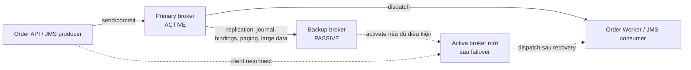
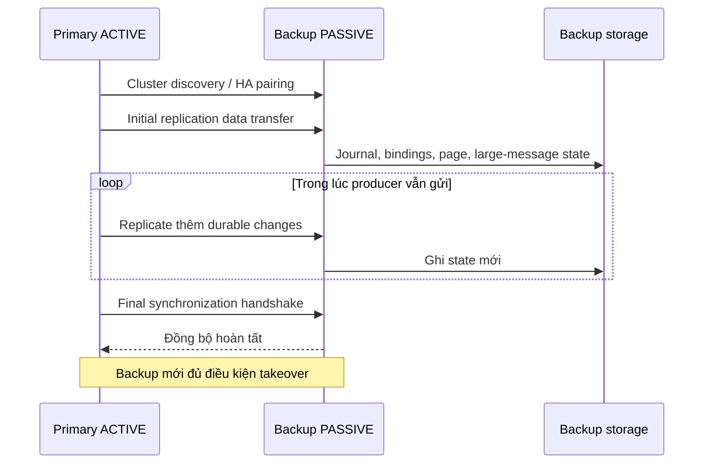
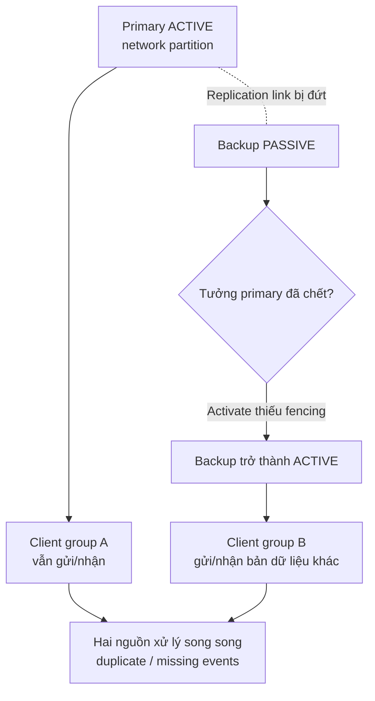
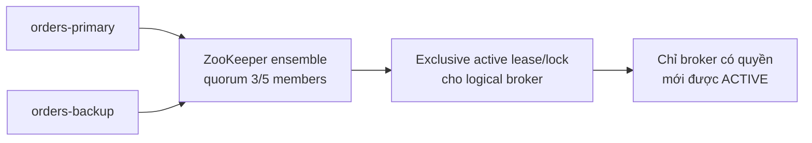
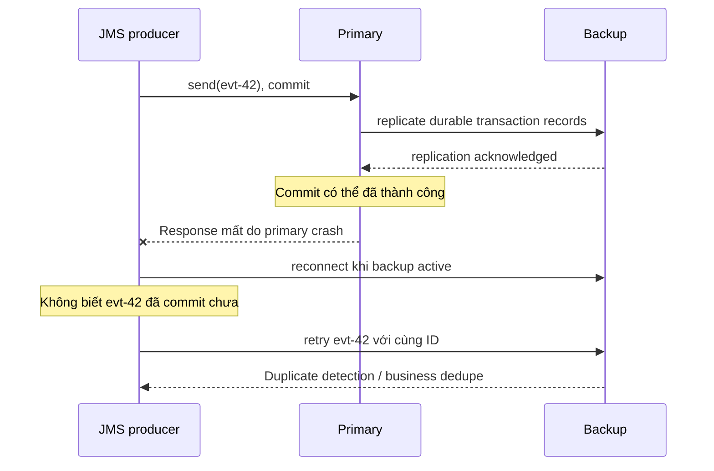

# Artemis primary/backup với replication

> **Chương:** Sẵn sàng cao  
> **Phạm vi:** Apache ActiveMQ **Artemis**, chính sách `<ha-policy><replication>` trên broker; JMS client sử dụng Artemis Core/JMS cho failover. Bài không dùng cú pháp ActiveMQ Classic master/slave hoặc shared-store để thay thế replication.  
> **Mục tiêu:** Cấu hình hai broker độc lập về storage thành một cặp primary/backup, giải thích đồng bộ ban đầu và takeover, triển khai chống split-brain, thiết lập client failover, phân tích commit outcome và kiểm thử failover/failback có số liệu.

## 1. Một queue phải tiếp tục phục vụ khi primary ngừng hoạt động

Giả sử `Order API` gửi lệnh `OrderCreated` vào queue `orders.commands`. Broker primary có journal và các message chưa được consumer xác nhận. Nếu máy chạy primary đột ngột mất nguồn, hệ thống cần **một broker khác có bản sao dữ liệu** để phục vụ lại mà không mất công việc đã ghi bền vững.

Artemis **replication HA** tạo một cặp:

- **Primary:** thường là broker active, tiếp nhận client, ghi journal và truyền trạng thái lưu trữ cần thiết sang backup.
- **Backup:** ban đầu **passive**, có data directory **riêng**, nhận replication và chờ quyền trở thành active.
- **Failover:** backup đã sẵn sàng được phép **activate** sau khi primary thất bại; các Core/JMS client hỗ trợ HA kết nối lại.
- **Failback:** khi primary cũ hồi phục, một quy trình có điều phối có thể chuyển trách nhiệm từ backup active về primary cũ, **sau khi dữ liệu được đồng bộ ngược**.



**Ba khái niệm không được trộn:**

1. **Replicated**: dữ liệu cần thiết đã được đồng bộ sang backup theo giao thức và chính sách lưu trữ.
2. **Ready for takeover**: backup đã kết thúc initial synchronization và có đủ điều kiện phối hợp để activate.
3. **Client recovered**: ứng dụng đã kết nối lại và các thao tác JMS/transaction đã được xử lý hoặc retry an toàn.

Một process backup đang chạy **không đồng nghĩa** backup đã đồng bộ xong; một backup đã activate **không đồng nghĩa** tất cả in-flight operations của producer/consumer đã được commit.

## 2. Replication khác shared-store, clustering và load balancing thế nào?

| Cơ chế Artemis | Dữ liệu nằm ở đâu? | Khi broker gặp sự cố | Điểm cần lưu ý |
|---|---|---|---|
| **Replication primary/backup** | Mỗi broker có **data directory riêng**, dữ liệu được truyền qua mạng | Backup đủ điều kiện có thể activate với dữ liệu đã đồng bộ | Phải có cluster discovery và chống split-brain; backup cần initial sync |
| **Shared-store primary/backup** | Hai broker cùng truy cập một shared storage | Backup chiếm lock và đọc cùng journal khi primary mất quyền | Phụ thuộc hạ tầng storage/lock; không dùng `replication` |
| **Cluster gồm nhiều active brokers** | Mỗi active broker quản lý queue/dữ liệu của chính nó | Có thể cân bằng/redistribute theo cluster policy | **Cluster connection không tự làm bản sao HA cho từng queue** |
| **JMS client failover** | Không tạo bản sao broker | Client chuyển endpoint khi active broker đổi | Không tự khôi phục mọi transaction đang dang dở |

Trong môi trường replication, **cần cluster configuration** để primary/backup tìm thấy nhau và cập nhật topology. Nhưng **có cluster connection không đồng nghĩa đã cấu hình HA**: phải có `<ha-policy><replication><primary/>` và `<backup/>`, cùng cơ chế coordination phù hợp.

### 2.1. Tên trong tài liệu cũ

Các tài liệu Artemis cũ đôi khi gọi `live/backup` hoặc `master/slave`; tài liệu hiện đại dùng **`primary/backup`**, và XML cấu hình hiện đại cũng dùng `<primary>`, `<backup>`. Không sao chép `<master>`/`<slave>` của bản cũ hoặc cấu hình ActiveMQ Classic vào Artemis mới mà chưa kiểm tra schema theo phiên bản.

### 2.2. Chỉ dữ liệu đã được lưu phù hợp mới có bảo đảm phục hồi

Không phải mọi trạng thái JVM ở primary đều được backup nhận:

- Message **PERSISTENT** đã commit và được lưu đúng journal/replication mới thuộc mục tiêu durable recovery.
- Message `NON_PERSISTENT`, request chưa nhận, các buffer chưa xác nhận và Session state chưa hoàn tất **không** có cùng bảo đảm.
- Thông tin phiên kết nối, in-flight sends/acks, thread state của consumer **không được nhân bản y hệt** để tiếp tục một transaction đang dang dở như không có sự cố.
- Cấu hình triển khai (`broker.xml`, user/role, TLS certificate, plugin jar, acceptor, cluster credentials) phải được đồng bộ bằng **deployment management**, không kỳ vọng replication tự sao chép toàn bộ file cấu hình.

**Đích của HA replication là khôi phục dịch vụ và dữ liệu durable**, không phải thực thi nghiệp vụ exactly-once.

## 3. Các điều kiện trước khi khởi động hai node

Ví dụ lab dùng hai Artemis **broker instances** và hai cổng:

| Thuộc tính | Primary | Backup |
|---|---|---|
| Instance logic | `orders-primary` | `orders-backup` |
| Local broker endpoint | `127.0.0.1:61616` | `127.0.0.1:61617` |
| Connector name | `orders-p` | `orders-b` |
| Cluster connection name | `orders-ha-cluster` | `orders-ha-cluster` |
| Replication group-name | `orders-ha-group` | `orders-ha-group` |
| Data directory | `/lab/artemis-primary/data` | `/lab/artemis-backup/data` |
| HA policy | `replication/primary` | `replication/backup` |
| Khi ổn định | **active** | **passive và in-sync** |

**Đây là lab một máy, không phải kiến trúc HA production:** cùng nguồn điện, OS, NIC và ổ đĩa có thể làm cả hai node chết đồng thời. Production phải tách failure domain; các endpoint trong `<connectors>` cần là địa chỉ mà **peer và các client thực sự truy cập được**, không mặc định `127.0.0.1`.

### 3.1. Đừng chia sẻ data directory

Replication dùng **shared-nothing storage**:

```text
orders-primary/
    etc/broker.xml
    data/             <-- chỉ primary sử dụng

orders-backup/
    etc/broker.xml
    data/             <-- chỉ backup sử dụng
```

Không mount cùng đường journal/pages/large-messages/bindings vào cả hai node; đó sẽ là một mô hình shared-store sai cách. Cũng không tự copy nguyên một journal của instance khác vào backup đang hoạt động: để Artemis thực hiện initial sync/recovery, bảo vệ tính nhất quán của node identity.

### 3.2. Điều kiện hạ tầng

- Hai node dùng phiên bản Artemis **tương thích**, cùng cấu hình destination/routing, persistence/security và cluster credentials cần thiết.
- Mỗi broker có **duy nhất** một connector công bố được và acceptor lắng nghe đúng port/host.
- Firewall cho phép đường node–node và client–active, TLS/credential đúng ở cluster connection nếu sử dụng.
- Disk đủ dung lượng cho journal, bindings, paging, large messages và dữ liệu nhân bản ban đầu.
- Thời gian đồng hồ được đồng bộ; log/metrics có node name, node ID, vai trò và thời điểm chuyển trạng thái.
- Hệ thống có quorum/lock manager **đã vận hành tin cậy** nếu định tự động failover an toàn giữa các failure domains.

Cần quyết định rõ **quyền activate**. Cấu hình hai broker có replication nhưng không có cơ chế giải quyết split-brain là **bài thử cơ chế**, không phải thiết kế production chấp nhận được.

## 4. Cấu hình `broker.xml` tối thiểu cho lab: primary

Đây là **các fragment thuộc `<core>`** của instance primary, không phải file `broker.xml` hoàn chỉnh. Giữ nguyên namespace, broker configuration, security, management và các mục khác của broker instance. Tên connector và HA group phải khớp chính xác giữa hai node.

```xml
<!-- PRIMARY: etc/broker.xml, bên trong <core> -->
<persistence-enabled>true</persistence-enabled>

<!-- Hai node đều ghi durable state trên storage riêng. -->
<journal-sync-transactional>true</journal-sync-transactional>
<journal-sync-non-transactional>true</journal-sync-non-transactional>

<connectors>
    <connector name="orders-p">tcp://127.0.0.1:61616</connector>
    <connector name="orders-b">tcp://127.0.0.1:61617</connector>
</connectors>

<acceptors>
    <acceptor name="orders-acceptor">tcp://127.0.0.1:61616?protocols=CORE</acceptor>
</acceptors>

<cluster-user>orders-ha-cluster-user</cluster-user>
<cluster-password>REPLACE_WITH_SAME_CLUSTER_SECRET</cluster-password>

<cluster-connections>
    <cluster-connection name="orders-ha-cluster">
        <address/>
        <connector-ref>orders-p</connector-ref>
        <retry-interval>500</retry-interval>
        <reconnect-attempts>-1</reconnect-attempts>
        <static-connectors>
            <connector-ref>orders-b</connector-ref>
        </static-connectors>
    </cluster-connection>
</cluster-connections>

<ha-policy>
    <replication>
        <primary>
            <group-name>orders-ha-group</group-name>
            <cluster-name>orders-ha-cluster</cluster-name>
            <check-for-active-server>true</check-for-active-server>
        </primary>
    </replication>
</ha-policy>

<addresses>
    <address name="orders.commands">
        <anycast>
            <queue name="orders.commands" durable="true"/>
        </anycast>
    </address>
</addresses>
```

**Giải thích các thuộc tính trọng điểm:**

- `persistence-enabled=true` và sync journal: cần cho mục tiêu durability, nhưng **không thay thế replication/quorum**.
- `orders-p`: địa chỉ primary **công bố qua cluster topology**, phải đúng endpoint có thể kết nối từ client và peer.
- `cluster-connection name="orders-ha-cluster"`: topology để tìm backup/primary; `cluster-name` tham chiếu đúng tên cluster connection này.
- `group-name="orders-ha-group"`: giới hạn backup ghép với primary cùng nhóm; không phải địa chỉ queue hoặc quyền truy cập.
- `check-for-active-server=true`: **rất quan trọng với quorum voting replication khi primary cũ khởi động lại**; tìm node đang active với node ID của mình trước khi quyết định hoạt động, tránh phục vụ dữ liệu cũ song song.
- `orders.commands`: mẫu queue durable. Dữ liệu message cũng phải persistent/committed để kỳ vọng sống sót sau crash.

**Lưu ý bảo mật:** chuỗi `REPLACE_WITH_SAME_CLUSTER_SECRET` là placeholder, **không phải cú pháp tự đọc secret**. Thay qua secret injection/broker instance management, không commit mật khẩu thật vào Git. Trong production dùng transport TLS và security role phù hợp.

## 5. Cấu hình `broker.xml` tối thiểu cho lab: backup

Tại instance backup, dùng connector của nó làm `connector-ref`, nhưng cả hai broker cùng `group-name` và `cluster-name`:

```xml
<!-- BACKUP: etc/broker.xml, bên trong <core> -->
<persistence-enabled>true</persistence-enabled>
<journal-sync-transactional>true</journal-sync-transactional>
<journal-sync-non-transactional>true</journal-sync-non-transactional>

<connectors>
    <connector name="orders-b">tcp://127.0.0.1:61617</connector>
    <connector name="orders-p">tcp://127.0.0.1:61616</connector>
</connectors>

<acceptors>
    <acceptor name="orders-acceptor">tcp://127.0.0.1:61617?protocols=CORE</acceptor>
</acceptors>

<cluster-user>orders-ha-cluster-user</cluster-user>
<cluster-password>REPLACE_WITH_SAME_CLUSTER_SECRET</cluster-password>

<cluster-connections>
    <cluster-connection name="orders-ha-cluster">
        <address/>
        <connector-ref>orders-b</connector-ref>
        <retry-interval>500</retry-interval>
        <reconnect-attempts>-1</reconnect-attempts>
        <static-connectors>
            <connector-ref>orders-p</connector-ref>
        </static-connectors>
    </cluster-connection>
</cluster-connections>

<ha-policy>
    <replication>
        <backup>
            <group-name>orders-ha-group</group-name>
            <cluster-name>orders-ha-cluster</cluster-name>
            <allow-failback>true</allow-failback>
        </backup>
    </replication>
</ha-policy>

<addresses>
    <address name="orders.commands">
        <anycast>
            <queue name="orders.commands" durable="true"/>
        </anycast>
    </address>
</addresses>
```

**Khi khởi động thành công:**

1. Primary active và nhận JMS client.
2. Backup tiến hành ghép cặp theo `group-name` và topology; **chưa active** trong giai đoạn này.
3. Backup đồng bộ dữ liệu từ primary rồi trở thành backup **đủ điều kiện takeover**.
4. Lúc primary còn active, backup không đồng thời nhận client như một active độc lập cho cùng logical broker.
5. Nếu primary chết và cơ chế coordination cho phép, backup có thể activate.

`allow-failback=true` thể hiện ý định backup đã takeover sẽ nhường lại khi primary cũ hồi phục và được đồng bộ. Đây **không phải** chỉ dẫn để kill backup ngay khi thấy process primary lên. Failback có nhiều pha và cần xác nhận chính xác state.

### 5.1. Những giá trị phải giống và phải khác

| Phải giống/có liên hệ | Phải khác |
|---|---|
| `group-name` của cặp HA | Broker instance/data directories |
| `cluster-name` tham chiếu đúng cluster connection | Port/host của acceptor trên cùng máy |
| Cluster user/password phù hợp | Local `connector-ref` (orders-p vs orders-b) |
| Destination/routing/security policies tương thích | Địa chỉ connector được quảng bá cho từng node |
| Phiên bản/protocol tương thích | Logging/monitoring instance identity |

Đừng tự sửa node ID ở journal để làm backup “nhìn giống primary”. **Artemis quản lý identity của logical broker** khi pair và failover; cần giữ nguyên dữ liệu đúng lifecycle trong quá trình restart/failback.

### 5.2. Đoạn XML mẫu chưa đủ để an toàn chống split-brain

Các block ở phần 4–5 minh họa **replication/cluster topology**, không phải một cơ chế fencing production. Nếu mạng node–node bị phân mảnh, primary có thể vẫn đang xử lý client trong khi backup tưởng primary chết. Phải chọn quorum hoặc distributed lock manager phù hợp trước khi cho phép **tự động activate** trong môi trường có dữ liệu thật.

## 6. Initial synchronization: backup online không đồng nghĩa backup đã sẵn sàng

Khác shared-store, backup replication có **data directory riêng** và phải lấy được snapshot/những thay đổi cần thiết từ primary.



**Các giai đoạn cần giám sát:**

| Giai đoạn | Backup được dùng để thay primary ngay? | Nguyên nhân |
|---|---|---|
| Chưa kết nối primary | **Không** | Không biết bản sao có mới nhất hay chưa |
| Đang copy initial journal/page/large data | **Chưa an toàn** | Có thể thiếu state |
| Final sync handshake | **Chờ hoàn tất** | Cần đảm bảo backup đã nhận phần dữ liệu cuối |
| In-sync và HA pair healthy | **Có thể**, tùy coordination/fencing | Backup có đủ data và điều kiện activate |
| Mất replication link khi primary còn active | **Không tùy tiện** | Nguy cơ split-brain |

Trong giai đoạn initial sync, phần lớn hoạt động vẫn có thể diễn ra đồng thời với traffic. Nhưng **final synchronization handshake** có một khoảng có thể block journal operations. Tham số `initial-replication-sync-timeout` giới hạn thời gian chờ bước này; tài liệu Artemis hiện đại mô tả mặc định khoảng **30.000 ms**. Điều chỉnh sau khi đo snapshot size, replication bandwidth và journal latency, không dùng một số thật lớn để che lỗi mạng.

### 6.1. Sizing initial sync

Các yếu tố quan trọng:

- Dung lượng journal + bindings + paging + large messages cần phục hồi.
- Băng thông thực tế, RTT và mức congestion giữa hai broker.
- Khối lượng ghi mới phát sinh **trong khi** initial copy.
- Throughput và latency của disk trên cả primary và backup.
- Phần giới hạn cuối của sync và thời gian sẵn sàng của standby.

Nếu 50 GiB dữ liệu cần copy qua đường truyền hiệu dụng 100 MiB/s, chỉ riêng copy thô đã có **cỡ vài phút**, chưa tính metadata, journal changes, disk I/O và final handshake. Không dùng “backup process started” làm điều kiện readiness; monitor **in-sync/pairing status**.

### 6.2. Vì sao backup có thể chờ mãi nếu không tìm thấy primary?

Replication backup **không có shared storage lock** để biết nó đang giữ bản dữ liệu mới nhất. Khác shared-store backup, nó **không được tự ý activate chỉ vì không tìm thấy primary** trong lúc chưa có lịch sử pairing an toàn. Trong một số tình huống recovery thủ công, quản trị viên phải xác minh node nào có data mới nhất rồi mới đổi vai trò/cấu hình theo runbook.

Không khởi động một backup cũ thành primary bằng cách sửa XML vội vàng trên production: có thể tái phục vụ dữ liệu stale hoặc gây mất/cặp đôi xử lý message.

## 7. Split-brain: vì sao chỉ có hai broker chưa đủ cho quorum voting an toàn?

**Split-brain** là khi hai broker cùng phục vụ **cùng một logical broker identity/data set** dù phải chỉ có một active.



Với cùng queue `orders.commands`, mỗi active có thể giao cùng một durable message cho consumer khác. Hai bên còn nhận các message **mới khác nhau**, khiến journal divergence. Đây là lỗi **tính đúng đắn**, không chỉ độ trễ failover.

### 7.1. Quorum voting và số node

Artemis quorum voting cần các **active brokers khác trong cluster** để làm nhân chứng khi replication link bị mất. Theo tài liệu mạng cô lập của Artemis:

- **Một HA pair duy nhất (hai broker)** không đủ nhân chứng để quorum voting hoạt động như cơ chế chống split-brain production.
- **Hai HA pairs** cũng chưa đủ trong topology quorum voting được mô tả.
- Cần **ít nhất ba HA pairs** trong thiết kế cluster quorum-voting được tài liệu hướng dẫn để có thành phần bỏ phiếu đủ ý nghĩa.

Không diễn giải `quorum-size=-1`, `vote-retries` hay `vote-on-replication-failure` thành câu thần chú có thể khiến **hai broker** độc lập phân biệt crash với network partition. Với chỉ một cặp, cần thêm **bộ điều phối độc lập/fencing** để có một nguồn quyết định active duy nhất.

### 7.2. Quorum voting và restart primary

Trong cơ chế quorum voting, trên primary cấu hình:

```xml
<ha-policy>
  <replication>
    <primary>
      <group-name>orders-ha-group</group-name>
      <cluster-name>orders-ha-cluster</cluster-name>
      <check-for-active-server>true</check-for-active-server>
    </primary>
  </replication>
</ha-policy>
```

`check-for-active-server=true` là **bắt buộc cần xem xét khi muốn failback từ backup active**. Primary cũ khi restart sẽ tìm trong topology node đang active với node ID của chính nó. Nếu thấy backup đã takeover, nó không được mở listener và phát message từ journal cũ ngay; cần phối hợp đồng bộ để failback.

**Giới hạn:** ở tình huống partition không có khả năng nhìn thấy nhau, một check qua cluster topology vẫn có thể không đủ để chứng minh không có active ở phía bên kia. Do đó quorum/fencing là yêu cầu bổ sung, không thay bằng một Boolean.

### 7.3. Vì sao không cứ cho backup activate “để uptime cao”?

Có sự đánh đổi giữa:

- **Availability:** vẫn phục vụ khi đường replication/network bị lỗi.
- **Consistency/safety:** không bao giờ có hai active cho cùng logical broker.

Không thể giữ được cả hai chỉ bằng hai node không có nguồn quyết định độc lập dưới mọi kiểu network partition. Trong hệ thống thanh toán, đơn hàng, ledger, thường ưu tiên **không tạo hai nguồn sự thật**; một khoảng gián đoạn có cảnh báo tốt hơn xử lý hai lần giao dịch.

## 8. Production: dùng pluggable lock manager cho một HA pair

Artemis hỗ trợ **pluggable distributed lock manager** để quyết định broker nào được phép active. Tài liệu nêu implementation dùng **Apache ZooKeeper/Curator**. Khác quorum voting dựa vào số active brokers khác, lock manager ủy quyền điều phối cho **hệ thống chứng thực độc lập**.

Một triển khai khái niệm:



### 8.1. Primary `ha-policy` dùng ZooKeeper manager

Dưới `<core>` của **primary broker.xml**, thay thế `<ha-policy>` lab (không khai báo hai policy):

```xml
<ha-policy>
  <replication>
    <primary>
      <group-name>orders-ha-group</group-name>
      <cluster-name>orders-ha-cluster</cluster-name>
      <manager>
        <class-name>org.apache.activemq.artemis.lockmanager.zookeeper.CuratorDistributedLockManager</class-name>
        <properties>
          <property key="connect-string"
                    value="zk1.internal:2181,zk2.internal:2181,zk3.internal:2181"/>
        </properties>
      </manager>
    </primary>
  </replication>
</ha-policy>
```

### 8.2. Backup dùng **cùng** nguồn điều phối

```xml
<ha-policy>
  <replication>
    <backup>
      <group-name>orders-ha-group</group-name>
      <cluster-name>orders-ha-cluster</cluster-name>
      <allow-failback>true</allow-failback>
      <manager>
        <class-name>org.apache.activemq.artemis.lockmanager.zookeeper.CuratorDistributedLockManager</class-name>
        <properties>
          <property key="connect-string"
                    value="zk1.internal:2181,zk2.internal:2181,zk3.internal:2181"/>
        </properties>
      </manager>
    </backup>
  </replication>
</ha-policy>
```

**Điều kiện để ví dụ này có giá trị thực tế:**

1. ZooKeeper cluster đã được triển khai, quorum healthy, node–ZK kết nối được, ACL/TLS và secret đúng.
2. Broker Artemis đã có **implementation plugin/đúng dependencies trên classpath** theo hướng dẫn phiên bản; không mặc định mọi distribution có đủ Curator/ZK artifacts.
3. Hai broker có **cùng lock/coordination domain** và cấu hình HA tương thích; kiểm tra namespace/chroot, ZooKeeper ACL và broker identity.
4. Điều chỉnh session/heartbeat/timeout theo latency thực và giới hạn JVM GC pauses; đừng đặt timeout quá thấp khiến GC ngắn biến thành mất lock.
5. Test network partition **giữa brokers**, **broker–ZooKeeper**, và **ZooKeeper mất quorum**; không chỉ kill process primary.
6. Chỉ một broker được ACTIVE tại mọi thời điểm; khi mất quyền coordination, broker phải có hành vi an toàn thay vì tiếp tục phục vụ dữ liệu stale.

**Không trộn hai cơ chế:** `manager` là điều phối khác với `quorum-size`/`vote-on-replication-failure` dành cho quorum voting. Chọn một cách giải quyết split-brain theo topology có tài liệu và kiểm chứng.

### 8.3. Điều kiện failover khi mất ZooKeeper quorum

Distributed lock manager ưu tiên quyền sở hữu active hợp lệ. Nếu ZooKeeper quorum bị mất, broker có thể không được phép tự ý activate, dù backup còn sống. Đây là đánh đổi **safety trước availability** và phải được ghi trong SLA/RTO: bộ điều phối là một thành phần quan trọng của hệ thống HA, cần giám sát và chạy trên failure domains độc lập.

Đừng cố “sửa downtime” bằng cách tắt lock manager lúc xảy ra partition. Nếu cần khôi phục thủ công, phải xác định **active thực sự ở đâu, journal nào mới nhất và quyền fencing đã thu hồi**.

## 9. Failover, failback và restart primary: không hoán đổi các khái niệm

Timeline minh họa:

```text
T0: primary ACTIVE, backup PASSIVE đã in-sync

T1: primary crash
    -> replication link mất
    -> quorum/lock manager xác nhận takeover được phép

T2: backup ACTIVE
    -> JMS client reconnect
    -> durable queue/message được phục vụ từ backup

T3: primary cũ restart
    -> kiểm tra node ID / active owner
    -> không tự activate từ journal cũ
    -> primary cũ đồng bộ dữ liệu mới từ backup đang ACTIVE

T4: nếu allow-failback và điều kiện đáp ứng
    -> bàn giao quyền active có phối hợp
    -> client reconnect thêm một lần
```

### 9.1. Failover không phải failback

- **Failover:** active thay đổi từ primary cũ sang backup sau lỗi.
- **Failback:** chuyển active về primary cũ sau khi phục hồi, phải đảm bảo **data mới trên backup được đồng bộ trở lại**.
- **Restart backup:** chỉ khôi phục một passive instance, có thể cần initial resynchronization.
- **Rolling maintenance:** có thể phải lên lịch ngắt dịch vụ và controlled switch, không coi là crash failover tự động.

`allow-failback=true` trên backup cho phép kịch bản nhường lại khi primary cũ muốn takeover. Với nhiều ứng dụng tài chính, có thể chọn **không tự động failback** hoặc kiểm soát failback trong maintenance window để hạn chế số lần reconnect, cần quyết định theo phiên bản/architecture.

### 9.2. Vì sao không restart hai broker cùng lúc sau sự cố?

Sau backup takeover, primary cũ có journal **cũ hơn** vì backup active có thể đã xử lý thêm messages. Nếu cả hai dừng và khởi động lại tùy thứ tự:

- Có nguy cơ chọn sai bản dữ liệu mới nhất.
- Có thể tái hiện những message đã được backup ack.
- Có thể làm hệ thống chia hai active nếu coordination sai.
- Cần một runbook xác định ownership và **bản data authoritative**.

Không tự xóa data directory của node thua hoặc ép nó active khi chưa đối soát. Đôi khi phải đặt instance ở chế độ passive và để Artemis đồng bộ lại theo quy trình quản trị phù hợp.

### 9.3. Graceful shutdown khác crash

`failover-on-shutdown` trong Artemis HA documentation chủ yếu được mô tả cho **shared-store** hoặc từng chính sách cụ thể. **Không sao chép một flag shared-store** vào replication rồi mặc định backup sẽ takeover khi primary dừng sạch.

Để test failover replication, cần mô phỏng **process failure** có kiểm soát trên broker test, không đơn giản chạy `artemis stop` và kết luận backup phải activate. Khi bảo trì production, theo runbook controlled failover/failback phù hợp implementation đang dùng.

## 10. Artemis JMS client: HA URL và khả năng reconnect

Cấu hình broker replication là **một nửa** của luồng HA. Client JMS phải có cách nhận biết active mới. Với Artemis Core/JMS client, một dạng connection URI trong tài liệu là:

```text
(tcp://127.0.0.1:61616?name=orders-p,tcp://127.0.0.1:61617?name=orders-b)?ha=true&reconnectAttempts=-1
```

Giải nghĩa:

- Hai initial connectors cho phép tìm một broker khi endpoint đầu lỗi.
- `name=orders-p` và `name=orders-b` **khớp với tên connector** mà broker cluster connection công bố, giúp client ánh xạ topology khi cần.
- `ha=true` cho Artemis Core client sử dụng cơ chế HA/failover với topology nhận từ broker.
- `reconnectAttempts=-1` yêu cầu không giới hạn số lần reconnect theo khả năng provider; **không có nghĩa mỗi request có timeout hữu hạn** hoặc downtime tự biến mất.
- URI này chỉ mang ý nghĩa cho **Artemis client/protocol tương thích**; AMQP/third-party clients cần cấu hình failover riêng.

Production phải dùng hostnames/dịch vụ mạng mà client truy cập được. Nếu broker công bố `127.0.0.1` từ một VM khác, client có thể nhận topology nhưng reconnect **về chính localhost của nó** và thất bại.

### 10.1. Java producer: gửi transaction có business ID ổn định

Ví dụ dùng Artemis **Jakarta** JMS client tương thích API `jakarta.jms`. Với Artemis/Spring đời cũ dùng `javax.jms` thì phải chọn đúng artifact client và imports, không trộn namespace.

```java
import jakarta.jms.Connection;
import jakarta.jms.DeliveryMode;
import jakarta.jms.JMSException;
import jakarta.jms.MessageProducer;
import jakarta.jms.Queue;
import jakarta.jms.Session;
import jakarta.jms.TextMessage;
import org.apache.activemq.artemis.jms.client.ActiveMQConnectionFactory;

public final class HaOrderProducer {

    private static final String HA_URL =
        "(tcp://127.0.0.1:61616?name=orders-p," +
        "tcp://127.0.0.1:61617?name=orders-b)" +
        "?ha=true&reconnectAttempts=-1";

    public static void send(String eventId, String orderId)
            throws JMSException {

        ActiveMQConnectionFactory factory =
            new ActiveMQConnectionFactory(HA_URL);

        Connection connection = factory.createConnection();
        try {
            connection.setExceptionListener(error ->
                System.err.println("JMS connection event: " + error));

            Session session = connection.createSession(
                true, Session.SESSION_TRANSACTED);
            try {
                Queue queue = session.createQueue("orders.commands");
                MessageProducer producer = session.createProducer(queue);
                try {
                    producer.setDeliveryMode(DeliveryMode.PERSISTENT);

                    TextMessage message =
                        session.createTextMessage(orderId);
                    message.setStringProperty("eventId", eventId);
                    message.setStringProperty("eventType", "OrderCreated");

                    // Artemis per-address duplicate detection cache.
                    // Giữ nguyên ID khi retry cùng business event.
                    message.setStringProperty("_AMQ_DUPL_ID", eventId);

                    producer.send(message);

                    // Đây mới là ranh giới transaction JMS.
                    // Nếu lỗi trong lúc commit, kết quả có thể UNKNOWN.
                    session.commit();
                } catch (JMSException | RuntimeException failure) {
                    // Chỉ cố cleanup local; rollback ở đây KHÔNG
                    // chứng minh broker chưa commit khi reply bị mất.
                    try {
                        session.rollback();
                    } catch (JMSException rollbackFailure) {
                        failure.addSuppressed(rollbackFailure);
                    }
                    throw failure;
                } finally {
                    producer.close();
                }
            } finally {
                session.close();
            }
        } finally {
            connection.close();
        }
    }
}
```

Ví dụ tập trung vào **một logical send**. Nó chưa gồm secret/TLS, deadline, pooling và outbox. Trong production, quản lý `ConnectionFactory` như singleton và Connections/Sessions theo framework lifecycle, không tạo socket mỗi event. Cùng một `Session` không được chia sẻ đồng thời giữa nhiều threads.

**Không coi `Connection.setExceptionListener` là tín hiệu “message đã mất”**. Listener nhận lỗi transport/failover có thể được gọi dù client đã tái kết nối. Tại ranh giới commit, phải lưu kết quả `UNKNOWN` nếu chưa nhận confirmation rõ ràng.

### 10.2. Consumer: commit sau business effect idempotent

```java
import jakarta.jms.Connection;
import jakarta.jms.JMSException;
import jakarta.jms.Message;
import jakarta.jms.MessageConsumer;
import jakarta.jms.Queue;
import jakarta.jms.Session;

public final class HaOrderConsumer {

    // processOnce cần có DB unique constraint cho eventId;
    // code thân hàm do ứng dụng nghiệp vụ triển khai.
    public static void receiveOnce(
            org.apache.activemq.artemis.jms.client.ActiveMQConnectionFactory factory,
            java.util.function.BiConsumer<String, String> processOnce)
            throws JMSException {

        Connection connection = factory.createConnection();
        try {
            Session session = connection.createSession(
                true, Session.SESSION_TRANSACTED);
            try {
                Queue queue = session.createQueue("orders.commands");
                MessageConsumer consumer = session.createConsumer(queue);
                try {
                    connection.start();

                    Message m = consumer.receive(5_000L);
                    if (m == null) {
                        return;
                    }

                    try {
                        String eventId = m.getStringProperty("eventId");
                        String orderId = m.getBody(String.class);

                        // Idempotent DB transaction trước JMS ACK.
                        processOnce.accept(eventId, orderId);
                        session.commit();
                    } catch (JMSException | RuntimeException failure) {
                        try {
                            session.rollback();
                        } catch (JMSException rollbackFailure) {
                            failure.addSuppressed(rollbackFailure);
                        }
                        throw failure;
                    }
                } finally {
                    consumer.close();
                }
            } finally {
                session.close();
            }
        } finally {
            connection.close();
        }
    }
}
```

Callback `processOnce` là **hợp đồng nghiệp vụ**: phải ghi khóa `eventId` và side effect trong **cùng một DB transaction** để duplicate/redelivery không tạo đơn hàng hai lần. Cơ chế replication không gộp JMS commit với PostgreSQL commit.

Trong môi trường ứng dụng Spring, `@JmsListener` và listener container có thể tự quản lý Session/consumer/recovery. Đừng tự kéo raw `Session` ra khỏi listener container để ack từ thread khác hoặc trộn hai cơ chế transaction ownership.

## 11. Unknown outcome khi failover: replication không tự cho exactly-once

Một producer gửi rồi primary crash vào đúng thời điểm commit:



Hai tình huống đều hợp lý từ góc nhìn client:

- Broker **chưa commit** trước crash → phải retry.
- Broker **đã commit** nhưng reply mất → retry có thể tạo **duplicate** nếu không có biện pháp chống trùng.

Đó là bài toán **uncertain commit outcome**, không thể giải bằng việc đổi `reconnectAttempts` thành `-1`.

### 11.1. Artemis duplicate detection cache

Artemis có property đặc biệt:

```java
message.setStringProperty("_AMQ_DUPL_ID", eventId);
```

Broker kiểm tra ID trùng theo **address** trong một **circular cache**. Nếu event đã được nhận và duplicate ID còn trong cache, bản gửi lại có thể không được route thêm. Cache này được lưu bền vững mặc định theo cấu hình Artemis, nhưng **có giới hạn kích thước** và ID cũ có thể bị ghi đè khi cache xoay vòng.

Vì vậy:

- Giữ `eventId` không đổi qua mọi retry của cùng business event.
- Dùng `_AMQ_DUPL_ID` như **lớp bảo vệ phía broker**, không xem đây là unique constraint vĩnh viễn.
- Consumer **vẫn** cần idempotency bền vững trong DB.
- Nếu gửi nhiều messages trong **một JMS transaction**, duplicate detection có semantics ở mức transaction; thiết kế ID cho batch/transaction có chủ đích.
- Không suy từ `JMSMessageID` rằng đó là một event nghiệp vụ duy nhất xuyên qua các lần republish.

### 11.2. Transaction đang dang dở khi client reconnect

Client có thể tự tạo lại các logical Session/Consumer sau failover, nhưng **không tái dựng đầy đủ server Session state** của primary cũ. Khi failover trùng thao tác gửi/nhận/commit:

- Blocking call có thể được unblocked bằng JMS exception.
- JMS transaction chưa commit có thể được rollback khi Session được khôi phục.
- Transaction commit bị ngắt response có thể **UNKNOWN**.
- Acknowledgment không được ghi bền vững có thể dẫn tới redelivery.
- Consumer side effect đã commit DB trước JMS ack có thể thực hiện trùng nếu không idempotent.

Không dùng `Thread.sleep` rồi “thử commit lại” trên một Session không còn rõ trạng thái. Phải theo semantics provider, xử lý exception và xây một **retry unit** có business ID ổn định.

## 12. Failover không nên làm thay đổi danh tính message và destination

Nếu queue `orders.commands` được tạo/durable ở primary, replication backup khi active phải khôi phục đúng thông tin message cần thiết. Khi triển khai, kiểm tra:

- Queue thực sự là **ANYCAST** queue cho lệnh point-to-point, không nhầm với MULTICAST Topic.
- `DeliveryMode.PERSISTENT` và commit của producer đã thành công theo đường Artemis client.
- Journal/page/large-message state đã được replication đúng; message chưa bị expire/ack/clear hợp lệ.
- Người dùng, role, ACL, TLS cert, destination/security policies cần **cấu hình tương thích trên cả hai broker**, vì replication không tự đồng bộ mọi cấu hình ngoài storage.
- Broker connectors quảng bá tên/host/port tương thích với JMS URI `name=...` và reachability.
- Duplicate detection, DLQ/expiry address và address settings được kiểm chứng sau takeover.

### 12.1. Message đã ack trước failover có thể không còn trong queue

Nếu consumer đã xử lý và JMS commit/ack thành công trên primary, message **nên** biến mất khỏi pending queue. Sau failover thấy queue rỗng có thể hoàn toàn đúng.

Muốn test durability của message đã gửi, hãy **dừng consumer cho tới khi hoàn thành failover**, rồi mới đọc. Muốn test redelivery/ack, dùng một test riêng. Trộn hai bài sẽ dẫn tới kết luận sai “replication làm mất message”.

### 12.2. Queue topology sau failover

Artemis có thể auto-create address/queue theo policy, nhưng trong kiểm thử HA nên **provision queue từ broker.xml/deployment** và kiểm tra resource thực tế trên cả hai node. Không tạo queue thử theo tên tùy ý rồi suy rằng replication đã bảo vệ toàn bộ broker resources.

Nếu hai broker dùng cấu hình security/destination không nhất quán, failover có thể thành công ở cấp HA mà **ứng dụng vẫn lỗi authorization/routing**.

## 13. Monitoring: active, passive, in-sync, failover và split-brain

Một bảng giám sát hữu ích không dừng ở `broker process up`:

| Lớp | Tín hiệu theo dõi | Điều kiện cảnh báo |
|---|---|---|
| **HA role** | Broker active/passive, node ID, HA pair membership | Hai active cho cùng logical broker hoặc không có active |
| **Replication** | Backup pairing, initial sync progress/completion, replication link health | Backup sống nhưng chưa in-sync quá lâu |
| **Coordination** | Quorum vote/manager lock, ZooKeeper session và quorum | Mất quyền lock, session churn, no-quorum |
| **Storage** | Journal write/sync latency, disk free, paging/large files, I/O errors | Backup không theo kịp, nguy cơ hết đĩa |
| **Client** | Connections, reconnect/failover counters, JMSException/UNKNOWN commits | Reconnect storm, nhiều transactions uncertain |
| **Destination** | Pending/delivering messages, DLQ, expiry, oldest message age | Backlog tăng sau failover |
| **Business** | `eventId` dedupe, side effects, lag, SLO latency | Double processing hoặc lost-work từ commit gaps |
| **Topology** | Connector reachability, cluster link, certificate/credentials | Không discover được backup, topology stale |

Tên MBean và metric cụ thể tùy phiên bản/exporter; đừng bịa một metric “replicationLagMs” có sẵn trên mọi môi trường. Cần instrument từ broker management API/logs và test thăm dò liveness/readiness.

### 13.1. Readiness khác liveness

- **Liveness:** process broker đang chạy.
- **Readiness cho client:** broker ở trạng thái **ACTIVE** và đủ khả năng nhận connections/service request.
- **Backup readiness:** process passive đã **kết thúc initial sync** và coordination cho phép takeover khi cần.
- **HA pair healthy:** primary active + backup in-sync + quorum/manager healthy.

Không đặt load balancer gửi client traffic tới mọi process “healthy HTTP” nếu trong đó có backup passive. Nếu dùng DNS/service discovery/Kubernetes, thiết kế endpoint active-only hoặc client Artemis HA topology nhận biết hai connectors đúng.

### 13.2. RTO và RPO phải đo từ sự kiện thật

- **RTO (Recovery Time Objective):** từ lúc primary không phục vụ được tới khi client có thể publish/consume thành công trên active mới. Bao gồm detection, voting/lock transfer, broker activation, client reconnect và app recovery.
- **RPO (Recovery Point Objective):** lượng durable work tối đa mất sau lỗi đã định nghĩa. Phụ thuộc dữ liệu đã commit/sync/replicated, HA storage, partition policy và source of truth của nghiệp vụ.

Đừng báo “RPO=0” chỉ vì có replication pair. Phải nói rõ loại failure (single process crash, host failure, disk loss, network split, simultaneous loss of nodes), mức guarantee của sender và test dữ liệu xác nhận.

### 13.3. Event log đề xuất

```text
haGroup=orders-ha-group
logicalNodeId=<from-broker-management>
brokerInstance=orders-backup
haRole=BACKUP
runtimeState=PASSIVE
replicationState=IN_SYNC
coordination=LOCK_MANAGER_HEALTHY
lastFailoverAt=<timestamp-if-any>
clientReconnects=<count-from-client-metrics>
oldestPendingMessageAgeMs=<measured>
```

Đây là **các trường để instrument**, không phải log JSON mặc định broker tự sinh. Không đưa secret cluster/ZooKeeper hoặc message payload nhạy cảm vào log.

## 14. Hiệu năng và sizing replication

Replication có chi phí **mạng và storage ở hai đầu**:

```text
Producer persistent commit
    -> primary routing + journal/write
    -> replication records truyền qua mạng
    -> backup nhận/ghi state
    -> confirmation theo protocol và persistence policy
```

Không suy luận mọi `send()` đợi đúng toàn bộ từng bước nếu client không blocking hoặc Session còn trong transaction chưa commit. Để đánh giá durability phải đo ở **commit/confirmation boundary** thực tế và theo config `journal-sync-*`.

### 14.1. Các biến ảnh hưởng

| Biến | Khi tăng/khác đi | Tác động có thể thấy |
|---|---|---|
| RTT giữa primary và backup | Cao hơn | Commit/write latency tăng, detection chậm |
| Replication bandwidth | Thấp hơn | Initial sync dài, backup lag |
| Journal write/sync IOPS trên backup | Chậm hơn | Backup không bắt kịp, latency tăng |
| Large messages/page files | Nhiều hơn | Initial copy và recovery cần thời gian/disk |
| Producer transaction batch size | Lớn hơn | Tăng throughput có thể tăng commit latency/in-flight data |
| Broker journal-sync flags | Tắt/bật | Thay **mức durability**, không chỉ throughput |
| HA coordination timeouts | Quá thấp/cao | False failover hoặc downtime kéo dài |
| Client reconnect policy | Retry thấp/cao | Fail sớm hoặc request treo lâu |

Nếu mục tiêu là đạt 50ms p99 commit trong cùng data center, phải benchmark với đúng RTT, disk, message size và giao thức. Không chọn `journal-sync-transactional=false` chỉ để benchmark tốt hơn rồi tiếp tục tuyên bố không mất dữ liệu.

### 14.2. Tách workload bình thường và initial sync

Khi backup mới tham gia, primary vừa phục vụ traffic vừa copy journal lịch sử. Ghi riêng:

- Throughput/latency producer trong trạng thái **steady-state in-sync**.
- Throughput/latency khi **initial synchronization**.
- Độ dài đoạn **final sync handshake** có thể block journal.
- Failover activation time và client reconnect duration.
- Tác động của broker restart/failback đến p95/p99.

Các giá trị này quyết định lựa chọn băng thông, CPU, ổ đĩa và maintenance window.

## 15. Thực hành có kiểm chứng theo từng trạng thái

**Bối cảnh test:** dùng broker Artemis staging cô lập, hai instance/data directories khác nhau; client Artemis Core/JMS, queue `orders.commands` bền vững và message persistent. Trước khi làm test active takeover, phải cấu hình coordination/fencing thực sự hoặc giới hạn lab phù hợp; **không diễn tập split-brain trên production**.

### Bài A — Ghép cặp và xác nhận initial sync

1. Khởi động primary với `replication/primary`, sau đó backup với `replication/backup`.
2. Đọc broker logs/topology: nhóm `orders-ha-group` và cluster connection `orders-ha-cluster` phải match.
3. Gửi 50 persistent messages có `eventId` duy nhất, **chưa cho consumer ack**.
4. Xác nhận backup hoàn thành initial sync; ghi dung lượng/state và thời điểm in-sync.
5. Kiểm tra backup chưa là một active độc lập.

**PASS:** một active, một passive **đã in-sync**, dữ liệu test đã được broker accept/commit đúng.

### Bài B — Primary crash sau backup in-sync

1. Chờ A đạt in-sync.
2. Trên cluster có cơ chế arbitration hợp lệ, mô phỏng primary process crash.
3. Đo thời gian failover detection + activation; xác nhận **chỉ một active**.
4. Cho client HA reconnect, nhận lại các message chưa ack.
5. Đối chiếu 50 `eventId` từ producer với inventory consumer.

**PASS:** takeover sau đủ điều kiện, client hoạt động lại và dữ liệu durable test đã được xác nhận không thất lạc trong failure model.

**Nếu chỉ hai node dùng quorum voting mà không có coordination ngoài:** không khẳng định auto failover phải xảy ra; ghi nhận tình trạng không đủ quorum như **kết quả an toàn có chủ đích**, không sửa bằng cách bỏ fencing.

### Bài C — Primary chết giữa transaction commit

1. Producer gửi một message trong transacted Session, giữ `eventId=evt-crash-commit`.
2. Tiêm crash/đứt kết nối ngay ở ranh giới `session.commit()`.
3. Ghi outcome `SUCCESS`/`FAILED`/`UNKNOWN` ở client; không gắn nhãn “chưa gửi” cho UNKNOWN.
4. Sau takeover, kiểm tra queue/duplicate ID cache.
5. Retry cùng `eventId`, consumer idempotent; xác minh chỉ một business side effect.

**PASS:** xử lý được cả khả năng commit đã xảy ra nhưng reply bị mất.

### Bài D — Consumer DB commit trước JMS ack

1. Gửi `evt-42` vào queue.
2. Consumer commit side effect trong DB cùng unique `eventId`.
3. Kill consumer **trước JMS commit/ack**, giữ broker primary/backup healthy.
4. Đợi redelivery trên cùng hoặc consumer mới.
5. Xác minh DB chỉ có **một side effect** dù message có thể nhận nhiều lần.

**PASS:** replication bảo vệ message durable, còn idempotency bảo vệ nghiệp vụ trước duplicate.

### Bài E — Failback an toàn

1. Cho backup đã activate ở bài B xử lý thêm messages; tạo dữ liệu **mới chỉ backup active biết**.
2. Restart primary cũ với `check-for-active-server=true` và coordination manager/quorum đúng.
3. Xác minh primary cũ **không tự active ngay** từ journal stale.
4. Theo dõi resynchronization từ active backup về primary cũ.
5. Sau điều kiện failback được phép, đo số lần reconnect, kiểm tra một active và tồn tại đầy đủ event IDs.

**PASS:** không có hai active và không quay về dữ liệu cũ, không chỉ “process primary đã start”.

### Bài F — Network partition, không phải process crash

1. Trong lab có lock manager hoặc quorum hợp lệ, ngắt đường replication giữa primary và backup.
2. Giữ client traffic vào phía primary để mô phỏng sự phân mảnh.
3. Quan sát quyền active/lock, lease expiration và hành vi của backup.
4. Kiểm tra điều kiện **không bao giờ hai brokers cùng active** cho một logical broker.
5. Khôi phục mạng; xác minh sync/recovery không tạo journal divergence.

**PASS:** hành vi fail-closed hoặc handover có fencing đúng; không chấp nhận two-active, dù throughput/số message có vẻ bình thường.

### Bài G — Backup chưa sync xong

1. Tạo dataset test lớn có journal/page/large messages.
2. Khởi động backup, quan sát initial copy.
3. Trước khi báo in-sync, mô phỏng mất đường kết nối hoặc primary crash **trong lab có runbook an toàn**.
4. Xác minh backup **không tự tuyên bố đủ data** để takeover khi chưa sync.
5. Khởi động lại quy trình, đo thời gian resync và final handshake.

**PASS:** backup readiness được đánh giá bằng hoàn thành replication, không chỉ PID/network port.

### Bài H — Graceful stop và cluster outage

1. Thử dừng primary bằng quy trình sạch, ghi rõ đây **không phải** crash.
2. So sánh behavior với bài B; không giả định mọi graceful stop đều kích hoạt failover theo replication.
3. Tắt một endpoint ZooKeeper trong ensemble vẫn còn quorum; quan sát service.
4. Mất quorum ZooKeeper trong lab; kiểm tra broker có tránh activate vô phép không.
5. Khôi phục ZooKeeper, kiểm tra lock ownership và client reconnect.

**PASS:** mô tả đúng khác nhau giữa planned maintenance, crash, replication link loss và coordinator outage.

### Bảng ghi bằng chứng

| Case | Primary | Backup | Sync state | Coordination | Active count | Messages/side effects | Kết luận |
|---|---|---|---|---|---:|---|---|
| A | Running | Running | In-sync | Healthy | 1 | 50 persistent | |
| B | Crashed | Activated | Trước crash in-sync | Valid takeover | 1 | 50 IDs | |
| C | Commit uncertain | Activated | Đã pairing | Valid takeover | 1 | Dedupe by eventId | |
| D | Running | Passive | In-sync | Healthy | 1 | Một DB effect | |
| E | Restarting | Active trước failback | Re-sync | Controlled | 1 | Không lost/duplicate | |
| F | Network isolated | Candidate | Link broken | Lock/quorum | ≤1 | Không divergence | |
| G | Lost during copy | Not ready | Incomplete | No unsafe takeover | ≤1 | Không stale promote | |
| H | Clean stop / coordinator outage | Theo policy | Tùy thời điểm | Quorum state | ≤1 | Đối soát | |

Ghi thêm **Artemis version, HA policy XML, client URI, node IDs, data directories, broker logs, cluster/ZK state, commit results, timestamp, eventId inventory**. Không chỉ báo “failover PASS” vì một TCP port mở.

## 16. Troubleshooting theo lỗi thường gặp

| Triệu chứng | Nguyên nhân có khả năng | Kiểm chứng |
|---|---|---|
| Backup process chạy nhưng không thành in-sync | Sai `group-name`, cluster-name/connection, credential, firewall, thiếu disk | Broker pairing logs, topology, journal sync progress |
| Backup tự active quá sớm trong lab | Thiếu quorum/fencing hoặc cấu hình role sai | Kiểm tra HA policy và coordination ownership |
| Hai broker đều active sau partition | **Split-brain** do arbitration sai/mất quyền fencing | Dừng ghi mới theo runbook, xác định authoritative journal; không hợp nhất mù |
| Failover không diễn ra với một HA pair | Quorum voting không có đủ nhân chứng | Dùng lock manager có quorum độc lập hoặc thiết kế nhiều HA pairs |
| Primary restart gây duplicate message | `check-for-active-server` chưa bật hoặc failback sai quy trình | Node ID, active owner, HA policy, data recency |
| Backup in-sync nhưng client không reconnect | URI không có `ha=true`, endpoint/name sai, broker connector quảng bá localhost không reachable | Client URL, topology advertised connector, network traces |
| Client reconnect được nhưng JMS transaction lỗi | In-flight/commit outcome không được tái tạo | Phân loại UNKNOWN, retry cùng eventId và dedupe |
| Queue trống sau failover | Consumer đã ack? Expiry? Destination khác? Data dir sai? | Journal/queue state, consumer ack, expiry/DLQ |
| Replication chậm khi có backlog lớn | Disk/RTT/bandwidth, paging/large files | Thời gian initial copy, I/O và final sync |
| Sau failover authentication fail | Backup thiếu users/roles/TLS/ACL hoặc secret khác | Deployment config diff, security logs |
| Backup không activate khi ZooKeeper down | Lock manager không thể đạt quorum | ZK ensemble/session, coordination policy |
| Hai node cùng dùng một journal volume | Lẫn replication với shared-store | Kiểm tra mount paths và storage ownership |
| Restart cả hai node không rõ ai mới nhất | Mất tracking active/last commit, phục hồi sai thứ tự | Runbook chọn authoritative data, không ép start bừa |
| Retry gây side effect DB hai lần | JMS commit/ack chưa rõ sau failover | Business ID, unique constraint, outbox/inbox |
| Backup có state nhưng thiếu large-message payload | Storage/replication chưa đầy đủ hoặc restore thiếu files | Checksum, page/large-message directories, recovery logs |

## 17. Checklist production và nguồn tra cứu

### Checklist

- [ ] Mỗi HA pair có **primary + backup** với **storage độc lập** đúng replication policy.
- [ ] Cluster topology/connector-ref/`group-name`/`cluster-name` được cấu hình chính xác và verify pairing.
- [ ] Backup hoàn tất initial sync mới được tính là takeover-ready.
- [ ] Có quorum **đủ node** hoặc pluggable lock manager/fencing được kiểm thử cho network partition.
- [ ] Không lấy hai-broker quorum voting làm cơ chế chống split-brain production.
- [ ] Primary cũ khi restart có `check-for-active-server` phù hợp với quorum voting/failback; không khởi động active từ journal stale.
- [ ] `allow-failback` được chọn có chủ đích, có runbook chuyển quyền active và đồng bộ dữ liệu.
- [ ] Client Artemis HA URI/topology có hai connectors hợp lệ; broker không quảng bá địa chỉ localhost ra mạng khác.
- [ ] Message cần độ bền dùng persistent delivery, commit đúng và journal sync/storage policy đáp ứng yêu cầu.
- [ ] Ứng dụng xử lý `UNKNOWN` commit outcome, retry với eventId bền vững và consumer idempotency.
- [ ] Hai node có cấu hình destination, security, TLS, secrets, DLQ và client protocol tương thích.
- [ ] Monitoring phân biệt liveness, active readiness, backup in-sync readiness, coordinator health và application SLO.
- [ ] Đã kiểm thử crash, network partition, quorum loss, client reconnect, failback và backup initial sync chưa hoàn tất.
- [ ] Có alert nếu không có active, **hai active**, backup lag và disk/replication errors.
- [ ] Đã định nghĩa RTO/RPO theo failure model, không tuyên bố zero loss vô điều kiện.
- [ ] Có hướng dẫn recovery khi **cả primary và backup cùng dừng** hoặc chọn nhầm data mới nhất.

### Tài liệu chính thức

1. [Apache ActiveMQ Artemis — High Availability and Failover](https://artemis.apache.org/components/artemis/documentation/latest/ha.html): chính sách `replication/primary` và `replication/backup`, initial sync, HA pairing, `check-for-active-server`, failback, distributed lock manager.
2. [Apache ActiveMQ Artemis — Network Isolation (Split Brain)](https://artemis.apache.org/components/artemis/documentation/latest/network-isolation.html): quorum voting, tính an toàn khi mất đường replication và số HA pairs cần cho quorum.
3. [Apache ActiveMQ Artemis — Clusters](https://artemis.apache.org/components/artemis/documentation/latest/clusters.html): `cluster-connection`, `connector-ref`, static connectors và topology discovery.
4. [Apache ActiveMQ Artemis — Client Failover](https://artemis.apache.org/components/artemis/documentation/latest/ha.html#client-failover): client reconnect, in-flight calls và transaction exceptions.
5. [Apache ActiveMQ Artemis — Duplicate Message Detection](https://artemis.apache.org/components/artemis/documentation/latest/duplicate-detection.html): `_AMQ_DUPL_ID`, circular ID cache, persistent cache và semantics khi retry commit.
6. [Apache ActiveMQ Artemis — Persistence](https://artemis.apache.org/components/artemis/documentation/latest/persistence.html): journal/page/large messages và durable recovery.

> **Ghi nhớ:** Artemis `<ha-policy><replication>` tạo bản sao durable state từ **primary active** sang **backup passive trên storage riêng**. Backup chỉ có thể thay primary sau **initial synchronization** và khi **coordination/fencing cho phép**; hai process broker đang chạy không đủ chứng minh HA. Client phải bật failover, ứng dụng vẫn phải xử lý `UNKNOWN` commit và idempotency, và recovery/failback phải tránh **split-brain** lẫn phục vụ dữ liệu stale. Thiết kế đáng tin phải chứng minh được **một active duy nhất, backup in-sync và dữ liệu nghiệp vụ đúng sau lỗi**, không chỉ broker tự khởi động lại.
