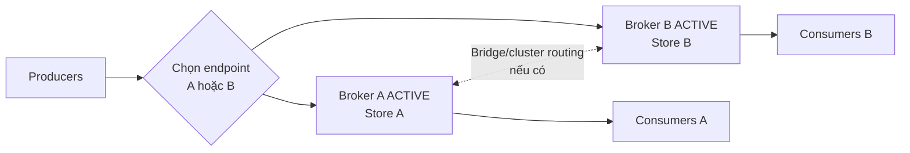
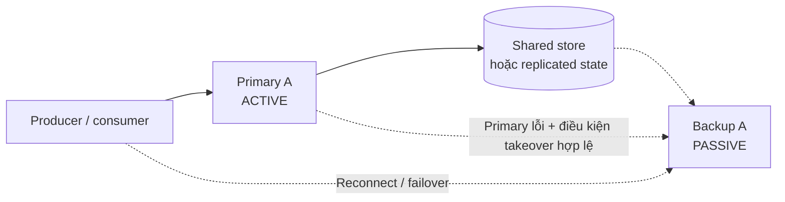
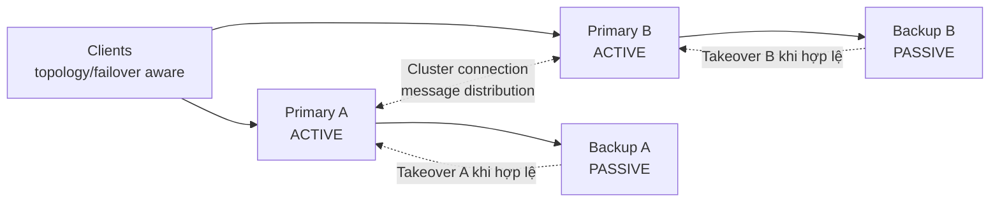
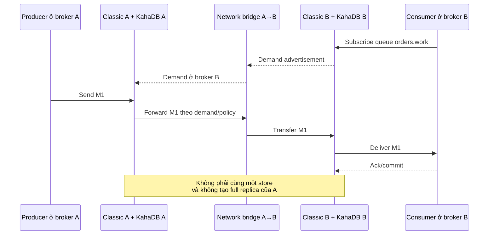
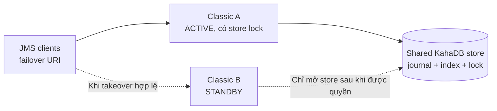

# Phân biệt HA, cân bằng tải, network of brokers và cluster

> **Chương:** Sẵn sàng cao  
> **Phạm vi:** Apache ActiveMQ **Classic** và **Artemis**. Bài này phân biệt bốn khái niệm thường bị gọi chung là “chạy nhiều broker”: **high availability (HA)**, **load balancing**, **network of brokers** của Classic và **cluster** của Artemis. Trọng tâm là *message nằm ở đâu, điều gì xảy ra khi một node chết, client kết nối lại thế nào*, không lặp lại nhập môn queue/topic hay JMS producer/consumer.

Một kiến trúc có hai broker, hai máy và URL `failover:(...)` vẫn **có thể làm mất khả năng đọc message** khi một broker chết. Nguyên nhân: client chuyển được TCP connection sang broker thứ hai **không có nghĩa** broker thứ hai đang giữ những message mà broker thứ nhất đã nhận. Tương tự, một Artemis cluster biết các node của nhau và có thể phân phối tải **không tự trở thành hệ thống có bản sao dự phòng cho mọi queue**.

Để thiết kế đúng, phải tách **ba câu hỏi**:

1. **Kết nối:** Khi broker đang dùng mất, client có tìm được endpoint khác không?
2. **Dữ liệu:** Endpoint mới có thể khôi phục **trạng thái message/queue/transaction chưa hoàn tất** của endpoint cũ không?
3. **Phân phối tải:** Khi tất cả node khỏe, producer/consumer và messages được chia giữa các node theo quy tắc nào?

Một giải pháp HA phải trả lời được ít nhất hai câu hỏi đầu cho **failure model đã cam kết**. Cân bằng tải chủ yếu trả lời câu thứ ba. Network/cluster tạo các kết nối giữa broker để chuyển hoặc phân phối messages; **chúng không mặc nhiên trả lời câu hỏi dữ liệu khi node mất**.

## 1. Bảng phân biệt ngắn, nhưng đủ để ra quyết định

| Khái niệm | Mục tiêu trực tiếp | Cơ chế điển hình | Có tự sao chép message để takeover? | Điều dễ bị hiểu sai |
|---|---|---|---|---|
| **High availability (HA)** | Dịch vụ tiếp tục hoạt động khi một broker/host lỗi; bảo vệ trạng thái theo cơ chế HA. | Primary–backup với shared store, replication, fencing/quorum và failover client. | **Có bảo vệ trạng thái theo mô hình được thiết kế**, nhưng cần xác nhận sync/recovery và failure mode. | Có hai TCP endpoint là đã HA. |
| **Load balancing** | Phân phối traffic/work giữa những tài nguyên đang chạy. | Competing consumers, phân phối client connections, broker-to-broker forwarding. | **Không**, nếu không có cơ chế lưu trạng thái riêng. | Round-robin gửi là durable replication. |
| **Classic network of brokers** | Nối các Classic brokers và **chuyển messages theo nhu cầu subscription** qua network connectors. | Network bridge, subscription advertisement, forwarding, `networkTTL`. | **Không phải replication HA của một KahaDB store**. | Message đã vào broker A chắc chắn có mặt trên B. |
| **Artemis cluster** | Cho các brokers trao đổi topology/queue bindings và phân phối message giữa các node. | `cluster-connection`, routing/forwarding, `message-load-balancing`, client topology discovery. | **Không mặc định**; cần cấu hình HA primary–backup riêng. | Chỉ thêm `cluster-connection` là đã có backup. |

**Kết luận kiến trúc:** Có thể cần **cả HA lẫn load balancing**. Ví dụ: hai Artemis primary hoạt động để chia tải, mỗi primary có **một backup riêng**; cluster connections nối các primary để route message theo demand. Nếu chỉ có hai primary và không có backup/shared store, hệ thống đã mở rộng throughput nhưng chưa bảo vệ trạng thái cục bộ của node bị mất.

### 1.1. Từ ngữ “failover” có hai nghĩa cần tách

- **Client failover/reconnect:** Client JMS đổi endpoint hoặc kết nối lại. Điều này giải quyết đường **kết nối**; có thể vẫn phải tạo lại session/consumer hoặc xử lý transaction outcome `UNKNOWN` tùy provider.
- **Broker HA failover:** Backup được phép **activate** để thay primary và phục vụ trạng thái đã được bảo vệ. Đây là việc chuyển **quyền sở hữu dữ liệu và phục vụ**, có thể cần lock/shared storage, replication và quorum để tránh hai primary cùng ghi.

Một URL client có chữ `failover` **không tự tạo cơ chế thứ hai**.

## 2. Hai topology trông giống nhau nhưng hành vi lỗi khác hẳn

### 2.1. Hai active brokers chỉ chia tải



Nếu broker A chết khi trong **Store A** còn M1 chưa được chuyển đi, consumer mới nối B **không tự đọc được M1**. B vẫn phục vụ traffic của nó; **một phần hệ thống còn sống** không đồng nghĩa mọi message vẫn được truy cập. Muốn biết M1 ở đâu phải theo dõi **đã enqueue ở node nào, có bridge forwarding/ack hay chưa và có backup hợp lệ cho node A không**.

### 2.2. Một primary có backup để tiếp quản



Backup thường **không** là consumer cạnh tranh với primary trong trạng thái bình thường. Nhiệm vụ của nó là khôi phục quyền phục vụ dữ liệu **được HA mechanism bảo vệ**, không phải xử lý một nửa messages để tăng throughput. Một cặp primary/backup thường ưu tiên tính liên tục/độ bền, **không nhân đôi năng lực active xử lý queue** khi backup vẫn ở trạng thái dự phòng.

### 2.3. Hai cặp HA, cluster giữa các primary



Đây là **mô hình tư duy**, không phải sơ đồ cabling/replication đầy đủ. Mỗi backup phải có **cơ chế HA riêng** đối với primary tương ứng và điều kiện fencing/quorum thích hợp. Cluster connection giữa các primary không thay thế đường đồng bộ trạng thái HA.

## 3. Phân tích failure model trước khi tuyên bố “HA”

Một hệ thống “không mất message” phải định nghĩa *không mất trong trường hợp nào*. Các sự cố khác nhau tạo hậu quả khác nhau:

| Sự cố | Client reconnect có ích? | Cần HA trạng thái? | Điều cần kiểm tra |
|---|---|---|---|
| Producer đứt TCP nhưng broker vẫn chạy | Có thể. | Không nhất thiết. | `send/commit` có thể đã hoàn tất nhưng response mất; idempotency. |
| Broker JVM crash, disk cục bộ còn nguyên | Có thể nối node khác. | Có, nếu muốn node khác đọc **ngay** pending của node chết. | Backup đã đồng bộ store/giữ shared lock, thời gian activate. |
| Host mất điện, local disk không truy cập được | Reconnect chỉ giải quyết transport. | Có cơ chế bảo vệ dữ liệu ngoài host, không chỉ local KahaDB. | Shared-store availability hoặc replication và fencing. |
| Mất cả volume/storages | Không. | HA một bản sao trên cùng vùng lỗi có thể không đủ. | Replicas ở failure domain riêng, backup, disaster recovery. |
| Network partition giữa các brokers | Client có thể chọn nhầm node. | **Quorum/fencing cực kỳ quan trọng**. | Ngăn split-brain: không cho hai primary cùng ghi một logical store. |
| Consumer lỗi nghiệp vụ/poison message | Không xử lý được bằng đổi broker. | Không phải vấn đề HA chính. | Rollback, redelivery delay, DLQ, idempotency. |
| Một node quá tải, node khác còn trống | Có thể giảm tải nếu topology/routing phù hợp. | HA không đủ. | Connection/message balancing, prefetch, queue bindings và consumer demand. |

**RTO** là mục tiêu thời gian phục hồi phục vụ; **RPO** là mức mất dữ liệu chấp nhận khi phục hồi. Thêm một backup không mặc định có `RPO=0` hay `RTO=0`: replication có trạng thái bắt kịp hay chưa, session/transaction ra sao, topology có khám phá lại không, có election delay hay không đều phải được kiểm chứng.

### 3.1. Cửa sổ dữ liệu khi client đã gửi nhưng chưa nhận phản hồi

```text
T0  Producer gửi M1 (PERSISTENT)
T1  Broker nhận/ghi M1
T2  Broker fail hoặc đường trả response bị mất
T3  Client thấy JMSException / failover / transaction rolled back
T4  Client retry M1 với businessRequestId giống trước
```

Ở T2, **không thể suy từ exception rằng M1 chưa có trong broker/backup**. Retry có thể tạo thêm một JMS message cùng business request. Trong cả Classic và Artemis, HA không thay thế **business idempotency**, còn broker replication không tự đảm bảo side effect database/HTTP đúng một lần.

## 4. Cân bằng tải: ba tầng khác nhau

| Tầng balancing | Phân phối cái gì? | Ví dụ | Giới hạn |
|---|---|---|---|
| **Client connection** | Producer/consumer mới kết nối tới broker nào. | Load balancer/L4, danh sách connector/URL với lựa chọn node. | Không chuyển pending message từ store A sang B. |
| **Consumer trong cùng queue** | Các delivery của queue được chia giữa competing consumers. | Ba JMS consumers trên `orders.in`. | Không nhân bản một message cho cả ba; ordering hoàn tất có thể thay đổi. |
| **Broker-to-broker message forwarding** | Message/request được chuyển giữa các node theo nhu cầu hoặc policy. | Classic network bridge; Artemis cluster `ON_DEMAND`. | Chỉ chuyển những message được route/forward; không phải backup toàn bộ store. |

Tăng số brokers không chắc tăng throughput nếu downstream database chỉ cho phép 20 connections, CPU consumer đã đầy, broker không có consumer demand đúng queue hoặc pending messages đang bị “dính” trên một node. Mọi kế hoạch load balancing phải tính **queue placement**, **consumer placement**, **routing policy** và **capacity cuối chuỗi**.

### 4.1. Load balancing không đảm bảo fair ordering

Khi nhiều consumers/primaries cùng làm việc, **thứ tự hoàn thành** có thể khác thứ tự gửi. Nếu nghiệp vụ cần mọi event của một `accountId` được xử lý tuần tự, cân nhắc message grouping/partition theo khóa hoặc kiểm soát phiên bản nghiệp vụ. Đừng suy rằng hai broker trong cùng cluster sẽ bảo toàn **global total ordering** cho tất cả messages.

## 5. ActiveMQ Classic: `network of brokers` thực sự làm gì?

Classic dùng **network connectors** để tạo các cầu nối broker-to-broker. Bridge quảng bá nhu cầu subscription và có thể **forward messages** từ broker có message tới broker có demand theo cấu hình. Đây là một hình thức mở rộng phạm vi phân phối, đặc biệt hữu ích khi producer và consumer kết nối đến các brokers khác nhau.



**Điều network bridge có thể làm:** điều hướng message qua các broker có subscription phù hợp, giảm yêu cầu producer và consumer kết nối đến cùng một broker, đồng thời hỗ trợ một số chính sách phân phối qua network. **Điều nó không tự làm:** sao chép mọi queue, mọi message, mọi transaction của A sang B để B trở thành backup có thể tiếp quản ngay khi A chết.

### 5.1. Hai Classic brokers với store độc lập

Giả sử có hai Classic instances:

| Node | Broker name | OpenWire endpoint | KahaDB |
|---|---|---|---|
| A | `classic-a` | `tcp://broker-a:61616` | `/srv/classic-a/kahadb` |
| B | `classic-b` | `tcp://broker-b:61616` | `/srv/classic-b/kahadb` |

Mỗi node có **data directory riêng**. Với một môi trường Classic multi-broker có network bridges, các broker nên có **`brokerName` riêng** để phân biệt topology và tránh định danh loop nhầm. Không sao chép toàn bộ `activemq.xml` của A rồi khởi chạy B với cùng store directory trên hai máy.

Trong **`activemq.xml` của A**, các đoạn con minh họa bên trong `<broker>` đã tồn tại:

```xml
<!-- Broker A: chỉ một phần của <broker>, không phải file hoàn chỉnh -->
<networkConnectors>
    <networkConnector
        name="A-to-B"
        uri="static:(tcp://broker-b:61616)"
        networkTTL="2"
        conduitSubscriptions="true"/>
</networkConnectors>
```

Nếu cần **hai chiều**, cấu hình một connector riêng trong **`activemq.xml` của B**:

```xml
<!-- Broker B -->
<networkConnectors>
    <networkConnector
        name="B-to-A"
        uri="static:(tcp://broker-a:61616)"
        networkTTL="2"
        conduitSubscriptions="true"/>
</networkConnectors>
```

**Đọc đúng các thuộc tính:**

- `uri="static:(...)"` dùng **static discovery** tới broker được chỉ định. Tên DNS/port trong lab phải resolve và reachable từ host chạy broker.
- `networkTTL` giới hạn số hop của network bridge để tránh message/consumer demand bị truyền qua quá nhiều brokers; nó **không** có nghĩa message TTL/JMSExpiration.
- `conduitSubscriptions` có thể gom những subscription demand tương đương để bridge không nhân bản đường subscription không cần thiết; cần đánh giá riêng nếu dùng topic durable/selector hoặc muốn phân phối đặc biệt.
- Mỗi node vẫn **lưu message theo persistence adapter của chính node đó**; bridge không có cấu hình “replicate complete KahaDB store” trong những snippet này.

Đây là **đoạn cấu hình minh họa**: trong thực tế cần xác nhận transport connectors, broker names, authentication/TLS giữa brokers, destination rules, queue inclusion/exclusion, network duplex mode, topology loop và tính tương thích release. Nếu `<networkConnectors>` đã có, phải hợp nhất vào block hiện hữu thay vì tạo một cấu hình trùng lặp không rõ hiệu lực.

### 5.2. Bản chất subscription-driven, không phải đồng bộ đều mọi message

**Một tình huống quan trọng:**

```text
T0  A và B online, Network of Brokers hoạt động.
T1  Producer gửi persistent M1 vào queue Q ở A.
T2  Không có demand phù hợp ở B hoặc bridge chưa forward M1.
T3  KahaDB A đang giữ M1 chưa được tiêu thụ.
T4  Broker A/host A chết; B vẫn active.
T5  Consumer reconnect đến B.
```

Ở T5, B có thể phục vụ các message **đã tới B**, nhưng **không được phép kết luận B có M1**. M1 vẫn nằm trong store A không truy cập được (trừ khi một HA mechanism riêng bảo vệ store A). Khi A phục hồi, M1 có thể được xử lý/forward tùy điều kiện và policy; trong lúc A down, workload liên quan M1 có thể không sẵn sàng.

Nếu message **đã được network bridge forward và broker B đã nhận** trước khi A chết, tình huống khác: phải kiểm tra ack/transaction của bridge, nguồn và đích để đánh giá message nằm ở đâu, có duplicate hay chưa. Không dùng số lượng message trong queue B lúc bình thường để tuyên bố “network có bản sao bền vững của mọi message A”.

### 5.3. `networkTTL` không phải số replica

Đặt `networkTTL="2"` không tạo hai bản sao; nó đặt giới hạn truyền qua network. Cũng không đồng nghĩa số broker mà mỗi message phải đi qua hoặc số lần delivery. Một network bridge hướng demand có thể không forward message nào khi không có subscription phù hợp, ngay cả với TTL lớn.

Với nhiều brokers nối thành vòng, cần kiểm tra message path/duplicate suppression, selector, conduit subscriptions và topology cycle. **Tăng TTL để “có HA hơn” là sai hướng**: nó có thể tăng phạm vi routing và độ phức tạp, nhưng không tạo backup cho KahaDB.

## 6. Classic client `failover:(...)`: đổi connection không sao chép dữ liệu

ActiveMQ Classic JMS client có **failover transport URI**, ví dụ:

```text
failover:(tcp://broker-a:61616,tcp://broker-b:61616)?randomize=false&initialReconnectDelay=1000
```

Client có thể kết nối lại tới một endpoint trong danh sách khi transport hiện tại mất. Với hai broker **độc lập** (chỉ nối bằng network bridge), URL này tạo **đường thay thế cho kết nối**, không biến broker B thành owner của toàn bộ trạng thái broker A.

| Kiểu hệ thống được liệt kê trong URI | Sau A chết, client tới B | Pending M1 ở A |
|---|---|---|
| Hai Classic brokers độc lập | Có thể reconnect. | Vẫn ở A, không tự xuất hiện ở B. |
| Hai Classic brokers nối `network of brokers` | Có thể reconnect. | Chỉ có ở B nếu trước đó đã được forward hợp lệ; network không phải HA store. |
| Classic master–slave/primary–backup dùng **shared store/HA mechanism phù hợp** | Client có thể reconnect tới node được activate. | Backup có thể phục vụ trạng thái được bảo vệ của cùng logical broker, tùy cơ chế failover và độ bền store. |

### 6.1. Ví dụ Java portable với Classic `javax.jms`

Trong các nhánh Classic 5.x dùng API `javax.jms` kiểu JMS 1.1, không giả định `Connection` tự triển khai `AutoCloseable`. Ví dụ dưới đây dùng `try/finally` để đóng đúng các đối tượng JMS, không phụ thuộc vào `try-with-resources` của Jakarta `JMSContext`.

```java
import javax.jms.Connection;
import javax.jms.DeliveryMode;
import javax.jms.JMSException;
import javax.jms.MessageProducer;
import javax.jms.Queue;
import javax.jms.Session;
import javax.jms.TextMessage;
import org.apache.activemq.ActiveMQConnectionFactory;

public final class ClassicFailoverProducer {
    private ClassicFailoverProducer() {}

    public static void main(String[] args) throws JMSException {
        String uri =
            "failover:(tcp://broker-a:61616,tcp://broker-b:61616)"
                + "?randomize=false&initialReconnectDelay=1000";
        ActiveMQConnectionFactory factory =
                new ActiveMQConnectionFactory(uri);
        Connection connection = factory.createConnection();
        Session session = null;
        MessageProducer producer = null;
        try {
            session = connection.createSession(
                    true, Session.SESSION_TRANSACTED);
            Queue destination = session.createQueue("orders.work");
            producer = session.createProducer(destination);
            producer.setDeliveryMode(DeliveryMode.PERSISTENT);

            TextMessage message =
                    session.createTextMessage("ORDER|A-101");
            message.setStringProperty("businessId", "A-101");
            producer.send(message);
            session.commit();
            System.out.println("JMS_TX_COMMITTED id="
                    + message.getJMSMessageID());
        } catch (JMSException failure) {
            System.err.println("JMS_TX_RESULT_UNKNOWN_OR_FAILED: "
                    + failure.getMessage());
            // Khi commit mất response, không khẳng định broker chưa commit.
            throw failure;
        } finally {
            if (producer != null) {
                try { producer.close(); } catch (JMSException ignore) {}
            }
            if (session != null) {
                try { session.close(); } catch (JMSException ignore) {}
            }
            connection.close();
        }
    }
}
```

Để chạy ví dụ, dùng Maven `org.apache.activemq:activemq-client:5.18.4` như một version minh họa và thay hostname theo lab. **Không dùng `org.apache.activemq.artemis.jms.client.ActiveMQConnectionFactory` với URI failover của Classic**. Khi commit lỗi trong quá trình failover, kết quả có thể **UNKNOWN** hoặc transaction bị rollback tùy thời điểm/provider; client không được tự kết luận mỗi request đã chạy đúng một lần.

**Thực hành cần nhớ:** URI failover nên trỏ tới **các endpoint có cùng hợp đồng dữ liệu** nếu client kỳ vọng tiếp tục xử lý cùng logical queue. Nếu B chỉ là broker độc lập có queue cùng tên, failover transport không tự kiểm tra rằng B sở hữu cùng backlog với A.

## 7. Classic HA: backup phải có quyền truy cập trạng thái, không chỉ URI giống nhau

Một mô hình HA của Classic được biết đến là **shared file system master/slave**: hai broker processes được cấu hình sử dụng **cùng một persistent store trên filesystem dùng chung**, với cơ chế lock để chỉ một broker active ghi store tại một thời điểm. Node dự phòng đợi lấy lock; sau khi primary thật sự không còn giữ quyền ghi, backup có thể mở store và tiếp tục phục vụ.



**Đây không phải network of brokers**: mục đích là chuyển quyền sở hữu **cùng logical store**, không phải forward messages theo demand giữa hai stores độc lập. Một số triển khai Classic còn dùng shared JDBC persistence/locking để đạt kiểu hoạt động tương tự; cần đánh giá storage/database locks và phiên bản broker tương ứng.

### 7.1. Tối thiểu phải có các điều kiện nào?

- Cả hai instances trỏ đúng **cùng thư mục KahaDB** trên shared filesystem được hỗ trợ, không phải hai đường dẫn string giống nhau nhưng thực ra là hai ổ local khác nhau.
- Hệ thống lưu trữ và filesystem phải có **file locking đúng**; khi mất network partition, không được để hai JVM cùng tin mình là active writer.
- Chỉ một node active phục vụ kết nối/ghi vào store tại một thời điểm; backup phải đợi lock và không được “đổi chế độ thành active” bằng script tự viết bỏ qua fencing.
- Client được cung cấp hai endpoint có thể kết nối sau takeover và có chính sách retry/reconnect phù hợp với thời gian chuyển quyền.
- Shared store bản thân là **single point of failure** nếu không được bảo vệ ở lớp storage; hỏng shared volume có thể hỏng cả primary lẫn backup.

Đoạn cấu hình **minh họa một thuộc tính storage**, không đủ để triển khai HA an toàn:

```xml
<!-- Trên cả hai Classic instances, nếu shared-store HA được thiết kế đúng -->
<persistenceAdapter>
    <kahaDB directory="/shared/classic-orders/kahadb"/>
</persistenceAdapter>
```

Phần `<persistenceAdapter>` đặt bên trong `<broker>` của `activemq.xml` thực tế, và chỉ một persistence adapter được dùng. **Không sao chép đoạn này lên hai máy rồi tự bật cùng lúc nếu chưa kiểm chứng hệ thống lock/fencing**. Storage HA, cluster credential, quyền mount, data recovery, broker-name/client endpoints và failover procedure phải được thiết kế đầy đủ.

### 7.2. Vì sao một shared store khác hai KahaDB stores?

| Mô hình | Message M1 ở đâu trước sự cố? | Sau A crash, B đọc được M1 nhờ gì? |
|---|---|---|
| **Network of brokers**, stores A/B riêng | M1 có thể chỉ ở A. | Chỉ khi M1 đã được bridge chuyển sang B trước crash; không có full replica. |
| **Shared-store HA** | M1 trong store chung đã được lưu bền theo policy. | B giành quyền hợp lệ để mở **chính store đó** và phục hồi message. |
| **Replication HA** (mô hình khái niệm) | Primary và backup có trạng thái đã đồng bộ theo replication protocol. | Backup activate dữ liệu đã replicate, theo quorum/consistency rules. |

Khi một shared-store primary đang có transaction chưa commit hoặc producer/consumer đang chờ phản hồi lúc crash, vẫn phải xử lý `JMSException`, rollback/unknown outcome và redelivery. Backup đọc được queue **không có nghĩa mọi side effect nghiệp vụ đã exactly-once**.

## 8. Artemis cluster: `cluster-connection` là mạng phân phối, không phải backup

Artemis có khái niệm **cluster** riêng: brokers trao đổi thông tin topology/bindings để forward messages giữa những nodes phù hợp. `cluster-connection` điều khiển quan hệ và routing, nhưng **mỗi active broker vẫn sở hữu journal/message state của mình** trừ khi có HA replication/shared-store cấu hình thêm.

### 8.1. Cluster hai active nodes với `ON_DEMAND`

Giả sử:

| Node | Broker ID | Connector | Queue |
|---|---|---|---|
| Artemis A | ID riêng của broker A | `tcp://node-a:61616` | `orders.work`, ANYCAST |
| Artemis B | ID riêng của broker B | `tcp://node-b:61616` | `orders.work`, ANYCAST |

Các queue có thể tồn tại ở cả hai nodes, nhưng đó là **hai queue bindings và hai stores khác nhau**, không phải một bảng journal tự đồng bộ. Thông qua cluster, Artemis có thể forward message giữa queues theo cấu hình balancing và demand.

Các đoạn **trên broker A**, chèn vào những phần `<connectors>` và `<cluster-connections>` hiện hữu của `broker.xml`:

```xml
<!-- Đoạn con trong <connectors> -->
<connector name="node-a">tcp://node-a:61616</connector>
<connector name="node-b">tcp://node-b:61616</connector>
```

```xml
<!-- Đoạn con trong <cluster-connections> -->
<cluster-connection name="orders-cluster">
    <address>orders.</address>
    <connector-ref>node-a</connector-ref>
    <retry-interval>500</retry-interval>
    <message-load-balancing>ON_DEMAND</message-load-balancing>
    <max-hops>1</max-hops>
    <static-connectors>
        <connector-ref>node-b</connector-ref>
    </static-connectors>
</cluster-connection>
```

Trên broker B, đổi `<connector-ref>` local thành `node-b` và static remote thành `node-a`, đồng thời cấu hình các connector/acceptor reachable. `orders.` là **prefix address** được cluster connection xét, không phải tên queue của chính cluster; address `orders.work` nằm trong phạm vi này.

Một **đoạn con `<addresses>`** có thể xuất hiện trên từng broker:

```xml
<address name="orders.work">
    <anycast>
        <queue name="orders.work" durable="true"/>
    </anycast>
</address>
```

**Đây là topology sketch, không phải hai file `broker.xml` hoàn chỉnh.** Cần bổ sung acceptors, cluster credentials/authorization, discovery/static connectors và address-settings theo phiên bản; xác minh node IDs riêng, network reachability và cluster formation trên console/log trước khi dùng. Không khai báo trùng các khối XML đã tồn tại.

### 8.2. `message-load-balancing` điều khiển forwarding như thế nào?

| Giá trị thường gặp | Ý nghĩa khái quát | Hậu quả đối với message |
|---|---|---|
| **`ON_DEMAND`** | Forward đến node khác khi có **remote consumer demand** phù hợp theo topology. | Tránh đẩy message đến node không có demand tương ứng trong tình huống phổ biến. |
| **`STRICT`** | Phân phối qua cluster bindings theo nguyên tắc cân bằng nghiêm hơn, có thể forward dù node đích chưa có matching consumer trực tiếp. | Có thể tạo backlog tại node remote; cần đo queue placement và consumer readiness. |
| **`OFF`** | Không thực hiện phân phối message bình thường qua cluster connection theo cách trên. | Không kỳ vọng remote consumers tự được phục vụ chỉ vì nodes biết topology. |

Chọn policy theo nhu cầu consumer, khả năng capacity và việc message cần ở node nào; phải kiểm tra đúng hành vi ở release Artemis sử dụng. **Không có giá trị nào đồng nghĩa “replicate 1 bản sang mỗi node để HA”**. Thậm chí `STRICT` có thể làm **phân tán** pending messages trên nhiều stores; khi một node chết, phần messages còn ở node đó vẫn gặp vấn đề nếu không có HA pair.

### 8.3. Khác biệt giữa forwarding và redistribution

Artemis có các chính sách liên quan **redistribution** để di chuyển messages đang chờ từ queue trên một node khi không còn consumers phù hợp sang node khác có demand (có thể liên quan `redistribution-delay` ở address-setting và điều kiện cụ thể).

Điều này vẫn là **di chuyển message theo điều kiện**, không phải giữ một backup replica đồng bộ vĩnh viễn. Redistributing pending message khỏi node A **có thể giúp cân bằng tải** khi consumer chỉ còn ở B, nhưng không cứu được các messages còn nằm trên A sau một failure khiến A và local store không thể truy cập.

### 8.4. Client biết topology chưa đủ để bảo vệ journal

Artemis client có thể học topology cluster và kết nối tới một node khác khi node hiện tại không khả dụng, tùy connection factory/HA/reconnect settings. Điều đó hỗ trợ client availability, **không làm queue còn trên node mất điện tự xuất hiện ở node mới**. Đặt `ha=true` ở Artemis client cũng **không thay thế** broker HA policy.

**Điểm cần theo dõi ở cluster:** consumer count theo từng node/queue, message pending/delivering ở từng node, cluster bridges, message forwarded/redistributed, queue bindings và tình trạng network partition. Không chỉ xem tổng queue depth từ một broker rồi suy ra trạng thái mọi nodes.

## 9. Artemis HA: `ha-policy` bổ sung bảo vệ dữ liệu cho broker

Artemis hỗ trợ các dạng HA như **shared store** và **replication**, được cấu hình tại `<ha-policy>`. Đây là cơ chế khác với `<cluster-connections>`:

- **Shared store:** Primary và backup được thiết kế để truy cập **cùng bộ journal/bindings/paging/large-message state** trên storage dùng chung; cơ chế lock/activation bảo đảm không có hai active writers đồng thời.
- **Replication:** Primary truyền dữ liệu/trạng thái cần thiết tới **backup với storage riêng** theo cơ chế replication của Artemis. Backup phải bắt kịp trạng thái hợp lệ và chỉ activate khi điều kiện failover/quorum thỏa.
- **Cluster:** Giúp các **active brokers** route/redistribute messages và cung cấp topology; **không tự sao lưu** toàn bộ journal của active broker khác.

Khi tham khảo tài liệu ở các release Artemis khác nhau, bạn có thể gặp cách gọi cấu hình **master/slave** trong bản cũ và **primary/backup** trong bản mới. Vì vậy các đoạn dưới đây chỉ minh họa **nhóm phần tử của những release dùng cú pháp primary/backup**; trước khi triển khai phải kiểm tra schema/version `broker.xml` của instance thật, không copy sang một release cũ chưa hỗ trợ.

### 9.1. Replication primary/backup: cấu hình ở hai broker riêng

Ví dụ **phần `<ha-policy>` của broker primary A**:

```xml
<ha-policy>
    <replication>
        <primary>
            <group-name>orders-ha-a</group-name>
        </primary>
    </replication>
</ha-policy>
```

Ví dụ **phần `<ha-policy>` của broker backup A**:

```xml
<ha-policy>
    <replication>
        <backup>
            <group-name>orders-ha-a</group-name>
            <allow-failback>true</allow-failback>
        </backup>
    </replication>
</ha-policy>
```

Đây là **minh họa cơ chế**, tuyệt đối **chưa phải cấu hình HA hoạt động độc lập**: primary và backup còn cần các connector/cluster connections/discovery liên quan tới replication, network reachability, storage directories riêng, credentials, quorum/fencing và thiết lập node ID đúng theo release. `group-name` giúp giới hạn nhóm HA tương ứng, nhưng **không bảo đảm chỉ bằng tên giống nhau mà replication đã đồng bộ an toàn**.

Đừng khởi chạy hai brokers như hai primary tự do rồi thêm `group-name` và nghĩ sẽ tự hình thành HA pair. Trên một primary/backup pair cần xác minh backup **thật sự ở trạng thái standby và đã synchronized**, không phải một active broker độc lập đang phục vụ queue cùng tên.

### 9.2. Shared-store primary/backup: tránh hai writers vào cùng journal

Với release hỗ trợ cú pháp này, cấu hình **primary** có thể chứa:

```xml
<ha-policy>
    <shared-store>
        <primary/>
    </shared-store>
</ha-policy>
```

Và **backup**:

```xml
<ha-policy>
    <shared-store>
        <backup>
            <allow-failback>true</allow-failback>
        </backup>
    </shared-store>
</ha-policy>
```

Với mô hình shared store, không chỉ journal mà **các thư mục state liên quan** (bindings, journal, paging, large messages) phải được định nghĩa nhất quán trên storage dùng chung. Nếu hai host mount cùng đường dẫn string nhưng backing volume khác nhau, **đó không phải shared store**. Hệ thống lock/fencing của storage phải đáng tin cậy khi xảy ra partition; không cho hai active brokers cùng ghi journal.

**Phân biệt ngay:**

| Thuộc tính | Artemis shared store | Artemis replication |
|---|---|---|
| Nơi lưu state | Các node HA truy cập store chung phù hợp. | Primary và backup có vùng lưu trữ riêng, state được truyền qua replication. |
| Khi primary chết | Backup được phép mở store chung khi lock/ownership hợp lệ. | Backup activate state đã replicate, theo quorum/activation policy. |
| Rủi ro nổi bật | Shared volume có thể thành SPOF; filesystem locking, mount và storage HA. | Replication link/quorum/synchronization, split-brain, lag, backup readiness. |
| Có phân phối workload active/active không? | Không, backup passive trong cặp thông thường. | Không, backup passive trong cặp thông thường. |
| Có cần cluster message balancing để HA? | Không đồng nghĩa; hai cơ chế giải quyết mục tiêu khác nhau. | Replication thường dựa vào thông tin kết nối/topology phù hợp nhưng **khác** balancing messages giữa active primaries. |

### 9.3. Vì sao quorum/fencing không phải chi tiết tùy chọn

Xét phân vùng mạng:

```text
             mạng giữa hai host bị ngắt
       Primary A                  Backup A
   vẫn có thể phục vụ          không nhìn thấy primary
   một số clients             muốn activate
            \                  /
             \  SPLIT BRAIN?  /
              -> hai writers <-
```

Nếu cả hai cùng tin mình là primary của cùng logical queue/store, chúng có thể đưa ra các quyết định nhận/ack khác nhau và làm hỏng tính nhất quán. Vì vậy phải có **quy tắc ownership**: lock/fencing đối với shared store; quorum/vote/replication-failure policy và cơ chế cách ly primary lỗi đối với replication.

Một cặp **chỉ gồm hai máy** gặp partition có thể thiếu bên thứ ba để phân biệt “peer chết” với “đường mạng lỗi”. Chọn quorum/witness/cách ly lỗi theo kiến trúc cụ thể. **Đừng tắt cơ chế kiểm soát split-brain chỉ để demo failover nhanh hơn rồi dùng cấu hình đó cho production.**

### 9.4. Phối hợp HA pairs với cluster

Một hệ thống vừa cần scaling vừa cần HA có thể dùng:

```text
Artemis A primary ---- cluster forwarding ---- Artemis B primary
      |                                          |
  replication                                replication
      |                                          |
Artemis A backup                          Artemis B backup

Mỗi primary/backup pair: bảo vệ trạng thái của một logical broker.
Cluster A ↔ B: route và chia tải giữa hai logical brokers đang active.
```

Khi A primary lỗi, **backup A** takeover state của logical broker A. Đây không phải việc chuyển mọi message đang pending ở A sang logical broker B bằng `ON_DEMAND`. Nếu chỉ B còn active và **không có backup A**, cluster có thể tiếp tục phục vụ message đã nằm ở B, nhưng những message còn trong journal A **không tự xuất hiện**.

## 10. Client Artemis: discovery, reconnect và HA activation

Ví dụ Java dùng Artemis Jakarta client:

```xml
<dependency>
    <groupId>org.apache.activemq</groupId>
    <artifactId>artemis-jakarta-client</artifactId>
    <version>2.38.0</version>
</dependency>
```

Với broker release/client phù hợp, Artemis JMS connection factory hỗ trợ URI chứa các connector và tham số HA/reconnect. **Ví dụ cấu hình minh họa**, cần kiểm tra đúng URI syntax/options của Artemis version đang dùng:

```java
import jakarta.jms.ConnectionFactory;
import jakarta.jms.DeliveryMode;
import jakarta.jms.JMSContext;
import org.apache.activemq.artemis.jms.client.ActiveMQConnectionFactory;

String endpoints =
    "(tcp://node-a:61616,tcp://node-a-backup:61616)"
        + "?ha=true&reconnectAttempts=-1";
ConnectionFactory connectionFactory =
        new ActiveMQConnectionFactory(endpoints);

try (JMSContext context =
             connectionFactory.createContext(
                     System.getenv("ARTEMIS_USER"),
                     System.getenv("ARTEMIS_PASSWORD"))) {
    context.createProducer()
            .setDeliveryMode(DeliveryMode.PERSISTENT)
            .send(context.createQueue("orders.work"),
                    "ORDER|A-101");
}
```

Đoạn Java giả định env credentials hợp lệ và broker cluster/HA đã chạy; đặt trong method phù hợp, dùng JDK/client tương thích. `JMSContext` ở Jakarta API hỗ trợ `AutoCloseable`; điều này **khác** với ví dụ Classic JMS 1.1 dùng `Connection`/`Session` và `try/finally`.

**Không suy luận từ URI:**

- Danh sách hai connectors chỉ cho client biết những **địa chỉ có thể thử**, không tạo replication.
- `ha=true` là cấu hình **client-side/topology-aware** theo khả năng provider, không tạo `<ha-policy>` trên broker.
- `reconnectAttempts=-1` biểu diễn ý định retry lâu dài trong provider tương ứng, nhưng vẫn cần giám sát và chính sách timeout/stop của ứng dụng; không dùng nó làm cơ chế health checking duy nhất.
- Nếu primary chết **trong lúc gửi hoặc commit**, result có thể đã được broker thực hiện nhưng response mất. Retry an toàn cần `businessRequestId`/idempotency và hiểu rõ transaction recovery.

Đối với production, connection factory nên cấu hình qua Spring/DI với thông tin xác thực và TLS đúng; không nhúng credential vào mã. Sau failover, cần kiểm tra consumer subscription/selector, transaction state và callback exception; **connection restored không đồng nghĩa task trước đó chắc chắn chưa hoặc đã xử lý xong**.

## 11. Ma trận sự cố: cùng hai brokers nhưng kết quả rất khác nhau

Giả sử producer gửi một message persistent M1 vào queue `orders.work` của broker A; message **đã được ghi nhận** nhưng chưa được consumer ack và chưa được forward sang node khác. Sau đó A đột ngột lỗi.

| Kiến trúc | Broker B có thể nhận client mới? | B có lấy được chính M1 không? | Điều kiện để phục hồi M1 |
|---|---|---|---|
| A và B độc lập, cùng tên queue | Có nếu B còn chạy. | **Không** chỉ nhờ trùng tên queue. | Khởi động lại A hoặc có cơ chế phục hồi dữ liệu A riêng. |
| Classic `network of brokers` với KahaDB riêng | Có nếu B còn chạy. | **Không mặc định**, M1 chưa forward. | A phục hồi để bridge chuyển tiếp; hoặc bảo vệ state của A bằng HA khác. |
| Artemis cluster hai active nodes, không backup | Có thể, theo client/topology. | **Không mặc định**, M1 còn ở store A. | A phục hồi hoặc một HA mechanism bảo vệ A. |
| Classic shared-store HA đúng cấu hình | B sau takeover hợp lệ. | **Có thể**, nếu store đã bền vững và B được quyền mở cùng store. | Store/locking/recovery và client failover đều hoạt động. |
| Artemis replication HA đúng cấu hình | Backup của A sau activation hợp lệ. | **Có thể**, nếu M1 thuộc trạng thái đã replicate và backup đủ điều kiện takeover. | Replication synchronization, quorum/fencing và journal recovery. |
| Artemis shared-store HA đúng cấu hình | Backup sau takeover hợp lệ. | **Có thể**, nếu shared store chứa M1 và ownership được chuyển an toàn. | Shared storage còn dùng được và cơ chế locking/activation chính xác. |

Từ “có thể” là **có điều kiện**: nếu M1 hết TTL, bị purge/expired trước sự cố, chưa commit ở producer, hoặc trạng thái sync chưa đủ thì kết luận khác. Tương tự, nếu B đã được network bridge chuyển M1 trước khi A chết, bài toán không còn là “M1 chỉ ở store A”. Phải xác nhận **message placement tại mốc lỗi**, không suy từ cấu trúc sơ đồ tổng quan.

### 11.1. Bốn kết quả có thể xuất hiện sau failover

1. **M1 vẫn pending**: backup khôi phục queue và consumer mới xử lý M1. Đây là kết quả mong đợi khi persistent state được bảo vệ.
2. **M1 đã được consumer xử lý nhưng được giao lại**: ack/transaction chưa commit hoặc kết quả chưa rõ. Nghiệp vụ phải idempotent.
3. **M1 không có ở node đích**: đó có thể là node không sở hữu state (cluster/network-only) hoặc một lỗi storage; không mặc định rằng broker xóa mất.
4. **Hai JMS messages cùng business ID**: producer retry sau mất phản hồi hoặc route/network forwarding/rollback ở các thời điểm khác nhau. Cần correlation và dedupe, không chỉ đếm QueueSize.

### 11.2. “Broker vẫn khỏe” chưa chắc người dùng còn dùng được

Nếu broker B healthy nhưng producer chỉ trỏ A, **client endpoint discovery** đang thiếu. Nếu client biết B nhưng route không có queue binding/demand hoặc ACL đúng, **routing/readiness** đang thiếu. Nếu queue tồn tại trên B nhưng dữ liệu còn ở A, **state availability** đang thiếu. Nếu backup activate nhưng consumer business side effect trùng, **application idempotency** đang thiếu.

Đây là bốn tầng kiểm tra khác nhau; tăng số brokers không tự giải quyết tất cả.

## 12. Bài thực hành so sánh mà không nhầm networking với HA

Mỗi test bên dưới phải chạy trên **broker instances lab cô lập**, queue riêng `orders.work`, có quyền quản lý và không có dữ liệu production. Cần ghi rõ broker/client versions và ghi log được phép lưu. Không giả định hai brokers đã được cấu hình đầy đủ chỉ vì XML snippet trong bài hợp lệ.

### 12.1. Chuẩn bị Maven cho Classic producer

Để biên dịch class `ClassicFailoverProducer` ở mục 6.1, có thể tạo `pom.xml` trong một thư mục Maven lab riêng:

```xml
<project xmlns="http://maven.apache.org/POM/4.0.0"
         xmlns:xsi="http://www.w3.org/2001/XMLSchema-instance"
         xsi:schemaLocation="http://maven.apache.org/POM/4.0.0
                             https://maven.apache.org/xsd/maven-4.0.0.xsd">
    <modelVersion>4.0.0</modelVersion>
    <groupId>lab.activemq</groupId>
    <artifactId>classic-failover-probe</artifactId>
    <version>1.0-SNAPSHOT</version>
    <properties>
        <maven.compiler.release>11</maven.compiler.release>
        <project.build.sourceEncoding>UTF-8</project.build.sourceEncoding>
    </properties>
    <dependencies>
        <dependency>
            <groupId>org.apache.activemq</groupId>
            <artifactId>activemq-client</artifactId>
            <version>5.18.4</version>
        </dependency>
    </dependencies>
    <build>
        <plugins>
            <plugin>
                <groupId>org.apache.maven.plugins</groupId>
                <artifactId>maven-compiler-plugin</artifactId>
                <version>3.11.0</version>
            </plugin>
            <plugin>
                <groupId>org.codehaus.mojo</groupId>
                <artifactId>exec-maven-plugin</artifactId>
                <version>3.2.0</version>
            </plugin>
        </plugins>
    </build>
</project>
```

Đặt class vào `src/main/java/ClassicFailoverProducer.java` (do ví dụ dùng **default package**), điều chỉnh hai hostnames rồi chạy:

```bash
mvn -q compile exec:java "-Dexec.mainClass=ClassicFailoverProducer"
```

Đây là một **probe kết nối/gửi JMS**, không phải trình đánh giá mức đồng bộ store. Khi chạy trong mạng không có DNS `broker-a`/`broker-b`, cần thay bằng hostname/IP lab thật, và các brokers phải có OpenWire endpoint/ACL hợp lệ.

### 12.2. Test A — competing consumers không phải HA

1. Chạy một Classic hoặc Artemis broker riêng, tạo queue `orders.work`.
2. Khởi chạy **hai consumers độc lập** cùng đọc queue đó.
3. Gửi nhiều messages có `businessId` khác nhau.
4. Kiểm tra các consumers chia nhau những message phù hợp; tổng completed count bằng số business jobs trong điều kiện không lỗi.
5. Dừng một consumer, xem consumer còn lại tiếp tục nhận.

**Kết luận đúng:** Cân bằng tải và tính chịu lỗi ở **tầng consumer**. **Chưa kiểm chứng:** broker/host chết mà pending messages vẫn truy cập được.

### 12.3. Test B — Classic network of brokers không tự backup KahaDB

1. Khởi chạy Classic A và Classic B **active** với hai KahaDB riêng, network connectors hướng demand như mục 5.
2. Cho consumer chỉ kết nối B và producer chỉ gửi vào A; xác nhận bridge hình thành và message có thể tới consumer B khi có demand.
3. Trong một lần test khác, ngừng B/consumer để có message **còn pending ở A**; xác nhận placement trước khi thực hiện failover.
4. Dừng **broker A lab** theo kịch bản được phép, kết nối consumer tới B; kiểm tra message ở A **không tự trở thành message của store B**.
5. Khởi động lại A và kiểm tra forwarding/recovery theo topology và demand.

**Kết luận đúng:** Network bridge có thể chuyển messages giữa brokers khi hoạt động/demand phù hợp, **không sao chép trọn store để backup**. Không dùng bước 4 trên production, và đừng dùng shutdown sạch để kiểm chứng độ bền trước mất điện.

### 12.4. Test C — Artemis cluster hai active nodes, không HA

1. Cấu hình cluster connections hai chiều như mục 8, queue `orders.work` trên cả A và B.
2. Tạo consumer demand trên B, gửi vào A; quan sát message forwarding và metric theo node.
3. Dừng consumer B và gửi message vào A, kiểm tra message đang nằm ở **queue A** trước sự cố.
4. Cho A ngừng hoạt động trong lab; client kết nối B có thể tiếp tục phục vụ **store B**, nhưng không được kỳ vọng đọc ngay backlog còn ở A.

**Kết luận đúng:** Cluster biết topology và có thể phân phối công việc, nhưng không tự tạo **backup data state** cho mỗi primary.

### 12.5. Test D — một HA pair được cấu hình đầy đủ

1. Chuẩn bị Artemis **primary/backup pair** hoặc Classic shared-store pair theo tài liệu **đúng release**, có store/replication/fencing thích hợp.
2. Kiểm tra primary active, backup thật sự standby và synchronized/được quyền takeover theo cơ chế HA, thay vì là broker active thứ hai.
3. Gửi M1 persistent và xác nhận producer commit; chưa có consumer ACK M1.
4. Tạo failure **có kiểm soát trên broker lab**; đợi backup activate hợp lệ.
5. Kết nối consumer sau failover, xác nhận M1 được phục hồi và xử lý theo semantics của store.
6. Lặp lại với message đang in-flight và commit response bị mất; theo dõi redelivery/duplicate, không ép giá trị exactly-once.

**Kết luận đúng:** Cơ chế HA có thể bảo vệ cùng **logical queue state** qua node takeover trong failure model thử. **Chưa được kết luận** rằng mọi host/storage/network partition đều được xử lý an toàn hoặc không bao giờ có duplicate.

### 12.6. Test E — split-brain/quorum phải được xem xét riêng

Kịch bản đứt network giữa primary và backup khác kịch bản primary chết hẳn. **Chỉ chạy fault injection mạng trong môi trường hạ tầng cô lập đã có kế hoạch rollback/fencing**, không áp dụng lệnh chặn mạng hay ngắt storage ngẫu nhiên trên production.

**Tiêu chí đạt:** Không có hai brokers cùng được quyền ghi **cùng logical store**; trạng thái replication/quorum được báo chính xác, client không bị gửi tới hai owners mâu thuẫn, và sau khôi phục vẫn có quy trình reconcile/failback đã kiểm chứng. Nếu hai brokers đều báo active sau partition, đó là **cảnh báo nghiêm trọng**, không phải HA thành công vì “cả hai đều chạy”.

### 12.7. Bảng ghi kết quả tối thiểu

| Test | Thành phần bị lỗi | Client reconnect | Message được phục hồi | Duplicate business effect | Thời gian phục hồi |
|---|---|---|---|---|---|
| Competing consumers | Một consumer | Không cần broker failover | Queue vẫn trên broker đang chạy | Đo bằng business ID | Đo thực tế |
| Classic NoB | Một broker | Có thể đổi endpoint | Chỉ những messages đã được forward / store còn truy cập | Đo thực tế | Đo thực tế |
| Artemis cluster | Một active node | Có thể đổi node | Chỉ messages còn truy cập trên nodes sống, nếu không có HA riêng | Đo thực tế | Đo thực tế |
| HA pair | Primary broker | Backup takeover + reconnect | Theo state đã được shared/replicated và failure model | Đo thực tế | Đo thực tế |

Không điền số RTO/RPO giả định vào các ô này. Kết quả phụ thuộc journal/persistence, replication sync, quorum, endpoint discovery, OS/storage, TLS/ACL và thời điểm failover. Chỉ báo cáo số thực đo cùng điều kiện kiểm thử.

## 13. Vận hành: chẩn đoán đúng tầng khi một node lỗi

### 13.1. Bảng chỉ số theo ba câu hỏi cốt lõi

| Câu hỏi | Chỉ số/trạng thái nên quan sát | Nguồn phù hợp |
|---|---|---|
| **Client còn kết nối được?** | Current endpoint, reconnect attempts, latency failover, số `JMSException`, session/container readiness. | JMS client/connection factory, Spring listener container logs, application health. |
| **Logical broker còn owner hợp lệ?** | Primary/backup state, activation, store lock ownership, replication synchronization, quorum/fencing, failback state. | Artemis/Classic broker logs, management/JMX, storage/quorum monitoring. |
| **Messages còn tồn tại ở đâu?** | Queue pending, delivering/in-flight, DLQ, age, per-node enqueue/dequeue, journal recovery. | Broker management theo **node và queue**, không chỉ tổng cluster. |
| **Đang cân bằng tải không?** | Consumer count theo broker/queue, traffic sent/forwarded, network bridges/cluster connections, processing rate và backlog skew. | Classic network bridge stats hoặc Artemis cluster/queue management. |
| **Nghiệp vụ đã hoàn tất chưa?** | Business request ID, idempotency insert/duplicate count, downstream commit, số xử lý thành công/thất bại. | Application logs, database/outbox/inbox, downstream service metrics. |

**Không dùng duy nhất “TCP port 61616 mở” làm health check HA.** Port mở có thể chỉ chứng minh process accept connections, không chứng minh node đang là primary hợp lệ, replication/backup sẵn sàng, queue có data, hoặc send/commit hoạt động an toàn.

### 13.2. Đọc đúng dấu hiệu khi client báo “failover thành công”

```text
Client log: connected to broker-b
Broker-b log: ACTIVE
Queue orders.work on broker-b: pending = 0
Broker-a: offline, KahaDB-a not accessible
```

Trường hợp này có thể là:

- **Thành công về mặt client connectivity**: application nối được B.
- **Không thành công về mặt state availability**: M1 trước đó có thể vẫn ở A.
- **Chưa có bằng chứng business completion**: phải đối chiếu `businessId`, logs và state của consumer.

Đừng vội kết luận M1 bị broker B “làm mất”; cũng đừng báo SLO HA đạt chỉ vì client reconnect được trong 2 giây. Điều cần ghi là **SLO cho queue/data nào đã đạt hoặc chưa đạt**.

### 13.3. Những yếu tố làm failover chậm dù backup đã sẵn sàng

- **Failure detection:** transport timeout, heartbeat, storage locks/quorum vote, thời gian kết luận primary không còn quyền ghi.
- **Backup activation:** journal/index recovery, lock acquisition, replication reconciliation, binding activation.
- **Client reconnect:** danh sách endpoint/topology có đúng không, DNS/TLS/credential, delay giữa retries và timeout.
- **Application restoration:** consumer/session recreation hoặc recovery, transaction rollback, reconnect listener container, kiểm tra message selectors/subscriptions.
- **Downstream warm-up:** DB pool, caches, HTTP dependencies, workload đổ dồn sau failover.

RTO cần đo **từ lúc dịch vụ thực sự mất khả năng xử lý đến lúc workload thành công trở lại**, không chỉ thời gian backup đổi status thành ACTIVE.

### 13.4. Runbook cho một sự cố thực tế

1. **Khoanh phạm vi:** node chết, network partition, shared storage lỗi, hay chỉ producer/consumer mất kết nối?
2. **Kiểm tra trạng thái HA:** primary nào còn active, backup nào đã activate và quyền ownership có hợp lệ không? Có nghi ngờ split-brain không?
3. **Tạm dừng hành động gây hại:** không vội bật lại primary cũ khi backup đã nhận quyền, không force-start hai writers trên shared store, không xóa journal để “unlock”.
4. **Xác minh data placement:** M1 đang trên queue nào, node nào, trạng thái pending/delivering/ack ra sao? Đừng dựa vào queue name giống nhau.
5. **Kiểm tra client path:** reconnect có đi tới node sở hữu state không, route/ACL/TLS và listener readiness có đúng không?
6. **Đối soát nghiệp vụ:** `send/commit` lúc lỗi có thể UNKNOWN; dùng business ID để xác định công việc đã thực hiện và tránh retry gây duplicate.
7. **Phục hồi có kiểm soát:** làm theo failback/rejoin của version, đảm bảo store/replication synchronized, kiểm tra broker cluster health trước khi khôi phục traffic.
8. **Ghi nhận RTO/RPO:** bằng các message IDs/business IDs đã được xác minh, không ước lượng từ việc node báo running.

**Đặc biệt với partition:** Một broker mất kết nối peer không chứng minh peer đã chết. Nếu kết luận sai và kích hoạt backup trong lúc primary cũ vẫn ghi, có nguy cơ split-brain. Ưu tiên xử lý quyền ownership/quorum trước khi xử lý cân bằng tải.

## 14. Chọn topology theo yêu cầu thay vì theo số node

| Yêu cầu thực tế | Hướng kiến trúc cần xem xét | Điều chưa đủ |
|---|---|---|
| Nhiều workers nhận một queue trên một broker, tăng throughput | **Competing consumers** với concurrency hợp lý. | Không chống broker/host failure. |
| Producer/consumer ở nhiều Classic brokers, muốn chuyển message theo demand | **Classic network of brokers** với network connectors, policy và destination matching. | Không tạo backup full store hoặc RPO=0. |
| Nhiều Artemis active brokers, muốn phân phối messages tới nơi có consumers | **Artemis cluster connections** và `message-load-balancing` phù hợp. | Không cứu state của node chết khi không có HA pair. |
| Một logical broker cần takeover khi máy chết | **Primary–backup HA** với shared store hoặc replication, client failover. | Một backup passive không tự tăng throughput active. |
| Vừa chia tải vừa cần node takeover | **Nhiều HA pairs + cluster/network distribution** theo broker được chọn. | Vẫn cần idempotency, quorum, capacity N+1 và failure tests. |
| Yêu cầu chống mất cả datacenter/region | **Disaster recovery/multi-site architecture** với RPO/RTO rõ và quy trình phục hồi dữ liệu độc lập. | Một HA pair cùng failure domain chưa đủ. |
| Lệnh thanh toán/đơn hàng không được xử lý trùng | **Business idempotency** và reconciliation, ngoài việc broker HA. | HA/replication và persistent message không tự exactly-once. |

### 14.1. Capacity N+1 không tự có từ HA

Nếu có **hai active primaries**, mỗi node đang chạy ở 80% tài nguyên, mất một node sẽ đẩy tải còn lại về node kia; chỉ kết nối được chưa chắc có đủ năng lực xử lý. Kế hoạch HA phải dành **headroom** cho workload khi failure:

```text
Trạng thái bình thường:
  Active A: 60% tải hệ thống
  Active B: 40% tải hệ thống

A ngừng và backup A chưa sẵn sàng:
  B có thể nhận thêm request mới,
  nhưng messages còn trong store A không tự chuyển sang B.

A backup takeover:
  Workload phục hồi trên logical broker A,
  capacity phụ thuộc CPU/IO của backup và cách client phân phối kết nối.
```

**Có backup ≠ còn đủ capacity**. Backup hardware nhỏ hơn primary hoặc dùng chung disk/network có thể là bottleneck sau failover; benchmark phải đo trong trạng thái degraded mode, không chỉ steady-state.

### 14.2. Đánh đổi giữa routing locality và độ sẵn sàng

Đối với message xử lý theo địa lý/tenant, có thể muốn message ở node gần consumer để giảm latency. Nhưng khi node đó lỗi, có thể cần backup cùng khu vực hoặc plan chuyển traffic. Cluster `ON_DEMAND` giúp routing theo demand; **nó không tự chọn một disaster recovery policy**. Thiết kế phải cân bằng:

- Locality để giảm network hops.
- Data ownership rõ ràng để tránh lost/stranded backlog.
- HA pair ở failure domain phù hợp.
- Quorum/fencing khi partition.
- Giới hạn retry, idempotency và khôi phục transaction.

## 15. Câu hỏi tình huống có đáp án

**Câu 1.** Hai Classic brokers A/B có `networkConnector` hai chiều, mỗi broker có KahaDB riêng. A lưu 1.000 messages chưa forward. A chết, producer reconnect tới B. Có thể tuyên bố 1.000 messages vẫn online?

**Không.** Network connectors không tạo shared/replicated store. B vẫn hoạt động nhưng backlog còn ở A không tự truy cập được; cần A phục hồi hoặc cơ chế HA bảo vệ store A.

**Câu 2.** Cấu hình Classic `failover:(tcp://A:61616,tcp://B:61616)` và nhận thấy client luôn reconnect được. Như vậy đã HA?

**Chưa đủ.** Đó là client failover. Phải chứng minh B hoặc backup activation có đúng state của logical broker trước sự cố, và SLO của consumer sau failover đạt yêu cầu.

**Câu 3.** Artemis có `cluster-connection` và `message-load-balancing=STRICT`. Mọi message có luôn được nhân bản thành hai bản để chống mất node không?

**Không.** `STRICT` là chính sách phân phối/forwarding trong cluster, không phải replicated HA store. Khi node chết, messages còn ở local journal của node có thể không truy cập được nếu thiếu backup.

**Câu 4.** Artemis cluster có ba active nodes, mỗi node có queue `payments.work`. Node A chết. Consumer reconnect sang B và không thấy 10 messages cũ của A. Broker có tự làm mất dữ liệu?

**Không thể kết luận như vậy.** Phải kiểm tra placement: có thể 10 messages còn trên store A không truy cập được. Tên queue giống nhau trên các nodes không chứng minh state đã replicate.

**Câu 5.** Primary và backup dùng shared store, nhưng sau network partition cả hai cùng active và ghi journal. Đây có phải failover nhanh không?

**Không.** Đây là **split-brain/data-corruption risk**. Cần khoanh vùng, fencing/lock/quorum và phục hồi có kiểm soát; không tối ưu RTO bằng cách bỏ ownership rules.

**Câu 6.** Primary có backup replication đã synchronized, consumer xử lý DB thành công rồi crash trước JMS commit. Sau failover message được giao lại. HA có thất bại?

**Không nhất thiết.** HA có thể đã bảo vệ message chưa commit chính xác, còn duplicate business effect xuất phát từ ranh giới DB–JMS độc lập. Cần idempotency.

**Câu 7.** Một queue có bốn consumers trên cùng broker. Một consumer chết và ba consumer còn lại tiếp tục xử lý. Đây là load balancing hay broker HA?

**Consumer-level load balancing/fault tolerance**, chưa phải broker HA. Nếu toàn broker chết, cả bốn consumer mất nguồn message cho đến khi broker/store được phục hồi.

**Câu 8.** Đặt Artemis `message-load-balancing=ON_DEMAND`, producer gửi vào A nhưng consumer chỉ ở B. Mục đích policy này là gì?

**Forward theo remote demand** phù hợp, trong điều kiện cluster connection và queue bindings hoạt động. Nó giúp phân phối công việc tới nơi có consumer nhưng không tự đồng bộ mọi message làm bản sao backup.

**Câu 9.** Vì sao test kill JVM và test mất cả shared storage phải báo kết quả riêng?

Vì primary/backup có thể takeover sau một JVM crash **khi store còn nguyên**, nhưng sẽ không phục hồi được dữ liệu nếu shared storage duy nhất mất; hai kiểu lỗi có failure domain/RPO khác nhau.

**Câu 10.** Producer thấy `session.commit()` ném exception ngay khi HA failover. Có thể retry bằng business ID mới để bảo đảm xử lý thành công?

**Không.** Commit có thể đã hoàn tất nhưng phản hồi bị mất; dùng business ID mới sẽ phá cơ chế deduplication. Giữ khóa idempotency ổn định và đối soát trạng thái trước khi quyết định retry.

## 16. Tổng kết theo một câu hỏi duy nhất

Khi nhìn thấy “hai broker cùng chạy”, hãy hỏi: **“Nếu broker A chết ngay bây giờ, ai có quyền đọc *chính những message chưa ACK của A*?”**

- Nếu đáp án chỉ là “client sẽ kết nối sang B” → bạn mới chứng minh **connection failover**.
- Nếu đáp án là “network bridge/cluster có thể chuyển messages **khi A còn hoạt động**” → bạn mới có **message distribution**, không tự có HA.
- Nếu đáp án là “backup được phép activate **đúng store/state đã được bảo vệ của A**, có quorum/fencing và client recovery kiểm chứng” → đây mới là **HA cho logical broker** trong phạm vi failure model được thử.

Với **ActiveMQ Classic**, `network of brokers` chủ yếu nối brokers và forward message theo subscription demand; HA cần shared-store/HA mechanism riêng. Với **Artemis**, `cluster-connection` giúp topology/routing/load balancing; `ha-policy` với shared store hoặc replication giúp primary–backup bảo vệ trạng thái. Cả hai vẫn cần **idempotency**, monitoring và các bài thử RTO/RPO ở đúng thời điểm lỗi để bảo đảm workflow nghiệp vụ không mất hoặc thực thi trùng ngoài ý muốn.
