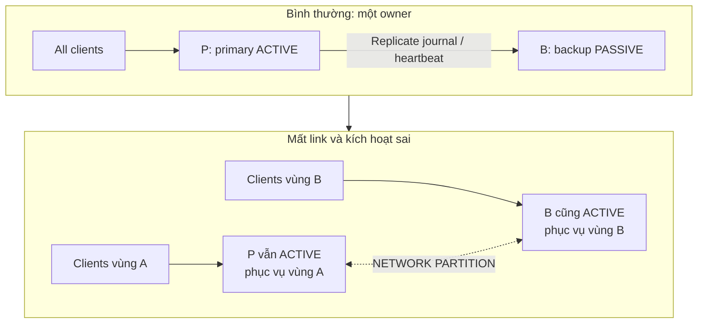
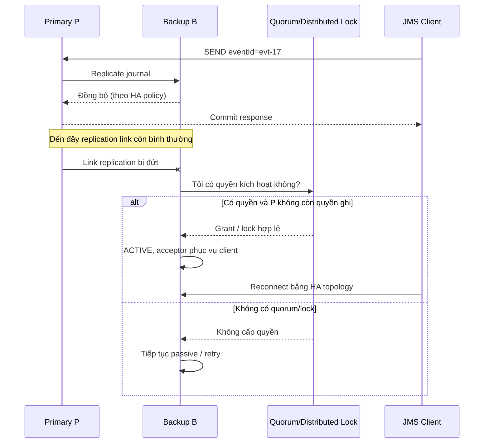

# Split-brain, network partition và cơ chế phối hợp khi kích hoạt dự phòng

> **Chương:** Sẵn sàng cao  
> **Mô-đun:** `INTEGRATION_MESSAGING_MESSAGE_BROKER_ACTIVEMQ` — ActiveMQ Classic và Artemis cho giao tiếp bất đồng bộ với queue/topic, routing, Java/JMS, acknowledgment, transaction, redelivery, DLQ, bảo mật và vận hành broker tin cậy.  
> **Trọng tâm:** Vì sao mất liên lạc không đồng nghĩa broker đã chết; cách ngăn primary và backup đồng thời active bằng **quorum, distributed lock hoặc exclusive storage lock**; cách xử lý restart/failback, lựa chọn cấu hình chính xác và chứng minh an toàn bằng fault injection trên môi trường thử nghiệm.

## 1. Định nghĩa split-brain trong một nhóm HA

Trong một **HA pair** thông thường, hai broker có vai trò **primary** và **backup** khi cấu hình. Khi chạy bình thường, primary ở trạng thái **active** chấp nhận client và backup ở trạng thái **passive**, chuẩn bị tiếp quản. Trong Artemis, primary/backup là vai trò **cấu hình**; active/passive là **trạng thái runtime**: sau failover, broker được cấu hình backup có thể chính là broker active.

**Split-brain** là trạng thái hai broker tưởng mình có quyền sở hữu **cùng một tập dữ liệu/message identity** và đều phục vụ client. Nó không đơn thuần là việc có hai broker process đang chạy; nhiều broker active sở hữu các shard/queue khác nhau là một kiến trúc khác.



Hậu quả trực tiếp:

- **Queue:** P và B cùng có bản sao message M1 trước partition. Hai consumer ở hai vùng có thể cùng lấy M1 → tạo hóa đơn/trừ tiền **hai lần**.
- **Topic:** Producer ở vùng A phát một sự kiện chỉ vào P, subscriber ở vùng B đang nối B → **thiếu sự kiện** ở vùng B.
- **Journal phân kỳ:** Sau thời điểm chia cắt, P có message/ACK mới, B có message/ACK khác. Khi mạng hồi phục không thể tự ghép hai journal bằng cách chép đè thư mục.
- **Phục hồi sai:** Primary cũ restart với journal cũ sau khi backup đã active và commit thêm message, rồi primary cũ lại chấp nhận client → split-brain lần hai.

Một tiêu chí thiết kế có thể kiểm chứng là:

```text
Với cùng HA identity và cùng logical journal:
    activeOwnerCount(t) <= 1 tại mọi thời điểm t
```

Đó là **safety invariant**. Nó mạnh hơn kiểm tra “ít nhất một broker đang online”.

## 2. Crash thật, mất heartbeat và network partition khác nhau

Backup B ngừng nhận replication packet từ primary P. Từ B, các trường hợp sau có dấu hiệu giống hệt nhau:

| Hiện tượng thực | P còn xử lý message? | B có biết chắc chỉ nhờ timeout? | B tự active ngay có an toàn? |
| --- | --- | --- | --- |
| P dừng vì mất điện | Không | Không | Chỉ khi có điều kiện phối hợp hợp lệ |
| Link P ↔ B đứt nhưng P ↔ client A còn tốt | **Có** | Không | **Không**: split-brain |
| P dừng lâu vì GC hoặc I/O nhưng chưa chết | Có thể | Không | Có nguy cơ false failover |
| B bị cô lập khỏi P và phần còn lại của cluster | P có thể còn tốt | Không | **Không**, nếu thiếu quorum/lock |
| Storage lock bị lỗi nhưng cả hai host còn chạy | Có thể | Không | **Không**, phải điều tra fencing |

**Timeout không phải phép chứng minh thất bại.** Giảm `connection-ttl` xuống rất thấp chỉ khiến nghi ngờ nhanh hơn và có thể tăng false positive khi GC pause, jitter hoặc packet loss.

### 2.1. Safety so với availability

- **Safety:** Chỉ một owner hợp lệ được ghi/serve cùng dữ liệu, tránh duplicate/loss do hai broker active.
- **Availability/liveness:** Dịch vụ cuối cùng vẫn tiến lên khi một node thực sự hỏng.
- **Trong partition:** Đôi khi phải chọn **không activate backup** nếu không thể xác minh primary cũ đã mất quyền. Việc dừng tạm thời có thể tốt hơn làm sai dữ liệu tài chính.

Một distributed lock hoặc quorum không “xóa downtime”; chúng **đặt điều kiện** cho quyền phục vụ. Đây là lý do failover an toàn có thể chậm hơn failover “hễ không thấy heartbeat là lên ngay”.

### 2.2. Timeline kinh điển



Sơ đồ thể hiện **điều kiện an toàn cần đạt**, không khẳng định mọi HA policy đều có một RPC vote giống nhau. Trên shared-store, quyền được quyết định bởi **file lock**; trong replication quorum, được đánh giá qua **cluster voters**; với pluggable lock manager, được quyết định bởi **external coordinator**.

## 3. Ba hướng phối hợp trên ActiveMQ Artemis

| Hướng | “Trọng tài” | Quy mô điển hình | Hạn chế quan trọng |
| --- | --- | --- | --- |
| **Shared-store HA** | Exclusive file lock của cùng shared filesystem | Một cặp primary/backup và SAN/NAS có lock tin cậy | Một mount sai/lock lỗi có thể dẫn tới hai writer |
| **Replication + quorum voting** | Đa số phiếu từ **các active brokers khác** | Artemis cluster có **ít nhất ba HA pairs** | Một hoặc hai HA pairs không đủ quorum theo cơ chế này |
| **Replication + pluggable lock manager** | Distributed lock/lease trong hệ ngoài (ví dụ ZooKeeper) | Một cặp HA cũng dùng được | Hạ tầng lock phải có majority, cơ chế fencing và lifecycle đúng |

Một **cặp broker replication đơn lẻ** không tự trở thành quorum chỉ bằng `P + B = 2 process`. Trong Artemis, quorum voting cần các **active brokers** khác của cluster và tài liệu chính thức nêu rõ tối thiểu **ba HA pairs** để thiết lập quorum phù hợp.

### 3.1. Shared-store: storage lock là trọng tài

```text
               Storage dùng chung
     +----------------------------------+
     | journal / bindings / paging      |
     | large-messages / exclusive lock  |
     +----------------------------------+
          ^                       ^
          |                       |
       Primary P                Backup B
       ACTIVE/lock owner        PASSIVE/wait
```

P và B không giữ hai kho đồng bộ qua TCP trong chế độ này. Chúng cùng trỏ đến một bộ dữ liệu lưu trữ và chỉ broker giữ **exclusive lock đúng nghĩa** mới được active.

**Ví dụ policy trên primary P, đặt trong `<core>` của `broker.xml`:**

```xml
<ha-policy>
    <shared-store>
        <primary/>
    </shared-store>
</ha-policy>
```

**Policy tương ứng trên backup B:**

```xml
<ha-policy>
    <shared-store>
        <backup/>
    </shared-store>
</ha-policy>
```

**Cả hai instance phải trỏ tới đúng cùng shared directories:**

```xml
<!-- Ví dụ: cùng storage được mount tại cùng path trên hai host -->
<journal-directory>/mnt/ha-shared/journal</journal-directory>
<bindings-directory>/mnt/ha-shared/bindings</bindings-directory>
<paging-directory>/mnt/ha-shared/paging</paging-directory>
<large-messages-directory>/mnt/ha-shared/large-messages</large-messages-directory>
```

Đây là những **trích đoạn**, không phải `broker.xml` hoàn chỉnh: acceptors, connectors, cluster configuration, security và persistence của instance còn phải cấu hình riêng. Hai thư mục có cùng tên nhưng **trên hai local disk khác nhau** không hề tạo shared-store HA.

**Đừng đánh giá lock bằng việc mount thành công.** Hãy thử: một host chết, lock được release/lease hết hạn, backup có thể giành lock; đồng thời không có giai đoạn cả hai host đều ghi. NFS/các filesystem phân tán có cấu hình lock sai hoặc stale locks có thể phá safety hoặc làm RTO quá dài.

### 3.2. Replication + quorum voting: ai có đa số thì mới được tiếp quản

Replication dùng journal riêng ở P và B; backup cần **initial sync hoàn tất** trước khi đủ điều kiện failover. Khi mất replication link, B có thể thực hiện vote để quyết định có active không; P cũng có thể vote để quyết định tiếp tục active khi bật tùy chọn phù hợp.

**Cụm ví dụ có ba cặp HA:** `(P1,B1)`, `(P2,B2)`, `(P3,B3)`. Ba primary active của các cặp tham gia topology voting. Đa số của ba vote là **hai**. Không dùng ba backup passive làm “ba voter active” thay cho yêu cầu này.

**HA policy cho P1:**

```xml
<ha-policy>
    <replication>
        <primary>
            <group-name>orders-pair-1</group-name>
            <vote-on-replication-failure>true</vote-on-replication-failure>
            <check-for-active-server>true</check-for-active-server>
            <quorum-size>-1</quorum-size>
        </primary>
    </replication>
</ha-policy>
```

**HA policy cho B1:**

```xml
<ha-policy>
    <replication>
        <backup>
            <group-name>orders-pair-1</group-name>
            <quorum-size>-1</quorum-size>
            <vote-retries>12</vote-retries>
            <vote-retry-wait>5000</vote-retry-wait>
            <quorum-vote-wait>30</quorum-vote-wait>
        </backup>
    </replication>
</ha-policy>
```

Ý nghĩa:

- `group-name` ghép đúng cặp P1/B1. Các cặp khác nên có tên riêng `orders-pair-2` và `orders-pair-3` nhưng ở **cùng cluster** phù hợp.
- `vote-on-replication-failure=true` cho P1 tham gia quyết định có giữ active khi mất replication; mặc định `false` khiến primary có thể tiếp tục chạy khi replication mất.
- `check-for-active-server=true` là biện pháp quan trọng **khi primary cũ restart** sau khi B1 đã takeover; tránh primary tự phục vụ với journal cũ trong chế độ quorum voting.
- `quorum-size=-1` dùng kích thước cluster hiện tại theo cơ chế Artemis; `-1` **không có nghĩa vô hiệu hóa quorum**.
- `vote-retry-wait` là mili-giây, `quorum-vote-wait` là giây: không hoán đổi đơn vị.
- Những HA snippets này **không tự tạo cluster**; vẫn phải cấu hình connector, cluster-connection, trust/auth và mạng cho đủ active voters.

**Giới hạn:** Nếu B1 không lấy được quorum, nó phải đợi/khôi phục vai trò passive chứ không được tự nhận P1 đã chết. Điều đó có thể làm dịch vụ gián đoạn khi các voter không reachable nhưng là một đánh đổi an toàn có chủ đích.

### 3.3. Replication + pluggable lock manager: một cặp HA vẫn có thể an toàn

Artemis cung cấp interface `DistributedLockManager`, với implementation tham chiếu dựa trên **Apache ZooKeeper/Curator**. Việc bầu owner được giao cho một cơ chế **distributed lock bên ngoài**, không dựa hoàn toàn vào việc P và B quan sát heartbeat của nhau.

Ví dụ dùng **ZooKeeper ensemble ba voting nodes** (tên máy minh họa, không phải endpoint thật). Ensemble phải có quorum, cấu hình bảo mật và storage bền.

**Primary P — policy excerpt:**

```xml
<ha-policy>
    <replication>
        <primary>
            <group-name>orders-pair-1</group-name>
            <manager>
                <class-name>org.apache.activemq.artemis.lockmanager.zookeeper.CuratorDistributedLockManager</class-name>
                <properties>
                    <property key="connect-string"
                              value="zk1.internal.example:2181,zk2.internal.example:2181,zk3.internal.example:2181"/>
                    <property key="session-ms" value="18000"/>
                </properties>
            </manager>
        </primary>
    </replication>
</ha-policy>
```

**Backup B — policy excerpt:**

```xml
<ha-policy>
    <replication>
        <backup>
            <group-name>orders-pair-1</group-name>
            <manager>
                <class-name>org.apache.activemq.artemis.lockmanager.zookeeper.CuratorDistributedLockManager</class-name>
                <properties>
                    <property key="connect-string"
                              value="zk1.internal.example:2181,zk2.internal.example:2181,zk3.internal.example:2181"/>
                    <property key="session-ms" value="18000"/>
                </properties>
            </manager>
        </backup>
    </replication>
</ha-policy>
```

**Lưu ý:**

- Đây là cấu hình **HA policy**, không thay thế connectors/cluster-discovery, ports, ACL/TLS, data directories hoặc plugin dependencies. Cần triển khai ZooKeeper plugin đúng classpath của Artemis version đang chạy.
- `session-ms` là thời gian session với ZooKeeper; nếu quá ngắn có thể bị expire vì jitter/GC pause, nếu quá dài có thể tăng RTO. Không dùng nó thay thế timeout xử lý JMS message.
- Cả hai broker phải dùng **cùng ensemble** và thông tin phối hợp phù hợp. Nếu mỗi broker dùng ZooKeeper riêng, hai lock không có ý nghĩa loại trừ lẫn nhau.
- `coordination-id` là cấu hình **riêng cho chế độ competing primary brokers** với lock manager; không mặc nhiên bắt buộc trong cặp P/B thông thường.
- Khi ZooKeeper mất majority, không được ép một backup mới lên active nếu không có lock/quyền phù hợp. Tạm ngừng failover có thể chính là hành vi an toàn.

### 3.4. Fencing: bầu B chưa đủ nếu P vẫn đang ghi

```text
t0: P đang giữ quyền active.
t1: P mất liên hệ coordinator, nhưng vẫn thấy client vùng A.
t2: B lấy quyền owner mới sau khi lock/lease của P mất hiệu lực.
t3: P BẮT BUỘC không tiếp tục nhận ghi với quyền cũ.
t4: Chỉ B được phép phục vụ logical journal/message identity đó.
```

**Fencing** nghĩa là broker từng giữ quyền **không thể tiếp tục gây side effect** sau khi quyền bị thu hồi. Một giải pháp chỉ “bầu leader mới” mà không quản lý **owner cũ** có thể vẫn split-brain.

Bốn câu hỏi khi review HA:

1. Ai cấp và thu hồi quyền active?
2. Khi P mất kết nối coordinator, P tự stop, mất lock hoặc bị fence bằng gì?
3. Backup kiểm tra mình có dữ liệu mới nhất/đã đồng bộ bằng gì trước activation?
4. Khi P trở lại, điều gì ngăn nó bật với **journal cũ** trước khi đồng bộ?

Khái niệm **epoch/fencing token** hữu ích trong thiết kế hệ phân tán, nhưng không phải một JMS header mà Artemis mặc nhiên cung cấp cho mọi kiểu HA. Đừng đặt một số epoch tự nghĩ ra trên message rồi coi đó là đủ bảo vệ journal.

## 4. Network health check không thay quorum/lock

Artemis có thể ping các địa chỉ để đánh giá broker còn tiếp cận hạ tầng mạng hay không.

```xml
<!-- Đặt dưới core của Artemis broker.xml đang có -->
<network-check-period>10000</network-check-period>
<network-check-timeout>1000</network-check-timeout>
<network-check-list>10.10.0.1,10.10.0.2</network-check-list>
```

Khi health check thất bại, broker có thể dừng service và khởi lại khi điều kiện mạng phục hồi. Theo tài liệu, trong danh sách IP **chỉ cần một IP reachable** là network check có thể được coi thành công.

**Bốn giới hạn cần thử thực tế:**

- P ping được gateway bên mình nhưng **không nhìn thấy B/quorum**. Health check có thể vẫn PASS.
- P và B mỗi bên ping được một địa chỉ khác nhau. **Cả hai** có thể tin mạng khỏe dù replication đứt.
- Ping một endpoint ngoài Internet không ổn định có thể làm broker tự dừng sai khi cụm nội bộ vẫn khỏe.
- Ping không cho biết **journal nào mới nhất** hoặc **ai có quyền owner**; nó không phải consensus protocol.

Dùng network checks như **tín hiệu bổ sung**, không thay **shared lock, quorum vote hoặc external lock manager**.

## 5. Failback và primary restart: thời điểm rất dễ tái tạo split-brain

Một failure sequence phổ biến:

```text
1. P active, B passive và đã đồng bộ.
2. P bị mất điện.
3. B lên active, xử lý 100 message mới và ACK 90.
4. P khởi động lại với journal cũ chỉ có dữ liệu trước bước 2.
5. Nếu P tự active mà không kiểm tra B, cả P và B đều phục vụ cùng identity.
```

Với replication quorum voting, `check-for-active-server=true` trên **primary** giúp nó kiểm tra active server có cùng node ID khi khởi động và thực hiện quy trình failback phù hợp. Tài liệu Artemis cảnh báo primary restart sau failover mà không bật cơ chế này có thể phục vụ message cũ gây duplicate.

Với replication + lock manager, **coordinator** quyết định broker nào có quyền active; primary không thể tự active chỉ vì không thấy peer. Với shared-store, broker trở lại phải **giành được exclusive lock** trước khi sử dụng journal.

**Không làm theo cách:** restart cả hai, thấy broker nào lên trước thì chọn nó. Cần so trạng thái active, journal freshness, replication sync, lock/quorum, dữ liệu đã commit và các giao dịch chưa chắc chắn.

## 6. Client failover phục hồi kết nối, không bầu broker active

### 6.1. Artemis Core/Jakarta JMS

Một client Artemis có thể dùng topology HA, ví dụ:

```text
(tcp://broker-a.internal.example:61616?name=orders-primary,tcp://broker-b.internal.example:61616?name=orders-backup)?ha=true&reconnectAttempts=20&retryInterval=1000&initialConnectAttempts=20
```

Tên connector `orders-primary`/`orders-backup` phải tương thích với **connector names broker công bố** trong topology. Nếu broker công bố IP nội bộ không thể truy cập từ client (ví dụ NAT/Kubernetes), reconnect có thể thất bại dù B đã active.

| Client parameter | Ý nghĩa | Không được suy ra |
| --- | --- | --- |
| `ha=true` | Tự thử reconnect tới backup trong topology | Không tự tạo quorum và không ngăn split-brain |
| `reconnectAttempts=20` | Số lần cố gắng reconnect; `-1` là vô hạn | Không bảo đảm broker sẽ active |
| `retryInterval=1000` | Nhịp retry tính bằng ms | Không phải quorum timeout |
| `initialConnectAttempts=20` | Số lần thử ở giai đoạn chưa connect lần đầu | Client đã biết đầy đủ topology khi chưa connect |
| `confirmationWindowSize` | Buffer phục vụ reattach Core session khi khả thi | Không bảo đảm business side effect exactly-once |

Sau failover, client có thể được dựng lại Session và MessageConsumer, nhưng không tái tạo **toàn bộ transaction state** trên broker mới. Khi một lời gọi đang chờ response bị mất kết nối, nó có thể bị unblocked bằng exception. Với transacted JMS, Artemis có thể đánh dấu transaction rollback-only và ném `TransactionRolledBackException`/`TransactionRolledBackRuntimeException` tương ứng.

**Không suy luận “commit timeout ⇒ broker chắc chắn không commit”.** Cần xử lý kết quả không rõ bằng eventId nghiệp vụ ổn định, retry có kiểm soát và consumer idempotency.

### 6.2. ActiveMQ Classic failover transport

Ví dụ URL OpenWire Classic:

```text
failover:(tcp://classic-a.internal.example:61616,tcp://classic-b.internal.example:61616)?randomize=false&maxReconnectAttempts=20
```

Nó chỉ quyết định **client thử endpoint nào khi mất kết nối**. Classic network of brokers có các message stores riêng và chức năng store-and-forward; không đồng nghĩa hai active brokers có **một journal HA**.

**Không đánh giá safety bằng “client tự reconnect thành công”.** Nếu cả P và B cùng active, client reconnect vẫn có thể thành công **vào broker sai**.

## 7. Java/JMS: probe failover có eventId và transaction

Mục tiêu là ghi nhận message trước/sau failover, quan sát `JMSMessageID`, `JMSRedelivered` và lỗi commit. Đây là **lab probe**, không phải một giải pháp exactly-once có thể deploy production.

### 7.1. Queue thử nghiệm

Trong phần `<addresses>` **đã có** của cả instance Artemis, thêm address riêng (không tạo hai phần `<addresses>` trùng nhau):

```xml
<addresses>
    <address name="ha.probe.jobs">
        <anycast>
            <queue name="ha.probe.jobs">
                <durable>true</durable>
            </queue>
        </anycast>
    </address>
</addresses>
```

Queue thực tế phải hiện diện trên active broker và được bảo vệ bằng SEND/CONSUME permissions của lab user. Broker phải có persistence/HA pairing đã được kiểm chứng; tạo queue mới trên một broker ngẫu nhiên không chứng minh dữ liệu được replicated.

### 7.2. Maven Java 17/Jakarta JMS

```xml
<project xmlns="http://maven.apache.org/POM/4.0.0"
         xmlns:xsi="http://www.w3.org/2001/XMLSchema-instance"
         xsi:schemaLocation="http://maven.apache.org/POM/4.0.0 https://maven.apache.org/xsd/maven-4.0.0.xsd">
    <modelVersion>4.0.0</modelVersion>
    <groupId>example.messaging</groupId>
    <artifactId>artemis-ha-probe</artifactId>
    <version>1.0.0</version>
    <properties>
        <maven.compiler.release>17</maven.compiler.release>
    </properties>
    <dependencies>
        <dependency>
            <groupId>org.apache.activemq</groupId>
            <artifactId>artemis-jakarta-client</artifactId>
            <version>2.38.0</version>
        </dependency>
    </dependencies>
    <build>
        <plugins>
            <plugin>
                <groupId>org.apache.maven.plugins</groupId>
                <artifactId>maven-compiler-plugin</artifactId>
                <version>3.13.0</version>
            </plugin>
            <plugin>
                <groupId>org.codehaus.mojo</groupId>
                <artifactId>exec-maven-plugin</artifactId>
                <version>3.5.0</version>
            </plugin>
        </plugins>
    </build>
</project>
```

`2.38.0` được pin để mô tả một tổ hợp ví dụ; không khẳng định là bản mới nhất. Client dùng `jakarta.jms`, khác `javax.jms` của Classic 5.x.

### 7.3. `src/main/java/example/messaging/HaProbe.java`

```java
package example.messaging;

import jakarta.jms.DeliveryMode;
import jakarta.jms.JMSConsumer;
import jakarta.jms.JMSContext;
import jakarta.jms.JMSRuntimeException;
import jakarta.jms.Message;
import jakarta.jms.Queue;
import jakarta.jms.TextMessage;
import jakarta.jms.TransactionRolledBackRuntimeException;

import org.apache.activemq.artemis.jms.client.ActiveMQConnectionFactory;

public final class HaProbe {
    private static final String QUEUE_NAME = "ha.probe.jobs";

    private HaProbe() {}

    public static void main(String[] args) throws Exception {
        if (args.length < 1) {
            throw new IllegalArgumentException(
                    "Usage: send <eventId> | receive <maxMessages>");
        }
        String url = required("BROKER_URL");
        String user = required("BROKER_USER");
        String password = required("BROKER_PASSWORD");
        ActiveMQConnectionFactory factory =
                new ActiveMQConnectionFactory(url);

        switch (args[0]) {
            case "send" -> {
                if (args.length != 2) {
                    throw new IllegalArgumentException("send <eventId>");
                }
                send(factory, user, password, validId(args[1]));
            }
            case "receive" -> {
                if (args.length != 2) {
                    throw new IllegalArgumentException(
                            "receive <maxMessages>");
                }
                int max = Integer.parseInt(args[1]);
                if (max < 1 || max > 10_000) {
                    throw new IllegalArgumentException(
                            "maxMessages must be in [1,10000]");
                }
                receive(factory, user, password, max);
            }
            default -> throw new IllegalArgumentException(
                    "Unknown mode: " + args[0]);
        }
    }

    private static String required(String key) {
        String value = System.getenv(key);
        if (value == null || value.isBlank()) {
            throw new IllegalStateException("Missing env: " + key);
        }
        return value;
    }

    private static String validId(String id) {
        if (!id.matches("[A-Za-z0-9_-]{1,128}")) {
            throw new IllegalArgumentException("Invalid business eventId");
        }
        return id;
    }

    private static void send(ActiveMQConnectionFactory factory,
                             String user, String password, String eventId) {
        try (JMSContext context = factory.createContext(
                user, password, JMSContext.SESSION_TRANSACTED)) {
            Queue queue = context.createQueue(QUEUE_NAME);
            TextMessage message = context.createTextMessage(
                    "HA_TEST:" + eventId);
            message.setStringProperty("eventId", eventId);
            message.setLongProperty(
                    "createdAtEpochMs", System.currentTimeMillis());

            try {
                context.createProducer()
                        .setDeliveryMode(DeliveryMode.PERSISTENT)
                        .send(queue, message);
                context.commit();
                System.out.println("COMMIT_RETURNED eventId=" + eventId);
            } catch (TransactionRolledBackRuntimeException failure) {
                System.err.println(
                    "TRANSACTION_ROLLED_BACK eventId=" + eventId);
                throw failure;
            } catch (JMSRuntimeException uncertain) {
                System.err.println(
                    "UNKNOWN_COMMIT_RESULT eventId=" + eventId
                    + "; khi retry phải giữ nguyên ID");
                throw uncertain;
            }
        }
    }

    private static void receive(ActiveMQConnectionFactory factory,
                                String user, String password, int max)
            throws Exception {
        try (JMSContext context = factory.createContext(
                user, password, JMSContext.SESSION_TRANSACTED);
             JMSConsumer consumer =
                context.createConsumer(context.createQueue(QUEUE_NAME))) {
            for (int i = 0; i < max; i++) {
                Message m = consumer.receive(3000);
                if (m == null) {
                    System.out.println("No message in 3 seconds");
                    break;
                }

                try {
                    String eventId = m.getStringProperty("eventId");
                    int deliveryCount = m.propertyExists("JMSXDeliveryCount")
                            ? m.getIntProperty("JMSXDeliveryCount")
                            : -1;

                    // Chỉ log trong demo: chưa thực hiện business effect.
                    System.out.printf(
                        "RECEIVED id=%s jmsId=%s redelivered=%s count=%d%n",
                        eventId, m.getJMSMessageID(),
                        m.getJMSRedelivered(), deliveryCount);

                    // Production: commit DB inbox+business rồi mới JMS.
                    context.commit();
                } catch (Exception failure) {
                    try {
                        context.rollback();
                    } catch (JMSRuntimeException rollbackError) {
                        failure.addSuppressed(rollbackError);
                    }
                    throw failure;
                }
            }
        }
    }
}
```

**Ranh giới của phép thử:**

- `JMSContext.SESSION_TRANSACTED` chỉ bao phủ thao tác JMS; không tự giao dịch đồng bộ với DB/API ngoài.
- `COMMIT_RETURNED` nghĩa client đã nhận kết quả commit thành công trong lần gọi đó; không bảo đảm business effect ở DB sẽ đúng một lần.
- `UNKNOWN_COMMIT_RESULT` không chứng minh message bị mất. Khi retry **cùng sự kiện**, giữ nguyên `eventId`.
- `JMSMessageID` là ID của message vật lý; gửi lại có thể tạo một ID vật lý khác dù eventId giống.
- Consumer demo chỉ in log, **không deduplicate**. Khi test cần so log với eventId và bảng dữ liệu nghiệp vụ của ứng dụng nếu có.
- Muốn kiểm tra failover khi client đang nhận cần tạo tải **đủ dài**; một consumer chạy vài giây khi queue rỗng không chứng minh an toàn.

### 7.4. Các lệnh chạy

Mỗi terminal cần `BROKER_URL`, `BROKER_USER`, `BROKER_PASSWORD`. URL tham khảo:

```text
(tcp://broker-a.internal.example:61616?name=orders-primary,tcp://broker-b.internal.example:61616?name=orders-backup)?ha=true&reconnectAttempts=20&retryInterval=1000&initialConnectAttempts=20
```

Gửi message với hai business IDs:

```bash
mvn -q compile exec:java -Dexec.mainClass=example.messaging.HaProbe -Dexec.args="send evt-001"
mvn -q compile exec:java -Dexec.mainClass=example.messaging.HaProbe -Dexec.args="send evt-002"
```

Nhận từ một terminal khác:

```bash
mvn -q compile exec:java -Dexec.mainClass=example.messaging.HaProbe -Dexec.args="receive 10"
```

Để mô phỏng kết quả commit không rõ, ngắt kết nối **trong lab** đúng thời điểm gửi rồi **retry với cùng eventId**. Không tạo ID mới để “đỡ trùng”; đây chính là điều khiến consumer không nhận ra hai message đại diện cùng một sự kiện.

## 8. Duplicate nghiệp vụ sau failover dù không có split-brain

Một HA setup chống split-brain vẫn có thể **redeliver** message sau crash/commit không chắc chắn:

```text
Worker 1 nhận eventId=evt-55
    -> INSERT invoice thành công, DB COMMIT
    -> mất mạng trước JMS COMMIT/ACK
Backup hợp lệ tiếp quản
    -> redeliver evt-55 cho Worker 2
    -> nếu không chống trùng: tạo invoice lần thứ hai
```

Giải pháp: durable inbox + transaction DB và ACK JMS **sau** khi DB transaction thành công.

```sql
CREATE TABLE processed_events (
    consumer_name VARCHAR(80) NOT NULL,
    event_id VARCHAR(128) NOT NULL,
    processed_at TIMESTAMPTZ NOT NULL DEFAULT now(),
    PRIMARY KEY (consumer_name, event_id)
);

-- Logic nằm cùng DB transaction với thay đổi nghiệp vụ:
BEGIN;

INSERT INTO processed_events (consumer_name, event_id)
VALUES ('invoice-worker', :event_id)
ON CONFLICT (consumer_name, event_id) DO NOTHING;

-- Chỉ nếu INSERT ảnh hưởng 1 dòng:
--   ghi invoice/payment vào cùng transaction.
-- Nếu duplicate: kiểm tra signature/payload, không ghi effect thêm.

COMMIT;

-- Chỉ sau đó JMS Session COMMIT/ACK.
```

Nếu external side effect là HTTP payment gateway hoặc email, DB inbox **không** khiến HTTP call nằm trong transaction DB. Cần idempotency key tại hệ đích, outbox hoặc quy trình saga/đối soát. Broker HA bảo vệ quyền active và durable message, không tự giải quyết toàn bộ **exactly-once business processing**.

## 9. Runbook khi nghi ngờ đã split-brain

**Không để hai broker tiếp tục phục vụ client khi vẫn chưa biết ai có quyền owner.**

1. **Cô lập traffic:** Theo change/incident runbook, tạm dừng producer và consumer đến HA identity bị nghi split-brain; tắt auto-reconnect nếu nó liên tục ghi tới hai vùng.
2. **Lưu bằng chứng:** Thu logs, node ID, active/passive state, cluster membership, quorum result, distributed lock owner, connection IDs, thời điểm mất link và eventIds.
3. **Fencing:** Stop/cách ly **broker không được phép active** bằng biện pháp vận hành đã phê duyệt. Đổi DNS riêng lẻ không đủ nếu client cũ vẫn kết nối.
4. **Đóng băng journal:** Sao lưu **riêng từng** data directory theo quy trình offline; không trộn/tự chép đè journal từ P sang B khi đã phân kỳ.
5. **Đối soát:** So message enqueue/ACK, producer outbox, consumer DB inbox, business ledger, DLQ và external side effects. Không chỉ so kích thước journal.
6. **Quyết định nguồn hợp lệ:** Chọn nguồn theo tính nhất quán, freshness và nghiệp vụ. Nếu hai bên đã có giao dịch hợp lệ khác nhau, cần reconciliation/compensation có kiểm toán.
7. **Tái đồng bộ:** Dựng backup từ nguồn được xác nhận, kiểm tra quorum/lock và chờ initial sync; chỉ khi đạt safety invariant mới mở lại client traffic.
8. **Rà soát gốc lỗi:** Heartbeat/TTL, lock semantics, quorum đủ hay không, network routes, failback config, false GC timeout, journal/disk và quy trình thay đổi.

**Không có bước “restart cả hai để broker tự merge dữ liệu”.** Nếu cả hai đã nhận ghi sau partition, việc khôi phục có thể cần thao tác nghiệp vụ riêng và điều tra chuyên môn.

## 10. Thử lỗi có kiểm soát trên môi trường lab

Các kịch bản partition chỉ nên được thực hiện trên **VM/container mạng cô lập**, có kênh điều khiển ngoài băng và dữ liệu **không phải production**. Đừng chèn lệnh firewall/iptables vào broker thật chỉ để “xem failover”.

### 10.1. Chuẩn bị

- Broker P active, B passive; HA policy thực sự đã hiệu lực; replication **initial sync xong** hoặc shared-store lock hợp lệ.
- Có đủ voter nếu test quorum, hoặc ZooKeeper ensemble có majority nếu dùng pluggable lock manager.
- Queue `ha.probe.jobs` có persistent messages với business IDs cố định; đã lưu các thông số queue count/ACK count/DB effect trước khi thử.
- Client topology advertised connectors có địa chỉ reachable, TLS và ACL đúng; không dựa vào danh sách hai URL mà chưa kiểm tra server HA.
- Có phương án stop/fence từng broker, khôi phục mạng, sao lưu hai data stores riêng và rollback cấu hình.

### 10.2. Ma trận sự cố

| Test | Lỗi cố ý | Điều cần chứng minh |
| --- | --- | --- |
| T1 | Primary P crash thật | B chỉ active sau cơ chế policy hợp lệ; client reconnect; persistent backlog phục hồi |
| T2 | Chỉ mất replication link, P vẫn có clients | B **không** active cùng P nếu thiếu quorum/lock |
| T3 | P mất external lock/quorum nhưng vẫn thấy client vùng A | P phải dừng hoặc bị fence khỏi write path |
| T4 | B bị cô lập, P khỏe | B không tự suy luận P đã chết rồi activate |
| T5 | Failover xong, restart P cũ | P không active bằng journal cũ trước khi sync/failback |
| T6 | Mất kết nối client trong `commit()` | Xử lý unknown outcome, retry cùng eventId và idempotency |
| T7 | Một trong ba ZooKeeper voters bị dừng | Majority còn đủ, vẫn chỉ **một** owner |
| T8 | ZooKeeper mất majority | Không cấp lock mới thiếu quorum; đánh đổi availability theo lease/session |
| T9 | Shared filesystem stale-lock/mất mount | Không có hai writer; nếu không chứng minh được thì thiết kế FAIL |
| T10 | Tạo GC pause/network jitter dài | Không kích hoạt giả vượt giới hạn được chấp nhận |

**Điều kiện PASS quan trọng nhất:** tại mọi thời điểm kiểm tra, **active owner count ≤ 1** cho cùng HA identity, kể cả khi chỉ partition một chiều. “Client đã reconnect thành công” hoặc “queue count vẫn đọc được” **không đủ** để đánh giá safety.

### 10.3. Metrics cần ghi trước/trong/sau

| Quan sát | Vì sao cần |
| --- | --- |
| Primary/backup active state + node ID + uptime | Phát hiện active đồng thời và restart sai |
| Quorum votes, lock owner, lease expiry, ZooKeeper ensemble health | Chứng minh cơ chế coordination hoạt động |
| Replication sync state/lag, journal/disk health | Backup có dữ liệu hợp lệ để thay thế chưa |
| Enqueue/ACK, queue count, redelivery, DLQ | Đối chiếu những message bị giao lại/mất/đưa DLQ |
| Client reconnect attempts, commit exception, timeout | Xác định cửa sổ unknown outcome |
| Số eventId unique trong DB và số business effects | Phát hiện tác động lặp vượt JMS |
| RTO, RPO đo thực tế | So với SLO thay vì suy ra từ một tham số timeout |

**Ước lượng RTO** = thời gian phát hiện lỗi + thời gian quorum/lock xác nhận + thời gian activate/recover journal + thời gian client reconnect/khởi động processing. Đó không phải một công thức SLA cố định.

**RPO = 0** cũng không được tuyên bố chỉ vì bật replication. Cần xác minh persistent delivery, broker/storage sync, trạng thái đồng bộ trước failover và kết quả transaction tại thời điểm hỏng.

## 11. ActiveMQ Classic: KahaDB file lock và giới hạn

Classic có cơ chế **shared filesystem master/slave**. Một broker giữ **exclusive lock** trên message store, các instance còn lại chờ giành lock; failover client dùng OpenWire `failover:` transport.

```xml
<!-- Classic: đặt trong broker đã có, hai node cùng shared storage -->
<persistenceAdapter>
    <kahaDB directory="/mnt/classic-shared/kahadb"
            lockKeepAlivePeriod="10000"/>
</persistenceAdapter>
```

Những lỗi cần đặc biệt cảnh giác:

- **Lock phải thực sự là cluster-wide exclusive lock**. Một số filesystem/NFS versions hoặc cấu hình không đáp ứng được; nếu hai node tưởng cùng giữ lock, journal có thể bị **corrupt**.
- KahaDB `shared-file-locker` hỗ trợ `lockKeepAlivePeriod`. Tài liệu Classic cảnh báo với `lockKeepAlivePeriod=0`, thay đổi/mất lock file ngoài ý muốn có thể không bị master phát hiện kịp, dẫn đến **hai master**.
- NFS stale lock có thể ngăn backup giành quyền một thời gian dài dù master đã chết; đánh giá timeout và thực nghiệm trên đúng storage/OS triển khai.
- **Networks of brokers** dùng store-and-forward giữa broker có data stores riêng; không tự cung cấp exclusive ownership cho một journal.
- Classic `authorizationPlugin`, KahaDB lock và client `failover:` là ba tầng khác nhau: security, ownership và reconnect.

**Không lấy `<ha-policy>`/`<replication>` của Artemis đặt vào `activemq.xml` Classic.** Hai broker dùng schema/config và cơ chế HA khác nhau.

## 12. Bài tập và câu hỏi kiểm chứng

### Bài tập A — Nhận diện split-brain

P và B đều ghi log ACTIVE sau khi mất replication link. P vẫn phục vụ clients ở vùng A, B nhận clients ở vùng B.

**Hỏi:** Vì sao đây là split-brain? Hai hậu quả đối với queue/topic? Có tự sửa được chỉ bằng reconnect client không?

*Định hướng:* Cùng logical message identity có hai owner; queue có duplicate delivery, topic có missed event, journal phân kỳ. Client reconnect không bầu owner/fence broker.

### Bài tập B — Một cặp Artemis có quorum chưa?

Một cặp P/B replica, bật `vote-on-replication-failure` rồi cho rằng đã có quorum.

**Hỏi:** Thiếu điều kiện nào? Nên chọn gì nếu chỉ có hai broker?

*Định hướng:* Artemis quorum voting cần **ít nhất ba HA pairs** active để bỏ phiếu. Với một cặp có thể chọn shared-store lock hoặc replication pluggable lock manager với coordinator majority.

### Bài tập C — Primary cũ restart sau failover

B đã active và commit thêm nhiều message. P cũ restart với journal trước failover; `check-for-active-server=false` trong chế độ quorum voting.

**Hỏi:** Tình huống nào có thể xảy ra và sửa thế nào?

*Định hướng:* P có thể tự active với journal cũ dẫn tới duplicate/split-brain. Bật check khi phù hợp, kiểm tra node ID, sync/failback, tuyệt đối không chọn journal cũ bằng restart ngẫu nhiên.

### Bài tập D — Fencing với ZooKeeper

P mất ZooKeeper quorum nhưng client vẫn gửi được tới P; B có thể lấy được quyền owner khi P mất lease.

**Hỏi:** Vì sao chỉ việc B lấy lock chưa đủ? P phải được kiểm soát thế nào?

*Định hướng:* P không được tiếp tục write sau khi mất quyền; cần tự stop hoặc fencing đáng tin cậy, chỉ cấp quyền mới khi điều kiện loại trừ được bảo đảm.

### Bài tập E — Ping không phải consensus

`network-check-list` có hai IP; P ping được IP1, B ping được IP2 nhưng P/B không giao tiếp với nhau.

**Hỏi:** Kết quả health check có thể ra sao? Có ngăn split-brain không?

*Định hướng:* Mỗi broker có thể health PASS với ít nhất một IP reachable; không cho biết ai có journal owner, không thay quorum/lock.

### Bài tập F — Unknown commit và nghiệp vụ

Consumer ghi invoice DB rồi JMS commit timeout. Backup hợp lệ activate, message bị redeliver.

**Hỏi:** Vì sao vẫn có duplicate business effect dù không split-brain? Thiết kế giao dịch gì?

*Định hướng:* JMS local transaction và DB transaction tách rời. Dùng stable eventId, DB inbox unique + business update cùng DB transaction, DB commit rồi JMS ACK/commit; external API cần idempotency key riêng.

### Bài tập G — Classic shared-file lock

Hai Classic brokers trỏ cùng KahaDB trên filesystem chưa xác minh lock; `lockKeepAlivePeriod=0`.

**Hỏi:** Điều gì xảy ra nếu lock file bị thao tác hoặc mount phân vùng?

*Định hướng:* Hai master có thể cùng ghi, corrupt journal. Dùng cluster-wide locking được kiểm chứng, keepalive dương và test stale lock/failover thật.

### Bài tập H — Thiết kế ma trận fault injection

Thiết kế bài test cho một cặp Artemis replication + ZooKeeper lock manager: P crash, B bị cô lập, P mất ZooKeeper, ZooKeeper mất majority, P restart và client commit timeout.

**Yêu cầu:** Với mỗi case, ghi expected active owner count, lock owner, redelivery, RTO, và số business effect theo eventId.

*Định hướng:* Active owner count không vượt 1; chỉ broker có lock/quyền mới phục vụ, tạm ngừng khi thiếu coordination; duplicate delivery có thể có nhưng unique business effect được bảo vệ.

## 13. Tài liệu tham khảo

1. Apache ActiveMQ Artemis — [Network Isolation (Split Brain)](https://artemis.apache.org/components/artemis/documentation/latest/network-isolation.html): vấn đề phân vùng, shared lock, quorum voting, pluggable lock manager và network checks.
2. Apache ActiveMQ Artemis — [High Availability and Failover](https://artemis.apache.org/components/artemis/documentation/latest/ha.html): `shared-store`/`replication`, voting, ZooKeeper, failback, `check-for-active-server`, client transactions.
3. Apache ActiveMQ Artemis — [Core Client Failover](https://artemis.apache.org/components/artemis/documentation/latest/client-failover.html): `ha`, `reconnectAttempts`, `initialConnectAttempts`, reattach/reconnect và exceptions.
4. Apache ActiveMQ Artemis — [Detecting Dead Connections](https://artemis.apache.org/components/artemis/documentation/latest/connection-ttl.html): `connection-ttl` và heartbeat.
5. Apache ActiveMQ Artemis — [Persistence](https://artemis.apache.org/components/artemis/documentation/latest/persistence.html): journal và dữ liệu bền trong HA.
6. Apache ActiveMQ Classic — [Shared File System Master/Slave](https://activemq.apache.org/components/classic/documentation/shared-file-system-master-slave): exclusive lock, failover và filesystem caveats.
7. Apache ActiveMQ Classic — [Pluggable Storage Lockers](https://activemq.apache.org/components/classic/documentation/pluggable-storage-lockers): `lockKeepAlivePeriod` và shared-file-locker.
8. Apache ActiveMQ Classic — [Networks of Brokers](https://activemq.apache.org/components/classic/documentation/clustering): store-and-forward không thay HA owner.
9. Jakarta Messaging — [Jakarta Messaging 3.1](https://jakarta.ee/specifications/messaging/3.1/): Session transaction, persistent send, acknowledgment và redelivery.

> **Kết luận:** Mất replication link **không** chứng minh primary đã chết. Chống split-brain cần **một cơ chế phối hợp đáng tin cậy** (shared-store file lock, quorum với đủ HA pairs, hoặc external distributed lock) **và loại trừ quyền ghi của owner cũ**. Client failover chỉ khôi phục đường kết nối; ứng dụng vẫn phải chịu được commit không rõ kết quả và redelivery bằng eventId ổn định, idempotency và đối soát dữ liệu.
