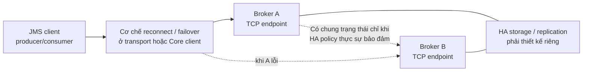
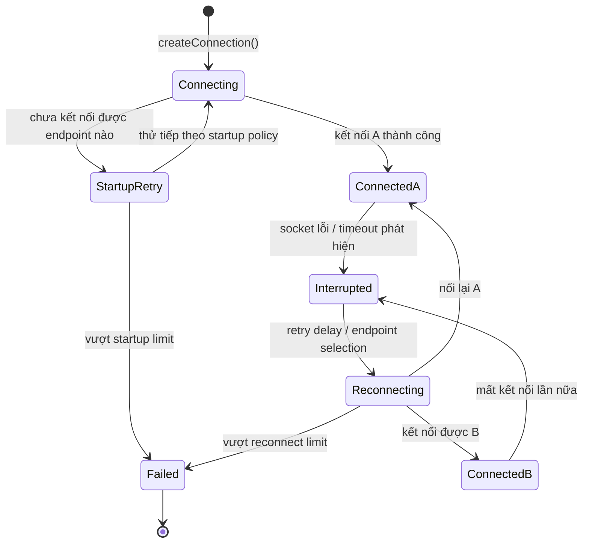

# Failover transport của Classic và cấu hình reconnect của Artemis client

> **Chương:** Sẵn sàng cao  
> **Module:** `INTEGRATION_MESSAGING_MESSAGE_BROKER_ACTIVEMQ` — tìm hiểu Apache ActiveMQ Classic và Artemis trong giao tiếp bất đồng bộ với queue, topic, routing và JMS; thực hành Java producer/consumer, acknowledgment, transaction, redelivery, DLQ, bảo mật và vận hành broker đáng tin cậy.  
> **Trọng tâm bài:** Cách **client JMS phục hồi kết nối** khi broker hoặc đường mạng gặp sự cố: `failover:(...)` của **ActiveMQ Classic OpenWire client** so với `reconnectAttempts`/`ha`/`confirmationWindowSize` của **Artemis native Core/JMS client**. Phân biệt *reconnect*, *session reattach*, *HA failover*, *failback* và **kết quả giao dịch chưa xác định**; đưa ra cấu hình URI, ví dụ Java và phép thử sự cố có thể lặp lại.

## 1. Trước hết phải phân biệt khôi phục kết nối với khôi phục dữ liệu

Một producer đã mở JMS connection tới broker A, gửi một lệnh `CreateShipment`, rồi A dừng. Khi client kết nối được broker B, ta có **ít nhất ba câu hỏi độc lập**:

1. **Kết nối:** Client có phát hiện lỗi và thiết lập TCP/JMS connection mới không?
2. **Trạng thái broker:** Broker B có **message, queue, durable subscription, journal** mà A đã giữ không?
3. **Tác dụng nghiệp vụ:** Lệnh đã được commit/ack hay chưa; có nguy cơ gửi hoặc xử lý hai lần không?

Đặt một danh sách URI broker trong client **chỉ giải quyết phần tìm đầu nối**, không tự sao chép persistent store giữa hai broker độc lập.



Hai tình huống đối chiếu:

- **A và B là một HA pair đúng nghĩa**, chẳng hạn shared store hoặc replication với điều kiện đã đồng bộ đầy đủ: chuyển kết nối sang broker B có thể tiếp tục làm việc với dữ liệu bền vững đã được bảo vệ.
- **A và B là hai broker standalone độc lập**: client có thể nối được B nhưng `lab.ha.orders` trên B chưa có message nào của A. Thành công TCP **không phải** thành công HA dữ liệu.

### 1.1. Bốn thao tác thường gọi chung là “failover”

| Thuật ngữ | Điều thực sự xảy ra | Điều không được mặc định |
|---|---|---|
| **Reconnect cùng broker** | Client mất socket rồi nối lại **chính server** đó | Session cũ vẫn còn sau broker restart |
| **Reattach session** | Client Artemis Core nối lại một **session server-side còn sống** và hòa giải các lệnh chưa được xác nhận | Có thể reattach sau server mất toàn bộ memory/session |
| **Failover tới backup** | Client đổi endpoint sang backup đã được HA policy cho phép trở thành active | Chỉ có hai IP là đủ duy trì journal/ack |
| **Failback** | Khi primary phục hồi, workload có thể trở về primary theo broker/client policy | Tự động diễn ra hoặc không gây gián đoạn lần thứ hai |

**Lưu ý về tên gọi:** ActiveMQ Classic dùng tên riêng **Failover Transport** cho lớp transport bao nhiều socket endpoint. Artemis dùng cơ chế reconnect/failover trong **Core client/ServerLocator** và HA topology. Cùng từ “failover” nhưng **không phải cùng URI grammar hay cùng implementation**.

## 2. ActiveMQ Classic: `failover:(...)` là lớp transport của client

### 2.1. Cú pháp chuẩn và cách chọn URI

Classic JMS client `org.apache.activemq.ActiveMQConnectionFactory` có thể nhận composite URI:

```text
failover:(tcp://classic-a:61616,tcp://classic-b:61616)?option=value&option2=value
```

Ví dụ **HA primary/standby có chủ đích**:

```text
failover:(tcp://classic-a:61616,tcp://classic-b:61616)?randomize=false&initialReconnectDelay=500&maxReconnectDelay=10000&useExponentialBackOff=true&startupMaxReconnectAttempts=10&maxReconnectAttempts=-1&timeout=5000
```

Giải nghĩa:

- Hai `tcp://...` là **endpoint cho Classic OpenWire**, không phải địa chỉ Artemis Core mặc định.
- `randomize=false` làm client **ưu tiên thử theo thứ tự URI được khai báo**, thường dùng cho primary trước rồi standby. `randomize=true` là mặc định, thử endpoint ngẫu nhiên.
- `initialReconnectDelay=500` (ms) đặt khoảng chờ trước lần reconnect đầu; `useExponentialBackOff=true` cho delay tăng dần, nhưng không vượt `maxReconnectDelay=10000` (ms).
- `startupMaxReconnectAttempts=10` giới hạn những lần thử ở **giai đoạn chưa từng kết nối thành công**.
- `maxReconnectAttempts=-1` là **tiếp tục thử vô hạn sau mất kết nối** đối với Classic 5.6+, phải cân nhắc shutdown/readiness và giới hạn thời gian ở tầng nghiệp vụ.
- `timeout=5000` cho một **lời gọi send có thể bị chặn** thất bại sau thời gian chờ tương ứng; **không** có nghĩa transport ngừng cố reconnect sau 5 giây.

**Đặc biệt dễ sai:** Từ **ActiveMQ Classic 5.6+**, `maxReconnectAttempts=-1` nghĩa là vô hạn, còn `0` nghĩa là **không reconnect**. Tài liệu cũ trước 5.6 từng sử dụng `0` cho vô hạn. Không sao chép URI từ blog rất cũ mà không đối chiếu version. `startupMaxReconnectAttempts=-1` cũng biểu thị không giới hạn.

### 2.2. Hình dung vòng đời Failover Transport



**Sự kiện transport resumed** chỉ khẳng định đường kết nối đã phục hồi. JMS Session/transaction và application side effects phải được kiểm tra **riêng**; message chưa ack có thể được redeliver.

### 2.3. Những tham số Failover Transport cần biết

| Option | Mặc định Classic hiện đại | Khi cần chỉnh | Rủi ro |
|---|---|---|---|
| `randomize` | `true` | `false` khi cần ưu tiên URI đầu | Không tạo HA data replication |
| `initialReconnectDelay` | `10` ms | Giảm số kết nối dồn dập | Quá ngắn tạo reconnect storm |
| `useExponentialBackOff` | `true` | Tăng khoảng cách thử tiếp | Thời gian phục hồi có thể tăng |
| `reconnectDelayExponent` | `2.0` | Điều chỉnh độ dốc backoff | Đặt quá lớn làm chậm phục hồi |
| `maxReconnectDelay` | `30000` ms | Giới hạn khoảng cách giữa retries | Max quá lớn tăng RTO |
| `startupMaxReconnectAttempts` | `-1` | Fail-fast khi ứng dụng chưa từng connect | Bị giới hạn có thể khiến startup fail lúc broker đang phục hồi |
| `maxReconnectAttempts` | `-1` từ 5.6+ | Chặn reconnect vô hạn sau một số lần | Hết retries thì ứng dụng phải tự khởi tạo Connection mới |
| `timeout` | `-1` (không timeout send) | Không để sender chờ vô hạn khi mất broker | **Không dừng reconnect**, outcome send có thể chưa rõ |
| `backup` | `false` | Giữ sẵn **một kết nối transport dự phòng** để đổi nhanh | Tốn socket/resource; không backup messages |
| `trackMessages` | `false` | Cache lệnh/message đang bay theo mục đích provider | Tốn RAM; không tạo exactly-once |
| `maxCacheSize` | `131072` bytes | Giới hạn cache khi tracking bật | Không là giới hạn queue hay journal |
| `updateURIsSupported` | `true` | Broker có thể cập nhật danh sách endpoint | Đánh giá trust/ACL và route tới host được công bố |
| `updateURIsURL` | Không có | Đọc danh sách URI cập nhật từ nguồn quản trị | Quyền đọc, tính nhất quán, bảo mật của URL/file |
| `warnAfterReconnectAttempts` | `10` | Điều chỉnh mức cảnh báo reconnect lâu | Log warning không đồng nghĩa failover hoàn tất |

Giá trị mặc định dựa trên tài liệu **Classic Failover Transport Reference**. Luôn kiểm tra version/client thực tế, đặc biệt khi app đã thiết lập bằng Spring JMS ConnectionFactory wrapper hoặc thư viện khác.

### 2.4. `timeout` giải quyết việc chờ của một lời gọi, không phải toàn bộ sự cố

Khi broker không khả dụng, một `MessageProducer.send()` đồng bộ có thể bị **block chờ kết nối lại**. Với:

```text
failover:(tcp://classic-a:61616)?timeout=3000&maxReconnectAttempts=-1
```

Client có thể:

1. Mất kết nối.
2. Tiếp tục vòng reconnect không giới hạn.
3. `send()` hiện tại **trả lỗi** sau khoảng 3 giây chờ.
4. Sau đó transport **vẫn đang thử reconnect**; connection có thể dùng lại khi broker trở lại.

**Không** diễn giải lỗi timeout thành “broker chắc chắn chưa nhận message”. Nếu lỗi xảy ra gần lúc gửi/commit, response có thể thất lạc. Với công việc quan trọng, phải dùng idempotency key và trạng thái đã commit thay vì tạo lệnh nghiệp vụ mới không có đối chiếu.

```text
t0       send(M1) ─────────────────────────► broker A?
t1       mất socket/không có response
t1+3s    send() throws timeout
t1+5s    transport reconnect thành công

Không thể suy từ timeout rằng:
  M1 chưa đến broker,
  M1 đã được lưu,
  hay consumer đã xử lý M1.
```

### 2.5. `backup=true` khác với HA backup broker

Cấu hình:

```text
failover:(tcp://classic-a:61616,tcp://classic-b:61616)?backup=true
```

bảo Classic client có thể giữ **thêm một kết nối transport** để khi A lỗi chuyển nhanh sang URI khác. Nó không:

- Sao chép KahaDB/JDBC journal của A sang B.
- Sao chép messages hoặc transaction state.
- Bảo đảm B là replica đồng bộ của A.
- Bảo vệ khỏi split brain nếu broker HA policy cấu hình sai.

Chỉ bật khi tài nguyên/socket và đặc tính broker thực sự cần, rồi đo lợi ích RTO so với chi phí. Nếu B là **passive broker** chưa mở connector, một socket dự phòng có thể chưa được thiết lập cho đến lúc B active.

### 2.6. Broker có thể thông báo endpoint mới

Failover Transport có `updateURIsSupported=true` theo mặc định và Classic broker có thể bật thông tin topology, chẳng hạn các thuộc tính trên `<transportConnector>` trong `conf/activemq.xml`:

```xml
<transportConnector
    name="openwire"
    uri="tcp://0.0.0.0:61616"
    updateClusterClients="true"
    rebalanceClusterClients="false"/>
```

Đây chỉ là **fragment** bên trong `<transportConnectors>` hiện hữu. Không thêm connector trùng port; chỉ bật nếu topology và trust boundary cho phép. Những URI broker công bố phải là **địa chỉ client truy cập được** (DNS/NAT/firewall đúng), không chỉ hostname nội bộ container.

**`rebalanceClusterClients`** có mục tiêu chủ động phân bổ client khi topology đổi, khác hẳn xử lý failover khi server lỗi. Bài này chỉ dùng thuộc tính trên để giải thích việc cập nhật endpoint, không tự coi mạng nhiều brokers là một HA pair.

### 2.7. Giao dịch đang bay: transport replay không phải exactly-once

Classic Failover Transport theo dõi transaction và có thể replay các lệnh liên quan sau reconnect. Nhưng nếu đang có **consumer acknowledgments trong transaction**, thứ tự redelivery có thể không được bảo toàn đủ để commit. Theo tài liệu Classic, các trường hợp này có thể gây `javax.jms.TransactionRolledBackException` và ứng dụng cần xử lý/retry an toàn.

Đặc biệt, nếu **`Session.commit()` đang bay khi mất mạng**:

```text
Client                          Broker A
  |--- commit(TX-9) --------------->|
  |                                | (có thể đã commit)
  X mất socket                      |
  |<--- không nhận reply -----------X
  |
  +-- Failover Transport reconnect → Broker B
  |
  +-- ứng dụng KHÔNG BIẾT chắc TX-9 được chốt hay chưa
```

Không viết `catch (JMSException e) { resendWithNewBusinessId(); }`. Cần phân biệt **transaction rolled back được provider báo rõ** với **commit outcome chưa rõ**, dùng business key bền vững và đối chiếu state.

## 3. Classic: URI failover đúng không tự dựng cụm HA

### 3.1. Hai broker độc lập có thể gây “mất message sau failover”

```text
Classic A: KahaDB-A / queue orders có M1
Classic B: KahaDB-B / queue orders rỗng

Client:
  failover:(tcp://A:61616,tcp://B:61616)?randomize=false

A chết → client nối B thành công
B vẫn KHÔNG có M1 từ A
```

Để có HA với dữ liệu tồn tại sau switch, cần **broker-side HA architecture** tương ứng:

- ActiveMQ Classic có các kiến trúc primary/standby dựa trên **shared store/master-slave** hoặc cơ chế HA cụ thể theo version/điều kiện triển khai.
- Nếu dùng shared KahaDB, các broker cần nhìn **cùng persistent data directory** và cơ chế **exclusive lock** hoạt động đáng tin cậy. Thường chỉ broker đang giữ lock mới mở connector cho client.
- **Network of Brokers** dùng để phân phối/routing message giữa các brokers **không đồng nghĩa** có một journal chung, không tự thay thế HA pair bền vững.
- Điều kiện durability còn phụ thuộc `DeliveryMode.PERSISTENT`, transaction commit, store sync và backup/restore storage.

Một fragment KahaDB mang tính kiến trúc, **không phải cấu hình HA hoàn chỉnh**:

```xml
<persistenceAdapter>
  <kahaDB directory="/shared/activemq-data/kahadb"/>
</persistenceAdapter>
```

Nếu nhiều brokers trỏ tới cùng đường dẫn trên shared filesystem, phải có khả năng cấp lock độc quyền chuẩn và quản trị **fencing/split brain**. Không mount một thư mục cục bộ khác máy có cùng string path rồi cho rằng đã shared store. Không tạo hai brokers cùng ghi một KahaDB không được bảo vệ.

### 3.2. Khi nào nên dùng một URL duy nhất trong lab?

Để kiểm thử **reconnect sau restart cùng broker**, không cần giả lập hai nodes:

```text
failover:(tcp://127.0.0.1:61616)?initialReconnectDelay=500&maxReconnectDelay=5000&maxReconnectAttempts=-1&timeout=3000
```

Dừng broker, giữ nguyên persistent volume, khởi động lại chính broker đó. Phép thử chứng minh client có thể **khôi phục connection**, và message persistent được khôi phục **nếu store đúng**. Nó **không** chứng minh failover A→B hay thời gian chuyển đổi của backup.

## 4. Artemis native client: không dùng URI `failover:(...)` của Classic

### 4.1. Ba hành vi riêng của Artemis Core client

Artemis native JMS client dựa trên **Core protocol**. Tài liệu Artemis 2.57.0 phân biệt:

1. **Reconnect cùng server:** nếu chỉ bị đứt mạng ngắn, server/session còn sống, client có thể kết nối lại.
2. **Session reattach:** nếu **client có command confirmation buffer** và server-side session còn tồn tại, có thể hòa giải các lệnh trước/sau điểm mất mạng.
3. **Session recreation sau broker restart/HA switch:** server-side session cũ không còn, client tái tạo session/consumer trên node đang active; **các trạng thái in-flight chưa chắc giống lúc trước sự cố**.

Một URL Artemis native cho **reconnect cùng server**:

```text
tcp://127.0.0.1:61616?reconnectAttempts=-1&initialConnectAttempts=10&retryInterval=1000&retryIntervalMultiplier=2.0&maxRetryInterval=10000&confirmationWindowSize=1048576
```

Các option nằm trên URL của **Artemis ConnectionFactory**. Đừng đưa URL này vào `ActiveMQConnectionFactory` của Classic `javax.jms` rồi kỳ vọng hai client hiểu giống nhau.

### 4.2. Các tham số native Artemis

| Parameter | Mặc định tài liệu Artemis 2.57.0 | Ý nghĩa thực tế |
|---|---|---|
| `reconnectAttempts` | `0` | Số lần cố **reconnect** sau lỗi. `-1` là vô hạn; **0 mặc định không tự reconnect** |
| `initialConnectAttempts` | `0` | Số lần thử ban đầu trước khi đã học topology; `0` chỉ một lần kết nối ban đầu |
| `retryInterval` | `2000` ms | Delay nền giữa các lần thử |
| `retryIntervalMultiplier` | `1.0` | Nhân backoff của delay |
| `maxRetryInterval` | `2000` ms | Chặn delay tăng vượt ngưỡng |
| `ha` | `false` | Cho phép dùng **backup node** được công bố trong HA topology |
| `failoverAttempts` | `0` | Giới hạn thử những **active nodes khác** sau khi reconnect hiện tại không thành; `-1` vô hạn |
| `confirmationWindowSize` | `-1` bytes | **-1 tắt command buffer và reattach**; >0 cho phép cố reattach nếu server session còn |
| `connectionTTL` | Thường `60000` ms cho Netty/TCP | Server giữ connection/session tối đa bao lâu khi không thấy traffic |
| `clientFailureCheckPeriod` | Thường `30000` ms cho Netty/TCP | Chu kỳ ping/kiểm tra để phát hiện dead connection |

**Đừng bê mặc định của Classic sang Artemis.** Ví dụ Classic 5.19 `maxReconnectAttempts=-1` là mặc định retry vô hạn; Artemis `reconnectAttempts=0` là **mặc định không reconnect tự động** nếu không cấu hình.

### 4.3. Tại sao `initialConnectAttempts` cần chính sách riêng?

Trước khi native client kết nối lần đầu, nó **chưa nhận đầy đủ HA topology** từ broker. Nếu app start trong lúc primary vừa chết, không thể dựa vào thông tin backup mà client chưa học được.

- `initialConnectAttempts=0`: mặc định, thử kết nối ban đầu một lần rồi trả lỗi nếu không được.
- `initialConnectAttempts=10`: cho phép chờ broker startup trong giới hạn.
- `initialConnectAttempts=-1`: tiếp tục cố initial connect không giới hạn; có thể khiến tiến trình startup chờ lâu vô hạn nếu sai host/credential hoặc network.
- Sau khi đã có connection, `reconnectAttempts`/`ha`/`failoverAttempts` mới điều khiển những tình huống phục hồi tiếp theo.

**Không dùng initial retry vô hạn để che cấu hình broker sai, DNS sai hay thiếu quyền truy cập.** Kết hợp readiness probe, log và alert có deadline rõ.

### 4.4. `confirmationWindowSize` là bộ đệm reattach, không phải nơi giữ message bền vững

Artemis Core client có cơ chế command confirmation:

```text
Client                           Artemis server
  |--- command C1 -------------------->|
  |--- command C2 -------------------->|
  |<-- server confirms up to C1 -------|
  |--- command C3 -------------------->|
  X mất mạng                         [server-side session còn?]
  |
  +-- client reconnect cùng server
      và session còn sống
      |
      +-- server nói lệnh cuối đã nhận
      +-- client dùng local confirmation buffer
          để replay phần cần thiết
      → reattach có thể thành công
```

`confirmationWindowSize=1048576` nghĩa là giữ **tối đa cỡ 1 MiB command-related buffer** trong cơ chế xác nhận của client. Đây không phải queue message capacity, không phải journal durability và **không** là giới hạn producer payload.

- `confirmationWindowSize=-1`: **tắt session reattach** theo tài liệu, buộc chuyển qua reconnect/recreation.
- Giá trị dương: cho phép reattach **nếu server session còn** và chưa bị đóng do `connectionTTL` hoặc restart.
- Broker mất process/restart hoặc chuyển sang backup khiến server session cũ không còn: **không thể hứa reattach đầy đủ**; native client có thể recreate session/consumer.
- Đổi window size có chi phí RAM và confirmation traffic; không tăng vô hạn để tìm “exactly-once”.

### 4.5. ConnectionTTL và failure check là hai phía của phát hiện lỗi

Cho client native Netty:

```text
tcp://artemis-a:61616?clientFailureCheckPeriod=15000&connectionTTL=60000&reconnectAttempts=-1
```

Khi kết nối không có traffic, client gửi ping định kỳ; server dùng `connectionTTL` để giải phóng server-side session/connection nếu không nhận gì quá hạn. Client cũng dùng các tín hiệu này để phát hiện kết nối chết và quyết định reconnect.

**Không tự đặt `connectionTTL=5000` với `clientFailureCheckPeriod=30000`** rồi mong session reattach ổn định: server có thể xóa state sớm hơn nhịp kiểm tra/ping. Tuning quá nhạy dễ gây false positives trên JVM GC pause, network jitter hoặc host quá tải.

Số liệu cần đo gồm **thời gian phát hiện** + **thời gian chọn endpoint và reconnect** + **thời gian recovery**; chỉ giảm `retryInterval` không tự rút ngắn mọi thành phần của RTO.

## 5. Artemis HA pair: `ha=true` phải đi với broker topology thật

### 5.1. URI cho cặp primary/backup

Với Artemis HA đúng nghĩa (shared store hoặc replication, backup thật sự có thể activate), native client có thể được cấu hình:

```text
tcp://artemis-primary:61616?ha=true&reconnectAttempts=-1&initialConnectAttempts=10&retryInterval=1000&retryIntervalMultiplier=2.0&maxRetryInterval=10000
```

Khi đã kết nối lần đầu, client nhận **topology updates** chứa connector của backup. Khi primary hỏng, client có thể thử backup theo thông tin đã học. Để điều này hoạt động:

1. Broker primary/backup phải được cấu hình **`ha-policy` đúng và synchronized**.
2. Broker cluster/topology phải quảng bá connector mà **client thực sự truy cập được**.
3. `ha=true` và `reconnectAttempts` đủ lớn/nonzero cho khoảng backup activate.
4. Firewall/TLS/credentials trên node backup phải chấp nhận client.
5. Client phải xử lý transaction/session recreation và side effects an toàn.

**`ha=true` không tạo backup tự động** nếu chỉ có một broker standalone; không thay replication/shared-store policy.

### 5.2. Multiple connectors và tên được công bố

Artemis cho phép client khai báo các connector ban đầu. Ví dụ theo cú pháp của tài liệu HA:

```text
(tcp://artemis-primary:61616?name=node-0,tcp://artemis-backup:61617?name=node-1)?ha=true&reconnectAttempts=-1&retryInterval=1000&initialConnectAttempts=10
```

Ở đây `name=node-0`, `name=node-1` phải khớp **connector names** mà broker HA topology/cluster connection công bố. Chúng **không phải tên queue hay broker user**.

Ví dụ fragment **trên primary** trong `etc/broker.xml`:

```xml
<connectors>
  <connector name="node-0">tcp://artemis-primary:61616</connector>
</connectors>

<!-- Cluster-connection hiện hữu cần dùng connector-ref node-0;
     backup phải công bố node-1 đúng topology. -->
```

Fragment tương ứng **trên backup**:

```xml
<connectors>
  <connector name="node-1">tcp://artemis-backup:61617</connector>
</connectors>
```

Đây **không phải cấu hình HA broker hoàn chỉnh**; những phần `<ha-policy>`, cluster connections, replication/shared-store, security và ports cần được provision theo topology. Nếu broker hiện hữu đã có `<connectors>`, **gộp connector vào phần tử đó**, không thêm hai `<connectors>` cạnh tranh.

Đặc biệt trong Kubernetes/Docker: broker có thể công bố hostname nội bộ như `artemis-0.default.svc` nhưng client ở bên ngoài cluster không resolve được. Khi đó kết nối lúc đầu thành công qua LoadBalancer, nhưng **failover thất bại sau khi nhận topology**. Phải công bố/override client-reachable connector địa chỉ đúng, không chỉ mở port 61616.

### 5.3. Artemis reconnect khác nối sang một active broker bất kỳ

Cần phân biệt:

- `reconnectAttempts`: thử kết nối lại cùng **primary/backup pair**.
- `ha=true`: sử dụng backup đã được topology biết để failover.
- `failoverAttempts`: có thể thử sang **active servers khác** khi đường hồi phục pair không thành theo config; điều này phù hợp **cụm có nhiều active servers**, nhưng **không** tự đảm bảo queue data của primary đã được sao chép sang node bất kỳ.

Nếu A, B, C đều là active nodes nhưng chỉ B là backup của A, client chuyển ngẫu nhiên sang C có thể vẫn không nhìn thấy persistent messages trên A. **Đừng nhầm cluster load balancing với HA recovery của một journal cụ thể**.

### 5.4. Shared store và replication — nêu đúng ranh giới

| Broker HA policy | Cách giữ dữ liệu | Điều kiện để backup có thể tiếp quản |
|---|---|---|
| **Shared store** | Primary và backup cùng nhìn một data directory được khóa độc quyền | Shared filesystem/lock/fencing hoạt động, backup có quyền đọc journal |
| **Replication** | Primary đồng bộ dữ liệu bền vững sang backup qua mạng | Backup đã sync đầy đủ; replication/quorum/split-brain policy phù hợp version |
| **Primary-only/standalone** | Không có backup HA | `ha=true` ở client **không tự sửa** |
| **Nhiều active brokers độc lập** | Mỗi node có journal/queues riêng | Failover TCP không đồng nghĩa bảo toàn backlog |

**Tập trung của bài là cấu hình client**: không tự dựng `ha-policy` nguyên cụm chỉ bằng vài snippet rồi coi như production-ready. Thiết kế storage, quorum, fencing và failback phải được kiểm tra độc lập với transport reconnect.

## 6. So sánh cấu hình Classic và Artemis trên cùng mục tiêu

### 6.1. Cặp URI không thể tráo đổi

**Classic OpenWire client:**

```text
failover:(tcp://classic-a:61616,tcp://classic-b:61616)?randomize=false&initialReconnectDelay=500&maxReconnectDelay=10000&maxReconnectAttempts=-1&timeout=3000
```

**Artemis native client:**

```text
(tcp://artemis-a:61616?name=node-0,tcp://artemis-b:61617?name=node-1)?ha=true&reconnectAttempts=-1&initialConnectAttempts=10&retryInterval=500&maxRetryInterval=10000
```

Khác biệt không chỉ là tên option:

| Đặc tính | Classic client Failover Transport | Artemis native Core/JMS client |
|---|---|---|
| Lớp thực hiện | Composite transport của Classic OpenWire | Core ServerLocator/session recovery |
| URI wrapper | **`failover:(...)`** | URL native **`(...) ?ha=true...`** hoặc `tcp://...?...` |
| Chọn endpoint đầu | `randomize`, thứ tự URI | Initial connector(s), HA topology/discovery |
| Retry ban đầu | `startupMaxReconnectAttempts` | `initialConnectAttempts` |
| Retry sau mất kết nối | `maxReconnectAttempts` | `reconnectAttempts` |
| Delay/backoff | `initialReconnectDelay`, `reconnectDelayExponent`, `maxReconnectDelay` | `retryInterval`, `retryIntervalMultiplier`, `maxRetryInterval` |
| Giới hạn send đang chờ | `timeout` option của Failover Transport | JMS/Core call timeouts và exception semantics riêng |
| Socket dự phòng | `backup` option của transport | HA backup node được công bố qua topology |
| Session reattach qua command confirmation | Không phải cùng cơ chế buffer Artemis | `confirmationWindowSize` nếu session còn |
| Đọc HA topology | Broker updateURIs và URI list | Client topology updates/discovery + `ha=true` |
| In-flight transaction | Replay/tracking có giới hạn, có thể rollback/in-doubt | Reattach hoặc recreate; rollback-only/unblock khi failover |
| Khả năng đồng bộ dữ liệu | **Broker HA riêng**, không do URI cung cấp | **Broker HA policy riêng**, không do `ha=true` tạo |

### 6.2. Dùng Classic OpenWire client để nối Artemis thì cấu hình nào áp dụng?

Nếu ứng dụng **vẫn dùng** `org.apache.activemq.ActiveMQConnectionFactory` của Classic và broker phía sau là **Artemis OpenWire acceptor**, phần reconnect **vẫn là Classic Failover Transport**:

```java
org.apache.activemq.ActiveMQConnectionFactory factory =
    new org.apache.activemq.ActiveMQConnectionFactory(
        "failover:(tcp://artemis-a:61616,tcp://artemis-b:61617)"
        + "?randomize=false&maxReconnectAttempts=-1");
```

Đừng lầm rằng vì server là Artemis nên ứng dụng có thể dùng option `confirmationWindowSize`/`ha=true` của Artemis **native Core client** trong Classic Failover URI. Đó là **hai client protocol stacks khác nhau**.

Với Artemis native:

```java
org.apache.activemq.artemis.jms.client.ActiveMQConnectionFactory factory =
    new org.apache.activemq.artemis.jms.client.ActiveMQConnectionFactory(
        "tcp://artemis-a:61616?ha=true&reconnectAttempts=-1");
```

**Không trộn `javax.jms` Classic 5.x với `jakarta.jms` Artemis 2.x trong một source file.** Phần lab tiếp theo cố ý dùng **hai project Maven riêng**.

## 7. Lab A — Classic OpenWire client qua `failover:(...)`

### 7.1. Mục đích và điều kiện

Bài test tối thiểu chứng minh:

- Producer dùng **một `Connection`** đã cấu hình Failover Transport.
- Khi broker restart cùng persistent store, client có thể reconnect và tiếp tục nếu không vượt giới hạn retries.
- Nếu `send/commit` trả exception, ứng dụng ghi **`IN_DOUBT`** và không tự tạo lệnh business mới.
- Consumer đọc/ack message đã commit để kiểm tra store recovery.

Cần Java 17, Maven 3.9+, ActiveMQ Classic OpenWire endpoint tại `tcp://127.0.0.1:61616`, queue `lab.ha.probe` và quyền send/consume. Có thể dùng broker Artemis bật OpenWire, nhưng phép thử này kiểm tra **Classic client reconnect**, không phải Artemis native reconnection.

**Bắt đầu với một broker duy nhất có persistent volume**. Khi muốn test hai nodes HA thật, thay URL và thiết kế broker HA pair trước. Không chạy hai standalone brokers rồi coi đó là test data failover.

### 7.2. Maven `pom.xml` cho Classic

```xml
<project xmlns="http://maven.apache.org/POM/4.0.0"
         xmlns:xsi="http://www.w3.org/2001/XMLSchema-instance"
         xsi:schemaLocation="http://maven.apache.org/POM/4.0.0
                             https://maven.apache.org/xsd/maven-4.0.0.xsd">
  <modelVersion>4.0.0</modelVersion>
  <groupId>demo.messaging</groupId>
  <artifactId>classic-failover-probe</artifactId>
  <version>1.0-SNAPSHOT</version>

  <properties>
    <maven.compiler.release>17</maven.compiler.release>
    <project.build.sourceEncoding>UTF-8</project.build.sourceEncoding>
  </properties>

  <dependencies>
    <dependency>
      <groupId>org.apache.activemq</groupId>
      <artifactId>activemq-client</artifactId>
      <version>5.19.12</version>
    </dependency>
  </dependencies>

  <build>
    <plugins>
      <plugin>
        <groupId>org.apache.maven.plugins</groupId>
        <artifactId>maven-compiler-plugin</artifactId>
        <version>3.14.1</version>
      </plugin>
      <plugin>
        <groupId>org.codehaus.mojo</groupId>
        <artifactId>exec-maven-plugin</artifactId>
        <version>3.5.1</version>
      </plugin>
    </plugins>
  </build>
</project>
```

### 7.3. Java `ClassicFailoverProbe.java`

Đặt dưới `src/main/java/demo/ClassicFailoverProbe.java`:

```java
package demo;

import org.apache.activemq.ActiveMQConnectionFactory;

import javax.jms.Connection;
import javax.jms.DeliveryMode;
import javax.jms.JMSException;
import javax.jms.Message;
import javax.jms.MessageConsumer;
import javax.jms.MessageProducer;
import javax.jms.Queue;
import javax.jms.Session;
import javax.jms.TextMessage;

import java.time.Instant;

public final class ClassicFailoverProbe {
    private static final String QUEUE = "lab.ha.probe";
    private static final String DEFAULT_URL =
        "failover:(tcp://127.0.0.1:61616)"
        + "?initialReconnectDelay=500"
        + "&maxReconnectDelay=5000"
        + "&startupMaxReconnectAttempts=10"
        + "&maxReconnectAttempts=-1"
        + "&timeout=3000";

    public static void main(String[] args) throws Exception {
        if (args.length != 3 || (!"publish".equals(args[0])
                && !"drain".equals(args[0]))) {
            usage();
            return;
        }

        String mode = args[0];
        String runId = args[1];
        if (!runId.matches("[A-Za-z0-9_-]{1,40}")) {
            throw new IllegalArgumentException("Invalid runId");
        }
        int count = Integer.parseInt(args[2]);
        if (count < 1 || count > 500) {
            throw new IllegalArgumentException("count must be 1..500");
        }

        String url =
            System.getenv().getOrDefault("BROKER_URL", DEFAULT_URL);
        String user = System.getenv("BROKER_USER");
        String password = System.getenv("BROKER_PASSWORD");

        ActiveMQConnectionFactory factory =
            new ActiveMQConnectionFactory(url);

        Connection connection =
            user == null || user.isBlank()
                ? factory.createConnection()
                : factory.createConnection(user, password);

        try {
            connection.setExceptionListener(error -> {
                // Callback bất đồng bộ; KHÔNG commit/retry ở đây.
                System.err.println("CONNECTION_EVENT at=" + Instant.now()
                    + " reason=" + error.getMessage());
            });
            connection.start();

            if ("publish".equals(mode)) {
                publish(connection, runId, count);
            } else {
                drain(connection, runId, count);
            }
        } finally {
            connection.close();
        }
    }

    private static void publish(Connection connection,
                                String runId, int count)
            throws Exception {
        Session session = connection.createSession(
            true, Session.SESSION_TRANSACTED);
        try {
            Queue queue = session.createQueue(QUEUE);
            MessageProducer producer = session.createProducer(queue);
            try {
                producer.setDeliveryMode(DeliveryMode.PERSISTENT);

                for (int i = 1; i <= count; i++) {
                    String businessId = runId + "-" + i;
                    TextMessage message =
                        session.createTextMessage("work:" + businessId);
                    message.setStringProperty("businessId", businessId);
                    message.setStringProperty("testRunId", runId);

                    String stage = "SEND_CALL";
                    try {
                        producer.send(message);
                        stage = "COMMIT_CALL";
                        session.commit();

                        System.out.println("COMMITTED_SEND id=" + businessId
                            + " messageId=" + message.getJMSMessageID()
                            + " time=" + Instant.now());
                    } catch (JMSException failure) {
                        System.err.println("IN_DOUBT id=" + businessId
                            + " stage=" + stage
                            + " detail=" + failure.getMessage());
                        // Nếu failover trúng lúc commit, KHÔNG
                        // khẳng định broker đã/ chưa commit.
                        rollbackBestEffort(session, failure);
                        return; // Dừng; không retry mù.
                    }
                    Thread.sleep(1000L);
                }
            } finally {
                producer.close();
            }
        } finally {
            session.close();
        }
    }

    private static void drain(Connection connection,
                              String runId, int count)
            throws JMSException {
        Session session = connection.createSession(
            true, Session.SESSION_TRANSACTED);
        int committed = 0;
        try {
            Queue queue = session.createQueue(QUEUE);
            String selector = "testRunId = '" + runId + "'";
            MessageConsumer consumer =
                session.createConsumer(queue, selector);
            try {
                for (int i = 0; i < count; i++) {
                    Message msg = consumer.receive(2000L);
                    if (msg == null) {
                        session.rollback();
                        break;
                    }

                    String id = msg.getStringProperty("businessId");
                    try {
                        session.commit();
                        committed++;
                        System.out.println("COMMITTED_RECEIVE id=" + id
                            + " redelivered=" + msg.getJMSRedelivered());
                    } catch (JMSException failure) {
                        System.err.println("RECEIVE_COMMIT_IN_DOUBT id=" + id);
                        rollbackBestEffort(session, failure);
                        break;
                    }
                }
            } finally {
                consumer.close();
            }
        } finally {
            session.close();
        }
        System.out.println("DRAIN_COMMITTED=" + committed);
    }

    private static void rollbackBestEffort(
            Session session, JMSException original) {
        try {
            session.rollback();
        } catch (JMSException rollbackFailure) {
            original.addSuppressed(rollbackFailure);
        }
    }

    private static void usage() {
        System.out.println("publish <runId> <count:1..500>");
        System.out.println("drain <runId> <count:1..500>");
    }
}
```

**Ý nghĩa chính của code:**

- `factory` dùng **Classic Failover Transport** vì `BROKER_URL` chứa `failover:(...)`.
- Một Connection và transacted Session được dùng trong cả đợt thử; mỗi `session.commit()` đóng một JMS transaction cục bộ.
- Message được gửi **PERSISTENT**, TTL mặc định 0. Điều này chỉ kiểm thử được recovery khi broker thực sự bật persistence và giữ đúng data volume.
- `ExceptionListener` chỉ **log tín hiệu kết nối**. Nó không tự báo “transaction X đã commit”; không thực hiện JMS send/commit trong callback.
- Với `timeout`, `send()` có thể trả lỗi trong lúc Failover Transport vẫn reconnect. Code dừng ở `IN_DOUBT` để tránh tự động sinh duplicate.
- `businessId` là khóa logic ổn định theo `runId`+`i`, dùng để tra message và downstream idempotency. `JMSMessageID` chỉ là transport ID.
- `drain` dùng JMS selector giới hạn các message của một `runId`. Nó **ack/commit** những message nhận được; đừng chạy `drain` trước khi kiểm tra trạng thái pending nếu bạn muốn quan sát backlog.
- Nếu người học muốn biết bao nhiêu message còn, dùng management/JMX/QueueBrowser; output của `drain` không phải phép kiểm tra passive vì nó **tiêu thụ** message.

### 7.4. Chạy và gây lỗi có kiểm soát

Bash:

```bash
export BROKER_URL='failover:(tcp://127.0.0.1:61616)?initialReconnectDelay=500&maxReconnectDelay=5000&startupMaxReconnectAttempts=10&maxReconnectAttempts=-1&timeout=3000'
export BROKER_USER='labuser'
export BROKER_PASSWORD='lab-only-password'

mvn -q compile exec:java \
  '-Dexec.mainClass=demo.ClassicFailoverProbe' \
  '-Dexec.args=publish caseClassic 40'
```

PowerShell:

```powershell
$env:BROKER_URL = 'failover:(tcp://127.0.0.1:61616)?initialReconnectDelay=500&maxReconnectDelay=5000&startupMaxReconnectAttempts=10&maxReconnectAttempts=-1&timeout=3000'
$env:BROKER_USER = 'labuser'
$env:BROKER_PASSWORD = 'lab-only-password'

mvn -q compile exec:java '-Dexec.mainClass=demo.ClassicFailoverProbe' '-Dexec.args=publish caseClassic 40'
```

Sau vài dòng `COMMITTED_SEND`:

1. **Dừng broker lab** trong lúc chương trình vẫn còn đang gửi.
2. Giữ nguyên KahaDB/JDBC store/durable volume. **Không xóa journal** khi test.
3. Khởi động lại **cùng broker** sau vài giây.
4. Quan sát `CONNECTION_EVENT`, các dòng `COMMITTED_SEND` sau recovery hoặc `IN_DOUBT` khi lời gọi lỗi. Với `timeout=3000`, một lời gọi send đang chờ có thể lỗi trước khi broker quay lại; điều đó **không có nghĩa** toàn bộ transport đã ngừng reconnect.
5. Dùng JMX/console đối chiếu `businessId`, hoặc chạy `drain` sau khi ghi kết quả.

```bash
mvn -q compile exec:java \
  '-Dexec.mainClass=demo.ClassicFailoverProbe' \
  '-Dexec.args=drain caseClassic 40'
```

**Tiêu chí:** chứng minh recovery/reconnect có cơ chế hoạt động; không khẳng định đã thực hiện failover sang **backup** khi chỉ có một broker. Nếu producer dừng ở `IN_DOUBT`, phải tra cứu state/broker log rồi mới quyết định replay idempotent; **đừng tạo runId mới cho cùng lệnh nghiệp vụ thật**.

## 8. Lab B — Artemis native Jakarta JMS reconnect và HA

### 8.1. Project riêng, namespace riêng

Bài lab Artemis dùng **`jakarta.jms`** qua `artemis-jakarta-client`, **không** dùng `activemq-client` Classic ở `pom.xml` này.

```xml
<project xmlns="http://maven.apache.org/POM/4.0.0"
         xmlns:xsi="http://www.w3.org/2001/XMLSchema-instance"
         xsi:schemaLocation="http://maven.apache.org/POM/4.0.0
                             https://maven.apache.org/xsd/maven-4.0.0.xsd">
  <modelVersion>4.0.0</modelVersion>
  <groupId>demo.messaging</groupId>
  <artifactId>artemis-reconnect-probe</artifactId>
  <version>1.0-SNAPSHOT</version>

  <properties>
    <maven.compiler.release>17</maven.compiler.release>
    <project.build.sourceEncoding>UTF-8</project.build.sourceEncoding>
  </properties>

  <dependencies>
    <dependency>
      <groupId>org.apache.artemis</groupId>
      <artifactId>artemis-jakarta-client</artifactId>
      <version>2.57.0</version>
    </dependency>
  </dependencies>

  <build>
    <plugins>
      <plugin>
        <groupId>org.apache.maven.plugins</groupId>
        <artifactId>maven-compiler-plugin</artifactId>
        <version>3.14.1</version>
      </plugin>
      <plugin>
        <groupId>org.codehaus.mojo</groupId>
        <artifactId>exec-maven-plugin</artifactId>
        <version>3.5.1</version>
      </plugin>
    </plugins>
  </build>
</project>
```

Với Artemis **2.57.0**, tọa độ Maven được tài liệu chính thức khuyến nghị là **`org.apache.artemis:artemis-jakarta-client`**. Tọa độ cũ `org.apache.activemq:artemis-jakarta-client` được Maven Central cung cấp dưới dạng **relocation POM**, nên dùng groupId mới để dependency rõ ràng. Tên Java package của ConnectionFactory vẫn là `org.apache.activemq.artemis.jms.client`.

Để thử **reconnect cùng server**, dùng một Artemis broker native tại `127.0.0.1:61616` có queue anycast `lab.ha.probe`; broker có thể auto-create theo policy hoặc tạo trước qua `etc/broker.xml`:

```xml
<!-- Fragment trong <addresses> hiện hữu của Artemis -->
<address name="lab.ha.probe">
  <anycast>
    <queue name="lab.ha.probe"/>
  </anycast>
</address>
```

Đừng copy một file broker mới chỉ từ fragment trên. Khi muốn thử failover sang backup, phải có **hai Artemis nodes tạo thành HA pair thật** theo `ha-policy`/cluster topology và endpoint client-reachable.

### 8.2. Java `ArtemisReconnectProbe.java`

Đặt dưới `src/main/java/demo/ArtemisReconnectProbe.java`:

```java
package demo;

import jakarta.jms.DeliveryMode;
import jakarta.jms.JMSConsumer;
import jakarta.jms.JMSContext;
import jakarta.jms.JMSProducer;
import jakarta.jms.JMSRuntimeException;
import jakarta.jms.Message;
import jakarta.jms.Queue;
import jakarta.jms.TextMessage;

import org.apache.activemq.artemis.jms.client.ActiveMQConnectionFactory;

import java.time.Instant;

public final class ArtemisReconnectProbe {
    private static final String QUEUE = "lab.ha.probe";
    private static final String DEFAULT_URL =
        "tcp://127.0.0.1:61616"
        + "?reconnectAttempts=-1"
        + "&initialConnectAttempts=10"
        + "&retryInterval=1000"
        + "&retryIntervalMultiplier=2.0"
        + "&maxRetryInterval=10000"
        + "&confirmationWindowSize=1048576";

    public static void main(String[] args) throws Exception {
        if (args.length != 3 || (!"publish".equals(args[0])
                && !"drain".equals(args[0]))) {
            usage();
            return;
        }

        String mode = args[0];
        String runId = args[1];
        if (!runId.matches("[A-Za-z0-9_-]{1,40}")) {
            throw new IllegalArgumentException("Invalid runId");
        }
        int count = Integer.parseInt(args[2]);
        if (count < 1 || count > 500) {
            throw new IllegalArgumentException("count must be 1..500");
        }

        String url =
            System.getenv().getOrDefault("BROKER_URL", DEFAULT_URL);
        String user = System.getenv("BROKER_USER");
        String password = System.getenv("BROKER_PASSWORD");

        try (ActiveMQConnectionFactory factory =
                     new ActiveMQConnectionFactory(url)) {
            if (user != null && !user.isBlank()) {
                if (password == null) {
                    throw new IllegalArgumentException(
                        "BROKER_PASSWORD required with BROKER_USER");
                }
                factory.setUser(user);
                factory.setPassword(password);
            }

            try (JMSContext context =
                     factory.createContext(JMSContext.SESSION_TRANSACTED)) {
                context.setExceptionListener(error -> {
                    // Artemis cũng báo callback khi có reconnect
                    // hoặc session reattach thành công.
                    System.err.println("CONNECTION_EVENT time="
                        + Instant.now()
                        + " code=" + error.getErrorCode()
                        + " message=" + error.getMessage());
                });

                Queue destination = context.createQueue(QUEUE);

                if ("publish".equals(mode)) {
                    publish(context, destination, runId, count);
                } else {
                    drain(context, destination, runId, count);
                }
            }
        }
    }

    private static void publish(JMSContext context, Queue destination,
                                String runId, int count)
            throws Exception {
        JMSProducer producer = context.createProducer()
            .setDeliveryMode(DeliveryMode.PERSISTENT)
            .setTimeToLive(0L);

        for (int i = 1; i <= count; i++) {
            String businessId = runId + "-" + i;
            TextMessage message =
                context.createTextMessage("work:" + businessId);
            message.setStringProperty("businessId", businessId);
            message.setStringProperty("testRunId", runId);

            String stage = "SEND_CALL";
            try {
                producer.send(destination, message);
                stage = "COMMIT_CALL";
                context.commit();

                System.out.println("COMMITTED_SEND id=" + businessId
                    + " messageId=" + message.getJMSMessageID()
                    + " time=" + Instant.now());
            } catch (JMSRuntimeException failure) {
                System.err.println("IN_DOUBT id=" + businessId
                    + " stage=" + stage
                    + " detail=" + failure.getMessage());
                try {
                    context.rollback();
                } catch (JMSRuntimeException rollbackFailure) {
                    failure.addSuppressed(rollbackFailure);
                }
                return; // Dừng để đối chiếu broker/business state.
            }

            Thread.sleep(1000L);
        }
    }

    private static void drain(JMSContext context, Queue destination,
                              String runId, int count) {
        String selector = "testRunId = '" + runId + "'";
        try (JMSConsumer consumer =
                 context.createConsumer(destination, selector)) {
            int committed = 0;

            for (int i = 0; i < count; i++) {
                Message message = consumer.receive(2000L);
                if (message == null) {
                    context.rollback();
                    break;
                }

                String businessId;
                try {
                    businessId = message.getStringProperty("businessId");
                } catch (jakarta.jms.JMSException error) {
                    context.rollback();
                    throw new JMSRuntimeException(error.getMessage());
                }

                try {
                    context.commit();
                    committed++;
                    System.out.println("COMMITTED_RECEIVE id=" + businessId);
                } catch (JMSRuntimeException failure) {
                    System.err.println("RECEIVE_COMMIT_IN_DOUBT id="
                        + businessId);
                    try {
                        context.rollback();
                    } catch (JMSRuntimeException rollbackFailure) {
                        failure.addSuppressed(rollbackFailure);
                    }
                    break;
                }
            }
            System.out.println("DRAIN_COMMITTED=" + committed);
        }
    }

    private static void usage() {
        System.out.println("publish <runId> <count:1..500>");
        System.out.println("drain <runId> <count:1..500>");
    }
}
```

**Hai điểm khác Classic rất rõ:**

1. `JMSContext` của Jakarta JMS kết hợp connection/session; `JMSRuntimeException` là unchecked. `JMSContext.SESSION_TRANSACTED` vẫn đòi `context.commit()` để chốt send/receive.
2. Những URI option như `reconnectAttempts`, `ha`, `confirmationWindowSize` được **Artemis native client** diễn giải; `ExceptionListener` có thể được gọi ngay cả khi client sau đó **tái kết nối thành công**.

**Lưu ý:** Ở nhánh xử lý `JMSException` khi đọc property trong `drain`, code chuyển thành unchecked JMSRuntimeException sau khi rollback. Trong app thật cần bảo toàn cause, structured error code và metrics; lab ưu tiên làm rõ luồng ack/recovery. `drain` là thao tác tiêu thụ thật, không phải browser.

### 8.3. Chạy thử reconnect cùng Artemis broker

Bash:

```bash
export BROKER_URL='tcp://127.0.0.1:61616?reconnectAttempts=-1&initialConnectAttempts=10&retryInterval=1000&retryIntervalMultiplier=2.0&maxRetryInterval=10000&confirmationWindowSize=1048576'
export BROKER_USER='labuser'
export BROKER_PASSWORD='lab-only-password'

mvn -q compile exec:java \
  '-Dexec.mainClass=demo.ArtemisReconnectProbe' \
  '-Dexec.args=publish caseArtemis 40'
```

PowerShell:

```powershell
$env:BROKER_URL = 'tcp://127.0.0.1:61616?reconnectAttempts=-1&initialConnectAttempts=10&retryInterval=1000&retryIntervalMultiplier=2.0&maxRetryInterval=10000&confirmationWindowSize=1048576'
$env:BROKER_USER = 'labuser'
$env:BROKER_PASSWORD = 'lab-only-password'

mvn -q compile exec:java '-Dexec.mainClass=demo.ArtemisReconnectProbe' '-Dexec.args=publish caseArtemis 40'
```

Trong khi app gửi, gây lỗi broker hoặc ngắt kết nối mạng **trên môi trường lab riêng**, rồi khôi phục. Ghi các tín hiệu:

- `CONNECTION_EVENT` có xuất hiện không, error code là gì?
- `publish` tiếp tục sau reconnect hay dừng ở `IN_DOUBT`?
- Nếu broker **không restart**, server session có còn để reattach không? `confirmationWindowSize` được bật có giúp không?
- Nếu broker **restart**, sessions được recreate hay app phải tạo context mới? Có transaction rollback/in-doubt không?
- Persistent messages được commit **trước sự cố** có còn sau recovery cùng data volume không?

Sau khi ghi kết quả, có thể dùng `drain caseArtemis 40` để đối chiếu những message thực sự tồn tại. **Không lấy count của drain làm bằng chứng tất cả producer attempts đã commit**, vì source ban đầu có thể dừng ngay tại một giao dịch không rõ kết quả.

### 8.4. Đổi sang HA pair thật

Chỉ khi **broker primary và backup thực sự có HA topology**, đặt:

```text
tcp://artemis-primary:61616?ha=true&reconnectAttempts=-1&initialConnectAttempts=10&retryInterval=1000&confirmationWindowSize=1048576
```

Hoặc URL nhiều named connectors theo phần 5.2. Khi primary dừng, đo backup activation và client connection recovered. **Một broker độc lập ở port 61617 không tự trở thành backup** dù URL liệt kê cả hai.

## 9. Failure injection: ma trận phải chạy trước khi tuyên bố HA sẵn sàng

| Sự cố | Classic Failover Transport | Artemis native Core client | Bằng chứng cần có |
|---|---|---|---|
| Broker chưa lên khi app khởi động | `startupMaxReconnectAttempts` | `initialConnectAttempts` | Startup retry/fail-fast đúng policy |
| Đứt mạng ngắn, broker vẫn sống | Reconnect transport | Reconnect; có thể **reattach** nếu session còn và buffer bật | Lấy lại kết nối, quan sát trạng thái session |
| Broker restart **cùng store** | Reconnect rồi rebuild JMS runtime state theo provider | Reconnect, **recreate** session vì server-side session cũ mất | PERSISTENT messages đã commit còn; unacked redeliver |
| HA primary crash, backup activate | Client nối URI backup nếu reachable | `ha=true` và topology học được cho phép nối backup | Backup được active, persistent data được bảo vệ |
| Hai brokers standalone độc lập | Có thể nối B nhưng **không có dữ liệu A** | Có thể nối node khác nhưng **không có dữ liệu A** | Phải báo **không đạt HA dữ liệu** |
| Producer send đang block | `timeout` có thể unblock riêng send | Call timeout/unblocked semantics riêng | Error class + state; không retry mù |
| Transaction đang commit | Có thể `TransactionRolledBackException` hoặc in-doubt | Có thể rollback-only/unblock, và in-doubt khi commit đang bay | Không nhân đôi side effect |
| Consumer đã receive nhưng chưa ack | Redelivery sau failure theo broker policy | Reattach/recreate; nếu ack chưa bền vững có thể redeliver | Inbox/idempotency |
| Backup endpoint broker công bố không resolve từ client | Reconnect URL/cluster update lỗi | Topology failover lỗi | Kiểm tra DNS/firewall/NAT/SSL |
| Cả hai endpoints chết | Retry đến giới hạn đã cấu hình | ReconnectAttempts/failoverAttempts đến giới hạn | Alert, readiness chuyển unhealthy, không đóng băng vô hạn |

### 9.1. Ba phép thử tách biệt

**Test A — Chỉ reconnect:** Một broker duy nhất; dừng/rerun hoặc chặn mạng, giữ store. Kết quả chỉ đánh giá reconnect và recovery phiên.

**Test B — HA data failover:** Hai brokers có replication/shared store đúng; primary chết, backup activate. Kết quả đánh giá **đường client sang node khác** và **dữ liệu được backup**.

**Test C — Commit boundary:** Gây ngắt mạng đúng khi `commit()`/`send()` đang chờ phản hồi. Kết quả đánh giá **duplicate safety và trạng thái in-doubt**, không chỉ socket uptime.

Không thể thay Test B bằng Test A, hoặc thay Test C bằng việc kill broker giữa hai lời gọi send cách nhau một giây. Ba loại lỗi có kết quả và biện pháp bảo vệ khác nhau.

### 9.2. Đo RTO và RPO bằng định nghĩa cụ thể

- **Detection time:** từ khi socket/server thực sự lỗi đến khi client phát hiện.
- **Reconnect delay:** gồm retry interval/backoff và DNS/TLS/auth.
- **Backup activation:** backup cần giành quyền/khôi phục journal trước khi accept.
- **Application recovery:** recreate session/consumer, restore listener workflow, xử lý in-doubt.
- **RTO:** từ lỗi đến khi **nghiệp vụ** xử lý lại message thành công, không chỉ TCP socket restored.
- **RPO:** dữ liệu đã được commit bền vững nào không thể khôi phục sau sự cố, xét persistence/replication/storage failure thực tế.

Nếu dashboard chỉ có “connected=true”, không thể kết luận RTO hay RPO.

## 10. Độ tin cậy giao dịch: không tự gửi lại như một message hoàn toàn mới

### 10.1. Timeline của một commit bị mất response

```text
Producer                       Broker primary
  |                                  |
  |--- send(M, eventId=E101) ------->|
  |--- commit(TX1) ----------------->|
  |                                  | maybe committed
  X----------- network loss ----------X
  |
  |--- reconnect/failover ------------> backup/primary
  |
  |--- application catches exception?
        |
        +-- Không biết chắc commit cũ đã thành công
        +-- Tránh send lại với business key mới
        +-- Đối chiếu state / idempotent replay
```

Có hai loại kết quả phải phân biệt:

1. **Provider xác định giao dịch bị rollback**, ví dụ Artemis báo transaction rollback-only sau session recreation hoặc Classic `TransactionRolledBackException` trong trường hợp theo dõi redelivery. Có thể retry **cùng logical operation**, nhưng vẫn xét side effect bên ngoài.
2. **Client không chắc broker đã nhận commit hay chưa**, vì gói commit hoặc response bị mất. Không được tuyên bố rollback chỉ từ một lỗi IO, timeout hay reconnect event. Phải có đường reconcile.

### 10.2. Idempotency key phải tồn tại ngoài transport

Ví dụ hai nguồn định danh:

```text
eventId  = "shipment-order-1001"    (business logical key, ổn định)
JMSMessageID = "ID:..."             (broker gán mỗi JMS message)
```

Producer giữ nguyên `eventId` khi retry theo cùng nghiệp vụ. Consumer cần:

- Một unique constraint/inbox theo `(consumerName, eventId)`.
- Business state transition idempotent và điều kiện không thực thi hai lần.
- DB commit phù hợp trước JMS ack/commit, có thể redelivery nhưng **không lặp side effect**.
- Nếu gọi API ngoài, truyền idempotency key xuống downstream nếu API hỗ trợ.

**JMS transaction cục bộ không bao gồm database hoặc payment gateway.** Reattach/reconnect có thể hồi phục transport, nhưng không thể quyết định kết quả side effect đã chạy ở hệ thống ngoài.

### 10.3. Artemis broker duplicate detection là lớp phụ trợ

Artemis hỗ trợ duplicate detection qua property `_AMQ_DUPL_ID` (kiểu String với JMS). Nếu một producer phát lại cùng logical event, có thể đặt **duplicate ID ổn định** để Artemis loại những lần publish duplicate trong phạm vi duplicate cache và chính sách broker.

Ví dụ Java Jakarta JMS:

```java
TextMessage message = context.createTextMessage("work");
message.setStringProperty("eventId", "shipment-order-1001");
message.setStringProperty(
    "_AMQ_DUPL_ID", "shipment-order-1001");
context.createProducer().send(queue, message);
```

**Không coi duplicate cache là thay thế inbox:** cache có phạm vi/retention/cấu hình riêng, broker không kiểm soát DB side effect, còn event replay có thể diễn ra sau khi cache evict. Tránh tự đặt property vendor-specific lên producer Classic rồi giả định Classic broker xử lý như Artemis native.

## 11. Vận hành: xử lý kết nối “đã lên” nhưng ứng dụng vẫn không chạy

### 11.1. Readiness và liveness là hai ngưỡng khác nhau

Một app có `reconnectAttempts=-1` có thể **không chết** dù broker biến mất hàng chục phút. Đây có thể là chủ đích giữ process sống chờ broker. Nhưng orchestration phải biết app **không sẵn sàng nhận traffic/đã dừng xử lý message**.

Gợi ý:

- **Liveness:** JVM/event loop/worker còn hoạt động, không deadlock.
- **Readiness:** app có khả năng thực hiện **gửi/nhận và commit một transaction** theo SLO, hoặc broker metrics/client state đủ xác minh.
- **Alert:** thời gian mất kết nối > ngưỡng, retry attempts tăng, listener stopped, oldest message age vượt SLO.
- **Shutdown:** có timeout khi drain, tránh deploy treo vô hạn vì một `send()` đang block.

Đừng gắn một probe quá chặt khiến orchestrator **restart liên tục** process đang nỗ lực reconnect; cũng đừng luôn trả readiness OK chỉ vì JMS ConnectionFactory bean tồn tại.

### 11.2. Những metric cần tách

| Metric | Nguồn | Ý nghĩa |
|---|---|---|
| `connection_interruption_total` | Transport/ExceptionListener | Số lần mất kết nối |
| `reconnect_attempt_total` / logs | Client | Đang thử bao nhiêu lần; backoff có đúng không |
| `time_to_recover_ms` | App/monitoring | Từ lỗi đến khi message tiếp theo được commit |
| `commit_in_doubt_total` | Handler | Mỗi lần không thể khẳng định kết quả commit |
| `transaction_rollback_total` | JMS handler | Provider xác nhận rollback hoặc app chủ động rollback |
| `redelivered_total` | Consumer/`JMSRedelivered` | At-least-once redelivery |
| `duplicate_prevented_total` | Inbox/business layer | Side effect trùng đã được ngăn |
| `broker_backup_activation_total` | Broker management | Bao nhiêu lần backup chuyển active |
| `journal_sync/replication_lag` | Broker/storage | Backup có đủ dữ liệu được bảo vệ không |
| `queue_oldest_age` | Broker/app | Backlog và SLA sau recovery |
| `TLS/auth_failure_total` | Client/broker | Sai certificate/credential không phải network flap |

**Tránh metric label = eventId/JMSMessageID** vì cardinality lớn. Dùng message ID cho structured logs/traces có retention và bảo vệ dữ liệu nhạy cảm.

### 11.3. Bốn lỗi thường bị chẩn đoán sai

**Lỗi 1 — Client connected nhưng queue không có backlog.**  
Có thể broker mới là standalone không có journal cũ. Kiểm tra `ha-policy`, store/replication và destination topology trước, không chỉ chỉnh URL.

**Lỗi 2 — Artemis `ha=true` nhưng chỉ thử primary rồi dừng.**  
Client có thể chưa học topology trước khi lỗi, `initialConnectAttempts=0`, backup chưa activate hoặc connector backup không reachable. Kiểm tra các điều kiện này, không tự bật `failoverAttempts=-1` rồi cho rằng backup xuất hiện.

**Lỗi 3 — Classic producer treo khi broker mất.**  
`timeout=-1` khiến send có thể chờ vô hạn dù transport đang reconnect. Cấu hình `timeout` có giới hạn và đưa trạng thái lỗi lên app; không nhầm với maxReconnectAttempts.

**Lỗi 4 — Artemis reconnect được nhưng uncommitted work phải chạy lại.**  
Sau broker restart/failover, session có thể bị recreate thay vì reattach, transaction đang dở bị rollback. Cần retry/idempotent handler và kiểm chứng commit outcome.

## 12. Security và networking trong đường failover

Đường secondary/backup thường ít được thử hơn đường primary; chính vì vậy các lỗi bảo mật hay chỉ xuất hiện **sau sự cố thực**:

1. **TLS trust:** certificate trên backup phải được client trust, hostname/SAN khớp DNS mà client kết nối; không tắt verification để “chữa” failover.
2. **Credentials/ACL:** cả primary và backup phải có user/roles cần thiết cho send, consume, create subscription hoặc queue theo topology.
3. **Reachability:** broker quảng bá endpoint qua topology/`updateClusterClients` phải client-resolvable, không phải `127.0.0.1` của broker container.
4. **Firewall/NAT:** mở đúng port và định tuyến hai chiều cho TLS/client, khác port cluster replication nội bộ.
5. **Secret rotation:** ứng dụng có thể giữ connection lâu; khi reconnect sau rotation, credentials cũ có thể không còn hợp lệ. Giám sát auth failure riêng với network errors.
6. **Fencing/split brain:** cấu hình broker HA phải ngăn hai nodes cùng active trên một shared store; client reconnect không sửa được dữ liệu nếu cả hai nhận ghi độc lập sai chính sách.

Ví dụ **không điền credentials trong URI/log**:

```text
BROKER_URL=failover:(ssl://classic-a:61617,ssl://classic-b:61617)?randomize=false&timeout=3000
BROKER_USER=(lấy từ secret store)
BROKER_PASSWORD=(lấy từ secret store)
```

Đây là **minh họa cú pháp Classic SSL endpoint**, không phải cấu hình keystore/truststore/hostname verification hoàn chỉnh. Với Artemis native, TLS thường được cấu hình bằng các tham số Netty như `sslEnabled`, `trustStorePath`, `trustStorePassword` hoặc tương đương theo version; **không copy** cú pháp `ssl://` của Classic sang Artemis rồi mong tương thích.

## 13. Quyết định cấu hình: những cặp mục tiêu thường xung đột

### 13.1. Muốn phục hồi nhanh nhưng không gây reconnect storm

- Delay quá ngắn, retry vô hạn và hàng nghìn clients có thể khiến backup vừa active bị **bão kết nối**, đặc biệt khi TLS handshake/authorization tốn CPU.
- Exponential backoff giúp giảm bão nhưng làm RTO tăng khi broker đã lên.
- Nếu muốn jitter, kiểm tra **provider/client support thực tế**; nếu thư viện không có jitter option rõ ràng, dùng tầng orchestration hoặc rollout staggering, không invent URI property.
- Khi app có hàng nghìn JMS connections, cân nhắc connection/session pooling đúng cách và limit concurrency, không mở connection mới vô hạn trong exception callback.

### 13.2. Muốn startup nhanh nhưng broker còn đang khởi động

- Classic `startupMaxReconnectAttempts=0` không phải cách đặt retry forever ở phiên bản mới; có thể khiến startup fail.
- Artemis `initialConnectAttempts=0` mặc định không chờ lâu ở lúc kết nối ban đầu.
- Với app cần sẵn sàng sau broker, chọn retry startup trong một budget hợp lý và readiness rõ ràng; đừng bắt service sống nhưng im lặng vô thời hạn.

### 13.3. Muốn failback về primary ngay khi nó trở lại

- Classic có thể dùng `randomize=false` để **ưu tiên lần thử** theo thứ tự, nhưng **không tự ép client đã ổn định ở secondary chuyển về primary khi primary khởi động lại**. Classic có option `priorityBackup`/`priorityURIs` cho hành vi ưu tiên/failback, cần test.
- Artemis failback phụ thuộc **HA broker policy** như `allow-failback` và cách backup/primary phối hợp. Thay `ha=true` phía client chưa bảo đảm failback luôn diễn ra.
- Failback cũng là một **sự kiện gián đoạn**; đừng tối ưu “trở về primary nhanh nhất” mà quên commit boundary và SLO của consumer.

### 13.4. Muốn reconnect thật lâu nhưng không block đường request HTTP

Một thread HTTP gọi `JmsTemplate.send()`, sau đó Classic Failover Transport chờ broker vô hạn, có thể kéo dài request quá SLA. Cần:

- Thời hạn `send`/request rõ ràng;
- Outbox/async publish nếu business yêu cầu lưu lệnh khi broker không sẵn;
- Throttling/backpressure thay vì chạy hàng nghìn threads chờ broker;
- Phân loại `sent-but-unconfirmed` và retry theo idempotency.

Client reconnect là **cơ chế hạ tầng**, không thay một workflow outbox.

## 14. Bài tập tình huống với đáp án

### Bài 1 — “Có hai URL nghĩa là HA”

Classic client dùng `failover:(tcp://A:61616,tcp://B:61616)`; A và B là hai broker standalone với hai KahaDB riêng. A chết, client nối B, `QueueSize=0`.

**Đáp án:** Đúng khả năng mong đợi. Failover Transport đổi endpoint, nhưng không sao chép messages đã ở A sang B. Muốn khôi phục backlog, cần broker HA policy/shared store/replication hoặc kiến trúc chuyển dữ liệu có bảo đảm.

### Bài 2 — Classic `maxReconnectAttempts=0`

App dùng Classic 5.19.12 với `maxReconnectAttempts=0` để “retry forever” theo một bài blog cũ.

**Đáp án:** Sai với 5.6+. `-1` mới là vô hạn; `0` tắt reconnect. Cần xem cả `startupMaxReconnectAttempts` cho lần kết nối ban đầu.

### Bài 3 — `timeout=3000` có đóng connection không?

Classic producer đang gửi, broker down 5 giây và `send()` ném exception sau 3 giây. Có chắc transport dừng mọi reconnect?

**Đáp án:** Không. Option `timeout` giới hạn thời gian chờ của lời gọi send, không chấm dứt vòng reconnect. Cần phân loại kết quả send/commit trước khi retry.

### Bài 4 — Artemis native reconnect mặc định

Ứng dụng Artemis native không đặt `reconnectAttempts`. Broker ngắt mạng rồi chạy lại; app không tự hồi phục như dự kiến.

**Đáp án:** Tài liệu Artemis 2.57.0 cho default `reconnectAttempts=0`. Phải cấu hình số >0 hoặc `-1` theo budget, và phân biệt initial connect với reconnect sau sự cố.

### Bài 5 — Reattach sau restart

Artemis client đặt `confirmationWindowSize=1048576`. Broker process bị kill và restart, client nói đã reconnect. Có đảm bảo reattach session cũ?

**Đáp án:** Không. Server-side session cũ không còn sau restart; client có thể recreate session/consumer. Command buffer chỉ giúp reattach khi cùng server session vẫn tồn tại và thỏa điều kiện TTL.

### Bài 6 — HA topology qua NAT

Artemis client kết nối qua `artemis.example.com:61616`, nhưng backup connector mà broker công bố là `10.8.0.12:61617` chỉ truy cập được trong cluster. Failover thất bại.

**Đáp án:** Client nhận topology chứa endpoint không reachable. Cần cấu hình connector client-facing/NAT/DNS và có thể override theo connector names đúng, không tăng `retryInterval` vô hạn.

### Bài 7 — Lost commit reply

Producer gọi JMS commit, broker đã xử lý, response bị mất. Client bắt exception rồi gửi lại cùng business command với eventId mới.

**Đáp án:** Có nguy cơ duplicate. Giữ nguyên business ID/idempotency key, đối chiếu state, dùng transactional outbox/inbox hoặc duplicate detection phù hợp. Không coi mọi exception là “commit chắc chắn chưa xảy ra”.

### Bài 8 — Classic `backup=true`

Bật `backup=true` trên Classic Failover Transport nhưng không có replicated store. Mức bảo đảm dữ liệu có tăng?

**Đáp án:** Không. Nó giữ một **transport/socket dự phòng** để đổi endpoint nhanh, không đồng bộ journal. Kiểm thử broker-side HA riêng.

### Bài 9 — Artemis `ha=true` với một broker

Chỉ có một broker Artemis đang chạy, `ha=true` và `reconnectAttempts=-1`. Khi broker đó bị xóa volume và thay node mới, queue cũ có quay về?

**Đáp án:** Không. Client không thể phục hồi journal đã mất; `ha=true` không tạo backup. Cần storage/replication/backup policy, RPO rõ và kiểm tra durable messages.

### Bài 10 — Chỉ có một message failover test

Một test chỉ gửi một message, kill broker sau khi producer nhận `COMMITTED_SEND` rồi xác nhận message còn sau restart; đội vận hành kết luận “đã bảo đảm exactly-once khi HA”.

**Đáp án:** Chưa đủ. Test này chỉ xác nhận một trường hợp persistence/recovery. Còn phải kiểm tra commit in-flight, unacked consumer messages, duplicate business effects, HA backup activation và failback.

## 15. Checklist nghiệm thu

- [ ] Tôi phân biệt **socket reconnect**, **session reattach**, **session recreation** và **backup failover**.
- [ ] Tôi biết Classic URI `failover:(...)` chỉ là client transport và `maxReconnectAttempts=-1` là retry forever từ Classic 5.6+.
- [ ] Tôi hiểu `randomize=false` ưu tiên URI theo thứ tự, `backup=true` chỉ là hot transport connection, `timeout` không chấm dứt reconnect.
- [ ] Tôi đặt riêng giới hạn startup và after-connect retry trên Classic.
- [ ] Tôi không đưa Artemis native `ha=true/reconnectAttempts` vào Classic OpenWire client URI.
- [ ] Tôi biết Artemis `reconnectAttempts=0` mặc định, `initialConnectAttempts=0` mặc định, và `confirmationWindowSize=-1` làm reattach không hoạt động.
- [ ] Tôi hiểu Artemis `confirmationWindowSize` chỉ phục vụ command reconciliation khi server session **còn**.
- [ ] Tôi biết `ha=true` cần HA broker topology, connector backup reachable và backup đã activate.
- [ ] Tôi kiểm tra journal/shared store/replication trước khi tuyên bố **RPO** hoặc tính bền vững sau failover.
- [ ] Tôi không lấy `ExceptionListener` callback hoặc socket restored làm bằng chứng JMS transaction đã commit.
- [ ] Tôi dùng cùng businessId qua retry, có inbox/idempotency và xử lý `IN_DOUBT`.
- [ ] Tôi chạy riêng test reconnect same node, HA primary→backup và commit boundary.
- [ ] Tôi có metrics detection/reconnect/recovery, rollback/in-doubt, redelivery, backlog age và security errors.
- [ ] Tôi không sửa broker production bằng failure injection; mọi thí nghiệm crash được giới hạn ở lab/staging riêng.

## 16. Tóm tắt quyết định kỹ thuật

**ActiveMQ Classic** đặt reconnect trong **Failover Transport** của OpenWire client: danh sách `failover:(...)`, chọn URI/`randomize`, backoff, giới hạn startup/reconnect, `timeout` cho send bị chặn và `backup` cho transport dự phòng. URI này không tự sao chép journal giữa brokers.

**ActiveMQ Artemis native** đặt reconnect trong **Core client**: `reconnectAttempts`, `initialConnectAttempts`, `retryInterval`/multiplier, `ha=true` với topology backup, `failoverAttempts` cho active nodes khác, và `confirmationWindowSize` cho cơ hội **reattach** session còn sống. `ha=true` không tự tạo broker backup hay bảo đảm failback.

Trong cả hai trường hợp, **kết nối sống lại khác với một lần giao JMS/SQL thành công**. Hãy kiểm tra broker HA data state, quản lý transaction in-doubt, và dùng idempotency business key để phục hồi mà không nhân đôi side effects.

## 17. Tài liệu tham khảo chính thức

1. [ActiveMQ Classic — Failover Transport Reference](https://activemq.apache.org/components/classic/documentation/failover-transport-reference) — URI, defaults theo version, timeout, backup, transaction tracking, updateURIs và priorityBackup.
2. [ActiveMQ Classic — Shared File System Master Slave](https://activemq.apache.org/components/classic/documentation/shared-file-system-master-slave) — ví dụ Classic HA shared store và failover transport.
3. [ActiveMQ Classic — Classic Connection URIs](https://activemq.apache.org/components/classic/documentation/activemq-classic-connection-uris) — phân biệt transport và protocol URI.
4. [Apache ActiveMQ Artemis 2.57 — Core Client Failover](https://artemis.apache.org/components/artemis/documentation/latest/client-failover.html) — reconnect vs reattach, `confirmationWindowSize`, initial/reconnect/failover attempts.
5. [Apache ActiveMQ Artemis 2.57 — High Availability and Failover](https://artemis.apache.org/components/artemis/documentation/latest/ha.html) — primary/backup, shared store/replication, topology và transaction rollback/in-doubt.
6. [Apache ActiveMQ Artemis — Detecting Dead Connections](https://artemis.apache.org/components/artemis/documentation/latest/connection-ttl.html) — connectionTTL/clientFailureCheckPeriod và ping.
7. [Apache ActiveMQ Artemis — Duplicate Message Detection](https://artemis.apache.org/components/artemis/documentation/latest/duplicate-detection.html) — `_AMQ_DUPL_ID` và duplicate cache.
8. [Jakarta Messaging 3.1 — JMSContext API](https://jakarta.ee/specifications/messaging/3.1/apidocs/jakarta.messaging/jakarta/jms/jmscontext) — transacted context, commit/rollback, ExceptionListener.
9. [Apache Artemis 2.57 — The Client Classpath](https://artemis.apache.org/components/artemis/documentation/latest/client-classpath) — tọa độ Maven `org.apache.artemis` cho Jakarta Messaging client.
