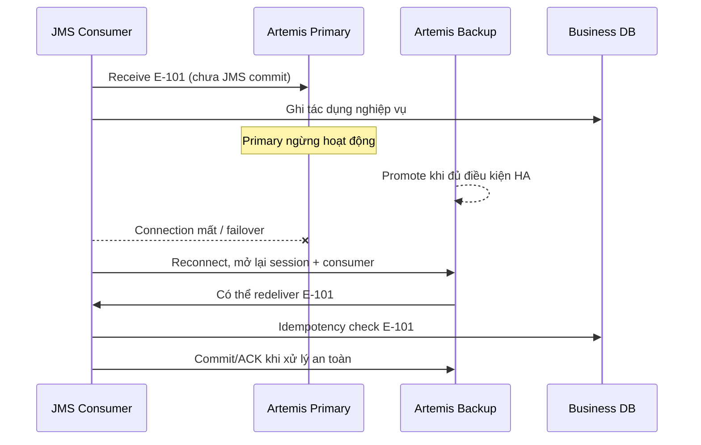
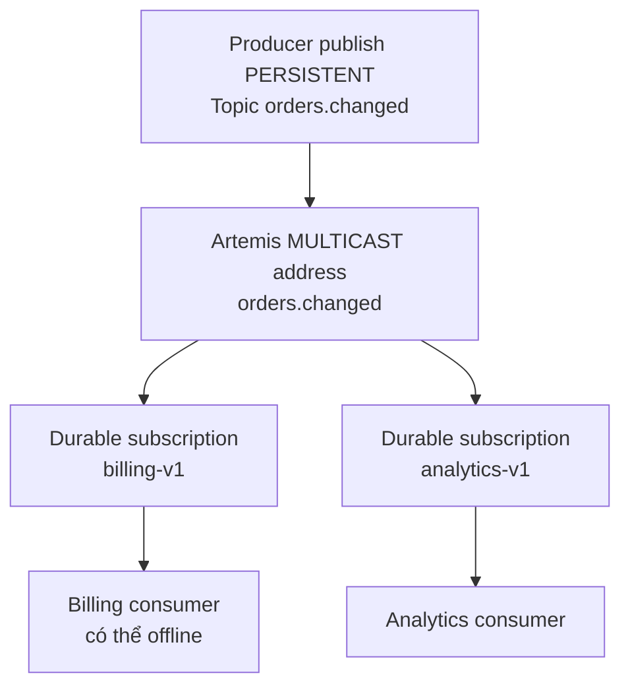

# Khôi phục consumer, subscription và giao dịch sau failover

> **Chương:** Sẵn sàng cao  
> **Phạm vi:** Khôi phục **JMS consumer**, **durable topic subscription** và **trạng thái transaction/acknowledgment** sau khi Apache ActiveMQ Artemis chuyển từ primary sang backup; đối chiếu điểm khác của ActiveMQ Classic. Trọng tâm không phải cách dựng một cluster từ đầu, mà là **message nào còn, ai có quyền nhận lại, khi nào được commit và cách xác minh xử lý không lặp**.

## 1. Failover xong, ứng dụng có thật sự tiếp tục đúng chỗ?

Order Worker đang đọc queue `orders.to-process` trên Artemis primary. Worker nhận message `E-101`, bắt đầu ghi database nhưng chưa commit JMS. Primary ngừng hoạt động; backup được kích hoạt. Sau đó, worker reconnect và có thể nhận lại `E-101`.

Đối với một durable topic subscriber, sự cố còn phức tạp hơn: một subscription đã nhận event trước đó, trong lúc ứng dụng offline broker vẫn phải giữ backlog; khi backup tiếp quản, subscriber mới phải tìm lại **đúng subscription** chứ không tạo subscription mới với một tên/client ID khác.

**Năm trạng thái cần khôi phục là năm việc khác nhau:**

| Tầng | Câu hỏi cần trả lời | Điều không được suy diễn |
|---|---|---|
| **Broker HA** | Backup đã tiếp quản **dữ liệu persistent, bindings và transaction state** phù hợp chưa? | Broker có mở cổng không chứng minh đã dùng đúng store/synchronized replica |
| **Kết nối JMS** | Client tìm thấy primary mới và hoàn tất handshake/authentication chưa? | TCP connected không chứng minh queue/subscription đúng |
| **Consumer/subscription** | Consumer đã mở lại; với topic, subscription identity có giữ nguyên không? | Tái tạo Java consumer object không tự khôi phục backlog của một subscription đặt tên khác |
| **Acknowledgment/transaction** | Message đang nhận và JMS commit/ACK trước lỗi đã hoàn tất hay còn không chắc chắn? | `receive()` thành công không đồng nghĩa message đã được ACK |
| **Business effect** | DB, payment hoặc side effect đã commit chưa? Có thể làm lại an toàn không? | JMS failover không thể rollback một database transaction bên ngoài JMS session |



**Kết luận mấu chốt:** HA giúp **tiếp tục phục vụ** và bảo vệ một tập trạng thái broker theo chính sách lưu trữ/replication; nó **không** tự hứa “một message chỉ được xử lý đúng một lần” khi consumer hoặc mạng gặp lỗi ở giữa các mốc commit.

## 2. Khả năng khôi phục phụ thuộc cách broker bảo vệ store

Trước khi kiểm tra consumer, phải xác định cơ chế HA của Artemis đang dùng. Đừng suy ra rằng cứ có hai container broker là backup có đầy đủ queue/subscription/transaction.

### 2.1. Shared store và replication khác nhau

| Tiêu chí | Artemis shared-store HA | Artemis replication HA |
|---|---|---|
| Nguồn dữ liệu durable | Primary/backup truy cập cùng hệ lưu trữ được chia sẻ, có cơ chế loại trừ truy cập đồng thời | Primary truyền trạng thái cần thiết sang backup trên đường replication |
| Điều kiện backup tiếp quản | Primary ngừng sở hữu store/lock; backup được phép mở store | Backup đủ điều kiện và trạng thái đồng bộ/quorum/HA policy cho phép kích hoạt |
| Rủi ro phải quản trị | Shared storage availability, khóa, fencing, I/O và việc hai broker cùng ghi | Replication lag/sync state, network partition, split brain, quorum và disk riêng |
| Nếu backup khởi động không có dữ liệu đồng bộ | Không được mở một store khác rồi coi đó là cùng message store | Không được mặc nhiên kích hoạt một bản sao trống và tuyên bố backlog đã được giữ |
| Điều cần quan sát | Store identity/lock owner, journal/bindings, active broker | Replication sync, backup activation, journal/bindings, broker identity/quorum |

Trong cả hai mô hình, **persistent message + durable queue/subscription + broker HA state nhất quán** mới là điều kiện để kiểm tra khôi phục backlog. `NON_PERSISTENT`, temporary queue, connection/session object và các trạng thái chỉ nằm trong RAM của ứng dụng **không** được biến thành durable chỉ nhờ có backup.

Artemis phiên bản 2.x hiện đại có các biến thể/chính sách HA khác nhau; cấu trúc `<ha-policy>`, thiết lập node/cluster-connection, quorum, failback và đồng bộ phải được kiểm tra theo **đúng phiên bản đang chạy**. Ví dụ dưới đây chỉ mô tả **phần chính sách HA shared-store**, không phải file `broker.xml` hoàn chỉnh:

```xml
<!-- PRIMARY: chèn phần tử này vào <core> của broker.xml primary -->
<ha-policy>
    <shared-store>
        <primary/>
    </shared-store>
</ha-policy>
```

```xml
<!-- BACKUP: dùng trên backup có chung store tương thích -->
<ha-policy>
    <shared-store>
        <backup/>
    </shared-store>
</ha-policy>
```

Hai fragment trên **không đủ để triển khai HA**: cần cluster connectors, storage path/locking tương thích, quyền, acceptors, HA pair identity, test takeover và fencing. Nếu dùng replication thay vì shared store, **không áp dụng** fragment shared-store và không giả định hai node cùng trỏ một data directory. Không chạy hai broker active ghi chung journal.

### 2.2. Dữ liệu cần sống qua failover

Để consumer nhận lại đúng trạng thái, kiểm tra ít nhất:

- **Queue message store và bindings:** durable queue còn tồn tại; message persistent chưa ACK/commit vẫn còn.
- **Durable topic subscription metadata:** subscription queue, client ID/subscription name, backlog của từng subscription và routing type.
- **Transaction records:** message sends/ACKs đã commit so với transaction chưa commit hoặc prepared XA.
- **Scheduled redelivery, DLQ, expiry, paging và large-message storage:** có đủ dữ liệu store/replication cần thiết để khôi phục vòng đời message.
- **Security/connector configuration:** client mới vào primary đã takeover bằng cùng danh tính ứng dụng và quyền phù hợp.

Không được chỉ nhìn `message count` của một queue mà bỏ qua **durable subscription backlog**, page cursor hoặc message đang delivering. Một queue vừa được khởi tạo mới có thể báo count 0 và ứng dụng trông “healthy”, nhưng dữ liệu của subscription cũ có thể vẫn nằm ở store/queue khác.

### 2.3. Promotion, failback và nguy cơ split brain

**Failover** là backup tiếp quản khi primary không còn phục vụ theo điều kiện của HA policy. **Failback** là việc đưa primary cũ quay lại nắm quyền có kiểm soát khi thích hợp; không phải mọi deployment đều cho phép failback tự động. Network partition có thể khiến hai node cùng *tưởng* mình được phép phục vụ nếu cơ chế quorum/fencing không được thiết kế đúng.

Khi thử nghiệm, không chỉ kill primary rồi chạy producer: phải xác nhận **một node active duy nhất**, client được điều hướng tới node đó và bản dữ liệu chưa ACK không bị tách thành hai nhánh độc lập. Không thao tác khởi động primary cũ song song với backup đã active khi chưa có kế hoạch rejoin/failback của topology.

## 3. Khôi phục queue consumer: điều gì xảy ra với message đang xử lý?

Queue consumer là một **runtime subscription** tới queue; Java `Connection`, `Session` và `MessageConsumer` có thể trở nên không hợp lệ khi broker gặp sự cố. JMS provider hỗ trợ reconnect/failover có thể tự phục hồi một phần tài nguyên; nếu không thể, ứng dụng phải **đóng phiên cũ, tạo phiên mới và kết nối lại một cách có giới hạn**.

### 3.1. Ma trận message state quanh thời điểm lỗi

| Trạng thái ngay trước lỗi | Sau khi backup tiếp quản có thể xảy ra | Hướng xử lý |
|---|---|---|
| Message persistent còn **ready**, chưa giao cho ai | Message vẫn đủ điều kiện được nhận nếu HA store/replication đã bảo toàn | Consumer mới nhận bình thường |
| Message đã được `receive()` nhưng **chưa ACK/commit** | Delivery có thể được trả về queue và giao lại | Chấp nhận duplicate delivery, dùng business idempotency |
| Consumer đã commit JMS thành công và broker đã bền vững hóa kết quả | Message không nên được giao lại chỉ vì có failover hợp lệ | Kiểm tra transaction/ACK evidence và test theo failure mode |
| Consumer gọi `commit()`, mất kết nối trước khi thấy phản hồi | **Unknown outcome:** commit có thể đã xảy ra hoặc chưa | Không đoán; làm lại qua inbox/idempotency, đối chiếu DB/broker |
| Transaction rollback trước lỗi | Message đủ điều kiện redeliver theo policy | Không tạo message mới bằng producer chỉ để “retry” |
| Message có TTL/expiry hoặc đã vào DLQ | Có thể không còn trong ready queue | Tra expiry/DLQ và timestamp, không kết luận mất do HA |
| Message NON_PERSISTENT | Khả năng tồn tại sau crash tùy runtime/HA, không nên hứa durability | Chỉ dùng ở nơi chấp nhận mất |

Ở broker, **acknowledgment chỉ có ý nghĩa khi được broker chấp nhận theo session/transaction tương ứng**. Ở ứng dụng, `onMessage` return hoặc log “done” trước khi transaction thực sự commit không chứng minh broker đã ghi nhận ACK.

### 3.2. Các chế độ JMS cần hiểu đúng khi failover

| Chế độ | Điều cần kiểm soát sau reconnect/failover |
|---|---|
| `AUTO_ACKNOWLEDGE` | Provider ACK theo contract sau khi message được nhận/xử lý theo API listener/synchronous receive; không ghép nguyên tử với database ngoài JMS |
| `CLIENT_ACKNOWLEDGE` | `message.acknowledge()` thông thường xác nhận **các message đã nhận trong session**, không chỉ đúng message đó; cực kỳ thận trọng với nhiều in-flight |
| `Session.SESSION_TRANSACTED` | `session.commit()` xác nhận những deliveries thuộc JMS transaction; rollback để broker redeliver. Commit trong lúc failover có thể lỗi/không xác định kết quả |
| JTA/XA | Transaction manager phối hợp JMS + resource khác khi chúng **thực sự enlist XA**; prepared branches cần transaction recovery riêng |

**Khuyến nghị cho lab:** dùng một `Session` **transacted**, một consumer, xử lý tuần tự từng message rồi `commit()`; khi JMS session hỏng, tạo mới thay vì tiếp tục dùng object cũ. Với throughput cao, tăng **số session/consumer độc lập**, không dùng một JMS `Session` đồng thời từ nhiều thread.

### 3.3. JMS headers chỉ để hỗ trợ quan sát

`JMSRedelivered` có thể cho biết message được giao lại, và `JMSXDeliveryCount` thường biểu thị số lượt delivery khi provider cung cấp. Hai trường này hữu ích để phát hiện retry sau failover, nhưng **không phải khóa idempotency**:

- Một relay có thể phát lại **cùng logical event** như một JMS message mới: `JMSRedelivered=false` nhưng event nghiệp vụ đã từng được xử lý.
- `JMSMessageID` có thể đổi sau một lần producer send mới.
- Cách đếm delivery qua crash/failover, rollback, policy hoặc upgrade cần kiểm chứng theo provider/version.

Dùng `eventId` hoặc `commandId` **do nghiệp vụ định danh ổn định**, lưu với message property và trong inbox DB. Khi nhận duplicate, consumer vẫn commit/ACK message sau khi xác minh side effect đã được hoàn tất.

## 4. Durable topic subscription: phải khôi phục **đúng danh tính**

Queue có thể giữ message cho một consumer bất kỳ đã được phép nhận; **topic** theo kiểu publish/subscribe lại phụ thuộc vào subscription có tồn tại từ trước hay không. Với **durable topic subscription**, broker giữ backlog cho logical subscription khi consumer offline, nhưng chỉ khi subscription đã được đăng ký trước thời điểm publish và broker bảo toàn subscription state.

### 4.1. Topic address, subscription queue và consumer session

Ở Artemis, một JMS topic thường ánh xạ tới **multicast address**. Mỗi durable subscription tương ứng với một queue/binding subscription mà broker quản lý, để giữ những message chưa được consumer tương ứng xác nhận.



Vì vậy:

- `Connection`/`Session`/`MessageConsumer` là **đối tượng runtime**, có thể bị ngắt và tạo lại.
- Durable subscription queue/backlog là **trạng thái broker** có thể sống qua disconnect/failover nếu HA storage đúng.
- Khi reconnect, consumer phải mở **cùng logical durable subscription**, không tạo một subscription mới rồi mong backlog của subscription cũ tự chuyển sang.

### 4.2. Client ID và tên subscription là một phần của khóa định danh

Với **unshared durable subscription** theo JMS, danh tính gắn với **client identifier** và **subscription name** (cùng các ràng buộc tương thích về topic, selector, `noLocal`). Trong lab:

```text
clientID         = billing-worker-prod-01
subscriptionName = order-changed-billing-v1
topic            = orders.changed
```

Khi khởi tạo connection mới sau failover, ứng dụng dùng **đúng `clientID` và `subscriptionName`** để lấy backlog tiếp tục. Thay `billing-worker-prod-01` bằng một UUID mới khi mỗi pod restart có thể tạo **logical subscription khác**, để lại backlog cũ thành “orphan” về mặt vận hành.

| Sau failover/restart | Kết quả mong đợi |
|---|---|
| Cùng `clientID` + `subscriptionName`, cùng topic/selector | Consumer gắn lại subscription cũ và tiếp tục nhận message chưa ACK |
| Đổi `clientID` nhưng giữ `subscriptionName` | Có thể đăng ký subscription khác; backlog cũ không tự chuyển |
| Giữ `clientID` nhưng đổi `subscriptionName` | Có thể tạo subscription mới, mất mối liên hệ với backlog cũ |
| Gọi `unsubscribe(subscriptionName)` | **Xóa subscription** và backlog theo semantics broker/JMS; không dùng như “reconnect” |
| Hai consumer unshared cùng client ID/subscription hoạt động đồng thời | Bị ràng buộc exclusivity và có thể lỗi/đẩy nhau; cần thiết kế sharing hoặc ownership |
| Subscription chưa từng tồn tại, producer publish khi không có subscriber | Durable topic không tự lưu message cho một subscriber “sắp được tạo” |

**Không dùng `UUID.randomUUID()` làm `clientID` mỗi khi container khởi động.** Tên ổn định phải đến từ configuration/deployment inventory; cần tránh va chạm giữa hai active replicas. Với **unshared durable**, thông thường chỉ **một active consumer** cho logical subscription. Nếu muốn nhiều replicas đồng thời chia việc, cân nhắc **shared durable subscription** và xác minh hỗ trợ của client/broker, thay vì cùng đặt một client ID rồi dùng unshared API.

### 4.3. Shared durable khác unshared durable thế nào?

Jakarta Messaging (JMS 2.0+) có API:

```java
// Unshared durable: một active consumer cho logical subscription.
MessageConsumer exclusive =
        session.createDurableConsumer(topic, "order-changed-billing-v1");

// Shared durable: nhiều consumer có thể chia message của cùng
// logical subscription nếu runtime/provider hỗ trợ và cấu hình đúng.
MessageConsumer shared =
        session.createSharedDurableConsumer(
                topic, "order-changed-billing-shared-v1");
```

Hai dòng trên minh họa **hai lựa chọn khác nhau**, không phải tạo cả hai trong một session cho cùng subscription. Với shared durable, mỗi message trong backlog của **một logical subscription** được giao cho consumer tham gia theo cơ chế chia tải; không phải mỗi replica nhận đủ một bản như các durable subscriptions **khác nhau**.

Khi cần scale, phải xác định rõ:

1. Nhiều **subscriptions riêng** để mỗi hệ thống (Billing/Analytics) nhận đủ một bản?
2. Hay một **shared subscription** để nhiều Billing workers chia nhau xử lý?
3. Client ID có được dùng hay không, và provider định danh shared subscription theo tên/client ID như thế nào?
4. Có yêu cầu giữ **thứ tự theo aggregate** không? Nhiều shared consumers có thể làm completion order khác publication order.

Không chuyển một unshared durable subscription đang có backlog sang shared durable bằng cách đổi API rồi mặc định không mất dữ liệu. Cần kế hoạch migration danh tính/binding, selector, backlog, cutover và xác nhận subscriber semantics trên đúng phiên bản Artemis.

### 4.4. Đừng sửa selector/topic trong lúc khôi phục mà không có kế hoạch

Một durable subscription đã tồn tại thường gắn với cấu hình topic, message selector và `noLocal`. Thay đổi chúng có thể yêu cầu thay thế subscription; tùy provider/API có thể dẫn tới lỗi hoặc xóa/tạo lại binding. **Không** sửa selector trong lúc đang failover để “xử lý nhanh một lỗi”: hãy ghi nhận snapshot backlog và kiểm tra policy migration.

### 4.5. Cấu hình broker cho hai loại destination

Ví dụ các phần tử dưới `<addresses>` **hiện có** trong `broker.xml` của Artemis:

```xml
<address name="lab.ha.orders">
    <anycast>
        <queue name="lab.ha.orders"/>
    </anycast>
</address>
<address name="lab.ha.events">
    <multicast/>
</address>
<address name="DLQ">
    <anycast>
        <queue name="DLQ"/>
    </anycast>
</address>
```

Queue `lab.ha.orders` phục vụ bài kiểm tra queue; topic JMS `lab.ha.events` dùng multicast address. Durable subscription queue có thể được broker tạo lúc client đăng ký theo chính sách auto-create/authorization; nếu auto-create bị giới hạn, phải provision subscription/binding phù hợp **trước khi producer publish**. Không suy `session.createTopic(...)` trong client là tạo durable subscription trên broker.

Thêm chính sách redelivery lab vào khối `<address-settings>` đang tồn tại:

```xml
<address-setting match="lab.ha.#">
    <dead-letter-address>DLQ</dead-letter-address>
    <max-delivery-attempts>6</max-delivery-attempts>
    <redelivery-delay>2000</redelivery-delay>
    <redelivery-delay-multiplier>2.0</redelivery-delay-multiplier>
    <max-redelivery-delay>30000</max-redelivery-delay>
</address-setting>
```

Đây là policy **thử nghiệm** (6 lần delivery tính cả lần đầu, delay danh nghĩa 2→4→8→16→30 giây). Bảo đảm queue DLQ tồn tại, broker persistence được bật, storage/journal đủ bền và backup nhận được trạng thái này theo HA topology. Khi có transaction rollback sau failover, message có thể được redeliver chậm theo policy chứ **không** xuất hiện ngay ở ready queue.

## 5. Transaction sau failover: đừng đồng nhất broker HA với commit nguyên tử

Một JMS **transacted `Session`** gộp các send/receive/ACK thuộc session thành **local JMS transaction**. `commit()` là mốc hoàn tất JMS transaction, nhưng khi connection chết ngay lúc gửi commit request, client có thể **không biết** broker đã ghi nhận quyết định hay chưa.

### 5.1. Ba cửa sổ lỗi quan trọng

```text
Consumer receive E-101
    |
    v
Business DB transaction COMMIT
    |
    |  [Cửa sổ A: JVM chết trước JMS commit -> có thể redeliver]
    v
JMS session.commit()
    |
    |  [Cửa sổ B: kết nối chết giữa commit và phản hồi -> unknown outcome]
    v
JMS commit acknowledged to client
```

| Vị trí lỗi | DB nghiệp vụ | JMS ack/transaction | Phương án an toàn |
|---|---|---|---|
| Trước DB commit | Có thể rollback | JMS chưa commit | Rollback JMS; message có thể được nhận lại |
| DB commit rồi chết trước JMS commit | **Đã commit** | **Chưa hoàn tất** | Redelivery → kiểm tra inbox; không thực hiện side effect thêm |
| Trong khi JMS `commit()`, mất kết nối | **Đã commit** | **Unknown outcome** | Không giả định message đã ACK/mất; tạo session mới, idempotency |
| JMS commit thành công, rồi service trả HTTP lỗi | **Đã commit** | Đã ACK | Không gửi lại command logic với ID mới |
| JMS ACK trước DB commit (anti-pattern) | Có thể rollback | Broker đã loại message | **Có nguy cơ mất tác dụng nghiệp vụ**, tránh thứ tự này |

Nếu app xử lý sự kiện bằng cách chuyển tiền, trả hàng hoặc ghi database ngoài JMS, cần **một bản ghi inbox/unique business key bền vững**. Cách thực hành không dùng XA: trong một transaction DB, ghi inbox + side effect, **DB commit trước**, rồi `session.commit()` để ACK JMS. Crash giữa hai mốc có thể tạo duplicate delivery nhưng không tạo duplicate side effect.

**Không gọi `session.commit()` trước khi side effect DB thật sự commit.** Đây là thứ tự dễ gây mất việc không thể replay khi broker tưởng message đã xử lý.

### 5.2. JMS producer đang commit khi failover

Đối với producer dùng `SESSION_TRANSACTED`, nhiều lần `send()` chưa biến thành message đã commit cho đến `session.commit()`. Nếu failover khiến `commit()` trả lỗi/mất phản hồi:

- Transaction có thể đã rollback hoặc đã commit nhưng xác nhận bị mất, tùy thời điểm/provider.
- **Không** dùng lại một `Session` lỗi và giả định có thể tiếp tục transaction cũ.
- **Không** mặc nhiên tái gửi bằng `eventId` mới: có thể tạo duplicate business events.
- Với sự kiện quan trọng gắn DB, dùng **transactional outbox**, giữ event ID ổn định, retry khi xác định được connection mới; consumer dùng inbox.

Artemis native failover có thể tự phục hồi connection/session trong những điều kiện hỗ trợ, nhưng **không** phải bảo đảm mọi transaction đang dở được replay/commit nguyên vẹn. Ứng dụng phải xử lý exception/rollback result và dựng lại transaction boundary sạch.

### 5.3. XA/JTA chuẩn bị xong không thể “rollback cho xong” sau failover

Với **XA/JTA distributed transaction**, transaction manager (TM) điều phối nhiều XAResource, như JDBC DB + Artemis. Transaction có thể nằm trong pha **prepared/in-doubt** khi primary chết. Backup khôi phục được broker store/replicated transaction records là một phần của bài toán; TM còn phải có **durable recovery log**, kết nối đúng RM sau failover và ra quyết định commit/rollback theo `Xid`.

```mermaid
sequenceDiagram
    participant TM as Transaction Manager
    participant DB as Database XA RM
    participant A as Artemis Primary
    participant B as Artemis Backup
    TM->>DB: prepare(Xid)
    DB-->>TM: XA_OK
    TM->>A: prepare(Xid)
    A-->>TM: XA_OK
    Note over A,B: Primary lỗi; backup tiếp quản persisted XA state
    TM->>B: recover / locate prepared Xid
    Note over TM: Đọc quyết định trong recovery log
    TM->>B: commit/rollback(Xid) theo quyết định
    TM->>DB: hoàn tất branch còn thiếu
```

Khuyến nghị vận hành:

1. Xác nhận **giao dịch nào dùng local JMS**, giao dịch nào thực sự enlist vào JTA/XA; `@Transactional` một mình không đủ để biến kết nối tự tạo thành XA.
2. TM recovery module phải có credentials, RM identity/connection recovery và endpoint tới primary mới.
3. Khi có prepared XA branch, **không** xóa journal hoặc tự ép rollback/commit tùy tiện; có thể tạo **heuristic mixed outcome** nếu DB đã commit nhánh còn lại.
4. Đối chiếu `Xid`, TM log, broker prepared transaction và DB recovery state trước khi sửa thủ công.

**Ranh giới:** một broker failover thành công không tự hồi phục transaction đã commit ở database khác hoặc quyết định 2PC chưa có trong TM log. Và một Saga qua nhiều services không được biến thành XA chỉ vì messages đi qua cùng Artemis cluster.

## 6. Idempotency: kỹ thuật làm consumer an toàn trước duplicate sau failover

Ứng dụng có thể không phân biệt được hai sự kiện sau bằng JMS:

- Message `E-101` được broker **redeliver** sau khi ACK/commit chưa thành công.
- Outbox relay mất phản hồi send rồi **publish lại** `E-101` như một message vật lý mới.

Trong cả hai trường hợp, Java consumer cần xử lý **cùng logical `eventId`** nhiều nhất một lần **ở cấp tác dụng nghiệp vụ**.

### 6.1. Schema PostgreSQL mẫu cho inbox

Chạy trên **database của consumer lab**, không phải trên broker:

```sql
CREATE TABLE consumer_inbox (
    consumer_key VARCHAR(128) NOT NULL,
    event_id     UUID NOT NULL,
    processed_at TIMESTAMPTZ NOT NULL DEFAULT now(),
    PRIMARY KEY (consumer_key, event_id)
);

CREATE TABLE processed_orders (
    event_id     UUID PRIMARY KEY,
    order_id     VARCHAR(64) NOT NULL,
    processed_at TIMESTAMPTZ NOT NULL DEFAULT now()
);
```

Để giao lại `E-101` mà không ghi hai lần, consumer chạy **một transaction DB**:

```sql
BEGIN;
INSERT INTO consumer_inbox (consumer_key, event_id)
VALUES ('queue-orders-worker', '00000000-0000-0000-0000-000000000101')
ON CONFLICT DO NOTHING;

-- Chỉ khi INSERT inbox thêm một row:
INSERT INTO processed_orders(event_id, order_id)
VALUES ('00000000-0000-0000-0000-000000000101', 'O-1001');
COMMIT;
```

SQL trên minh họa **nhánh event mới**. Trong code thật, phải kiểm tra số row `INSERT inbox` trả về; khi bằng 0 thì **không** chạy `INSERT processed_orders`. Dùng UUID thật từ property `eventId`; giá trị `0000...0101` chỉ là UUID mẫu hợp lệ.

Sau khi transaction DB commit, **mới** `session.commit()` JMS. Nếu broker giao lại sau failover, inbox đã có khóa, consumer bỏ qua side effect và vẫn commit JMS để message không bị redeliver vô hạn.

### 6.2. Idempotency event chưa đủ cho nghiệp vụ thanh toán

Nếu cùng một business command được phát dưới **hai event ID khác nhau**, inbox sẽ coi là hai sự kiện khác nhau. Vì vậy Payment Service còn cần `paymentIdempotencyKey` hoặc unique business key theo `orderId + paymentStepId`; Inventory Service dùng unique reservation key. `JMSXDeliveryCount` không thay thế được các khóa đó.

## 7. Lab Java: tái tạo JMS consumer và gắn lại durable subscription

Ví dụ này triển khai **một consumer process**, đọc từ queue `lab.ha.orders` hoặc durable topic `lab.ha.events`, ghi inbox + kết quả vào PostgreSQL, rồi **mới commit JMS**. Khi JMS provider báo session/connection lỗi, chương trình đóng các handle cũ, chờ có giới hạn rồi tạo kết nối/session/consumer mới.

**Điều kiện:** dùng JDK 17, Maven; broker Artemis lab **đã được cấu hình HA và có topology reconnect thật sự hoạt động**. `BROKER_URL` phải là URI bootstrap phù hợp với client và deployment; chỉ đưa URI primary duy nhất rồi khởi động **một process mới khi primary đó đã chết** có thể không tìm được backup. Với Artemis Core HA client, việc tự học backup connector/topology, các địa chỉ seed và tham số reconnect phải được kiểm chứng trên **đúng client/broker version**.

### 7.1. Maven

Tạo `pom.xml` ở một project lab **độc lập**. Ví dụ ghim Artemis client 2.38.0 và PostgreSQL JDBC 42.7.4 để minh họa; trong deployment thực dùng các phiên bản đã kiểm thử tương thích/JDK và bản vá bảo mật phù hợp.

```xml
<project xmlns="http://maven.apache.org/POM/4.0.0"
         xmlns:xsi="http://www.w3.org/2001/XMLSchema-instance"
         xsi:schemaLocation="http://maven.apache.org/POM/4.0.0
           https://maven.apache.org/xsd/maven-4.0.0.xsd">
    <modelVersion>4.0.0</modelVersion>
    <groupId>lab.messaging</groupId>
    <artifactId>artemis-ha-consumer-lab</artifactId>
    <version>1.0.0</version>
    <properties>
        <maven.compiler.release>17</maven.compiler.release>
        <project.build.sourceEncoding>UTF-8</project.build.sourceEncoding>
    </properties>
    <dependencies>
        <dependency>
            <groupId>org.apache.activemq</groupId>
            <artifactId>artemis-jakarta-client</artifactId>
            <version>2.38.0</version>
        </dependency>
        <dependency>
            <groupId>org.postgresql</groupId>
            <artifactId>postgresql</artifactId>
            <version>42.7.4</version>
        </dependency>
    </dependencies>
    <build>
        <plugins>
            <plugin>
                <groupId>org.apache.maven.plugins</groupId>
                <artifactId>maven-compiler-plugin</artifactId>
                <version>3.13.0</version>
            </plugin>
            <plugin>
                <groupId>org.codehaus.mojo</groupId>
                <artifactId>exec-maven-plugin</artifactId>
                <version>3.3.0</version>
            </plugin>
        </plugins>
    </build>
</project>
```

### 7.2. Consumer có local JMS transaction và DB inbox

Tạo `src/main/java/FailoverAwareConsumer.java`:

```java
import jakarta.jms.Connection;
import jakarta.jms.Destination;
import jakarta.jms.JMSException;
import jakarta.jms.Message;
import jakarta.jms.MessageConsumer;
import jakarta.jms.Queue;
import jakarta.jms.Session;
import jakarta.jms.Topic;
import org.apache.activemq.artemis.jms.client.ActiveMQConnectionFactory;

import java.sql.DriverManager;
import java.sql.PreparedStatement;
import java.sql.SQLException;
import java.util.UUID;

public final class FailoverAwareConsumer {
    private static final String QUEUE = "lab.ha.orders";
    private static final String TOPIC = "lab.ha.events";
    private static final String CONSUMER_KEY = "orders-projection-v1";

    private static String requireEnv(String name) {
        String value = System.getenv(name);
        if (value == null || value.isBlank()) {
            throw new IllegalArgumentException("Missing env " + name);
        }
        return value;
    }

    public static void main(String[] args) throws Exception {
        if (args.length != 1 ||
                (!"queue".equals(args[0]) &&
                 !"durable-topic".equals(args[0]))) {
            throw new IllegalArgumentException(
                "Usage: queue | durable-topic");
        }
        boolean topicMode = "durable-topic".equals(args[0]);
        String brokerUrl = requireEnv("BROKER_URL");
        String brokerUser = requireEnv("BROKER_USER");
        String brokerPassword = requireEnv("BROKER_PASSWORD");
        String jdbcUrl = requireEnv("JDBC_URL");
        String dbUser = requireEnv("DB_USER");
        String dbPassword = requireEnv("DB_PASSWORD");

        // Stable across restarts for the *same* unshared subscription.
        String clientId = topicMode ? requireEnv("JMS_CLIENT_ID") : "";
        String subscriptionName = topicMode
                ? requireEnv("JMS_SUBSCRIPTION_NAME") : "";

        ActiveMQConnectionFactory factory =
                new ActiveMQConnectionFactory(brokerUrl);
        try {
            while (!Thread.currentThread().isInterrupted()) {
                try (Connection connection =
                             factory.createConnection(
                                 brokerUser, brokerPassword)) {

                    if (topicMode) {
                        connection.setClientID(clientId);
                    }
                    try (Session session = connection.createSession(
                            true, Session.SESSION_TRANSACTED)) {

                        Destination destination = topicMode
                                ? session.createTopic(TOPIC)
                                : session.createQueue(QUEUE);
                        try (MessageConsumer consumer = topicMode
                                ? session.createDurableConsumer(
                                      (Topic) destination, subscriptionName)
                                : session.createConsumer(
                                      (Queue) destination)) {

                            connection.start();
                            System.out.println(
                                "CONSUMER_READY mode=" + args[0]);
                            receiveLoop(consumer, session,
                                        jdbcUrl, dbUser, dbPassword);
                        }
                    }
                } catch (JMSException failedSession) {
                    // Không tái sử dụng session/consumer cũ khi JMS đã lỗi.
                    System.err.println("JMS_RECONNECT_REQUIRED type="
                            + failedSession.getClass().getSimpleName());
                    Thread.sleep(2000L); // Chỉ backoff reconnect, không retry message.
                }
            }
        } finally {
            factory.close();
        }
    }

    private static void receiveLoop(MessageConsumer consumer,
                                    Session session,
                                    String jdbcUrl,
                                    String dbUser,
                                    String dbPassword)
            throws JMSException, InterruptedException {
        while (!Thread.currentThread().isInterrupted()) {
            Message message = consumer.receive(3000L);
            if (message == null) {
                continue;
            }

            String eventIdText = message.getStringProperty("eventId");
            String orderId = message.getStringProperty("orderId");
            int deliveryCount = message.propertyExists("JMSXDeliveryCount")
                    ? message.getIntProperty("JMSXDeliveryCount") : -1;
            System.out.printf(
                "DELIVERY eventId=%s count=%d redelivered=%s%n",
                eventIdText, deliveryCount, message.getJMSRedelivered());

            try {
                UUID eventId = UUID.fromString(eventIdText);
                if (orderId == null || orderId.isBlank()) {
                    throw new IllegalArgumentException("Missing orderId");
                }

                boolean firstTime = applyOnceInDb(
                    jdbcUrl, dbUser, dbPassword, eventId, orderId);
                System.out.printf("DB_COMMIT_OK eventId=%s fresh=%s%n",
                                  eventId, firstTime);

                // Optional fault-injection: only for isolated lab.
                long pauseMs = Long.parseLong(
                    System.getenv().getOrDefault(
                        "TEST_PAUSE_BEFORE_JMS_COMMIT_MS", "0"));
                if (pauseMs > 0 && pauseMs <= 30000) {
                    Thread.sleep(pauseMs);
                }

                session.commit(); // ACK belongs to JMS local transaction.
                System.out.printf("JMS_COMMIT_OK eventId=%s fresh=%s%n",
                                  eventId, firstTime);
            } catch (SQLException | IllegalArgumentException failure) {
                // Business DB didn't reach successful completion:
                // roll back JMS delivery, let broker redelivery/DLQ policy work.
                System.err.println("DB_OR_PAYLOAD_FAILED type="
                        + failure.getClass().getSimpleName());
                session.rollback();
            }
            // JMSException in commit()/rollback() propagates to outer loop.
            // The commit outcome may be unknown; reconnect and rely on inbox.
        }
    }

    private static boolean applyOnceInDb(
            String jdbcUrl, String dbUser, String dbPassword,
            UUID eventId, String orderId) throws SQLException {
        try (java.sql.Connection db =
                     DriverManager.getConnection(
                             jdbcUrl, dbUser, dbPassword)) {
            db.setAutoCommit(false);
            try {
                int inserted;
                try (PreparedStatement claim = db.prepareStatement("""
                        INSERT INTO consumer_inbox(consumer_key, event_id)
                        VALUES (?, ?)
                        ON CONFLICT DO NOTHING
                        """)) {
                    claim.setString(1, CONSUMER_KEY);
                    claim.setObject(2, eventId);
                    inserted = claim.executeUpdate();
                }

                if (inserted == 1) {
                    try (PreparedStatement effect = db.prepareStatement("""
                            INSERT INTO processed_orders(event_id, order_id)
                            VALUES (?, ?)
                            """)) {
                        effect.setObject(1, eventId);
                        effect.setString(2, orderId);
                        effect.executeUpdate();
                    }
                }
                db.commit(); // Inbox và effect cùng COMMIT.
                return inserted == 1;
            } catch (SQLException error) {
                db.rollback();
                throw error;
            }
        }
    }
}
```

**Điều chương trình thể hiện đúng:**

1. Ở chế độ `queue`: tạo consumer mới trên `lab.ha.orders` sau khi phát hiện lỗi JMS session. Ở chế độ `durable-topic`: tạo lại **cùng client ID/subscription name**; không gọi `unsubscribe()` khi reconnect.
2. Một `Session` được dùng trên **một thread**, xử lý tuần tự; `SESSION_TRANSACTED` đảm bảo JMS delivery chỉ được ACK khi `session.commit()` hoàn tất theo provider.
3. DB ghi `consumer_inbox` và `processed_orders` **trong cùng transaction**. Nếu bị redeliver sau DB commit, `ON CONFLICT DO NOTHING` trả 0; chương trình không tạo bản ghi hiệu ứng thứ hai.
4. Mất JMS confirmation sau `session.commit()` là trạng thái **unknown outcome**; chương trình không đoán đã ACK, mà tạo phiên mới và dựa vào inbox khi có delivery lại.
5. `TEST_PAUSE_BEFORE_JMS_COMMIT_MS` chỉ cho fault injection lab: tạo khoảng dừng **sau DB commit nhưng trước JMS commit** để dễ mô phỏng crash/failover. **Không bật** trong production.

**Những gì chương trình không hứa:** nó không tự tạo Artemis HA cluster, không cấu hình quorum/fencing, không đảm bảo URI bootstrap tìm được backup khi cold start, không cung cấp graceful shutdown/lifecycle đầy đủ của Spring Boot, không tự biến local DB + local JMS thành XA. Với production cần bổ sung connection timeouts, retry budget, readiness, observability, secrets/TLS, connection pools và backpressure.

### 7.3. Producer thử nghiệm cho queue và topic

Để tạo message có `eventId` ổn định, viết `src/main/java/HaTestPublisher.java`:

```java
import jakarta.jms.Connection;
import jakarta.jms.DeliveryMode;
import jakarta.jms.MessageProducer;
import jakarta.jms.Session;
import jakarta.jms.TextMessage;
import org.apache.activemq.artemis.jms.client.ActiveMQConnectionFactory;
import java.util.UUID;

public final class HaTestPublisher {
    public static void main(String[] args) throws Exception {
        if (args.length != 2 ||
                (!"queue".equals(args[0]) &&
                 !"topic".equals(args[0]))) {
            throw new IllegalArgumentException(
                "Usage: queue|topic <orderId>");
        }
        String url = System.getenv("BROKER_URL");
        String user = System.getenv("BROKER_USER");
        String password = System.getenv("BROKER_PASSWORD");
        if (url == null || user == null || password == null) {
            throw new IllegalArgumentException("Set broker env vars");
        }

        ActiveMQConnectionFactory factory =
                new ActiveMQConnectionFactory(url);
        try (Connection connection =
                     factory.createConnection(user, password);
             Session session = connection.createSession(
                     false, Session.AUTO_ACKNOWLEDGE)) {

            jakarta.jms.Destination destination =
                    "topic".equals(args[0])
                        ? session.createTopic("lab.ha.events")
                        : session.createQueue("lab.ha.orders");
            try (MessageProducer producer =
                         session.createProducer(destination)) {
                producer.setDeliveryMode(DeliveryMode.PERSISTENT);
                producer.setTimeToLive(0L);
                TextMessage message =
                        session.createTextMessage("OrderChanged:" + args[1]);
                message.setStringProperty(
                        "eventId", UUID.randomUUID().toString());
                message.setStringProperty("orderId", args[1]);
                producer.send(message);
                System.out.println("PUBLISHED eventId="
                        + message.getStringProperty("eventId"));
            }
        } finally {
            factory.close();
        }
    }
}
```

Chỉ dùng publisher này để phát **sự kiện mới** trong lab. Nếu bạn cố ý mô phỏng producer retry **cùng event logic**, hãy giữ nguyên `eventId` (đọc từ durable outbox hoặc cung cấp cố định), **không** gọi chương trình với `UUID.randomUUID()` rồi tuyên bố consumer phải bỏ qua event mới; inbox phân biệt chúng là hai logical events.

### 7.4. Lệnh chạy mẫu

Chỉ sau khi Artemis lab đã có **primary/backup HA**, broker queue/topic và PostgreSQL schema ở mục 6:

```bash
export BROKER_URL='tcp://127.0.0.1:61616'
export BROKER_USER='lab'
export BROKER_PASSWORD='replace-with-local-lab-secret'
export JDBC_URL='jdbc:postgresql://127.0.0.1:5432/ha_lab'
export DB_USER='ha_lab'
export DB_PASSWORD='replace-with-local-db-secret'

# Terminal A: queue consumer.
mvn -q compile exec:java \
  -Dexec.mainClass=FailoverAwareConsumer \
  -Dexec.args="queue"

# Terminal B: publish one message to queue.
mvn -q compile exec:java \
  -Dexec.mainClass=HaTestPublisher \
  -Dexec.args="queue O-1001"
```

Để thử **durable topic**:

```bash
# Terminal A: đăng ký subscription TRƯỚC khi publish.
export JMS_CLIENT_ID='billing-lab-fixed'
export JMS_SUBSCRIPTION_NAME='orders-changed-v1'
mvn -q compile exec:java \
  -Dexec.mainClass=FailoverAwareConsumer \
  -Dexec.args="durable-topic"

# Terminal B, sau khi subscription đã tồn tại:
mvn -q compile exec:java \
  -Dexec.mainClass=HaTestPublisher \
  -Dexec.args="topic O-1002"
```

**Đường dẫn `BROKER_URL` trên chỉ là local example**, không phải HA bootstrap đáng tin cậy nếu single endpoint đã mất. Khi failover, cần native Artemis HA client/topology đã được kiểm thử, hoặc một connector/discovery bootstrap reachable tới primary mới. Không copy nguyên ví dụ `localhost` vào production rồi mong client mới khởi động tìm được backup ở host khác.

PowerShell tương đương dùng `$env:BROKER_URL = '...'`, `$env:JDBC_URL = '...'` và các biến `$env:BROKER_USER`, `$env:BROKER_PASSWORD`, `$env:DB_USER`, `$env:DB_PASSWORD`, `$env:JMS_CLIENT_ID`, `$env:JMS_SUBSCRIPTION_NAME`; lệnh Maven có thể chạy với cùng `-Dexec.mainClass`/`-Dexec.args`.

**Cách thử crash sau DB commit:** trong consumer lab, đặt `TEST_PAUSE_BEFORE_JMS_COMMIT_MS=15000` (cần cấu hình trước khi khởi động process), gửi message, quan sát log `DELIVERY`, sau đó dừng primary **theo kế hoạch HA test** trong khoảng pause. Khi provider/session báo lỗi, kiểm tra broker redelivery và DB chỉ có một row `processed_orders` cho `eventId`. Không chạy phép thử này trên production database/broker.

## 8. Kịch bản kiểm chứng failover: phải đo cả dữ liệu và subscription

Các phép thử dưới đây chỉ thực hiện trên **hai Artemis nodes trong lab**, đã xác nhận có **một active primary và một backup đồng bộ/đủ điều kiện takeover**, với filesystem hoặc replication được cấu hình và đã kiểm tra riêng. Tạo message `PERSISTENT` và theo dõi đúng `eventId`. **Không** giả định một lệnh dừng container bất kỳ sẽ tạo failover an toàn: với replication phải bảo đảm backup đã synchronized, với shared-store phải có locking/fencing hợp lệ.

### 8.1. Ma trận kiểm thử tối thiểu

| Ca | Các bước | Bằng chứng PASS |
|---|---|---|
| **A. Queue backlog** | Không mở consumer; publish 5 message persistent vào `lab.ha.orders`; cho backup takeover | Queue trên primary mới vẫn thấy 5 message chưa tiêu thụ, sau đó consumer nhận đủ `eventId` |
| **B. Queue in-flight** | Consumer nhận event, dừng trước `session.commit()`; failover primary | Event được giao lại hoặc transaction được xử lý theo trạng thái broker; inbox không có hai tác dụng cho cùng event |
| **C. Durable offline** | Khởi động durable consumer **để đăng ký** `clientID/subscriptionName`; dừng consumer; publish 3 message; failover; reconnect cùng identity | 3 message được giữ cho subscription và đến consumer khi mở lại, không tạo subscription mới |
| **D. Client ID thay đổi** | Từ cùng backlog ở ca C, mở client ID **khác** trong instance test | Không thể mặc nhiên lấy backlog của subscription cũ; management vẫn có subscription cũ, cần dọn có kế hoạch |
| **E. JMS commit unknown** | Tiêm lỗi ở thời điểm gọi `session.commit()` | Có thể thấy JMS exception, message redeliver hoặc không; DB inbox giữ side effect một lần |
| **F. Producer commit unknown** | Gửi trong transacted session, ngắt kết nối quanh `commit()` | Ứng dụng không phỏng đoán; outbox/eventId và consumer inbox kiểm soát retry |
| **G. Redelivery/DLQ** | Một message cố tình ném lỗi ở mọi lần nhận | Redelivery count và delay tuân policy; sau budget xuất hiện trong DLQ, không bị xóa âm thầm |
| **H. Failback/rejoin** | Đưa primary cũ trở lại sau khi backup active; thực hiện failback theo policy | Chỉ một active owner, không split brain, dữ liệu/bindings/subscriptions vẫn đúng |

**Lưu ý đặc biệt với ca A:** khi queue trước failover chứa 5 message, kết quả đúng là 5 message **còn đang tồn** ở recovery point; nếu đồng thời có consumer, số ready có thể giảm và số delivering tăng. Cần tạm dừng consumer hoặc dùng browser/management thay vì lấy một queue count tại một thời điểm rồi kết luận mất message.

### 8.2. Thử durable subscription qua một khoảng offline thật

1. Trên broker primary lab, chạy `FailoverAwareConsumer durable-topic` với `JMS_CLIENT_ID=billing-lab-fixed`, `JMS_SUBSCRIPTION_NAME=orders-changed-v1`.
2. Xác minh trên Artemis management: logical subscription queue/binding đã tồn tại đúng `lab.ha.events` và consumer count tăng.
3. Dừng chương trình consumer **graceful**, **không gọi `unsubscribe`**. Khi này consumer count có thể về 0, nhưng durable subscription/binding vẫn phải còn.
4. Publish 3 events **sau khi subscription đã được đăng ký**, trong lúc chương trình consumer offline.
5. Đợi backup đồng bộ/takeover theo kịch bản, rồi khởi chạy lại consumer với **đúng client ID và subscription name**.
6. Kiểm tra 3 event IDs được nhận, database `consumer_inbox` có 3 rows tương ứng, subscription backlog giảm sau JMS commits.

Nếu subscriber nhận 0 message, kiểm tra **đăng ký thực sự trước khi publish chưa**, durable hay non-durable, topic name/routing type, selector, clientID/subscriptionName, TTL/expiry, HA replication of bindings và có consumer khác đã tiêu thụ chưa. Đừng tạo vội tên subscription mới; nó có thể che giấu backlog nằm ở subscription cũ.

### 8.3. Thử thời điểm DB commit nhưng chưa JMS commit

1. Xóa **chỉ dữ liệu lab** theo quy trình DB/queue đã cho phép; không xóa broker journal khi đang chạy.
2. Khởi động consumer với `TEST_PAUSE_BEFORE_JMS_COMMIT_MS=15000`.
3. Publish `E-201` rồi chờ log:

   ```text
   DELIVERY eventId=E-201 count=1 redelivered=false
   DB_COMMIT_OK eventId=E-201 fresh=true
   ```

   `E-201` ở đây là tên minh họa; chương trình thực tạo UUID. Dùng **UUID thật đã in ra từ publisher**.

4. Dừng primary đúng thời điểm cửa sổ test và cho backup takeover; tùy failover/provider, lời gọi commit có thể trả lỗi, block trong thời gian reconnect, hoặc hoàn tất.
5. Nếu event được giao lại, chờ log `DB_COMMIT_OK ... fresh=false` rồi `JMS_COMMIT_OK` ở lần nhận tiếp theo.
6. Truy vấn DB:

   ```sql
   SELECT event_id, COUNT(*) FROM processed_orders
   GROUP BY event_id HAVING COUNT(*) > 1;

   SELECT consumer_key, event_id, processed_at
   FROM consumer_inbox
   ORDER BY processed_at DESC LIMIT 20;
   ```

   Truy vấn `COUNT(*) > 1` phải không trả row vì `event_id` là primary key. Cần **đối chiếu log `fresh=false` và số lần ghi side effect** để chứng minh inbox thực sự ngăn xử lý lặp; chỉ dựa vào unique constraint ở `processed_orders` sẽ chưa đủ để biết nhánh code nào đã chạy.

**Không cưỡng bức kết luận “chắc chắn nhận hai lần”** nếu thử nghiệm không rơi đúng cửa sổ. Broker có thể đã nhận commit trước khi primary dừng hoặc provider tự phục hồi và commit thành công. Lặp test trên broker lab bằng fault injection xác định điểm cắt, ghi timestamp/log broker cùng event ID; không thay đổi chính sách xử lý nghiệp vụ chỉ để ép duplicate.

### 8.4. Thử crash sau ACK nhưng trước commit database là một anti-pattern

Nếu ứng dụng thiết kế theo thứ tự `JMS ACK/commit → DB write` và JVM chết ở giữa, broker có thể **không redeliver** mặc dù database chưa ghi. Đây là mất tác dụng nghiệp vụ chứ không phải lỗi HA. Không tạo quy trình production theo thứ tự này. Mục tiêu bài học là **DB commit + inbox trước, JMS ACK sau** hoặc dùng JTA/XA đúng nghĩa nếu yêu cầu atomic transaction giữa hai resource managers.

## 9. Runbook khôi phục consumer, durable subscription và transaction

Khi outage thật xảy ra, đừng chỉ restart hàng loạt consumers với kỳ vọng “tự hết lỗi”. Runbook nên theo **đúng thứ tự phụ thuộc**:

### Bước 1 — Chứng minh có một broker active hợp lệ

- Xác định node primary đã chết hay chỉ mất kết nối từ phía ứng dụng; phân biệt **broker failure** và **network partition**.
- Xác nhận backup takeover theo HA policy, trạng thái synchronized/active, correct journal/store identity, bindings và paging/large messages.
- Nếu primary cũ còn sống nhưng mất mạng, xử lý **quorum/fencing** để tránh hai node active; không cho client gửi vào cả hai bên.
- Kiểm tra broker logs activation, backup logs, disk, journal recovery và security/transport endpoints. Không xóa journal, paging directory hoặc tự mở một store trống để giải quyết sự cố.

### Bước 2 — Khôi phục kết nối và JMS resources

- Đảm bảo client có endpoint/discovery route tới primary mới. Với native Artemis client, xác minh topology updates, backup connectors và reconnect settings; với load balancer/proxy, xác minh target đã chuyển thật.
- Xem lỗi authentication/TLS và quyền trên broker mới; cấu hình khác primary có thể làm client reconnect được TCP nhưng fail tại session/consumer.
- Đối với một `Session` báo lỗi không thể tiếp tục, **đóng connection/session/consumer cũ**, tạo phiên mới và thử lại có backoff; không chạy hàng nghìn vòng retry tức thì.
- Không triển khai một vòng retry application vô hạn **song song** với provider reconnect vô hạn mà thiếu timeout/metrics; cần xác định tầng chịu trách nhiệm retry và cách shutdown có kiểm soát.

### Bước 3 — Xác nhận queue và durable subscription tồn tại

- Với queue: đối chiếu queue name, address, routing, durable binding, ready/delivering/scheduled messages, consumer count và DLQ.
- Với durable topic: tìm **client ID + subscription name** đúng, subscriber binding/queue và backlog tương ứng; không tự gọi `unsubscribe` rồi tạo lại để chữa sự cố.
- Nếu dùng shared durable, kiểm tra số active consumers, cơ chế chia tải và rủi ro reorder.
- Nếu subscription mất hoặc có tên mới, **ngưng business processing** để xác định nguyên nhân và recovery point; đừng tạo subscription thứ ba khi chưa biết backlog cũ ở đâu.

### Bước 4 — Xử lý giao dịch và in-flight messages

- Phân biệt `AUTO_ACKNOWLEDGE`, `CLIENT_ACKNOWLEDGE`, JMS transacted và JTA/XA; ghi mốc nào được commit trước outage.
- Với local JMS ACK/commit unknown, không xóa bản ghi nghiệp vụ, không tái gửi event với ID mới; để broker redeliver theo policy và dùng inbox.
- Với prepared XA, đọc TM recovery log/Xid và để transaction manager hoàn tất; **không tự heuristic rollback/commit** nếu chưa có quyết định thống nhất.
- Kiểm tra poison messages, redelivery policy, DLQ và expiry; không replay DLQ hàng loạt trước khi khắc phục nguyên nhân.

### Bước 5 — Mở lại xử lý dần và đối soát

- Mở số consumer có giới hạn, quan sát throughput/latency/redelivery/error rate. Nếu backlog rất lớn, tránh “thundering herd” làm downstream quá tải.
- So danh sách `eventId` trước/sau sự cố, inbox DB, DLQ, durable backlog và business state.
- Ghi RPO/RTO thực tế: dữ liệu persistent nào giữ được, bao lâu tới khi consumers xử lý ổn, có event duplicate/late không.
- Chỉ xử lý purge/cleanup subscriptions sau khi đã đối soát ownership và retention, có approval.

## 10. Metrics và cảnh báo: đừng chỉ đo thời gian broker mở cổng

| Nhóm | Metric/log cần theo dõi | Tín hiệu nguy hiểm |
|---|---|---|
| HA broker | Primary/backup role, sync/activation, store lock owner, quorum/fencing logs | Không có active, backup chưa sync, hai node tranh active |
| Client reconnect | Connection failures, reconnect attempts, reconnect latency, endpoint đang kết nối | Connection loop, liên tục trỏ primary chết, TLS/auth mismatch |
| Queue | Ready/delivering/scheduled count, messages added/acknowledged, consumers | Backlog lớn nhưng consumers không commit |
| Durable subscriptions | Subscription name/clientID, consumers active/inactive, pending per subscription | Subscription đổi tên sau mỗi restart, backlog cũ không có consumer |
| JMS transaction | Commit/rollback failures, unknown outcomes, redelivery count | Tăng đột biến lỗi `commit()` sau failover |
| Inbox/DB | Duplicate event count, DB commit errors, idempotency constraint conflicts | Business effect bị lặp hoặc message ACK trước DB |
| XA nếu có | Prepared/in-doubt Xid count, oldest age, TM recovery failures | Branch prepared tồn lâu, TM mất log/credentials |
| DLQ/expiry | Count, oldest age, replay rate | Event quan trọng bị “mất khỏi ready queue” nhưng chưa được xử lý |
| Backpressure | Broker memory/paging/disk, consumer throughput, retry rate | Failover xong backlog phục hồi nhưng consumer/downstream bị quá tải |

**SLA quan trọng** không phải chỉ “backup kích hoạt trong N giây”, mà còn gồm: **consumer kết nối và xử lý lại trong bao lâu, subscription backlog còn nguyên không, giao dịch in-doubt được xử lý trong bao lâu, business side effects có trùng hoặc thiếu không**.

## 11. Đối chiếu ActiveMQ Classic: failover transport không thay thế recovery logic

ActiveMQ Classic có cách HA và reconnect khác Artemis. Với Classic OpenWire client, `FailoverTransport` thường dùng URI dạng:

```text
failover:(tcp://classic-a:61616,tcp://classic-b:61616)?randomize=false
```

Đây là **cú pháp dành cho Classic client/OpenWire**, **không** đem copy thẳng sang Artemis Core JMS connection factory. Nó cung cấp danh sách endpoint để client thử kết nối, **không tự làm hai broker độc lập có chung persistence store**.

| Khía cạnh | ActiveMQ Artemis | ActiveMQ Classic |
|---|---|---|
| HA broker | Shared-store/replication/HA policies và topology client tương ứng | Có thể dùng shared filesystem hoặc JDBC locking/master–slave theo deployment; cấu hình khác Artemis |
| Cơ chế client | Artemis Core HA topology, reconnect/failover, backup connectors hoặc URI/discovery phù hợp | OpenWire `failover:(...)` transport với các tham số riêng |
| Durable subscription | JMS client ID/subscription name, provider-managed durable queues/bindings | JMS client ID/subscription name, metadata lưu qua persistence adapter |
| Transaction khi reconnect | Local JMS transaction đang dở có thể rollback/không rõ kết quả; cần xử lý app | FailoverTransport có cơ chế reconnect/replay phù hợp provider nhưng vẫn cần kiểm tra commit/duplicate/rollback outcome |
| Message persistence | Artemis journal/paging/replication/shared-store | KahaDB/JDBC adapter/locks; backup đúng store mới có backlog |
| Consumer idempotency | Bắt buộc khi có DB/HTTP side effect không nằm trong JMS transaction | **Vẫn bắt buộc** vì replay/ACK unknown và duplicate business events |

Với Classic, một client có thể reconnect tới endpoint khác mà endpoint đó dùng **KahaDB/DB store khác**, dẫn tới “connected but missing durable subscription”. Đây không phải tự động khôi phục đúng broker, mà có thể là **trỏ sai logical broker**. Cần xác nhận persistence ownership và client IDs, tương tự kiểm tra Artemis store identity.

Đừng nhầm Classic `maximumRedeliveries` (số lượt giao lại) với Artemis `max-delivery-attempts` (tổng lượt delivery), và đừng suy cùng một JMS error sẽ được ánh xạ giống nhau trên mọi provider/version.

## 12. Anti-pattern khi phục hồi sau failover

| Anti-pattern | Hậu quả | Cách thay |
|---|---|---|
| Cứ broker mở cổng là tuyên bố failover xong | Broker có thể không chứa đúng durable queue/subscription | Xác minh store, bindings, event IDs và takeover status |
| Mỗi restart sinh `clientID` mới | Subscription cũ thành orphan; backlog chưa được lấy | Client ID + subscription name cố định theo logical subscriber |
| Gọi `unsubscribe` rồi `createDurableConsumer` lại | Có thể xóa backlog chưa xử lý | Reconnect vào subscription cũ; migration có plan |
| Hai unshared durable consumers dùng cùng client ID | Va chạm/exclusivity errors | Một active owner hoặc thiết kế shared durable đúng semantics |
| Cùng JMS `Session` được dùng từ nhiều threads | Race/vi phạm JMS threading contract | Mỗi consumer thread một session độc lập |
| Coi `JMSRedelivered` là khóa chống trùng | Không phát hiện producer resend bằng message vật lý mới | Dùng stable business `eventId` + durable inbox |
| Commit JMS trước DB | Message mất khi DB rollback hoặc process chết | DB inbox/effect commit trước JMS ACK |
| Thử gọi lại `session.commit()` trên session đã lỗi | Không biết transaction cũ còn hợp lệ không, có thể gây sai trạng thái | Tạo session mới, đối soát và idempotency |
| Xóa journal hoặc prepared XA để “mở khóa” | Có thể mất recovery state, tạo inconsistent commit | TM recovery, Xid correlation và decision log |
| Restart hàng trăm consumers cùng lúc | Backlog recovery gây retry storm/downstream overload | Ramp-up concurrency, rate limiting, backpressure |
| Failback primary cũ không fencing | Nguy cơ hai active brokers và split brain | Dùng topology/quorum/failback procedure được hỗ trợ |
| Chỉ nhìn ready queue = 0 | Có thể đang delivering, paged, DLQ hoặc subscription cũ | So message lifecycle và queue/subscription bindings |

## 13. Bài tập nâng cao và tiêu chí hoàn thành

**Bài 1 — Queue in-flight:** Gửi 5 persistent messages vào `lab.ha.orders`. Cho consumer xử lý 2 message, rồi gây failover khi message thứ ba chưa JMS commit. Ghi `eventId`, `JMSMessageID` và `JMSXDeliveryCount` trước/sau. Vì sao có thể nhận lại message thứ ba?

**Bài 2 — Durable offline:** Tạo durable subscription trước khi publisher chạy, dừng consumer, publish 3 messages và failover. Khởi động lại với **cùng `JMS_CLIENT_ID`/`JMS_SUBSCRIPTION_NAME`**. So pending message count và subscriber identity trên primary/backup. Sau đó thử tên khác trong một môi trường lab độc lập và giải thích vì sao backlog cũ không tự chuyển.

**Bài 3 — Commit unknown:** Dùng biến `TEST_PAUSE_BEFORE_JMS_COMMIT_MS` để ngắt primary sau DB commit. Quan sát session commit error hoặc reconnect, sau đó chứng minh `processed_orders` không có hai effects dù event được redeliver.

**Bài 4 — Phân biệt ba state:** Ở log broker/DB có dữ liệu: JMS consumer disconnected, durable subscription queue tồn tại, inbox đã có row, message vẫn ready. Hãy mô tả hành động đúng để reconnect và ACK mà không lặp side effect.

**Bài 5 — Shared durable:** Thiết kế hai Billing replicas cùng chia backlog durable topic. Giải thích khác biệt giữa shared durable, hai unshared durable subscriptions và hai consumer tranh dùng một client ID; thảo luận thứ tự message theo `orderId`.

**Bài 6 — XA recovery:** Tạo transaction giữa DB và Artemis bằng JTA TM trong lab, làm primary lỗi sau prepare rồi backup tiếp quản. Liệt kê thông tin `Xid`, TM recovery log, prepared branches và quyết định cuối cần kiểm tra trước khi quản trị thủ công.

**Bài 7 — Split brain:** Primary mất network tới backup nhưng vẫn ghi store/nhận producer; backup tưởng được phép active. Nêu yêu cầu quorum/fencing và vì sao chỉ thêm hai endpoint client không đủ để bảo đảm cùng một nguồn sự thật.

**Bài 8 — Failback:** Sau khi backup đã active và tiếp tục nhận messages, primary cũ trở lại. Thiết kế trình tự kiểm tra sync, fencing, consumer reconnect, durable bindings và phát hiện duplicate/late delivery trước khi cho production traffic chạy hoàn toàn.

### Checklist nghiệm thu

- [ ] Phân biệt **broker takeover**, **client reconnect**, **consumer re-creation**, **subscription restoration** và **transaction recovery**.
- [ ] Biết vì sao persistent message và durable queue/subscription cần store/replication đồng bộ; temporary/non-persistent state không được bảo đảm tương tự.
- [ ] Queue consumer xử lý message chưa ACK/commit bằng rollback/redelivery/idempotency.
- [ ] Durable topic subscriber gắn lại **cùng client ID/subscription name**, không dùng `unsubscribe` để reconnect.
- [ ] Không dùng chung một JMS `Session` ở nhiều threads; có bounded reconnect, health/readiness và graceful shutdown.
- [ ] Đối soát DB commit trước JMS commit, xử lý **unknown outcome** sau failover bằng inbox/eventId.
- [ ] Nếu dùng XA/JTA, có TM recovery log, `Xid` correlation và quy trình prepared transaction recovery.
- [ ] Kiểm thử failover, offline durable subscriber, commit failure, DLQ và failback trên HA lab cô lập.
- [ ] Theo dõi consumer/subscription backlog, commit/reconnect metrics, storage và business side effects.

**Kết luận:** khôi phục sau failover không chỉ là để Artemis backup mở cổng. Một hệ thống đáng tin cậy phải **phục hồi đúng store và subscription**, mở lại consumer với danh tính ổn định, tôn trọng trạng thái **ACK/transaction chưa rõ kết quả**, và dùng **idempotency bền vững** để xử lý redelivery/replay mà không làm lặp tác dụng nghiệp vụ. Đối với XA, transaction manager cần phục hồi quyết định theo `Xid`; đối với local JMS + database riêng, inbox và thứ tự **DB commit trước JMS ACK** là cơ chế bảo vệ cốt lõi.
