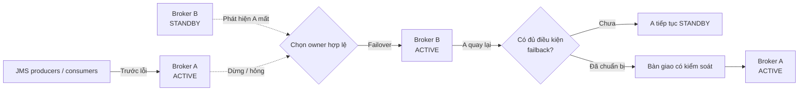
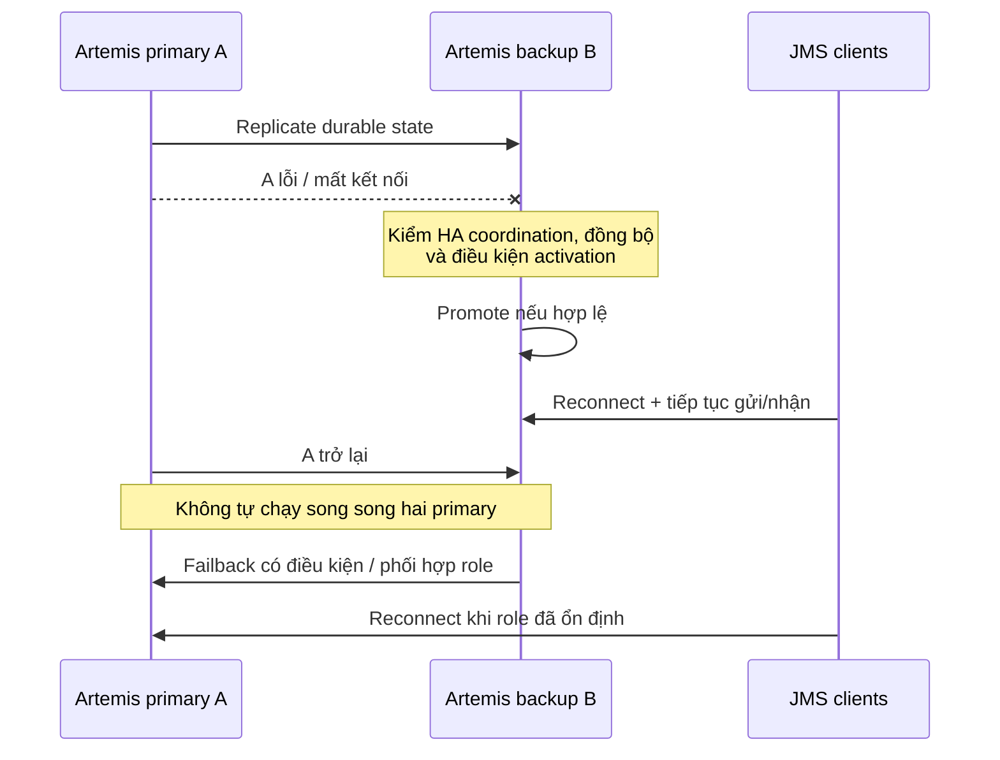
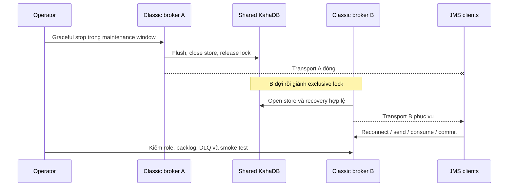

# Failback, khởi động lại có kiểm soát và diễn tập lỗi

> **Chương:** Sẵn sàng cao  
> **Phạm vi:** Quy trình vận hành **failover**, **failback**, rolling/controlled restart và fault drill cho **Apache ActiveMQ Classic** và **ActiveMQ Artemis** khi dùng queue/topic, JMS, persistent message, transaction và redelivery. Tập trung vào quyết định **khi nào an toàn chuyển vai trò**, cách quan sát trạng thái dữ liệu/client, tiêu chí PASS/FAIL và kế hoạch quay lui. Các cấu hình mẫu dành cho **môi trường lab/staging**, phải đối chiếu schema phiên bản broker và topology thực tế trước khi áp dụng production.

## 1. Failover không đồng nghĩa failback

Giả sử một nhóm ActiveMQ có hai node: `broker-a` đang phục vụ producer/consumer, `broker-b` đang dự phòng. Khi `broker-a` gặp sự cố, hệ thống muốn `broker-b` trở thành node active để duy trì xử lý. Sau khi sửa `broker-a`, **không nhất thiết nên tự chuyển traffic trở lại nó ngay**.

| Thuật ngữ | Sự kiện | Câu hỏi vận hành cần trả lời |
|---|---|---|
| **Failover** | Node active mất khả dụng, node dự phòng tiếp quản | Có đúng **một active** và message durable/transaction còn an toàn không? |
| **Failback** | Trả vai trò active về node gốc hoặc node được chỉ định | Node cũ đã an toàn, dữ liệu đã đồng bộ, và quá trình bàn giao có kiểm soát chưa? |
| **Controlled restart** | Dừng/khởi động có kế hoạch nhằm bảo trì, nâng cấp hoặc khôi phục | Có đủ dự phòng, còn giao dịch dang dở không, rollback được không? |
| **Fault drill** | Cố ý mô phỏng lỗi trong lab/staging để đo khả năng phục hồi | Có log, metric và điều kiện PASS/FAIL thực tế, không chỉ “service lại xanh” không? |
| **Client reconnect** | JMS client kết nối lại sau lỗi transport/broker | Session, transaction và các message in-flight được xử lý ra sao? |

**Failover của client** là khả năng JMS client reconnect. **Failover của broker** là việc node khác sở hữu tập dữ liệu phục vụ. Một URI `failover:(...)` không tự xây dựng HA, replication hay cơ chế ngăn split-brain ở phía broker.



**Kết luận then chốt:** một lần chuyển vai trò thành công cần chứng minh **quyền sở hữu dữ liệu duy nhất**, **khả năng phục hồi trạng thái**, **client tái kết nối được**, và **nghiệp vụ chịu được redelivery/unknown commit**. Ping tới TCP port hoặc JVM đã chạy **không chứng minh** điều đó.

### 1.1 RTO, RPO và tác động nghiệp vụ không phải cùng một thước đo

- **RTO (Recovery Time Objective):** thời gian tối đa chấp nhận để dịch vụ messaging trở lại **trạng thái phục vụ được**, tính từ thời điểm lỗi theo định nghĩa đo đã thống nhất.
- **RPO (Recovery Point Objective):** lượng dữ liệu được phép mất tính theo thời điểm hoặc message đã được chấp nhận/commit. Cần định nghĩa rõ “message thành công” ở đâu: producer `send` trả về, JMS `Session.commit` trả về, hay giao dịch nguồn/outbox đã commit.
- **Duplicate/redelivery:** số lần xử lý lại có thể tăng dù RPO=0 theo nghĩa message committed không mất. Không lấy “message còn đủ” suy ra “nghiệp vụ thực thi đúng một lần”.
- **Transaction ambiguity:** request/commit mất phản hồi có thể đã thành công hoặc chưa; ứng dụng cần `eventId` ổn định, inbox/idempotency và đối soát.

Một SLO mẫu cho lab: “Trong vòng 45 giây sau khi active bị dừng, ít nhất một producer gửi được message persistent mới và consumer commit được message; không xuất hiện hai broker đồng thời nhận ghi cùng một store; không mất message `JMS commit` đã được xác nhận trong điều kiện lưu trữ/HA đã định.” Con số 45 giây **chỉ là target thử nghiệm**; không phải bảo đảm của ActiveMQ.

## 2. Điều kiện an toàn trước khi cho node chuyển vai trò

### 2.1 Bốn bất biến bắt buộc

| Bất biến | Cách kiểm chứng | Nếu vi phạm |
|---|---|---|
| **Một owner có quyền ghi tại một thời điểm** | Trạng thái lock/quorum/primary, broker log, endpoint client, fencing đối với storage | Dừng thay đổi; **nguy cơ split-brain** và store corruption |
| **Standby sở hữu trạng thái đủ dùng** | Shared-store mount nhất quán hoặc replication state/synchronization được xác nhận | Không thúc ép promotion hoặc failback |
| **Uncommitted work được xử lý theo semantics JMS** | In-flight, prepared XA, transaction/reconnect logs, redelivery và DB dedupe | Có thể mất tác động, lặp hoặc in-doubt |
| **End-to-end traffic thực sự phục hồi** | Persistent send+commit, consume+commit, queue depth, DLQ và nghiệp vụ idempotent | Service “UP” nhưng không phục vụ |

**Split-brain** là tình trạng có hai broker cùng tin mình là active cho cùng một tài nguyên logic khi topology yêu cầu duy nhất một owner. Đó là lỗi ưu tiên phòng ngừa hơn là cố giảm vài giây RTO. Khi không chắc node cũ đã bị cách ly khỏi store/clients, **không ép standby thành active bằng cách xóa lock, sửa metadata hay tắt quorum**.

### 2.2 Điều kiện GO/NO-GO cho controlled failback

Trước khi chuyển từ active B về A, người điều phối cần xác minh:

1. **A khỏe thực sự:** máy, JVM, network, storage, certificate và cấu hình broker đã sửa; không chỉ TCP port mở.
2. **B đang là active duy nhất:** log/trạng thái HA không còn một node thứ ba cùng nhận ghi.
3. **Dữ liệu đã sẵn sàng:** với shared store, cơ chế lock/fencing hoạt động; với replication, bản backup có trạng thái đồng bộ thích hợp.
4. **Không còn thao tác quản trị xung đột:** snapshot/restore, upgrade schema store, thay đổi storage mount hoặc xử lý XA recovery chưa hoàn tất.
5. **Client có đường reconnect:** đúng broker endpoints, security/TLS, name resolution và reconnect policy; broker mới không bị chặn bởi ACL.
6. **Nghiệp vụ chịu được retry:** consumer idempotent, producer retry giữ `eventId`, có DLQ/monitoring và người phụ trách đối soát.
7. **Có cửa sổ thay đổi, rollback path và người quyết định:** nếu thử nghiệm smoke thất bại, biết sẽ giữ node nào active và khi nào dừng thay đổi.

`NO-GO` nếu replication chưa catch up, không kiểm soát được quyền ghi vào shared filesystem, transaction manager còn XA prepared chưa xử lý mà quy trình dự kiến không chịu được, hay đã xuất hiện dấu hiệu hai owner. **Failback có thể trì hoãn**; tính sẵn sàng không đòi trả vai trò về node gốc ngay lập tức.

## 3. Classic và Artemis có hành vi failback khác nhau

### 3.1 ActiveMQ Classic: shared file system master/slave

Một topology Classic phổ biến dùng **KahaDB đặt trên shared filesystem có locking phù hợp**. Hai broker process trỏ đến **cùng một persistent store**; chỉ broker giữ được lock hợp lệ mới hoạt động như master/active đối với store đó.

```text
            Shared persistent storage
            /srv/activemq-ha/kahadb
                      |
            +---------+---------+
            |                   |
    broker-a (ACTIVE)   broker-b (STANDBY)
    holds store lock    waits for lock
```

**Phải là một shared store thực sự**, không phải hai thư mục local có đường dẫn giống nhau. Shared filesystem phải hỗ trợ lock bền và có semantics phù hợp, không dùng một NFS/config không bảo đảm locking hoặc copy dữ liệu thủ công giữa hai broker rồi gọi là shared-store HA.

Một **đoạn cấu hình KahaDB trên cả hai node** (ví dụ Classic 5.x) trong `activemq.xml`:

```xml
<!-- Snippet: đặt trong broker XBean đã có, chỉ một persistenceAdapter.
     Thư mục là volume shared mount thực và hỗ trợ exclusive lock. -->
<persistenceAdapter>
    <kahaDB directory="/srv/activemq-ha/kahadb"/>
</persistenceAdapter>
```

Các node còn cần broker config riêng cho transport connector/port, security, broker identity, monitoring và system limits. Việc cả hai trỏ cùng `directory` **không tự chứng minh HA**: phải kiểm quá trình giành lock, dừng/restart, lỗi storage và giao thức lock thực tế.

**Đặc điểm failback:** nếu B đã giữ lock và hoạt động, việc A quay lại **không có nghĩa A tự cướp quyền active**. A thông thường phải chờ; muốn chuyển vai trò có kiểm soát, cần cho B giải phóng lock đúng cách và kiểm A giành lock rồi phục vụ. Không xóa lock file hoặc ép song song hai JVM mở cùng KahaDB để “chuyển về nhanh”.

### 3.2 Artemis: shared store và replication không cùng quy trình

Artemis hỗ trợ những kiểu HA khác nhau; quy trình failback phụ thuộc topology:

| Kiểu HA | Nguồn sự thật của dữ liệu | Điều phải đợi khi failback |
|---|---|---|
| **Shared store** | Primary/backup sử dụng cùng durable storage theo locking/HA coordination | Owner đang hoạt động nhả quyền; backup có quyền hợp lệ; shared storage nhất quán |
| **Replication** | Primary phát sinh journal state; backup nhận bản sao, cần synchronization và giao thức quorum/failover | Kiểm tình trạng replication/catch-up, không cho node từng lỗi chạy với state cũ như primary độc lập |
| **Cluster phân phối workload** | Nhiều address/queue/các node khác nhau; có thể không có một shared store logic | Không được coi cluster/load balancing là automatic HA cho một queue chưa thiết kế đúng |

Một cặp Artemis 2.x **primary/backup replication** có thể dùng `ha-policy` với chính sách tương ứng. Các nhánh Artemis cũ dùng tên `master/slave`, một số nhánh mới dùng `primary/backup`; **không sao chép XML qua phiên bản mà chưa kiểm schema thực của broker**. Những option như `allow-failback`, kiểm tra primary còn sống và quorum/lock manager là **điều kiện thay đổi ownership**, không phải một “lệnh chuyển nhanh”.

Ví dụ khái niệm sơ đồ:



**Không đồng nhất replication “đã kết nối TCP” với “đã đồng bộ trạng thái”.** Đối với Artemis, phải đọc trạng thái HA/synchronization, quorum/vote/lock và broker logs, nhất là sau lỗi network partition. Một cặp chỉ có hai node mà không có cơ chế chống split-brain thích hợp là rủi ro kiến trúc; không “giải” bài toán quorum bằng cách buộc backup active bằng mọi giá.

### 3.3 Tự động failback hay thủ công?

Một số cấu hình Artemis cho phép failback tự động, chẳng hạn tùy chọn `allow-failback` trong các chính sách HA/phiên bản hỗ trợ. **Không khẳng định một default chung cho mọi topology/phiên bản**. Nếu tự động failback bật, cần đo:

- Khi A tái xuất hiện, B có dừng phục vụ/đồng bộ để nhường vai trò không?
- Có thêm một đợt reconnect của client, mất bao lâu và tác động latency ra sao?
- Các message in-flight, JMS transaction, XA recovery và subscriber được xử lý thế nào?
- Có nguy cơ failover–failback lặp lại (*flapping*) khi A chưa thực sự khỏe?

Với workload nhạy cảm, **ưu tiên policy hạn chế flapping và có cửa sổ failback** nếu topology/version cho phép. Cần mô tả rõ auto failback trong runbook; không áp quy trình thủ công lên một cặp đang cấu hình tự chuyển về mà không biết.

## 4. Chuẩn bị một diễn tập có giá trị đo

### 4.1 Cố định “phạm vi được phá”

Trong staging có thể thử dừng process active, rút mạng **client** khỏi active, mô phỏng mất kết nối broker-to-broker hoặc cô lập đường storage trong điều kiện có fencing. Nhưng chỉ làm khi:

- Môi trường lab tách production và có thể khôi phục.
- Có quyền truy cập console của **cả hai node** và storage/quorum dashboard.
- Đã ghi lại broker/client version, HA policy, destination, data store, persistent mode, transport URIs.
- Có snapshot/backup **nhất quán với database và broker** nếu mục đích bài cần restore.
- Có người theo dõi transaction recovery, consumer state, queue depth/DLQ, network và storage.

**Không chạy thử phá mạng shared storage, xóa lock, kill cả cặp hoặc tạo disk full trên production** chỉ để “chứng minh” HA. Một drill tốt có **blast radius xác định**, ngưỡng dừng và cách khôi phục.

### 4.2 Đồng hồ đo và nguồn chứng cứ

| Dấu mốc | Cách ghi | Ý nghĩa |
|---|---|---|
| `T0` | Thời điểm fault injection có xác nhận | Mốc bắt đầu RTO thử nghiệm |
| `T1` | Active mất quyền phục vụ / mất lease hoặc lock | Chứng minh node cũ không tiếp tục ghi |
| `T2` | Backup đạt trạng thái active hợp lệ | Chứng minh broker role transition |
| `T3` | Client producer `Session.commit` thành công | End-to-end write đã phục hồi |
| `T4` | Client consumer `Session.commit` thành công | End-to-end read/ACK đã phục hồi |
| `T5` | State/outbox/DB đối soát ổn | Chứng minh nghiệp vụ không mất hoặc nhân đôi tác động |

RTO thực tế nên đo theo `T3/T4` và ứng dụng có thể phục vụ, **không chỉ `T2`**. Dùng timestamp UTC kèm host, đồng bộ NTP và trace ID; nếu muốn đo dưới giây, cần tránh so sánh đồng hồ hai host không đồng bộ.

### 4.3 Mức dữ liệu cần có trong drill

Gửi một lô `PERSISTENT` có `eventId` ổn định, một số message được tiêu thụ/commit, một số còn pending và một số được giữ in-flight khi cắt active. Đưa vào tối thiểu một trường hợp:

1. JMS producer gửi rồi **commit thành công** trước sự cố.
2. Consumer nhận message nhưng **chưa JMS commit** khi sự cố xảy ra.
3. DB nghiệp vụ **đã commit** nhưng JMS ACK chưa rõ kết quả.
4. Producer nhận **timeout/unknown commit outcome**, giữ nguyên event ID nếu retry.
5. Có DLQ/expiry và durable subscription khi workload thực tế sử dụng chúng.

Một drill không có dữ liệu in-flight hoặc đang transaction chỉ chứng minh rằng hai broker có thể đổi trạng thái, **chưa kiểm chứng độ tin cậy messaging**.

## 5. Runbook Classic shared-store: chuyển active rồi trả vai trò có kiểm soát

Giả sử **A đang giữ lock KahaDB**, B đã khởi động và chờ lock trên **cùng shared filesystem**, hai transport endpoint là `broker-a:61616` và `broker-b:61616`. Runbook này chỉ áp dụng khi đã **xác minh topology shared-store master/slave**; không áp cho Classic network of brokers rời nhau hoặc hai KahaDB độc lập.

### 5.1 Chuẩn bị trước khi dừng A

1. **Đóng băng thay đổi khác:** dừng deploy đồng thời, schema migration và job quản trị store không cần thiết.
2. **Ghi trạng thái ban đầu:** A active, B standby, KahaDB directory cùng mount thực, chỉ A nắm lock; broker logs và health checks được lưu.
3. **Xác minh B đủ điều kiện tiếp quản:** Java, credentials, broker config, network, store access, quota disk, connector availability và quyền chạy service.
4. **Kiểm pending/in-flight và XA:** drain hoặc giảm tốc producer có kiểm soát nếu cần, xác định các giao dịch còn mở và phương án xử lý in-doubt.
5. **Kiểm client URI:** producer và consumer biết **cả hai endpoint**; DNS/firewall/TLS và chứng chỉ của B không lỗi.
6. **Đặt rollback criteria:** RTO tối đa, số transaction unknown được phép, queue lag, DLQ và ngưỡng split-brain.

Ví dụ **client ActiveMQ Classic failover transport**, không phải cấu hình HA của broker:

```properties
BROKER_URL=failover:(tcp://broker-a.example:61616,tcp://broker-b.example:61616)?randomize=false&initialReconnectDelay=1000&maxReconnectDelay=30000&useExponentialBackOff=true
```

Các giá trị `initialReconnectDelay`/`maxReconnectDelay` là **mốc thử nghiệm**, đơn vị mili giây. `randomize=false` ưu tiên thử các URI theo thứ tự cấu hình khi client tìm kết nối; **không ép broker A trở thành primary** và không bảo đảm client đã kết nối B sẽ tự chuyển về A khi A quay lại. Với cấu hình TLS, URI thực tế có thể là `ssl://...` và cần truststore/hostname verification phù hợp. Trong lab không để client retry mãi mà không có SLO/circuit breaker ở ứng dụng.

### 5.2 Controlled switchover A → B



Thao tác trên **broker đã được xác nhận active**, ví dụ bản Classic chạy dưới script phân phối tiêu chuẩn:

```bash
# Chỉ minh họa trong maintenance lab; thay bằng service manager của hệ thống.
./bin/activemq stop
```

Nếu broker chạy dưới systemd/Kubernetes/Windows Service, sử dụng **cơ chế stop của chính deployment** và kiểm trạng thái thật; không áp lệnh trên vào shell tùy ý. Một `stop` trả exit code 0 **chưa chứng minh** store lock đã được giải phóng.

**Sau khi stop A, theo thứ tự:**

1. Xác nhận **A không còn chấp nhận producer/consumer**, tiến trình/service dừng hoặc ở trạng thái đã định. Nếu chỉ mất heartbeat nhưng A vẫn có quyền ghi store, đây là **NO-GO** cho việc ép B.
2. Kiểm broker log **B đã lấy được lock** và recovery KahaDB thành công, mở transport connector. Không can thiệp thủ công vào file lock.
3. Kiểm **không có hai active** qua log/state và kiểm tra nguồn dữ liệu, không chỉ qua cổng TCP.
4. Thử producer `PERSISTENT` `Session.commit` và consumer `Session.commit` qua URI failover; theo dõi unacknowledged delivery.
5. Đối soát eventId đã commit trước lỗi với tập message/DB sau chuyển vai trò; ghi RTO/T0–T4, duplicate/redelivery và DLQ.

**Nếu B không lên:** không vội cho A và B mở store cùng lúc. Thu thập lỗi storage/quyền/lock/recovery; chỉ khởi động lại một owner khi đã xác nhận B không giữ lock và A an toàn. Escalate nếu tình trạng quyền sở hữu store không thể chứng minh.

### 5.3 A quay lại: thường là standby, chưa phải failback

Sau khi B active ổn định, có thể đưa A quay lại **để chờ lock** (nếu config shared-store và hạ tầng cho phép). Kiểm rằng A không tự phục vụ ghi vào KahaDB khi B còn giữ lock. **Đây là khôi phục năng lực dự phòng, chưa phải trả active về A.**

Nếu doanh nghiệp thực sự cần A làm active trở lại:

1. Chọn maintenance window thứ hai, xác nhận A đã khỏe và có thể giành lock khi B nhả.
2. Xác nhận B là **owner duy nhất** hiện hành, client và dữ liệu ổn; không có storage maintenance/backup xung đột.
3. Dừng **B đang active** bằng phương pháp graceful, kiểm B nhả lock và ngừng phục vụ.
4. Chờ **A lấy lock và hoàn tất KahaDB recovery**, sau đó kiểm producer/consumer reconnect và JMS commit.
5. Đưa B trở lại làm **standby**, xác nhận một active duy nhất; chấm dứt cửa sổ thay đổi sau khi metric ổn định.

**Không đồng nghĩa “failback thành công” nếu A chỉ khởi động được nhưng B vẫn active.** Trong shared-store Classic, **quyền sở hữu lock** mới là tiêu chí quan trọng. Ngay cả khi chủ động đặt A trước trong URI failover, client đang ở B không chắc sẽ reconnect về A khi B chưa ngừng hoạt động.

### 5.4 Kế hoạch quay lui khi failback không đạt

Nếu sau khi B đã dừng mà A không thể phục vụ:

- **Dừng tiến trình A nếu nó đã chiếm lock nhưng chưa khỏe**, xác minh quyền sở hữu store được nhả đúng cách.
- Kiểm B có thể giành lại lock và recovery trạng thái an toàn.
- Cho client nối lại B, làm smoke test và đối soát. Giữ A ở ngoài luồng cho đến khi nguyên nhân được xử lý.
- **Không chạy hai broker ghi vào cùng store để cứu RTO**; điều đó có thể biến một outage có thể phục hồi thành lỗi toàn vẹn dữ liệu.

## 6. Runbook Artemis: replication và điều kiện failback

### 6.1 Cấu hình tham khảo chỉ là một phần của HA policy

Với các nhánh Artemis 2.x sử dụng tên **`primary/backup`** trong `broker.xml`, phần HA policy replication trên **node backup** có thể chứa:

```xml
<!-- Snippet minh họa cấu trúc HA policy Artemis sử dụng primary/backup.
     Chỉ dùng khi schema của bản Artemis đang chạy hỗ trợ các tên này. -->
<ha-policy>
    <replication>
        <backup>
            <group-name>orders-ha</group-name>
            <allow-failback>true</allow-failback>
        </backup>
    </replication>
</ha-policy>
```

Đây **không phải cấu hình HA hoàn chỉnh có thể copy-paste**: còn cần một policy tương ứng ở primary, cấu hình cluster/discovery/connectors, cơ chế lock/quorum và dữ liệu/journal thích hợp. Với bản Artemis dùng tên `master/slave` hoặc mô hình lock manager khác, **phải viết lại theo schema/version thực** chứ không thay mỗi URL.

**`allow-failback` không đồng nghĩa “cho phép hai primary”**; trong topology hỗ trợ, nó liên quan việc backup đang phục vụ có nhường vai trò khi primary dự kiến quay lại. Cách hoạt động cụ thể, thời điểm đồng bộ và việc có thể failback tự động phải kiểm tra theo HA policy và phiên bản thực tế.

### 6.2 Sau khi B được promote, đừng đưa A lên primary với dữ liệu cũ

Trong replication:

1. Khi A lỗi, kiểm B **đủ điều kiện activation**, không chỉ nhìn thấy A mất TCP. Quorum/coordination/fencing phải chứng minh không có A active khác.
2. B tiếp quản, client reconnect, broker xử lý recovery và message in-flight theo policy.
3. Khi A quay lại, xác nhận cơ chế **đồng bộ/catch-up** và vai trò mà A sẽ tham gia theo HA topology. Một bản copy journal cũ của A **không được tự mở như một primary độc lập** trong khi B đang phục vụ.
4. Nếu cấu hình cho phép failback tự động, đo **đợt chuyển vai trò thứ hai** và mức client reconnect/transaction rollback. Nếu cần manual control, chỉ làm theo quy trình chính thức của version đang chạy.
5. Chỉ đánh dấu PASS khi đúng một primary phục vụ, role backup khỏe, dữ liệu và client smoke test đạt.

Với **shared-store Artemis**, trình tự gần ý tưởng shared-store Classic: xác nhận owner duy nhất và lock/HA coordination. Nhưng **không dùng câu lệnh Classic `./bin/activemq stop`, không áp Classic KahaDB/XML** sang instance Artemis.

### 6.3 Trường hợp NO-GO cần rõ ràng

| Tình trạng | Quyết định |
|---|---|
| Primary cũ mất kết nối nhưng chưa được fencing/xác nhận dừng | **NO-GO** cho promote cưỡng bức |
| Backup replication chưa đồng bộ hoặc chưa rõ nguồn dữ liệu mới nhất | **NO-GO** cho failback/restore tùy tiện |
| Quorum không đủ, backup không được quyền active | **Không tắt quorum để thử vận may** |
| Broker B active ổn, A mới hồi phục nhưng có dấu hiệu flapping | **Giữ B active**, theo dõi A trước |
| Client certificate chỉ đúng A, sai hostname của B | Sửa TLS/truststore trước switchover |
| XA transaction prepared/in-doubt chưa có chủ xử lý | Chuyển cho transaction manager recovery; đừng force commit/rollback |
| Replication connection vừa khôi phục nhưng catch-up chưa có bằng chứng | Chờ trạng thái HA/backup synchronization đạt yêu cầu |

### 6.4 Vì sao restart primary theo kiểu “stop–start thật nhanh” có thể nguy hiểm?

Một lệnh restart có thể tạo hai lần mất kết nối: khi primary dừng, backup được promote; khi primary quay lại, **failback tự động** có thể kích hoạt thêm một lần chuyển vai trò. Nếu đang có nhiều JMS transactions hoặc nhiều client, “độ dài restart process” không đại diện “độ dài outage của ứng dụng”.

Do đó **controlled restart** phải tính trạng thái backup, chính sách auto failback, thời gian reconnect, persistent store recovery, client transaction rollback và DLQ. Với storage/replication, **lỗi một phía có thể làm thay đổi dữ liệu cần đồng bộ**, không thể chỉ đo thời gian JVM start.

## 7. Nguồn dữ liệu và transaction qua failover

### 7.1 Bốn trạng thái message dễ nhầm

| Trước lỗi | Phía producer/consumer có thể thấy | Sau failover |
|---|---|---|
| Producer chưa `Session.commit` | Chưa có kết quả publish cuối cùng | Message chưa được commit không được xem là chắc chắn tồn tại |
| Producer `Session.commit` đã trả thành công | Ứng dụng coi message đã chốt theo JMS | Phải xác minh HA store giữ dữ liệu trong phạm vi bảo đảm đã thiết kế |
| Producer gửi commit nhưng **mất phản hồi** | Outcome **không chắc chắn** | Có thể đã chốt hoặc chưa; retry phải giữ business ID |
| Consumer đã commit DB nhưng chưa JMS commit | DB có tác động, broker chưa chắc đã ACK | Message có thể redeliver; DB phải có idempotency |

`PERSISTENT` + store/replication đúng giúp chống mất message theo phạm vi thiết kế, **không cung cấp exactly-once business processing**. Nếu consumer bị ngắt sau DB commit nhưng trước JMS ACK, nó hoặc worker mới có thể xử lý lại. Do đó drill cần theo dõi **eventId** và trạng thái business, không dựa hoàn toàn vào `JMSMessageID` hay `JMSRedelivered`.

### 7.2 Phiên JMS cũ không phải transaction mới

Khi transport reconnect, client có thể tái tạo connection/session/consumer, nhưng không được giả định một transaction JMS đang dang dở sẽ tự commit thành công sau failover. Các exception như `JMSException` và transaction rollback ở thời điểm broker đổi vai trò có thể yêu cầu ứng dụng **rollback/retry theo transaction boundary**, tra business idempotency và kiểm trạng thái unknown outcome.

```text
t0  JMS consumer nhận E-17
t1  Database commit E-17
t2  Active broker chết, JMS commit chưa được xác nhận
t3  Backup phục vụ, E-17 có thể được redeliver
t4  Consumer tra processed_events(E-17), không ghi nghiệp vụ lần hai
t5  JMS commit để ACK E-17 sau khi nhận diện idempotent
```

Nếu producer cũng retry sau timeout bằng **eventId mới**, inbox sẽ không nhận diện được cùng một nghiệp vụ. Tạo business ID ở **đầu giao dịch nguồn**, giữ nguyên qua mọi retry và outbox relay.

### 7.3 XA/JTA cần người chịu trách nhiệm recovery

Một XA transaction đã `prepare` nhưng chưa resolve có thể giữ trạng thái trên broker store trong quá trình failover. Đừng dùng câu “broker mới active, chắc tất cả transaction đã rollback” để bỏ qua XA recovery. Cần transaction coordinator, recovery log, `Xid` và trạng thái XA của database/ActiveMQ được đối soát.

**Không force rollback/commit prepared XA** để làm broker “đẹp metric” nếu chưa có bằng chứng nghiệp vụ và sự phê duyệt của chủ sở hữu global transaction.

## 8. Lab Java JMS Classic: quan sát reconnect, commit và redelivery

Lab minh họa **client side** trên một cặp ActiveMQ Classic 5.x đã được cấu hình HA đúng ở các phần trước. Không dùng ứng dụng này để tạo topology HA hay thay thế xác minh lock/quorum.

**Môi trường:**

- JDK 17, Gradle 8.x, broker A và B cung cấp OpenWire ở hai endpoint mà ứng dụng nhìn thấy.
- Hai broker Classic phải **thực sự chia sẻ persistent store có khóa hợp lệ** nếu kiểm chứng shared-store; hai broker độc lập có queue trùng tên **không hợp lệ** cho lab mất dữ liệu/HA.
- Queue test `lab.ha.failback` chỉ có dữ liệu giả, và tài khoản được cấp quyền tạo/gửi/nhận thích hợp.
- Bật giám sát queue depth, enqueue/dequeue, consumer connections và trạng thái active/standby; chuẩn bị người điều phối để dừng node đúng mục tiêu.

### 8.1 Cấu trúc Gradle

```text
classic-ha-probe/
├── settings.gradle
├── build.gradle
└── src/main/java/lab/HaProbe.java
```

`settings.gradle`:

```groovy
rootProject.name = 'classic-ha-probe'
```

`build.gradle`:

```groovy
plugins {
    id 'java'
    id 'application'
}

repositories {
    mavenCentral()
}

java {
    toolchain {
        languageVersion = JavaLanguageVersion.of(17)
    }
}

dependencies {
    implementation 'org.apache.activemq:activemq-client:5.18.3'
    runtimeOnly 'org.slf4j:slf4j-simple:1.7.36'
}

application {
    mainClass = 'lab.HaProbe'
}
```

Đây là **mốc phiên bản API minh họa**, không phải xác nhận phiên bản mới nhất hoặc bản build đã được duyệt cho production. Cần đối chiếu Classic broker/client compatibility, bản vá bảo mật và JMS namespace nếu chuyển sang Spring Boot 3/Jakarta.

### 8.2 Mã Java producer và consumer

Tạo `src/main/java/lab/HaProbe.java`:

```java
package lab;

import java.time.Instant;
import javax.jms.Connection;
import javax.jms.DeliveryMode;
import javax.jms.JMSException;
import javax.jms.Message;
import javax.jms.MessageConsumer;
import javax.jms.MessageProducer;
import javax.jms.Queue;
import javax.jms.Session;
import javax.jms.TextMessage;
import org.apache.activemq.ActiveMQConnectionFactory;
import org.apache.activemq.ActiveMQPrefetchPolicy;

public final class HaProbe {
    private static final String QUEUE = "lab.ha.failback";

    private HaProbe() { }

    public static void main(String[] args) throws Exception {
        if (args.length != 3) {
            usage();
            return;
        }

        String mode = args[0];
        if (!"send".equals(mode) && !"consume".equals(mode)) {
            usage();
            return;
        }

        String identity = args[1];
        if (!identity.matches("[A-Za-z0-9_-]{1,32}")) {
            throw new IllegalArgumentException("Invalid runId/workerId");
        }
        int amount = Integer.parseInt(args[2]);
        if (amount < 0 || amount > 1000
                || ("send".equals(mode) && amount == 0)) {
            throw new IllegalArgumentException(
                    "send count=1..1000; consume max=0..1000");
        }

        String url = env("BROKER_URL",
                "failover:(tcp://127.0.0.1:61616,"
                + "tcp://127.0.0.1:62626)?randomize=false"
                + "&initialReconnectDelay=1000"
                + "&maxReconnectDelay=30000");
        ActiveMQConnectionFactory factory =
                new ActiveMQConnectionFactory(url);

        // Giữ ít message ở client để dễ quan sát in-flight.
        ActiveMQPrefetchPolicy prefetch = new ActiveMQPrefetchPolicy();
        prefetch.setQueuePrefetch(1);
        factory.setPrefetchPolicy(prefetch);

        String user = System.getenv("BROKER_USER");
        String password = System.getenv("BROKER_PASSWORD");
        Connection connection = user == null || user.isBlank()
                ? factory.createConnection()
                : factory.createConnection(user, password);

        try {
            connection.setExceptionListener(error ->
                    System.err.println(Instant.now()
                            + " JMS exception: "
                            + error.getClass().getSimpleName()));
            connection.start();
            Session session = connection.createSession(
                    true, Session.SESSION_TRANSACTED);
            try {
                Queue queue = session.createQueue(QUEUE);
                if ("send".equals(mode)) {
                    sendBatch(session, queue, identity, amount);
                } else {
                    consume(session, queue, identity, amount);
                }
            } finally {
                session.close();
            }
        } finally {
            connection.close();
        }
    }

    private static void sendBatch(
            Session session, Queue queue, String runId, int count)
            throws JMSException {
        MessageProducer producer = session.createProducer(queue);
        try {
            producer.setDeliveryMode(DeliveryMode.PERSISTENT);
            for (int sequence = 1; sequence <= count; sequence++) {
                String eventId = runId + "-"
                        + String.format("%04d", sequence);
                TextMessage message = session.createTextMessage(
                        "ha-probe:" + eventId);
                message.setStringProperty("eventId", eventId);
                message.setIntProperty("sourceSequence", sequence);
                producer.send(message);
                try {
                    session.commit();
                    System.out.printf(
                            "%s SEND_COMMITTED eventId=%s%n",
                            Instant.now(), eventId);
                } catch (JMSException uncertain) {
                    // Không giả định commit thất bại => broker chưa nhận.
                    System.err.printf(
                            "%s SEND_OUTCOME_UNKNOWN eventId=%s%n",
                            Instant.now(), eventId);
                    throw uncertain;
                }
            }
        } finally {
            producer.close();
        }
    }

    private static void consume(
            Session session, Queue queue, String workerId, int maxCount)
            throws Exception {
        MessageConsumer consumer = session.createConsumer(queue);
        long holdMs = Long.parseLong(env("LAB_HOLD_MS", "1000"));
        if (holdMs < 0 || holdMs > 60000) {
            throw new IllegalArgumentException(
                    "LAB_HOLD_MS must be 0..60000");
        }
        boolean haltBeforeAck = Boolean.parseBoolean(
                env("LAB_HALT_BEFORE_ACK", "false"));
        int committed = 0;
        try {
            System.out.println("LISTENING worker=" + workerId);
            while (maxCount == 0 || committed < maxCount) {
                Message message = consumer.receive(2000);
                if (message == null) {
                    continue;
                }

                String eventId = message.getStringProperty("eventId");
                boolean redelivered = message.getJMSRedelivered();
                int deliveryCount =
                        message.propertyExists("JMSXDeliveryCount")
                        ? message.getIntProperty("JMSXDeliveryCount") : -1;

                System.out.printf(
                        "%s RECEIVE worker=%s eventId=%s"
                        + " redelivered=%s deliveryCount=%d%n",
                        Instant.now(), workerId, eventId,
                        redelivered, deliveryCount);

                // Cửa sổ lỗi: đã receive, chưa JMS commit.
                if (haltBeforeAck) {
                    System.err.println(
                            "LAB HALT before JMS commit: " + eventId);
                    Runtime.getRuntime().halt(77);
                }

                try {
                    Thread.sleep(holdMs);
                    // Thực tế phải commit DB idempotent TRƯỚC JMS commit.
                    session.commit();
                    committed++;
                    System.out.printf(
                            "%s RECEIVE_COMMITTED worker=%s eventId=%s%n",
                            Instant.now(), workerId, eventId);
                } catch (InterruptedException interrupted) {
                    try {
                        session.rollback();
                    } catch (JMSException ignored) {
                        // Có thể connection đã mất trong lúc rollback.
                    }
                    Thread.currentThread().interrupt();
                    return;
                } catch (JMSException error) {
                    System.err.printf(
                            "%s JMS_COMMIT_UNKNOWN worker=%s eventId=%s%n",
                            Instant.now(), workerId, eventId);
                    // Không tự nhận là đã ACK hay chưa ACK.
                    try {
                        session.rollback();
                    } catch (JMSException ignored) {
                        // Phiên cũ có thể không còn hợp lệ sau failover.
                    }
                    throw error;
                }
            }
        } finally {
            consumer.close();
        }
    }

    private static String env(String name, String fallback) {
        String value = System.getenv(name);
        return value == null || value.isBlank() ? fallback : value;
    }

    private static void usage() {
        System.out.println("Usage:");
        System.out.println(" send <runId> <count>");
        System.out.println(" consume <workerId> <maxMessages>");
        System.out.println(" maxMessages=0 means receive until stopped");
    }
}
```

**Ranh giới của code:** đây là **JMS-level probe**, không có database nghiệp vụ. `RECEIVE_COMMITTED` chỉ chứng minh client đã nhận kết quả commit JMS, **không chứng minh** một lần duy nhất ghi vào DB. Với bài kiểm tra end-to-end thật, thêm bảng `processed_events(event_id PRIMARY KEY)` và xử lý/idempotency trong cùng DB transaction rồi mới gọi `session.commit()`. Nếu sau DB commit nhưng trước JMS commit broker failover, lần redelivery phải phát hiện event đã xử lý và không ghi lặp.

`Runtime.halt(77)` cố ý kết thúc JVM **không chạy finally/shutdown hook**, chỉ để mô phỏng crash của **consumer lab**. Không đưa cơ chế này vào ứng dụng production; không dùng cùng biến trên nhiều worker nếu không muốn chúng liên tục tự chết.

### 8.3 Build và chạy baseline

```bash
# Sau khi cài Gradle 8.x, đứng trong thư mục classic-ha-probe.
gradle wrapper --gradle-version 8.10.2
./gradlew installDist
```

Trên Windows dùng `.\gradlew.bat installDist`; script ứng dụng tương ứng nằm trong `build/install/classic-ha-probe/bin`. Ví dụ **Linux/macOS với hai endpoint lab**:

```bash
# Terminal 1: consumer, giữ chạy liên tục.
./build/install/classic-ha-probe/bin/classic-ha-probe consume W1 0

# Terminal 2: producer, chạy sau khi W1 kết nối.
./build/install/classic-ha-probe/bin/classic-ha-probe send runA 20
```

Trong lab với endpoint/credentials khác, đặt `BROKER_URL` và `BROKER_USER`/`BROKER_PASSWORD` trong môi trường tiến trình. Đừng chứa credentials trực tiếp trong URL hoặc đưa password lên lệnh command line. Windows PowerShell đặt biến theo cú pháp `$env:BROKER_URL = "..."`.

Kỳ vọng có các dòng:

```text
2026-... SEND_COMMITTED eventId=runA-0001
2026-... RECEIVE worker=W1 eventId=runA-0001 redelivered=false ...
2026-... RECEIVE_COMMITTED worker=W1 eventId=runA-0001
```

Kết quả trên chỉ là **hình thức log**, không bảo đảm thứ tự dòng, timestamp hay cờ redelivery tại mọi broker/version. Trong nhiều terminal, thứ tự xuất hiện trên màn hình không thay thế event ordering ở nguồn dữ liệu.

### 8.4 Diễn tập failover active khi còn message in-flight

1. Dùng queue lab sạch, `LAB_HOLD_MS=20000` ở terminal consumer để tạo khoảng đang xử lý. Producer gửi một lô `send runB 30`.
2. Khi W1 in `RECEIVE` cho message đầu tiên nhưng **chưa `RECEIVE_COMMITTED`**, người điều phối **dừng/kill broker ACTIVE đúng node của staging** theo kịch bản đã được duyệt.
3. Quan sát standby được promote **chỉ sau khi ownership hợp lệ**, client reconnect, in-flight có thể redeliver hoặc có exception/transaction rollback.
4. Nếu ứng dụng probe thoát vì `JMS_COMMIT_UNKNOWN`, **khởi động lại consumer**. Không đánh dấu event là đã xong chỉ vì nó từng in `RECEIVE`.
5. Khi queue lab được drain, đối chiếu tập `SEND_COMMITTED eventId` với event đã consume/ACK; nếu producer có unknown outcome, phải kiểm riêng từ broker và dedupe theo eventId.

**Nếu một node dừng nhưng standby không lấy được lock/quorum:** diễn tập nên ghi **FAIL/NO-GO**, thu thập log và dừng thay đổi. Không “đạt” bằng cách tắt safeguard để làm broker còn lại mở cổng.

### 8.5 Diễn tập consumer crash trước ACK, không cần kill broker

Chạy consumer **trên lab** với:

```bash
# Terminal consumer: chỉ bật biến trong shell thử nghiệm.
export LAB_HALT_BEFORE_ACK=true
./build/install/classic-ha-probe/bin/classic-ha-probe consume CRASH 1

# Terminal producer khác, nếu queue test trống:
./build/install/classic-ha-probe/bin/classic-ha-probe send runCrash 1
```

Sau khi thấy log `LAB HALT before JMS commit`, mở lại consumer **không có biến crash**:

```bash
unset LAB_HALT_BEFORE_ACK
./build/install/classic-ha-probe/bin/classic-ha-probe consume RECOVER 1
```

Kỳ vọng broker giao lại message chưa commit sau khi phát hiện connection chết, và consumer `RECOVER` commit thành công. `JMSRedelivered`/`JMSXDeliveryCount` hỗ trợ chẩn đoán nhưng phải kiểm provider/version, không coi đây là business dedup. Thử nghiệm này mô phỏng **consumer failure**, khác với **broker failover**; nó dùng để kiểm phần client/idempotency độc lập trước khi kết hợp hai lỗi.

### 8.6 Diễn tập failback về node gốc

Sau khi failover A → B:

1. Giữ producer gửi tốc độ thấp, vẫn mang `runId`, record `SEND_COMMITTED`/`UNKNOWN`.
2. Kiểm A đã khỏe và không còn quyền active, B đang xử lý bình thường.
3. Thực hiện **quy trình failback tương ứng**: Classic shared store theo mục 5.3, Artemis theo topology/HA policy mục 6.
4. Ghi lại **một đợt gián đoạn/reconnect thứ hai**, không chỉ dùng thời gian từ lần failover đầu.
5. So khớp eventId, queue size, in-flight, durable subscriptions (nếu dùng), DLQ và trạng thái DB nghiệp vụ.
6. Kiểm node không active trở về standby, **không có hai owner**; chỉ sau đó kết thúc maintenance window.

**Điểm đo riêng cho failback:** một lần failover thành công không bảo đảm lần failback thành công. Node gốc có thể vẫn có cấu hình cũ, stale journal/replica, chứng chỉ sai hoặc không tham gia lại được HA group.

## 9. Tiêu chí nghiệm thu: kiểm trạng thái, dữ liệu và hành vi client

### 9.1 Bảng quan sát bắt buộc

| Tín hiệu | Trước lỗi | Trong failover/failback | Khi ổn định |
|---|---|---|---|
| Role active/standby | Chính xác một active | Transition được giải thích bằng lock/quorum | Chính xác một active, backup khỏe |
| Shared-store owner / replication sync | Hợp lệ | Không có hai bên ghi đồng thời; trạng thái chuyển được ghi | Store/replica đủ điều kiện cho failover tiếp |
| Producer JMS commit latency và error | Baseline | Có thể tăng/unknown outcome | Quay về ngưỡng SLO |
| Consumer reconnect/ACK | Baseline | Có thể rollback/re-deliver | Tiêu thụ và commit trở lại |
| Pending + in-flight | Phù hợp workload | Có thể tăng tạm thời | Hồi phục hoặc giảm về mức chấp nhận |
| Redelivery/DLQ | Baseline | Có thể tăng | Không tăng vô hạn; có quy trình xử lý |
| DB inbox/outbox | Không có gap bất thường | Dedupe/retry hoạt động | Không phát sinh side effect trùng |
| XA recovery | Không có in-doubt không kiểm soát | Theo dõi branch tồn tại | Mỗi branch có trạng thái xử lý xác định |
| TLS/ACL trên node mới | Hoạt động | Không có handshake/authz regression | Positive/negative tests đạt |

Đừng chỉ dùng `BrokerService.isStarted`, health endpoint, TCP port hoặc trạng thái container `Running` làm tiêu chí phục hồi. Một broker mở cổng nhưng không ghi store, không có quyền active hợp lệ hoặc không thể ACK message **chưa đạt tiêu chí thành công**.

### 9.2 Cách tính RTO và phân tích RPO

Với cùng một phép diễn tập, có thể định nghĩa:

```text
T0 = thời điểm tác động lỗi xác nhận
T3 = thời điểm producer đầu tiên JMS commit thành công sau lỗi
T4 = thời điểm consumer đầu tiên JMS commit thành công sau lỗi

RTO cho messaging read+write = max(T3, T4) - T0
```

Đây là **định nghĩa phục vụ lab**, không thay toàn bộ SLO nghiệp vụ. Với user-facing service, thời điểm thật cần đo có thể là **khi nghiệp vụ đã đọc/ghi database và trả kết quả hợp lệ**, muộn hơn `T4`.

Để kiểm RPO, giữ tập `expectedCommittedEvents` từ các lệnh producer **đã trả `Session.commit` thành công trước lỗi**, rồi đối chiếu với dữ liệu tồn tại sau khôi phục:

- Event **thiếu** trong queue và **chưa được tiêu thụ/ghi kết quả** là dấu hiệu cần điều tra.
- Event đã được ACK/consume thành công **không cần còn trong queue**; phải đối chiếu business record/inbox.
- Message có **unknown outcome** khi producer mất phản hồi phải được tách riêng; không tự đếm là “mất” hoặc “chắc chắn đã lưu”.
- Event được tiêu thụ nhiều lần nhưng chỉ một business effect **có thể phù hợp thiết kế at-least-once**.
- Tính đúng của RPO còn phụ thuộc độ bền của shared storage, replication policy, disk flush, HA fencing và các failure mode được đặt trong giả định.

### 9.3 PASS không chỉ nghĩa là “tự hồi phục”

Một ca failback đạt **PASS** khi đồng thời:

1. Không phát hiện hai node active ghi vào cùng tập dữ liệu logic.
2. Người điều phối chứng minh node tiếp quản đã hoàn thành recovery/synchronization hợp lệ.
3. Producer và consumer kết nối lại, `Session.commit` hoạt động.
4. Không mất event committed trong phạm vi bảo đảm đã chọn, các unknown outcome được đối soát.
5. Tác động nghiệp vụ không bị lặp nhờ idempotency; DLQ/poison message không bị bỏ quên.
6. Node còn lại sẵn sàng làm standby để chịu được một lỗi tiếp theo.
7. RTO/RPO/latency và error budget đạt mục tiêu đã ghi **trước** phép thử.

Nếu broker chỉ lên lại sau thao tác can thiệp thủ công ngoài runbook, ghi **PASS có điều kiện/FAIL theo tiêu chí tự động hóa**, không sửa tiêu chí sau sự cố để làm đẹp báo cáo.

## 10. Ma trận diễn tập lỗi theo mức độ rủi ro

| Mã | Fault/drill | Quan sát trọng tâm | Điều kiện dừng |
|---|---|---|---|
| H1 | Graceful stop active Classic shared store | Lock release, standby acquire lock, client reconnect | B không nhận lock; A vẫn có quyền ghi |
| H2 | Active process crash trong staging | KahaDB recovery, unacked redelivery, RTO | Split-brain hoặc recovery lỗi |
| H3 | Consumer chết trước JMS ACK | Redelivery và dedupe theo eventId | Handler tạo side effect lặp |
| H4 | Producer mất phản hồi ở JMS commit | Unknown outcome, retry cùng eventId | App tự xác nhận “mất” không đối soát |
| H5 | Standby bị restart khi A vẫn active | A tiếp tục phục vụ, backup quay lại khỏe | A bị ảnh hưởng ngoài SLO |
| H6 | A quay lại khi B đang active Classic | A chờ lock/standby, **không preempt** B | Hai active hoặc A ghi sai store |
| H7 | Controlled failback B → A Classic | B nhả lock, A tiếp quản, B standby | Không xác định owner/lock |
| H8 | Artemis replication: A lỗi, B promote | Sync/quorum hợp lệ, client reconnect | B promote khi thiếu điều kiện fencing |
| H9 | Artemis primary cũ quay lại | Catch-up, policy allow-failback, không flapping | A phục vụ stale state |
| H10 | Network partition giữa các node | Chỉ một node được phép ghi, quorum/fencing | Đồng thời nhận write ở hai phía |
| H11 | Storage latency/lỗi mount giả lập có kiểm soát | Store write block, lock timeout, failover behavior | Nguy cơ corruption hoặc mất volume |
| H12 | XA prepared trong giai đoạn chuyển node | Recovery coordinator, Xid còn theo dõi được | Force heuristic commit/rollback trái quy trình |
| H13 | Durable topic subscriber offline và broker switchover | Backlog đúng subscription, reconnect/drain | Backlog biến mất không được giải thích |
| H14 | Mất credential/TLS khi chuyển sang B | Kết nối/authorization trên endpoint mới | Failover xong nhưng app không gửi/nhận |
| H15 | Failover rồi failback liên tiếp | Hai lần reconnect, RTO từng lần và flapping | Quá SLO hoặc backup mất đồng bộ |

**Thứ tự triển khai:** H1/H3/H5/H6 trên lab trước; H2/H7 khi đã đo được baseline và có rollback; các kịch bản partition/storage/quorum chỉ trong staging chuyên dụng và được duyệt bởi chủ sở hữu hạ tầng. **Không thực hiện phân đoạn network/storage hoặc giả lập disk full trên production** để lấy chỉ số.

### 10.1 Nhật ký diễn tập dùng để bàn giao

```text
Drill ID / người phụ trách / môi trường:
Broker: Classic hay Artemis, version, topology, HA policy:
Client version + URI/protocol + auth/TLS:
Source of truth: shared store / replication / quorum owner:
Active trước lỗi / standby trước lỗi:
Failure injection (chỉ thị, thời điểm T0, phương tiện):
Owner/fencing evidence:
Time standby active T2:
First successful send commit T3:
First successful receive commit T4:
RTO; RPO assumption; số unknown transactions:
Expected committed event IDs / observed business outcomes:
In-flight, redelivery, DLQ, XA recovery:
Failback steps; active sau failback / standby sau failback:
Kết quả từng điều kiện PASS/FAIL:
Rollback thực hiện hay không; incident link:
Lesson learned / action owner / due date:
```

**Chứng cứ cần tồn tại đủ lâu** để người khác tái lập đánh giá: broker log, replication/lock state, queue counters, producer/consumer traces, DB inbox/outbox record và sự thay đổi cấu hình. Không lưu mật khẩu, token, message body chứa PII hoặc private key vào báo cáo diễn tập.

## 11. Chẩn đoán nhanh khi failback không như mong muốn

| Triệu chứng | Nguyên nhân cần phân biệt | Hành động ưu tiên |
|---|---|---|
| A khởi động nhưng không thành active | Classic B vẫn giữ shared-store lock; Artemis A chưa ở role hợp lệ | Xem owner/HA state, **không xóa lock** |
| B không promote | Shared mount lỗi/không lấy lock; replication chưa sync/quorum không đủ | Kiểm storage/quorum/recovery log, không force takeover |
| A và B đều mở port | Có thể không đồng nghĩa cả hai active, nhưng nguy cơ ownership sai | Kiểm nguồn dữ liệu và quyền ghi, cô lập nếu split-brain |
| Client vẫn gửi vào B sau khi A quay lại | Failover transport không ép chuyển về preferred URI khi connection khỏe | Xác định failback policy và chuyển traffic có kế hoạch |
| Broker B active nhưng consumer không chạy | Sai TLS/ACL/destination/credentials; JMS session cần reconnect | Kiểm authN/authZ, client logs, URI và listener state |
| Producer báo timeout dù broker đã lưu | Commit reply bị mất trong lúc chuyển vai trò | Đối soát eventId, không retry bằng ID mới |
| Message lặp sau failover | JMS chưa ACK/commit trước lỗi; producer retry | Inbox/idempotency, kiểm delivery count/redelivery |
| RTO lớn dù B lên nhanh | DNS/TLS reconnect, client backoff, listener startup, DB dependency | Đo T2 vs T3/T4, tối ưu client/app path |
| Failback nhiều lần trong vài phút | Node gốc chưa khỏe hoặc tự động failback/flapping | Giữ node ổn định active, sửa health policy |
| Queue trống nhưng nghiệp vụ thiếu | ACK trước DB commit, DLQ/expiry, dữ liệu khác node | Đối soát nguồn dữ liệu, transaction và DLQ |
| Prepared XA chưa rõ sau chuyển vai trò | Recovery manager chưa resolve branch | Dùng transaction manager/Xid, không tự rollback |

## 12. Câu hỏi áp dụng và checklist trước giờ bảo trì

### Câu hỏi tình huống

1. Classic A/B dùng **chung KahaDB volume**. A hỏng, B đã active. Nếu A khởi động lại và chỉ đứng chờ lock, đó là **failback** hay khôi phục standby? Khi nào mới chuyển vai trò hợp lệ?
2. Vì sao đặt `broker-a` trước `broker-b` trong URI `failover:(...)` không tự buộc broker A trở lại active?
3. Artemis B đã được promote khi A mất kết nối. Bạn cần bằng chứng gì về **quorum, fencing và synchronization** trước khi cho A quay lại?
4. Một producer ghi log `SEND_COMMITTED` cho E1 trước lỗi, rồi consumer ACK E1 sau failover. Có bắt buộc E1 vẫn nằm trong queue để chứng minh RPO=0 không? Vì sao?
5. Consumer đã commit DB E2 nhưng chưa JMS commit khi active chết. Đâu là rủi ro chính, và unique key theo `eventId` giải quyết được phần nào?
6. Một bài drill chỉ kiểm ping, TCP port và `systemctl status`. Những yêu cầu nào của end-to-end recovery vẫn chưa được kiểm chứng?
7. Tại sao failback tự động có thể **làm tăng** số lần reconnect so với giữ B active đến hết giờ cao điểm?
8. Với hai node không có quorum/witness hay fencing đủ mạnh, tại sao không được “nâng” cả hai bên thành primary khi network partition?
9. Sau controlled restart, broker mới active nhưng client không thể consume do ACL. Phân biệt lỗi **HA transition** và lỗi **readiness của ứng dụng**.
10. Một XA branch ở trạng thái prepared xuất hiện sau failover. Vì sao runbook phải chỉ định transaction coordinator thay vì dự đoán rollback?

### Checklist GO/NO-GO

- [ ] Xác định đúng topology: Classic shared-store hay Artemis shared-store/replication; không nhầm cluster thông thường với HA.
- [ ] Có cơ chế và bằng chứng **single active owner**, lock/quorum/fencing.
- [ ] Backup khỏe, storage/replication state phù hợp, không có stale primary được phép ghi.
- [ ] Có endpoint/transport/client reconnect policy, TLS/ACL và quyền gửi/nhận được kiểm trên node mới.
- [ ] Định nghĩa rõ `T0`/`T3`/`T4`, RTO/RPO target, data evidence và các ngưỡng phải dừng.
- [ ] Có trường hợp persistent send, in-flight receive, unknown commit và redelivery; không chỉ kiểm message mới.
- [ ] Producer retry giữ nguyên business eventId; consumer có DB idempotency/transaction boundary.
- [ ] XA prepared/in-doubt có owner recovery; DLQ/durable topic được theo dõi.
- [ ] Có kế hoạch failback hoặc quyết định **không failback ngay**, tránh flapping.
- [ ] Có câu lệnh/service manager đúng deployment, backup nhất quán và runbook quay lui.
- [ ] Có negative tests khi B không đủ điều kiện nhận ownership; không tắt safeguard để đạt tỷ lệ PASS giả.
- [ ] Sau bảo trì xác nhận **một active + một standby**, JMS send/consume/commit và nghiệp vụ thực đều đạt.

**Kết luận:** **Failover** là chuyển xử lý sang broker dự phòng khi active mất khả dụng; **failback** là một lần chuyển vai trò bổ sung, không phải hệ quả tự động của việc khởi động lại node cũ. Với **Classic shared-store**, chỉ một broker được giữ lock KahaDB, nên controlled failback đòi owner hiện hành giải phóng store trước khi node khác tiếp quản. Với **Artemis**, điều kiện khác nhau giữa shared store và replication: cần tính đến đồng bộ, quorum/fencing và chính sách tự động failback của phiên bản đang chạy. Diễn tập đạt yêu cầu chỉ khi chứng minh **single owner, recovery state, JMS commit end-to-end, RTO/RPO và nghiệp vụ idempotent**, đồng thời có đường dừng/quay lui an toàn khi điều kiện chuyển vai trò không đạt.
