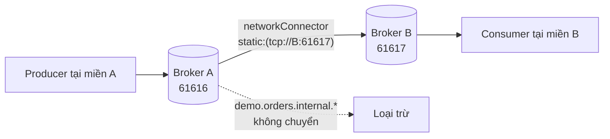
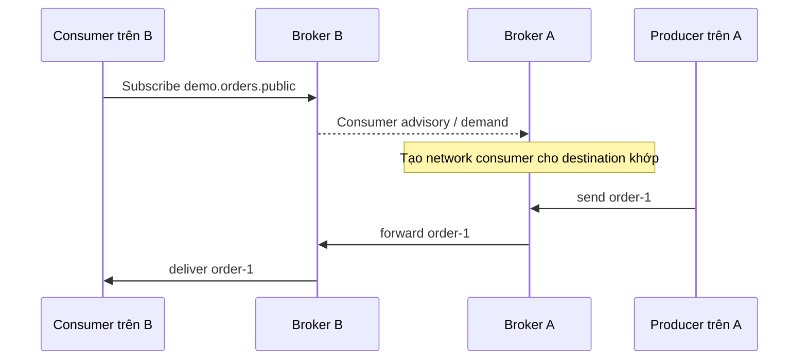
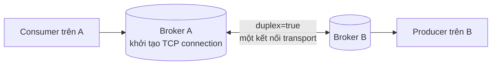
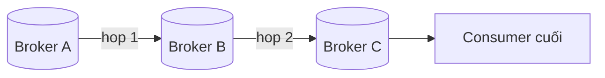

# Network connector, duplex, include/exclude destination và network TTL

> **Chương:** Kết nối nhiều broker  
> **Phạm vi:** **Apache ActiveMQ Classic 5.x**, cơ chế *Network of Brokers* dựa trên `networkConnector`. Bài phân tích đường chuyển message theo nhu cầu consumer, `duplex`, nhóm `dynamicallyIncludedDestinations` / `staticallyIncludedDestinations` / `excludedDestinations` và `networkTTL`. **Artemis không dùng nguyên cấu hình NetworkConnector của Classic**; cần chọn bridge, cluster connection hoặc federation theo topology Artemis.

## 1. Network connector không phải kết nối JMS client

Giả sử hệ thống có hai broker Classic:

- **Broker A** ở miền bán hàng: producer gửi `demo.orders.public`.
- **Broker B** ở miền xử lý: consumer nhận từ `demo.orders.public`.
- Chỉ những destination được phép mới được trao đổi; queue nội bộ `demo.orders.internal.audit` **không được chuyển** qua mạng broker.

Producer và consumer vẫn kết nối tới broker của mình bằng JMS. Phần nối hai broker là **network bridge do broker tạo**, không phải một `ConnectionFactory` trong Java.



Cơ chế mặc định của Classic thường là **demand forwarding**: broker A nhận thông tin có consumer quan tâm ở B (qua **consumer advisories**) rồi tạo *network consumer* tương ứng tại A để chuyển message tới B.

**Điểm phân biệt quan trọng:**

- Với **queue**, network consumer của B là **một đường nhận cạnh tranh** với consumer cục bộ tại A. Message được chuyển sang B không đồng nghĩa broker đang nhân bản toàn bộ queue sang hai nơi.
- Với **topic**, bridge chuyển message để phục vụ các subscriptions ở broker bên kia theo semantics network bridge; không tự tạo bản sao lịch sử cho một subscriber chưa tồn tại.
- `networkConnector` **không sao chép journal**, không thay HA replication và không tự biến broker A/B thành một cluster có cùng state. Đóng network bridge sẽ ảnh hưởng routing/khả năng tiếp cận consumer, không xóa message đang bền vững ở các queue đã lưu.

## 2. Cách bridge hình thành theo demand

Một cấu hình kết nối có hướng **A → B** sẽ tạo đường bridge từ A tới B. Khi B có consumer trên một queue được phép, A có thể nhận advisory và tạo network consumer để chuyển message từ A sang B.



Trong thử nghiệm **dynamic-only**, hãy mở consumer ở B **trước** khi producer gửi ở A và đợi bridge nhận advisory. Nếu A không có consumer nào ở xa và queue không nằm trong danh sách static, A có thể **giữ message trong queue A**. Việc không thấy message ở B khi không có consumer **không chứng minh network connector bị hỏng**.

### Các thuộc tính liên quan

| Thuộc tính | Ý nghĩa thực tế | Giá trị cần lưu ý |
| --- | --- | --- |
| `uri` | Cách broker tìm remote broker | `static:(tcp://broker-b:61617)` |
| `name` | Định danh network connector/JMX | Đặt tên **duy nhất** khi có nhiều bridge |
| `duplex` | Một transport connection dùng để thiết lập bridge **hai chiều** | `false` mặc định |
| `dynamicallyIncludedDestinations` | Chỉ forward destination khớp **khi có demand** | Rỗng thường có nghĩa dynamic không bị giới hạn, trừ exclusions |
| `staticallyIncludedDestinations` | Tạo demand forwarding **không phụ thuộc consumer remote** | Không nên dùng rộng cho mọi queue |
| `excludedDestinations` | Loại một destination khỏi **dynamic forwarding** | **Không** loại được destination được *static include* |
| `networkTTL` | Số chặng broker tối đa cho message/consumer subscriptions | Mặc định thường là **1** |
| `conduitSubscriptions` | Gộp subscription demand trùng nhau | `true` thường là mặc định |
| `decreaseNetworkConsumerPriority` | Ưu tiên local consumer hơn network consumer theo khoảng cách | Default thay đổi giữa các phiên bản Classic |

**Yêu cầu của dynamic routing:** đừng tắt `advisorySupport` trên broker một cách tùy tiện. Nếu advisories bị vô hiệu hóa thì bridge **không tự phát hiện consumer mới** như kỳ vọng; cần topology static rõ ràng khi thực sự muốn không dùng advisories.

## 3. Mẫu XML hai broker: A mở connector tới B

Giả định hai **instance Classic** chạy trên một máy lab hoặc hai host riêng; cổng `61616` thuộc A, `61617` thuộc B. Mỗi instance phải có **brokerName riêng** và **thư mục persistence riêng**.

### 3.1. Broker B: chỉ mở listener cho broker và JMS clients

Trích đoạn trong `activemq.xml` của B, đặt trong `<broker>`:

```xml
<transportConnectors>
    <transportConnector
        name="openwire-b"
        uri="tcp://0.0.0.0:61617"/>
</transportConnectors>
```

Broker B không cần cấu hình một network connector ngược về A nếu A đã có `duplex=true`. Trong triển khai thật, dùng hostname/DNS của B thay `localhost` và đặt ACL/TLS phù hợp.

### 3.2. Broker A: include/exclude và duplex

Trích đoạn trong `activemq.xml` của A:

```xml
<transportConnectors>
    <transportConnector
        name="openwire-a"
        uri="tcp://0.0.0.0:61616"/>
</transportConnectors>

<networkConnectors>
    <networkConnector
        name="sales-to-processing"
        uri="static:(tcp://127.0.0.1:61617)"
        duplex="true"
        networkTTL="2"
        conduitSubscriptions="true"
        decreaseNetworkConsumerPriority="true">

        <dynamicallyIncludedDestinations>
            <queue physicalName="demo.orders.>"/>
            <topic physicalName="demo.events.>"/>
        </dynamicallyIncludedDestinations>

        <excludedDestinations>
            <queue physicalName="demo.orders.internal.>"/>
            <topic physicalName="demo.events.private.>"/>
        </excludedDestinations>

        <staticallyIncludedDestinations>
            <queue physicalName="demo.audit.forward"/>
        </staticallyIncludedDestinations>

    </networkConnector>
</networkConnectors>
```

**Đây là các đoạn cấu hình**, không phải file `activemq.xml` hoàn chỉnh. Chèn chúng vào đúng `<broker>` của hai instance khác nhau, không lặp các section nếu file hiện tại đã có. Broker A/B cũng cần persistence, security và các phần XML còn lại phù hợp bản Classic đang chạy.

### Diễn giải từng destination

| Destination gửi ở A | Đối tượng | Kết quả kỳ vọng |
| --- | --- | --- |
| Queue `demo.orders.public` | Có consumer tại B | **Dynamic include**: đủ điều kiện forward A → B |
| Queue `demo.orders.internal.audit` | Có consumer tại B | **Dynamic exclude**: không forward qua bridge này |
| Topic `demo.events.order` | Có subscription tại B | Dynamic include; forward cho subscription quan tâm |
| Topic `demo.events.private.secret` | Có subscription tại B | Bị loại khỏi dynamic forwarding |
| Queue `demo.audit.forward` | Không có consumer tại B | **Static include**: có thể forward và lưu ở B dù chưa có consumer |
| Queue `demo.unlisted` | Có consumer tại B | Không nằm trong các include → không forward qua bridge này |

Trong cấu hình mẫu, `dynamicallyIncludedDestinations` giới hạn **nhóm dynamic**. `demo.audit.forward` được forward theo **static include**, dù không nằm trong dynamic include.

**Bẫy ưu tiên:** `excludedDestinations` **không áp dụng cho `staticallyIncludedDestinations`**. Đừng đưa một queue nhạy cảm vào static list rồi trông cậy một exclude rộng hơn để bảo vệ nó. Loại bỏ khỏi static list và dùng broker authorization/firewall làm lớp bảo vệ thực sự.

**Wildcard:** ActiveMQ Classic dùng `>` để khớp nhiều cấp tên destination và `*` cho một cấp. Các wildcard được hỗ trợ với `dynamicallyIncludedDestinations` và `excludedDestinations`; **không** giả định wildcard dùng được trong `staticallyIncludedDestinations`. Với static, liệt kê **destination cụ thể**.

## 4. `duplex=true`: hai chiều trên một kết nối

Không đặt `duplex=true` có nghĩa là mỗi message luôn chạy hai chiều. Theo mặc định, connector có **hướng**; nếu broker A mở connector tới B, hướng A → B là hướng chủ động.

Với `duplex=true`:

- Broker A thiết lập **một network transport connection** đến B và thông qua đó thiết lập **bridge ngược B → A**.
- B có thể chuyển message về A khi A có consumer phù hợp với bộ lọc/demand tương ứng.
- Cấu hình bridge được truyền sang đầu bên kia để tạo phần bridge hai chiều.
- Phù hợp khi **chỉ A có thể mở kết nối ra B** vì NAT/firewall hoặc không muốn B chủ động mở cổng về A.



### Không cấu hình dư connector ngược

Với hai broker, **một** `networkConnector duplex=true` ở A thường đủ. Nếu B cũng cấu hình một connector `duplex=true` trỏ về A, có thể tạo thêm bridge/demand ngoài ý định, tốn tài nguyên và tăng khả năng routing khó đoán.

Một số topology cần **nhiều network connectors** để tách traffic topic/queue hoặc tăng năng lực; trong trường hợp đó phải dùng **`name` duy nhất** và kiểm chứng duplicate routes. Nếu muốn cấu hình mỗi hướng khác nhau (lọc, chính sách riêng biệt), cân nhắc hai **one-way connectors** có thiết kế rõ thay vì mặc định một duplex sẽ có hai bộ chính sách độc lập.

### Bảo mật hướng ngược

`duplex=true` tạo đường forward **hai chiều** với phạm vi config đang áp. Khi bật từ một cấu hình chỉ intended A → B, phải xét có cho phép B → A nhận `demo.orders.*` hay không. Kết hợp allowlist destination, user/role ở hai broker và firewall; **network TTL và exclude không thay thế ACL**.

## 5. Dynamic include, static include, exclude: chọn đúng cách

### 5.1. Dynamic: chỉ chuyển khi có demand

```xml
<networkConnector
    name="dynamic-only"
    uri="static:(tcp://broker-b:61617)">
    <dynamicallyIncludedDestinations>
        <queue physicalName="demo.orders.>"/>
        <topic physicalName="demo.events.>"/>
    </dynamicallyIncludedDestinations>
</networkConnector>
```

Cách này phù hợp khi consumer có thể chạy ở nhiều brokers và muốn network traffic đi theo consumer. Với queues, không nên hiểu đây là **replication**. Message được chuyển có thể được gửi cho B để phục vụ consumer, và việc đổi chỗ consumer cùng backlog có thể tạo tình huống cần kiểm soát ordering/prefetch.

### 5.2. Static: chuyển dù không có consumer remote

```xml
<networkConnector
    name="audit-forward"
    uri="static:(tcp://broker-b:61617)"
    staticBridge="true">
    <staticallyIncludedDestinations>
        <queue physicalName="demo.audit.forward"/>
    </staticallyIncludedDestinations>
</networkConnector>
```

Với `staticBridge=true`, connector **không dựa trên advisory về consumer remote** mà chỉ dùng `staticallyIncludedDestinations` để tạo demand. Hữu ích khi broker A là ingress và phải đẩy dữ liệu sang B để **B giữ backlog** dù worker chưa chạy.

Không dùng `staticBridge=true` đồng thời mong connector sẽ tự forward thêm các queue chỉ dựa trên consumer B. `staticBridge` là lựa chọn topology, không phải biện pháp tự tăng reliability.

### 5.3. Exclude là filter của dynamic, không phải security boundary

```xml
<excludedDestinations>
    <queue physicalName="demo.orders.internal.>"/>
    <topic physicalName="demo.events.private.>"/>
</excludedDestinations>
```

Đây là filter trong **connector cụ thể**. Nếu broker A còn connector khác có include rộng, destination bị exclude trên connector thứ nhất có thể vẫn được forward qua đường thứ hai. Muốn ngăn phát tán dữ liệu, ngoài filter phải kiểm tra:

- Tất cả `networkConnectors` đang hoạt động và các đường alternate.
- `staticallyIncludedDestinations` của mỗi connector.
- Quyền `read/write` của principal trên remote broker, network connector credentials và network segmentation.
- Virtual Topics, Composite Destinations hoặc queue ảo có thể tạo **destination vật lý khác** với topic/queue ban đầu.

Không dùng `excludedDestinations` làm bằng chứng duy nhất về data isolation.

## 6. `networkTTL`: số **chặng broker**, không phải thời gian tồn tại

`networkTTL` là giới hạn hop của **message và consumer demand** qua Network of Brokers. Mặc định thường là `1`. Ví dụ chuỗi:



- `networkTTL=1`: phù hợp trao đổi giữa **hai broker kề nhau**; demand ở C có thể không lan đủ về A qua B, khiến A không forward theo consumer C.
- `networkTTL=2`: cho phép **hai chặng** A → B → C nếu cấu hình/filters trên cả hai links cũng cho phép.
- Nếu có mạng mesh/chu trình A–B–C–A, TTL hạn chế đường đi vòng vô hạn, nhưng **không tự bảo đảm loại trùng nghiệp vụ**, tổng ordering hay route luôn tối ưu.
- TTL càng lớn, càng nhiều advisories/network subscriptions và lựa chọn route; đánh đổi độ mở rộng với tính phức tạp.

**Đừng nhầm với JMS time-to-live**:

| Tham số | Đơn vị | Áp dụng cho |
| --- | --- | --- |
| `networkTTL=2` | **Số network hops** | Message và consumer subscriptions qua brokers |
| `messageTTL=2` | **Số network hops** | Message qua network, trong Classic 5.9+ |
| `consumerTTL=2` | **Số network hops** | Consumer demand/subscriptions qua network, trong Classic 5.9+ |
| `producer.send(..., timeToLive=5000)` | **Mili giây** | JMS message expiration sau khoảng 5 giây |

Classic 5.9+ hỗ trợ điều chỉnh `messageTTL` và `consumerTTL` độc lập. `networkTTL` ảnh hưởng đồng thời cả hai nếu không được cấu hình riêng. Khi có topology mesh, việc để `consumerTTL` rất cao làm demand có thể có nhiều đường đến cùng một consumer; cần thiết kế tránh dead routes/duplicate subscriptions.

### Cảnh báo khi tách TTL

Không có công thức “số broker là N thì đặt networkTTL=N” cho mọi mô hình. Với chain ba brokers A–B–C, nên bắt đầu `2`, sau đó xác minh:

1. Consumer tại C có tạo network consumer tương ứng trên B và A không?
2. Message có đi đúng hai hops, không bị giữ ở A/B?
3. Nếu consumer chuyển sang B, broker có giảm đường vòng và ưu tiên local consumer không?
4. Mạng có vòng hoặc bridge song song gây trùng demand không?

Với mạng mesh nhiều consumer, có thể dùng `suppressDuplicateQueueSubscriptions=true` để hạn chế demand trùng trong điều kiện phù hợp, đồng thời cân nhắc `conduitSubscriptions`/`decreaseNetworkConsumerPriority`. Đây là **tuning routing**, không phải thay thế idempotency khi retry.

## 7. `conduitSubscriptions`, selector và những kết quả bất ngờ

Mặc định `conduitSubscriptions=true` thường gộp nhiều subscription cùng destination thành **một network consumer**. Điều này làm giảm số demand subscriptions/overhead, nhưng với **queue consumers dùng selector khác nhau trên các brokers**, có thể tạo phân phối không như ý.

Ví dụ:

```text
A: producer gửi message color='red' và color='blue'
B: queue consumer selector color = 'red'
C: queue consumer selector color = 'blue'
A nối network tới B và C
```

Nếu bridge gộp demand và **không xét selector ngay từ phía A**, nó có thể chuyển phần lớn message sang một broker không có consumer phù hợp; message nằm ở queue B trong khi consumer ở C cần nó.

**Hướng xử lý có kiểm chứng**:

- Trong topology queue-selector này, thử `conduitSubscriptions="false"` trên connector, đo message routing khi consumer có các selector đối lập.
- Đánh giá thiết kế lại destination (tách queue theo màu/loại công việc) thay vì bắt network bridge lọc business condition phức tạp.
- Không chọn `conduitSubscriptions=false` trên toàn hệ thống một cách mù quáng: có thể tăng số demand subscriptions, network advisories và broker overhead.

### Virtual Topics cũng làm lệch nhận thức về destination

Consumer của một Classic Virtual Topic thường đăng ký **queue vật lý** dạng `Consumer.A.VirtualTopic.Orders`. Nếu bridge chỉ dynamic include **topic** `VirtualTopic.>` mà demand thực đến từ queue ảo khác, có thể **không có advisory đúng loại** để forward topic như kỳ vọng.

Trên các phiên bản Classic hỗ trợ, cấu hình `useVirtualDestSubs=true` ở phía phát advisory và connector liên quan có thể cần thiết để bridge nhìn thấy consumer của virtual destination. Kiểm chứng theo topology/version thật; không giả định một include topic sẽ luôn bao phủ mọi consumer queue phát sinh từ virtual topic.

## 8. Java JMS probe: gửi/nhận/browse trên hai broker

Dùng **ActiveMQ Classic 5.x** với Java `javax.jms` và OpenWire để xác minh routing, không cần thêm logic producer/consumer phức tạp. Ví dụ Maven:

```xml
<dependency>
    <groupId>org.apache.activemq</groupId>
    <artifactId>activemq-client</artifactId>
    <version>5.19.0</version>
</dependency>
```

File `ClassicNetworkProbe.java`:

```java
import java.util.Enumeration;
import java.util.UUID;

import javax.jms.Connection;
import javax.jms.DeliveryMode;
import javax.jms.Message;
import javax.jms.MessageConsumer;
import javax.jms.MessageProducer;
import javax.jms.Queue;
import javax.jms.QueueBrowser;
import javax.jms.Session;
import javax.jms.TextMessage;

import org.apache.activemq.ActiveMQConnectionFactory;

public final class ClassicNetworkProbe {
    public static void main(String[] args) throws Exception {
        if (args.length < 3) {
            throw new IllegalArgumentException(
                "Usage: send|receive|browse A|B queueName");
        }

        String mode = args[0];
        String broker = args[1];
        String queueName = args[2];

        String url;
        if ("A".equals(broker)) {
            url = "tcp://127.0.0.1:61616";
        } else if ("B".equals(broker)) {
            url = "tcp://127.0.0.1:61617";
        } else {
            throw new IllegalArgumentException("Unknown broker: " + broker);
        }

        ActiveMQConnectionFactory factory =
                new ActiveMQConnectionFactory(url);
        // Lab cấu hình broker không xác thực. Production dùng TLS + credentials.
        Connection connection = factory.createConnection();

        try {
            Session session = connection.createSession(
                    false, Session.AUTO_ACKNOWLEDGE);
            try {
                Queue queue = session.createQueue(queueName);

                switch (mode) {
                    case "send" -> {
                        MessageProducer producer =
                                session.createProducer(queue);
                        try {
                            producer.setDeliveryMode(DeliveryMode.PERSISTENT);
                            TextMessage message = session.createTextMessage(
                                    "probe-from-" + broker);
                            message.setStringProperty(
                                    "eventId", UUID.randomUUID().toString());
                            producer.send(message);
                            System.out.println(
                                    "Sent to " + broker + ": " + queueName);
                        } finally {
                            producer.close();
                        }
                    }
                    case "receive" -> {
                        MessageConsumer consumer =
                                session.createConsumer(queue);
                        try {
                            connection.start();
                            Message received = consumer.receive(15_000L);
                            if (received == null) {
                                System.out.println("No message within 15s");
                            } else {
                                System.out.println("Received on "
                                        + broker + ": eventId="
                                        + received.getStringProperty("eventId")
                                        + ", messageId="
                                        + received.getJMSMessageID());
                            }
                        } finally {
                            consumer.close();
                        }
                    }
                    case "browse" -> {
                        QueueBrowser browser = session.createBrowser(queue);
                        try {
                            connection.start();
                            Enumeration<?> it = browser.getEnumeration();
                            int count = 0;
                            while (it.hasMoreElements()) {
                                Message item = (Message) it.nextElement();
                                System.out.println("Pending eventId="
                                        + item.getStringProperty("eventId"));
                                count++;
                            }
                            System.out.println("Browsed " + count + " message(s)");
                        } finally {
                            browser.close();
                        }
                    }
                    default -> throw new IllegalArgumentException(
                            "Unknown mode: " + mode);
                }
            } finally {
                session.close();
            }
        } finally {
            connection.close();
        }
    }
}
```

**Tại sao có `browse`?** `receive` thực sự tiêu thụ và ACK message; `QueueBrowser` chỉ quan sát. Với static forwarding, browse queue B sau khi A send là bằng chứng message đã tới queue B mà chưa có consumer xử lý. Không suy tình trạng network chỉ từ một lần `browse`: cùng lúc broker có thể đang forward, đặc biệt khi bridge mới kết nối.

### Lệnh test khi chạy bằng Maven

Giả định mã đã compile và được chạy với classpath chứa `activemq-client`; cú pháp gọi class minh họa:

```text
# Terminal 1: mở consumer B trước, chờ demand truyền qua bridge
java ClassicNetworkProbe receive B demo.orders.public

# Terminal 2: trong lúc Terminal 1 còn chờ
java ClassicNetworkProbe send A demo.orders.public

# Kiểm tra exclusion: consumer B đợi nhưng không nhận từ A
java ClassicNetworkProbe receive B demo.orders.internal.audit
java ClassicNetworkProbe send A demo.orders.internal.audit

# Kiểm tra static: không cần consumer B
java ClassicNetworkProbe send A demo.audit.forward
java ClassicNetworkProbe browse B demo.audit.forward
```

Lệnh `java` cần được chạy với classpath phù hợp qua IDE/Maven hoặc command dùng `-cp`; block trên tập trung vào thứ tự **logic** của ca kiểm chứng. Đừng chạy hai lệnh `receive` và `send` liên tiếp trong cùng terminal rồi kỳ vọng receive đang blocking có thể chạy đồng thời.

## 9. Kiểm chứng `duplex`, `TTL` và đường đi khác nhau

### Lab A — Một connector duplex giữa A/B

1. Chỉ cấu hình `networkConnector duplex=true` tại A, không đặt connector ngược ở B.
2. Trên A chạy consumer cho queue `demo.orders.return`.
3. Từ B gửi vào `demo.orders.return`; đợi demand của A tới B rồi quan sát A nhận.
4. Tắt `duplex` trên A và restart bridge trong lab; không cấu hình B → A, xác minh B không tự forward theo đường ngược.
5. Kiểm tra số network bridges trong JMX/log: tránh hai connector duplex vô tình chồng lên nhau.

**PASS:** một connection thiết lập bridge hai chiều khi `duplex=true`; nguồn B có thể phục vụ consumer A nếu filters cho phép.

### Lab B — Dynamic include và exclude

1. Tạo consumer tại B cho `demo.orders.public` trước khi gửi ở A.
2. Gửi message từ A; xác nhận B nhận qua dynamic bridge.
3. Tạo consumer tại B cho `demo.orders.internal.audit` rồi gửi message ở A.
4. Xác nhận B **không** nhận qua network connector này; browse A kiểm tra message vẫn có thể còn ở queue A.
5. Thử topic `demo.events.order` và `demo.events.private.secret` với subscriber B đang active; đừng gửi trước khi subscriber được đăng ký nếu muốn kiểm tra dynamic forwarding.

**PASS:** chỉ dynamic destinations khớp include **và không khớp exclude** mới tạo demand forwarding.

### Lab C — Static include không cần consumer B

1. Đảm bảo B không có active consumer trên `demo.audit.forward`.
2. Gửi một persistent message từ A vào `demo.audit.forward`.
3. Browse queue tại B; message có thể tồn tại ở đó vì static bridge tạo demand ngay cả khi không có consumer cuối.
4. Trên một cấu hình test khác, đặt cùng destination vào `excludedDestinations` **và static include**; quan sát exclude không thắng static. Sau đó **bỏ static include** để chặn thật.
5. Nếu muốn chỉ static route, thử `staticBridge=true` với danh sách cụ thể.

**PASS:** giải thích đúng sự khác nhau giữa static forwarding và dynamic demand; không coi exclude là ACL.

### Lab D — Network TTL qua ba brokers A–B–C

1. Tạo network A → B và B → C với **broker names riêng**, mỗi link có include `demo.orders.>`.
2. Đặt `networkTTL=1` trên các connectors, chỉ mở consumer `demo.orders.public` tại C và gửi ở A; ghi đường đi/queue depth.
3. Đặt `networkTTL=2` trên các links, restart/reconnect có kiểm soát, lặp lại.
4. Quan sát consumer demand tại B/A, message trên C và các bridge/hop metrics.
5. Với topology có vòng, kiểm tra duplicate network subscriptions và route; không tăng TTL một cách vô hạn.

**PASS:** chứng minh `networkTTL` liên quan **số chặng**, không liên quan message expiration tính giây.

## 10. Chẩn đoán khi bridge không chuyển như kỳ vọng

| Triệu chứng | Nguyên nhân cần kiểm tra | Hướng khắc phục |
| --- | --- | --- |
| A kết nối B nhưng queue không forward | Chưa có remote consumer/demand; chỉ dynamic include | Mở consumer B, đợi advisory; cân nhắc static include nếu muốn forward không demand |
| Queue khác nhóm vẫn bị forward | Có connector khác include rộng hoặc static include | Rà soát **tất cả** network connectors, đừng chỉ xem một XML snippet |
| Excluded queue vẫn ở B | Queue đó nằm trong `staticallyIncludedDestinations`; exclude chỉ áp dynamic | Bỏ khỏi static include và khóa quyền ở broker |
| `duplex=true` mà B không gửi ngược | B không có demand phù hợp ở A, filters/authorization cản | Kiểm tra consumer A, bridge ngược, role, destination name |
| Broker thấy nhiều bridge trùng | Cả hai bên cùng tạo duplex connector hoặc tên connector chồng nhau | Giữ topology có chủ đích; tên bridge unique |
| Broker C consumer nhưng A không route | `networkTTL`/`consumerTTL` không đủ 2 hops | Điều chỉnh số hops và xác minh demand propagation |
| Queue bị “kẹt” khi dùng selector khác nhau | `conduitSubscriptions=true` gộp demand, selector không được tôn trọng như mong đợi ở A | Test `conduitSubscriptions=false` hoặc tách destination |
| Virtual Topic không forward | Chỉ include topic nhưng demand là consumer queue | Kiểm tra `useVirtualDestSubs` và virtual destination advisories |
| Sau disable advisories, dynamic routing ngừng | Bridge thiếu consumer advisories | Bật advisories hoặc dùng staticBridge + destinations rõ ràng |
| Message duplicate / thứ tự đảo | Bridge trung gian, redelivery, queue consumer competition | Idempotent consumer, xem topology và ordering requirements |
| Network bridge lên nhưng client send fail | Broker auth/TLS/transport khác với network demand | Kiểm tra connector credentials, protocol, destination ACL |
| Request–reply qua broker bị lỗi temp queue | `bridgeTempDestinations=false` hoặc temp destination đã đóng | Bật phù hợp hoặc thiết kế fixed reply queue có routing rõ |

### Những chỉ số cần đo

- JMX `NetworkConnector`: trạng thái, `Duplex`, `NetworkTTL`, `ConduitSubscriptions` và config connector (field có thể khác theo version).
- Broker log: network bridge started/stopped, reconnect, authentication/transport errors.
- Queue metrics **trên cả A và B**: `QueueSize`, `EnqueueCount`, `DequeueCount`, `ConsumerCount`, `InFlightCount`.
- Số network consumers/demand subscriptions và traffic advisories; consumer có đang active tại B không?
- End-to-end latency và `eventId`; tránh suy chỉ từ `JMSMessageID` hoặc một metric ở một broker.

**Cảnh báo semantics:** Network bridge là một consumer/producer trung gian. Tổng ordering **không được bảo toàn** giữa brokers; messages có thể chuyển tới cuối queue phía đích hoặc bị giao lại khi đường link gián đoạn. Nếu yêu cầu đúng một lần tác dụng nghiệp vụ, dùng stable event ID và idempotency.

## 11. Khác biệt với Artemis, security và vận hành production

Cấu hình `<networkConnector>`, `dynamicallyIncludedDestinations`, `excludedDestinations` và `networkTTL` trong bài là **của ActiveMQ Classic**. Trong Artemis, kết nối nhiều brokers được tổ chức bằng **cluster connections, bridges, federation** và các cơ chế HA riêng; không copy XML này vào `broker.xml` Artemis rồi mong có cùng behavior.

Về bảo mật Classic:

- Broker A phải được **phép kết nối** tới B. Network connector có thể dùng `userName`/`password` cho xác thực remote broker, nhưng không hardcode secrets trong VCS. Với production nên dùng secret management/TLS và kiểm tra truststore/certificate.
- Cần cấp quyền phù hợp trên destinations mà broker bridge gửi/nhận; không mở wildcard `>` quá rộng chỉ để “đỡ lỗi”.
- `excludedDestinations` và `networkTTL` **không phải lớp bảo mật** chống lộ dữ liệu. Broker khác có thể có connector/ACL khác.
- Bridge temporary destinations (`bridgeTempDestinations`) hỗ trợ request–reply qua brokers nhưng tạo thêm advisories; tắt nó giúp giảm traffic trong mô hình không cần request–reply xuyên broker.
- Mỗi broker có persistence, disk, ACL và failure domain riêng. Một bridge không có nghĩa HA failover tự động cho JMS client; client failover transport và broker topology phải thiết kế độc lập.

### Checklist triển khai

- [ ] Chỉ áp dụng `networkConnector` XML cho **Classic**; biết Artemis dùng cấu hình khác.
- [ ] Có broker names unique, ports, DNS/TLS và tài nguyên riêng.
- [ ] Phân biệt **network connector** của broker với **JMS client ConnectionFactory**.
- [ ] Đã chọn **one-way** hay **duplex** có chủ đích; tránh hai bridge ngược chồng nhau.
- [ ] Include **dynamic** chỉ cho destinations có demand cần chuyển.
- [ ] Static include chỉ cho destinations thật sự cần forward không phụ thuộc remote consumer.
- [ ] Hiểu `excludedDestinations` **không** phủ định static include và không thay thế ACL.
- [ ] Không dùng wildcard trong static include nếu version/config không hỗ trợ.
- [ ] `networkTTL` đủ số hops, không nhầm với JMS time-to-live.
- [ ] Đã kiểm tra `conduitSubscriptions`, selector, virtual destinations và mesh topology.
- [ ] Dynamic bridge có advisories phù hợp; không vô tình vô hiệu hóa `advisorySupport`.
- [ ] Có giám sát connectors, network demand, destination metrics tại cả hai đầu.
- [ ] Đã thử crash/reconnect bridge, đổi chỗ consumer, duplicate/ordering và request–reply temp destination nếu dùng.
- [ ] Thiết kế idempotency, persistence, ACL và retry riêng; không coi Network of Brokers là đồng bộ storage/HA mặc định.

## Tài liệu tham khảo

1. [Apache ActiveMQ Classic — Networks of Brokers](https://activemq.apache.org/components/classic/documentation/networks-of-brokers): network connector, duplex, included/excluded destinations, network TTL, conduit subscriptions và advisory demand.
2. [Apache ActiveMQ Classic — Network Connector XBean Reference](https://activemq.apache.org/components/classic/documentation/xbean-xml-reference-50): các thuộc tính connector.
3. [Apache ActiveMQ Classic — JMX](https://activemq.apache.org/components/classic/documentation/jmx): xem network connector và destination statistics.
4. [Apache ActiveMQ Classic — Message Groups](https://activemq.apache.org/components/classic/documentation/message-groups): lưu ý ordering khi có nhiều consumers/bridges.
5. [Apache ActiveMQ Artemis — Clusters](https://artemis.apache.org/components/artemis/documentation/latest/clusters.html): mô hình kết nối của Artemis, không dùng Classic NetworkConnector XML.
