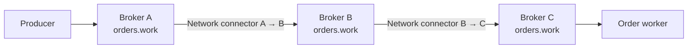
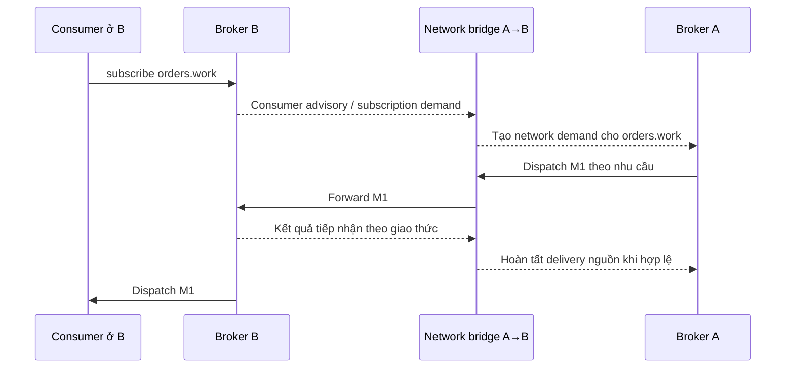
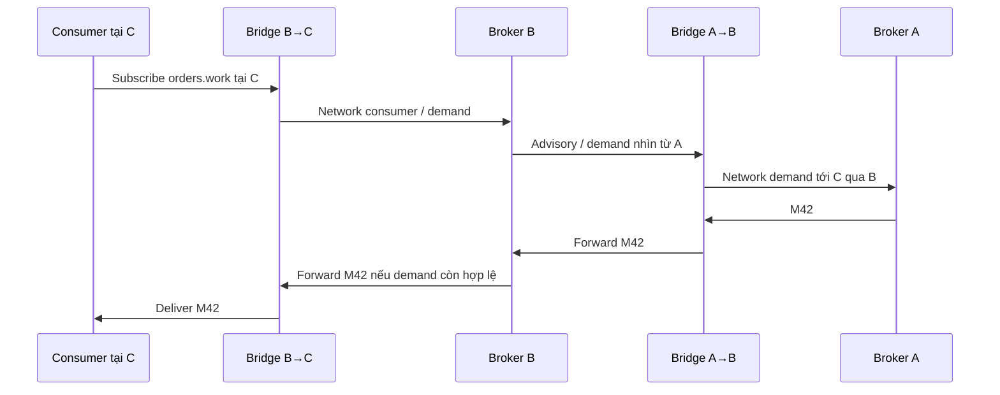
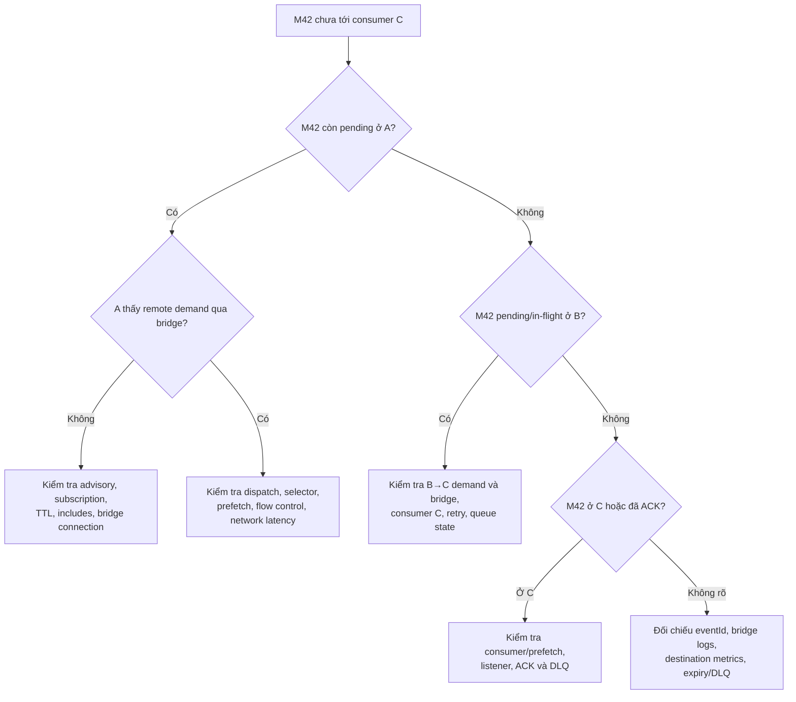

# Consumer demand, advisory và thông điệp bị giữ tại broker trung gian

> **Chương:** Kết nối nhiều broker  
> **Phạm vi:** Apache ActiveMQ **Classic 5.x**, mô hình **Network of Brokers** với *demand forwarding*. Bài tập trung vào cách subscription/advisory tạo nhu cầu chuyển message, vì sao message có thể dừng tại broker trung gian và cách chẩn đoán/khắc phục. Artemis dùng address, queue và federation/cluster theo cơ chế khác; **không áp dụng trực tiếp các thuộc tính `networkConnector` của Classic cho Artemis**.

## 1. Hiện tượng: consumer đã xuất hiện nhưng message vẫn nằm ở broker khác

Giả sử có ba ActiveMQ Classic broker độc lập:



Ứng dụng gửi message `M-42` vào queue `orders.work` trên **A**. Một consumer chạy ở **C**. Nếu demand lan truyền qua các network bridges và mọi điều kiện cho phép, message có thể đi từ **A → B → C** rồi được giao cho consumer.

Vấn đề phát sinh khi topology thay đổi:

- M-42 đã chuyển từ A sang B.
- Consumer hoặc đường bridge dẫn tới C biến mất, hoặc một message được dispatch/prefetch tới một broker rồi nhu cầu nhận thay đổi.
- Một consumer mới nối trực tiếp vào A nhìn thấy queue trống và **không nhận được M-42**, mặc dù M-42 vẫn còn ở B.

Đây có thể là **message bị giữ tại broker trung gian** (*stranded/stuck message*), không nhất thiết là mất message. Các broker trong Network of Brokers **không tạo thành một queue vật lý duy nhất có thể lấy message ở mọi node**.

**Điểm quan trọng:** *consumer demand* tác động đến **quyết định chuyển tiếp sắp xảy ra**. Nó không bảo đảm broker tự động thu hồi hoặc chuyển ngược mọi message **đã chuyển thành công** trước đó.

### 1.1. Ba trạng thái phải tách riêng

| Trạng thái | Tại đâu? | Ý nghĩa |
|---|---|---|
| `Pending/QueueSize` ở A | Store của A | Message còn do A quản lý, có thể cấp cho consumer A hoặc network consumer phù hợp |
| `InFlightCount` ở A | Đang giao từ A cho consumer/bridge | Message đang được dispatch nhưng chưa hoàn tất ACK ở phạm vi đo của A |
| `Pending/QueueSize` ở B | Store của B | Message đã được B tiếp nhận và đang chờ xử lý/chuyển tiếp; consumer A **không tự đọc được** |

Một message có thể đi qua nhiều broker, vì vậy tổng `EnqueueCount`/`DequeueCount` của A, B, C **không** phải số nghiệp vụ duy nhất. Dùng `eventId` ứng dụng để truy nguồn gốc qua các node.

## 2. Consumer demand là gì trong Network of Brokers?

Classic triển khai network connector như một cầu nối broker-to-broker, hỗ trợ **store-and-forward**. Một cơ chế cốt lõi là **demand forwarding**: bridge tìm những subscription/consumer ở broker phía xa để quyết định có nên nhận message từ broker phía nguồn hay không.

Với một queue, một consumer thật ở B có thể làm A thấy một **network consumer** đại diện nhu cầu từ B. A có thể dispatch message cho network consumer đó; bridge sau đó gửi message tới B.



Sơ đồ diễn tả **quan hệ nhân quả**, không phải lời hứa mỗi bước luôn tương đương đúng một frame hoặc một transaction SQL. Cách bridge xác nhận delivery nguồn và bảo vệ in-flight khi network lỗi phụ thuộc broker/client version, message persistence và cấu hình bridge.

### 2.1. Vòng đời nhu cầu

1. Consumer thật tạo subscription cho `orders.work` ở B.
2. Broker B phát sự kiện advisory/subscription change.
3. Network bridge A→B quan sát thông tin từ phía B và duy trì demand phù hợp ở A.
4. Khi có message có thể giao, A xem network bridge như một **đường tiêu thụ hợp lệ** và chuyển tiếp theo dispatch policy.
5. Consumer ở B đóng kết nối: B báo thay đổi; cầu nối cập nhật hoặc gỡ demand. Việc thay đổi này **không tức thời tuyệt đối**.
6. Message đã nằm trong store của B không tự động “quay về” A chỉ vì demand vừa biến mất.

**Không hiểu nhầm:** nhu cầu consumer **không phải** lời hứa consumer sẽ xử lý thành công. Một consumer có thể đang chậm, tắc downstream, có prefetch hoặc chết sau khi message đã đến B.

### 2.2. “Một consumer thật” khác “network consumer”

Broker A có thể không có process Java nào trực tiếp subscribe queue, nhưng trong JMX vẫn thấy consumer count khác 0 vì một subscription do **network bridge** tạo để đại diện demand ở xa.

Điều này giải thích hai biểu hiện dễ gây hiểu nhầm:

- **A có consumer nhưng local application không có:** kiểm tra xem đó có phải `network consumer`.
- **Consumer count ở A giảm về 0 sau khi consumer B tắt, nhưng A cũng không còn message:** message có thể đã được chuyển sang store B trước khi demand bị xóa.

Đừng dùng duy nhất `ConsumerCount` để khẳng định đã có một business consumer thật ở địa phương.

## 3. Advisory: tín hiệu điều khiển, không phải xác nhận nghiệp vụ

ActiveMQ Classic sử dụng **advisory messages** để thông báo các sự kiện broker như consumer/subscription xuất hiện, biến mất và thay đổi liên quan. Trong cấu hình demand forwarding, **consumer advisories** giúp network bridge biết remote demand.

Ví dụ với queue `orders.work`, advisory destination liên quan có dạng:

```text
ActiveMQ.Advisory.Consumer.Queue.orders.work
```

Trong Java client Classic, nên tạo advisory topic bằng API của provider thay vì tự ghép tên tùy ý:

```java
import org.apache.activemq.advisory.AdvisorySupport;
import org.apache.activemq.command.ActiveMQQueue;
import javax.jms.Topic; // activemq-client 5.x dùng javax.jms.

Topic topic = AdvisorySupport.getConsumerAdvisoryTopic(
    new ActiveMQQueue("orders.work"));
```

Đoạn trên chỉ minh họa API và sự khác biệt namespace; **đừng để cả `jakarta.jms.Topic` và `javax.jms.ConnectionFactory` trong cùng chương trình**. Chương trình Java hoàn chỉnh ở mục 6 dùng nhất quán `javax.jms.*`.

### 3.1. Advisory có những giới hạn nào?

| Thông tin | Advisory giúp ích | Advisory **không** chứng minh |
|---|---|---|
| Consumer xuất hiện/biến mất | Biết topology nhu cầu đang thay đổi | Consumer đã xử lý/commit nghiệp vụ |
| Network consumer được tạo | Gợi ý remote demand đã tới broker nguồn | Message chắc chắn chuyển ngay hoặc đến đúng consumer |
| Consumer đóng | Biết nên cập nhật demand | Các message cũ sẽ tự hồi hương về broker nguồn |
| Bridge/network reconnect | Quan sát thay đổi topology | Không có message trùng, không mất message hoặc không có partition |
| Advisory consumer topic | Debug hoạt động và subscription | Không phải nguồn lịch sử đầy đủ thay thế JMX/store |

Advisories là **control-plane signals**. Chúng có thể đến trễ khi bridge/network gặp sự cố; người quan sát đến sau có thể không ghi lại toàn bộ lịch sử sự kiện trước đó. Với Network of Brokers, broker cũng duy trì state và subscription internals, không nên xem một message advisory mà công cụ quan sát thấy là toàn bộ sự thật của routing.

**Security:** advisory destination cần chính sách truy cập phù hợp. Không mở quyền đọc mọi advisory cho tài khoản nghiệp vụ nếu metadata consumer/topology là thông tin nhạy cảm. Nếu cấu hình chặn những thông tin mà bridge cần để nhận remote demand, dynamic forwarding có thể không hoạt động như dự kiến; cần kiểm tra quyền và policy chính xác.

### 3.2. Phân biệt ba sự kiện

```text
1. Consumer advisory xuất hiện   = có nhu cầu đăng ký
2. Network bridge forward M42    = message chuyển tới một broker khác
3. Consumer ACK M42               = một delivery được xác nhận
```

Ba sự kiện có thời điểm, mục đích và trạng thái riêng. Sự kiện 1 không chứng minh sự kiện 2; sự kiện 2 không chứng minh sự kiện 3.

## 4. Kịch bản A → B → C: demand được chuyển tiếp qua nhiều hop

Khi C có consumer, bridge B→C có thể thấy demand từ C. Sau đó, B có thể biểu diễn demand ấy lên phía A thông qua bridge A→B, **nếu topology và các giới hạn forwarding cho phép**.



Điều kiện quan trọng:

- Cầu nối có hướng **A → B** và **B → C**; demand đi theo luồng control phù hợp của bridge, **message** theo hướng chuyển tiếp đã định.
- Subscription/demand có thể cần đi qua **hai network hops**; tham số TTL của network phải cho phép.
- Destination phải được cho phép trong dynamic/static includes và không bị exclusions chặn.
- Consumer thật tại C còn khả dụng; broker và bridges chưa bị lỗi.
- Message chưa bị expiry, lọc bởi selector hoặc giữ bởi dispatch tới consumer khác.
- Message đã tồn tại ở B thì cơ chế quyết định chuyển B→C tùy demand và khả năng bridge B→C, **không** có một central queue manager tự san lại toàn cụm.

### 4.1. `networkTTL` là số hop, không phải thời hạn message

Trong ActiveMQ Classic, `networkTTL` giới hạn phạm vi network forwarding để ngăn mạng broker chuyển subscription/message vòng vô hạn. Với topology A→B→C, chọn giá trị đủ cho ít nhất hai bước bridge; ví dụ `networkTTL="3"` trong bài lab có khoảng dự phòng.

**Không nhầm với:**

- JMS `timeToLive`: thời gian message được phép tồn tại trước khi hết hạn.
- `consumerTTL` và `messageTTL` (ở phiên bản/cấu hình có hỗ trợ): các giới hạn hop cho thông tin consumer và message.
- `redeliveryDelay`: trì hoãn khi giao lại message chưa được ACK.

TTL network quá thấp có thể khiến demand ở C không được nhìn tới A hoặc message không được chuyển đủ hops, tạo tình huống “C online nhưng A không forward”. TTL quá cao trong topology có vòng có thể làm tăng lưu lượng control/data và tạo các đường chuyển tiếp ngoài dự kiến.

### 4.2. `conduitSubscriptions` và subscription hợp nhất

`conduitSubscriptions` là một cơ chế network connector có thể **hợp nhất những subscription có cùng destination** khi đưa demand qua bridge, thường đặc biệt hữu ích với fan-out/topic topology để tránh chuyển nhiều bản dư thừa qua cùng một liên kết.

Với queue và nhiều broker, **không** suy diễn rằng bật `conduitSubscriptions` bảo đảm phân phối công bằng, giữ nguyên vị trí message hoặc loại bỏ mọi duplicate network subscription. Hành vi cụ thể còn phụ thuộc network topology, selector, phiên bản và những thuộc tính queue subscription khác.

### 4.3. Advisory propagation có thể không ổn định ngay lúc reconnect

Đừng đặt giả định “C tạo consumer là A thấy ngay trong cùng millisecond”. Network bridge phải thiết lập kết nối, đồng bộ thông tin subscription và cập nhật state. Trong thời gian ngắn, A có thể chưa thấy demand dù C đã online.

Khi debug, đo riêng:

```text
t0 C consumer connected
t1 B shows remote/network demand
t2 A shows propagated demand
t3 A dequeues/forwards M42
t4 C receives M42
```

Khoảng `t1-t0` hoặc `t2-t1` lớn gợi ý vấn đề control plane; `t3-t2` lớn gợi ý dispatch/flow control; `t4-t3` lớn gợi ý bridge downstream/consumer handling.

## 5. XML minh họa: hai network connectors một chiều

Trong lab, ba broker Classic có **brokerName khác nhau**, transport endpoints khác host và persistent store **độc lập**. Đây là một Network of Brokers, **không phải HA shared-store primary/backup**.

### 5.1. Broker A kết nối sang B

Trong phần tử `<broker>` hiện hữu của `activemq.xml` trên broker A, đặt:

```xml
<networkConnectors>
  <networkConnector
      name="A-to-B"
      uri="static:(tcp://broker-b:61616)"
      dynamicOnly="true"
      conduitSubscriptions="true"
      networkTTL="3"
      decreaseNetworkConsumerPriority="true">
    <dynamicallyIncludedDestinations>
      <queue physicalName="orders.work"/>
    </dynamicallyIncludedDestinations>
  </networkConnector>
</networkConnectors>
```

### 5.2. Broker B kết nối sang C

Trong phần tử `<broker>` hiện hữu trên broker B:

```xml
<networkConnectors>
  <networkConnector
      name="B-to-C"
      uri="static:(tcp://broker-c:61616)"
      dynamicOnly="true"
      conduitSubscriptions="true"
      networkTTL="3"
      decreaseNetworkConsumerPriority="true">
    <dynamicallyIncludedDestinations>
      <queue physicalName="orders.work"/>
    </dynamicallyIncludedDestinations>
  </networkConnector>
</networkConnectors>
```

Broker C trong lab không cần connector đi ngược về B; consumer Java kết nối trực tiếp vào C.

**Cách hiểu từng thuộc tính:**

| Thuộc tính | Tác động trong bài lab |
|---|---|
| `uri="static:(...)"` | Xác định endpoint remote của network connector; từ `static` ở đây nói tới tập endpoint, **không** có nghĩa bắt buộc mọi queue đều phải được forward |
| `dynamicOnly="true"` | Ưu tiên forwarding theo nhu cầu động, không chủ ý tạo luồng static cho queue chưa có demand |
| `dynamicallyIncludedDestinations` | Giới hạn destination được bridge xem xét, **không** tự sinh consumer |
| `networkTTL="3"` | Giới hạn số hop ở mức đủ cho lab A→B→C; cần kiểm chứng theo phiên bản |
| `conduitSubscriptions="true"` | Điều khiển hợp nhất demand subscriptions, không phải cân bằng dữ liệu giữa các broker |
| `decreaseNetworkConsumerPriority="true"` | Hỗ trợ ưu tiên consumer cục bộ hơn network consumer trong các trường hợp phù hợp; **không** thu hồi message đã chuyển |

**Lưu ý cấu hình:** các đoạn trên là fragment của **hai file cấu hình broker khác nhau** trong lab, không phải hai `<networkConnectors>` độc lập phải dán nguyên vào một `activemq.xml`. Nếu broker đã có `networkConnectors`, hãy gộp đúng chỗ, tránh tạo nhiều connector trùng endpoint gây vòng/nhân demand. Các đường dẫn hostname, cổng và policy security phải khớp môi trường.

**Đừng bật nhiều hướng bridge hoặc `duplex=true` theo thói quen** khi chưa vẽ đường demand/data thực sự. Một network topology có vòng có thể làm việc quan sát network consumers và subscriptions phức tạp hơn đáng kể.

### 5.3. Dynamic và static subscription không giống nhau

Hai hình thức cấu hình cần phân biệt:

- **Dynamic inclusion:** chỉ cho phép những destination đã chọn được tham gia **khi có demand**. Đây là mô hình chính của bài.
- **Static inclusion/forced subscription:** có thể tạo nhu cầu chuyển tiếp cho destination được liệt kê ngay cả khi không có consumer thật ở phía remote, tùy thiết lập connector. Với queue, điều đó có thể làm message **rời broker nguồn rồi tích ở broker khác**.

Vì vậy, khi muốn message ở A cho đến khi thực sự có consumer hợp lệ ở xa, không vô tình thêm `staticallyIncludedDestinations` hoặc những cài đặt force-forward không cần thiết. Luôn test trên phiên bản Classic thực tế, vì network connector có thêm nhiều tham số và tương tác policy riêng.

## 6. Tại sao message bị giữ ở broker trung gian?

### 6.1. Trường hợp A: demand tồn tại rồi biến mất sau khi đã forward

```text
t0: Consumer B subscribe orders.work
t1: A nhận demand, forward M42 sang B
t2: B nhận M42 vào store
t3: Consumer B disconnect hoặc crash
t4: Consumer mới chạy tại A
```

Tại t4, M42 **có thể vẫn ở B**. Consumer tại A không thấy M42 chỉ vì nó vừa subscribe queue có cùng tên. Message đã được chuyển qua **ranh giới store**.

Trong topology A→B→C, B vẫn là broker trung gian về kết nối, nhưng ở thời điểm này không có demand downstream nên giữ message ở queue của chính B.

**Hệ quả:** Nếu vận hành chỉ tra queue A mà bỏ qua B/C, có thể báo nhầm “mất message”.

### 6.2. Trường hợp B: demand từ C bị cắt trước khi B chuyển tiếp xong

```text
C có consumer -> B thấy demand -> A forward M42 sang B
                              |
                   B→C bridge down / C mất consumer
                              |
                        M42 nằm tại B
```

Message chuyển A→B và B→C là **hai chặng network khác nhau**, không phải một commit nguyên tử trải qua cả ba broker. Khi B không thể gửi tiếp, nó có thể giữ lại pending message để chuyển khi demand hợp lệ xuất hiện trở lại.

Không khẳng định mọi lỗi giữa chặng đều để message đúng ở B: có thể message vẫn ở A, đang in-flight hoặc đã đến C. Phải **đối chiếu trạng thái thực tế của cả ba node** và thời điểm các ACK bridge đã có hiệu lực.

### 6.3. Trường hợp C: prefetch/dispatch khiến broker “trống” trước khi nghiệp vụ hoàn tất

Network bridge hoạt động như consumer phía nguồn và producer phía đích. Ở broker A, message có thể đã được dispatch vào bridge hoặc đang in-flight; ở B có thể nằm trong store/buffer; ở C có thể đã vào prefetch của consumer thật.

Do đó:

- `QueueSize=0` trên A **không chứng minh** ứng dụng đã xử lý M42.
- `ConsumerCount>0` trên B **không chứng minh** có process nghiệp vụ đang làm việc tại B.
- `QueueSize=0` trên B **không chứng minh** C đã commit nghiệp vụ.
- Một consumer có prefetch lớn, ngừng ACK nhưng vẫn giữ connection có thể khiến message khó được chia đều và queue metrics dễ bị diễn giải sai.

**Prefetch không phải nguyên nhân duy nhất** gây stuck messages. Nó là một yếu tố làm chậm việc thu hồi/in-flight recovery và thay đổi cảm nhận về message location.

### 6.4. Trường hợp D: demand không lan tới A

Các nguyên nhân:

- `networkTTL`/`consumerTTL` không đủ qua số hops.
- Bridge A→B hoặc B→C chưa established, reconnect lỗi hoặc bị network partition.
- `dynamicallyIncludedDestinations`/`excludedDestinations` cấu hình sai.
- Advisory/subscription control traffic bị cấu hình hoặc quyền truy cập chặn.
- Selector hoặc consumer destination không khớp.
- Consumer thực tế chưa active/ready ở C.

Khi đó, M42 **có thể vẫn nằm ở A** chứ không phải tại broker trung gian. Đây là **thiếu demand/forwarding**, khác với “M42 đã di chuyển rồi bị giữ”.

### 6.5. Trường hợp E: topology nhiều đường và network subscription trùng

Khi nối A↔B↔C hoặc nhiều connector cùng destination, broker có thể thấy nhiều network consumers đại diện những con đường khác nhau. Cơ chế loop prevention, message path, `networkTTL`, subscription suppression và priority ảnh hưởng việc chọn đường.

**Không tự sửa lỗi bằng cách tăng TTL vô hạn hoặc bật mọi network connector hai chiều.** Điều đó có thể làm traffic và trạng thái demand khó đo hơn, thậm chí message di chuyển sang những broker ngoài ý muốn.

## 7. Java JMS: probe gửi, nhận và quan sát consumer advisory

Ví dụ sau dùng **ActiveMQ Classic `activemq-client:5.18.5`**, API **`javax.jms`** và OpenWire. Không trộn với Spring Boot 3.x `jakarta.jms`. Có thể chạy chương trình riêng ở broker A, B hoặc C để xem **message thực sự được nhận từ node nào**.

### 7.1. Dependency Maven

```xml
<dependency>
  <groupId>org.apache.activemq</groupId>
  <artifactId>activemq-client</artifactId>
  <version>5.18.5</version>
</dependency>
```

Phiên bản chỉ nhằm minh họa, cần dùng client tương thích và được dự án phê duyệt. Broker phải provision queue `orders.work` và cấp quyền send/consume. `watch` còn cần quyền subscribe advisory destination nếu security policy có giới hạn.

### 7.2. Chương trình `NetworkDemandProbe.java`

```java
import java.time.Instant;

import javax.jms.Connection;
import javax.jms.DeliveryMode;
import javax.jms.JMSException;
import javax.jms.Message;
import javax.jms.MessageConsumer;
import javax.jms.MessageProducer;
import javax.jms.Queue;
import javax.jms.Session;
import javax.jms.TextMessage;
import javax.jms.Topic;

import org.apache.activemq.ActiveMQConnectionFactory;
import org.apache.activemq.advisory.AdvisorySupport;
import org.apache.activemq.command.ActiveMQQueue;

public final class NetworkDemandProbe {
    private static final String QUEUE = "orders.work";

    public static void main(String[] args) throws Exception {
        if (args.length < 2) {
            usage();
            return;
        }

        String mode = args[0];
        String url = args[1];

        ActiveMQConnectionFactory factory =
                new ActiveMQConnectionFactory(url);

        String user = System.getenv("BROKER_USER");
        String password = System.getenv("BROKER_PASSWORD");

        Connection connection =
                user == null || user.isEmpty()
                    ? factory.createConnection()
                    : factory.createConnection(user, password);

        try {
            switch (mode) {
                case "send":
                    if (args.length != 3) {
                        usage();
                        return;
                    }
                    send(connection, args[2], url);
                    break;

                case "consume":
                    if (args.length != 3) {
                        usage();
                        return;
                    }
                    consume(connection, Integer.parseInt(args[2]), url);
                    break;

                case "hold":
                    if (args.length != 3) {
                        usage();
                        return;
                    }
                    holdAndRollback(
                            connection, Integer.parseInt(args[2]), url);
                    break;

                case "watch":
                    if (args.length != 3) {
                        usage();
                        return;
                    }
                    watchAdvisories(
                            connection, Integer.parseInt(args[2]), url);
                    break;

                default:
                    usage();
            }
        } finally {
            connection.close();
        }
    }

    private static void send(
            Connection connection, String eventId, String url)
            throws JMSException {

        Session session = connection.createSession(
                true, Session.SESSION_TRANSACTED);
        try {
            Queue queue = session.createQueue(QUEUE);
            MessageProducer producer = session.createProducer(queue);
            try {
                TextMessage message =
                        session.createTextMessage("event:" + eventId);
                message.setStringProperty("eventId", eventId);

                producer.send(
                        message, DeliveryMode.PERSISTENT, 4, 0L);
                session.commit();

                System.out.printf(
                        "%s SEND_COMMITTED broker=%s eventId=%s%n",
                        Instant.now(), url, eventId);
            } catch (JMSException | RuntimeException failure) {
                try {
                    session.rollback();
                } catch (JMSException rollbackError) {
                    failure.addSuppressed(rollbackError);
                }
                throw failure;
            } finally {
                producer.close();
            }
        } finally {
            session.close();
        }
    }

    private static void consume(
            Connection connection, int max, String url)
            throws JMSException {

        if (max <= 0) {
            throw new IllegalArgumentException("max must be positive");
        }
        Session session = connection.createSession(
                true, Session.SESSION_TRANSACTED);
        try {
            Queue queue = session.createQueue(QUEUE);
            MessageConsumer consumer = session.createConsumer(queue);
            try {
                connection.start();
                for (int i = 0; i < max; i++) {
                    Message msg = consumer.receive(5000L);
                    if (msg == null) {
                        System.out.printf(
                            "%s TIMEOUT broker=%s%n", Instant.now(), url);
                        break;
                    }
                    try {
                        String eventId =
                                msg.getStringProperty("eventId");
                        System.out.printf(
                            "%s RECEIVE broker=%s eventId=%s redelivered=%s%n",
                            Instant.now(), url, eventId,
                            msg.getJMSRedelivered());
                        session.commit(); // ACK message đã nhận.
                    } catch (JMSException | RuntimeException failure) {
                        session.rollback();
                        throw failure;
                    }
                }
            } finally {
                consumer.close();
            }
        } finally {
            session.close();
        }
    }

    private static void holdAndRollback(
            Connection connection, int seconds, String url)
            throws Exception {

        if (seconds <= 0) {
            throw new IllegalArgumentException(
                    "seconds must be positive");
        }
        Session session = connection.createSession(
                true, Session.SESSION_TRANSACTED);
        try {
            MessageConsumer consumer =
                    session.createConsumer(session.createQueue(QUEUE));
            try {
                connection.start();
                Message msg = consumer.receive(10000L);
                if (msg == null) {
                    System.out.println("NO_MESSAGE_TO_HOLD");
                    return;
                }

                System.out.printf(
                    "%s HELD broker=%s eventId=%s%n",
                    Instant.now(), url,
                    msg.getStringProperty("eventId"));

                // Cố ý chưa ACK; mô phỏng một consumer chậm/ngắt.
                Thread.sleep(seconds * 1000L);
                session.rollback(); // Trả delivery về broker local.
                System.out.println("ROLLED_BACK_LOCAL_DELIVERY");
            } finally {
                consumer.close();
            }
        } finally {
            session.close();
        }
    }

    private static void watchAdvisories(
            Connection connection, int seconds, String url)
            throws JMSException {

        if (seconds <= 0) {
            throw new IllegalArgumentException(
                    "seconds must be positive");
        }
        Session session = connection.createSession(
                false, Session.AUTO_ACKNOWLEDGE);
        try {
            ActiveMQQueue physical =
                    new ActiveMQQueue(QUEUE);
            Topic advisory = AdvisorySupport
                    .getConsumerAdvisoryTopic(physical);
            MessageConsumer watcher =
                    session.createConsumer(advisory);
            try {
                connection.start();
                long deadline =
                        System.nanoTime() + seconds * 1_000_000_000L;

                while (System.nanoTime() < deadline) {
                    Message advisoryMessage =
                            watcher.receive(1000L);
                    if (advisoryMessage != null) {
                        // Advisory body chứa metadata Classic-specific.
                        // In class/type trước, không coi là ACK nghiệp vụ.
                        System.out.printf(
                            "%s ADVISORY broker=%s type=%s bodyClass=%s%n",
                            Instant.now(), url,
                            advisoryMessage.getJMSType(),
                            advisoryMessage.getClass().getSimpleName());
                    }
                }
            } finally {
                watcher.close();
            }
        } finally {
            session.close();
        }
    }

    private static void usage() {
        System.out.println(
            "Usage: NetworkDemandProbe send <broker-url> <eventId>");
        System.out.println(
            "       NetworkDemandProbe consume <broker-url> <max>");
        System.out.println(
            "       NetworkDemandProbe hold <broker-url> <seconds>");
        System.out.println(
            "       NetworkDemandProbe watch <broker-url> <seconds>");
    }
}
```

**Các giới hạn của probe:**

- Chỉ cần một broker URL mỗi process. Nó **không** tự tạo Network of Brokers; XML phải được cấu hình ở brokers.
- `send` in `SEND_COMMITTED` chỉ sau khi JMS transaction commit thành công. Nếu commit thất bại/mất kết nối, không xem output trước đó là bằng chứng message được broker chấp nhận.
- `consume` nhận và commit ngay nên chỉ kiểm chứng **delivery từ một broker**, không mô phỏng nghiệp vụ dài.
- `hold` cố tình nhận rồi `rollback()` để trả delivery về **session/broker phía đang phục vụ consumer**; không trả lại message qua các network hops trước đó.
- `watch` chỉ cho biết có consumer advisory event được client thấy trong khoảng theo dõi; nó **không** xác minh network demand đã đi đủ A→B→C. Đối chiếu thêm JMX và connection/bridge logs.
- Đừng chạy `hold` hoặc fault injection trên queue nghiệp vụ thật; trạng thái rollback có thể kích hoạt redelivery policy/DLQ sau nhiều lần thử.

### 7.3. Kịch bản lab 1: demand C lan qua B tới A

1. Khởi động Classic A, B, C với XML mục 5, xác minh hai network connectors đã established.
2. Mở cửa sổ quan sát advisories trên **A và B** trước khi thêm consumer C.
3. Gửi M1 vào **A**; với `dynamicOnly=true` và chưa có consumer ở B/C, M1 thường nằm chờ tại queue A.
4. Tạo consumer tại C; demand có cơ hội lan C→B→A. A chuyển tiếp M1 sang B, B sang C.
5. Consumer C in `RECEIVE broker=C eventId=M1`, sau đó commit.
6. Đối chiếu JMX queues A/B/C; đừng xem số Enqueue tích lũy trên từng node là số message logic.

Lệnh minh họa (đã build classpath):

```bash
# Terminal A: quan sát advisory ở A
java -cp "target/classes:target/dependency/*" \
  NetworkDemandProbe watch tcp://broker-a:61616 45

# Terminal B: quan sát advisory ở B
java -cp "target/classes:target/dependency/*" \
  NetworkDemandProbe watch tcp://broker-b:61616 45

# Terminal producer: gửi vào A
java -cp "target/classes:target/dependency/*" \
  NetworkDemandProbe send tcp://broker-a:61616 M1

# Terminal worker: nhận từ C
java -cp "target/classes:target/dependency/*" \
  NetworkDemandProbe consume tcp://broker-c:61616 1
```

Trên Windows, dấu phân cách classpath là `;` thay cho `:`. Ví dụ yêu cầu dependency JAR đã có trong `target/dependency`; bài không thực hiện Maven/build thật.

**Nếu C TIMEOUT:** kiểm tra lần lượt `ConsumerCount` ở C, demand tại B, demand tại A, bridge connection/TTL, selector/filter, queue states từng broker. Không tự kết luận message bị mất.

### 7.4. Kịch bản lab 2: chứng minh message đã chuyển B không tự quay A

Giữ **topology một chiều A→B→C**, không có consumer tại C và không có bridge ngược B→A. Dùng message mới M2 và một consumer tạm ở B:

```bash
# 1. Gửi message ở A, trước khi B có consumer thật.
java -cp "target/classes:target/dependency/*" \
  NetworkDemandProbe send tcp://broker-a:61616 M2

# 2. Tạo demand ở B; chờ bridge chuyển M2 từ A sang B.
#    Khi nhận, giữ 3 giây rồi rollback ở B.
java -cp "target/classes:target/dependency/*" \
  NetworkDemandProbe hold tcp://broker-b:61616 3

# 3. Khi B đã nhận/rollback xong và không có consumer C,
#    thử nhận tại A: không kỳ vọng thấy M2.
java -cp "target/classes:target/dependency/*" \
  NetworkDemandProbe consume tcp://broker-a:61616 1

# 4. Kiểm tra tại B: M2 có thể vẫn nằm tại B.
java -cp "target/classes:target/dependency/*" \
  NetworkDemandProbe consume tcp://broker-b:61616 1
```

**Điều kiện nghiệm thu của lab:** Chỉ đánh giá bước 3/4 sau khi bước 2 đã in `HELD eventId=M2` và JMX xác nhận chuyển tiếp A→B xong. Nếu chưa có `HELD`, demand/bridge chưa hoạt động; không thể kết luận stuck messages. Nếu một consumer khác đang nhận cùng queue, kết quả không xác định. Nếu B có C consumer/đường forwarding khác, M2 có thể đã đi tiếp.

Tại bước 3, mở consumer A **có thể tạo demand mới trong một topology có bridge hai chiều** và làm message quay lại; bài lab cố ý không cấu hình chiều ngược để giữ lập luận một chiều. Trong production, **không** tự tạo bridge ngược chỉ nhằm kéo message về mà chưa xem xét loop/duplicate/ordering.

### 7.5. Kịch bản lab 3: lỗi downstream bridge sau khi forwarding

Để sát tình huống B là broker trung gian cho C:

1. Consumer C hoạt động, tạo demand C→B→A.
2. Quan sát message từ A đã được forward tới B.
3. Ở **môi trường thử nghiệm**, ngắt connector B→C hoặc dừng C ở một thời điểm xác định; thu queue/in-flight states tại A, B, C.
4. Xác định message thực tế còn ở đâu, không đoán từ một log duy nhất.
5. Khôi phục connector và consumer C; xác minh backlog được xử lý hoặc còn ở B, rồi phân tích vì sao.

Kịch bản này có **cửa sổ race** nên không bảo đảm lần nào cũng “M42 mắc lại B”. Nếu cần bài test lặp lại chắc chắn, sử dụng **broker JMX metrics và cổng lỗi mạng có điều khiển** để chứng minh vị trí trước/sau từng bước, không báo PASS từ suy đoán.

## 8. Chẩn đoán theo đường đi dữ liệu và đường đi demand

Một quy trình hỗ trợ tốt nhất luôn trả lời **hai câu hỏi riêng**:

1. **Consumer demand đã đi từ C qua B tới A chưa?**
2. **Message data hiện nằm tại A, B hay C?**

### 8.1. Bảng tín hiệu tại từng broker

| Broker | Kiểm tra demand/control plane | Kiểm tra data plane |
|---|---|---|
| **A** | Network bridge A→B đang connected? Có network consumer cho `orders.work` không? | `QueueSize`, `InFlightCount`, `EnqueueCount`, `DequeueCount` của queue A |
| **B** | Bridge B→C connected? Demand từ C có hiển thị? Network demand lên A còn không? | Có message pending/in-flight ở B? Có dispatch tiếp tới bridge C? |
| **C** | Có consumer Java thật, connection và selector đúng không? | Queue pending/in-flight ở C; consumer đã ACK/commit chưa? |

Dùng Web Console/JMX của Classic, chú ý tên MBean, cách tính `QueueSize` và hiển thị network consumer phụ thuộc version. **Không cộng ba QueueSize làm một thước đo chuẩn về một message logic** khi đang có in-flight/transfer/duplicate trong lúc bridge failover; dùng thêm `eventId` và snapshot theo thời điểm.

### 8.2. Cây quyết định



Cây quyết định giả định có phương pháp tìm M42 bằng `eventId`: chọn **JMS browsing hoặc test probe** có kiểm soát và giới hạn khối lượng, không duyệt hàng triệu message trên broker đang quá tải chỉ để tìm một ID. JMX counters tổng hợp **không** tự chỉ ra ID cụ thể của message.

### 8.3. Checklist cấu hình dễ gây nhầm

- `dynamicOnly` có bật không? Có `staticallyIncludedDestinations` đang ép forwarding dù thiếu consumer?
- `dynamicallyIncludedDestinations`/`excludedDestinations` có bao đúng queue không?
- TTL mạng có đủ cho số hop nhưng không quá lớn trong topology có vòng?
- Cặp network connectors có bị cấu hình trùng, đảo chiều hoặc `duplex` ngoài dự tính không?
- Consumer C có đang active nhưng queue selector khác yêu cầu?
- Advisory/demand control messages có bị ACL hoặc policy broker chặn không?
- Network bridge reconnect liên tục (auth, TLS, transport timeout)?
- Có consumer local hoặc network khác nhận M42 trước đó?
- Queue B có đầy memory/store hoặc bị producer/consumer flow control?
- Message có expiration, redelivery hay DLQ policy khiến nó không còn ở queue dự kiến?

## 9. Phương án khắc phục: chọn theo nguyên nhân, không “tăng TTL cho tất cả”

### 9.1. Message đã nằm ở broker B

**Giải pháp trước mắt, an toàn hơn:** khôi phục consumer hợp lệ **ở B** hoặc khôi phục downstream demand **B→C** để xử lý lượng message đang chờ. Nếu cần chuyển message về A, phải dùng thao tác quản trị/bridge/consumer-republish được thiết kế riêng, có bảo vệ `eventId` và kiểm soát mất/trùng.

Không xóa queue B hoặc tự sửa internal store chỉ vì trên A không thấy message. Nếu định chuyển lại bằng một ứng dụng:

- Chỉ ACK message nguồn sau khi đích đã xác nhận nhận bền vững theo chính sách.
- Chấp nhận khả năng replay/duplicate tại ranh giới commit của hai broker độc lập.
- Dùng business eventId, inbox/idempotency ở consumer đích.
- Ghi audit `eventId, sourceBroker, targetBroker`; giới hạn rate để không làm quá tải.
- Với message tài chính, phải có quy trình đối soát trước khi bulk migration.

### 9.2. Message vẫn nằm A, không có demand

Khắc phục **control plane**:

- Xác minh C thật sự subscribe đúng queue và selector.
- Xác minh B→C và A→B đã established.
- Kiểm tra `networkTTL`/`consumerTTL`, destination inclusion/exclusion, advisory rights.
- Khi demand đã xuất hiện tại A, kiểm tra tiếp dispatch/bridge flow control.

Đổi cấu hình broker mà không xác minh demand sau đổi có thể biến một lỗi “không chuyển tiếp” thành lỗi “chuyển tiếp nhầm broker”.

### 9.3. Ưu tiên consumer local so với network consumer

`decreaseNetworkConsumerPriority="true"` có thể hỗ trợ tình huống mong local consumer được ưu tiên khi cả local và network demand tồn tại. Tuy nhiên, cần thử đúng broker version và dispatch policy:

- Nó **không** ép message đã lưu B quay A.
- Nó **không** loại bỏ prefetch/in-flight cũ.
- Nó **không** tự tạo cân bằng tải/hợp đồng FIFO toàn cụm.

Nếu workload yêu cầu strict ordering hoặc locality theo `orderId`, cân nhắc **thiết kế phân vùng/ownership theo key** ngay từ đầu thay vì coi Network of Brokers như distributed queue có một thứ tự chung.

### 9.4. Topology nào tránh nhu cầu truyền nhiều hop?

Một số lựa chọn:

| Nhu cầu | Kiến trúc nên cân nhắc | Đánh đổi |
|---|---|---|
| Consumer tập trung ở C | Producer kết nối trực tiếp C hoặc broker phù hợp | Giảm hops nhưng phụ thuộc endpoint C |
| Cần HA chứ không phải liên thông nhiều site | Dùng HA primary/backup có store/replication phù hợp | Khác hoàn toàn network forwarding |
| Cần gửi event tới nhiều bên | Topic với durable subscriptions hoặc mô hình federation phù hợp | Fan-out không giống queue competing consumers |
| Cần chuyển job giữa vùng | Một hướng bridge có ownership rõ và cơ chế replay | Có thể tăng latency, cần đối soát |
| Cần giữ xử lý theo phân vùng | Partition/routing theo key, không tự động chuyển ngược | Thêm logic gán ownership |
| Thường xuyên đổi nơi có consumer | Thiết kế explicit destination routing và quan sát pending per broker | Quản trị routing phức tạp hơn |

**Đừng đồng nhất Network of Brokers với shared-store HA:** network broker thường có **store riêng**, một message đã chuyển sang B thì A không thể nhìn xuyên vào store B.

## 10. Kiểm thử các trường hợp thất bại

| Trường hợp | Thiết lập | Kỳ vọng cần kiểm chứng |
|---|---|---|
| **No demand** | Gửi M1 vào A, chưa có consumer B/C | Với dynamic forwarding, M1 thường ở A |
| **Một hop** | Consumer B xuất hiện | A tạo network demand; M1 có thể được giao qua B |
| **Hai hops** | Consumer C, connectors A→B→C | Demand lan đủ hops; M1 có thể đến C |
| **TTL quá thấp** | C không được nhìn từ A | M1 có thể còn A; không nhầm là “mất” |
| **Bridge A→B down** | Consumer B/C có mặt nhưng bridge lỗi | A giữ backlog; kiểm tra reconnect |
| **Bridge B→C down** | M đã tới B | B có thể giữ backlog; recovery khi C demand trở lại |
| **Consumer B biến mất** | B đã nhận M2 nhưng chưa commit | M2 có thể redeliver và ở B; A không tự lấy về |
| **Bridge prefetch lớn** | Consumer downstream chậm/mất | Quan sát in-flight khác pending; không nhầm metric |
| **Static forwarding ngoài ý muốn** | Forced subscription không cần consumer | Message có thể tích ở remote broker |
| **Nhiều network paths** | Bật connector hai chiều/mesh | Quan sát trùng network subs, TTL/path; kiểm tra loop suppression |
| **Consumer local A xuất hiện muộn** | M đã ở B, A không có đường ngược | A không nhận được M cũ chỉ vì có consumer mới |
| **JMS client reconnect** | Kill consumer C rồi restart | Redelivery/ACK và vị trí message sau restart |
| **Persistent message và broker restart** | Message nằm B, restart B trên store cũ | Message chưa ACK tồn tại theo store/policy |
| **Message expiry/DLQ** | TTL/delivery attempts khác lab | Phân biệt message bị xử lý theo policy với stuck ở B |
| **Multiple consumers** | Consumer ở A, B, C cùng hoạt động | Không giả định business completion theo một FIFO toàn cục |

**Nghiệm thu nên dựa trên eventId và trạng thái mỗi broker theo thời điểm**. Một lần `TIMEOUT` của Java consumer chỉ chứng minh client đó không nhận trong thời gian chờ; không xác minh message đã bị mất hoặc đang ở node nào.

## 11. Vận hành và quan sát liên tục

### 11.1. Bộ metric nên kết hợp

| Nhóm | Metric/tín hiệu | Câu hỏi |
|---|---|---|
| Destination tại mỗi node | `QueueSize`, `InFlightCount`, enqueue/dequeue rate | Backlog có đang tích ở một broker trung gian không? |
| Network connectors | Connected/disconnected, reconnect count, bridge throughput | Đường forwarding còn hoạt động không? |
| Consumer subscriptions | Local vs network consumers, destination, selector | Demand bắt nguồn từ đâu và đã lan tới node nào? |
| Advisory control plane | Consumer start/stop, consumer advisory topic | Subscription change có tới nơi nhận không? |
| Persistent store | Store usage, memory, disk, cursor pressure | Message bị giữ do lưu trữ/flow control không? |
| Application | `eventId`, delivery count, processing/ACK latency | Message có thật sự xử lý/commit hay chỉ đã forward? |
| Topology | Broker path, network hops, primary endpoint | Có thay đổi route/TTL sau deploy không? |

Tự động hóa cảnh báo **theo từng broker**: queue `orders.work` ở A có thể trống trong khi B tồn nhiều message. Một dashboard chỉ truy A sẽ bỏ sót hiện tượng này.

### 11.2. Quy trình điều tra một event

1. Lấy `eventId=M42` và nơi producer xác nhận `send/commit`.
2. Đo consumer thật cuối cùng được kỳ vọng ở broker nào.
3. Truy snapshot **A, B, C**: queue pending, in-flight, bridge status và network consumers.
4. Kiểm tra advisory/demand theo hướng từ consumer về phía nguồn.
5. Đối chiếu log network forwarding theo hướng message.
6. Xác minh M42 có bị consumer nào ACK, bị chuyển DLQ, hết hạn hay bị admin xóa không.
7. Chỉ sau khi biết M42 ở đâu mới quyết định khôi phục consumer/bridge hoặc migrate có kiểm soát.
8. Sau khắc phục, kiểm tra **business side effect** và duplicate, không chỉ queue size về 0.

### 11.3. Những cam kết không nên đưa ra

Không nên hứa:

- “Bất kỳ consumer ở broker nào cũng luôn lấy được message ngay.”
- “Xóa demand thì message tự trở lại nơi producer gửi.”
- “Advisory consumer đã xuất hiện nghĩa là message đã xử lý.”
- “`networkTTL=3` bảo đảm mọi chu trình broker đều không có lỗi/race.”
- “Bật bidirectional network connector tự động sửa stuck message.”
- “Hai broker nối network là tương đương một cặp HA chia sẻ dữ liệu.”

Những khẳng định này đều bỏ qua broker-local queue custody, thời điểm forwarding, subscription timing và ranh giới persistent store.

## 12. Câu hỏi vận dụng

1. Một message được producer commit vào A, sau đó chuyển tới B. Consumer mới xuất hiện ở A nhưng không nhận được. Tại sao điều này không đủ để kết luận message đã mất?
2. Phân biệt **consumer thật ở B** và **network consumer ở A** đại diện nhu cầu B. Vì sao consumer count trên A có thể khác 0 khi không có process Java local?
3. Consumer C đang chạy nhưng A không thấy remote demand. Bạn sẽ kiểm tra hai network bridge và những tham số nào trước?
4. `networkTTL` khác `JMS timeToLive` như thế nào? Tại sao TTL quá thấp có thể làm hai-hop forwarding không hoạt động?
5. Một message đã forward A→B rồi consumer B đóng. Vì sao broker A không tự động gọi lại message từ B?
6. `conduitSubscriptions` và `decreaseNetworkConsumerPriority` có phải là cơ chế chuyển message ngược từ B về A không? Giải thích phạm vi thực sự.
7. Dùng `NetworkDemandProbe` thiết kế một bài test giúp chứng minh **demand đã đến A** nhưng **message đang tồn B**. Những bằng chứng JMX nào cần ghi lại?
8. Vì sao một queue có ba competing consumers ở A/B/C không đảm bảo global FIFO hay exactly-once business processing?
9. Nếu cấu hình `staticallyIncludedDestinations` cho queue không có consumer remote, rủi ro tích backlog ở broker khác là gì?
10. Khi cần di chuyển message từ B về A, nên làm gì để giảm rủi ro mất/trùng tại ranh giới hai transaction broker độc lập?

## 13. Tài liệu tham khảo

- [ActiveMQ Classic — Networks of Brokers](https://activemq.apache.org/components/classic/documentation/networks-of-brokers): mô hình kết nối broker và demand forwarding.
- [ActiveMQ Classic — Network Connector](https://activemq.apache.org/components/classic/documentation/network-connector): các thuộc tính connector như dynamic subscriptions, TTL và forwarding.
- [ActiveMQ Classic — ActiveMQ Advisory Messages](https://activemq.apache.org/components/classic/documentation/advisory-message): consumer advisories và cơ chế quan sát bằng API Classic.
- [ActiveMQ Classic — How Do I Use JMS to Connect to a Network of Brokers?](https://activemq.apache.org/components/classic/documentation/how-do-i-use-jms-to-connect-to-a-network-of-brokers): cách client tương tác với network.
- [ActiveMQ Classic — Why Do I Have Messages Stuck in a Queue?](https://activemq.apache.org/components/classic/documentation/why-do-i-have-messages-stuck-in-a-queue): những yếu tố khiến message không đến consumer như kỳ vọng.
- [ActiveMQ Classic — Prefetch Policy](https://activemq.apache.org/components/classic/documentation/what-is-the-prefetch-limit-for): phân biệt pending và dispatched/in-flight.

**Ghi nhớ:** Với ActiveMQ Classic Network of Brokers, **consumer demand** được truyền qua network bridge nhờ **advisory/subscription information**; nó giúp quyết định **forward message mới**, không tạo một global queue hay cơ chế tự động đưa message đã chuyển về broker nguồn. Khi message “biến mất” khỏi A nhưng consumer ở C không nhận, hãy kiểm tra **demand path C→B→A** và **data path A→B→C** một cách độc lập, xác minh queue/in-flight ở **từng broker** và chỉ khôi phục/migrate sau khi biết message thực sự đang được lưu ở đâu.
