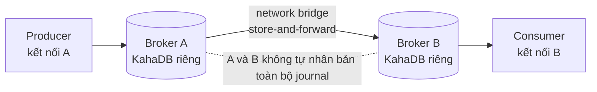
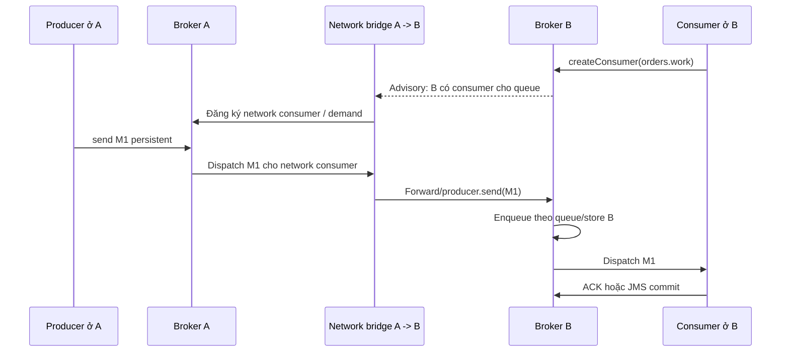
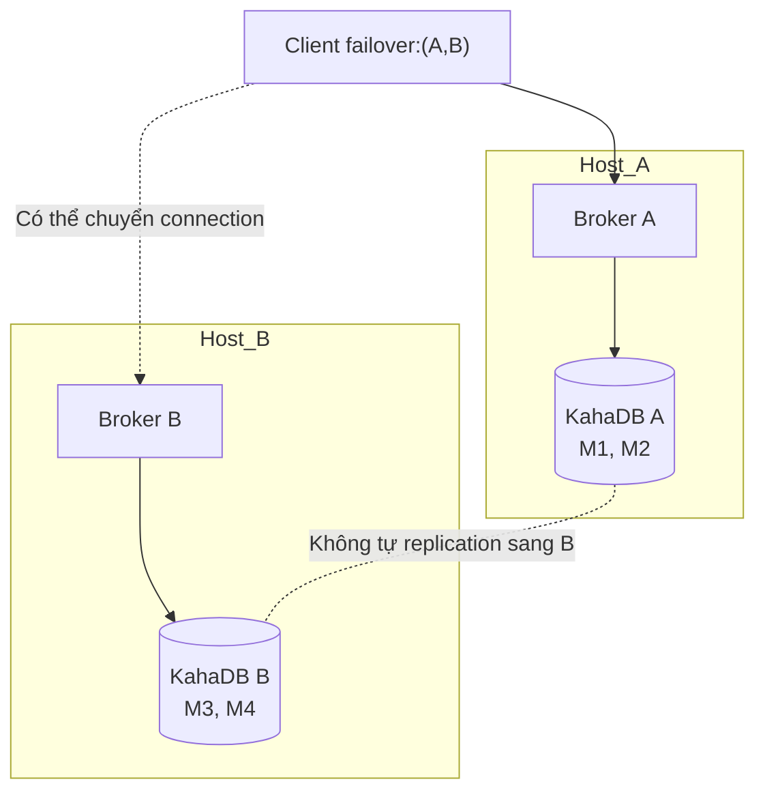

# Giới hạn thứ tự và độ sẵn sàng dữ liệu trong network of brokers

> **Chương:** Kết nối nhiều broker  
> **Phạm vi:** **Apache ActiveMQ Classic — Network of Brokers** (store-and-forward giữa các broker độc lập, thường dùng OpenWire). Không đồng nhất với **Artemis HA replication/shared-store** hay Artemis cluster connection.  
> **Mục tiêu:** Giải thích vì sao việc mạng broker chuyển message theo nhu cầu **không bảo đảm FIFO toàn cục**, vì sao **client đã failover** vẫn có thể không đọc được message lưu trên broker hỏng, và cách thiết kế/kiểm thử giới hạn về thứ tự, tồn lưu, di chuyển consumer, partition, duplicate và khả năng phục hồi.

## 1. “Hai broker kết nối với nhau” không đồng nghĩa một queue có hai bản sao

Xét hai broker ActiveMQ Classic:

- **Broker A:** producer gửi 100 message vào queue `orders.work`.
- **Broker B:** consumer của cùng queue `orders.work` đang hoạt động.
- Một `networkConnector` từ A sang B biết về consumer trên B và chuyển message theo nhu cầu.



**Network of Brokers là cơ chế chuyển message giữa các broker có lưu trữ riêng, không phải replication HA.** Theo tài liệu Classic, queue message được một broker sở hữu ở từng thời điểm logic của store-and-forward, rồi chuyển tới broker nơi có consumer. Broker B không mặc nhiên có bản sao dự phòng của mọi message đang nằm trên A.

Hai câu hỏi phải tách riêng:

1. **Thứ tự:** `M1`, `M2`, `M3` có được ứng dụng hoàn tất theo thứ tự gửi khi chúng có thể đi qua các network bridges, consumer và queue khác nhau không?
2. **Khả dụng:** nếu `M1` vẫn ở disk A mà A chết, consumer đã chuyển kết nối sang B có đọc được `M1` ngay không?

Trong topology này, câu trả lời mặc định cho **cả hai** đều là **không bảo đảm**.

**Không nhầm ba mục tiêu:**

| Mục tiêu | Network of Brokers mang lại | Giới hạn |
| --- | --- | --- |
| Phân phối queue giữa nhiều broker | Chuyển message theo **demand** của consumer ở xa | Không phải một queue vật lý đồng bộ trên mọi broker |
| Client đổi nơi kết nối | Kết hợp `failover:` để client tìm broker khác | Broker mới không tự có những message còn ở store broker hỏng |
| Giữ message đã ghi persistent | Store-and-forward duy trì durability **nếu nguồn đã durable** và broker/store khỏe | Không thay thế backup, replicated storage, HA pair hoặc disaster recovery |
| Giữ thứ tự xử lý toàn cục | Không có hợp đồng này | Network bridge, nhiều consumer, prefetch, replay và chuyển broker có thể đổi thứ tự |

## 2. Cơ chế demand forwarding làm thay đổi nơi message tồn tại

### 2.1. Consumer ở xa tạo một **network subscription**

Trình tự tối giản A → B:



Tài liệu Classic mô tả `networkConnector` dùng **advisory messages** để học nhu cầu consumer ở broker khác. Đây là lý do `advisorySupport=false` có thể phá mô hình network **động**; nếu tắt advisory phải thiết kế cấu hình mạng tĩnh phù hợp, không kỳ vọng broker tự nhận biết consumer mới.

**Hệ quả:** message có thể được **dispatch cho network consumer** của A dù consumer B chưa thực sự hoàn tất nghiệp vụ. Một phần backlog có thể đã được forward và nằm trên B, một phần vẫn ở A hoặc đang in-flight.

### 2.2. Vì sao một message có thể “kẹt ở broker không có consumer”?

Ví dụ:

```text
t0: Consumer C nối B -> A phát hiện nhu cầu, forward M1...M50 tới B.
t1: Consumer C tắt hoặc chuyển sang A.
t2: M1...M50 còn pending/inflight trên B.
t3: Tại A có consumer mới, nhưng A không sở hữu các message đã sang B.
t4: Nếu network không re-route backlog đó trở lại, chúng nằm ở B.
```

Chuyển nơi consumer đăng ký **không chuyển ngược dữ liệu tự động**. Ngay cả với bridge hai chiều, việc replay trở lại cũng bị ràng buộc bởi demand, routing filters, TTL theo số hop và cơ chế tránh vòng lặp.

Do đó cần **quan sát queue ở từng broker**, không chỉ tổng consumer count hoặc service log. Broker B có thể giữ 50 message trong khi consumer mới trên A không nhận được gì.

### 2.3. Queue và topic khác nhau

- **Queue:** một message được phân phối đến một trong các consumer của logical workload; network forwarding làm thay đổi broker đang sở hữu message.
- **Topic:** broker phát bản sao cho các subscriptions có nhu cầu. Với nhiều subscription, network phải xử lý **conduit subscriptions** và tránh tạo bản sao không mong muốn.
- **Durable topic subscriptions:** metadata/backlog gắn với subscription trên broker cụ thể; subscriber di chuyển sang broker khác có thể để lại message ở broker cũ. Đây là một ví dụ điển hình về **stuck messages**.

Tài liệu Classic mô tả rõ case durable subscriber ở B ngắt kết nối rồi đăng ký lại trên A: backlog đã forward đến B **không tự xuất hiện ở A**. Virtual Topics/queue-based subscribers là một chiến lược cần cân nhắc, nhưng **không xóa hoàn toàn bài toán di chuyển queue backlog**.

## 3. Những phạm vi thứ tự khác nhau — đừng gọi chung là “FIFO”

Từ “đúng thứ tự” phải gắn với **một tập message, một ranh giới và một điểm quan sát**.

| Phạm vi | Giả định tối thiểu | Có thể kỳ vọng gì? |
| --- | --- | --- |
| Một producer, một queue, một consumer, **một broker** | Không dùng selector gây thay luồng, không failover/redelivery phức tạp | Thứ tự dispatch/receive của một producer thường được bảo toàn |
| Nhiều producer, cùng một broker/topic | Gửi đồng thời | Không có tổng thứ tự duy nhất giữa mọi producer chỉ từ timestamp |
| Một queue có **nhiều consumer** | Prefetch và thời gian xử lý khác nhau | Thứ tự **hoàn tất nghiệp vụ** có thể khác thứ tự receive |
| Một queue qua **network bridge** | Network bridge cũng là một consumer và producer forwarding | **Không bảo đảm total ordering trên toàn mạng** |
| Consumer di chuyển giữa broker | Backlog đang ở nhiều store | Message cũ có thể xử lý **sau** message mới |
| Redelivery/failover | ACK/commit không hoàn tất trước sự cố | Message cũ có thể quay lại, xuất hiện trùng hoặc muộn |
| Dùng `JMSXGroupID` | Group owner thuộc broker/consumer đang dispatch | Hữu ích để giữ thứ tự nhóm **trong miền dispatch được kiểm soát**, không giải quyết total order nhiều broker |

Tài liệu chính thức **Networks of Brokers** nêu rõ:

- Network bridge tạo **một consumer bổ sung**.
- Bridge nhận message từ **đầu queue nguồn** rồi gọi `producer.send(...)`, đưa message vào **cuối queue đích**.
- Vì vậy **total message ordering không được bảo toàn** trên mạng broker.

Điểm này không mâu thuẫn với việc một lần chạy lab yên ổn có thể nhận đủ `M1, M2, M3` đúng thứ tự. **Một lần quan sát đúng thứ tự không tạo ra bảo đảm tổng quát**.

### 3.1. Ví dụ re-enqueue làm đảo thứ tự

Giả sử broker B đã có message `B-old`; A có `A-1`, `A-2` cần forward tới B:

```text
A: [A-1, A-2]
B: [B-old]

Bridge A -> B chuyển A-1, A-2:
B: [B-old, A-1, A-2]

Mọi thứ đúng thứ tự **trên mỗi đường**, nhưng không có
thứ tự toàn cục "A-1 chắc chắn được xử lý trước B-old".
```

Một kịch bản còn nhạy hơn với **cùng một producer**:

```text
t0: Producer gửi M1, M2 vào A; consumer đang ở B;
    M1, M2 có thể đã chuyển tới B.
t1: Consumer B tắt; producer tiếp tục gửi M3 vào A.
t2: Consumer chuyển sang A, nhận M3 tại A.
t3: B hoạt động lại hoặc backlog từ B được re-route, xử lý M1/M2.
Kết quả nghiệp vụ có thể thấy M3 trước M1/M2.
```

Đây là **một diễn tiến có thể xảy ra**, không phải lịch cố định của mọi broker hay mọi prefetch.

### 3.2. Thứ tự **receive**, **commit** và **side effect** là ba phép đo khác nhau

```text
Broker dispatch: M1 -> consumer C1
                 M2 -> consumer C2

Consumer C1:    gọi DB 900ms -> commit M1
Consumer C2:    gọi DB  20ms -> commit M2
```

Dù broker dispatch theo thứ tự, **M2 có thể hoàn tất trước M1**. Muốn bảo đảm thứ tự cập nhật một account/order, cần kiểm soát **concurrency và khóa dữ liệu nghiệp vụ** ở đầu nhận, không chỉ tùy chỉnh `networkTTL`.

### 3.3. Nếu yêu cầu đúng thứ tự, phải chỉ rõ **theo key nào**

Thông thường ta không cần toàn bộ message hệ thống có một thứ tự duy nhất. Cần:

- Sự kiện cùng `orderId`: `Created → Paid → Shipped`.
- Sự kiện cùng `accountId`: thay đổi số dư theo version.
- Sự kiện cùng `aggregateId`: version liên tiếp, không áp dụng phiên bản cũ đè phiên bản mới.

Đưa vào payload/property:

```java
message.setStringProperty("eventId", "order-42:3");
message.setStringProperty("aggregateId", "order-42");
message.setLongProperty("aggregateVersion", 3L);
message.setStringProperty("JMSXGroupID", "order-42");
```

`JMSXGroupID` là tính năng Message Groups của ActiveMQ Classic: broker cố gắng dispatch cùng nhóm tới một consumer đang sở hữu nhóm. Nó **không** tạo một lock toàn mạng giữa nhiều broker có store riêng và không khôi phục dữ liệu đang kẹt nơi khác. Dùng thêm `aggregateVersion`, idempotency và quy tắc xử lý **gap/duplicate/out-of-order**.

## 4. “Sẵn sàng dữ liệu” là bài toán **message đang ở đâu**?

### 4.1. Hai store khác nhau, hai miền lỗi khác nhau



Giả sử `M1`, `M2` chưa forward khỏi A. A gặp lỗi ổ đĩa/process:

- Client có thể kết nối B qua `failover:`.
- **B không tự có M1/M2**; không thể giao những message chỉ còn trong store A.
- Nếu A chỉ crash process và disk còn tốt, restart A có thể làm backlog khả dụng trở lại.
- Nếu disk A mất vĩnh viễn và không có replica/backup/replay nguồn, **network of brokers không cứu M1/M2**.

Classic phân biệt rõ **store-and-forward network** với **master/slave replicated/shared message store**. Với SLA “mất một broker nhưng vẫn truy cập được ngay mọi message đã commit”, chỉ network connector **không đủ**.

### 4.2. Ma trận trạng thái

| Sự cố | Message chưa forward đang ở A | Message đã forward đang ở B | Client có thể kết nối B? |
| --- | --- | --- | --- |
| A và B khỏe, bridge khỏe | Có thể chuyển theo demand; hoặc còn ở A | Có thể consume ở B | Có |
| **A down**, B khỏe | **Không truy cập** cho tới khi A/store A phục hồi | Vẫn có thể xử lý tại B | Có, nếu URL/network đúng |
| **B down**, A khỏe | Message còn ở A vẫn có thể xử lý tại A nếu có consumer | Message đã lưu ở B **không truy cập** khi B down | Không cho B; có thể về A |
| **Link A–B down**, cả hai khỏe | Backlog ở A có thể tăng, B consumer không nhận từ A | Backlog ở B vẫn được B xử lý | Client có thể đến từng broker theo đường riêng |
| A/B khỏe nhưng **bridge sai TTL/filter** | Message có thể bị giữ tại A dù B có consumer | Không có forward mong muốn | Có; lỗi là routing, không phải client TCP |
| A mất disk vĩnh viễn | Có nguy cơ mất message chỉ có tại A | B vẫn có phần dữ liệu đã đến B | Có |
| Cả hai broker cùng down | Không có broker active | Không có broker active | Không |

**Cột “client có thể kết nối B” không đồng nghĩa “toàn bộ backlog sẵn sàng ở B”.** Đó là lý do phải giám sát **data availability theo owner broker** cùng với connection availability.

### 4.3. Chỉ số RPO/RTO phải tách

- **RPO** ở mức dữ liệu: bao nhiêu message đã được ứng dụng xác nhận gửi nhưng mất khi một broker/store gặp sự cố?
- **RTO** ở mức xử lý: bao lâu để workload nhận đủ message còn hợp lệ và xử lý lại, gồm thời gian broker/store hồi phục, bridge reconnect và backlog drain?
- **Connection failover time:** client đổi TCP connection nhanh đến đâu?
- **Message reachability time:** một message cụ thể `eventId` trở lại khả dụng cho consumer ở broker đang sống khi nào?

Một cấu hình có `failover:` nhanh **không tự cho RTO của backlog bằng vài giây**. Các message trên broker down có thể phải chờ broker đó khôi phục, hoặc vận hành một cơ chế HA/store replication riêng.

## 5. Vì sao network bridge làm thay đổi độ sẵn sàng ngay cả khi không lỗi?

Một `networkConnector` thường hoạt động theo **consumer demand**:

1. B chưa có consumer cho `lab.net.orders` → A có thể giữ toàn bộ persistent queue backlog.
2. B có consumer → advisory làm xuất hiện network consumer trên A; bridge có thể forward message.
3. Consumer B nhận message/ACK hoặc broker B giữ phần chưa ACK.
4. Consumer B biến mất → nhu cầu chuyển đổi; một số message đã ở B **không tự quay về A**.
5. Một consumer mới trên A có thể nhìn thấy message còn trên A nhưng không thấy phần đã chuyển sang B.

Điều đó có nghĩa **số lượng message ở broker A thay đổi theo topology consumer**, không chỉ theo nơi producer gửi.

**Lưu ý prefetch:** network consumer và local consumer có prefetch/priority, nên số lượng message đã chuyển có thể vượt số consumer B đang xử lý ngay lúc quan sát. Đừng suy `B.QueueSize=0` nghĩa là A không từng gửi message qua B: một số message có thể đang **in-flight**, đã ACK hoặc metric chưa cập nhật đúng thời điểm.

## 6. Cấu hình lab ActiveMQ Classic: hai broker, một bridge A → B

Thiết lập cơ bản:

```text
ActiveMQ Classic A       ActiveMQ Classic B
tcp://127.0.0.1:61616    tcp://127.0.0.1:61617
KahaDB A (riêng)         KahaDB B (riêng)
        |
        +--- networkConnector A-to-B (duplex=false) ---> B
```

**Phạm vi:** Các fragment dưới đây thuộc cấu hình **ActiveMQ Classic 5.18.x `activemq.xml`** (XBean). Chúng minh họa phần tử `<broker>` và có thể phải đặt trong file Spring `<beans>` sẵn có của từng instance; không phải toàn bộ file để khởi động ActiveMQ từ đầu. Hai instance phải dùng **directory riêng** cho KahaDB và log, không share store theo cách không được hỗ trợ.

### 6.1. Broker A: producer vào A, bridge đến B

```xml
<broker xmlns="http://activemq.apache.org/schema/core"
        brokerName="brokerA"
        persistent="true"
        useJmx="true"
        advisorySupport="true">

    <persistenceAdapter>
        <kahaDB directory="data/brokerA-kahadb"/>
    </persistenceAdapter>

    <transportConnectors>
        <transportConnector name="openwire-A"
                            uri="tcp://127.0.0.1:61616"/>
    </transportConnectors>

    <networkConnectors>
        <networkConnector name="A-to-B"
                          uri="static:(tcp://127.0.0.1:61617)"
                          duplex="false"
                          networkTTL="1"
                          conduitSubscriptions="true"
                          decreaseNetworkConsumerPriority="true">
            <dynamicallyIncludedDestinations>
                <queue physicalName="lab.net.orders"/>
            </dynamicallyIncludedDestinations>
        </networkConnector>
    </networkConnectors>
</broker>
```

### 6.2. Broker B: chỉ có OpenWire acceptor, không tạo B → A bridge

```xml
<broker xmlns="http://activemq.apache.org/schema/core"
        brokerName="brokerB"
        persistent="true"
        useJmx="true"
        advisorySupport="true">

    <persistenceAdapter>
        <kahaDB directory="data/brokerB-kahadb"/>
    </persistenceAdapter>

    <transportConnectors>
        <transportConnector name="openwire-B"
                            uri="tcp://127.0.0.1:61617"/>
    </transportConnectors>

    <!-- Lab một chiều: không khai báo networkConnector B-to-A. -->
</broker>
```

**Vì sao chủ động chọn một chiều?** Để xác định dễ dàng **nơi bắt đầu** (A), **nơi có nhu cầu tiêu thụ** (B) và những message không thể tự quay ngược khi consumer di chuyển sang A. Hai chiều/`duplex` đưa thêm đường chuyển message, advisory và khả năng loop/stuck vào lab; nên mở rộng từng bước sau khi hiểu baseline.

### 6.3. Một số lựa chọn có vẻ hợp lý nhưng sai mục tiêu

- `networkTTL="1"`: một hop là đủ cho A → B; không chọn 3 chỉ vì bạn muốn “HA 3 broker”.
- `duplex="false"`: bridge chỉ thiết lập hướng A → B; **không** là replicated queue.
- `dynamicallyIncludedDestinations`: giới hạn **đích được cân nhắc forward**, vẫn chịu consumer demand; không nghĩa là cứ A nhận message là gửi sang B vô điều kiện.
- `conduitSubscriptions="true"`: gộp nhu cầu từ nhiều consumer/subscription remote; đặc biệt cần hiểu với topics.
- `decreaseNetworkConsumerPriority="true"`: ưu tiên consumer gần/local trong các tình huống tương ứng, giảm unnecessary network hops; **không** tạo FIFO toàn cục.
- `advisorySupport="true"`: cho phép chuyển subscription demand động; tắt nó có thể làm bridge không học được consumer mới.

**Cảnh báo về default theo phiên bản:** từ ActiveMQ Classic 5.18.0, `decreaseNetworkConsumerPriority` mặc định là `true`; các bản trước có thể mặc định `false`. Trong lab đặt tường minh để kết quả không âm thầm thay đổi theo upgrade.

### 6.4. Không nhầm bridge URI với client failover URI

```text
Broker A:
networkConnector uri="static:(tcp://127.0.0.1:61617)"

Java client:
failover:(tcp://127.0.0.1:61616,tcp://127.0.0.1:61617)
```

`static:` ở broker tạo **network bridge**; `failover:` ở client tạo khả năng **đổi connection** khi endpoint không truy cập được. Chúng phục vụ hai việc khác nhau. Thêm danh sách A/B vào `failover:` **không** tạo đường chuyển queue message A → B.

## 7. Các network connector option ảnh hưởng nơi message đi, không bảo đảm global FIFO

| Tùy chọn Classic | Tác động chính | Điều **không** nên suy |
| --- | --- | --- |
| `networkTTL` | Số broker hops cho message và consumer subscriptions (mặc định 1) | TTL lớn hơn sẽ luôn “đúng HA hơn” |
| `messageTTL` / `consumerTTL` | Giới hạn hop riêng từ một số bản Classic | Đây là JMS expiration/time-to-live |
| `decreaseNetworkConsumerPriority` | Ưu tiên local/nearby queue consumers | Bảo đảm message của một order luôn cùng owner trên cả mạng |
| `conduitSubscriptions` | Gộp nhiều subscriptions remote thành một nhu cầu mạng | Mọi consumer được chia message đồng đều |
| `prefetchSize` | Số message network consumer có thể giữ trước | Không có message đang nằm ở broker khác |
| `dynamicOnly` | Giới hạn kích hoạt network durable subscription theo hoạt động consumer | Có thể tăng để giữ offline topic durable backlog |
| `staticallyIncludedDestinations` | Tạo network demand/bridge cho destination chỉ định dù chưa có consumer đăng ký | Tự tạo replica HA đầy đủ của mọi queue |
| `duplex` | Dùng một connection mạng cho forwarding hai chiều | Hết mọi trường hợp loop/duplicate/stuck |
| `suppressDuplicateQueueSubscriptions` | Giảm demand/route trùng trong mesh theo điều kiện | Tự bảo đảm mọi message có exactly-once delivery |
| `bridgeTempDestinations` | Chia sẻ advisory tạm thời cho request/reply | Temporary destination trở thành durable sau crash |

### 7.1. `conduitSubscriptions` và vấn đề lựa chọn đường queue

Tài liệu Classic có ví dụ:

- A có 1 consumer queue Q.
- B có 2 consumers queue Q.
- Network A nhìn **hai consumer trên B thành một remote demand** khi `conduitSubscriptions=true`.
- Nếu các consumer cùng priority và dispatch cân bằng, các message có thể được phân bổ gần **1/2 tại A, 1/2 tại B**, thay vì **1/3 cho mỗi consumer**.

Khi chuyển sang `conduitSubscriptions=false` trong topology **chỉ queue**, broker A có thể nhìn thấy nhu cầu từ từng remote consumer, thay đổi phân bổ. Nhưng với **topics**, tắt conduit có thể dẫn đến **các bản sao lặp** trên mạng. Vì vậy không đổi tham số này chỉ để “tăng throughput” mà chưa test đúng loại destination.

### 7.2. Selector có thể tạo “message bị kẹt” nếu gộp remote demand

Ở chế độ conduit, việc relay remote subscriptions có thể bỏ qua selector ở broker nguồn rồi để broker đích lọc. Nếu B và C có consumers với selectors khác nhau, nguồn A có thể forward message tới broker **không có consumer match**, làm các message có selector còn lại bị giữ ở nơi không mong muốn.

**Không** cho rằng “selector sẽ tự được áp dụng trước khi A quyết định route” trong mọi network topology. Nếu cần routing theo tenant/region, cân nhắc **queue/destination phân vùng rõ** hoặc cấu hình conduit/selectors phù hợp đã được kiểm thử; tăng `networkTTL` không sửa được selector mismatch.

### 7.3. Nhiều hops và vòng lặp

```text
A --> B --> C
A --> C
C --> A   (mesh/ring)
```

Với `networkTTL=1`, subscription/message thông thường chỉ vượt một hop; một consumer ở C có thể không tạo demand mà A thấy qua B. Tăng TTL giúp đi nhiều hop nhưng có rủi ro **nhiều đường forward, loop và message kẹt**. Mesh cần thiết kế `consumerTTL`/`messageTTL`, suppression của demand trùng, bridge filters và test di chuyển consumer.

Một mô hình **hub-and-spoke** đơn giản dễ kiểm soát hơn mesh đầy đủ nếu thứ tự/khả dụng quan trọng. Dù vậy, hub có thể thành điểm lỗi vận hành và phải có HA riêng nếu SLA yêu cầu.

## 8. Lab Java/JMS: chứng minh delivery, vị trí lưu và thứ tự quan sát

Bài lab dùng **ActiveMQ Classic 5.18.x** (API `javax.jms`) với hai broker cấu hình như phần 6. Code có bốn mode, chỉ thao tác trên queue `lab.net.orders`:

- `send`: producer nối một broker, gửi `N` persistent messages với `runId` và `sequence`, **commit** transaction.
- `drain`: consumer nối một broker, nhận `N` messages, kiểm tra dữ liệu và ACK bằng JMS commit. **Chỉ ghi nhận thứ tự quan sát; không tự giả định FIFO**.
- `hold`: mở consumer ở B trong một khoảng thời gian nhưng **không ACK**; tạo remote demand để quan sát message chuyển vào/in-flight tại B.
- `browse`: xem các message hiện thấy tại một broker, **không ACK**. Chỉ dùng để đối chiếu khi không có traffic đồng thời.

### 8.1. Dependency Maven

Ví dụ Java 17, dùng đúng một nhánh client Classic 5.x:

```xml
<properties>
    <maven.compiler.release>17</maven.compiler.release>
</properties>

<dependencies>
    <dependency>
        <groupId>org.apache.activemq</groupId>
        <artifactId>activemq-client</artifactId>
        <version>5.18.3</version>
    </dependency>
</dependencies>
```

`ActiveMQConnectionFactory` ở đây là `org.apache.activemq.ActiveMQConnectionFactory` của **Classic**, không phải `org.apache.activemq.artemis.jms.client.ActiveMQConnectionFactory`. Với nhánh Classic 5.x dùng `javax.jms`; khi chuyển sang Classic 6.x/Jakarta, chọn API/dependency đúng phiên bản, không trộn hai namespace.

### 8.2. Mã Java hoàn chỉnh

```java
import org.apache.activemq.ActiveMQConnectionFactory;

import javax.jms.Connection;
import javax.jms.DeliveryMode;
import javax.jms.Message;
import javax.jms.MessageConsumer;
import javax.jms.MessageProducer;
import javax.jms.Queue;
import javax.jms.QueueBrowser;
import javax.jms.Session;
import javax.jms.TextMessage;

import java.util.Enumeration;
import java.util.HashSet;
import java.util.Set;

public final class BrokerNetworkProbe {
    private static final String DESTINATION = "lab.net.orders";

    private static void check(boolean ok, String reason) {
        if (!ok) throw new IllegalStateException(reason);
    }

    private static Connection connect(String brokerUrl)
            throws Exception {
        ActiveMQConnectionFactory factory =
                new ActiveMQConnectionFactory(brokerUrl);
        String user = System.getenv("ACTIVEMQ_USER");
        String pass = System.getenv("ACTIVEMQ_PASSWORD");

        if (user != null) {
            check(pass != null, "Missing ACTIVEMQ_PASSWORD");
            return factory.createConnection(user, pass);
        }
        return factory.createConnection();
    }

    private static void send(Connection connection,
                             String runId, int count)
            throws Exception {
        Session session = connection.createSession(
                true, Session.SESSION_TRANSACTED);
        MessageProducer producer = null;
        try {
            Queue queue = session.createQueue(DESTINATION);
            producer = session.createProducer(queue);
            producer.setDeliveryMode(DeliveryMode.PERSISTENT);

            for (int seq = 0; seq < count; seq++) {
                TextMessage message =
                        session.createTextMessage("payload-" + seq);
                message.setStringProperty("runId", runId);
                message.setIntProperty("sequence", seq);
                message.setStringProperty(
                        "eventId", runId + ":" + seq);

                producer.send(message);
            }
            session.commit();
            System.out.println(
                    "SEND COMMITTED " + count + " messages");
        } catch (Exception failure) {
            try { session.rollback(); }
            catch (Exception suppressed) {
                failure.addSuppressed(suppressed);
            }
            throw failure;
        } finally {
            if (producer != null) producer.close();
            session.close();
        }
    }

    private static void drain(Connection connection,
                              String runId, int expected)
            throws Exception {
        Session session = connection.createSession(
                true, Session.SESSION_TRANSACTED);
        MessageConsumer consumer = null;
        try {
            Queue queue = session.createQueue(DESTINATION);
            consumer = session.createConsumer(
                    queue, "runId = '" + runId + "'");
            connection.start();

            Set<Integer> seen = new HashSet<>();
            int lastSeq = -1;
            int backwards = 0;

            for (int n = 0; n < expected; n++) {
                Message message = consumer.receive(10_000);
                check(message instanceof TextMessage,
                        "Timed out or unexpected JMS type");

                String eventId =
                        message.getStringProperty("eventId");
                int seq = message.getIntProperty("sequence");
                String body = ((TextMessage) message).getText();

                check(seq >= 0 && seq < expected,
                        "sequence out of range: " + seq);
                check((runId + ":" + seq).equals(eventId),
                        "eventId mismatch");
                check(("payload-" + seq).equals(body),
                        "body mismatch");
                check(seen.add(seq),
                        "duplicate sequence in this lab run: " + seq);

                if (seq < lastSeq) backwards++;
                lastSeq = seq;

                System.out.println("RECEIVED " + eventId +
                        " JMSRedelivered=" + message.getJMSRedelivered());
                session.commit(); // ACK đúng batch vừa nhận.
            }

            check(seen.size() == expected, "Missing messages");
            System.out.println("DRAIN PASS " + seen.size()
                    + " / observed backwards steps=" + backwards);

        } catch (Exception failure) {
            try { session.rollback(); }
            catch (Exception suppressed) {
                failure.addSuppressed(suppressed);
            }
            throw failure;
        } finally {
            if (consumer != null) consumer.close();
            session.close();
        }
    }

    private static void hold(Connection connection,
                             String runId, int seconds)
            throws Exception {
        Session session = connection.createSession(
                false, Session.CLIENT_ACKNOWLEDGE);
        MessageConsumer consumer = null;
        try {
            Queue queue = session.createQueue(DESTINATION);
            consumer = session.createConsumer(
                    queue, "runId = '" + runId + "'");
            connection.start();

            // Consumer tồn tại để broker B quảng bá nhu cầu,
            // nhưng không gọi receive()/acknowledge().
            // Chỉ dùng trong lab: message có thể đang prefetched.
            System.out.println("HOLD consumer for " + seconds + "s");
            Thread.sleep(seconds * 1000L);
        } finally {
            if (consumer != null) consumer.close();
            session.close();
        }
    }

    private static void browse(Connection connection, String runId)
            throws Exception {
        Session session = connection.createSession(
                false, Session.AUTO_ACKNOWLEDGE);
        QueueBrowser browser = null;
        try {
            Queue queue = session.createQueue(DESTINATION);
            browser = session.createBrowser(
                    queue, "runId = '" + runId + "'");
            connection.start();

            int count = 0;
            Enumeration<?> items = browser.getEnumeration();
            while (items.hasMoreElements()) {
                Message m = (Message) items.nextElement();
                count++;
                System.out.println("BROKER HAS " +
                        m.getStringProperty("eventId"));
            }
            System.out.println("BROWSE " + count);
        } finally {
            if (browser != null) browser.close();
            session.close();
        }
    }

    public static void main(String[] args) throws Exception {
        check(args.length == 4,
                "Usage: <send|drain|hold|browse> "
                + "<brokerUrl> <runId> <countOrSeconds>");

        String mode = args[0];
        String brokerUrl = args[1];
        String runId = args[2];
        check(runId.matches("[A-Za-z0-9_-]{1,32}"),
                "Only safe ASCII runId is supported");

        int n = Integer.parseInt(args[3]);
        check(n >= 0 && n <= 1000, "countOrSeconds out of range");

        Connection connection = connect(brokerUrl);
        try {
            switch (mode) {
                case "send":
                    check(n > 0, "count must be positive");
                    send(connection, runId, n);
                    break;
                case "drain":
                    check(n > 0, "count must be positive");
                    drain(connection, runId, n);
                    break;
                case "hold":
                    check(n > 0 && n <= 300, "invalid hold seconds");
                    hold(connection, runId, n);
                    break;
                case "browse":
                    browse(connection, runId);
                    break;
                default:
                    throw new IllegalArgumentException(
                            "Unknown mode: " + mode);
            }
        } finally {
            connection.close();
        }
    }
}
```

**Một số chi tiết cố ý trong lab:**

- Java JMS 1.1/Classic 5.x: đóng `Connection`, `Session`, `Producer` và `Consumer` rõ ràng, không dựa vào `try-with-resources` của Jakarta JMS mới.
- Queue dùng selector `runId` để tách traffic giữa những lần thử. Không dùng queue production.
- `send` dùng **PERSISTENT + transaction commit**; nếu commit gặp lỗi connection ở thời điểm không chắc chắn, cần kiểm tra event ID trước khi retry.
- `drain` ghi `backwards steps` trong chuỗi nhận. `0` **không chứng minh FIFO toàn mạng**, chỉ có nghĩa lần thử chưa quan sát đảo thứ tự.
- `hold` mở consumer và kích hoạt demand nhưng không gọi `receive()`; một số message có thể được broker/connection **prefetch** mà chưa ACK. Vì vậy `QueueSize` và `InFlightCount` phải xem cùng nhau.
- `browse` là quan sát tạm thời; lúc bridge/consumer còn chạy, enumeration không phải snapshot nhất quán. Muốn đối chiếu chuẩn, dừng producer/bridge movement rồi đo tại cả hai broker bằng management.

### 8.3. Các lệnh chạy theo thứ tự

Ở đây lệnh được thể hiện như **đối số truyền cho Java main** sau khi đã biên dịch bằng IDE/Maven:

```text
BrokerNetworkProbe send   tcp://127.0.0.1:61616 runA 20
BrokerNetworkProbe browse tcp://127.0.0.1:61616 runA 0
BrokerNetworkProbe drain  tcp://127.0.0.1:61617 runA 20
BrokerNetworkProbe browse tcp://127.0.0.1:61616 runA 0
BrokerNetworkProbe browse tcp://127.0.0.1:61617 runA 0
```

**Điều kiện:** B broker đang hoạt động, dynamic network bridge A → B đã kết nối, queue A có dữ liệu và không có consumer ngoài lab.

Khi `drain` tạo consumer tại B, advisory tạo demand trên A. Các message sẽ forward theo cơ chế mạng rồi được consumer B nhận. Kỳ vọng **nhận đủ 20 message** trong test khỏe mạnh, không khẳng định thứ tự tất yếu đúng 0..19 dưới mọi race/retry.

Không lấy số `BROWSE` của A+B ngay khi `drain` đang chạy làm một định luật tổng số cố định: trong quá trình forward có in-flight, ACK, prefetch và trạng thái nhất quán tại từng broker khác nhau.

### 8.4. Thử “data ở đâu” bằng consumer không ACK

Trong **một lượt test mới** `runB`:

1. Start B và chạy `hold tcp://127.0.0.1:61617 runB 60`.
2. Khi B đã đăng ký consumer, chạy `send tcp://127.0.0.1:61616 runB 20`.
3. Xem JMX/Console của **cả A và B**: queue size, in-flight count, enqueue/dequeue counters, network consumer.
4. Sau khi `hold` hết hạn, consumer B đóng mà **không ACK**. Quan sát message còn thuộc broker B (khi bridge đã thực sự forward).
5. Tắt B theo quy trình trong lab, giữ lại KahaDB B.
6. Tạo consumer tại A, quan sát có thể **chỉ nhận phần còn ở A**; dữ liệu đã lưu tại B không tự xuất hiện ở A vì bridge này chỉ A → B.
7. Start B lại với **cùng KahaDB B**, mở consumer B và xác minh backlog ở B được xử lý.

**Không đòi chính xác “20 message đều sang B”** nếu chưa nhìn thấy bằng JMX: hành vi dispatch/prefetch và timing ảnh hưởng kết quả. Test đạt khi chứng minh được **một tập eventId đã forward tới B** không được client trên A truy cập chỉ vì B down; chúng phục hồi khi B/store B trở lại.

## 9. Bài test có chủ đích cho giới hạn thứ tự

### 9.1. Test cơ sở không có sự cố

1. A/B khỏe, chỉ một consumer B, một producer A.
2. Gửi tuần tự `seq=0..19` trong một transaction.
3. `drain` ở B, ghi thứ tự nhận.
4. Nếu nhận `0..19` theo thứ tự, đó là **đối chứng happy-path**, không phải bảo đảm mọi topology.

### 9.2. Test nhiều consumer và consumer migration

1. Thêm một local consumer A song song consumer B.
2. Producer A gửi nhiều message với cùng `runId`.
3. Quan sát một phần message được dispatch tại A và một phần qua bridge B (tỷ lệ không được đảm bảo).
4. Dừng consumer B, tạo consumer mới ở A; giữ lại message chưa ACK trên B.
5. So sánh chuỗi `seq` **được commit tại ứng dụng** và các message pending ở từng store.
6. Ghi lại những ID đến muộn, bị giao lại hoặc chưa đến vì vị trí lưu.

**Không thiết kế test sao cho chỉ cần thấy một lần đảo thứ tự mới được PASS.** Scheduler và network có thể tình cờ cho thứ tự. PASS nghĩa là đã đo được những ranh giới và không có assumption sai; muốn tạo hiện tượng đảo thứ tự cần fault injection/quy trình có kiểm soát.

### 9.3. Test đường B đã có backlog trước khi forward A

1. Gửi vài message tại B trước khi A bắt đầu forward (dùng `send` với B URL và `runId` riêng).
2. Gửi thêm message từ A với run ID khác.
3. Start consumer B nhận cả hai luồng; ghi `originBroker` và `sequence`.
4. Quan sát bridge append message forwarded vào queue B, xen với message đã có.
5. Không đưa ra total order giữa hai producer/broker.

Nếu contract yêu cầu so sánh thứ tự **của một aggregate**, hãy dùng **cùng business key/aggregateVersion** cho các event liên quan và đánh giá thứ tự **ở nơi commit DB**, không chỉ thứ tự console hiển thị.

## 10. Khi link partition hoặc broker chết: cái gì phải đo?

### 10.1. Link A–B down nhưng cả hai broker sống

```text
Producer A ---> Broker A [persist M1, M2]
                       -X- network bridge đến B
Broker B <--- consumer B đang chờ
```

- Client có thể vẫn kết nối thành công cả A và B.
- `send` trên A có thể thành công, vì **A** là nơi lưu message.
- Consumer B không nhận M1/M2 khi không có đường bridge.
- Khi link khôi phục, advisory/demand/forwarding mới có cơ hội chuyển backlog; độ trễ tổng phụ thuộc bridge reconnect, store và backlog drain.
- Không đo RPO bằng “producer.send trên A thành công” rồi coi B đã có message.

### 10.2. A down sau khi `send` thành công, trước khi forward

- M1/M2 có thể còn ở **KahaDB A**.
- B còn sống và client failover tới B nhưng **B không có M1/M2**.
- Khi A khởi động lại với store đúng, backlog tại A có thể tiếp tục forward nếu B consumer còn demand.
- Nếu A mất disk và không có backup/replication/outbox re-drive, message có thể mất.

### 10.3. B down sau khi một phần message đã được forward

- Message còn ở A có thể được consumer tại A xử lý.
- Message đã transfer xong vào store B nhưng chưa ACK phải chờ B/store B khôi phục.
- Message đang in-flight qua bridge ở thời điểm ngắt có thể được retry/redeliver theo store-and-forward semantics; không đoán chính xác trạng thái chỉ qua một lần đọc queue depth.
- Client reconnect đến A không kéo dữ liệu ở disk B về theo cơ chế failover TCP.

### 10.4. Client failover khi transaction còn mở

Với Classic `failover:`, tài liệu mô tả transport có thể track/replay transaction, nhưng giao lại các message chưa ACK trong một thứ tự nhất định **không luôn bảo đảm** khi có nhiều consumer. Một số commit có thể bị rollback/throw exception khi in-flight state không được khôi phục đầy đủ.

Nên:

- Bắt lỗi `JMSException`, `TransactionRolledBackException`; không assume commit failed nghĩa chưa có side effect DB.
- Sử dụng `eventId` và **inbox/idempotency** trên business handler.
- Không retry vô hạn khi destination không còn reachable; có alert và deadline.
- Nếu producer `send/commit` bị timeout, coi kết quả **unknown** và reconcile theo business ID.

## 11. Vì sao `failover:` không phải cơ chế replication

URI minh họa cho **Classic JMS client**:

```text
failover:(tcp://127.0.0.1:61616,tcp://127.0.0.1:61617)?randomize=false&timeout=3000&maxReconnectAttempts=20
```

- `randomize=false`: client thử A trước khi chuyển sang B theo danh sách.
- `timeout=3000`: giới hạn thời gian chờ của **send operation** khi kết nối bị gián đoạn (không phải broker/data recovery deadline).
- `maxReconnectAttempts=20`: giới hạn lần reconnect sau khi kết nối trước đó đã thành công; cần kiểm tra `startupMaxReconnectAttempts` riêng nếu muốn giới hạn lúc khởi động.
- `backup=true` có thể giữ connection dự phòng, giúp giảm thời gian chuyển TCP; **không nhân bản queue backlog**.

**Tình huống nguy hiểm:** ứng dụng coi “JMS client đã connected lại sau 1 giây” là đã recover mọi message. Nhưng các message thuộc store A vẫn chỉ tồn tại ở A. Hãy định nghĩa health ở hai lớp:

1. **Connection health:** còn broker nào nhận JMS connection không?
2. **Workload/data health:** tất cả `eventId` đã commit từ upstream có thể được consumer xử lý trong SLA không?

### 11.1. Khi cần HA dữ liệu thật sự

Nếu yêu cầu của hệ thống là “một broker process hoặc cả host gặp sự cố mà **mọi message đã commit** vẫn sẵn sàng trên node khác”, cần kiến trúc riêng:

- **Broker HA pair** với shared/replicated message store theo Classic version/cơ chế được hỗ trợ.
- **Broker persistence + upstream outbox/event log** có khả năng replay.
- **Phân vùng có owner rõ** và backup/DR cho từng owner.
- Hoặc một hệ thống streaming/log khác khi contract yêu cầu partition ordering và replay dài hạn.

Network connector vẫn có ích để **phân phối workload giữa các owner brokers**, nhưng không thay nhiệm vụ lưu bền vững dự phòng.

## 12. Cách hạn chế reorder và stuck message thực tế

### 12.1. Thiết kế “một owner” cho từng business key

Nếu cần order per `orderId`:

```text
Producer:
  orderId -> hash/partition -> broker/queue owner ổn định

Owner broker:
  queue partition X -> consumer group xử lý tuần tự hoặc
  message group cố định trong phạm vi owner

Consumer:
  update DB chỉ khi aggregateVersion kế tiếp hợp lệ
```

Đừng gửi cùng `orderId` lúc sang A, lúc sang B chỉ để “cân bằng tải” rồi đòi FIFO cuối cùng. Khi chuyển owner, phải có **handoff protocol**: ngăn producer gửi theo đường cũ, drain backlog đã biết, ghi watermark/version, sau đó mở route mới.

Nếu phải cho phép reordering, handler cần:

- Dedup `eventId`.
- Kiểm tra `aggregateVersion`: nếu version nhỏ/đã xử lý → bỏ qua idempotent.
- Nếu thiếu version trước → giữ hoặc retry có deadline, không ACK rồi áp dụng sai thứ tự.
- Cảnh báo khi gap quá lâu; quarantine/repair với runbook rõ ràng.

### 12.2. Dùng `JMSXGroupID` nhưng hiểu phạm vi

Trong Classic, Message Groups cho phép cùng nhóm được phân phối dính vào một consumer trên một queue broker. Nó hữu ích **nếu thông điệp cùng key đã được route tới cùng miền owner/dispatch**.

Ví dụ:

```java
TextMessage event = session.createTextMessage(json);
event.setStringProperty("JMSXGroupID", orderId);
event.setLongProperty("aggregateVersion", version);
producer.send(event);
```

Không mong `JMSXGroupID` hoạt động như một **distributed lock giữa A/B**. Nếu nhóm đã bị chia qua hai brokers và consumer chuyển nơi, local group ownership không đủ chống xử lý version 4 trước version 3. Còn phải tính `maxPageSize` và cơ chế group map khi backlog lớn.

### 12.3. Exclusive consumer chỉ là lựa chọn cục bộ

`Exclusive Consumer` giúp một queue trên **một broker** chỉ có một active consumer tại thời điểm nhất định. Nhưng trong network of brokers, các **network consumers** vẫn là đối tượng dispatch; mỗi broker có queue/backlog riêng. Một exclusive consumer trên A không tự ép các message đã forward sang B quay về A hoặc tạo một thứ tự tổng thể.

### 12.4. Giảm “stuck” do consumer thay đổi nơi kết nối

Các hướng can thiệp **phải thử theo version**:

| Biện pháp | Tác dụng | Rủi ro/giới hạn |
| --- | --- | --- |
| Consumer **stickiness** với broker owner | Ít chuyển subscription/backlog qua broker | Owner down có thể làm chậm truy cập message |
| Local consumer priority cao hơn network consumer | Giảm hop không cần thiết | Chưa giải quyết message đã forward |
| `conduitSubscriptions`/`suppressDuplicateQueueSubscriptions` phù hợp | Bớt remote demand/đường trùng | Có thể ảnh hưởng selectors/topic copy |
| `conditionalNetworkBridgeFilterFactory` với `replayWhenNoConsumers=true` | Cho phép message re-route khi local broker không còn consumer trong trường hợp hỗ trợ | Cần tránh vòng lặp, kiểm chứng TTL, duplicate auditing và version |
| Virtual Topics + durable queue subscriber | Thuận tiện quản lý subscription như queue, giảm một số case durable topic “orphan” | Vẫn có queue backlog thuộc broker cụ thể; không là replication |
| Owner/partition + explicit recovery runbook | Quản lý nơi message phải được xử lý | Có chi phí điều phối/rebalancing |

### 12.5. `replayWhenNoConsumers` cần dùng cẩn thận

Classic hỗ trợ filter dành cho queue, ví dụ fragment trong `destinationPolicy`:

```xml
<destinationPolicy>
    <policyMap>
        <policyEntries>
            <policyEntry queue="lab.net.orders">
                <networkBridgeFilterFactory>
                    <conditionalNetworkBridgeFilterFactory
                        replayWhenNoConsumers="true"/>
                </networkBridgeFilterFactory>
            </policyEntry>
        </policyEntries>
    </policyMap>
</destinationPolicy>
```

**Điều kiện:** Đây không phải một tùy chọn để bật “global FIFO”. Nó tác động đường **replay/forward** khi broker đang giữ message nhưng không còn consumer cục bộ; cần kiểm tra hướng bridge, network TTL, duplicate detection và độ trễ. Với một số Classic **trước 5.9**, tài liệu lưu ý có thể phải `enableAudit=false` để tránh cursor đánh dấu message replay là duplicate. Không áp dụng mẹo đó vào production mới mà chưa xác minh rủi ro duplicate/loop.

Cấu hình tương đương phải áp dụng đúng những broker/destination cần re-route. Nếu cặp A/B **chỉ có A→B**, B không có đường trở về A, filter trên B không tự tạo bridge ngược.

## 13. Độ sẵn sàng **topic** và durable subscription là một bài toán khác

Network of Brokers cho topic không chỉ là “broadcast mọi message cho mọi broker”. Nó phụ thuộc:

- Subscription demand/advisories.
- Durable subscriber đã tạo hay chưa.
- `conduitSubscriptions`, `dynamicOnly` và bridge name/broker name.
- Consumer/subscriber đang ở broker nào khi offline và reconnect.
- Các message persistent thuộc **durable subscription store của broker nào**.

Một case thường gặp:

```text
t0: Durable subscription S hoạt động trên B.
t1: P gửi topic T qua A -> bridge forward đến backlog S ở B.
t2: Subscriber S disconnect.
t3: S reconnect trên A (cùng tên logic nhưng broker khác).
t4: Message ở B không tự chuyển vào backlog mới ở A.
```

**Không coi clientID/subscriptionName giống nhau là một “global durable subscription” trải khắp các broker Classic độc lập.** Nếu cần nhiều người nhận theo logical subscription có backlog ổn định, cân nhắc Virtual Topics/queue-based semantics, hoặc dùng broker HA với data owner ổn định. Chuyển durable subscriber giữa A/B phải có **drain/migration plan** và kiểm chứng từng message ID.

## 14. Giám sát: phân biệt **đã chuyển**, **đã lưu**, **đã ACK** và **đã xử lý nghiệp vụ**

### 14.1. Bốn lớp số liệu tối thiểu

| Lớp | Metric/evidence | Tại sao cần |
| --- | --- | --- |
| Broker A và B | `QueueSize`, `InFlightCount`, `EnqueueCount`, `DequeueCount` | Message đang ở đâu, đang dispatch hay đã ACK? |
| Network bridge | Connected/active, network consumers, subscriptions/demand, forwards | Bridge còn học được remote consumers không? |
| JMS client | Connection URL, reconnects, transaction rollback, receive latency | Đã đổi broker nhưng có đọc đúng backlog không? |
| Nghiệp vụ | `eventId`, `aggregateVersion`, DB inbox, time-to-process | Có mất/trùng/đảo thứ tự cập nhật không? |

JMX Classic có MBeans cho `Broker`, `Destination`, `NetworkConnector` và connections. Khi đo, đọc từ **cả hai brokers**; queue depth ở một broker bằng 0 **không đồng nghĩa** toàn bộ logical workload đã xử lý xong.

### 14.2. Event timeline dùng cho một ca mất kết nối

```text
12:00:00  P gửi eventId=order-42:1 vào A, commit OK.
12:00:01  B có consumer, network demand xuất hiện.
12:00:02  A forward event sang B (theo broker metrics).
12:00:03  B down trước khi consumer ACK.
12:00:04  Client failover sang A, TCP CONNECTED.
12:00:05  A không thấy eventId=order-42:1 trong queue cục bộ.
12:00:30  B restart từ store B, event được redeliver.
12:00:31  Consumer B commit; business state cập nhật.
```

Đây là **timeline minh họa có thể xảy ra**, không phải các thời gian được Artemis/Classic bảo đảm. Muốn nghiệm thu SLA phải đo thời điểm thực của broker, network, DB và consumer.

### 14.3. Đặt alert theo **nguyên nhân vận hành**

- **A backlog tăng, B consumer online:** có thể bridge mất liên lạc, advisory bị tắt, TTL/filter không khớp.
- **B backlog tăng, B consumer offline:** message đã sang B nhưng không được xử lý; cần recovery của consumer/B.
- **B offline nhưng A client connected:** kiểm tra event IDs nằm ở B, không tuyên bố đã hết backlog.
- **Reorder/gap theo aggregateVersion:** kiểm tra migration, multi-consumer, redelivery, producer duplication.
- **Remote subscriber demand bất thường:** kiểm tra conduit, selector, bridge topology, subscription lặp.
- **Disk đầy trên một broker:** store-and-forward không thể tự giải quyết bằng việc connect sang broker khác; cần giảm ingress, xử lý backlog hoặc mở rộng storage đúng cách.

## 15. Ma trận kiểm thử chấp nhận

| Mã | Thao tác | Kỳ vọng cần kiểm tra |
| --- | --- | --- |
| N1 | A/B khỏe, consumer B, producer A | B nhận đủ messages từ A qua bridge |
| N2 | B không có consumer, producer A persistent | A giữ backlog khi không có remote demand thích hợp |
| N3 | B consumer xuất hiện sau khi A đã lưu message | Bridge học demand, queue chuyển/dispatch được |
| N4 | Consumer B biến mất sau khi A đã forward | Message đã ở B không mặc nhiên quay lại A |
| N5 | Link A–B đứt nhưng A/B vẫn khỏe | Send A có thể thành công; consume B bị chậm/thiếu cho tới khi link phục hồi |
| N6 | A chết khi message vẫn ở store A | Client có thể nối B nhưng không đọc được A-only backlog |
| N7 | B chết sau khi forward message sang B | A không tự có replica; restart B phục hồi phần pending |
| N8 | Consumer A và B hoạt động cùng lúc | Message có thể được chia; không đòi FIFO tổng thể |
| N9 | Consumer chuyển broker giữa backlog | Ghi nhận vị trí message/gap/reorder theo eventId |
| N10 | Dùng `JMSXGroupID` cố định nhưng route nhiều broker | Không mặc định group order toàn cục; kiểm tra version tại DB |
| N11 | Thay `networkTTL`/conduit trong mesh lab | So sánh đường route, duplicate demand, stuck messages |
| N12 | Topic durable subscriber B chuyển sang A | Kiểm tra backlog còn ở B, kế hoạch migration |
| N13 | Client `failover:` A→B khi A down | Kiểm tra cả connection health **và** data reachability |
| N14 | Consumer DB commit rồi ACK thất bại | Redelivery/idempotency, không nhân đôi side effect |
| N15 | A/B storage restart độc lập | Mỗi broker phục hồi message của **store chính nó** |
| N16 | Fault-inject bridge reconnect/transaction timeout | Không tự báo đã commit khi kết quả chưa xác định |

### 15.1. Evidence được xem là PASS

- Topology hai broker, unique broker names, network connector direction, mode và version Classic.
- Kết quả đọc **cả hai KahaDB-backed queues** qua JMX và theo business eventId.
- Tổng số unique event IDs producer đã **commit**, IDs đã forward, IDs đã được consumer ACK/commit.
- Vị trí backlog khi dừng B và khi consumer di chuyển A.
- Log lỗi bridge, reconnect, transaction, các counter `InFlightCount` và DLQ.
- Chứng cứ **DB side effect** không trùng khi message redeliver.
- Ghi nhận rõ rằng **không quan sát reorder trong một lần** không phải bằng chứng bảo đảm order.

Đừng test failover trên queue production hoặc xóa KahaDB để “đổi vị trí message”. Test dùng queue namespace riêng và backup/store có thể tái tạo.

## 16. Bảng quyết định kiến trúc

| Yêu cầu | Hướng tiếp cận |
| --- | --- |
| Producer/consumer ở nhiều broker, chấp nhận delay nếu owner broker down | Network of Brokers với store-and-forward, monitoring riêng từng broker |
| Một broker down vẫn phải đọc ngay **mọi** message đã commit | HA shared/replicated store cho broker owner; network connector **không đủ** |
| Cần FIFO theo `aggregateId` và scale worker | Owner/partition cố định cho key + group/consumer phù hợp + version check |
| Cần một thứ tự toàn cục cho **mọi** message toàn mạng | Phải chấp nhận nút thắt tuần tự hoặc hệ log/partition có semantics riêng; network bridge không cam kết |
| Consumer thường xuyên di chuyển broker | Ràng buộc affinity/owner, thiết kế migration/replay/backlog và cân nhắc Virtual Topics |
| WAN partition kéo dài, không được mất business event | Persistent broker + upstream outbox/replay + idempotent consumer + SLA backlog |
| Nhiều topic subscribers, muốn broadcast đúng một bản cho mỗi logical subscriber | Quản lý durable subscription identity, conduit/Virtual Topics và test client moves |
| Muốn tăng số connection/consumer | Network of Brokers hữu ích, nhưng không biến thành HA dữ liệu hoặc exactly-once |

## 17. Câu hỏi tự kiểm tra

1. Vì sao một network bridge được coi là consumer trên broker nguồn và producer trên broker đích?
2. Message ở đầu queue A khi forward sang B sẽ nằm tại đâu trong queue B?
3. Vì sao network of brokers không giữ **total ordering** dù producer A gửi theo thứ tự?
4. Khi A chết và client failover tới B, B có đọc được những message chỉ còn trong KahaDB A không?
5. Điều gì có thể xảy ra với backlog đã forward đến B khi consumer chuyển từ B sang A?
6. `networkTTL` và `JMSExpiration` khác nhau như thế nào?
7. `conduitSubscriptions=true` ảnh hưởng ra sao tới load balancing giữa nhiều remote consumers?
8. Vì sao `decreaseNetworkConsumerPriority=true` không phải cơ chế đảm bảo FIFO?
9. `JMSXGroupID` có thể tạo distributed lock cho tất cả broker trong network không?
10. Tại sao phải đo cả `QueueSize` và `InFlightCount` trên A/B?
11. Khi link A–B đứt, producer A gửi persistent thành công có chứng minh consumer B sẵn sàng đọc message không?
12. Cần kiến trúc nào nếu không thể chấp nhận việc owner broker down khiến data tạm thời unreachable?
13. Vì sao duplicate ID và aggregateVersion ở tầng nghiệp vụ còn cần dù dùng JMS transaction?
14. Vì sao `replayWhenNoConsumers` cần kiểm tra TTL, topology và duplicate audit trước production?

**Hướng trả lời:** (1) bridge nhận rồi gửi lại; (2) cuối queue B; (3) nhiều đường dispatch/reenqueue và consumer; (4) không; (5) vẫn pending trên B; (6) hop count vs thời gian hết hạn JMS; (7) gộp remote demand; (8) chỉ thay priority; (9) không; (10) prefetch/inflight khác pending; (11) không; (12) HA data store/replay/owner recovery; (13) duplicate/redelivery/unknown commit; (14) chống loop, stuck và sai dedup.

## 18. Tài liệu chính thức

- [ActiveMQ Classic — Networks of Brokers](https://activemq.apache.org/components/classic/documentation/networks-of-brokers): network bridge, demand, advisory, `networkTTL`, `conduitSubscriptions`, priority, reliability, ordering và stuck messages.
- [ActiveMQ Classic — Clustering](https://activemq.apache.org/components/classic/documentation/clustering): phân biệt network distribution, failover clients và HA store.
- [ActiveMQ Classic — How do Distributed Queues Work?](https://activemq.apache.org/components/classic/documentation/how-do-distributed-queues-work): message ownership theo broker và đường store-and-forward.
- [ActiveMQ Classic — Failover Transport Reference](https://activemq.apache.org/components/classic/documentation/failover-transport-reference): `failover:` URI, timeout, transaction replay và các lỗi commit.
- [ActiveMQ Classic — How do I Preserve Order of Messages?](https://activemq.apache.org/components/classic/documentation/how-do-i-preserve-order-of-messages): một consumer, nhiều consumer, exclusive consumer và message groups.
- [ActiveMQ Classic — Message Groups](https://activemq.apache.org/components/classic/documentation/message-groups): `JMSXGroupID`, sticky ownership và các ràng buộc.
- [ActiveMQ Classic — Durable Subscribers in a Network of Brokers](https://activemq.apache.org/components/classic/documentation/how-do-i-use-durable-subscribers-in-a-network-of-brokers): durable subscriber chuyển broker và backlog bị kẹt.
- [ActiveMQ Classic — JMX](https://activemq.apache.org/components/classic/documentation/jmx): Broker, Queue và NetworkConnector MBeans để đối chiếu vị trí message.

> **Kết luận:** Network of Brokers của ActiveMQ Classic đem lại **store-and-forward theo consumer demand**, không phải **replication message store**. Bridge có thể đưa message từ đầu queue A sang cuối queue B, còn consumer có thể di chuyển giữa broker khi message đã nằm ở nhiều store: **không có thứ tự toàn cục**, và **client failover thành công không bảo đảm mọi message lập tức sẵn sàng**. Để giải quyết đúng bài toán, hãy chọn owner/partition theo key, kiểm tra `eventId` và `aggregateVersion`, giám sát **từng broker và bridge**, đồng thời triển khai HA/backup/replay riêng khi SLA yêu cầu dữ liệu vẫn truy cập được sau khi owner broker hỏng.
