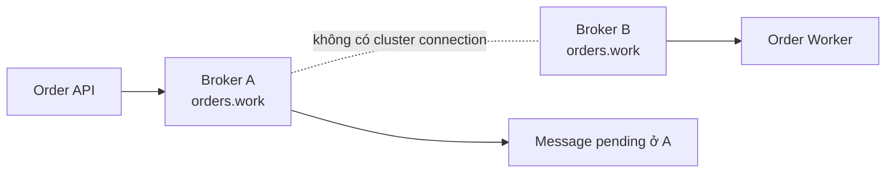
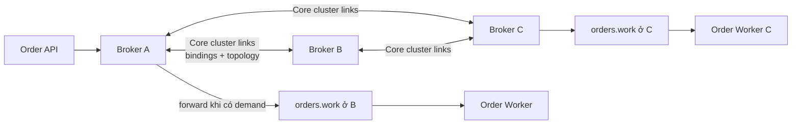
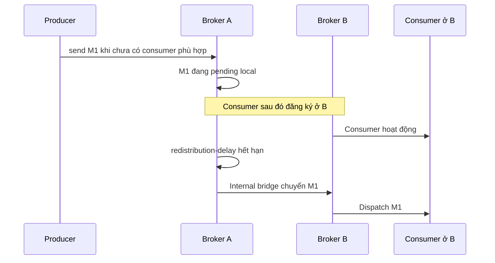
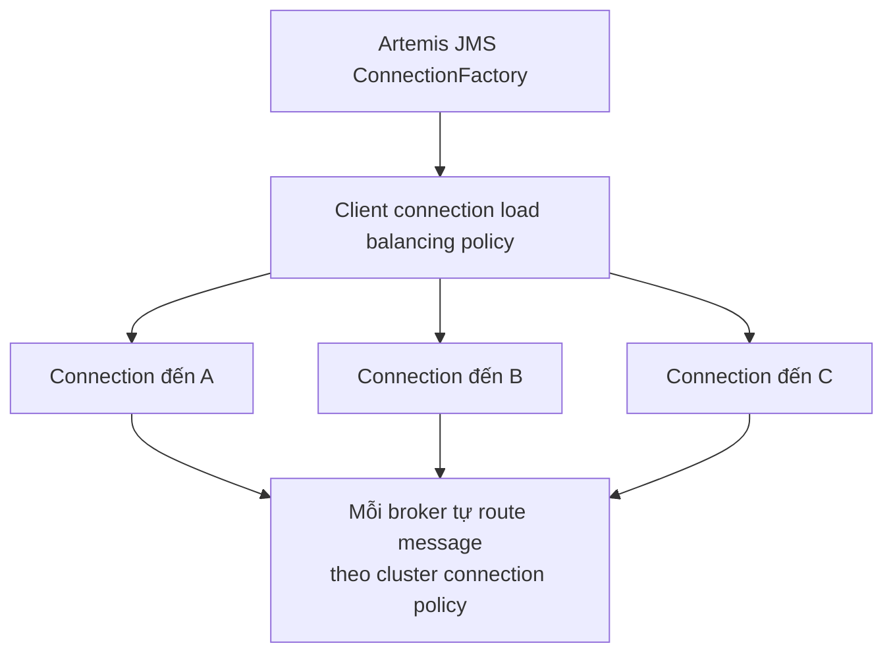

# Artemis cluster connection, khám phá node và phân phối tải

> **Chương:** Kết nối nhiều broker  
> **Phạm vi:** Apache ActiveMQ **Artemis**, Core cluster connections, static connectors, broadcast/discovery groups, message load balancing và message redistribution; thực hành bằng Java/Jakarta Messaging.  
> **Kết quả học tập:** Cấu hình được cluster nhiều node có data directories độc lập; giải thích topology được lan truyền như thế nào; chọn đúng `ON_DEMAND`, `STRICT`, `OFF` hay `OFF_WITH_REDISTRIBUTION`; phân biệt phân phối message với phân phối kết nối client và với replication HA; kiểm chứng được các tình huống thiếu consumer, thay đổi topology và lỗi node.

## 1. Bài toán: producer nối broker A, consumer chạy ở broker B

Giả sử ba Artemis brokers đang chạy độc lập:

- **Broker A:** `broker-a:61616` — `Order API` gửi lệnh vào `orders.work`.
- **Broker B:** `broker-b:61616` — một nhóm `Order Worker` đang consume queue `orders.work`.
- **Broker C:** `broker-c:61616` — một nhóm worker khác, có thể tăng/giảm theo tải.

Nếu chúng **không có cluster connection**, việc đặt cùng tên queue `orders.work` trên cả ba broker **không khiến message tự chuyển từ A sang B**. Message được lưu và phân phối theo địa chỉ/queue của broker A; consumer nối B chỉ thấy dữ liệu thuộc broker B.



Artemis cluster connection cho các broker trao đổi **thông tin topology, queue bindings và consumer demand**, rồi tạo các **Core bridges nội bộ** để chuyển message giữa các node khi chính sách cho phép.



**Phải tách ba cơ chế:**

1. **Broker-side message load balancing:** message đã đi vào **một broker** có thể được route tiếp sang **broker khác** qua cluster connection.
2. **Client-side connection load balancing:** Java client chọn **broker nào để mở connection/session**. Chọn kết nối không đồng nghĩa dịch chuyển message đã lưu.
3. **HA replication:** primary/backup giữ **bản sao durable state** để takeover khi broker chết. Cluster connection **không tự nhân bản toàn bộ journal** hay biến ba active brokers thành một storage chung.

Một cluster nhiều active nodes giúp chia tải; nếu node A chết trong khi còn message chỉ được lưu ở A, các node B/C **không mặc nhiên có bản sao của chúng**. Muốn HA cho dữ liệu của A phải cấu hình **HA policy riêng** hoặc một chiến lược khôi phục đáp ứng yêu cầu.

## 2. Mô hình Artemis cluster: mỗi node vẫn là một broker độc lập

Một node có:

- **Core acceptor:** cổng nhận kết nối client và inter-broker Core.
- **Connector:** địa chỉ outbound/public mà broker quảng bá cho các node và client.
- **Cluster connection:** quy tắc tạo liên kết với các node khác, chọn dải address, forwarding policy và số hops.
- **Local addresses/queues:** queue thật có journal, pending/in-flight message và consumer riêng tại node.
- **Cluster topology:** danh sách active/backup endpoints và bindings được trao đổi giữa nodes.

```text
Artemis node A
  broker.xml
    acceptor :61616       <- nhận client/cluster traffic
    connector broker-a     -> địa chỉ quảng bá cho peer
    cluster-connection     -> phạm vi address + peer discovery
    address orders.work
       queue orders.work   -> local queue, local storage

Artemis node B
  broker.xml
    acceptor :61616
    connector broker-b
    cluster-connection
    address orders.work
       queue orders.work   -> một queue khác cùng tên, local storage khác
```

Khi một message đi từ A đến B, Artemis dùng các liên kết **store-and-forward** nội bộ; message có thể tạm nằm trên node nguồn nếu kết nối tới B gặp lỗi. `use-duplicate-detection` ở cluster bridge giúp tránh chuyển tiếp trùng trong một số kịch bản bridge resend, nhưng **không thay** idempotency của business consumer.

### 2.1. Sự khác nhau giữa topology và destination

- Node discovery giúp biết **có những broker nào**, không tạo queue nghiệp vụ.
- Cluster connection giúp biết **queues/bindings nào có ở các node**, không đồng nghĩa có quyền gửi mọi nơi.
- Địa chỉ `orders.work` và queue `orders.work` cần được **provision phù hợp** trên các node tham gia. Đừng suy rằng hai queue trùng tên đã là một queue vật lý chung.
- Cluster có thể route message qua nhiều hop; `max-hops` giới hạn mức lan truyền/ứng viên phân phối trong topology, không phải độ dài đường DNS hay số lần client retry.

### 2.2. Vì sao node ID phải khác nhau?

Mỗi Artemis instance ghi **node ID** vào data directory/journal. Nếu clone **nguyên cả data directory** của A sang B để tạo cluster, hai broker có thể có cùng node ID, làm topology không hình thành đúng hoặc gây các hành vi nguy hiểm.

**Chỉ sao chép cấu hình đã rà soát**, không sao chép thư mục `journal`, `bindings`, `paging` và `large-messages` của một active instance như cách sinh node mới. Mỗi node có storage độc lập.

## 3. Lab ba broker với static connectors

Để kiểm chứng message distribution một cách tái lập, trước tiên dùng **static connectors**. Tránh multicast trong lab đầu vì nhiều mạng Docker/Kubernetes/VPC không chuyển tiếp UDP multicast.

### 3.1. Topology thử nghiệm

| Node | Host/port trong lab một máy | Connector name | Data directory |
|---|---|---|---|
| A | `127.0.0.1:61616` | `node-a` | `/lab/artemis-a/data` |
| B | `127.0.0.1:61617` | `node-b` | `/lab/artemis-b/data` |
| C | `127.0.0.1:61618` | `node-c` | `/lab/artemis-c/data` |

Mỗi hàng là một **Artemis broker instance** riêng với `etc/broker.xml` và data directory riêng. Cùng một máy chỉ đủ dạy **routing và phân phối tải**, không phải minh chứng HA chống hỏng máy.

**Production:** thay localhost bằng hostname/IP **peer và JMS client đều truy cập được**; không quảng bá `127.0.0.1` từ container/VM cho các máy khác vì chúng sẽ kết nối về localhost của chính mình.

### 3.2. Cấu hình chung: connectors, credentials, queue

Trong `<core>` của **cả ba** `broker.xml`, mỗi broker có thể định nghĩa bộ connectors dùng để tham chiếu bằng tên:

```xml
<!-- Fragment chung: <core> / broker.xml, Artemis -->
<connectors>
    <connector name="node-a">tcp://127.0.0.1:61616</connector>
    <connector name="node-b">tcp://127.0.0.1:61617</connector>
    <connector name="node-c">tcp://127.0.0.1:61618</connector>
</connectors>

<cluster-user>cluster-orders-user</cluster-user>
<cluster-password>REPLACE_WITH_SHARED_CLUSTER_SECRET</cluster-password>

<addresses>
    <address name="orders.work">
        <anycast>
            <queue name="orders.work" durable="true"/>
        </anycast>
    </address>
</addresses>
```

Trong phần `<acceptors>` hiện có của từng broker, bảo đảm acceptor Core nghe đúng **cổng local**:

```xml
<!-- A: 61616; B: đổi thành 61617; C: đổi thành 61618 -->
<acceptors>
    <acceptor name="core">tcp://127.0.0.1:61616?protocols=CORE</acceptor>
</acceptors>
```

Không chép đè toàn bộ `<acceptors>` hoặc `<addresses>` đang được ứng dụng dùng; đây là **fragments để ghép có kiểm soát**. Giữ đúng một vùng cấu hình cho mỗi phần tử theo schema. Những brokers khác nhau dùng **cùng cluster credentials** trong lab và phải có quyền kết nối inter-broker.

**Lưu ý bảo mật:** `REPLACE_WITH_SHARED_CLUSTER_SECRET` là placeholder, không phải cú pháp lấy secret tự động. Với production, inject bí mật từ hệ thống quản lý secrets, bảo vệ file, bật TLS và giới hạn network cho cluster traffic; không dùng admin password của JMS client làm cluster password.

### 3.3. Cluster connection tại node A

```xml
<!-- Node A: đặt trong <core> / <cluster-connections> -->
<cluster-connections>
    <cluster-connection name="orders-cluster">
        <address>orders.</address>
        <connector-ref>node-a</connector-ref>
        <retry-interval>500</retry-interval>
        <initial-connect-attempts>-1</initial-connect-attempts>
        <reconnect-attempts>-1</reconnect-attempts>
        <use-duplicate-detection>true</use-duplicate-detection>
        <message-load-balancing>ON_DEMAND</message-load-balancing>
        <max-hops>1</max-hops>
        <static-connectors>
            <connector-ref>node-b</connector-ref>
            <connector-ref>node-c</connector-ref>
        </static-connectors>
    </cluster-connection>
</cluster-connections>
```

### 3.4. Cluster connection tại B và C

Giữ các phần `<address>`, retry, duplicate detection, balancing và max-hops như trên; thay local `connector-ref` và static peer list **chính xác** như sau:

| Broker | `connector-ref` ở root cluster connection | `static-connectors` |
|---|---|---|
| A | `node-a` | `node-b`, `node-c` |
| B | `node-b` | `node-a`, `node-c` |
| C | `node-c` | `node-a`, `node-b` |

Đoạn dành cho B:

```xml
<cluster-connections>
    <cluster-connection name="orders-cluster">
        <address>orders.</address>
        <connector-ref>node-b</connector-ref>
        <retry-interval>500</retry-interval>
        <initial-connect-attempts>-1</initial-connect-attempts>
        <reconnect-attempts>-1</reconnect-attempts>
        <use-duplicate-detection>true</use-duplicate-detection>
        <message-load-balancing>ON_DEMAND</message-load-balancing>
        <max-hops>1</max-hops>
        <static-connectors>
            <connector-ref>node-a</connector-ref>
            <connector-ref>node-c</connector-ref>
        </static-connectors>
    </cluster-connection>
</cluster-connections>
```

Tại C, đổi local `node-b` thành `node-c`; trong static list đổi `node-c` thành `node-b`. Mỗi broker phải có **connector riêng được quảng bá chính xác**. Khi ba node kết nối trực tiếp với nhau, đây là **symmetric/full-mesh cluster**, nên `max-hops=1` đủ cho các node nhìn thấy nhau.

### 3.5. Tại sao dùng `<address>orders.</address>`?

Trong cluster connection, `address` là **lọc prefix**, không phải Artemis wildcard:

- `orders.` khớp `orders.work`, `orders.events` nếu có.
- `orders.` **không** có nghĩa biểu thức `orders.#` của `address-settings`.
- `<address/>` rỗng nghĩa là có thể cân bằng **tất cả addresses** được cluster connection xét, nên rộng hơn ý đồ của lab.
- Có thể dùng danh sách prefix/ngăn exclude theo cú pháp cluster connection, nhưng không viết chuỗi wildcard `orders.#` vào trường này rồi mong hoạt động như security/address settings.
- Nếu hai cluster connections có prefix chồng lên nhau, có nguy cơ cùng message chịu xử lý chuyển tiếp qua nhiều cluster connections. Phải thiết kế dải address không chồng chéo hoặc test rất chặt.

Trong ví dụ chỉ có queue `orders.work`; nếu hệ thống có `billing.#` hoặc management/expiry addresses không thuộc cluster thì **không** thêm chúng vào prefix `orders.`.

## 4. Broker biết node khác bằng cách nào?

Cần tách **bootstrap discovery** và **topology update sau khi kết nối**.

1. Broker A cần **địa chỉ ban đầu** của ít nhất một peer (từ static connector list hoặc dynamic discovery).
2. Core cluster link được xác lập và các broker trao đổi topology, queue bindings và trạng thái consumers cần cho routing.
3. Peer được thêm/bớt, connection lỗi hoặc consumer tăng/giảm thì thông tin có thể được cập nhật qua các kết nối cluster.
4. Cấu hình `message-load-balancing` quyết định message mới được phân phối như thế nào từ node đang nhận.

```text
Initial contact
    +-- static-connectors  -> thử một hoặc nhiều known peers
    |
    +-- discovery-group-ref -> nghe broadcast / JGroups

Established Core cluster links
    -> topology advertisements
    -> queue binding/consumer demand updates
    -> message routing qua internal bridges
```

**Discovery không phải replication.** Nhìn thấy node C trong topology không chứng minh node C có journal copy của A. Cũng không chứng minh một consumer đã được tạo trên C.

### 4.1. Static connectors: lựa chọn dễ kiểm soát

Ưu điểm:

- Không cần multicast và thường dễ chạy trên VM/Kubernetes có DNS ổn định.
- Peer endpoints nằm rõ trong deployment/config review.
- Chỉ cần một số bootstrap connectors khả dụng để học topology rộng hơn qua broker đã kết nối.

Giới hạn:

- Địa chỉ quảng bá sai host/port khiến peer/clients reconnect thất bại.
- Khi thay đổi topology hoàn toàn, cần cập nhật DNS, config hoặc cơ chế bootstrap.
- Cluster chứ không phải DNS chịu trách nhiệm trao đổi bindings/consumer topology sau kết nối.
- Static list **không tự giới hạn topology ở đúng các tên đã khai báo** trừ khi dùng tùy chọn kiểm soát topology cụ thể. Nếu muốn **chỉ được nối trực tiếp tới peer trong list**, Artemis có `allow-direct-connections-only="true"` cho `static-connectors`, cần cấu hình và test riêng.

### 4.2. Dynamic discovery qua UDP: broadcast và discovery group

Artemis có thể broadcast connector của mỗi broker và nghe các broadcast khác:

```xml
<!-- Trong <core> của broker.xml, minh họa broker A -->
<broadcast-groups>
    <broadcast-group name="orders-broadcast">
        <group-address>231.7.7.7</group-address>
        <group-port>9876</group-port>
        <broadcast-period>2000</broadcast-period>
        <connector-ref>node-a</connector-ref>
    </broadcast-group>
</broadcast-groups>

<discovery-groups>
    <discovery-group name="orders-discovery">
        <group-address>231.7.7.7</group-address>
        <group-port>9876</group-port>
        <refresh-timeout>10000</refresh-timeout>
    </discovery-group>
</discovery-groups>
```

Trong cluster connection, **thay** `<static-connectors>` bằng:

```xml
<discovery-group-ref discovery-group-name="orders-discovery"/>
```

Trên B/C, khai báo cùng multicast group/port nhưng `broadcast-group` phát **connector của chính node đó** (`node-b` hoặc `node-c`). Discovery group nhận các connector advertisements, từ đó lấy initial peer; khi đã kết nối, broker trao đổi topology qua link thông thường.

**Yêu cầu bảo mật ở Artemis hiện đại:** server discovery có thể **bị vô hiệu theo mặc định** vì nguy cơ broadcast giả. Khi thực sự chọn discovery, cấu hình `-Dartemis.discovery.enabled=true` hoặc `ARTEMIS_DISCOVERY_ENABLED=true` cho **JVM broker/client liên quan**, theo hướng dẫn của phiên bản đang dùng. Nếu tạo instance bằng CLI, kiểm tra lựa chọn tạo instance/profile có bật discovery tương ứng. Đừng bật trên production mà chưa kiểm soát trust boundary.

### 4.3. UDP hay JGroups?

| Tiêu chí | Static connectors | UDP broadcast/discovery | JGroups discovery |
|---|---|---|---|
| Bootstrap | Danh sách connector | Multicast address/port | Channel/stack JGroups |
| Cần multicast network? | Không | Có | Tùy stack JGroups |
| Thêm node | Có thể discover qua topology khi đã join | Broadcast nhận động | Theo stack/discovery |
| Kiểm soát peer source | Cấu hình endpoints/DNS | UDP **không tự xác thực người gửi** | Có thể dùng JGroups `AUTH`/TLS đúng stack |
| Phù hợp VPC/Kubernetes | Thường dễ kiểm soát nhất | Thường bị chặn hoặc khó vận hành | Cần platform-aware stack và security |
| Rủi ro | Peer stale/DNS sai | Spoofed discovery/topology injection | Stack cấu hình sai/quyền join lỏng |

Không dùng **UDP multicast chưa xác thực** qua một mạng nhiều tenant/không tin cậy. Môi trường production cần TLS, ACL cluster credentials, network policies và cho phép đúng các nút tham gia.

## 5. Bốn chế độ `message-load-balancing` khác nhau như thế nào?

Tùy chọn nằm trong `<cluster-connection>`, **không** phải một thuộc tính của JMS `MessageProducer`:

```xml
<message-load-balancing>ON_DEMAND</message-load-balancing>
```

| Giá trị | Initial routing khi message vào node | Nếu node đích không có consumer | Khi nào phù hợp |
|---|---|---|---|
| **`OFF`** | **Không forward** message sang broker khác | Message ở local broker | Cố ý cô lập xử lý theo node |
| **`ON_DEMAND`** | Chỉ forward tới queue ở node có **consumer phù hợp** (có xét selector) | Không forward sang queue không có matching consumer | Hạn chế backlog rơi vào node không có worker; lựa chọn khởi đầu thường hợp lý |
| **`STRICT`** | Phân phối round-robin giữa các **matching queues** trên nodes, kể cả không có consumer | Có thể forward và tạo backlog ở node không có worker | Muốn phân phối sẵn, có kế hoạch worker luôn sẵn sàng hoặc redistribution phù hợp |
| **`OFF_WITH_REDISTRIBUTION`** | Ưu tiên giữ message mới tại local node, không phân phối ban đầu | Nếu bật redistribution và không có consumer phù hợp ở local, message có thể chuyển đi sau | Ưu tiên local consumer, chỉ chuyển message tồn khi cần |

**Chốt điều kiện:** `STRICT` **không** forward message tới broker mà **không có queue cùng tên** với queue đích, dù node đó tồn tại trong cluster. `ON_DEMAND` cần queue **và** consumer phù hợp; có selector thì selector cần match. Các giá trị được Artemis hỗ trợ tùy version, vì vậy hãy đặt **tường minh** thay vì dựa vào default từ blog/cấu hình cũ.

### 5.1. Ví dụ với consumers chỉ ở B và C

```text
Node A: Queue orders.work có 0 consumer
Node B: Queue orders.work có 3 consumers
Node C: Queue orders.work có 1 consumer

Producer nối Node A, gửi 12 messages.
```

- `ON_DEMAND`: A có thể forward đến B/C dựa trên bindings/demand; **không bảo đảm chia theo tỷ lệ 3:1** chỉ vì số consumer khác nhau.
- `STRICT`: A vẫn có thể là một đích nhận message local dù A không có consumer; message có thể tồn trong queue A cho đến khi xuất hiện consumer hoặc có redistribution thích hợp.
- `OFF`: cả 12 messages ở A, B/C không nhận chúng chỉ nhờ cluster membership.
- `OFF_WITH_REDISTRIBUTION`: message ban đầu ở A; nếu địa chỉ được bật redistribution và A không có consumer, Artemis có thể chuyển messages sang node có demand.

**Không xem các tỷ lệ ở ví dụ là kết quả benchmark định lượng.** Round-robin và routing phụ thuộc thứ tự node, matching queues, consumers/selectors, queue filters, group handling và trạng thái links.

### 5.2. Selector ảnh hưởng `ON_DEMAND`

Giả sử consumer ở B tạo selector:

```java
MessageConsumer consumer = session.createConsumer(
    session.createQueue("orders.work"), "region = 'VN'");
```

Khi producer gửi `region="SG"`, consumer đó không match. Với `ON_DEMAND`, Artemis không coi consumer B là **demand phù hợp** cho message này chỉ vì “B có một consumer”. Nếu C có consumer match, C là ứng viên; nếu không có node match, message có thể ở nguồn.

Dùng selector làm cách lọc delivery, **không** làm tường bảo mật giữa tenants. Những quyền truy cập queue vẫn phải được broker phân quyền độc lập.

### 5.3. `use-duplicate-detection` không phải exactly-once nghiệp vụ

```xml
<use-duplicate-detection>true</use-duplicate-detection>
```

Artemis sử dụng duplicate detection cho các internal cluster bridges để hạn chế duplicate khi node nguồn resend sau mất confirmation của node đích. Đây là tính chất **store-and-forward**, không phải tuyên bố rằng một consumer sẽ không bao giờ thấy event trùng.

- Producer có thể retry sau khi `session.commit()` trả outcome chưa rõ.
- Consumer có thể commit DB rồi crash trước JMS ack.
- Message có thể redeliver sau rollback/broker restart.
- Duplicate detection dùng cache/ID semantics và không thay DB unique constraint lâu dài.

Luồng nghiệp vụ quan trọng cần `eventId` ổn định và idempotency ở nơi ghi business state.

## 6. Redistribution: cứu backlog đã nằm sai node

**Initial distribution** xét khi message mới được route vào queue. **Redistribution** xét **message đã ở một queue** nhưng queue đó hiện không còn matching consumers trong khi node khác có demand.



Không phải mọi cluster đều tự redistribution: Artemis để `redistribution-delay=-1` (disabled) trong cấu hình mặc định thường gặp. Để bật trên một dải address, cấu hình **`address-settings`**:

```xml
<!-- Trong <core> / <address-settings> của broker.xml -->
<address-settings>
    <address-setting match="orders.#">
        <redistribution-delay>1000</redistribution-delay>
    </address-setting>
</address-settings>
```

- `1000`: chờ khoảng 1 giây sau khi phát hiện cần redistribution.
- `0`: cố gắng chuyển ngay, có thể tăng churn khi consumers đóng/mở nhanh.
- `-1`: không redistribution.
- `match="orders.#"` là **wildcard của address settings**, khác với prefix `<cluster-connection><address>orders.</address>`.
- Để redistribution hoạt động, `message-load-balancing` phải là **`ON_DEMAND` hoặc `OFF_WITH_REDISTRIBUTION`** theo Artemis cluster policy, và phải có matching consumer/queue ở node khác.

### 6.1. Khi nào nên đặt delay khác 0?

Một consumer rolling restart có thể biến mất vài trăm mili giây rồi quay lại cùng node. Nếu đặt `redistribution-delay=0`, Artemis có thể chuyển message sang node khác ngay, gây thêm network I/O và đảo thứ tự.

Với `1000–5000 ms` (chỉ là **khoảng để thử nghiệm**, không phải giá trị chuẩn), queue local có cơ hội được consumer mới bám vào trước khi redistribution. Chọn theo thời gian restart/rebalance thực tế, latency SLO và mức độ chấp nhận reorder.

### 6.2. Khi nào redistribution không cứu được?

- Không có queue cùng tên/matching routing trên node đích.
- Không có consumer phù hợp hoặc selector không match message.
- `redistribution-delay=-1` hoặc balancing mode không cho redistribution.
- Cluster links đứt/quyền cluster sai/node topology không đầy đủ.
- Message nằm ở **broker đã chết** và node đó không có HA backup; các node còn sống **không có bản sao** để chuyển.
- Message expired, bị ack hợp lệ hoặc thuộc một workflow/destination khác.

**Lỗi thường gặp:** nhìn B có consumer nhưng không nhận message tồn ở A, rồi tăng `max-hops`. Cần kiểm tra **redistribution-delay, demand và matching queue** trước; max-hops không tự bật redistribution.

## 7. Client-side connection load balancing: ai chọn broker để kết nối?

Artemis client có thể chọn node từ initial connectors hoặc topology nhận từ cluster. Điều này **khác hoàn toàn** với message routing ở phần 5.



Trong Artemis Core/JMS, các policy điển hình:

| Policy | Mục tiêu | Lưu ý |
|---|---|---|
| `RoundRobinConnectionLoadBalancingPolicy` | Rải những lựa chọn connection/session theo vòng | Vòng đầu có thể chọn ngẫu nhiên; không suy là phân phối CPU chính xác |
| `RandomConnectionLoadBalancingPolicy` | Chọn ngẫu nhiên từ các nodes | Có dao động ngắn hạn |
| `RandomStickyConnectionLoadBalancingPolicy` | Chọn ngẫu nhiên rồi giữ một node | Giảm dao động, không cân bằng liên tục |
| `FirstElementConnectionLoadBalancingPolicy` | Ưu tiên phần tử đầu | Có thể dồn tải vào một node |

Đây là **client policy**. Trong khi đó `message-load-balancing=ON_DEMAND` là **broker policy** về message forwarding. Hai policy có thể được cấu hình đồng thời và phải đo riêng.

### 7.1. URL Artemis cho danh sách initial nodes

Ví dụ URL dùng được với Artemis JMS client tương thích:

```text
(tcp://127.0.0.1:61616,tcp://127.0.0.1:61617,tcp://127.0.0.1:61618)?ha=false&useTopologyForLoadBalancing=false
```

Ý nghĩa:

- Ba TCP endpoints là các **initial connectors**; không phải ba bản sao HA của một journal.
- `useTopologyForLoadBalancing=false` yêu cầu dùng danh sách tĩnh làm nguồn lựa chọn cho client load balancing thay vì mở rộng lựa chọn từ cluster topology.
- `ha=false` ở lab nhấn mạnh rằng cluster **active/active không backup**; không tạo bảo đảm tự takeover state của broker hỏng.
- Khi muốn dùng topology do cluster cung cấp, bỏ `useTopologyForLoadBalancing=false` và kiểm chứng các connectors broker quảng bá đều reachable.

Có thể chọn policy qua URI `connectionLoadBalancingPolicyClassName`. Ví dụ cấu hình đơn một endpoint để minh họa tên class:

```text
tcp://127.0.0.1:61616?connectionLoadBalancingPolicyClassName=org.apache.activemq.artemis.api.core.client.loadbalance.RoundRobinConnectionLoadBalancingPolicy
```

**Đừng trộn client Artemis Core/JMS URL với ActiveMQ Classic `failover:(...)`.** Cú pháp và cách xử lý failover/topology khác nhau.

### 7.2. Client đổi broker không tự di chuyển pending messages

Nếu producer gửi vào A rồi A bị crash, việc client reconnect sang B chỉ giúp những **lệnh mới** có thể tiếp tục (nếu cấu hình cho phép). Message persistent còn nằm trên journal của A **không xuất hiện ở B** chỉ vì client đã chuyển endpoint.

Phải phân biệt ba thao tác:

1. **Reconnection:** đổi socket/Session endpoint.
2. **Message load balancing:** chuyển một message giữa active brokers khi node nguồn đang hoạt động và có cluster bridge.
3. **HA failover:** backup giữ bản sao state của một primary để tiếp quản khi primary chết.

Khi một `send`/`commit` đứt kết nối, app phải xử lý **kết quả chưa rõ**, retry cùng `eventId` và consumer idempotent. Không gộp chúng thành “client tự recover nên không lặp hoặc mất message”.

## 8. Ví dụ Java JMS gửi vào A, nhận từ B

Để chứng minh **broker-side forwarding** thay vì client-side balancing, phép thử đầu tiên dùng **hai factory trỏ cố định tới hai brokers**. Nếu dùng URL nhiều endpoints ngay, sẽ khó biết message đến B do client nối B trực tiếp hay do cluster bridge.

### 8.1. Producer nối cố định A

Ví dụ dùng **Jakarta Messaging** (`jakarta.jms`) và Artemis JMS client phù hợp Spring Boot 3/Jakarta. Nếu dùng client đời cũ `javax.jms` thì đổi cả artifact và imports, không pha trộn.

```java
import jakarta.jms.Connection;
import jakarta.jms.DeliveryMode;
import jakarta.jms.JMSException;
import jakarta.jms.MessageProducer;
import jakarta.jms.Queue;
import jakarta.jms.Session;
import jakarta.jms.TextMessage;
import org.apache.activemq.artemis.jms.client.ActiveMQConnectionFactory;

public final class ClusterOrderPublisher {

    public static void sendToA(String eventId, String orderId)
            throws JMSException {

        ActiveMQConnectionFactory factory =
            new ActiveMQConnectionFactory("tcp://127.0.0.1:61616");

        try (Connection conn = factory.createConnection()) {
            Session session = conn.createSession(
                true, Session.SESSION_TRANSACTED);
            try {
                Queue queue = session.createQueue("orders.work");
                MessageProducer producer = session.createProducer(queue);
                try {
                    producer.setDeliveryMode(DeliveryMode.PERSISTENT);

                    TextMessage msg = session.createTextMessage(orderId);
                    msg.setStringProperty("eventId", eventId);
                    msg.setStringProperty("region", "VN");

                    producer.send(msg);
                    session.commit();
                    System.out.println("Committed to broker A: " + eventId);
                } catch (JMSException | RuntimeException failure) {
                    try {
                        session.rollback();
                    } catch (JMSException rollbackFailure) {
                        failure.addSuppressed(rollbackFailure);
                    }
                    throw failure;
                } finally {
                    producer.close();
                }
            } finally {
                session.close();
            }
        }
    }
}
```

`JMS MessageProducer.send`/`Session.commit` không bảo đảm consumer đã hoàn thành nghiệp vụ. Khi broker A có `ON_DEMAND` và node B có matching consumer, cluster có thể forward message từ A tới B.

### 8.2. Consumer nối cố định B

```java
import jakarta.jms.Connection;
import jakarta.jms.JMSException;
import jakarta.jms.Message;
import jakarta.jms.MessageConsumer;
import jakarta.jms.Queue;
import jakarta.jms.Session;
import jakarta.jms.TextMessage;
import org.apache.activemq.artemis.jms.client.ActiveMQConnectionFactory;

public final class ClusterOrderWorker {

    public static void receiveFromB() throws JMSException {
        ActiveMQConnectionFactory factory =
            new ActiveMQConnectionFactory("tcp://127.0.0.1:61617");

        try (Connection conn = factory.createConnection()) {
            Session session = conn.createSession(
                true, Session.SESSION_TRANSACTED);
            try {
                Queue queue = session.createQueue("orders.work");
                MessageConsumer consumer = session.createConsumer(queue);
                try {
                    conn.start();

                    Message msg = consumer.receive(15_000L);
                    if (msg == null) {
                        System.out.println("No matching message on B");
                        return;
                    }

                    try {
                        String eventId =
                            msg.getStringProperty("eventId");
                        String orderId =
                            ((TextMessage) msg).getText();

                        System.out.printf(
                            "Received on B: eventId=%s orderId=%s%n",
                            eventId, orderId);

                        // Production: xử lý DB idempotent trước commit JMS.
                        session.commit();
                    } catch (JMSException | RuntimeException failure) {
                        try {
                            session.rollback();
                        } catch (JMSException rollbackFailure) {
                            failure.addSuppressed(rollbackFailure);
                        }
                        throw failure;
                    }
                } finally {
                    consumer.close();
                }
            } finally {
                session.close();
            }
        }
    }
}
```

**Trình tự thực hành:**

1. Khởi động A/B/C và xác nhận Core cluster topology đã ổn định.
2. Provision queue `orders.work` trên cả ba node theo phần 3.
3. Chạy `ClusterOrderWorker.receiveFromB()` trước để consumer ở B đăng ký demand.
4. Gửi `ClusterOrderPublisher.sendToA("evt-42","ORD-42")`.
5. Quan sát B nhận message, trong khi producer **chỉ nối TCP tới A**.
6. Nếu B không nhận, kiểm tra topology, matching queue, consumer demand, selector, địa chỉ được cluster connection bao phủ và inter-broker credentials.

Dùng client fixed-endpoint để kiểm chứng A→B đã, sau đó mới so sánh với factory nhiều endpoints ở phần 7.

## 9. Thứ tự, message groups, backpressure và giới hạn tốc độ

Cluster tăng khả năng chia tải nhưng có thêm network hop và concurrency:

- **Send order** tại một producer không đồng nghĩa **business completion order** trên ba brokers.
- `ON_DEMAND` có thể điều hướng các messages sang B/C theo demand thay đổi.
- `STRICT` có thể đưa message vào node chưa có consumer và tạo backlog.
- Redistributor có thể chuyển message đã chờ sang node khác sau một delay.
- Prefetch/consumer window, nhiều consumers và rollback/redelivery có thể làm kết quả xử lý đến không theo FIFO toàn cluster.

### 9.1. Message grouping

Nếu mọi update của một `orderId` phải được xử lý theo thứ tự, hãy xem xét `JMSXGroupID` và cơ chế grouping/handler mà Artemis hỗ trợ cho cluster; kiểm chứng group ownership, failover và consumer disconnect.

```java
msg.setStringProperty("JMSXGroupID", "ORDER-" + orderId);
```

Tuy nhiên **chỉ gắn `JMSXGroupID` không đủ để khẳng định mọi message cùng group sẽ giữ thứ tự đúng xuyên nhiều node dưới mọi kiểu failover**. Cần cấu hình grouping handler cho cluster nếu kiến trúc cần grouping tập trung và kiểm thử cụ thể. Ở DB, dùng `aggregateVersion`/optimistic locking để từ chối update cũ.

### 9.2. Store-and-forward có chi phí

Một message A→B cần:

```text
Producer -> A (routing + local handling)
               -> internal cluster bridge
               -> B (remote queue, consumer)
               -> consumer ack / transaction
```

Chi phí thêm có thể gồm network RTT, broker journal I/O, internal store-and-forward queues và flow control. Nếu producer và matching consumer **cùng node**, route local thường có chi phí thấp hơn việc buộc message qua broker khác.

Đừng chọn `STRICT` chỉ vì “round-robin nghe cân bằng hơn”; hãy tối ưu **throughput, broker disk usage, backlog age và end-to-end latency**, không chỉ phân phối số message.

### 9.3. Cluster-wide capacity không phải phép cộng tuyệt đối

Ba broker mỗi node có khả năng xử lý 10.000 message/s trong isolation **không đảm bảo** cluster xử lý 30.000 message/s:

- Producer chỉ nối A, A phải forward lớn qua mạng.
- Consumers tập trung B/C, lệch demand hoặc selector.
- Internal bridge/window và link băng thông giới hạn.
- Storage/journal fsync trên node đích.
- Broker cluster topology notification/redistribution quá nhiều.
- Một queue nghiệp vụ đòi thứ tự nghiêm ngặt, không cho parallelism.

Đo từ đầu cuối, cân bằng client connections trước khi dùng cluster bridges để sửa hiện tượng producer/consumer quá lệch node.

## 10. Một số knob kỹ thuật cần hiểu trước khi chỉnh

| Option | Nằm ở đâu | Mục đích | Cảnh báo |
|---|---|---|---|
| `<address>` | `cluster-connection` | Lọc prefix address được cluster route | Không dùng wildcard của address-settings |
| `<connector-ref>` | `cluster-connection` | Connector **local** quảng bá | Sai hostname làm topology không reachable |
| `<static-connectors>` | Cluster connection | Bootstrap peers | Không đồng nghĩa hạn chế topology trừ cấu hình riêng |
| `<discovery-group-ref>` | Cluster connection | Bootstrap qua discovery | UDP/JGroups cần được bảo vệ |
| `message-load-balancing` | Cluster connection | Initial forwarding mode | `ON_DEMAND` ≠ `STRICT` |
| `max-hops` | Cluster connection | Giới hạn các node có thể tham gia qua topology hops | Không tự mở redistribution |
| `use-duplicate-detection` | Cluster connection | Bảo vệ bridge resend ở mức nội bộ | Không thay DB idempotency |
| `initial-connect-attempts` | Cluster connection | Retry tìm peer lần đầu | `-1` không đảm bảo node đủ quyền/kết nối |
| `reconnect-attempts` | Cluster connection | Retry khi inter-broker link mất | Không nhân bản message khi node chết |
| `redistribution-delay` | `address-setting` | Hoãn chuyển messages đã local-queued không có consumer phù hợp | `-1` disable; cần mode hỗ trợ |
| `useTopologyForLoadBalancing` | **Client URI** | Chọn topology động hay static list cho client | Không thay server message routing |
| `connectionLoadBalancingPolicyClassName` | **Client URI** | Policy chọn broker cho connection/session | Không đồng nghĩa HA takeover |
| `cluster-user/password` | Broker | Xác thực inter-broker connection | Khác service JMS user/password |

### 10.1. `max-hops` trong ring/chain

Với topology A–B–C nhưng A **không kết nối trực tiếp** C, `max-hops=1` trên A không mở rộng ứng viên sang các node quá một hop. Nếu cần forwarding tới C, phải cấu hình phù hợp topology và `max-hops` trên các cluster connections liên quan.

Ở full-mesh lab A/B/C đã có direct connections nên `max-hops=1` là đủ. Tăng lên 2 không phải cách sửa phổ biến cho **thiếu consumer demand**, **queue không tồn tại** hoặc **redistribution disabled**.

### 10.2. Lỗi cấu hình phần tử chồng nhau

Tránh để hai cluster connections cùng route address prefix `orders.` nếu bạn không chủ định cho message đi qua hai tập bridges. Khi cần nhiều clusters khác nhau, dùng prefixes phân tách và exclusions được Artemis hỗ trợ, rồi test duplicate/redistribution dưới load.

## 11. Quan sát cluster: node xuất hiện khác queue có demand

Một dashboard clustering cần tách ít nhất bốn tầng:

| Tầng | Quan sát | Ý nghĩa khi lỗi |
|---|---|---|
| **Broker discovery** | Node IDs, advertised connectors, topology members | Thiếu node hoặc quảng bá địa chỉ sai |
| **Cluster link** | Cluster connection / bridge state, auth errors, reconnects | Không forward được dù đã nhìn thấy peer |
| **Binding/demand** | Queue cùng tên trên từng node, consumer count, selectors | Không có matching destination để route |
| **Routing/redistribution** | Local vs forwarded enqueue, internal SF queues, redistribution events | Message kẹt local hoặc mạng nghẽn |
| **Business** | `eventId`, xử lý/ack, DB side effects, latency | Nghiệp vụ lặp hoặc chậm dù cluster healthy |

**Không suy rằng “ba nodes đều connected” là message chắc chắn được cân đều.** Matching queues/consumer selectors mới quyết định nhiều trường hợp forwarding.

### 11.1. Checklist log cho một message

```text
eventId=evt-42
producerConnectedBroker=A
sourceAddress=orders.work
sourceQueue=orders.work
matchingConsumersOnA=0
matchingConsumersOnB=1
matchingConsumersOnC=0
messageLoadBalancing=ON_DEMAND
clusterBridge=A->B
consumerBroker=B
businessOutcome=COMMITTED
```

Đây là **các trường quan sát tự thiết kế**, không phải log mặc định Artemis tự xuất đủ mọi trường. Có thể lấy từng phần từ broker management/JMX, tracing application và broker logs tùy phiên bản.

### 11.2. Đo “load balancing” thế nào cho đúng?

Chạy 3 nhóm test độc lập:

1. **Server message distribution:** producer **cố định vào A**, consumers ở B/C; đo số messages/queue mỗi node.
2. **Client connection distribution:** nhiều JMS connections từ một factory multi-endpoint; đo socket/connection count theo node, **không lấy số message làm bằng chứng**.
3. **HA recovery:** kill node đang có pending messages; kiểm tra **có backup/state replication thật** hay không. Không tính đây là load-balancing test.

Ba phép đo tách biệt ngăn việc “client kết nối B” bị hiểu nhầm là broker A đã forward message qua cluster.

## 12. Bộ bài thực hành có đối chứng

Chạy tất cả trên **Artemis staging độc lập**, ba brokers khác data directories. Tạo queue `orders.work` mỗi node, dùng persistent messages mang `eventId` duy nhất; bật metrics/management để đếm queue depth, consumers, cluster links. Không chạy stress hoặc network-partition test trên production.

### Bài A — Chứng minh cluster connection mới làm message đi A→B

1. Tắt/loại cluster connection trên lab A/B (giữ queue trùng tên).
2. Producer gửi `evt-A1` vào A; consumer chỉ nối B.
3. Kiểm tra message pending ở A, B không nhận.
4. Bật cluster connection `ON_DEMAND`, khởi động lại lab theo quy trình.
5. Gửi **message mới** `evt-A2` vào A khi B đã có consumer.

**PASS:** `evt-A2` có thể đi đến B, chứng minh Core cluster forwarding. Với `evt-A1` đã tồn trước, cần redistribution nếu muốn chuyển; bật cluster connection không tự chứng minh backlog tự rời A.

### Bài B — `ON_DEMAND` với consumer matching/unmatching

1. A không consumer, B có consumer selector `region='VN'`, C không consumer.
2. Gửi một message `region='VN'` và một message `region='SG'` vào A.
3. Theo dõi queue pending và route ở A/B/C.
4. Thêm consumer selector `region='SG'` ở C.
5. Bật `redistribution-delay=0` riêng trong test backlog; quan sát message đang đợi được chuyển.

**PASS:** hiểu ON_DEMAND dựa trên **selector match**, không chỉ consumer count.

### Bài C — So sánh `STRICT` với `ON_DEMAND`

1. Queue cùng tên tồn tại A/B/C; chỉ B có consumer.
2. Chạy batch 30 messages với `ON_DEMAND`, commit từng message hoặc một transaction rõ ràng.
3. Reset queue test theo runbook; đổi `STRICT` và chạy batch khác.
4. Đếm queue depth từng node và message chưa có consumer.
5. Bật redistribution trong test riêng nếu cần, kiểm tra backlog có được giải phóng không.

**PASS:** với `STRICT` có thể có message tồn ở A/C dù B có consumer; `ON_DEMAND` ưu tiên node có demand phù hợp. Không yêu cầu một tỷ lệ round-robin đúng tuyệt đối.

### Bài D — Phân biệt `OFF` và `OFF_WITH_REDISTRIBUTION`

1. Producer cố định A, consumer chỉ B; cấu hình redistribution delay 1000ms.
2. Với `OFF`, gửi 10 messages và kiểm tra A giữ local.
3. Reset test; với `OFF_WITH_REDISTRIBUTION`, gửi 10 messages vào A.
4. Theo dõi message ban đầu ở A rồi có thể chuyển sang B sau delay.
5. Nếu kết quả khác kỳ vọng, kiểm tra matching queue/demand, delay, inter-broker link và version.

**PASS:** hai mode đều không initial-forward, nhưng **chỉ một mode cho phép redistribution** khi cấu hình đáp ứng.

### Bài E — Học topology qua static connectors

1. A chỉ biết B ở bootstrap list; B có links tới C.
2. Quan sát node topology mà A học được sau khi kết nối B.
3. Test `max-hops=1` rồi `max-hops=2` trong chain/ring có chủ ý.
4. Đặt `allow-direct-connections-only=true` ở static connectors trong test riêng nếu cần kiểm soát links.
5. Kiểm tra node nào đủ điều kiện nhận forwarded message theo hops.

**PASS:** không nhầm số **initial connectors** với số node cluster có thể discover và số hops eligible để balance.

### Bài F — Dynamic discovery: UDP bị chặn và mở lại

1. Trên lab network tin cậy, bật discovery được phép và cấu hình broadcast/discovery group.
2. Chặn UDP multicast group/port trong môi trường test.
3. Quan sát cluster bootstrap thất bại hoặc topology không đầy đủ.
4. Mở lại multicast và kiểm tra peers được phát hiện.
5. So với static connectors để chọn giải pháp production.

**PASS:** hiểu UDP discovery cần network path và kiểm soát bảo mật; không dùng auto-discovery mù trong mạng không tin cậy.

### Bài G — Client balancing khác broker balancing

1. Dùng producer fixed-A và consumer fixed-B: xác nhận message forwarding A→B.
2. Dùng factory multi-endpoint `useTopologyForLoadBalancing=false`, tạo nhiều connections/sessions.
3. Đếm connections theo node và so sánh với số forwarded messages.
4. Đổi broker `message-load-balancing=OFF`, giữ client factory không đổi.
5. Đối chiếu kết quả: connections vẫn có thể được phân phối, nhưng broker không initial-forward.

**PASS:** chứng minh client connection policy và server message routing độc lập.

### Bài H — Node chết và thông điệp còn ở local journal

1. Bật cluster routing nhưng **không** cấu hình replication HA.
2. Gửi message persistent được giữ ở queue node A, chưa consume/ack.
3. Crash node A trong staging; cho client reconnect sang B/C.
4. Kiểm tra B/C có tự chứa message pending của A hay không.
5. Khôi phục A từ **đúng data directory**, rồi đọc message.

**PASS:** nhận ra cluster membership không nhân bản journal; message chỉ nằm tại A không tự chuyển sang node khác khi A đã chết. Không tuyên bố RPO=0 cho active/active cluster chỉ nhờ cluster connection.

### Mẫu báo cáo

| Case | Message mode | Consumers | Redistribution | Kỳ vọng quan sát | Kết quả |
|---|---|---|---|---|---|
| A1 | No cluster | B | Off | A giữ pending | |
| A2 | ON_DEMAND | B | Off | A có thể forward sang B | |
| B | ON_DEMAND | B filter VN | 0 sau test | Chỉ matching VN chuyển đúng demand | |
| C | STRICT | Chỉ B | Off | Một số message có thể đợi ở A/C | |
| D1 | OFF | Chỉ B | 1000ms | Không forward | |
| D2 | OFF_WITH_REDISTRIBUTION | Chỉ B | 1000ms | Local trước, chuyển khi cần | |
| F | Discovery UDP | Tùy | Tùy | Phụ thuộc multicast reachability | |
| G | Client multi-endpoint | B/C | Off | Connections và message routing đo riêng | |
| H | Cluster không HA | B/C | Off | Không tự recovery journal A trên B/C | |

Ghi **Artemis version, client artifact, broker node IDs, connector URLs, cluster config, queue/binding info, selector, timestamp, eventId inventory, broker logs**. Đừng kết luận chỉ từ việc `JMS receive(3000)==null`: có thể queue trống, message đang chờ forward hoặc consumer không match.

## 13. Troubleshooting theo dấu hiệu thực tế

| Hiện tượng | Khả năng nguyên nhân | Bước kiểm tra |
|---|---|---|
| A/B/C đều chạy nhưng không thành cluster | Sai `cluster-user/password`, connector-ref, firewall, Core acceptor, node ID trùng | Cluster logs, peer connection, journal directories |
| Broker thấy peer nhưng không forward message | `<address>` prefix không match, `OFF`, thiếu queue đồng tên, selector không match | Cluster connection policy, bindings, consumer counts |
| `STRICT` vẫn không gửi sang C | C không có queue **cùng tên** hoặc link/topology không hợp lệ | Queue definitions, hops, bridge status |
| `ON_DEMAND` khi B có consumer nhưng không nhận | Consumer selector không match; message đang local/redistributor disabled | Selector, message property, redistribution-delay |
| A còn pending sau khi consumer chuyển tới B | Message được route từ trước, chưa bật redistribution | `redistribution-delay`, ON_DEMAND/OFF_WITH_REDISTRIBUTION |
| Redistributor không chạy dù delay=0 | Balancing mode `OFF`/`STRICT` hoặc không có matching consumer | Mode, demand, address-setting match |
| Broadcast nhận được từ node lạ | UDP discovery không xác thực | Tắt discovery chưa bảo vệ, dùng static/JGroups AUTH/TLS |
| Discovery không chạy dù XML có nhóm | Discovery feature disabled, UDP multicast bị chặn | System property, group addr/port, firewall |
| Client nối broker “không đúng node” | Policy client round-robin, topology dynamic hoặc URI static config | Client factory URI, policy, topology, broker conn count |
| Client reconnect được nhưng queue message trên A mất | Cluster không replication/HA | Kiểm tra data dir A/HA policy, không suy mất vì client đổi node |
| Internal store-and-forward backlog tăng | Remote broker/bridge lỗi, target slow/disk full | SF queues, flow control, bridge reconnect metrics |
| Throughput thấp hơn một broker | Forward network hops, consumer demand lệch, storage bottleneck | Benchmark client balance vs message balance, disk/network |
| Client gửi trùng sau network timeout | Commit outcome chưa rõ; producer retry event mới | Giữ eventId, duplicate detection và DB idempotency |
| Cluster có consumer nhưng thứ tự sai | Multi-node routing, selector, prefetch, redistributor, rollback | Sequence/version ở DB, grouping policy |
| Node B/C có cùng node ID | Đã clone journal/data directories | Tạo instance mới với storage riêng, không copy data của active node |

## 14. Checklist production và tài liệu tham khảo

### Checklist

- [ ] Mỗi Artemis node dùng **data directory/node ID riêng**; không clone journal của active broker.
- [ ] Cluster connector quảng bá hostname/port **peer và client truy cập được**.
- [ ] `cluster-user/password`, TLS, ACL/firewall giữa brokers được bảo vệ riêng.
- [ ] `<address>` trong cluster connection được hiểu là **prefix**, không nhầm wildcard `address-settings`.
- [ ] Mỗi broker có queue/routing type phù hợp cho những messages cần phân phối.
- [ ] Đã chọn và test `ON_DEMAND`/`STRICT`/`OFF`/`OFF_WITH_REDISTRIBUTION` theo nhu cầu consumer.
- [ ] Nếu cần cứu backlog node không còn consumer, bật `redistribution-delay` rõ ràng và đúng mode.
- [ ] Static connectors hoặc discovery group được chọn theo network constraints; UDP/JGroups discovery phải được kiểm soát bảo mật.
- [ ] Có thông tin broker topology, inter-broker link health, matching bindings và consumer demand trong monitoring.
- [ ] Client connection load balancing và broker message load balancing được cấu hình/đo **riêng**.
- [ ] Không nhầm cluster forwarding với HA replication hoặc khả năng thay thế journal node đã chết.
- [ ] Chọn `max-hops` theo topology thật, không tăng tùy tiện để chữa lỗi selector/queue.
- [ ] `use-duplicate-detection` và business `eventId` được dùng có chủ đích; consumer vẫn idempotent.
- [ ] Thứ tự per-aggregate/ordering được kiểm thử khi có nhiều nodes, redistribution và worker restart.
- [ ] Có phép thử mất link, node restart, backlog/consumer migration, forwarding delay và connection reconnect.
- [ ] Có runbook khi internal SF queues kẹt, node ID trùng, discovery injection hoặc data bị giữ trên broker down.

### Nguồn chính thức

1. [Apache ActiveMQ Artemis — Clusters](https://artemis.apache.org/components/artemis/documentation/latest/clusters.html): cluster connection, Core bridges, static/dynamic discovery, bốn message balancing modes, client policies, redistribution và topology.
2. [Apache ActiveMQ Artemis — Configuring Transports](https://artemis.apache.org/components/artemis/documentation/latest/configuring-transports.html): Core acceptors/connectors, advertised endpoints và transport options.
3. [Apache ActiveMQ Artemis — Configuration Reference](https://artemis.apache.org/components/artemis/documentation/latest/configuration-index.html): `cluster-connection` options, retries và hop count.
4. [Apache ActiveMQ Artemis — Address Model](https://artemis.apache.org/components/artemis/documentation/latest/address-model.html): ANYCAST/MULTICAST và cách address/queue ảnh hưởng routing.
5. [Apache ActiveMQ Artemis — Duplicate Detection](https://artemis.apache.org/components/artemis/documentation/latest/duplicate-detection.html): duplicate IDs trong broker/bridges.
6. [Apache ActiveMQ Artemis — High Availability and Failover](https://artemis.apache.org/components/artemis/documentation/latest/ha.html): replication/shared-store là khả năng **khác** cluster connection.
7. [Jakarta Messaging Specification](https://jakarta.ee/specifications/messaging/3.1/): JMS send/receive, acknowledgment và transactions.

> **Ghi nhớ:** `<cluster-connection>` nối các **active Artemis brokers** và cho phép **message load balancing** giữa các local queues khi matching address/queue/consumer demand đáp ứng policy. `static-connectors` hoặc `discovery-group-ref` chỉ giúp **tìm peer ban đầu**; `message-load-balancing` quyết định **initial forwarding**; `redistribution-delay` giúp chuyển **messages tồn trên node không còn matching consumer**. Chọn broker của JMS client là quyết định khác, còn dữ liệu cần sống khi một node chết phải có **HA replication/shared-store riêng**. Không coi một cluster nhiều node là một queue vật lý duy nhất hay một bản sao journal tự động.
