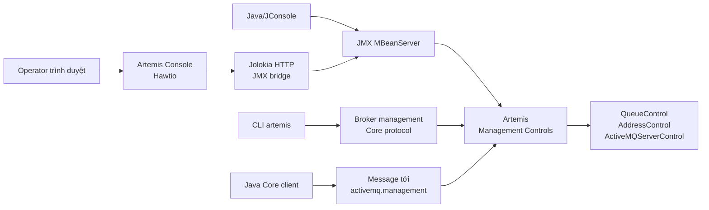
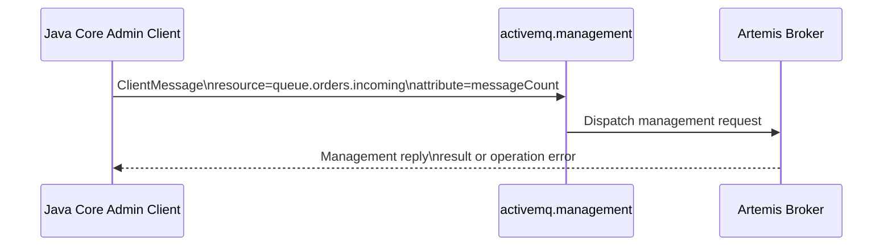

# Artemis Management Console, CLI, JMX và management API

> **Chương:** Giám sát  
> **Phạm vi:** Apache ActiveMQ **Artemis** (file cấu hình `broker.xml`, `bootstrap.xml` và `management.xml`). Bài hướng dẫn **bốn đường quan sát/quản trị broker**: Web Console (Hawtio), công cụ `artemis` CLI, JMX/Jolokia và management message API. Ví dụ ưu tiên **read-only**, có Java cụ thể và cách bảo vệ quyền truy cập. Đây không phải giao diện quản trị của ActiveMQ Classic.

## 1. Một management model, nhiều đường truy cập

Khi `orders.incoming` tồn đọng 10.000 message, operator cần biết queue còn consumer hay không, message đang giao bao nhiêu, broker có paging không và có phải restart hay không. Artemis cung cấp **một bộ managed resources** (broker, address, queue, connection, session, consumer, bridge…) nhưng có nhiều client để truy cập.



| Kênh | Điểm truy cập | Mục đích chính | Rủi ro cần kiểm soát |
| --- | --- | --- | --- |
| **Console** | `http://localhost:8161/console` trong cấu hình mặc định | Khám phá topology, xem queue/consumer, browse message, thao tác có kiểm soát | Có nút `Purge`/`Delete`/`Move`; cần RBAC và audit |
| **CLI** | `<instance>/bin/artemis`; shell hoặc lệnh một lần | Điều tra nhanh, `queue stat`, health check, quản lý queue/address | Một số lệnh thay đổi state; tránh secret trong process arguments |
| **JMX** | MBeans trong JVM, remote JMX khi **chủ động bật** | Truy xuất attribute, invoke operation, tích hợp công cụ Java | Remote JMX/RMI có bề mặt tấn công lớn nếu mở công khai |
| **Jolokia HTTP** | `/console/jolokia` | Đọc/gọi JMX bằng HTTP/JSON; Console sử dụng cùng cơ chế | Phải bảo vệ HTTP(S), credentials, CORS/Origin và RBAC |
| **Management message API** | Address `activemq.management` qua CORE/JMS | Automation trong mạng message, không cần JMX RMI | Quyền `manage`; lệnh destructive cũng là management operation |

**Tách hai khái niệm:** *management API* là các **operations/attributes của resources**. *Transport quản trị* là JMX, Jolokia, CORE/JMS message, CLI hoặc Console. CLI không bao phủ mọi operation; khi viết automation phức tạp, dùng API có dữ liệu JSON hoặc Micrometer metrics thay vì parse bảng hiển thị CLI.

## 2. Hiểu resource trước khi đọc số liệu

Artemis có **address** định tuyến tới một hoặc nhiều **queue**. Các số liệu queue không nên cộng/trừ tùy ý với số liệu address; một message multicast có thể được route đến nhiều queue subscription.

| Resource/interface | Một số thuộc tính hoặc operation hữu ích | Câu hỏi nó trả lời |
| --- | --- | --- |
| `ActiveMQServerControl` | `getVersion`, `isActive`, `getQueueNames`, `listConnectionIDs`, `listQueues` | Broker có active không? Có những queue/connections nào? |
| `AddressControl` | `getQueueNames`, `getAddressSize`, pause/block address | Message được route vào những queue nào? Address có áp lực bộ nhớ? |
| `QueueControl` | `getMessageCount`, `getConsumerCount`, `getDeliveringCount`, `getMessagesAdded`, `getMessagesAcknowledged` | Queue tồn bao nhiêu message, có consumer và tiến độ không? |
| `QueueControl` (thao tác thay đổi) | `pause`, `resume`, `removeMessages`, `moveMessages` | Dừng giao, xóa hoặc chuyển message có chủ đích |
| Connections/sessions | `listConnections`, `listSessions`, `listConsumers` | Client/protocol nào đang giữ tài nguyên? |

**Dữ liệu cần diễn giải theo cùng thời điểm:**

- `MessageCount`: snapshot số message trong queue theo cách Artemis quản lý, **không** phải số event nghiệp vụ chưa thành công. Nó có thể thay đổi giữa hai lời gọi.
- `DeliveringCount`: số message **đang được giao** cho consumers và chưa hoàn tất xác nhận.
- `ConsumerCount`: số consumers **đang gắn queue**; bằng 0 không chứng minh broker bị lỗi (worker có thể cố ý dừng).
- `MessagesAdded` / `MessagesAcknowledged`: counters theo vòng đời của queue/broker; nên lấy **chênh lệch giữa hai lần đọc** để tính tốc độ, thay vì lấy giá trị tuyệt đối làm messages/giây.
- `ScheduledCount`, `MessagesExpired`, `MessagesKilled`: giúp phân biệt message chờ lịch, hết hạn và bị chuyển sang xử lý thất bại.

Ví dụ với `MessageCount=10.000` và `ConsumerCount=0`: đây thường là backlog chưa có worker; không cần vội `Purge`. Với `ConsumerCount=5` mà `DeliveringCount` đứng yên cùng `MessagesAcknowledged` không tăng, kiểm tra worker treo/transaction, downstream và redelivery.

## 3. Artemis Management Console: xem rồi mới thao tác

### 3.1. Đường truy cập và cấu hình liên quan

Instance Artemis thường cung cấp:

```text
Console: http://localhost:8161/console
Jolokia: http://localhost:8161/console/jolokia
Core:    tcp://localhost:61616
```

Đây là **địa chỉ mặc định ví dụ** của instance do Artemis tạo, không áp dụng nếu người vận hành đã đổi `bootstrap.xml`, network binding hoặc port offset. Đối chiếu log startup có các thông báo dạng:

```text
AMQ241002: Artemis Jolokia REST API available at ...
AMQ241004: Artemis Console available at ...
```

Console sử dụng **Jolokia → JMX**. Trong `etc/bootstrap.xml`, web binding quyết định port/HTTP(S), còn `etc/jolokia-access.xml` kiểm soát truy cập Jolokia/CORS. `etc/management.xml` điều khiển các lựa chọn JMX, trong đó có RBAC hoặc remote JMX connector.

**Mặc định chỉ nên truy cập từ localhost/VPN/bastion.** Không đưa port 8161 ra Internet chỉ vì cần xem queue. Nếu reverse proxy TLS kết thúc HTTPS rồi chuyển HTTP nội bộ, kiểm tra cấu hình Origin/CORS; trạng thái “đăng nhập được nhưng giao diện trống” thường liên quan đến Jolokia bị từ chối vì Origin/scheme, không nhất thiết do broker CORE.

### 3.2. Quy trình điều tra một queue bằng Console

1. Đăng nhập bằng account quan sát có **quyền đọc** thích hợp.
2. Chọn **Artemis → Queues**, tìm queue `orders.incoming`; xác nhận cả **Address**, **Routing Type** và **Queue Name**.
3. Đọc `Message Count`, `Consumer Count`, `Delivering Count`, `Messages Added/Acked`; ghi timestamp và broker/node đang quan sát.
4. Dùng **Browse** để xem một số message/headers/properties khi cần. Browse **không ACK**, nhưng body có thể chứa dữ liệu nhạy cảm và một trang browse không chứng minh toàn bộ queue khỏe.
5. Xem **Connections/Consumers** để xác định client ID, protocol, user và remote address của worker.
6. Kiểm tra **Addresses** (address size, page count) và trạng thái broker, sau đó mới kết luận nghẽn do consumer, routing hay disk.
7. Khi cần thay đổi, lập phiếu thao tác/audit, giới hạn message ID hoặc selector và có bước xác nhận thứ hai.

Các thao tác Console **không đồng nghĩa nhau**:

| Thao tác | Tác động | Mức độ an toàn |
| --- | --- | --- |
| **Browse** | Chỉ xem message đang nằm trong queue | Read-only về mặt ACK; vẫn cần quyền dữ liệu |
| **Pause/Resume** | Tạm dừng/tiếp tục dispatch tùy resource | Có tác động vận hành |
| **Move** | Bỏ message khỏi queue nguồn, thêm vào queue đích | Thay đổi state, cần kiểm tra selector và queue đích |
| **Copy** | Thêm bản sao vào queue đích, giữ message nguồn | Có nguy cơ double-processing |
| **Purge** | Xóa toàn bộ message của queue | **Destructive**, không tự undo |
| **Delete Queue** | Xóa tài nguyên queue; dữ liệu của nó có thể mất | **Destructive**, cần quy trình riêng |

Tính năng cụ thể theo version/role; **không thực hành Purge hoặc Delete trên queue production** để kiểm tra Console có hoạt động không.

## 4. CLI: `artemis shell`, `queue stat`, kiểm tra node

CLI nên được gọi từ **broker instance** hoặc bản cài Artemis tương thích với broker đích. Trên Linux:

```bash
ARTEMIS_INSTANCE=/srv/artemis/instance-a

"$ARTEMIS_INSTANCE/bin/artemis" help
"$ARTEMIS_INSTANCE/bin/artemis" help queue
"$ARTEMIS_INSTANCE/bin/artemis" help queue stat
"$ARTEMIS_INSTANCE/bin/artemis" help check

# Shell quản trị; nhập connection URL/credentials qua prompt nếu cần.
"$ARTEMIS_INSTANCE/bin/artemis" shell
```

Trong shell tương tác:

```text
Apache Artemis > connect
Apache Artemis > queue stat
Apache Artemis > help queue
Apache Artemis > disconnect
```

`queue stat` có thể trả bảng với các cột như:

```text
NAME   ADDRESS   CONSUMER_COUNT   MESSAGE_COUNT   MESSAGES_ADDED
       DELIVERING_COUNT   MESSAGES_ACKED   SCHEDULED_COUNT   ROUTING_TYPE
```

**Dùng lệnh thật trên instance để xem chính xác cú pháp.** Tham số `--url`, `--user`, `--password` được hỗ trợ ở các lệnh kết nối tới broker, nhưng đặt mật khẩu trực tiếp trên dòng lệnh có thể lộ trong process list/shell history. Shell có thể giữ kết nối/credential cho các lần gọi tiếp theo; chỉ dùng trên máy quản trị được bảo vệ.

Trên Windows:

```powershell
$instance = 'C:\brokers\artemis-a'
& "$instance\bin\artemis.cmd" help queue
& "$instance\bin\artemis.cmd" shell
```

### 4.1. `queue stat` khác `check`

`queue stat` phù hợp quan sát **ảnh chụp trạng thái nhiều queue**, không nên dùng như lệnh kiểm tra sức khỏe duy nhất. CLI còn có nhóm `check` (chi tiết xem `help check` trên phiên bản đang chạy) để xác minh các điều kiện như khả năng kết nối/đánh giá node hoặc queue.

| Câu hỏi | Hướng CLI phù hợp | Bổ sung khi điều tra |
| --- | --- | --- |
| Broker có nhận connection quản trị? | `connect`, nhóm `check` | Console, transport logs |
| Queue nào đang backlog cao? | `queue stat` | QueueControl/JMX lấy theo thời gian |
| Queue không có consumer? | `queue stat`, queue detail | `listConsumers` qua management API |
| Cần liệt kê/đổi cấu hình queue | `help queue`, subcommand phù hợp | Xác nhận thao tác không xóa dữ liệu |
| Cần biết journal có bị hỏng khi broker tắt | `data print`, `data recover` (offline) | **Không chạy data tools offline trên broker live** |

**CLI là công cụ thao tác cho người vận hành**, đầu ra bảng không phải stable machine-readable schema. Với dashboard dài hạn, sử dụng metrics plugin hoặc quản trị API trả JSON thay vì dùng regex parse đầu ra `queue stat`.

## 5. JMX: trực tiếp đọc MBeans trên JVM

Các Artemis management resources được expose làm MBeans thuộc domain mặc định `org.apache.activemq.artemis`. Với queue anycast `orders.incoming` tại address cùng tên, một ObjectName thường có dạng:

```text
org.apache.activemq.artemis:
  broker=<brokerName>,
  component=addresses,
  address="orders.incoming",
  subcomponent=queues,
  routing-type="anycast",
  queue="orders.incoming"
```

Viết thành **một dòng** khi query; `brokerName` phải lấy từ broker thực. Artemis dùng `ObjectNameBuilder` để tạo tên chính xác theo config/version. Đừng hardcode “0.0.0.0” làm broker name cho mọi môi trường chỉ vì nó xuất hiện trong ví dụ tài liệu.

### 5.1. Remote JMX **mặc định đóng**

JMX management trong JVM thường được bật, nhưng **remote JMX connector không được bật mặc định**. Một cách cấu hình trong `etc/management.xml`:

```xml
<!-- Trích đoạn bên trong <management-context ...> của management.xml -->
<connector
    connector-host="127.0.0.1"
    connector-port="1099"
    rmi-registry-port="1098"
    secured="false"/>
```

Đoạn này **chỉ dùng cho lab/local hoặc SSH tunnel**, không phải cấu hình production public. Muốn remote truy cập qua mạng, bảo vệ SSL, authentication, authorization và firewall theo runbook, đồng thời xử lý cổng RMI registry/RMI server để tránh kết nối treo do port ngẫu nhiên.

- Remote JMX sử dụng **JMX/RMI**, không phải CORE port 61616 và không phải Console port 8161.
- Broker có thể áp RBAC theo `management.xml` hoặc cơ chế `view/edit` trong `broker.xml` với `ArtemisRbacMBeanServerBuilder`; đừng bật chồng hai kiểu interception.
- `JConsole` attach local vào JVM thường không mang credentials phù hợp với RBAC Artemis; có thể bị từ chối thao tác. Không tắt authorization chỉ để “cho JConsole chạy được”.

### 5.2. Java 17: đọc `MessageCount` và `ConsumerCount` qua JMX

Ví dụ dùng **JDK chuẩn** nên không cần thêm dependency Artemis cho lớp này. Giả định đã bật remote JMX an toàn ở `127.0.0.1:1099` và một người dùng có quyền xem queue.

```java
import java.util.Hashtable;
import java.util.Set;

import javax.management.MBeanServerConnection;
import javax.management.ObjectName;
import javax.management.remote.JMXConnector;
import javax.management.remote.JMXConnectorFactory;
import javax.management.remote.JMXServiceURL;

public final class ArtemisQueueJmxRead {
    public static void main(String[] args) throws Exception {
        String url = "service:jmx:rmi:///jndi/rmi://"
                + "127.0.0.1:1099/jmxrmi";

        String[] credentials = {
                required("JMX_USER"),
                required("JMX_PASSWORD")
        };
        Hashtable<String, Object> env = new Hashtable<>();
        env.put(JMXConnector.CREDENTIALS, credentials);

        try (JMXConnector connector = JMXConnectorFactory.connect(
                new JMXServiceURL(url), env)) {

            MBeanServerConnection mbsc =
                    connector.getMBeanServerConnection();

            // Query theo resource path thay vì đoán brokerName.
            ObjectName pattern = new ObjectName(
                    "org.apache.activemq.artemis:"
                    + "component=addresses,"
                    + "address=\"orders.incoming\","
                    + "subcomponent=queues,"
                    + "queue=\"orders.incoming\",*");

            Set<ObjectName> matches = mbsc.queryNames(pattern, null);
            if (matches.size() != 1) {
                throw new IllegalStateException(
                        "Expected one queue MBean, got " + matches);
            }

            ObjectName queue = matches.iterator().next();
            long count = ((Number) mbsc.getAttribute(
                    queue, "MessageCount")).longValue();
            int consumers = ((Number) mbsc.getAttribute(
                    queue, "ConsumerCount")).intValue();
            int delivering = ((Number) mbsc.getAttribute(
                    queue, "DeliveringCount")).intValue();

            System.out.printf(
                    "queue=%s pending=%d consumers=%d delivering=%d%n",
                    queue, count, consumers, delivering);
        }
    }

    private static String required(String name) {
        String value = System.getenv(name);
        if (value == null || value.isBlank()) {
            throw new IllegalStateException("Missing env " + name);
        }
        return value;
    }
}
```

`ObjectName` ở ví dụ dùng pattern `,*` để bỏ qua broker name/routing type; chỉ chạy khi biết chắc không có **hai brokers/queue MBeans khớp cùng pattern** trên một MBeanServer. Trên hệ thống quản lý nhiều brokers, phải lọc thêm broker name/routing type và kiểm tra chính xác một kết quả.

**Đây là code read-only**: `getAttribute` không làm ACK message. Nếu muốn gọi `invoke("removeMessages",...)`, bạn đã đi từ giám sát sang **thay đổi dữ liệu**, cần quyền edit và quy trình phê duyệt.

## 6. Jolokia HTTP: JMX dưới dạng JSON

Jolokia được deploy cùng Console trong nhiều bản Artemis. Endpoint ví dụ:

```text
http://localhost:8161/console/jolokia
```

**Không nhầm với một REST API business độc lập.** HTTP request chứa `type=read`, `mbean` và `attribute` được Jolokia chuyển thành JMX query; kết quả gồm `status`, `value`, `timestamp`.

Ví dụ chỉ đọc broker active, giả định MBean của broker trong lab có tên `broker="0.0.0.0"` (xác nhận tên thật trước khi chạy):

```bash
curl --silent --show-error \
  --user monitor-user \
  -H 'Origin: http://localhost' \
  -H 'Content-Type: application/json' \
  --data '{"type":"read","mbean":"org.apache.activemq.artemis:broker=\"0.0.0.0\"","attribute":"Active"}' \
  http://localhost:8161/console/jolokia
```

`curl --user monitor-user` không hardcode password vào lệnh; nó có thể prompt password. Trong production dùng TLS/HTTPS nội bộ và secret management, không in credential hoặc payload vào logs. `Origin` phải được Jolokia cho phép trong `etc/jolokia-access.xml`; thêm wildcard CORS để “chữa giao diện trắng” sẽ làm yếu bảo mật.

Một kết quả hợp lệ có thể là:

```json
{
  "request": {
    "type": "read",
    "mbean": "org.apache.activemq.artemis:broker=\"0.0.0.0\"",
    "attribute": "Active"
  },
  "value": true,
  "status": 200
}
```

**Hai tầng lỗi cần kiểm tra**: HTTP status có thể thành công nhưng Jolokia JSON `status` báo operation error; thêm nữa, user có thể đăng nhập Console được nhưng không có `view` trên MBean. Không suy từ việc port 8161 mở rằng mọi thao tác management đều có quyền.

### 6.1. Khi nào dùng Jolokia thay JMX/RMI?

- Cần HTTP/JSON dễ tích hợp cùng internal tooling, qua reverse proxy có HTTPS, policy CORS và identity kiểm soát.
- Muốn đọc vài attributes định kỳ nhưng chưa có metrics backend.
- Cần điều tra một broker từ network segment không phù hợp cho JMX/RMI.

**Không poll một lượng lớn message bodies qua Jolokia mỗi giây.** Dùng metrics plugin để thu thập số liệu thời gian dài, tránh tạo áp lực CPU, serialization và lộ dữ liệu từ queue browsing.

## 7. Management message API: quản trị qua Artemis CORE

Artemis cho phép gửi **management request message** tới một address đặc biệt (mặc định):

```xml
<!-- Trích đoạn trong phần core của broker.xml -->
<management-address>activemq.management</management-address>

<security-settings>
    <security-setting match="activemq.management">
        <permission type="manage" roles="ops-admin"/>
    </security-setting>
</security-settings>
```

Đây là **trích đoạn**, phải được ghép vào các phần `<security-settings>` đã có thay vì tạo phần tử trùng. User trong `ops-admin` phải được tạo và gán role qua authentication/authorization; ví dụ chỉ cấp quyền `manage` trên management address, chưa phải cấu hình security hoàn chỉnh cho mọi destination.

Luồng request/reply quản trị:



`ManagementHelper` điền các property đặc thù của Artemis để chỉ ra **resource name**, **attribute/operation** và **arguments**. Đừng tự suy đây là một JMS selector hay body JSON thông thường.

### 7.1. Java Core: đọc `messageCount` qua management request/reply

Maven dependency (Java 17+, đồng bộ version với broker/BOM):

```xml
<dependency>
    <groupId>org.apache.artemis</groupId>
    <artifactId>artemis-core-client</artifactId>
    <version>2.57.0</version>
</dependency>
```

Tên Maven group/version ở ví dụ dùng distribution hiện đại Apache Artemis; ở dự án đã có dependency management, dùng BOM/version tương thích thực tế thay vì pin bừa bãi nhiều phiên bản Artemis.

File `ArtemisCoreManagementRead.java`:

```java
import org.apache.activemq.artemis.api.core.client.ActiveMQClient;
import org.apache.activemq.artemis.api.core.client.ClientMessage;
import org.apache.activemq.artemis.api.core.client.ClientRequestor;
import org.apache.activemq.artemis.api.core.client.ClientSession;
import org.apache.activemq.artemis.api.core.client.ClientSessionFactory;
import org.apache.activemq.artemis.api.core.client.ServerLocator;
import org.apache.activemq.artemis.api.core.management.ManagementHelper;
import org.apache.activemq.artemis.api.core.management.ResourceNames;

public final class ArtemisCoreManagementRead {
    public static void main(String[] args) throws Exception {
        String url = required("ARTEMIS_URL");
        String user = required("ARTEMIS_USER");
        String password = required("ARTEMIS_PASSWORD");
        String queue = "orders.incoming";

        try (ServerLocator locator =
                     ActiveMQClient.createServerLocator(url);
             ClientSessionFactory factory =
                     locator.createSessionFactory();
             ClientSession session =
                     factory.createSession(user, password, false,
                             true, true, false, 0);
             ClientRequestor requestor =
                     new ClientRequestor(session, "activemq.management")) {

            session.start();

            ClientMessage request = session.createMessage(false);
            ManagementHelper.putAttribute(
                    request, ResourceNames.QUEUE + queue,
                    "messageCount");

            ClientMessage reply = requestor.request(
                    request, 5_000L);
            if (reply == null) {
                throw new IllegalStateException(
                        "Management request timed out");
            }
            if (!ManagementHelper.hasOperationSucceeded(reply)) {
                throw new IllegalStateException(
                        "Management call rejected: "
                        + ManagementHelper.getResult(reply));
            }

            Object value = ManagementHelper.getResult(reply);
            System.out.println("Queue " + queue
                    + " messageCount=" + value);
        }
    }

    private static String required(String name) {
        String value = System.getenv(name);
        if (value == null || value.isBlank()) {
            throw new IllegalStateException("Missing env " + name);
        }
        return value;
    }
}
```

Ví dụ biến môi trường cho broker test:

```text
ARTEMIS_URL=tcp://127.0.0.1:61616
ARTEMIS_USER=ops_reader
ARTEMIS_PASSWORD=<secret do lab cung cấp>
```

**Điểm quan trọng về quyền và version:**

- `ResourceNames.QUEUE + queue` tạo tên resource kiểu `queue.orders.incoming`; `"messageCount"` là attribute, không phải tên method Java ở client.
- Management **message API** qua broker yêu cầu `manage` đối với `activemq.management`. Nếu bật `<management-message-rbac>true</management-message-rbac>` trên phiên bản hỗ trợ, việc đọc attribute còn bị giới hạn bằng quyền `view`/`edit` tương ứng, cộng với `manage`.
- Đoạn code dùng **Artemis Core client**. `ManagementHelper` không thể tùy tiện áp dụng cho `javax.jms.Message` hoặc JMS client của provider khác; Artemis có đường JMS management tương ứng nhưng core helper này cần `ClientMessage` phù hợp.
- `ClientRequestor.request(request, 5_000L)` có timeout; không dùng bản chờ vô hạn để gọi management từ health endpoint.
- Management reply có thể báo lỗi quyền, resource không tồn tại hoặc operation không phù hợp, dù kết nối transport thành công.

**Không trao role `ops-admin` cho toàn bộ business clients** chỉ vì muốn có một màn hình kiểm tra queue. Tách role read-only/monitoring và role có quyền chỉnh sửa, đồng thời cấu hình JMX/management RBAC theo version.

## 8. Security: quyền xem khác quyền thay đổi

### 8.1. JMX RBAC và quản trị qua message không hoàn toàn giống nhau

| Đường truy cập | Điều kiện thông dụng | Lưu ý |
| --- | --- | --- |
| Console | Hawtio login + role hợp lệ + JMX RBAC | User có thể login nhưng không `view`/`edit` MBean |
| Jolokia | HTTP authentication/Origin/CORS + JMX RBAC | Bật HTTP proxy/TLS đúng cách |
| Remote JMX | Connector bật chủ động + authentication + JMX RBAC | Không expose RMI public; cần xử lý port và SSL |
| Core management message | Broker connection + `manage` trên management address | Nếu bật fine-grained message RBAC, còn cần `view`/`edit` cho operation |
| CLI | Broker credentials + permissions của lệnh tương ứng | CLI không tự bypass quyền của broker |

Theo Artemis, JMX authorization có thể triển khai bằng:

- Các rule `role-access` trong `management.xml`, thường phân biệt methods bắt đầu `get*`/`list*` và các operation sửa state.
- Hoặc security-settings `mops.*` trong `broker.xml` khi bật `ArtemisRbacMBeanServerBuilder`. Nếu dùng builder này, **bỏ configuration authorization thay thế trong `management.xml`** như tài liệu yêu cầu.

Ví dụ về chính sách nguyên tắc (pseudocode RBAC, không copy trực tiếp thành XML khi chưa chọn cơ chế quản lý):

```text
ops-viewer: read queue counts, list connections, view broker active
ops-operator: ops-viewer + pause/resume theo danh sách resource
ops-admin: tạo/xóa queue, move/remove messages, failover/stop
business-app: send/consume đúng address, KHÔNG cấp management rộng
```

**Audit mọi mutation**: ai thao tác, broker/node nào, queue, selector/message ID, trước–sau và ticket change. Lệnh `removeMessages("")` hoặc `Purge` có thể xóa **tất cả message** trong queue, không cần consumer ACK và không thể undo theo JMS.

### 8.2. Management endpoint không phải health endpoint public

Một endpoint quản trị có thể trả payload, danh sách user/remote address hoặc cho phép chỉnh queue. Vì vậy:

- Đặt Console/Jolokia và remote JMX sau private network, VPN/bastion và TLS.
- Chọn read-only role cho dashboard, không dùng admin credential trong exporter/grafana.
- Bảo vệ `etc/jolokia-access.xml`: không bật CORS wildcard chỉ để dễ gọi API từ browser tùy ý.
- Giới hạn polling frequency, kích thước response, phân trang khi `listQueues`/`listConnections`.
- Không bật remote JMX trên cổng public; nếu cần, dùng tunnel và chứng thực.
- Không log body dữ liệu khách hàng khi chỉ cần `MessageCount` hoặc `ConsumerCount`.

## 9. Từ snapshot thành giám sát liên tục

Console, CLI và JMX read đều thường trả **snapshot**. Nếu muốn phát hiện một queue đang tăng backlog, cần lấy mẫu theo thời gian:

```text
T0: messageCount=500, messagesAdded=10.000, messagesAcked=9.500
T1: messageCount=750, messagesAdded=10.600, messagesAcked=9.850

Trong khoảng T0→T1:
  added delta = +600
  acked delta = +350
  backlog delta = +250
```

Chỉ trừ counters khi chúng thuộc **cùng queue và cùng lifecycle**; nếu broker restart/queue bị tạo lại/counter reset thì xử lý như một chuỗi đo mới, không coi delta âm là business throughput âm. Thực tế expiry, DLQ, move, scheduled và paging làm phương trình backlog phức tạp hơn `added - acked`.

Artemis hỗ trợ metrics qua **Micrometer plugin**; nếu cần Prometheus/Grafana dài hạn, ưu tiên hệ metrics phù hợp thay vì chạy `queue stat` mỗi giây. Plugin tùy cấu hình/phiên bản; các metric như `artemis.message.count`, `artemis.delivering.message.count`, `artemis.consumer.count` gắn nhãn broker/address/queue, trong khi JVM/disk metrics là nhóm khác.

### Bảng cảnh báo gợi ý (ngưỡng phải tự đo)

| Tình huống | Cần nhìn đồng thời | Phản ứng |
| --- | --- | --- |
| Backlog tăng dài | MessageCount, Added/Acked rate, ConsumerCount | Kiểm tra workers, downstream và lượng ingress |
| ConsumerCount bằng 0 bất thường | Queue, app deployment, connection errors | Khôi phục worker hoặc xác minh dừng theo kế hoạch |
| DeliveringCount cao không giảm | In-flight/ACK, transaction, consumer logs | Tìm consumer treo, lỗi DB hoặc tx chưa commit |
| MessageExpired/MessagesKilled tăng | TTL, redelivery, DLQ address | Kiểm tra timeout/poison messages |
| Broker gần disk/address limit | Address size, paging, store usage | Giảm ingress, xử lý capacity, không `Purge` tùy tiện |
| Active=false hoặc failover | Active state, cluster/HA logs | Xác minh node active/backup trước khi route clients |
| Authentication denied tăng | Audit log và địa chỉ nguồn | Kiểm tra credential hoặc hành vi truy cập bất thường |

**Đo cả ứng dụng** (độ trễ xử lý, lỗi DB, số eventId đã commit) và broker (queue state). `MessagesAcked` tăng không đồng nghĩa side effect nghiệp vụ đã commit đúng nếu consumer ACK trước DB.

## 10. Lab kiểm chứng Console, CLI, JMX, management message

**Điều kiện:** broker Artemis test chạy CORE ở `61616`, Console tại `8161`, queue anycast `orders.incoming` được provision, user quản trị riêng với quyền read-only cho từng kênh. Có thể cần bật remote JMX **chỉ trên localhost** cho lab. Không thử destructive operations trên data thật.

### Lab A — Console và CLI cùng nhìn một queue

1. Gửi 20 message persistent vào `orders.incoming`, **chưa chạy consumer**.
2. Console → Artemis → Queues: ghi `MessageCount`, `ConsumerCount`, routing type.
3. Chạy `artemis shell` → `connect` → `queue stat` và đối chiếu số liệu.
4. Mở một worker consumer, nhận/ACK 5 message; ghi snapshot sau đó.
5. Console **Browse** phần còn lại; xác nhận Browse không làm giảm queue count.
6. Kiểm tra `DeliveringCount` khi worker đang giữ message chưa ACK, sau khi commit thì giảm.

**PASS:** Console và CLI nhìn cùng broker/queue, số liệu tương thích trong phạm vi thời điểm đọc. Hai lần snapshot không cần bằng nhau tuyệt đối nếu queue đang thay đổi.

### Lab B — Jolokia/JMX read-only

1. Dùng URL broker Console/Jolokia thực tế từ startup log.
2. Trên lab, chạy `curl` đọc `Active` của broker MBean bằng credentials read-only.
3. Bật JMX connector tại localhost, kết nối bằng `JConsole` remote hoặc chạy `ArtemisQueueJmxRead`.
4. So sánh queue `MessageCount` / `ConsumerCount` từ JMX với Console.
5. Dùng account thiếu quyền `view`, xác nhận bị từ chối mà broker vẫn hoạt động.
6. Không “sửa” lỗi bằng cách tắt authentication/authorization trên production.

### Lab C — Management message

1. Cấu hình `management-address` và `manage` trên broker test, gắn user lab có quyền tương ứng.
2. Chạy `ArtemisCoreManagementRead`. Kiểm tra `messageCount` trả được kết quả.
3. Thay resource thành một queue không tồn tại để kiểm chứng lỗi được trả về, không chỉ timeout.
4. Dùng user thiếu `manage`, kiểm tra broker từ chối operation.
5. Bật fine-grained management message RBAC **trên môi trường test** rồi kiểm tra role chỉ xem được phép đọc mà không được `removeMessages`.

### Lab D — Quan sát quá tải và phân trang

1. Gửi nhiều message vào queue test có kiểm soát, dừng consumer.
2. So sánh `MessageCount` và `MessagesAdded` qua 2–3 mốc, xác định tốc độ tăng.
3. Dùng Console browse theo trang; không fetch toàn bộ payload vài trăm nghìn message vào browser.
4. Dùng management API `listQueues` có pagination khi số queue lớn.
5. Khôi phục consumer rồi theo dõi backlog giảm và số ACK tăng, so sánh với app metrics.

## 11. Chẩn đoán nhanh

| Hiện tượng | Nguyên nhân thường gặp | Cách xử lý |
| --- | --- | --- |
| Không mở được `:8161/console` | Web binding/port khác, firewall, broker web server chưa lên | Xem startup log và `bootstrap.xml` |
| Đăng nhập Console được nhưng giao diện trắng | Jolokia bị chặn bởi Origin/CORS/scheme hoặc quyền JMX | Kiểm tra browser network, `jolokia-access.xml`, reverse proxy |
| `queue stat` không kết nối được | Sai URL/credentials, broker CORE port không mở | `help queue stat`, `connect`, broker listener |
| CLI thấy queue khác Console | Đang quản lý **hai brokers/nodes khác nhau** hoặc snapshot khác lúc | Ghi broker name, node ID/URL và timestamp |
| JConsole local attach bị từ chối | Artemis RBAC cần authenticated subject, local attach không truyền credentials | Dùng remote JMX an toàn + credentials, không vô hiệu hóa RBAC |
| Remote JMX timeout | Connector mặc định off, RMI ports/firewall, host binding | Bật đúng `management.xml` và bảo vệ network |
| JMX không tìm thấy queue MBean | Sai ObjectName/broker-name/domain/routing-type hoặc queue không tồn tại | Dùng `queryNames` và đối chiếu actual MBeans |
| Jolokia HTTP 200 nhưng JSON `status` lỗi | JMX permission, MBean/attribute sai, Origin/policy | Kiểm tra `status` + `error`, không chỉ HTTP |
| Core management request timeout | Address/permission/CORE routing hoặc broker đang lỗi | Kiểm tra `manage` và management reply path |
| `MessageCount` không giảm dù ACK tăng | Có producer song song hoặc scheduled/paging/delivery thay đổi | Đo counters theo thời gian và queue state |
| Browse làm lộ payload nhạy cảm | Role quan sát quá rộng | Tách ACL, giới hạn access body, audit |
| Operator vô tình xóa backlog | Nhầm `Purge`/`Delete` với xem thống kê | Tách role, xác nhận nhiều bước và runbook |

## 12. Checklist vận hành an toàn

- [ ] Xác nhận đúng broker Artemis, URL/port/node đang quan sát.
- [ ] Biết Console → Jolokia → JMX và CORE management message là hai transport quản trị khác nhau.
- [ ] Dùng Console để điều tra queue, connection và consumer; **Browse không phải Purge**.
- [ ] Dùng CLI `queue stat`/`help queue` cho thao tác nhanh, không parse bảng thành metrics production.
- [ ] Nắm JMX MBean domain/ObjectName và biết **remote JMX mặc định đóng**.
- [ ] Khi dùng Jolokia, bảo vệ HTTP(S), Origin/CORS và RBAC; kiểm tra cả JSON `status`.
- [ ] Management message API có quyền `manage` và fine-grained `view/edit` khi bật RBAC.
- [ ] Tách tài khoản xem metrics khỏi tài khoản chỉnh/xóa queue và force failover.
- [ ] Không hardcode password trong CLI arguments, source hoặc dashboard.
- [ ] Đọc `MessageCount` cùng `DeliveringCount`, `ConsumerCount`, `MessagesAdded`, `MessagesAcked` và timestamp.
- [ ] Alert theo **tốc độ thay đổi** và SLO; có metrics plugin/time-series backend nếu cần liên tục.
- [ ] Không dùng `Purge`/`removeMessages("")` như biện pháp sửa backlog trước khi phân tích nguyên nhân.
- [ ] Test quyền bị từ chối, broker restart/failover, JMX/Jolokia disconnect và queue đổi trạng thái trên broker lab.

## Tài liệu tham khảo

1. [Apache Artemis — Management](https://artemis.apache.org/components/artemis/documentation/latest/management.html): `ActiveMQServerControl`, `QueueControl`, JMX, Jolokia, management messages và RBAC.
2. [Apache Artemis — Management Console](https://artemis.apache.org/components/artemis/documentation/latest/management-console.html): HTTP/console path, Jolokia CORS và login.
3. [Apache Artemis Console User Guide](https://artemis.apache.org/components/artemis-console/documentation/latest/): Queue Browse/Move/Copy/Purge và views.
4. [Apache Artemis — Command Line Interface](https://artemis.apache.org/components/artemis/documentation/latest/using-cli.html): `artemis shell`, `queue stat`, `help`, `check`.
5. [Apache Artemis — Metrics](https://artemis.apache.org/components/artemis/documentation/latest/metrics.html): Micrometer plugin và broker/address/queue metrics.
6. [Apache Artemis — Using the Server](https://artemis.apache.org/components/artemis/documentation/latest/using-server.html): `bootstrap.xml`, `management.xml`, `jolokia-access.xml`.
7. [Apache Artemis — QueueControl Javadoc](https://artemis.apache.org/components/artemis/documentation/javadocs/javadoc-latest/org/apache/activemq/artemis/api/core/management/QueueControl.html): thuộc tính queue.
