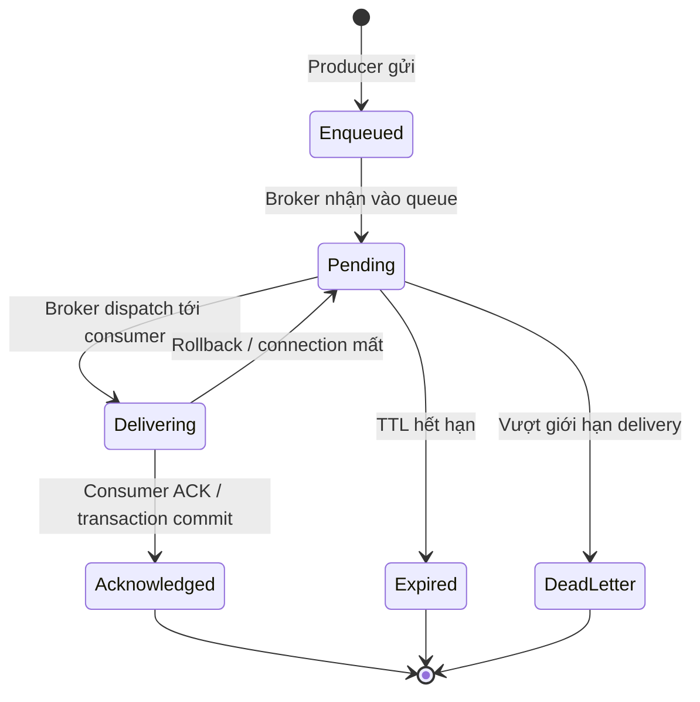

# Queue depth, số thông điệp đang giao, enqueue, dequeue và tốc độ xử lý

> **Chương:** Giám sát  
> **Phạm vi:** Đọc và diễn giải các chỉ số queue của **ActiveMQ Classic** và **Artemis**: số message đang chờ, số message đã dispatch nhưng chưa được xác nhận, bộ đếm enqueue/dequeue và tốc độ xử lý theo thời gian. Bài tập trung vào **đo đúng trạng thái backlog và throughput**, không lặp lại cấu hình producer/consumer hay toàn bộ hệ thống metrics.

Một dashboard hiển thị queue có **12.000 messages** chưa đủ để kết luận hệ thống đang khỏe hay sắp nghẽn. Con số đó có thể là backlog đang chờ consumer, có thể bị chi phối bởi messages đã dispatch nhưng chưa ACK tùy cách provider định nghĩa metric; cũng có thể là queue đang tăng nhanh nhưng consumer vẫn xử lý tốt trong thời gian ngắn. Muốn biết thực chất, phải đọc **nhiều chỉ số cùng nhau và theo chuỗi thời gian**.

Trong bài này, các khái niệm được chuẩn hóa như sau:

- **Queue depth / pending:** số message đang chờ được dispatch tới consumer.
- **Delivering / in-flight:** số message đã được broker giao cho consumer nhưng broker chưa ghi nhận hoàn tất (ACK/commit).
- **Enqueue count:** bộ đếm tích lũy số message được thêm vào queue.
- **Dequeue / acknowledged count:** bộ đếm tích lũy số message được xác nhận/loại khỏi trạng thái chờ theo accounting của broker.
- **Processing rate:** số message mà ứng dụng hoàn tất xử lý trong một đơn vị thời gian; đây là metric ở **tầng ứng dụng**, cần phân biệt với tốc độ broker dispatch hoặc ACK.

Các broker có tên thuộc tính và ranh giới accounting khác nhau. Vì vậy, không dùng tên metric giống nhau để mặc định semantics giống nhau; hãy ánh xạ thành một mô hình quan sát chung nhưng giữ lại metric gốc của provider.

## 1. Mô hình trạng thái của một message



Một queue thường có ít nhất hai tập trạng thái cần quan sát riêng:

1. **Pending messages:** broker giữ message nhưng chưa giao thành công cho consumer.
2. **Delivering messages:** broker đã dispatch, đang đợi consumer xác nhận. Message vẫn có thể redeliver nếu session rollback, consumer chết hoặc connection mất trước khi ACK được ghi nhận.

Do đó:

\[
\text{Outstanding} \approx \text{Pending} + \text{Delivering}
\]

Đây là phép cộng **chỉ dùng khi hai metric là hai tập không giao nhau**. Một số giao diện/adapter có thể báo queue size đã bao gồm một phần trạng thái khác; phải đọc semantics của attribute ở phiên bản broker trước khi cộng. Không cộng máy móc `QueueSize + InFlightCount` nếu `QueueSize` của exporter đã tính in-flight.

### 1.1. Bốn câu hỏi khác nhau từ một dashboard

| Câu hỏi | Metric chính | Cách đọc |
|---|---|---|
| Có bao nhiêu message đang chờ? | Pending / queue depth | Backlog chưa dispatch. |
| Consumer đang giữ bao nhiêu message? | Delivering / in-flight | Work đã rời pending nhưng chưa ACK/commit. |
| Broker nhận vào và hoàn tất bao nhiêu? | Enqueue/dequeue hoặc added/acknowledged counters | Bộ đếm tích lũy; cần lấy delta theo thời gian. |
| Ứng dụng thực sự xử lý được bao nhiêu? | Handler success/failed counters và duration | Đo ở tầng nghiệp vụ; không thay bằng dispatch rate. |

### 1.2. Pending thấp chưa chắc hệ thống khỏe

Ví dụ consumer prefetch lớn, broker dispatch hàng nghìn message cho một nhóm consumer nhưng handler bị kẹt ở database. Khi đó:

- Pending queue có thể giảm rất nhanh.
- Delivering/in-flight tăng cao.
- Dequeue/ACK gần như không tăng.
- Tuổi xử lý và handler latency tăng.

Nếu chỉ cảnh báo khi pending depth cao, dashboard có thể bỏ sót tình trạng **consumer đã giữ hết message nhưng không xử lý/ACK được**. Ngược lại, in-flight thấp và pending cao có thể cho thấy không có consumer, consumer bị giới hạn hoặc dispatch bị tắc.

## 2. Định nghĩa từng metric và cách diễn giải

| Metric chuẩn hóa | Loại dữ liệu | Ý nghĩa | Không chứng minh điều gì? |
|---|---|---|---|
| `queue_pending_messages` | Gauge | Số message đang đợi dispatch. | Không cho biết queue tăng nhanh hay chậm nếu chỉ nhìn một thời điểm. |
| `queue_delivering_messages` | Gauge | Số message đã dispatch, đang chờ ACK/commit. | Không đồng nghĩa consumer đang chạy business code tại đúng thời điểm scrape. |
| `queue_messages_added_total` | Counter | Tổng số message được thêm vào queue kể từ mốc counter được khởi tạo. | Không phải số message đang nằm trong queue. |
| `queue_messages_acked_total` | Counter | Tổng số message broker ghi nhận được xác nhận/acknowledged. | Không chứng minh side effect bên ngoài JMS đã exactly-once. |
| `queue_messages_expired_total` | Counter | Tổng số message hết hạn theo broker accounting. | Không nên gộp vào business processed. |
| `queue_messages_dead_lettered_total` | Counter (nếu broker/exporter expose) | Tổng số message bị chuyển/kết thúc theo dead-letter policy. | Không phải consumer xử lý thành công. |
| `queue_consumer_count` | Gauge | Số consumers đang đăng ký trên queue. | Không chứng minh consumers còn healthy hoặc đang xử lý được. |
| `listener_handler_completed_total` | Counter ứng dụng | Số lần handler hoàn tất logic của nó. | Có thể tăng lại khi message redelivery sau lỗi commit. |
| `listener_handler_duration_seconds` | Histogram/Timer | Thời gian handler chạy. | Không bao gồm mọi thời gian message chờ trong queue. |

**Gauge và counter khác nhau:** queue depth, in-flight và consumer count có thể tăng/giảm nên là gauge. Enqueue/dequeue/expired là bộ đếm tích lũy nên dùng `rate()`/delta; không lấy giá trị counter hiện tại làm tốc độ.

### 2.1. Enqueue count không phải queue depth

Giả sử broker đã nhận tổng cộng 100.000 messages kể từ khi queue được tạo:

```text
EnqueueCount = 100000
DequeueCount =  97000
Pending      =   2500
Delivering   =    500
```

`EnqueueCount=100000` là lịch sử tích lũy. Pending 2.500 và delivering 500 là trạng thái hiện tại. Trong ví dụ này, tổng outstanding xấp xỉ 3.000 nếu hai tập metric tách biệt. Phần chênh lệch giữa enqueue và dequeue **không phải lúc nào cũng bằng pending + delivering**, bởi expired, dead-letter, purge, transfer, scheduled messages và cách broker định nghĩa counters có thể làm phương trình khác đi.

### 2.2. Dequeue/ACK không đồng nghĩa nghiệp vụ hoàn tất đúng một lần

Broker ghi nhận ACK khi JMS consumer xác nhận message hoặc transaction commit. Nhưng consumer có thể:

- Ghi database thành công rồi mất kết nối trước khi commit JMS: message có thể được redeliver.
- Commit JMS thành công sau khi handler return nhưng side effect được offload sang một task nền: broker coi delivery xong dù task có thể thất bại sau đó.
- Gặp message poison rồi rollback: delivery count tăng nhưng dequeue/ACK không tăng tương ứng.

Vì thế cần tách **broker ACK rate** và **application business success rate**. Với nghiệp vụ thanh toán/đơn hàng, hãy theo dõi thêm business idempotency key, duplicate count và kết quả transaction database.

## 3. ActiveMQ Classic: đọc queue statistics bằng JMX

Classic cung cấp MBeans cho broker và từng destination. Với queue `orders.in`, ObjectName thường có dạng:

```text
org.apache.activemq:type=Broker,brokerName=localhost,
    destinationType=Queue,destinationName=orders.in
```

Đây là một ObjectName minh họa; `brokerName` phải khớp instance thực tế và ký tự đặc biệt trong destination cần được escape theo quy tắc JMX ObjectName. Broker cần bật JMX (`useJmx="true"` trong cấu hình broker nếu muốn khai báo tường minh) và cổng quản trị phải được bảo vệ.

### 3.1. Những thuộc tính Classic thường dùng

| QueueViewMBean attribute | Ý nghĩa vận hành | Loại |
|---|---|---|
| `QueueSize` | Số message hiện được báo trong queue; đọc cùng `InFlightCount` để hiểu pending/dispatch theo phiên bản. | Gauge |
| `InFlightCount` | Message đã dispatch nhưng chưa được xác nhận hoàn tất. | Gauge |
| `EnqueueCount` | Tổng message enqueue kể từ khi thống kê/queue được khởi tạo. | Counter |
| `DequeueCount` | Tổng message được dequeue/acknowledged theo accounting của Classic. | Counter |
| `DispatchCount` | Tổng lượt dispatch tới consumers. Redelivery có thể làm dispatch count tăng thêm. | Counter |
| `ConsumerCount` | Số consumer đang đăng ký queue. | Gauge |
| `ExpiredCount` | Tổng message hết hạn được ghi nhận. | Counter |
| `AverageEnqueueTime` | Thời gian enqueue trung bình theo thống kê provider expose. | Gauge/statistic |
| `MaxEnqueueTime` | Thời gian enqueue lớn nhất theo thống kê provider expose. | Gauge/statistic |

Các thống kê có thể reset khi broker restart, destination được tạo lại hoặc statistics được reset. Phải gắn dữ liệu với **broker identity, destination identity và thời điểm uptime** để không tính delta âm như một tốc độ thật.

### 3.2. Ví dụ đọc MBean bằng Java JMX

Đoạn dưới đây kết nối tới **JMX RMI đã được cấu hình riêng** của broker Classic; nó không phải OpenWire URL `tcp://...:61616`. Cần cấu hình JMX remote port, authentication và TLS/firewall theo môi trường. Không mở JMX không xác thực ra Internet.

```java
import java.util.HashMap;
import java.util.Map;
import javax.management.MBeanServerConnection;
import javax.management.ObjectName;
import javax.management.remote.JMXConnector;
import javax.management.remote.JMXConnectorFactory;
import javax.management.remote.JMXServiceURL;

public final class ClassicQueueMetrics {
    private ClassicQueueMetrics() {}

    public static void main(String[] args) throws Exception {
        String serviceUrl =
            "service:jmx:rmi:///jndi/rmi://broker-a:1099/jmxrmi";

        Map<String, Object> environment = new HashMap<>();
        // Nạp credential từ secret manager/biến môi trường khi cần.
        // Không ghi username/password trực tiếp vào source.

        JMXServiceURL url = new JMXServiceURL(serviceUrl);
        try (JMXConnector connector =
                     JMXConnectorFactory.connect(url, environment)) {
            MBeanServerConnection mbs =
                    connector.getMBeanServerConnection();

            ObjectName queue = new ObjectName(
                "org.apache.activemq:type=Broker,"
                + "brokerName=localhost,"
                + "destinationType=Queue,"
                + "destinationName=orders.in");

            print(mbs, queue, "QueueSize");
            print(mbs, queue, "InFlightCount");
            print(mbs, queue, "EnqueueCount");
            print(mbs, queue, "DequeueCount");
            print(mbs, queue, "DispatchCount");
            print(mbs, queue, "ConsumerCount");
            print(mbs, queue, "ExpiredCount");
        }
    }

    private static void print(
            MBeanServerConnection mbs,
            ObjectName objectName,
            String attribute) throws Exception {
        Object value = mbs.getAttribute(objectName, attribute);
        System.out.printf("%s=%s%n", attribute, value);
    }
}
```

Đây là chương trình đọc **snapshot**; nó không tính rate vì chỉ lấy một lần. Trong môi trường thật, chạy collector định kỳ và lưu timestamp/counter vào time-series database. Nếu `InstanceNotFoundException` xuất hiện, kiểm tra broker name, queue name, JMX registration và `useJmx`; không kết luận queue không tồn tại chỉ từ ObjectName sai.

### 3.3. Broker-level metrics cần đặt cạnh queue metrics

Classic BrokerView MBean còn có các chỉ số như:

- `MemoryPercentUsage`, `StorePercentUsage`, `TempPercentUsage`: áp lực tài nguyên broker.
- `CurrentConnectionsCount`, `TotalConnectionsCount`: số kết nối hiện tại và tổng lịch sử.
- `TotalEnqueueCount`, `TotalDequeueCount`: thống kê ở phạm vi broker.
- `Uptime`/`UptimeMillis`: giúp nhận biết restart và reset counter.

Queue pending tăng trong khi broker store usage tăng liên tục thường là dấu hiệu backlog persistent tích lũy. Pending thấp nhưng in-flight cao có thể là consumer prefetch lớn/handler bị kẹt. Luôn xem cả **queue, broker và OS/JVM**.

## 4. Artemis: queue metrics và management API

Artemis expose thống kê queue qua management/JMX. Một ObjectName QueueControl thường có cấu trúc tương tự:

```text
org.apache.activemq.artemis:
  broker="broker-a",
  component=addresses,
  address="orders.in",
  subcomponent=queues,
  routing-type="anycast",
  queue="orders.in"
```

`broker`, `address`, `routing-type` và `queue` phải khớp topology thực tế; cú pháp ObjectName và các attribute được expose cần đối chiếu phiên bản Artemis đang chạy. Dùng management console hoặc JMX `MBeanInfo` để xác minh thay vì hardcode một ObjectName đoán từ tên queue.

### 4.1. Nhóm metric QueueControl thường cần

| Artemis QueueControl attribute | Diễn giải | Loại |
|---|---|---|
| `MessageCount` | Số message hiện được quản lý trong queue theo semantics của Artemis. | Gauge |
| `DeliveringCount` | Số message hiện đang được giao tới consumers và chưa hoàn tất. | Gauge |
| `MessagesAdded` | Tổng message được thêm vào queue. | Counter |
| `MessagesAcknowledged` | Tổng message được acknowledged. | Counter |
| `MessagesExpired` | Tổng message hết hạn. | Counter |
| `MessagesKilled` | Tổng message bị loại/chuyển theo cơ chế dead-letter/killed của broker. | Counter |
| `ConsumerCount` | Số consumers trên queue. | Gauge |
| `ScheduledCount` | Số message đang được schedule để giao trong tương lai. | Gauge |

Các tên attribute có thể khác theo release/management layer. Hãy kiểm tra MBean attribute list hoặc management API của bản broker trước khi viết exporter. `MessageCount` và `DeliveringCount` là hai số liệu riêng trong QueueControl; **đừng cộng hoặc trừ theo một công thức chung nếu exporter/console đã gộp chúng**.

### 4.2. Artemis queue và address không phải một cấp metric

Artemis tách **address** (định tuyến) và **queue** (nơi giữ message). Một address có thể có nhiều queues, ví dụ multicast subscriptions hoặc nhiều anycast bindings. Vì vậy:

- Theo dõi `queue="orders.work"` riêng cho từng binding.
- Với topic multicast, mỗi subscription queue có pending/delivering/ack counters riêng.
- Tổng ở address có thể không bằng một queue đơn lẻ; khi cộng các queues, tránh đếm cùng logical event nhiều lần nếu topology có fan-out.
- DLQ và expiry queue là các queues khác; đừng gộp chúng vào backlog xử lý bình thường.

### 4.3. Classic và Artemis không có một công thức tên metric duy nhất

| Khái niệm chung | Classic JMX | Artemis QueueControl |
|---|---|---|
| Pending/depth | `QueueSize` (đọc cùng `InFlightCount`) | `MessageCount` |
| Delivering/in-flight | `InFlightCount` | `DeliveringCount` |
| Enqueue cumulative | `EnqueueCount` | `MessagesAdded` |
| ACK/dequeue cumulative | `DequeueCount` | `MessagesAcknowledged` |
| Expired | `ExpiredCount` | `MessagesExpired` |
| Dead-letter/killed | Theo DLQ/destination statistics; có thể cần đo queue đích | `MessagesKilled`/DLQ metrics theo release |
| Consumer count | `ConsumerCount` | `ConsumerCount` |

Ánh xạ trên là **khái niệm quan sát**. Nếu chuyển exporter giữa hai broker, giữ cả metric gốc và metric chuẩn hóa; ghi rõ cách xử lý expired, DLQ, scheduled, in-flight và reset. Không đặt tên `dequeue_total` cho một metric đã cộng cả expired và DLQ nếu bạn muốn so sánh nó với `MessagesAcknowledged`.

## 5. Tính enqueue rate, dequeue rate và processing rate

Các counter là số tích lũy. Muốn có tốc độ, lấy **độ chênh của counter trong một khoảng thời gian**:

\[
\text{rate} = \frac{C(t_2)-C(t_1)}{t_2-t_1}
\]

Trong đó `C` là một counter không reset trong khoảng đo, `t_2-t_1` tính bằng giây. Đơn vị thường là **messages/second**.

### 5.1. Ví dụ tính bằng tay

Một queue được scrape hai lần, cách nhau 60 giây:

| Counter | Lần đầu | Sau 60 giây | Delta | Rate |
|---|---:|---:|---:|---:|
| EnqueueCount | 10.000 | 13.000 | +3.000 | 50 msg/s |
| DequeueCount / MessagesAcknowledged | 9.000 | 11.400 | +2.400 | 40 msg/s |
| ExpiredCount | 100 | 130 | +30 | 0,5 msg/s |

Trong cửa sổ này, broker nhận vào khoảng **50 msg/s** và ACK khoảng **40 msg/s**. Nếu các counter cùng phạm vi và không có reset, chuyển queue hoặc loại bỏ khác, backlog có xu hướng tăng khoảng **10 msg/s** (chưa tính expired/killed/transfer theo semantics). Đây là tín hiệu cần kiểm tra capacity consumer.

Không kết luận queue depth phải tăng đúng 600 messages: còn có in-flight, expiry, DLQ, purge, scheduled messages, transaction rollback và các thao tác khác. Hãy so với **gauge pending/delivering thực tế**.

### 5.2. Processing rate của ứng dụng khác dequeue rate

Giả sử broker ACK 40 messages/s nhưng application chỉ đo được 35 handler completions/s. Có thể do:

- Một phần message được ACK sau khi bị loại theo chính sách hoặc handler xử lý rejection.
- Handler metric chỉ ghi nhận một nhánh business success, còn broker ACK bao gồm các nhánh hợp lệ khác.
- Metric ứng dụng bị mất khi process restart hoặc chỉ scrape một instance.
- Counter handler tăng trước JMS commit, sau đó commit thất bại và message redeliver; cùng message có thể được đếm thành công nhiều lần.

Hãy đặt tên metric chính xác, ví dụ:

- `listener_handler_completed_total`: số lần method xử lý hoàn tất theo code.
- `listener_handler_failed_total`: số lần handler ném lỗi.
- `business_operations_committed_total`: số nghiệp vụ đã commit theo source of truth (ví dụ DB/outbox).
- `queue_messages_acked_total`: số message broker xác nhận.

Không gọi `handler_completed_total` là “business exactly-once”. Nếu business transaction đã commit nhưng JMS commit lỗi, handler có thể chạy lại; metric handler có thể tăng hai lần trong khi business operation chỉ được ghi một lần nhờ idempotency.

### 5.3. Backlog trend

Đặt:

- `λ_in`: enqueue rate (message/s).
- `λ_ack`: broker acknowledged/dequeue rate (message/s).
- `λ_exp`: expiry rate (message/s).
- `λ_dlq`: dead-letter/killed rate (message/s), nếu được expose riêng.

Một phép ước lượng xu hướng backlog:

\[
\text{net growth} \approx \lambda_{in} - \lambda_{ack}
                              - \lambda_{exp} - \lambda_{dlq}
\]

**Chỉ dùng công thức này khi các counter có semantics tách biệt và DLQ/expiry không bị tính trong ACK/dequeue đã chọn.** Nếu broker đã tính một loại removal vào dequeue count, trừ thêm lần nữa sẽ đếm hai lần. Trong vận hành, so sánh `deriv(queue_pending_messages[window])` với rate counters để tìm chênh lệch; điều tra những hoạt động không nằm trong phương trình.

Nếu `λ_in > λ_ack` kéo dài, backlog tăng. Nếu `λ_ack > λ_in` trong một khoảng đủ dài, backlog có thể đang được xử lý giảm. Khi cả hai gần bằng nhau, queue depth có thể ổn định; vẫn phải xem tuổi message và p95/p99 handler latency.

### 5.4. Tính thời gian drain ước lượng

Khi backlog hiện tại là `B`, tốc độ đến trung bình `λ_in` và tốc độ ACK `λ_ack`, nếu `λ_ack > λ_in` thì thời gian drain gần đúng:

\[
\text{drain ETA} \approx
\frac{B}{\lambda_{ack}-\lambda_{in}}
\]

Ví dụ: pending 18.000 messages, arrival 20 msg/s, ACK 80 msg/s:

\[
\text{ETA} \approx \frac{18\,000}{80-20}=300\text{ giây}
\]

Đây là ước lượng khi tải ổn định, không có burst lớn, không đổi concurrency, không thêm retry/expiry và consumer throughput không giảm theo queue depth. Nếu `λ_ack ≤ λ_in` thì không có ETA drain hữu hạn theo mô hình này; tăng consumer capacity hoặc giảm producer rate trước.

### 5.5. Counter reset và delta âm

Sau broker restart, queue recreation, management statistics reset hoặc exporter đổi target, counter có thể quay về 0. Khi `C(t_2) < C(t_1)`:

- Không tính rate âm như throughput thật.
- Đánh dấu counter reset/restart và bắt đầu một cửa sổ đo mới.
- Giữ label broker identity và process start/uptime để phân biệt hai instance cùng hostname.
- Với Prometheus, dùng `rate(counter[5m])` thay vì tự trừ snapshot đơn giản; Prometheus xử lý counter reset trong range vector nếu chuỗi time series có mẫu đủ.

Nếu queue bị xóa rồi tạo lại cùng tên, counter mới không nối tiếp lịch sử queue cũ. Cần lưu queue identity/creation time nếu muốn phân tích chính xác.

## 6. Đọc backlog cùng tuổi message và số consumer

Queue depth chỉ là **số lượng**, không nói message đã chờ bao lâu. Một queue có 5.000 messages mới đến trong 10 giây có thể khỏe hơn queue có 50 messages đã chờ 4 giờ.

### 6.1. Queue age và enqueue time

Theo dõi ít nhất:

- **Oldest message age:** tuổi của message cũ nhất còn pending.
- **Age distribution:** p50/p95/p99 thời gian từ lúc enqueue đến khi bắt đầu xử lý.
- **Handler duration:** thời gian từ lúc handler bắt đầu tới khi hoàn tất.
- **End-to-end latency:** từ lúc business event được tạo tới lúc business operation commit.

Classic có thể expose các thống kê như `AverageEnqueueTime`/`MaxEnqueueTime`; tên/đơn vị cần xác minh theo release và MBean. Với Artemis, dùng management metrics phù hợp hoặc thêm timestamp ở ứng dụng để tính age. Một cách portable là producer gắn property `createdAtEpochMs`:

```java
long createdAt = System.currentTimeMillis();
message.setLongProperty("createdAtEpochMs", createdAt);
```

Trong consumer:

```java
long createdAt = message.getLongProperty("createdAtEpochMs");
long queueAgeMs = Math.max(0L,
        System.currentTimeMillis() - createdAt);
queueAgeTimer.record(queueAgeMs, TimeUnit.MILLISECONDS);
```

Đây là phép đo **business event age** nếu timestamp được tạo lúc event phát sinh; nó bao gồm thời gian trước khi broker enqueue. Nếu muốn đo riêng queue residence time, hãy ghi `enqueuedAt` ở boundary gửi thành công hoặc dùng timestamp enqueue của broker khi provider expose. Đồng hồ giữa hosts cần đồng bộ (NTP) và xử lý clock skew; không lấy timestamp từ client không tin cậy làm bằng chứng tuyệt đối.

### 6.2. Consumer count không phải processing capacity

Consumer count = 10 nhưng throughput vẫn thấp có thể do:

- Consumers đang blocked ở database/HTTP.
- Prefetch lớn làm in-flight cao, message phân phối lệch.
- Một số consumer kết nối nhưng không nhận do selector/authorization.
- Handler chạy tuần tự với một lock/global transaction.
- Queue có message lớn, paging/disk I/O hoặc serialization chậm.

Do đó cần kết hợp `ConsumerCount` với `DeliveringCount`, ACK rate, handler latency, error rate và resource metrics.

### 6.3. Phân biệt các hình dạng backlog

| Pending | Delivering | ACK rate | Dấu hiệu có thể | Kiểm tra |
|---|---|---|---|---|
| Tăng | Thấp | Thấp | Không có consumer, consumer không dispatch, queue selector/routing sai. | Consumer count, destination binding, ACL, prefetch/dispatch. |
| Thấp | Cao | Gần 0 | Consumer giữ nhiều message nhưng xử lý/ACK bị kẹt. | Handler latency, DB/HTTP, thread dump, in-flight age. |
| Tăng | Cao | Tăng nhưng thấp hơn enqueue | Consumer có hoạt động nhưng capacity không theo kịp producer. | Arrival vs ACK rate, concurrency, downstream limits. |
| Giảm | Thấp | Cao | Queue đang drain bình thường. | Age p95/p99 và business success để xác nhận. |
| Ổn định | Cao | Xấp xỉ enqueue | Hệ thống có thể đang ở steady state nhưng giữ nhiều in-flight. | Prefetch, consumer fairness, memory và transaction duration. |
| Thấp | Thấp | Thấp | Có thể queue đang rỗng hoặc producer không gửi. | Enqueue rate, producer count, upstream health. |

## 7. Đo processing rate ở tầng ứng dụng bằng Micrometer

Broker metrics cho biết message đã enqueue/dispatch/ACK. Để biết **method listener thực sự hoàn tất bao nhiêu lần**, instrument handler. Với Spring Boot, Micrometer có thể đăng ký Counter/Timer vào `MeterRegistry`; khi bật Prometheus registry và Actuator, metric được expose qua endpoint scrape được bảo vệ phù hợp.

Ví dụ listener Jakarta JMS:

```java
package lab.monitoring;

import io.micrometer.core.instrument.Counter;
import io.micrometer.core.instrument.MeterRegistry;
import io.micrometer.core.instrument.Timer;
import java.util.concurrent.TimeUnit;
import org.springframework.jms.annotation.JmsListener;
import org.springframework.stereotype.Component;

@Component
public class MeasuredOrderListener {
    private final OrderService orderService;
    private final Counter handlerReturned;
    private final Counter handlerFailed;
    private final Timer handlerDuration;

    public MeasuredOrderListener(
            OrderService orderService,
            MeterRegistry registry) {
        this.orderService = orderService;
        this.handlerReturned = Counter.builder(
                        "listener.handler.returned")
                .tag("queue", "orders.in")
                .register(registry);
        this.handlerFailed = Counter.builder(
                        "listener.handler.failed")
                .tag("queue", "orders.in")
                .register(registry);
        this.handlerDuration = Timer.builder(
                        "listener.handler.duration")
                .tag("queue", "orders.in")
                .publishPercentileHistogram()
                .register(registry);
    }

    @JmsListener(
        destination = "orders.in",
        containerFactory = "ordersListenerFactory")
    public void onMessage(String payload) {
        long startedAtNanos = System.nanoTime();
        try {
            orderService.process(payload);
            // Đếm method return bình thường, chưa khẳng định JMS commit.
            handlerReturned.increment();
        } catch (RuntimeException failure) {
            handlerFailed.increment();
            throw failure; // Giữ lỗi để container transaction rollback.
        } finally {
            handlerDuration.record(
                    System.nanoTime() - startedAtNanos,
                    TimeUnit.NANOSECONDS);
        }
    }
}
```

`OrderService` là service nghiệp vụ của ứng dụng; method `process` nên idempotent theo business key. Thêm dependency `spring-boot-starter-actuator` và một registry phù hợp (ví dụ Prometheus registry) nếu muốn expose metric ra Prometheus. Ví dụ không tự cấu hình HTTP endpoint hoặc authentication; production cần bảo vệ endpoint metrics.

### 7.1. Ý nghĩa và giới hạn của ba metric ứng dụng

- `listener.handler.returned` tăng khi method return bình thường. Nó đo **lần gọi handler hoàn tất**, không phải ACK đã commit.
- `listener.handler.failed` tăng khi handler ném `RuntimeException`. Nếu broker redeliver, một message có thể làm counter tăng nhiều lần.
- `listener.handler.duration` đo thời gian chạy method. Nó không bao gồm thời gian chờ message trong queue và cũng không bao gồm thời gian broker commit sau khi method return.

Không đặt tên counter này là `orders_paid_total` nếu nó chỉ đếm method return. Nếu cần business success thực sự, increment/record theo transaction của source of truth (ví dụ outbox record đã commit) hoặc query từ database event log. Cũng không tăng metric success **sau khi handler return** từ một thread khác rồi giả định JMS transaction đã commit.

### 7.2. Đo tuổi message ở handler

Có thể thêm Timer cho queue residence/event age:

```java
long createdAt = message.getLongProperty("createdAtEpochMs");
long ageMs = Math.max(0L,
        System.currentTimeMillis() - createdAt);
queueAge.record(ageMs, TimeUnit.MILLISECONDS);
```

Đây là snippet trong một handler nhận `jakarta.jms.Message` và có `Timer queueAge` được inject. Nếu timestamp được tạo ở producer trước khi enqueue, metric là **event age** chứ không phải thời gian chờ thuần trong broker. Khi cần đo queue residence chính xác, dùng timestamp enqueue do broker expose hoặc instrument ở boundary enqueue/dispatch.

## 8. Chuẩn hóa metric và truy vấn Prometheus

Classic JMX và Artemis QueueControl có tên attribute khác nhau. Một collector/exporter nên ánh xạ chúng về **hợp đồng metric chuẩn hóa**:

| Metric chuẩn hóa | Classic source | Artemis source | Labels gợi ý |
|---|---|---|---|
| `activemq_queue_pending_messages` | QueueSize sau khi xác minh semantics | MessageCount | cluster, broker, queue |
| `activemq_queue_delivering_messages` | InFlightCount | DeliveringCount | cluster, broker, queue |
| `activemq_queue_messages_added_total` | EnqueueCount | MessagesAdded | cluster, broker, queue |
| `activemq_queue_messages_acked_total` | DequeueCount theo accounting đã xác minh | MessagesAcknowledged | cluster, broker, queue |
| `activemq_queue_messages_expired_total` | ExpiredCount | MessagesExpired | cluster, broker, queue |
| `activemq_queue_consumer_count` | ConsumerCount | ConsumerCount | cluster, broker, queue |
| `app_listener_handler_returned_total` | Micrometer app metric | Micrometer app metric | service, queue |
| `app_listener_handler_failed_total` | Micrometer app metric | Micrometer app metric | service, queue |

Đây là **tên metric chuẩn hóa do hệ thống observability của bạn định nghĩa**, không phải cam kết rằng exporter mặc định tự sinh đúng tên đó. Với Classic, cần xử lý `QueueSize`/`InFlightCount` theo đúng version. Với Artemis, giữ phân biệt address/queue/routing type, đặc biệt các multicast subscription queues.

Không thêm labels có cardinality cao như `JMSMessageID`, payload, `businessRequestId`, customer ID hoặc exception message vào time-series metrics. Các trường này thuộc logs/traces; đưa vào label có thể làm Prometheus tăng series không kiểm soát.

### 8.1. Recording rules để đọc tốc độ

```yaml
groups:
  - name: activemq-queue-rates
    interval: 30s
    rules:
      - record: activemq:queue_enqueue_rate:5m
        expr: |
          sum by (cluster, broker, queue) (
            rate(activemq_queue_messages_added_total[5m])
          )
      - record: activemq:queue_ack_rate:5m
        expr: |
          sum by (cluster, broker, queue) (
            rate(activemq_queue_messages_acked_total[5m])
          )
      - record: activemq:queue_expiry_rate:5m
        expr: |
          sum by (cluster, broker, queue) (
            rate(activemq_queue_messages_expired_total[5m])
          )
```

Recording rule trên giả định collector đã chuẩn hóa labels/counters như bảng. `rate()` xử lý counter reset tốt hơn phép trừ hai snapshot, nhưng cần đủ samples trong cửa sổ và một time series identity ổn định.

### 8.2. Truy vấn PromQL thường dùng

**Enqueue rate theo queue:**

```promql
sum by (cluster, broker, queue) (
  rate(activemq_queue_messages_added_total[5m])
)
```

**ACK rate theo queue:**

```promql
sum by (cluster, broker, queue) (
  rate(activemq_queue_messages_acked_total[5m])
)
```

**Backlog hiện tại:**

```promql
activemq_queue_pending_messages
```

**Tốc độ pending depth tăng (messages/second):**

```promql
deriv(activemq_queue_pending_messages[10m])
```

**Tỷ lệ handler failure trên tổng lần handler kết thúc:**

```promql
sum by (service, queue) (
  rate(app_listener_handler_failed_total[5m])
)
/
clamp_min(
  sum by (service, queue) (
    rate(app_listener_handler_failed_total[5m])
    + rate(app_listener_handler_returned_total[5m])
  ),
  0.000001
)
```

Truy vấn failure ratio chỉ có ý nghĩa nếu hai counters cùng định nghĩa **một lần gọi handler** và cùng labels. Nếu có exception không được instrument, handler crash hoặc process chết trước khi metric được scrape, tỷ lệ có thể thấp hơn thực tế.

### 8.3. Alert rule: backlog tăng, queue không có consumer, in-flight bị kẹt

```yaml
groups:
  - name: activemq-queue-alerts
    rules:
      - alert: ActiveMQQueueBacklogHigh
        expr: activemq_queue_pending_messages > 10000
        for: 10m
        labels:
          severity: warning
        annotations:
          summary: "Queue backlog cao"
          description: "Pending messages vượt ngưỡng trong 10 phút."

      - alert: ActiveMQQueueBacklogGrowing
        expr: deriv(activemq_queue_pending_messages[10m]) > 10
        for: 10m
        labels:
          severity: warning
        annotations:
          summary: "Queue backlog tăng liên tục"
          description: "Pending tăng hơn 10 message/giây trong cửa sổ đo."

      - alert: ActiveMQQueueWithoutConsumer
        expr: |
          (activemq_queue_pending_messages > 0)
          and on (cluster, broker, queue)
          (activemq_queue_consumer_count == 0)
        for: 2m
        labels:
          severity: critical
        annotations:
          summary: "Queue có backlog nhưng không có consumer"

      - alert: ActiveMQQueueDeliveriesStalled
        expr: |
          (activemq_queue_delivering_messages > 100)
          and on (cluster, broker, queue)
          (rate(activemq_queue_messages_acked_total[5m]) < 1)
        for: 5m
        labels:
          severity: warning
        annotations:
          summary: "Nhiều message đang giao nhưng ACK rate thấp"
```

Các ngưỡng `10000`, `10 msg/s`, `100 in-flight` và `1 ACK/s` chỉ là **ví dụ cú pháp**. Sizing theo queue, burst, SLA và capacity thật; queue batch lớn có thể bình thường ở 10.000 messages, trong khi queue thanh toán chỉ 100 messages già có thể đã nghiêm trọng.

### 8.4. Không dùng queue depth làm alert duy nhất

Một bộ cảnh báo có ích nên kết hợp:

- **Mức tồn:** pending, delivering, scheduled.
- **Xu hướng:** enqueue rate, ACK rate, pending growth.
- **Độ già:** oldest message age, p95/p99 queue wait.
- **Năng lực:** consumer count, handler throughput/duration, downstream saturation.
- **Lỗi:** rollback/redelivery, expired, DLQ, handler failures, reconnect.

Alert theo **điều kiện kéo dài** để tránh báo động bởi burst ngắn. Dùng cảnh báo critical khi queue có backlog nhưng không có consumer, hoặc oldest age vượt SLA, thay vì chỉ cảnh báo mọi lần queue depth vượt một con số cố định.

## 9. Ví dụ đọc Artemis QueueControl bằng JMX

Đối với Artemis, có thể truy vấn QueueControl MBean tương tự Classic, nhưng ObjectName và attribute thuộc management model của Artemis. Ví dụ:

```java
import java.util.HashMap;
import java.util.Map;
import javax.management.MBeanServerConnection;
import javax.management.ObjectName;
import javax.management.remote.JMXConnector;
import javax.management.remote.JMXConnectorFactory;
import javax.management.remote.JMXServiceURL;

public final class ArtemisQueueMetrics {
    private ArtemisQueueMetrics() {}

    public static void main(String[] args) throws Exception {
        String serviceUrl =
            "service:jmx:rmi:///jndi/rmi://artemis-a:1099/jmxrmi";
        Map<String, Object> environment = new HashMap<>();

        ObjectName queue = new ObjectName(
            "org.apache.activemq.artemis:"
            + "broker=\"broker-a\","
            + "component=addresses,"
            + "address=\"orders.in\","
            + "subcomponent=queues,"
            + "routing-type=\"anycast\","
            + "queue=\"orders.in\"");

        try (JMXConnector connector = JMXConnectorFactory.connect(
                new JMXServiceURL(serviceUrl), environment)) {
            MBeanServerConnection mbs =
                    connector.getMBeanServerConnection();
            print(mbs, queue, "MessageCount");
            print(mbs, queue, "DeliveringCount");
            print(mbs, queue, "MessagesAdded");
            print(mbs, queue, "MessagesAcknowledged");
            print(mbs, queue, "MessagesExpired");
            print(mbs, queue, "MessagesKilled");
            print(mbs, queue, "ConsumerCount");
        }
    }

    private static void print(
            MBeanServerConnection mbs,
            ObjectName objectName,
            String attribute) throws Exception {
        System.out.printf("%s=%s%n",
                attribute, mbs.getAttribute(objectName, attribute));
    }
}
```

Đây là ví dụ JMX tổng quát; phải cấu hình JMX connector/port/authentication của Artemis, dùng đúng broker name và xác minh attribute list qua management console hoặc `MBeanInfo`. Nếu JMX của môi trường không expose RMI tại URI ví dụ, dùng management API/console được triển khai ở đó; **không mở cổng quản trị công khai** chỉ để chạy snippet.

### 9.1. Vì sao cần cả queue metrics lẫn address/topology metrics?

Artemis có thể có nhiều queue cùng address. Nếu address `orders.events` có ba multicast subscription queues:

```text
Address: orders.events
  ├── Queue: billing.subscription
  ├── Queue: analytics.subscription
  └── Queue: audit.subscription
```

Một event được route tới ba queues, do đó tổng `MessagesAdded` ở ba queue có thể là **ba lần một logical event**. Đây là fan-out đúng theo topology, không phải broker nhân bản lỗi. Dashboard phải giữ label `queue` và `routing_type`; tổng hợp lên address cần nêu rõ đó là **số bản giao tới subscriptions** hay **số logical events được publish**.

Với anycast, nhiều queues/bindings cũng có thể làm message được route theo chính sách phân phối. Đừng cộng số liệu theo address và queue cùng lúc rồi hiển thị như một tổng duy nhất; đó là hai góc nhìn của cùng một luồng.

## 10. Dashboard nên đọc theo thứ tự nào?

Một dashboard cho một queue quan trọng có thể tổ chức thành năm hàng:

| Hàng | Panel | Câu hỏi vận hành |
|---|---|---|
| **1. Trạng thái tức thời** | Pending, delivering, scheduled, consumer count | Hiện tại message nằm ở đâu? |
| **2. Tốc độ** | Enqueue/s, ACK/s, handler completed/s, handler failed/s | Producer và consumer đang chạy ở tốc độ nào? |
| **3. Độ trễ** | Oldest age, queue wait p95/p99, handler duration p95/p99 | Message phải chờ bao lâu và handler xử lý mất bao lâu? |
| **4. Độ tin cậy** | Redelivery, expired, DLQ, commit/connection errors | Có message đang thất bại hoặc bị loại không? |
| **5. Tài nguyên** | Memory/store/temp usage, disk free, JVM heap/GC, consumer downstream pool | Vì sao capacity suy giảm? |

**Một snapshot minh họa:**

```text
orders.in
  pending                 12,000
  delivering                 800
  consumers                    8
  enqueue rate               90 msg/s
  broker ACK rate            55 msg/s
  handler duration p95      420 ms
  oldest pending age         11 min
  DLQ depth                   24
```

Đọc snapshot:

1. Arrival vượt ACK khoảng 35 msg/s, nên backlog có xu hướng tăng nếu xu hướng giữ nguyên.
2. 800 in-flight trên 8 consumers là trung bình 100 message/consumer, cần kiểm tra prefetch và consumer xử lý có bị chậm không.
3. Oldest age 11 phút cho thấy một phần backlog đã vi phạm SLA nếu SLA nhỏ hơn mức này; số lượng 12.000 không tự nói lên điều đó.
4. DLQ depth 24 là nhánh lỗi riêng, cần theo dõi theo source/error class.

Đây là số giả định để minh họa cách đọc, **không phải ngưỡng khuyến nghị chung**.

### 10.1. Đo message rate và byte rate

Hai queue cùng 100 messages/s nhưng payload trung bình 1 KiB và 1 MiB có tải storage/network rất khác. Nếu broker/exporter có metric kích thước hoặc persistent size, theo dõi thêm:

\[
\text{byte rate} \approx \text{message rate} \times
                       \text{average message size}
\]

Đây chỉ là ước lượng; journal/index/header/encoding và compression làm byte storage khác payload bytes. Queue depth theo **số lượng** cần đặt cạnh store usage, paging, disk I/O và average message size.

### 10.2. Chọn scrape interval

- Scrape quá thưa có thể bỏ lỡ burst ngắn, spike in-flight hoặc sự cố vài phút.
- Scrape quá dày làm tăng tải JMX/management, đặc biệt khi broker có hàng nghìn queues.
- `rate(...[5m])` làm mượt burst nhưng phản ứng chậm hơn cửa sổ 1m.
- Dùng cửa sổ ngắn cho phát hiện nhanh và cửa sổ dài cho xu hướng; dashboard nên cho phép đổi range.

Không query hàng nghìn queue MBeans với tần suất rất cao nếu broker management thread đang bận. Chọn queues quan trọng, dùng scrape interval hợp lý và tránh gọi operations nặng (browse/list messages) trong collector metric định kỳ.

## 11. Runbook: queue depth tăng hoặc throughput giảm

### 11.1. Quy trình chẩn đoán

1. **Xác nhận metric đúng queue:** broker, address, queue, routing type và environment labels có đúng không? Có đang cộng topic subscriptions nhiều lần không?
2. **Đọc pending và delivering cùng lúc:** pending cao/in-flight thấp khác pending thấp/in-flight cao.
3. **Tính arrival và ACK rate:** lấy counter delta/rate trong cùng cửa sổ; phát hiện counter reset hoặc broker restart.
4. **Xem consumer count và handler metrics:** consumer có tồn tại, handler duration/error rate có tăng, thread có bị block không?
5. **Đọc oldest age và p95/p99:** phân biệt backlog mới tăng với message cũ bị kẹt.
6. **Kiểm tra expiry, redelivery và DLQ:** ACK rate thấp có thể do rollback lặp, poison message hoặc downstream outage.
7. **Đối chiếu resource metrics:** memory/store/temp, disk free, I/O latency, heap/GC và database pool.
8. **Khôi phục capacity:** sửa consumer/downstream, tăng concurrency có kiểm soát, giảm producer rate hoặc điều chỉnh routing; không purge queue chỉ để dashboard về 0.

### 11.2. Ma trận triệu chứng

| Triệu chứng | Nguyên nhân có thể | Hành động xác minh |
|---|---|---|
| Pending tăng, delivering gần 0 | Consumer không đăng ký, selector không match, dispatch/ACL lỗi. | `ConsumerCount`, listener state, selector, routing và broker logs. |
| Pending giảm, delivering tăng, ACK không tăng | Consumer prefetch/giữ message nhưng handler bị kẹt hoặc session chưa commit. | In-flight age, handler duration, thread dump, downstream latency. |
| Enqueue rate > ACK rate lâu dài | Producer rate cao hơn capacity consumer. | Backlog slope, consumer throughput, downstream saturation; giảm tải hoặc tăng capacity. |
| Enqueue rate = 0, pending vẫn cao | Producer ngừng nhưng consumer không drain hoặc queue đang giữ backlog cũ. | Consumer count, ACK rate, oldest age, paused listener. |
| ACK rate cao nhưng pending không giảm | Producer cũng đang gửi nhanh; hoặc metric scope/counter mapping không đồng nhất. | So arrival rate, pending gauge và labels theo cùng broker/queue. |
| DispatchCount tăng nhanh, DequeueCount không tăng | Redelivery/dispatch lặp, consumer rollback hoặc mất connection. | Delivery count, redelivered flag, rollback logs, DLQ. |
| DLQ tăng nhưng source pending giảm | Message bị chuyển khỏi source theo policy; không phải success. | DLQ source metadata, error class, dead-letter counters. |
| Expired tăng | TTL quá ngắn so với backlog/consumer capacity hoặc consumer offline. | Expiration policy, oldest age, TTL và expiry destination. |
| Consumer count > 0 nhưng ACK rate = 0 | Consumer tồn tại nhưng handler/DB blocked, transaction treo hoặc message không được ACK. | In-flight, thread dump, DB pool, handler error/latency. |
| Queue depth nhảy về 0 đột ngột | Broker restart, queue recreation, purge, consumer drain hoặc metric reset. | Uptime, counter reset, management audit, enqueue/dequeue deltas. |
| Throughput tăng nhưng business success không tăng | ACK/handler return khác business commit; duplicate/rejection/side effect lỗi. | Business outbox/inbox, idempotency, error categories và downstream logs. |
| Classic/Artemis dashboard lệch nhau | Mapping semantics, in-flight inclusion, address/queue scope hoặc expired/DLQ accounting khác. | Giữ metric gốc, so attribute definitions và test một message lifecycle. |

### 11.3. Không “chữa” backlog bằng cách purge

Purge làm queue depth giảm nhưng không xử lý nguyên nhân consumer chậm, routing sai hay database lỗi. Trước thao tác purge, cần biết:

- Queue nào, broker nào và số message bị tác động.
- Message có cần lưu audit/replay không.
- Có DLQ/expiry queue hoặc backup nào giữ bản gốc không.
- Chủ sở hữu nghiệp vụ đã xác nhận chính sách loại bỏ chưa.

Với production, ưu tiên drain có kiểm soát, pause/rate-limit producer, phục hồi consumers và giữ lại các message lỗi để điều tra. Chỉ purge khi đó là quyết định nghiệp vụ được phê duyệt và có audit.

## 12. Bài thực hành: đọc một queue qua ba khoảng thời gian

Tạo queue lab `orders.metrics`, bật một producer có thể điều khiển tốc độ và một consumer có thể cố ý thêm delay. Không dùng dữ liệu production.

### 12.1. Kịch bản A — producer nhanh hơn consumer

Thiết lập producer 100 messages/s, consumer xử lý trung bình 60 messages/s trong 5 phút. Mỗi 30 giây ghi:

- Pending, delivering, consumer count.
- Enqueue/dequeue cumulative counters.
- Handler completed/failed counters.
- Oldest message age.

**Kỳ vọng:** enqueue rate gần 100 msg/s, ACK rate gần 60 msg/s; backlog có xu hướng tăng xấp xỉ 40 msg/s trong điều kiện ổn định. Pending/age tăng dần; delivering tùy prefetch.

### 12.2. Kịch bản B — consumer dừng nhưng broker vẫn nhận

Giữ producer chạy, dừng listener container hoặc tắt consumer. Quan sát:

- Consumer count về 0.
- Enqueue counter tiếp tục tăng.
- ACK/dequeue rate gần 0.
- Pending depth và oldest age tăng.

Sau đó bật lại consumer. Theo dõi ACK rate và ETA drain; đừng chỉ nhìn consumer count chuyển từ 0 sang 1 để kết luận backlog đã được xử lý.

### 12.3. Kịch bản C — consumer giữ message nhưng không ACK

Cho handler chờ một downstream giả lập hoặc cố ý giữ transaction lâu. Quan sát:

- Pending có thể thấp đi khi message được dispatch.
- Delivering/in-flight tăng.
- ACK rate giảm hoặc dừng.
- Handler duration và oldest in-flight age tăng.

Kịch bản này chứng minh vì sao **pending depth đơn lẻ không phát hiện được mọi tình trạng tắc nghẽn**. Dừng thử nghiệm bằng cách kết thúc handler/consumer theo quy trình lab; broker có thể redeliver các message chưa ACK.

### 12.4. Kịch bản D — redelivery và DLQ

Cho một payload poison khiến handler rollback. Theo dõi:

- Dispatch/delivery attempts tăng.
- ACK không tăng tương ứng.
- Redelivery count tăng.
- Khi broker policy hết attempts, DLQ depth tăng và source queue giảm.

Đừng ghi nhận DLQ movement là throughput xử lý thành công. Tách counter `dead_lettered` và `acknowledged`; với Classic nếu không có một metric dead-letter counter trực tiếp phù hợp, quan sát queue DLQ và metadata source.

### 12.5. Bảng ghi kết quả

| Thời điểm | Pending | Delivering | Enqueue rate | ACK rate | Handler p95 | Oldest age |
|---|---:|---:|---:|---:|---:|---:|
| T0 — baseline | Đo | Đo | Đo | Đo | Đo | Đo |
| T1 — producer nhanh | Đo | Đo | Đo | Đo | Đo | Đo |
| T2 — dừng consumer | Đo | Đo | Đo | Đo | Đo | Đo |
| T3 — consumer phục hồi | Đo | Đo | Đo | Đo | Đo | Đo |

Không điền số liệu giả định vào báo cáo. Dùng cùng scrape interval, cùng queue identity và ghi lại broker restart/config changes để kết quả so sánh được.

## 13. Câu hỏi tự kiểm tra

**1.** Queue có `QueueSize=0`, `InFlightCount=500`. Có thể kết luận queue đã xử lý xong 500 messages?

**Đáp án:** Không. Các message đang được giao nhưng chưa được ACK/commit. Cần xem consumer progress, transaction và redelivery.

**2.** `EnqueueCount=1.000.000` có nghĩa queue đang có một triệu messages?

**Đáp án:** Không. Đây là counter tích lũy; queue depth là gauge trạng thái hiện tại.

**3.** `DequeueCount` tăng 100/s có chứng minh ứng dụng business commit 100 operations/s?

**Đáp án:** Không. Nó phản ánh accounting ACK/dequeue ở broker. Side effect DB/HTTP và idempotency phải được instrument riêng.

**4.** Pending giảm từ 5.000 về 0, delivering tăng từ 0 lên 5.000, ACK không tăng. Queue đã drain?

**Đáp án:** Chưa. Message có thể chỉ được dispatch và đang in-flight. Nếu consumer kẹt, chúng có thể redeliver.

**5.** Enqueue rate 80/s, ACK rate 100/s. Có thể tính ETA drain bằng pending/20?

**Đáp án:** Có thể ước lượng khi các rates ổn định và cùng semantics; vẫn phải xét expiry/DLQ/transfer, in-flight, burst và processing capacity.

**6.** Artemis có ba multicast subscription queues và mỗi queue báo 100 `MessagesAdded`. Có phải producer đã publish 300 logical events?

**Đáp án:** Không nhất thiết. Một logical event có thể được route thành ba bản giao tới ba subscription queues. Cần phân biệt publish count ở address với delivery count theo queue.

**7.** Consumer count tăng gấp đôi nhưng ACK rate không đổi. Có nên tiếp tục tăng concurrency?

**Đáp án:** Không trước khi tìm bottleneck. Downstream DB, prefetch, lock, CPU, transaction duration hoặc message size có thể giới hạn throughput.

**8.** Broker restart làm counter quay về 0. Prometheus hiển thị rate âm trong dashboard tự tính. Sửa thế nào?

**Đáp án:** Dùng counter-aware `rate()`/`increase()` và giữ process/broker identity; không tính delta âm qua ranh giới reset.

## 14. Ghi nhớ

Để giám sát queue đúng, phải đọc **pending depth, delivering/in-flight, enqueue/dequeue counters và processing rate** cùng nhau. Depth là trạng thái hiện tại; enqueue/dequeue là lịch sử tích lũy; rate là delta theo thời gian; handler metrics mới phản ánh method ứng dụng hoàn tất. Queue age và consumer count giúp giải thích backlog đang già đi hay chỉ tăng do burst.

Với **ActiveMQ Classic**, bắt đầu từ QueueViewMBean (`QueueSize`, `InFlightCount`, `EnqueueCount`, `DequeueCount`, `DispatchCount`, `ConsumerCount`). Với **Artemis**, đọc QueueControl (`MessageCount`, `DeliveringCount`, `MessagesAdded`, `MessagesAcknowledged`, `MessagesExpired`, `ConsumerCount`) và giữ đúng address/queue scope. Chuẩn hóa tên metric để so sánh được, nhưng **không xóa khác biệt semantics của từng broker**.

Khi pending tăng, hãy tính enqueue rate so với ACK rate, kiểm tra in-flight, age, consumers và resource metrics. Khi dashboard báo queue depth về 0, vẫn phải xác nhận không còn message delivering, không có DLQ/expiry bất thường và business operation thực sự đã commit. Đây là cách biến số liệu broker thành một bức tranh vận hành có thể hành động.
