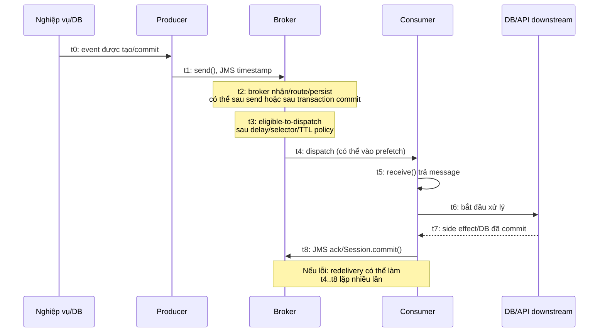

# Tuổi thông điệp lâu nhất, thời gian chờ và độ trễ toàn hành trình

> **Chương:** Giám sát  
> **Module:** `INTEGRATION_MESSAGING_MESSAGE_BROKER_ACTIVEMQ` — Tìm hiểu Apache ActiveMQ Classic và Artemis trong giao tiếp bất đồng bộ với queue, topic, routing và JMS; thực hành Java producer/consumer, acknowledgment, transaction, redelivery, DLQ, bảo mật và vận hành broker đáng tin cậy.  
> **Trọng tâm:** Đo đúng **tuổi message lâu nhất còn nghĩa vụ xử lý**, **thời gian chờ giao** và **end-to-end latency từ nguồn phát sinh đến khi xử lý/commit**. Phân biệt thống kê broker với thời điểm ứng dụng, cấu hình giám sát Classic/Artemis, xác lập SLO và điều tra “queue còn ít message nhưng khách vẫn chờ rất lâu”.

## 1. Bài toán: QueueSize giảm nhưng yêu cầu vẫn trễ

Giả sử hệ thống nhận lệnh `GenerateInvoice(orderId)` qua queue `billing.invoice.jobs`. Trong 10 phút gần nhất, dashboard báo:

- `EnqueueCount` tăng đều, consumer count = 4.
- `QueueSize` gần bằng 0.
- Request nghiệp vụ `orderId=O-302` vẫn chưa có hóa đơn sau 12 phút.
- Một worker có prefetch lớn, đã được broker **dispatch** message nhưng handler chưa gọi tới message đó; message cũng có thể nằm trong transaction chưa ack hoặc đang chờ redelivery.

Nhận định **“QueueSize ≈ 0 nên pipeline không có độ trễ”** có thể sai. Hệ thống có ít pending messages, nhưng một hay nhiều messages **đã ở trạng thái dispatched/in-flight** và vẫn chưa hoàn tất nghiệp vụ.

Bài này trả lời ba câu hỏi **khác nhau**:

1. **Tuổi thông điệp lâu nhất:** nghĩa vụ xử lý nào còn tồn tại **lâu nhất** tính đến thời điểm quan sát?
2. **Thời gian chờ:** một message đã đợi **bao lâu trước khi có thể/được consumer xử lý**?
3. **Độ trễ toàn hành trình:** từ thời điểm nghiệp vụ tạo event/command đến lúc kết quả được chốt bền vững, **mất bao lâu**?

Ba chỉ số liên quan nhưng **không thay thế nhau**. Một queue có throughput cao vẫn có một poison message chờ rất lâu; p95 của các messages hoàn tất cũng có thể đẹp trong khi những messages **chưa hoàn tất** đang quá hạn.

## 2. Vẽ rõ các mốc thời gian trước khi đo

Một message đi qua nhiều thời điểm, nhưng **không phải mốc nào cũng có sẵn trong JMS API**.



Đặt ký hiệu nhất quán:

| Mốc | Cách thu thập | Độ tin cậy / lưu ý |
|---|---|---|
| `t0 = businessCreatedAt` | DB outbox commit timestamp hoặc event envelope do producer gán | Cần định nghĩa chính xác: *trước* hay *sau* DB commit |
| `t1 = providerSendTimestamp` | `message.getJMSTimestamp()` | JMS provider gán khi message được đưa vào thao tác send; **không đồng nghĩa broker đã persist** |
| `t2 = brokerEnqueuedAt` | Broker/plugin/trace hoặc event telemetry riêng | Không có API JMS portable trả trực tiếp cho mọi message |
| `t3 = eligibleAt` | Delivery delay/scheduled time và policy | Broker có thể giữ message dù đã gửi; không nhất thiết có timestamp portable |
| `t4 = dispatchedAt` | Broker metrics/trace chuyên biệt | Prefetch làm dispatch xảy ra trước `receive()` |
| `t5 = receiveReturnedAt` | `System.currentTimeMillis()` ngay sau `receive()` | Timestamp phía consumer; khác broker dispatch |
| `t6 = handlerStartedAt` | Application instrumentation | Có thể muộn hơn t5 nếu queue trong app |
| `t7 = businessCommittedAt` | DB/gateway transaction record | **Quan trọng nhất** cho business SLO nếu side effect là mục tiêu |
| `t8 = jmsCommitReturnedAt` | Sau `session.commit()` trả thành công | Chốt JMS transaction; không chứng minh mọi external side effect thành công |

### 2.1. Công thức — nhưng không tự gọi mọi khoảng là “queue wait”

```text
Business end-to-end completed latency:
    E2E_business = t7 - t0

JMS processing lifecycle to acknowledgment:
    E2E_to_ack = t8 - t0

Provider-to-receive age (quan sát từ JMS):
    provider_to_receive = t5 - t1

Broker residence before dispatch (cần mốc broker chính xác):
    broker_dispatch_wait = t4 - t2

Client buffer / dispatch-to-receive time:
    client_buffer_wait = t5 - t4

Handler start delay:
    consumer_local_wait = t6 - t5

Processing service time:
    handler_time = t7 - t6

JMS completion overhead:
    ack_completion_time = t8 - t7

Một đoạn xử lý tuyến tính lý tưởng:
    E2E_to_ack ≈ (t1-t0)+(t2-t1)+(t4-t2)
               +(t5-t4)+(t6-t5)+(t7-t6)+(t8-t7)
```

Đây là phép phân rã để **giải thích**, không phải các metrics mặc định của Classic/Artemis. Với retry, message có thể đi qua nhiều vòng dispatch–receive–rollback–delay trước commit, nên không nên cộng một lần duy nhất các khoảng mà bỏ qua những vòng retry đó.

**Đặc biệt:** `t5 - JMSTimestamp` **không phải queue wait thuần**. Nó có thể bao gồm producer/network/broker storage, delay đã hẹn, thời gian ở broker, client prefetch, redelivery và chênh lệch đồng hồ. Nếu chỉ có hai mốc này, đặt tên trung thực là **`send_to_receive_age`** hoặc **`provider_to_receive_latency`**, không gán nhãn chính xác “broker queue wait”.

### 2.2. Các kiểu clock cần dùng đúng

- `System.nanoTime()`: phù hợp **đo thời lượng trong một JVM/process**, ví dụ thời gian chạy handler hoặc thời gian `receive(5000)` chặn. Không xuất giá trị nanoTime thô để trừ giữa hai hosts/JVM khác nhau.
- `System.currentTimeMillis()` và `Instant.now()`: phù hợp **mốc epoch thời gian** cần so giữa producer–broker–consumer, nhưng chịu sai số clock sync và clock adjustment. Dùng NTP/chrony và theo dõi skew.
- `JMSTimestamp`: mặc định do provider gán, nhưng có thể bằng `0` nếu producer bật disable timestamp và provider thực hiện hint đó. **Không giả định luôn dương**.
- `businessCreatedAt`: đặt trong envelope/outbox theo cùng quy ước UTC epoch milliseconds; nếu lấy trước một transaction DB kéo dài, E2E bao gồm cả thời gian transaction đó. Điều này có thể đúng nhưng phải công bố rõ.

Ví dụ hai hosts lệch clock:

```text
Producer clock nhanh hơn thực tế 400ms.
Consumer clock chuẩn.
consumerNow - producerCreatedAt = -150ms

Giá trị âm KHÔNG chứng minh “message đi ngược thời gian”.
Đó có thể là clock skew hoặc timestamp không đáng tin.
```

Không tự ép mọi giá trị âm thành 0 rồi âm thầm tăng histogram: hãy **đếm clock_skew/invalid_timestamp**, log có kiểm soát, dùng clock đồng bộ hoặc tracing với server timestamps để đối chiếu.

## 3. Tuổi thông điệp lâu nhất là tuổi của tập message nào?

Định nghĩa có ý nghĩa nhất với người vận hành:

> **Oldest outstanding business age tại thời điểm T** = `T - min(businessCreatedAt)` trên mọi **nghĩa vụ chưa hoàn tất** của phạm vi quan sát.

Phạm vi cần được công bố rõ: một queue, một durable subscription, một tenant, một workflow hay toàn hệ thống? Mốc `businessCreatedAt` có thể thay bằng `brokerEnqueuedAt` nếu đang giám sát duy nhất quãng đời **trong broker**, nhưng **không được tráo hai định nghĩa**.

### 3.1. Ba biến thể, ba câu trả lời

| Tên metric đề xuất | Tập đối tượng | Ý nghĩa | Hạn chế |
|---|---|---|---|
| `oldest_pending_age_seconds` | Message còn **pending/not dispatched** trong queue | Có một message còn chờ broker cấp việc đã bao lâu? | Không bao gồm message đã prefetch/in-flight |
| `oldest_unacked_age_seconds` | Pending **và** dispatched chưa ack/commit | Nghĩa vụ giao nhận chưa hoàn tất lâu nhất | Broker chưa chắc có một gauge sẵn bao phủ chính xác cả hai nhóm |
| `oldest_business_outstanding_age_seconds` | Mọi command/event chưa hoàn tất side effect, kể cả retry/replay | Khách hàng còn phải chờ công việc lâu nhất bao nhiêu? | Phải có DB/inbox/outbox/state machine hoặc telemetry ứng dụng |

Đừng gọi `oldest_pending_age` là **“tuổi thông điệp lâu nhất toàn pipeline”** nếu một message đã nằm trong worker buffer từ trước.

### 3.2. Một ví dụ số làm lộ “ảo giác QueueSize”

Tại thời điểm `12:10:00`:

| Message | `businessCreatedAt` | Trạng thái | Tuổi hiện tại |
|---|---|---|---:|
| `A` | 12:00:00 | Dispatched tới consumer 1, chưa commit | **600 s** |
| `B` | 12:08:00 | Pending trong queue | **120 s** |
| `C` | 12:09:45 | Pending trong queue | 15 s |
| `D` | 12:09:59 | Đã xử lý/commit thành công | Không còn outstanding |

Kết quả:

- `oldest_pending_age = 120s` (B).
- `oldest_unacked_age = 600s` (A), nếu A vẫn chưa ack.
- `oldest_business_outstanding_age >= 600s` nếu A chưa hoàn tất side effect.
- `QueueSize` theo ngữ nghĩa cụ thể của broker không đủ tự suy đúng A/B/C; cần biết chỉ số có gồm in-flight hay không và tình trạng per-consumer.

Một biểu đồ chỉ có `QueueSize` và `consumerCount` có thể bỏ qua lỗi: **consumer kết nối nhưng giữ message 10 phút**.

### 3.3. Khi nào “message đầu tiên” không phải message già nhất?

“First message” thường nghĩa là message đầu tiên **mà queue management sẽ nhìn thấy trong thứ tự hiện tại**. Nó có thể không phải message có `JMSTimestamp` nhỏ nhất nếu có:

- Priority lớn hơn làm message mới được ưu tiên.
- Scheduled delivery hoặc redelivery delay khiến message cũ tạm chưa eligible.
- Selector, message groups và consumer priority ảnh hưởng dispatch.
- Một message cũ đã được prefetch và không còn trong tập pending.
- Message đã expire/chuyển DLQ/replay bằng `TextMessage` mới.
- Paging/cursor, concurrent produce/consume làm thứ tự/snapshot thay đổi.

Vì vậy **`getFirstMessageAge()` của Artemis là tuổi *first message in queue*** theo API, không phải hợp đồng “max age trên mọi message outstanding”. Khi cần chứng minh oldest tuyệt đối, thiết kế đo **có thể bao quát pending + delivering + business state**, thay vì đổi tên method thành `getOldestMessageAge` trong dashboard.

## 4. Thời gian chờ: ba cách đo thường bị nhầm

### 4.1. Chờ trước dispatch khác chờ bên trong consumer

```text
Producer → Broker backlog → Dispatched / Prefetched → App receive → Handler
              |                    |                  |
              +-- broker wait ------+-- buffer wait ----+-- handler time
```

Giả sử broker dispatch 100 message cho một consumer Classic với `prefetch=100`. Handler xử lý mỗi message trong 2 giây:

- Message cuối có thể **được dispatch rất sớm**, sau đó nằm trong buffer client ~198 giây.
- Broker-side pending wait của message đó gần bằng 0.
- Producer-to-receive age lại gần 198 giây.
- `InFlightCount` cao; `QueueSize` có thể khó đọc nếu không xét MBean/provider semantics.

Đo `t5 - t1` giúp **quan sát trải nghiệm của message tại consumer**, dù không tách được chính xác bao nhiêu giây xảy ra trong broker và bao nhiêu trong prefetch. Để tách riêng, phải instrument broker dispatch timestamp hoặc consumer pipeline với trace phù hợp.

### 4.2. Delay có chủ ý không đồng nghĩa backlog xấu

Một message được producer gửi với delivery delay 10 phút:

```text
10:00 gửi vào broker
10:10 được phép dispatch (notBefore)
10:11 app receive
10:12 handler hoàn tất/commit
```

Ta có thể tính:

- `send_to_receive_age ≈ 11 phút`.
- **Thời gian trễ sau lúc đủ điều kiện giao** `eligible_to_receive ≈ 1 phút`.
- `E2E_to_ack ≈ 12 phút`.

Nếu dashboard lấy `11 phút` làm “broker quá tải”, sẽ **báo động sai**: 10 phút là intentional wait. Đặt **`notBeforeAt`** và, khi thích hợp, **`deadlineAt`** trong business envelope để tách chờ có chủ ý khỏi trễ không mong muốn.

**Đừng nhầm `TTL/JMSExpiration` với `deliveryDelay`:** TTL là hạn sống của message; nếu TTL ngắn hơn delay, message có thể expire trước khi eligible, không có sample nhận để đưa vào latency histogram.

### 4.3. Thời gian một lời gọi `receive(timeout)` chặn không phải tuổi queue

Ví dụ:

```java
long start = System.nanoTime();
Message m = consumer.receive(5000L);
long receiveCallWaitMs =
        (System.nanoTime() - start) / 1_000_000L;
```

`receiveCallWaitMs = 5000` chỉ có nghĩa lời gọi chờ tới ~5 giây để nhận message (hoặc timeout), **không** nghĩa “message được broker giữ 5 giây”. Khi queue rỗng, mọi consumer có thể chờ đầy 5 giây mà không có backlog nào.

Ngược lại, `receiveCallWaitMs=0` có thể đi cùng một message đã đợi **20 phút** ở broker/client buffer trước khi được handler đọc.

## 5. End-to-end latency: phải chọn điểm kết thúc đúng mục tiêu

Trong nhiều hệ thống, hành trình kết thúc khi **business side effect đã được commit**, không phải khi socket JMS được ack.

### 5.1. Tại sao `Session.commit()` chưa đủ cho business SLO?

Ví dụ xử lý đơn hàng:

```text
Business created event → outbox → JMS broker
    → invoice worker → database transaction commit
    → JMS Session.commit() xác nhận message
```

Nếu DB commit thành công lúc t7 nhưng JMS ack/commit chỉ hoàn tất t8, **SLO “hóa đơn được ghi”** thường đo t7 - t0. `t8 - t0` lại là thời gian **đóng nghĩa vụ JMS**; nó hữu ích cho hiệu năng broker và nguy cơ redelivery.

Trường hợp side effect là gọi API ngoài mà trả “accepted” asynchronous, phải định nghĩa **đích cuối**: được API chấp nhận, job downstream hoàn tất, email được gửi, hay khách nhận email? Không lấy `JmsTemplate.send()` return làm chứng cứ “khách đã nhận”.

### 5.2. Hai lớp chỉ số bổ sung nhau

**Phân phối trên những message đã hoàn tất**:

- `message_e2e_seconds` histogram (p50/p95/p99).
- `message_handler_seconds` histogram.
- `message_send_to_receive_seconds` histogram.
- `message_completed_total{outcome}` counter.
- `message_failed_total{error_class}` counter.

**Tình trạng những message chưa hoàn tất**:

- `oldest_pending_age_seconds`.
- `oldest_unacked_age_seconds` hoặc khả năng tương đương qua application state.
- `business_outstanding_age_seconds`, `outstanding_jobs`.
- `queue_size`, `inflight/delivering`, `scheduled_count` và `DLQ depth`.
- `oldest_unpublished_outbox_age_seconds` nếu producer có outbox.

**Chỉ báo completed latency có thiên lệch sống sót** (*survivorship bias*). Nếu 99 message nhanh hoàn thành trong 1 giây nhưng message số 100 đang kẹt 3 giờ, p99 latency của **99 message hoàn tất** có thể vẫn chỉ 1 giây. Một gauge **oldest outstanding** mới phát hiện message số 100.

### 5.3. SLO minh họa

Với `CreateInvoice` không có intentional delay:

| SLO/SLI | Ví dụ | Mục đích |
|---|---|---|
| `p95 business E2E` | Dưới 30 giây trong 30 phút | Trải nghiệm chung |
| `p99 business E2E` | Dưới 120 giây trong 30 phút | Tail latency |
| `oldest outstanding age` | Dưới 180 giây ở mọi queue sống | Không bỏ sót outlier |
| `consumer progress` | Có completion khi backlog > 0 | Phát hiện stuck worker |
| `DLQ ingress rate` | Dưới mức được thống nhất | Không che lỗi bằng dead-letter |
| `expired business commands` | Bằng 0 cho command chưa có policy discard | Ngăn mất nghĩa vụ |

Các ngưỡng chỉ là **ví dụ thiết kế**: phải dựa business deadline, throughput/traffic thấp, redelivery policy, intentional delays và hậu quả trễ thực tế. Không chép nguyên 30/120/180 giây cho tất cả workload.

## 6. ActiveMQ Classic: đo broker-side bằng JMX, đừng bịa thuộc tính tuổi message

Classic cung cấp destination MBeans (qua JMX hoặc Jolokia nếu đã triển khai quản trị). MBean queue thường có tên thuộc dạng:

```text
org.apache.activemq:type=Broker,brokerName=<brokerName>,
destinationType=Queue,destinationName=<physicalQueueName>
```

Để tránh nhầm physical name và JMX ObjectName escaping, hãy mở **JConsole/VisualVM/JMX client** xem đúng ObjectName mà broker công bố, thay vì tự ghép tên không kiểm tra khi queue chứa dấu cách/dấu phẩy.

### 6.1. Các thuộc tính có sẵn và giới hạn của chúng

| Classic Queue destination MBean | Nghĩa | Có suy ra oldest message age không? |
|---|---|---|
| `QueueSize` | Số message còn chưa được xử lý/ack theo định nghĩa destination/store | **Không**: count khác duration; xem cùng InFlightCount |
| `InFlightCount` | Message đã dispatch tới consumer nhưng chưa ack | **Không**: không có timestamp từng message |
| `DispatchCount` | Tổng lượt dispatch, có thể gồm redelivery | **Không**: counter tích lũy |
| `EnqueueCount` | Tổng lượt enqueue kể từ lần reset/restart tương ứng | **Không**: counter tích lũy |
| `DequeueCount` | Tổng messages được ack/rời destination theo broker | **Không**: counter tích lũy |
| `ExpiredCount` | Messages expired | Giúp phát hiện mất mẫu trước completion |
| `ConsumerCount` | Số consumers kết nối | Không cho biết còn xử lý được |
| `AverageEnqueueTime` | Thống kê thời gian ở queue theo logic broker/provider | **Không phải max/oldest**; cần xem ý nghĩa và cửa sổ version |
| `MemoryPercentUsage`, `StorePercentUsage` | Áp lực tài nguyên | Giúp giải thích vì sao backlog tăng |

Tài liệu JMX của Classic **không hứa có một attribute chuẩn tên `OldestMessageAge` trên queue MBean**. Nếu dashboard của bạn có giá trị này, cần biết **exporter/custom plugin/script** nào tính nó, lấy tập message nào, có bỏ qua in-flight hay không và refresh cadence.

### 6.2. Fragment đọc JMX bằng Java — read-only

Đoạn này dùng **JMX platform API của Java**, không cần thêm dependency cho JMX. Giả sử đã có một `MBeanServerConnection mbeanServer` được kết nối qua môi trường JMX bảo mật hoặc local process:

```java
import javax.management.MBeanServerConnection;
import javax.management.ObjectName;

static void printClassicQueue(
        MBeanServerConnection mbeanServer,
        String actualObjectName) throws Exception {

    ObjectName queue = new ObjectName(actualObjectName);
    String[] attrs = {
        "QueueSize", "InFlightCount", "DispatchCount",
        "EnqueueCount", "DequeueCount", "ExpiredCount",
        "ConsumerCount"
    };

    for (String attr : attrs) {
        Object value = mbeanServer.getAttribute(queue, attr);
        System.out.printf("%s=%s%n", attr, value);
    }
}
```

**Đây là fragment chứ không phải một chương trình kết nối JMX từ Internet.** Trong production, dùng exporter/management gateway với TLS, credentials và least privilege, không mở remote unauthenticated JMX. Các thao tác `purge`, `removeMessage`, `resetStatistics` là **mutation**: người học không được dùng để “kiểm thử tuổi queue” trên broker thật.

### 6.3. QueueBrowser: quan sát mẫu để tìm tuổi lớn nhất

JMS `QueueBrowser` có thể đọc một số messages mà không consume/ack, rồi dựa vào `JMSTimestamp` hoặc property `createdAtMs` để tính tuổi **của tập thấy được**:

```java
QueueBrowser browser = session.createBrowser(queue);
Enumeration<?> cursor = browser.getEnumeration();

long oldest = Long.MAX_VALUE;
int scanned = 0;
while (cursor.hasMoreElements() && scanned < 100) {
    Message message = (Message) cursor.nextElement();
    long created = message.propertyExists("createdAtMs")
            ? message.getLongProperty("createdAtMs")
            : message.getJMSTimestamp();
    if (created > 0L) {
        oldest = Math.min(oldest, created);
    }
    scanned++;
}

if (oldest != Long.MAX_VALUE) {
    System.out.printf("sampleOldestAgeMs=%d%n",
            Math.max(0L, System.currentTimeMillis() - oldest));
}
browser.close();
```

**Không đưa `sampleOldestAgeMs` thành metric chính xác của toàn queue trong production:**

- Browser có thể không thấy những messages đã **prefetch/in-flight**.
- Enumeration không bắt buộc là snapshot hoàn chỉnh khi có concurrent consumers/producers.
- Với broker paging/cursor, không bảo đảm trả đủ mọi message trong `scanned<100`.
- Priority/scheduled/selector và việc broker quản lý messages ảnh hưởng tập quan sát.
- Scan một queue khổng lồ liên tục tốn broker I/O/memory, có thể làm hệ đang trễ **càng trễ**.
- `JMSTimestamp=0` có thể xảy ra; tự lấy nó làm epoch 1970 sẽ tạo cảnh báo giả nhiều thập kỷ.

Vì vậy `QueueBrowser` chỉ nên dùng **trong lab hoặc chẩn đoán có giới hạn**. Muốn oldest outstanding phục vụ SLO dài hạn, hãy thiết kế metric/app state phù hợp thay vì polling toàn bộ payload.

## 7. Artemis: `getFirstMessageAge()` và metrics mặc định

Artemis QueueControl API có các methods cụ thể:

```text
QueueControl.getMessageCount()
QueueControl.getDeliveringCount()
QueueControl.getScheduledCount()
QueueControl.getConsumerCount()
QueueControl.getMessagesAdded()
QueueControl.getMessagesAcknowledged()
QueueControl.getMessagesExpired()
QueueControl.getMessagesKilled()
QueueControl.getFirstMessageTimestamp()
QueueControl.getFirstMessageAge()
```

`getFirstMessageAge()` trả về `Long` milliseconds hoặc không có giá trị phù hợp khi queue rỗng. Nó **không mang tên `getOldestUnackedAge()`** và không tự đảm bảo bao quát mọi message đang delivering/in-flight. Khi dùng, đặt tên metric là **`first_message_age_seconds`**, kèm ghi chú “first message in queue theo QueueControl”.

### 7.1. Sơ đồ ba nhóm message ở Artemis

```text
                    Artemis queue/address
                          |
        +-----------------+-----------------+
        |                 |                 |
    Scheduled         Pending/ready      Delivering
  (chưa đến giờ)     (chưa dispatch)    (đã giao, chưa ack)
        |                 |                 |
        +-----------------+-----------------+
                          |
                MessageCount/QueueControl
                  theo định nghĩa Artemis
                          |
          Counters riêng: ScheduledCount, DeliveringCount
```

**Điểm khác Classic cần ghi nhớ:** Trong tài liệu `QueueControl` của Artemis, `getMessageCount()` bao gồm messages **scheduled, paged và in-delivery** theo mô tả API. Nó không có cùng ngữ nghĩa chi tiết với mọi JMX `QueueSize` của Classic. **Không trừ `DeliveringCount` khỏi `MessageCount` mà không nêu bạn đang định nghĩa “pending” cụ thể nào, và kiểm tra broker version.**

Nếu ứng dụng có scheduled message hoặc redelivery delay, tuổi của `first message` có thể lớn nhưng message **chưa eligible để giao**. Cần xem `ScheduledCount`/not-before để không xem mọi age lớn là overload.

### 7.2. Micrometer metrics Artemis cung cấp gì?

Tài liệu Artemis `metrics` liệt kê các meter queue như:

```text
message.count
durable.message.count
delivering.message.count
scheduled.message.count
messages.acknowledged
messages.added
messages.expired
messages.killed
consumer.count
persistent.size
```

Đây là **tên meter logic** trên Artemis/Micrometer. **Prometheus exporter có thể đổi ký tự `.` thành `_`, thêm prefix/units/labels tùy plugin và version**; không tự invent một metric như `artemis_oldest_message_age_seconds` rồi khẳng định broker mặc định luôn xuất nó.

Đặc biệt: **Danh sách queue meters mặc định không có một metric oldest-outstanding-age đầy đủ.** Nếu dashboard có, hãy chỉ rõ nó được lấy từ `QueueControl.getFirstMessageAge`, một custom poller, event ledger hay plugin riêng.

### 7.3. Fragment `broker.xml` để bật JVM/queue metric collection theo plugin

Tài liệu Artemis có ví dụ cấu hình metrics plugin:

```xml
<!-- Đặt trong phần tử <core> của broker.xml và gộp
     với <metrics> hiện hữu, không khai báo lặp. -->
<metrics>
  <jvm-memory>true</jvm-memory>
  <jvm-gc>true</jvm-gc>
  <jvm-threads>false</jvm-threads>
  <plugin class-name="org.apache.activemq.artemis.core.server.metrics.plugins.LoggingMetricsPlugin"/>
</metrics>
```

**LoggingMetricsPlugin** là ví dụ plugin có trong tài liệu Artemis, **không phải Prometheus HTTP endpoint**. Muốn Prometheus scraping, triển khai metrics plugin/exporter được phân phối hỗ trợ và xác minh endpoint/metric names trong môi trường thực tế; plugin class và JAR phải có trên broker classpath. Không nên mở Jolokia/JMX ra public Internet chỉ để tiện dashboards.

Có thể cấu hình tại `<address-settings>`:

```xml
<address-setting match="lab.age.#">
  <enable-metrics>true</enable-metrics>
</address-setting>
```

Đây là **fragment trong `<address-settings>` hiện hữu**. `enable-metrics` áp dụng cho các queue/address thuộc match và default thông thường đã là true; đặt rõ chỉ hữu ích khi kế thừa chính sách tắt metrics ở nơi khác. Nó **không tự tạo một meter tuổi message**.

### 7.4. Khi nào dùng `getFirstMessageAge()`?

Có ích khi cần nhanh chóng hỏi “message đứng đầu hàng đang nhìn thấy đã nằm ở đây bao lâu?”, ví dụ một queue backlog chưa có consumers. Nhưng để giám sát production:

- Đọc số này **cùng** `MessageCount`, `DeliveringCount`, `ScheduledCount`, `ConsumerCount` và outcome.
- Kiểm tra method trả `null`/no value trên queue rỗng; **đừng chuyển thành tuổi 0 rồi mất dấu exporter hỏng**.
- Xác minh nó sử dụng **timestamp của message theo broker API**, không phải `businessCreatedAt` của upstream outbox.
- Không coi một giá trị lớn là root cause; có thể là poison message, scheduled delivery, downtime, missing consumer hoặc idle subscription.
- Nếu cần oldest exact theo SLA nghiệp vụ, instrument **outstanding job state** hoặc server-side tracking có bounds rõ.

## 8. Lab Java 17: đo age và E2E trên cùng message

Mục tiêu lab: **gửi một batch message, cố tình để backlog nằm chờ, nhìn tuổi pending tăng theo clock, sau đó consume và đo các mốc end-to-end.**

Lab chọn **ActiveMQ Classic 5.19.12 client (`javax.jms`/OpenWire)** vì phù hợp module Classic. Bạn có thể dùng broker Classic tại `tcp://127.0.0.1:61616`; Artemis cũng có thể nhận Classic OpenWire nếu đã mở acceptor tương ứng và queue anycast tồn tại. Điều này **không biến metrics của Artemis thành metrics Classic**.

### 8.1. Tạo project Maven độc lập

`pom.xml`:

```xml
<project xmlns="http://maven.apache.org/POM/4.0.0"
         xmlns:xsi="http://www.w3.org/2001/XMLSchema-instance"
         xsi:schemaLocation="http://maven.apache.org/POM/4.0.0
                             https://maven.apache.org/xsd/maven-4.0.0.xsd">
  <modelVersion>4.0.0</modelVersion>
  <groupId>demo.monitoring</groupId>
  <artifactId>message-age-probe</artifactId>
  <version>1.0-SNAPSHOT</version>
  <properties>
    <maven.compiler.release>17</maven.compiler.release>
    <project.build.sourceEncoding>UTF-8</project.build.sourceEncoding>
  </properties>
  <dependencies>
    <dependency>
      <groupId>org.apache.activemq</groupId>
      <artifactId>activemq-client</artifactId>
      <version>5.19.12</version>
    </dependency>
  </dependencies>
  <build>
    <plugins>
      <plugin>
        <groupId>org.apache.maven.plugins</groupId>
        <artifactId>maven-compiler-plugin</artifactId>
        <version>3.14.1</version>
      </plugin>
      <plugin>
        <groupId>org.codehaus.mojo</groupId>
        <artifactId>exec-maven-plugin</artifactId>
        <version>3.5.1</version>
      </plugin>
    </plugins>
  </build>
</project>
```

### 8.2. `MessageAgeProbe.java`

Đặt file `src/main/java/demo/MessageAgeProbe.java` trong project lab. Có ba lệnh:

- `publish <runId> <count>`: gửi PERSISTENT messages vào queue lab riêng.
- `browse <runId> <maxScan>`: chỉ **quan sát mẫu** message đang browse được, không ack.
- `consume <runId> <count> <processMs>`: nhận trong transacted Session, giả lập xử lý và commit từng message.

```java
package demo;

import org.apache.activemq.ActiveMQConnectionFactory;

import javax.jms.Connection;
import javax.jms.DeliveryMode;
import javax.jms.JMSException;
import javax.jms.Message;
import javax.jms.MessageConsumer;
import javax.jms.MessageProducer;
import javax.jms.Queue;
import javax.jms.QueueBrowser;
import javax.jms.Session;
import javax.jms.TextMessage;

import java.util.Enumeration;

public final class MessageAgeProbe {
    private static final String PREFIX = "lab.age.";

    public static void main(String[] args) throws Exception {
        if (args.length < 3) {
            usage();
            return;
        }
        String mode = args[0];
        String runId = args[1];
        if (!runId.matches("[A-Za-z0-9_-]{1,40}")) {
            throw new IllegalArgumentException("Invalid runId");
        }
        int count = Integer.parseInt(args[2]);
        if (count < 1 || count > 100) {
            throw new IllegalArgumentException("count must be 1..100");
        }
        if (mode.equals("consume") && args.length != 4) {
            usage();
            return;
        }
        if (!mode.equals("consume") && args.length != 3) {
            usage();
            return;
        }

        String url = System.getenv().getOrDefault(
                "BROKER_URL", "tcp://127.0.0.1:61616");
        String user = System.getenv("BROKER_USER");
        String password = System.getenv("BROKER_PASSWORD");

        ActiveMQConnectionFactory factory =
                new ActiveMQConnectionFactory(url);
        Connection connection = user == null || user.isBlank()
                ? factory.createConnection()
                : factory.createConnection(user, password);
        try {
            connection.start();
            String queueName = PREFIX + runId;
            switch (mode) {
                case "publish" -> publish(connection, queueName, runId, count);
                case "browse" -> browse(connection, queueName, count);
                case "consume" -> consume(connection, queueName, count,
                        boundedInt(args[3], "processMs", 0, 10000));
                default -> usage();
            }
        } finally {
            connection.close();
        }
    }

    private static int boundedInt(String text, String name,
                                  int min, int max) {
        int n = Integer.parseInt(text);
        if (n < min || n > max) {
            throw new IllegalArgumentException(
                    name + " must be " + min + ".." + max);
        }
        return n;
    }

    private static void publish(Connection connection, String queueName,
                                String runId, int count) throws Exception {
        Session session = connection.createSession(
                true, Session.SESSION_TRANSACTED);
        try {
            Queue queue = session.createQueue(queueName);
            MessageProducer producer = session.createProducer(queue);
            try {
                producer.setDeliveryMode(DeliveryMode.PERSISTENT);
                for (int i = 1; i <= count; i++) {
                    String eventId = runId + "-" + i;
                    long createdAtMs = System.currentTimeMillis();

                    TextMessage message = session.createTextMessage(
                            "work:" + eventId);
                    message.setStringProperty("eventId", eventId);
                    message.setLongProperty("createdAtMs", createdAtMs);

                    producer.send(message);
                    session.commit();

                    System.out.printf(
                            "PUBLISHED eventId=%s createdAtMs=%d "
                            + "JMSTimestamp=%d JMSMessageID=%s%n",
                            eventId, createdAtMs,
                            message.getJMSTimestamp(),
                            message.getJMSMessageID());
                }
            } finally {
                producer.close();
            }
        } catch (Exception failure) {
            rollbackQuietly(session, failure);
            throw failure;
        } finally {
            session.close();
        }
    }

    // Chỉ là SAMPLE trên những message browse được.
    // KHÔNG coi đây là toàn bộ queue, nhất là khi có prefetch.
    private static void browse(Connection connection, String queueName,
                               int maxScan) throws Exception {
        Session session = connection.createSession(
                false, Session.AUTO_ACKNOWLEDGE);
        try {
            QueueBrowser browser = session.createBrowser(
                    session.createQueue(queueName));
            try {
                Enumeration<?> entries = browser.getEnumeration();
                long minCreatedAt = Long.MAX_VALUE;
                int examined = 0;
                int invalidTimestamps = 0;

                while (entries.hasMoreElements() && examined < maxScan) {
                    Message message = (Message) entries.nextElement();
                    examined++;

                    if (!message.propertyExists("createdAtMs")) {
                        invalidTimestamps++;
                        continue;
                    }
                    long createdAt = message.getLongProperty(
                            "createdAtMs");
                    if (createdAt <= 0L) {
                        invalidTimestamps++;
                        continue;
                    }
                    minCreatedAt = Math.min(minCreatedAt, createdAt);
                }

                long observedAt = System.currentTimeMillis();
                System.out.println("BROWSE_SAMPLE examined=" + examined
                        + " invalidTimestamps=" + invalidTimestamps);
                if (minCreatedAt == Long.MAX_VALUE) {
                    System.out.println("NO_SAMPLE_AGE");
                } else {
                    long ageMs = observedAt - minCreatedAt;
                    System.out.println("sampleOldestAgeMs=" + ageMs
                            + " (NOT authoritative queue oldest)");
                }
            } finally {
                browser.close();
            }
        } finally {
            session.close();
        }
    }

    private static void consume(Connection connection, String queueName,
                                int count, int processMs) throws Exception {
        Session session = connection.createSession(
                true, Session.SESSION_TRANSACTED);
        try {
            MessageConsumer consumer = session.createConsumer(
                    session.createQueue(queueName));
            try {
                for (int i = 1; i <= count; i++) {
                    long receiveStartedNs = System.nanoTime();
                    Message message = consumer.receive(10000L);
                    long receiveReturnedNs = System.nanoTime();
                    long receivedAtMs = System.currentTimeMillis();

                    if (message == null) {
                        session.rollback();
                        System.out.println("RECEIVE_TIMEOUT");
                        return;
                    }

                    String eventId =
                            message.getStringProperty("eventId");
                    long createdAtMs = message.getLongProperty(
                            "createdAtMs");
                    long providerTimestamp =
                            message.getJMSTimestamp();

                    boolean redelivered = message.getJMSRedelivered();
                    String deliveryCount =
                            message.propertyExists("JMSXDeliveryCount")
                            ? Integer.toString(message.getIntProperty(
                                    "JMSXDeliveryCount"))
                            : "NOT_PROVIDED";

                    // processMs mô phỏng handler; không có DB thật.
                    Thread.sleep(processMs);
                    session.commit();
                    long committedAtMs = System.currentTimeMillis();
                    long committedAtNs = System.nanoTime();

                    // Duration trong cùng JVM: dùng monotonic clock.
                    long receiveCallWaitMs =
                            (receiveReturnedNs - receiveStartedNs)
                            / 1_000_000L;
                    long handlerToAckMs =
                            (committedAtNs - receiveReturnedNs)
                            / 1_000_000L;

                    // Cross-component: cần đồng bộ clock & event metadata.
                    boolean hasProviderTimestamp =
                            providerTimestamp > 0L;
                    long sendToReceiveMs = hasProviderTimestamp
                            ? receivedAtMs - providerTimestamp : -1L;
                    long createdToReceiveMs =
                            receivedAtMs - createdAtMs;
                    long createdToAckMs =
                            committedAtMs - createdAtMs;

                    System.out.printf(
                            "CONSUMED id=%s redelivered=%s count=%s "
                            + "receiveCallWaitMs=%d "
                            + "sendToReceiveMs=%d "
                            + "createdToReceiveMs=%d "
                            + "handlerToAckMs=%d "
                            + "createdToAckMs=%d%n",
                            eventId, redelivered, deliveryCount,
                            receiveCallWaitMs, sendToReceiveMs,
                            createdToReceiveMs, handlerToAckMs,
                            createdToAckMs);

                    if (!hasProviderTimestamp || createdAtMs <= 0L
                            || createdToReceiveMs < 0L
                            || createdToAckMs < 0L
                            || (hasProviderTimestamp
                                && sendToReceiveMs < 0L)) {
                        System.err.println(
                                "CLOCK_SKEW_OR_INVALID_TIMESTAMP "
                                + eventId);
                    }
                }
            } finally {
                consumer.close();
            }
        } catch (Exception failure) {
            rollbackQuietly(session, failure);
            throw failure;
        } finally {
            session.close();
        }
    }

    private static void rollbackQuietly(Session session, Exception failure) {
        try {
            session.rollback();
        } catch (JMSException rollbackFailure) {
            failure.addSuppressed(rollbackFailure);
        }
    }

    private static void usage() {
        System.out.println("publish <runId> <count:1..100>");
        System.out.println("browse <runId> <maxScan:1..100>");
        System.out.println(
                "consume <runId> <count:1..100> <processMs:0..10000>");
    }
}
```

### 8.3. Vì sao đây là lab đúng trọng tâm?

- `Queue` dùng `lab.age.<runId>` để mỗi lần thử không lẫn backlog cũ. Broker cần cho phép auto-create hoặc provision đúng queue trước.
- `publish` gắn `createdAtMs` **trước send**, commit persistent message. Đây là epoch app side, không phải thời điểm broker persist. Trong production lấy timestamp từ một nguồn có ý nghĩa hơn, như outbox event creation/commit.
- `browse` tìm `min(createdAtMs)` của **tối đa 100 messages được browser nhìn thấy**. Cố ý in “NOT authoritative”, không gọi đó là oldest queue tuyệt đối.
- `consume` đo **receive call wait** bằng `nanoTime`, **provider-to-receive** bằng `JMSTimestamp`, và **created-to-ack** bằng metadata app + epoch clock.
- `handlerToAckMs` bao gồm `Thread.sleep(processMs)` và JMS commit overhead. Trong production nó có thể bao gồm DB/API và logic app.
- Với một message không có timestamp app hợp lệ, phương thức hiện tại có thể in một số vô nghĩa; lab producer luôn tạo property đúng. Production phải validate sự hiện diện/kiểu trước khi ghi metric.
- `createdToAckMs` là **độ trễ đến JMS commit trong bài lab**, **không** phải “invoice business completed” vì code không có DB side effect.
- Session ở chế độ transacted bảo đảm log `CONSUMED` chỉ in sau khi `commit()` trả thành công. Nếu mất response đúng lúc commit, kết quả có thể in-doubt, phải có idempotency.
- Với consumer khác, priority, delayed delivery, redelivery hoặc failover, kết quả có thể khác thứ tự send; không coi mọi receive thứ i luôn trùng producer thứ i.

### 8.4. Lệnh chạy Bash và PowerShell

Bash:

```bash
export BROKER_URL='tcp://127.0.0.1:61616'
export BROKER_USER='labuser'
export BROKER_PASSWORD='lab-only-password'

mvn -q compile exec:java '-Dexec.mainClass=demo.MessageAgeProbe' '-Dexec.args=publish caseA 10'
```

PowerShell:

```powershell
$env:BROKER_URL = 'tcp://127.0.0.1:61616'
$env:BROKER_USER = 'labuser'
$env:BROKER_PASSWORD = 'lab-only-password'

mvn -q compile exec:java '-Dexec.mainClass=demo.MessageAgeProbe' '-Dexec.args=publish caseA 10'
```

Nếu broker lab cho phép anonymous có thể **bỏ `BROKER_USER`**. Không lưu credentials production trong tài liệu/log.

Đợi khoảng 10 giây bằng thao tác người học (không cần script), sau đó:

```bash
mvn -q compile exec:java '-Dexec.mainClass=demo.MessageAgeProbe' '-Dexec.args=browse caseA 100'
mvn -q compile exec:java '-Dexec.mainClass=demo.MessageAgeProbe' '-Dexec.args=consume caseA 10 500'
mvn -q compile exec:java '-Dexec.mainClass=demo.MessageAgeProbe' '-Dexec.args=browse caseA 100'
```

Kết quả điển hình:

```text
BROWSE_SAMPLE examined=10 invalidTimestamps=0
sampleOldestAgeMs≈10000 (NOT authoritative queue oldest)

CONSUMED id=caseA-1 ... receiveCallWaitMs=...
  sendToReceiveMs≈10000 createdToReceiveMs≈10000
  handlerToAckMs≈500 createdToAckMs≈10500

CONSUMED id=caseA-10 ... createdToAckMs≈15000
  (đã có 9 message xử lý ~500ms phía trước)

BROWSE_SAMPLE examined=0 invalidTimestamps=0
NO_SAMPLE_AGE
```

Đây là **số ước lượng để kiểm tra trực giác**, không phải output chính xác từng mili giây. Broker khác nhau và startup Maven/network/GC làm độ trễ thay đổi.

### 8.5. Hai thí nghiệm tách nguyên nhân

**Thí nghiệm A — Backlog chờ trước khi consumer khởi động**

1. `publish backlogA 20`.
2. Không mở consumer trong 15 giây.
3. `browse backlogA 100` hai lần cách nhau vài giây: `sampleOldestAgeMs` tăng trong khi số message chờ gần như không đổi.
4. `consume backlogA 20 0`: phần `createdToReceiveMs` lớn chủ yếu vì **chờ trước khi consumer có mặt**.

**Thí nghiệm B — Handler chậm làm tail latency tăng**

1. `publish slowB 20`.
2. Bắt đầu `consume slowB 20 1000` ngay, một consumer xử lý mỗi message một giây.
3. Observe `createdToAckMs` thường tăng dần tới message cuối, dù `receiveCallWaitMs` có thể rất thấp do prefetch.
4. Nếu producer đã publish trước và prefetch cao, browser có thể **không còn thấy những message đã dispatch** nhưng worker vẫn đang xử lý; không kết luận oldest đã giảm chỉ từ browse.

**Mục tiêu học:** Hai experiment có thể cho `createdToAckMs` giống nhau nhưng nguyên nhân khác — một do **pending backlog**, một do **processing capacity**.

## 9. Thiết kế dashboards và Prometheus queries đúng ngữ nghĩa

Phần này giả định doanh nghiệp đã instrument các **application metrics riêng**, không coi tên bên dưới là metric broker mặc định.

### 9.1. Metric contract đề xuất

| Metric ứng dụng | Type | Đơn vị | Khi cập nhật |
|---|---|---|---|
| `app_mq_oldest_pending_age_seconds` | Gauge | Seconds | Từ nguồn giám sát pending có định nghĩa rõ; khi không có message, ghi 0 hoặc absent theo policy công bố |
| `app_mq_oldest_outstanding_age_seconds` | Gauge | Seconds | Dựa vào state store/outstanding ledger bao gồm cả in-flight/business; không suy chỉ từ broker QueueSize |
| `app_mq_send_to_receive_seconds` | Histogram | Seconds | Khi consumer thực sự receive và timestamp hợp lệ |
| `app_mq_created_to_ack_seconds` | Histogram | Seconds | Chỉ sau JMS commit thành công, với mốc createdAt hợp lệ |
| `app_mq_business_e2e_seconds` | Histogram | Seconds | Sau business state/DB commit thành công |
| `app_mq_handler_seconds` | Histogram | Seconds | Sau handler kết thúc, gắn outcome |
| `app_mq_completed_total` | Counter | Messages | Sau side effect/commit theo contract |
| `app_mq_redelivered_total` | Counter | Deliveries | Khi message redelivered được quan sát |
| `app_mq_invalid_timestamp_total` | Counter | Samples | Missing/zero/type error/skew |
| `app_mq_expired_or_dlq_total` | Counter | Messages | Lấy từ broker và/hoặc reconciliation |
| `app_mq_oldest_unpublished_outbox_age_seconds` | Gauge | Seconds | Nếu upstream đã ghi outbox nhưng chưa publish |

**Histogram ghi nhận message hoàn tất không thể thay gauge của message đang kẹt.** Gắn labels giới hạn như `service`, `queue`, `event_type`, `outcome`, không gắn `eventId`/`orderId`/`JMSMessageID` vì cardinality và dữ liệu nhạy cảm.

### 9.2. Micrometer Timer cho latency đã hoàn tất

Trong một Spring Boot/Spring JMS service dùng Micrometer:

```java
import io.micrometer.core.instrument.MeterRegistry;
import io.micrometer.core.instrument.Timer;

import java.time.Duration;
import java.util.concurrent.TimeUnit;

static Timer e2eTimer(MeterRegistry registry, String queue) {
    return Timer.builder("app.mq.business.e2e")
        .description("Created-to-business-commit latency")
        .tag("queue", queue)
        .publishPercentileHistogram()
        .serviceLevelObjectives(
            Duration.ofSeconds(5),
            Duration.ofSeconds(30),
            Duration.ofSeconds(120))
        .register(registry);
}

// Chỉ record khi có createdAt hợp lệ và business commit confirmed:
long elapsedMs = businessCommittedAtMs - createdAtMs;
if (elapsedMs >= 0) {
    e2eTimer(registry, "billing.invoice.jobs")
        .record(elapsedMs, TimeUnit.MILLISECONDS);
}
```

Đây là **fragment** cần Micrometer trong project; không phải là phần của Maven Classic CLI lab. Dùng `publishPercentileHistogram()` nếu muốn tính percentiles **gộp qua nhiều instances** bằng PromQL; client-side percentiles riêng lẻ thường **không cộng được**.

**Cảnh báo chênh clock:** `businessCommittedAtMs` và `createdAtMs` từ hai hosts phải đồng bộ đồng hồ hoặc dùng tracing/state store có nguồn timestamp đáng tin cậy. Không dùng `System.nanoTime()` từ hai services để trừ trực tiếp.

### 9.3. PromQL (giả định exporter đã expose các metric ứng dụng như tên dưới)

**P95 E2E của các công việc business hoàn tất trong 5 phút:**

```promql
histogram_quantile(
  0.95,
  sum by (le, queue) (
    rate(app_mq_business_e2e_seconds_bucket[5m])
  )
)
```

**Tỷ lệ hoàn tất mỗi giây:**

```promql
sum by (queue) (
  rate(app_mq_completed_total[5m])
)
```

**Age của nghĩa vụ chưa xong lâu nhất theo queue:**

```promql
max by (queue) (
  app_mq_oldest_outstanding_age_seconds
)
```

**Mẫu alert condition, chỉ với queue không có intentional delay:**

```promql
max by (queue) (
  app_mq_oldest_outstanding_age_seconds{
    queue="billing.invoice.jobs"
  }
) > 180
```

Trong alert rule đặt `for: 5m` để tránh spike ngắn, đồng thời có alert exporter missing/`up==0`. Nếu metric absent vì exporter hỏng, câu query trên có thể **không phát cảnh báo**: giám sát **telemetry health** là điều bắt buộc.

**Không viết PromQL như thể Classic/Artemis mặc định có sẵn `app_mq_*`.** Đây là **naming contract minh họa cho custom instrumentation**. Nếu sử dụng Prometheus plugin của Artemis, phải tra tên series thực và mapping labels sau exporter.

### 9.4. Các biểu đồ nên đặt cạnh nhau

Một dashboard cho một queue quan trọng nên có ít nhất:

1. **Liveness:** connected consumer count, receive/commit progress, exporter health.
2. **Backlog:** queue size/message count, delivering/in-flight, scheduled, DLQ/expiry.
3. **Age:** oldest pending **và** oldest business outstanding (hai lines tách biệt).
4. **Latency:** p50/p95/p99 `created→receive`, `handler`, `business E2E`.
5. **Throughput:** enqueue/dispatch/commit rates, redelivery rate, error code.
6. **Resource:** broker memory/store/paging, producer flow control, worker CPU/GC, DB/API latency.

Nếu oldest tăng nhưng `completed/sec` vẫn cao, có thể có **một message rất cũ** đang mắc kẹt trong khi message mới được xử lý tốt. Nếu `completed/sec` về 0 và QueueSize tăng nhanh, có thể **toàn bộ worker ngừng tiến**. Hai trường hợp cần runbook khác nhau.

## 10. Những yếu tố làm phép đo sai hoặc mất ý nghĩa

### 10.1. Prefetch và competing consumers

Một consumer có prefetch 1000 trên Classic có thể giữ hàng trăm message trong client buffer khi handler chỉ xử lý một. `QueueBrowser` và chỉ số pending không nhất thiết nhìn thấy buffer đó. Để thấy vấn đề:

- Xem per-consumer dispatch/in-flight.
- Ghi `handlerStartedAt` và `JMSMessageID` trong trace (không dùng message ID làm metric label).
- So sánh oldest pending với oldest business outstanding.
- Đo lại sau khi chỉnh prefetch trên canary, không vội giảm prefetch production vì có đánh đổi throughput.

### 10.2. Redelivery thay đổi thời gian nhận nhưng không reset nghĩa vụ

Message M đã được tạo 10:00, xử lý lần 1 thất bại 10:02, retry 10:07 và thành công 10:10:

- `created→ack = 10 phút`: đúng trải nghiệm tổng.
- `first receive→ack` hoặc `last receive→ack` chỉ là một phần.
- `JMSXDeliveryCount=2` hỗ trợ phân loại retry; không đo duration.
- Nếu consumer ghi histogram mỗi **delivery attempt**, cùng event có thể tạo **hai samples**. Nếu SLO đếm **một logical event**, phải đo từ stable `eventId` đến **completion cuối**, không nhân đôi thành hai business operations.
- Redelivery delay 5 phút là chờ có chủ ý của **retry policy**; đừng tính nhầm là broker quá tải.

### 10.3. DLQ/expiry làm oldest age giảm nhưng công việc chưa thành công

Nếu một poison message 2 giờ tuổi chuyển DLQ, oldest age của queue nguồn có thể rơi từ 2 giờ xuống 10 giây. Dashboard trông tốt hơn, nhưng nghĩa vụ nghiệp vụ **vẫn chưa giải quyết**.

Cần:

- Theo dõi DLQ/expiry entry count, age và triage SLO.
- Giữ `eventId`/`originalCreatedAtMs` khi replay; JMS message mới có thể mang `JMSTimestamp` mới.
- Phân biệt **completed**, **failed terminal có chấp nhận**, **DLQ unresolved** và **expired**.
- Không tính “message đã rời queue nguồn” tương đương “business đã hoàn tất”.

### 10.4. Scheduled delivery và deadline

Message hẹn `deliver after 24h` sẽ có send-to-receive age ít nhất 24h. Đó không nhất thiết là vi phạm. Nên tính:

```text
eligible_to_receive_ms =
    receiveAtMs - notBeforeAtMs

deadline_lateness_ms =
    max(0, businessCompletedAtMs - deadlineAtMs)
```

Cần ghi rõ `notBeforeAtMs`/`deadlineAtMs` trong business contract. `JMSExpiration` có thể khiến message biến mất khỏi đường delivery thông thường trước khi consumer đo latency.

### 10.5. Priority, selector, group và topic subscriptions

- **Priority:** message mới ưu tiên cao có thể đi trước message cũ.
- **Selector:** một message cũ không match bất kỳ active consumer nào có thể nằm lại dù backlog tổng nhỏ.
- **Message group:** một consumer chậm giữ group lớn khiến age tăng riêng nhóm đó.
- **Topic durable subscription:** mỗi subscription có backlog/age độc lập; không cộng “oldest” từ hai subscriptions thành tổng rồi gọi là age chung.
- **Non-durable topic:** subscriber offline không có backlog của event chưa nhận; thiếu sample không phải “độ trễ bằng 0”.
- **Classic Virtual Topic:** mỗi consumer-group physical queue cần age metric riêng.
- **Artemis anycast/multicast:** message routed tới nhiều subscription queues có thể có completion times khác nhau theo từng service.

### 10.6. Broker restart và counter reset

Classic `EnqueueCount`/`DequeueCount` có thể reset sau restart hoặc `resetStatistics`; Artemis counters cũng có lifecycle riêng. Không suy throughput từ **chênh lệch hai snapshot counter** nếu có reset mà không xử lý. Với Prometheus, dùng `rate`/`increase` phù hợp trên monotonically increasing counter và theo dõi broker instance/restart.

Oldest age dạng gauge **không phải counter**: khi oldest message được xử lý/expire, gauge có thể **tụt mạnh**, đó thường là đúng ngữ nghĩa chứ không phải reset lỗi.

### 10.7. Timezone và timestamp precision

Đặt epoch milliseconds UTC trong property như `createdAtMs`. Khi hiển thị giờ địa phương trong Grafana, timezone là **presentation concern**. Không dùng local time string như `"17/11/2026 15:30"` không timezone để so sánh giữa services.

`JMSExpiration` là epoch milliseconds của provider theo TTL; khi downstream republish message mới, TTL và `JMSTimestamp` có thể tính lại. Muốn giữ **business age**, phải giữ immutable `originalCreatedAtMs` và stable event ID qua translator/replay.

## 11. Runbook: dashboard có age bất thường thì làm gì?

### 11.1. Quy trình 7 bước

1. **Xác nhận đúng phạm vi:** physical queue, durable subscription, consumer group, broker cluster, region và routing type.
2. **Xác nhận định nghĩa tuổi:** pending sample, first message in Artemis hay outstanding DB state? Dùng `JMSTimestamp` hay business event time?
3. **Đối chiếu state:** queue depth, in-flight/delivering, scheduled count, consumer count, DLQ, expiry, retry rate.
4. **Tìm message cụ thể:** qua eventId/trace logs hoặc management read-only có giới hạn; không lấy payload sensitive hàng loạt.
5. **Phân loại vị trí chờ:** upstream outbox, broker pending, prefetch buffer, handler, DB/API, redelivery delay, DLQ.
6. **Xác minh tác dụng nghiệp vụ:** DB state hoặc downstream idempotency ledger; không ack/purge/replay chỉ từ một giá trị age.
7. **Khắc phục có kiểm soát:** tăng worker khi backlog thật, sửa selector/group/prefetch khi dispatch lệch, khôi phục DB/API khi handler kẹt, quarantine poison message đúng policy, theo dõi age và completion sau xử lý.

### 11.2. Bảng triệu chứng → kết luận hợp lý

| Triệu chứng | Khả năng | Việc nên kiểm tra |
|---|---|---|
| Queue depth thấp, E2E cao | Prefetch/in-flight, handler chậm, outbox trước broker | Per-consumer in-flight, handler spans, outbox oldest age |
| Queue depth cao, oldest pending tăng | Consumer thiếu hoặc throughput < ingress | Consumer count, enqueue/dequeue rates, CPU/DB |
| Oldest pending cao, throughput vẫn cao | Một outlier/poison/group bị chặn | EventId của head, selector, group owner, redelivery |
| Oldest age tụt đột ngột, success không tăng | Expiry/DLQ/purge/move | ExpiredCount, killed/DLQ, operations audit |
| P95 E2E tốt, business complaints tăng | Survivorship bias hoặc một nhóm/tenant đặc biệt | Oldest outstanding, cohort SLO, missing completions |
| `send_to_receive` âm | Clock skew hoặc timestamp invalid | NTP, JMSTimestamp=0, app property type |
| JMS `receive()` chờ 5s, queue rỗng | Timeout nhận khi không có message | Không gọi đó là queue latency 5s |
| Artemis `FirstMessageAge` lớn, scheduled nhiều | Delay có chủ ý hoặc retry backoff | notBefore, scheduledCount, eligible age |
| Classic `InFlightCount` lớn, handlerStart thấp | Prefetch hoặc transaction chưa commit | Prefetch, unacked, listener lifecycle |
| Age nhỏ nhưng backlog luôn cao | Dữ liệu vào quá nhanh, eviction/expiry, reset JMS timestamp | Rate, expiry, throughput, originalCreatedAt |
| DLQ tăng nhưng queue nguồn nhanh | Nghĩa vụ chuyển nơi chờ | DLQ resolution age và replay outcome |

**Tránh thao tác phá hủy trong điều tra ban đầu:** không `purge`, không reset MBean counters, không xóa queue, không replay hàng loạt trước khi có snapshot/bằng chứng và kế hoạch rollback.

## 12. Bài tập có đáp án

### Bài 1 — Phân biệt ba tuổi

Tại 10:10, queue có M1 (tạo 10:00, đã dispatch nhưng chưa ack), M2 (tạo 10:07, pending) và M3 (tạo 10:09, pending). Tính oldest pending và oldest outstanding.

**Đáp án:** oldest pending = 3 phút (M2); oldest unacked/outstanding = 10 phút (M1), giả sử M1 vẫn chưa business-complete. Không suy kết quả này chỉ từ một counter `QueueSize`.

### Bài 2 — P99 “đẹp” nhưng khách vẫn đợi

999 message đã hoàn tất trong 1 giây; một message chưa được xử lý suốt 2 giờ. Có hợp lý khi chỉ báo p99 completed latency xanh?

**Đáp án:** Có. Message chưa hoàn tất **không góp sample** vào histogram completed latency. Phải thêm oldest outstanding gauge và alert cho in-flight/poison.

### Bài 3 — QueueBrowser trả 0

Classic có một consumer prefetch rất lớn; app chỉ xử lý 1 message/phút, `QueueBrowser` thấy 0 message. Có thể kết luận không còn nghĩa vụ chờ?

**Đáp án:** Không. Broker có thể đã dispatch nhiều messages vào buffer consumer, chưa ack. Xem `InFlightCount`, subscription state và business completion ledger.

### Bài 4 — Artemis `getFirstMessageAge`

Người học gọi `QueueControl.getFirstMessageAge()` rồi đặt tên metric `oldest_unacked_age_seconds`. Có chính xác?

**Đáp án:** Không. Method trả tuổi **first message in queue**, không bảo đảm max age trên mọi outstanding pending+delivering. Đặt tên `first_message_age_seconds` và ghi rõ hạn chế hoặc dùng ledger để tính oldest thực.

### Bài 5 — Thời gian receive call

`receive(5000)` trả về null sau 5 giây khi queue rỗng. Thời gian queue chờ là 5 giây?

**Đáp án:** Không. Đó là thời gian **consumer thread chờ lời gọi receive**, message không tồn tại; không có sample queue latency.

### Bài 6 — Delayed delivery

Message được gửi lúc 08:00, hẹn đến 08:30, nhận lúc 08:31, xử lý xong 08:32. Có nên báo broker latency 31 phút?

**Đáp án:** `send_to_receive=31 phút` đúng về duration, nhưng **eligible_to_receive=1 phút` mới thể hiện trễ sau khi đủ giờ. Business E2E tới completion = 32 phút nếu điểm bắt đầu là 08:00.

### Bài 7 — Clock skew

Producer clock nhanh 300ms; consumer nhận sau 100ms thực. Chênh consumerNow - createdAt = -200ms. Nên làm gì?

**Đáp án:** Ghi metric lỗi timestamp/clock skew, đồng bộ clock, kiểm tra source timestamp. Không dùng giá trị âm để tính p95, cũng không âm thầm ép 0 mà mất dấu lỗi.

### Bài 8 — DLQ làm age giảm

Một poison message tuổi 45 phút bị chuyển DLQ, oldest queue nguồn rơi xuống 5s. SLO đã được đáp ứng?

**Đáp án:** Chỉ chứng minh queue nguồn không còn giữ message đó. Business chưa hoàn tất; cần DLQ unresolved age và quy trình triage/replay.

### Bài 9 — Công thức đo E2E

Một event tạo lúc t0=10:00:00; JMS send t1=10:00:01; receive t5=10:00:11; DB commit t7=10:00:15; JMS ack t8=10:00:16. Cho biết provider-to-receive, business E2E và created-to-ack.

**Đáp án:** `t5-t1=10s`, `t7-t0=15s`, `t8-t0=16s`. Không thể từ bốn mốc này suy broker pure queue wait, vì chưa biết t2/t4.

### Bài 10 — Thiết kế SLO

Một workflow định nghĩa “99% hóa đơn được ghi trong 30 giây từ lúc thanh toán”, nhưng chỉ có broker `DequeueCount` và `QueueSize`. Đã đủ chưa?

**Đáp án:** Chưa. Cần timestamp lúc thanh toán hoàn tất, timestamp hóa đơn DB commit, eventId correlation, completed latency histogram và oldest business outstanding. Broker counters là yếu tố hỗ trợ chẩn đoán, không tự đo business SLO.

## 13. Checklist nghiệm thu kỹ thuật

- [ ] Tôi phân biệt **pending**, **dispatched/in-flight**, **handler processing** và **business completed**.
- [ ] Tôi biết oldest pending khác oldest unacked/outstanding, đặc biệt khi có prefetch.
- [ ] Tôi không coi `QueueSize` hay `ConsumerCount` là timestamp/latency.
- [ ] Tôi đọc đúng ý nghĩa `JMSTimestamp` và biết có thể bằng 0 nếu disable.
- [ ] Tôi dùng `System.nanoTime()` cho duration cùng JVM và epoch UTC cho cross-component; kiểm tra clock skew.
- [ ] Tôi không gọi `t_receive - JMSTimestamp` là broker queue wait thuần.
- [ ] Tôi biết `QueueControl.getFirstMessageAge()` của Artemis khác oldest outstanding.
- [ ] Tôi biết Classic JMX có các counters/queue metrics, không giả định metric oldest có sẵn.
- [ ] Tôi có lab `publish → browse → consume` để thấy oldest sample tăng trước receive.
- [ ] Tôi tách histogram completed E2E với gauge tuổi công việc chưa xong để tránh survivorship bias.
- [ ] Tôi phân loại intentional delay, retry delay, DLQ/expiry và prefetch khi tìm root cause.
- [ ] Tôi dùng labels metric có cardinality hữu hạn; event IDs chỉ ở traces/logs có kiểm soát.
- [ ] Tôi có alert exporter health bên cạnh oldest age và completion SLO.
- [ ] Tôi xác minh business state trước khi replay/purge/ack bất kỳ message nào.
- [ ] Tôi công bố rõ **đơn vị giây/mili giây** và nguồn timestamp cho từng metric.

## 14. Kết luận

**Tuổi lâu nhất** trả lời “công việc cũ nhất còn chưa hoàn tất đã đợi bao lâu”; **thời gian chờ** trả lời “message mất bao lâu để đi từ đủ điều kiện giao đến nhận/khởi xử lý”; **độ trễ toàn hành trình** trả lời “nghiệp vụ đã mất bao lâu từ lúc phát sinh đến khi side effect được chốt”.

- **Classic:** JMX `QueueSize`/`InFlightCount`/`DispatchCount` rất hữu ích nhưng **không tự tính max message age**. Browser chỉ cho sample có giới hạn.
- **Artemis:** `QueueControl.getFirstMessageAge()` cung cấp tuổi **message đầu queue**; dùng thêm delivering/scheduled/message counters và business ledger để hiểu age thật. Micrometer queue meters mặc định chủ yếu là counts/sizes, không phải full pipeline E2E histogram.
- **Ứng dụng:** cần `businessCreatedAt`, `eventId`, `handlerStartedAt`, `businessCommittedAt` và telemetry histogram/gauge. Bảo đảm cùng clock semantics, idempotency và retry-aware measurement.
- **Giám sát tốt:** đọc song song oldest outstanding, p95/p99 completed latency, throughput, queue state, DLQ/expiry và app outcomes. Một chỉ số đơn lẻ không đủ chứng minh khách hàng đã được phục vụ đúng hạn.

## 15. Tài liệu tham khảo chính thức

1. [ActiveMQ Classic — JMX](https://activemq.apache.org/components/classic/documentation/jmx) — Destination MBeans, QueueSize, InFlightCount, Enqueue/Dequeue/Expired.
2. [ActiveMQ Classic — How Do I Find the Size of a Queue](https://activemq.apache.org/components/classic/documentation/how-do-i-find-the-size-of-a-queue) — queue depth và ý nghĩa các counters.
3. [ActiveMQ Classic — DestinationViewMBean API](https://activemq.apache.org/components/classic/documentation/maven/apidocs/org/apache/activemq/broker/jmx/DestinationViewMBean.html) — bộ thuộc tính JMX và quản trị read-only/browse.
4. [Apache ActiveMQ Artemis — QueueControl 2.57.0 API](https://artemis.apache.org/components/artemis/documentation/javadocs/javadoc-latest/org/apache/activemq/artemis/api/core/management/QueueControl.html) — `getFirstMessageAge`, `getFirstMessageTimestamp`, `getDeliveringCount`, `getScheduledCount` và `getMessageCount`.
5. [Apache ActiveMQ Artemis — Metrics](https://artemis.apache.org/components/artemis/documentation/latest/metrics.html) — queue meters, JVM metrics và plugin configuration.
6. [Apache ActiveMQ Artemis — Management](https://artemis.apache.org/components/artemis/documentation/latest/management.html) — management API/message counters/JMX.
7. [Jakarta Messaging 3.1 — Message API](https://jakarta.ee/specifications/messaging/3.1/apidocs/jakarta.messaging/jakarta/jms/message) — `JMSTimestamp`, `JMSExpiration` và JMS properties.
8. [Micrometer — Timers](https://docs.micrometer.io/micrometer/reference/concepts/timers.html) — `Timer.record`/duration units.
9. [Micrometer — Histograms and Percentiles](https://docs.micrometer.io/micrometer/reference/concepts/histogram-quantiles.html) — aggregated percentiles qua `publishPercentileHistogram`.
10. [Prometheus — Histograms and Summaries](https://prometheus.io/docs/practices/histograms/) — `histogram_quantile`, `rate` và histogram observation semantics.
