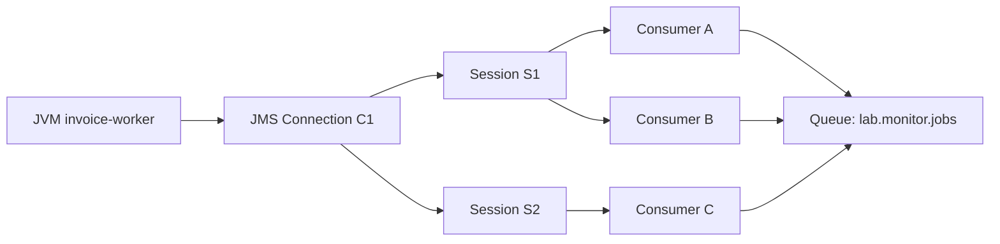
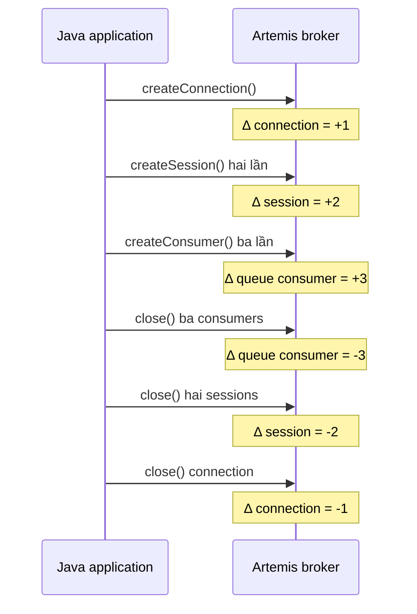
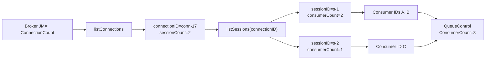

# Consumer count, connection count và session count

> **Chương:** Giám sát  
> **Mô-đun:** `INTEGRATION_MESSAGING_MESSAGE_BROKER_ACTIVEMQ` — sử dụng Apache ActiveMQ Classic và Artemis để giao tiếp bất đồng bộ bằng queue, topic, routing và JMS; thực hành producer/consumer Java, acknowledgment, transaction, redelivery, DLQ, bảo mật và vận hành broker đáng tin cậy.  
> **Trọng tâm:** Giải thích chính xác **ba đại lượng đếm khác nhau**: có bao nhiêu kết nối đang mở, bao nhiêu phiên làm việc còn tồn tại và bao nhiêu consumer đăng ký nhận message; lấy đúng số liệu từ Artemis/Classic; đối chiếu theo queue và connection; phát hiện thiếu consumer, connection churn, session leak, cấu hình Spring JMS sai và các trường hợp chỉ số “khỏe” nhưng ứng dụng ngừng xử lý.

## 1. Ba count không phải ba tên gọi của cùng một số

Một chương trình JMS có thể dùng **một Connection**, tạo **hai Session**, rồi đăng ký **ba MessageConsumer** tới cùng queue:



Nếu không có client khác, broker có thể báo:

```text
ConnectionCount = 1   # C1 là một kết nối vật lý tới broker
SessionCount    = 2   # S1, S2 tồn tại trên C1
ConsumerCount   = 3   # A, B, C được tạo và đăng ký trên queue
```

**Không có quy tắc `connectionCount = sessionCount = consumerCount`.** Một connection có thể chứa nhiều session, một session có thể có nhiều consumer, và một connection phục vụ producer có thể **không có consumer nào**.

### 1.1. Cấp đo và ý nghĩa thực tế

| Đại lượng | Cấp đo phù hợp | Đếm gì? | Không khẳng định điều gì? |
| --- | --- | --- | --- |
| **Connection count** | Broker/acceptor/connector; có thể xem theo client/protocol | Các kết nối client **đang mở** tới broker | Không bằng số JVM, pod, thread hay số queue worker |
| **Session count** | Broker (Artemis), theo connection/session; hoặc instrument ứng dụng | Các phiên/ngữ cảnh xử lý do provider duy trì | Không bằng số thread đang xử lý hoặc số message đã ACK |
| **Consumer count** | **Queue** là phạm vi quan trọng nhất, sau đó broker/connection | Đối tượng consumer/subscription đang đăng ký nhận | Không có nghĩa consumer đang chạy business logic hoặc đang ACK |
| **Connection total since start** | Broker | Số connection đã được tạo qua thời gian kể từ khi broker khởi động | Không phải số connection **hiện tại** |
| **Session total since start** | Broker Artemis | Số session đã tạo từ lúc broker khởi động | Không phải số session **hiện tại** |

Trong một hệ thống dùng nhiều protocol (Core, OpenWire, AMQP, MQTT), “session” ở phần quản trị broker là **đối tượng nội bộ của provider**. Không luôn có ánh xạ 1:1 tới `jakarta.jms.Session` của mọi loại client, nhất là AMQP/MQTT. Muốn so đúng phải biết đang quan sát **protocol và provider nào**.

### 1.2. Phân biệt ba cách hỏi

- **“Worker có còn nối broker?”** Xem connection count, connection list, remote address và thời gian tạo.
- **“Client đang tạo/giữ bao nhiêu phiên?”** Xem session count và danh sách session theo connection.
- **“Queue có người nhận chưa?”** Xem consumer count **tại đúng queue** và active consumer details.
- **“Worker có đang làm việc?”** Ba count **chưa đủ**; phải xem tốc độ ACK, delivering/in-flight, backlog age, consumer last acknowledged time và application health.

**Đừng lấy connection count thay cho readiness của worker.** Một service account có thể giữ connection được nhưng không có quyền tạo consumer trên queue; broker sẽ báo connection còn, queue consumer count bằng 0.

## 2. Lúc tạo và đóng JMS resource, count thay đổi thế nào?

### 2.1. Vòng đời có thể quan sát



Đây là **mô hình thay đổi mong đợi** trong lab độc lập, sau khi broker hoàn tất đăng ký/cleanup. Snapshot management có độ trễ hoặc race với reconnect nên không nhất thiết thay đổi đồng thời từng millisecond.

**Hai nhầm lẫn thường gặp:**

1. `Connection.start()` bắt đầu phân phối message; nó **không tạo một connection thứ hai**. Việc tạo consumer có thể đăng ký resource với broker ngay cả trước khi delivery bắt đầu.
2. `Session.close()`/`Connection.close()` sẽ giải phóng các resource con theo JMS; nếu client **crash** thay vì close sạch, broker chỉ phát hiện connection chết sau cơ chế TTL/heartbeat, vì thế count có thể giảm trễ.

### 2.2. Một Session có nhiều consumer không có nghĩa xử lý đa luồng

JMS Session có ngữ nghĩa **single-threaded**. Nếu tạo ba consumer nhưng hai consumer nằm trên cùng Session S1, không được lấy số consumer = 3 rồi khẳng định có ba business handler chạy song song.

```text
Connection C1:
  Session S1 -> Consumer A + Consumer B   (cùng ngữ cảnh tuần tự)
  Session S2 -> Consumer C                (một ngữ cảnh riêng)
```

Muốn xử lý song song thực sự, thông thường tạo **nhiều Session độc lập**, mỗi Session gắn consumer/worker tương ứng. Với Spring listener container, một invoker đang hoạt động thường dùng Session/MessageConsumer riêng; kiểm tra cấu hình cache, transaction manager và connection factory thay vì suy từ số thread.

### 2.3. Connection count không bằng số ứng dụng

Ví dụ 10 pod Java dùng một connection được chia sẻ cho 4 Session mỗi pod:

```text
Application replicas      = 10
Physical connections      ≈ 10  (mỗi pod một connection)
JMS sessions              ≈ 40
Queue consumers           ≈ 40  (nếu mỗi Session tạo một consumer)
```

Nếu pool connection mở 3 connection mỗi pod, connection count có thể tăng **30** mà số consumer không đổi. Nếu mỗi pod có một connection chỉ để gửi qua `JmsTemplate`, connection count cũng có thể tăng nhưng consumer count vẫn bằng 0.

**Dấu `≈` nhắc rằng đây là dự báo cấu hình, không phải số đo chắc chắn.** Temporary/reply-to sessions, connection caching, failover hoặc quản trị nội bộ có thể thay đổi số liệu.

## 3. Artemis: nguồn dữ liệu chuẩn và cấp đo

### 3.1. Broker control — current khác total

Artemis expose quản trị broker qua `ActiveMQServerControl`. Những thuộc tính cần biết:

| Thuộc tính JMX/management | API tương ứng | Diễn giải chính xác |
| --- | --- | --- |
| `ConnectionCount` | `getConnectionCount()` | Số client connections đang kết nối tới broker **lúc đo** |
| `TotalConnectionCount` | `getTotalConnectionCount()` | Tổng connections từng kết nối từ lúc broker start |
| `SessionCount` | `getSessionCount()` | Số server sessions đang tồn tại **lúc đo** |
| `TotalSessionCount` | `getTotalSessionCount()` | Tổng sessions đã tạo từ lúc broker start |
| `TotalConsumerCount` | `getTotalConsumerCount()` | **Số consumers hiện có** trên tất cả queues của broker |

**Bẫy tên:** Artemis `TotalConsumerCount` nói về **tổng consumers đang có trên các queue hiện tại**, **không phải** counter tích lũy “từng tạo bao nhiêu consumer từ lúc start”. Không nhầm chữ `Total` này với `TotalConnectionCount`/`TotalSessionCount`, vốn là các tổng tích lũy theo vòng đời broker.

Nếu broker restart, các **total since start** bắt đầu một chu kỳ mới. Không dùng `rate`/hiệu số qua điểm reset mà không xử lý restart; đừng biến session total thành gauge active session.

### 3.2. Queue control — consumer count có ý nghĩa vận hành hơn tổng broker

Artemis `QueueControl` exposes:

- `ConsumerCount` / `getConsumerCount()`: số consumers đang đọc từ **queue cụ thể**.
- `DeliveringCount` / `getDeliveringCount()`: số message đang được broker giao đến consumer, chưa hoàn tất theo semantics broker.
- `MessageCount`: tồn đọng message trên queue theo cách broker thống kê.
- `MessagesAdded`, `MessagesAcknowledged`: bộ đếm vào/ACK hỗ trợ tính throughput.
- `listConsumers` (qua broker management): xem consumer details như connection ID, session ID, queue, protocol, `messagesInTransit`, `messagesDelivered`, `messagesAcknowledged` và thời điểm ACK cuối theo version.

**Quan sát đúng:** `ConsumerCount = 4` trên `invoice.jobs` cho biết có bốn đăng ký consumer, **không** chứng minh bốn instance đều có quyền owner của mỗi `JMSXGroupID`, cũng không chứng minh mỗi consumer đang ACK liên tục.

### 3.3. Sơ đồ truy vết từ Connection tới Queue



Một thứ tự điều tra hiệu quả:

1. Mở **Console → Connections**: tìm theo `clientID`, `protocol` hoặc `remoteAddress`, ghi `connectionID`.
2. Sang **Sessions** và filter theo `connectionID`: đếm sessions, xem mỗi session có bao nhiêu consumer.
3. Sang **Consumers** và filter theo `sessionID`/`queueName`: xác định queue thực tế, protocol, trạng thái delivery/ACK.
4. Sang **Queues**: kiểm tra `ConsumerCount` tại queue cùng `MessageCount` và `DeliveringCount`.

Artemis Console cung cấp các liên kết điều hướng giữa **Connections → Sessions → Consumers → Queues**. Đừng chỉ nhìn tổng trên Dashboard khi cần biết **queue nào thiếu worker**.

### 3.4. JMX và Jolokia: cách đọc các thuộc tính chính xác

Artemis mặc định thường có broker object name dạng:

```text
org.apache.activemq.artemis:broker="0.0.0.0"
```

**Tên `broker` lấy từ `<name>` trong `broker.xml`**, ví dụ trên chỉ mang tính minh họa; trước khi chạy phải xem broker thực tế bằng JConsole/Console, không hardcode `0.0.0.0` vào monitor production.

Ví dụ **đọc** năm thuộc tính qua Jolokia trong Console **của broker lab**, từ shell Unix với `curl` (mật khẩu được curl hỏi tương tác khi `-u` chỉ có user):

```bash
curl -sS -u "$ADMIN_USER" \
  -H 'Origin: http://localhost' \
  -H 'Content-Type: application/json' \
  -X POST \
  --data '{"type":"read","mbean":"org.apache.activemq.artemis:broker=\"0.0.0.0\"","attribute":["ConnectionCount","SessionCount","TotalConsumerCount","TotalConnectionCount","TotalSessionCount"]}' \
  http://127.0.0.1:8161/console/jolokia
```

Phản hồi Jolokia thường trả các giá trị ở trường `value`. Ví dụ số minh họa:

```json
{
  "value": {
    "ConnectionCount": 3,
    "SessionCount": 7,
    "TotalConsumerCount": 5,
    "TotalConnectionCount": 51,
    "TotalSessionCount": 102
  },
  "status": 200
}
```

Ví dụ này mô tả **shape dữ liệu**, không phải kết quả thực đã đo. Nếu HTTP/JMX bị từ chối, kiểm tra management RBAC/Jolokia origin allowlist và account chỉ-đọc; **không tắt authentication hoặc mở remote Jolokia ra Internet** để lấy số liệu.

**Lấy bảng kết nối có cả sessionCount từng connection:**

```bash
curl -sS -u "$ADMIN_USER" \
  -H 'Origin: http://localhost' \
  -H 'Content-Type: application/json' \
  -X POST \
  --data '{"type":"exec","mbean":"org.apache.activemq.artemis:broker=\"0.0.0.0\"","operation":"listConnections","arguments":["",-1,-1]}' \
  http://127.0.0.1:8161/console/jolokia
```

Theo Artemis management API, `listConnections("", -1, -1)` trả chuỗi JSON có `data` (danh sách connection) và `count`; mỗi entry có `connectionID`, `sessionCount`, `protocol`, `remoteAddress`, `creationTime`. Có thể gọi tương tự `listSessions("", -1, -1)`, `listConsumers("", -1, -1)` để tìm consumer theo session/connection. Trong production dữ liệu nhiều, **dùng filter/pageSize và quyền read-only** thay vì tải toàn bộ danh sách liên tục.

**Các operations khác có chữ “close”, “destroy”, “remove”, “reset” có thể gây gián đoạn.** Dashboard cần quyền đọc metric, không cần quyền sửa/xóa connection/session/queue. Trên máy Windows PowerShell, lệnh shell có dấu `\` xuống dòng và dấu nháy kiểu POSIX cần chuyển thành một dòng/syntax PowerShell phù hợp.

### 3.5. Metrics plugin: cái nào được xuất mặc định?

Artemis có Micrometer metrics plugin. Theo danh mục metric trong tài liệu Artemis:

| Phạm vi | Tên metric logic | Loại | Điều cần lưu ý |
| --- | --- | --- | --- |
| Broker | `connection.count` | **Gauge** | Connections hiện tại |
| Broker | `total.connection.count` | **Counter tích lũy** theo broker uptime | Số connections đã từng tạo, có thể reset khi broker restart |
| Queue | `consumer.count` | **Gauge**, tag `broker`, `address`, `queue` | Consumers đang đăng ký trên từng queue |
| Queue | `message.count` | Gauge | Backlog; kết hợp với consumer count |
| Queue | `delivering.message.count` | Gauge | Message đang giao/in-flight |
| Queue | `messages.acknowledged` | Bộ đếm | Tính ACK/s từ chênh lệch |
| **Broker session** | **Không có `session.count` trong danh mục metric tiêu chuẩn được công bố** | Lấy qua JMX/management | Không tự giả định Prometheus có sẵn `session.count` |

Metrics **không tự xuất HTTP endpoint Prometheus** chỉ vì thêm một `<metrics>` block. Cần `ActiveMQMetricsPlugin` cung cấp `MeterRegistry` cho exporter phù hợp, ví dụ plugin Prometheus tương thích. Tài liệu có `LoggingMetricsPlugin` (ghi log cho demo) và `SimpleMetricsPlugin` (in-memory/test); không xem hai plugin này là Prometheus exporter production.

**Ví dụ giới hạn cấu hình (trích đoạn đặt trong `<core>` hiện có, không copy nguyên cấu hình broker):**

```xml
<metrics>
    <jvm-memory>true</jvm-memory>
    <jvm-gc>true</jvm-gc>
    <jvm-threads>true</jvm-threads>
    <plugin class-name="org.apache.activemq.artemis.core.server.metrics.plugins.LoggingMetricsPlugin"/>
</metrics>
```

Nó dành cho **lab quan sát metric qua log**, không mở HTTP scrape. Khi đã có metrics plugin/exporter, dùng **tên series thực tế** từ endpoint `/metrics` hoặc `/prometheus`; không mặc nhiên suy tên chuyển đổi dấu chấm → gạch dưới cho mọi registry/phiên bản.

## 4. ActiveMQ Classic: các count tồn tại ở JMX nhưng tên khác

Classic 5.x có `BrokerViewMBean` và `DestinationViewMBean`. Một phần ObjectName ví dụ:

```text
Broker MBean:
  org.apache.activemq:type=Broker,brokerName=localhost

Queue MBean:
  org.apache.activemq:type=Broker,brokerName=localhost,
      destinationType=Queue,destinationName=lab.monitor.jobs
```

Thay `localhost` bằng `brokerName` thực trong broker config, không mặc định hostname luôn trùng brokerName.

| Classic JMX attribute/API | Phạm vi | Ý nghĩa |
| --- | --- | --- |
| `CurrentConnectionsCount` / `getCurrentConnectionsCount()` | Broker | **Connections đang hoạt động** |
| `TotalConnectionsCount` / `getTotalConnectionsCount()` | Broker | Connections đã phục vụ **từ broker start** |
| `ConsumerCount` / `getConsumerCount()` | **Destination** | Consumers đang subscribe queue/topic đó |
| `QueueSubscribers` / `getQueueSubscribers()` | Broker | Danh sách MBeans của queue subscriptions |
| `TopicSubscribers` / `getTopicSubscribers()` | Broker | Danh sách topic subscriptions đang hoạt động |
| `InactiveDurableTopicSubscribers` | Broker | Durable topic subscriptions **chưa active**, vẫn có thể giữ backlog |
| `TotalConsumerCount` | Broker | Chỉ số tổng cấp broker; **đối chiếu theo broker version**, đừng suy semantics lifetime từ chữ “Total” |
| **SessionCount** | Broker Classic chuẩn | **Không có một thuộc tính `SessionCount` chuẩn tương đương Artemis trong `BrokerViewMBean`** |

**Điểm then chốt:** Khi dashboard hỏi session count cho Classic, **đừng chế tên JMX attribute `SessionCount`** trên broker MBean rồi chờ đọc được. Có thể instrument chính client (Session được tạo/đóng), kiểm tra JMX/connection metrics đặc thù của phiên bản hoặc dùng event instrumentation; phải ghi rõ đó là **application-side gauge**, không phải broker-wide current session gauge chuẩn.

### 4.1. Xem đúng queue, không lấy tổng broker thay thế

Trong JConsole/Web Console của Classic:

1. Chọn `org.apache.activemq` → Broker → brokerName thực.
2. Đọc `CurrentConnectionsCount` và `TotalConnectionsCount`.
3. Chọn `destinationType=Queue, destinationName=lab.monitor.jobs` → `ConsumerCount`, `QueueSize`, `InFlightCount`, `EnqueueCount`, `DequeueCount`.
4. Nếu `ConsumerCount=0` nhưng broker còn nhiều connections, kiểm tra các connections đó có phải producer/management connections không và consumer đang subscribe queue nào.

**Topic nuance:** Durable subscription có thể tồn tại khi client offline; nó **không phải consumer active**. Khi điều tra topic, phân biệt `DurableTopicSubscribers` với `InactiveDurableTopicSubscribers` và queue consumer count ở broker Artemis.

### 4.2. Thận trọng với advisory và network connectors

- Classic advisory topics có thể tạo consumers theo protocol/client config; các consumers đó **không xử lý queue nghiệp vụ**.
- Network connectors/bridges có thể tạo subscriptions đại diện route liên broker; không tính chúng như worker instances.
- Một app có nhiều destination consumers hoặc nhiều `Session` sẽ có nhiều consumer count nhưng vẫn chỉ một connection.
- Trong network of brokers, **mỗi broker có số connection/consumer local riêng**; cộng mà không hiểu topology có thể đếm lặp đường trung gian.

**Không dùng `TotalConnectionsCount` để chẩn đoán số connection đang mở**: sau 10 giờ, có thể đã phục vụ 20.000 connections nhưng hiện chỉ còn 12.

## 5. Bài thực hành Java 17: thay đổi count từng bước có đối chứng

Mục tiêu tạo ra thay đổi **+1 connection / +2 sessions / +3 consumers** trên **một broker Artemis** đang chạy, để biết từng số đếm đến từ đâu. Không cần gửi message; consumer vẫn được broker đăng ký nhận.

### 5.1. Điều kiện trước khi chạy

- JDK 17, Maven và một **Artemis broker riêng** ở `tcp://127.0.0.1:61616`.
- Queue `lab.monitor.jobs` được provision trước, routing **ANYCAST**; user có quyền `consume`.
- Có tài khoản quản trị **read-only** để xem Artemis Console/JMX, tách khỏi service account consume.
- Ghi **baseline** `ConnectionCount`, `SessionCount`, queue `ConsumerCount` khi chương trình chưa chạy. Broker có thể đang có kết nối từ ứng dụng khác.
- Không dùng queue production chứa công việc thật để tạo ba competing consumers thí nghiệm; chúng có thể nhận trước message, làm lệch phân phối.

Trích đoạn cấu hình queue trong phần `<addresses>` **hiện có** của `broker.xml`:

```xml
<addresses>
    <address name="lab.monitor.jobs">
        <anycast>
            <queue name="lab.monitor.jobs">
                <durable>true</durable>
            </queue>
        </anycast>
    </address>
</addresses>
```

Không tạo `<addresses>` thứ hai nếu broker.xml đã có. Với broker có auto-creation enabled, `Session.createQueue(name)` vẫn chỉ tạo **JMS destination handle**, không phải phép kiểm chứng quyền tạo physical queue.

### 5.2. Maven dependency (pin phiên bản demo)

```xml
<!-- pom.xml -->
<project xmlns="http://maven.apache.org/POM/4.0.0"
         xmlns:xsi="http://www.w3.org/2001/XMLSchema-instance"
         xsi:schemaLocation="http://maven.apache.org/POM/4.0.0 https://maven.apache.org/xsd/maven-4.0.0.xsd">
    <modelVersion>4.0.0</modelVersion>
    <groupId>example.messaging</groupId>
    <artifactId>artemis-count-probe</artifactId>
    <version>1.0.0</version>
    <properties>
        <maven.compiler.release>17</maven.compiler.release>
    </properties>
    <dependencies>
        <dependency>
            <groupId>org.apache.activemq</groupId>
            <artifactId>artemis-jakarta-client</artifactId>
            <version>2.38.0</version>
        </dependency>
    </dependencies>
    <build>
        <plugins>
            <plugin>
                <groupId>org.apache.maven.plugins</groupId>
                <artifactId>maven-compiler-plugin</artifactId>
                <version>3.13.0</version>
            </plugin>
            <plugin>
                <groupId>org.codehaus.mojo</groupId>
                <artifactId>exec-maven-plugin</artifactId>
                <version>3.5.0</version>
            </plugin>
        </plugins>
    </build>
</project>
```

Phiên bản chỉ là **một ví dụ cố định**, không tuyên bố là mới nhất. Code dùng `jakarta.jms`; Classic 5.x thường dùng `javax.jms` với `activemq-client`. Đừng thay dependency mà giữ nguyên import.

### 5.3. `src/main/java/example/messaging/CountTopologyLab.java`

```java
package example.messaging;

import java.io.BufferedReader;
import java.io.InputStreamReader;

import jakarta.jms.Connection;
import jakarta.jms.MessageConsumer;
import jakarta.jms.Queue;
import jakarta.jms.Session;

import org.apache.activemq.artemis.jms.client.ActiveMQConnectionFactory;

public final class CountTopologyLab {
    private static final String QUEUE = "lab.monitor.jobs";

    private CountTopologyLab() {}

    public static void main(String[] args) throws Exception {
        String url = System.getenv().getOrDefault(
                "BROKER_URL", "tcp://127.0.0.1:61616");
        String user = required("BROKER_USER");
        String pass = required("BROKER_PASSWORD");

        ActiveMQConnectionFactory cf =
                new ActiveMQConnectionFactory(url);
        BufferedReader input =
                new BufferedReader(new InputStreamReader(System.in));

        System.out.println(
                "BASELINE: đọc 3 current counts trước khi nhấn ENTER");
        pause(input);

        try (Connection connection = cf.createConnection(user, pass)) {
            connection.start();
            System.out.println(
                "STAGE 1: +1 Connection; chưa tạo Session/Consumer");
            pause(input);

            try (Session first =
                         connection.createSession(
                             false, Session.AUTO_ACKNOWLEDGE);
                 Session second =
                         connection.createSession(
                             false, Session.AUTO_ACKNOWLEDGE)) {

                System.out.println(
                    "STAGE 2: vẫn 1 Connection, +2 Sessions, 0 Consumers");
                pause(input);

                Queue queue = first.createQueue(QUEUE);
                try (MessageConsumer c1 = first.createConsumer(queue);
                     MessageConsumer c2 = first.createConsumer(queue);
                     MessageConsumer c3 = second.createConsumer(queue)) {

                    System.out.println(
                        "STAGE 3: 1 Connection, 2 Sessions, "
                        + "3 queue Consumers");
                    System.out.println(
                        "S1 có c1+c2, S2 có c3. "
                        + "Không gửi/receive message trong lab.");
                    pause(input);
                }

                System.out.println(
                    "STAGE 4: đã close 3 Consumers; "
                    + "vẫn 1 Connection và 2 Sessions");
                pause(input);
            }

            System.out.println(
                "STAGE 5: đã close 2 Sessions; còn 1 Connection");
            pause(input);
        }

        System.out.println(
            "STAGE 6: đã close Connection; delta 3 current counts về 0");
        // Không tự động suy rằng totalConnectionCount/totalSessionCount
        // trở về số cũ: đó là counters từ lúc broker khởi động.
    }

    private static String required(String key) {
        String value = System.getenv(key);
        if (value == null || value.isBlank()) {
            throw new IllegalStateException("Missing env: " + key);
        }
        return value;
    }

    private static void pause(BufferedReader input) throws Exception {
        System.out.println("Đọc broker metrics, nhấn ENTER để tiếp tục...");
        if (input.readLine() == null) {
            throw new IllegalStateException(
                "Standard input closed; cần interactive terminal");
        }
    }
}
```

**Điểm quan trọng của code:**

- Dùng **một** `Connection` và **hai** `Session`. Ba `MessageConsumer` thuộc cùng queue, trong đó **hai consumer dùng cùng Session**. Số consumer đăng ký không cho biết mức song song xử lý.
- Không gọi `receive()`, không gọi `send()`, vì mục tiêu duy nhất là **đếm resource**, không đo throughput/ACK.
- `try-with-resources` sẽ đóng consumer trước, rồi session, rồi connection. Sau các mốc close có thể chờ vài giây cho broker cập nhật snapshot.
- Khi connection đóng clean, **current counts** về baseline; nhưng `TotalConnectionCount` và `TotalSessionCount` **đã tăng**, không giảm khi close.
- Nếu chạy bằng IDE/Maven mà stdin bị đóng, chương trình sẽ dừng ở `pause()`; dùng terminal interactive hoặc công cụ hỗ trợ stdin.
- Resource có thể được broker/client tạo thêm tùy protocol/implementation; dùng **delta** và `listConnections`/`listSessions` để truy vết thay vì áp đặt số tuyệt đối bằng đúng ví dụ.
- Code không chứa credential; phải đặt `BROKER_USER`/`BROKER_PASSWORD` trong environment của terminal.

### 5.4. Lệnh chạy và bảng expected delta

```bash
mvn -q compile exec:java \
  -Dexec.mainClass=example.messaging.CountTopologyLab
```

Lệnh nhiều dòng với dấu `\` dùng POSIX shell. Trong PowerShell chạy thành một dòng. **Mỗi lần chương trình tạm dừng**, sang Console/Jolokia đo và ghi vào bảng:

| Mốc | Δ broker ConnectionCount | Δ broker SessionCount | Δ queue ConsumerCount | Chú ý |
| --- | ---: | ---: | ---: | --- |
| Baseline | 0 | 0 | 0 | Chụp trước khởi chạy |
| Stage 1 | +1 | 0 | 0 | Connection tạo xong |
| Stage 2 | +1 | +2 | 0 | Hai Session khác nhau |
| Stage 3 | +1 | +2 | +3 | Ba consumer đã đăng ký |
| Stage 4 | +1 | +2 | 0 | Đã đóng consumers |
| Stage 5 | +1 | 0 | 0 | Đã đóng Sessions |
| Stage 6 | 0 | 0 | 0 | Đã đóng Connection |

**Cột Δ là thay đổi so với baseline**, không phải tổng counts của broker đang dùng chung với dịch vụ khác. Nếu thấy chênh lệch, kiểm tra queue đã provision, quyền consume, source kết nối management và các client đang chạy trước khi kết luận client leak.

## 6. Spring JMS: một bean có thể tạo nhiều consumers nhưng ít connections

Spring `@JmsListener` được thực thi qua listener container, thường là `DefaultMessageListenerContainer` (DMLC). Nếu cấu hình nhiều listener invokers, container có thể tạo **nhiều Session và MessageConsumer**, dù tất cả callback gọi vào **một singleton bean**.

```java
@Configuration
@EnableJms
public class MonitoringJmsConfig {

    @Bean
    DefaultJmsListenerContainerFactory workFactory(
            ConnectionFactory connectionFactory) {
        var factory = new DefaultJmsListenerContainerFactory();
        factory.setConnectionFactory(connectionFactory);
        factory.setPubSubDomain(false);
        factory.setSessionTransacted(true);
        factory.setConcurrency("3-3"); // cố định ba invokers
        return factory;
    }
}

@Component
public class InvoiceListener {
    @JmsListener(
        id = "invoiceConsumer",
        destination = "lab.monitor.jobs",
        containerFactory = "workFactory"
    )
    public void onJob(String payload) {
        // Xử lý đồng bộ; container commit JMS khi handler thành công.
    }
}
```

**Cần hiểu rõ:**

- `concurrency="3-3"` xác định **min=max=3 invokers** cho endpoint, mục tiêu là khoảng ba consumer/Session đang hoạt động khi kết nối khỏe.
- `concurrency="3"` ở DMLC có thể có ý nghĩa **min=1, max=3**; muốn ba consumer cố định thì dùng `"3-3"`.
- Container có thể **dùng chung Connection**, hoặc pooling/cache tạo connection theo chính sách khác; không được khẳng định ba invokers ⇒ ba physical connections.
- Nhiều pods/replicas làm tổng consumer counts theo queue tăng theo số instance nếu tất cả đã kết nối: ví dụ 4 pods × 3 invokers ≈ 12 consumers; connection count có thể gần 4 hoặc cao hơn.
- Listener method callback chạy trong Session của invoker; **Session không dùng đồng thời trên nhiều thread**. Giữ business state tại biến local hoặc DB; bean singleton phải thread-safe.
- Nếu listener gặp lỗi authorization khi tạo consumer, vẫn có thể có connection tại broker, nhưng queue `ConsumerCount=0` hoặc thấp hơn dự kiến.
- Khi dùng **topic**, các subscribers độc lập không phải competing consumers trên cùng queue; phải kiểm tra shared subscription/virtual topic/MULTICAST queue riêng thay vì mặc nhiên tăng concurrency như queue.

### 6.1. Cần đo tại Spring và tại broker

Có thể inject `JmsListenerEndpointRegistry` để biết container đang có bao nhiêu invoker:

```java
JmsListenerEndpointRegistry registry = ...; // Spring inject bean
DefaultMessageListenerContainer dmlc =
        (DefaultMessageListenerContainer)
        registry.getListenerContainer("invoiceConsumer");

int scheduled = dmlc.getScheduledConsumerCount();
int active = dmlc.getActiveConsumerCount();
int minimum = dmlc.getConcurrentConsumers();
int maximum = dmlc.getMaxConcurrentConsumers();
```

Các giá trị `scheduled`/`active` là **snapshot phía Spring**, không tương đương nguyên xi `QueueControl.ConsumerCount` phía broker khi reconnect, recovery hoặc session cache bị chậm. Đối chiếu cả hai để xác định vấn đề nằm tại container, network, authentication hay broker dispatch.

### 6.2. Connection pool và session cache: count cao chưa chắc leak

Một `CachingConnectionFactory` hoặc pool có thể giữ physical connection/session **sau khi application code đóng logical resource**, để tái sử dụng. Khi đó:

- Java đã gọi `close()` nhưng broker vẫn thấy session/connection **do cache giữ**, có thể là hành vi chủ ý.
- Broker thấy session nhiều nhưng consumer count nhỏ nếu session cache phục vụ `JmsTemplate` gửi.
- Pool có `maxConnections`/session cache size; số được giữ tối đa phải so với cấu hình, không so với “mỗi method dùng xong là zero”.
- Không tự tăng `sessionCacheSize` hay `maxConnections` chỉ để giảm thời gian tạo resource trước khi xác định DB/queue throughput bottleneck.

**Kết luận:** “Count không giảm ngay” là **triệu chứng cần phân loại**, không phải bằng chứng leak nếu không biết lifecycle, pool và TTL.

## 7. Diễn giải các mẫu bất thường theo ba count

| Quan sát | Giả thuyết ưu tiên | Kiểm chứng |
| --- | --- | --- |
| `ConsumerCount=0` ở queue có backlog lớn, `ConnectionCount>0` | Worker chưa đăng ký, sai queue, ACL consume denied, container chưa start | Xem `listConsumers`, session list, logs, queue name/FQQN |
| `ConnectionCount=0`, `SessionCount=0`, `ConsumerCount=0` | Không có client kết nối hoặc broker mới restart/đổi active | So active broker/HA topology, load balancer, connection errors |
| `SessionCount tăng đều`, `ConnectionCount ổn định`, consumer count không đổi | App tạo Session nhưng không close, hoặc cache được cấu hình lớn | Truy vết session IDs theo connection, thời gian tạo, client pool |
| `ConnectionCount tăng đều`, `SessionCount ít thay đổi` | Connection leak, reconnect storm/slow cleanup, nhiều producer connections | Client IDs, remote addresses, TTL và counter total |
| `ConsumerCount tăng mạnh` nhưng `ACK/s` đứng yên | Consumer idle/slow, downstream bottleneck, group pinning, prefetch | Đo `deliveringCount`, last ACK, DB pool, worker CPU |
| `TotalConnectionCount` tăng mạnh, `ConnectionCount` gần như không đổi | Churn: tạo–đóng/reconnect liên tục | Delta lifetime counter theo phút, broker restart và network logs |
| `ConsumerCount>0` mà `MessageCount` tăng không dứt | Có worker nhưng xử lý/ACK chậm, selector sai, paused/scheduled | Đo ACK/s, per-consumer delivery, queue paused, selectors |
| Tất cả counts giảm đột ngột trên primary | HA failover, broker restart hoặc partition | So role active/passive và số liệu trên **broker mới active** |
| Classic durable subscriber offline, consumer count bằng 0 | Subscription vẫn lưu nhưng không có active receiver | Xem inactive durable subscriptions và backlog |
| Tổng queue consumer counts khác total broker trong vài giây | Snapshot lệch thời điểm, internal queues hoặc filtering | Cùng thời điểm thu dữ liệu, so phiên bản/phạm vi |

**Đặc biệt:** `ConsumerCount>0` không bảo đảm khả năng xử lý hữu ích. Một consumer có thể giữ kết nối nhưng treo ở HTTP call, blocked DB transaction hoặc không ACK. Ngược lại, một queue không có consumer trong 30 giây có thể **bình thường** nếu dịch vụ xử lý theo lịch mỗi đêm.

### 7.1. Connection churn: phân tích bằng hiệu số

Ví dụ Artemis:

```text
t0: ConnectionCount=20; TotalConnectionCount=1000
t1: ConnectionCount=20; TotalConnectionCount=1600
Khoảng đo: 10 phút

Current connections ổn định tại 20
Nhưng đã mở thêm khoảng 600 connections trong 600 giây
=> Tốc độ tạo connection ~1 connection/giây
```

Có thể là HTTP request mở JMS Connection mới mỗi lần, connection factory bị tạo lặp, network failover/reconnect, hoặc pool shutdown/restart. **Không kết luận leak** chỉ từ tổng tích lũy tăng; leak thường thể hiện current resource tăng không được giải phóng. Churn cao có thể gây áp lực CPU/TLS handshake và logging dù current count thấp.

Nếu broker restart trong cửa sổ, `TotalConnectionCount` reset nên hiệu số âm không có ý nghĩa; dùng broker uptime, restart counter hoặc exporter xử lý counter reset.

### 7.2. Session leak: không chỉ nhìn tỷ lệ Session/Connection

```text
09:00: Connection=8, Session=16, QueueConsumer=12
09:10: Connection=8, Session=80, QueueConsumer=12
09:20: Connection=8, Session=144, QueueConsumer=12
```

Đây là mẫu **đáng điều tra**: session tăng 64 mỗi 10 phút trong khi số consumer không đổi. Có thể do code tạo Session mỗi request nhưng không close, hoặc cache/pool quá lớn và chưa đạt ngưỡng.

Các bước:

1. Lọc `listConnections` theo `remoteAddress/clientID`, tìm connection nào có `sessionCount` tăng.
2. Gọi `listSessionsAsJSON(connectionID)` hoặc xem tab Sessions; ghi creation time và `consumerCount` từng session.
3. Đối chiếu client code: `createSession()` có đi cùng `try-with-resources`, `finally`/close không?
4. Kiểm tra pool/CachingConnectionFactory giới hạn cache và eviction policy.
5. Chỉ khi xác định leak mới sửa code và kiểm chứng số session **đứng ổn định** qua soak test.

**Không đóng hàng loạt sessions qua management API trên production** khi chưa biết Session có transaction đang chạy hay không; có thể gây redelivery và timeout nghiệp vụ.

### 7.3. Consumer count tăng nhưng throughput giảm

Nếu tăng consumer từ 4 lên 20 và ACK/s chỉ từ 100 lên 105 nhưng DB pool 100%, số consumer đang hoạt động không phải vấn đề chính. Thêm consumer còn có thể làm tăng redelivery, lock contention và thời gian xử lý p99.

Mức concurrency nên được chọn bằng số liệu queue age, ACK/s, service time, DB pool và khả năng phân phối. **Count là capacity indicator, không phải thành công nghiệp vụ.**

## 8. Monitoring liên tục và alerting: giữ ngữ nghĩa đúng

### 8.1. Gauge khác counter

- **Gauge:** `ConnectionCount`, `SessionCount`, `ConsumerCount`; có thể tăng hoặc giảm bất kỳ lúc nào. Không dùng `rate()` cho gauge để báo “connections per second”.
- **Counter since start:** `TotalConnectionCount`, `TotalSessionCount`, `MessagesAcknowledged`; có thể reset khi broker restart. Dùng **delta/rate** trong cửa sổ đo kèm kiểm tra reset.
- **Queue consumer count per queue:** phải giữ tag `broker`/`address`/`queue`; gom tổng qua mọi queue mà không có context có thể che một queue không có worker.
- **Unique identifiers:** `connectionID`, `sessionID`, `consumerID` có cardinality cao; lưu trong management logs/trace khi điều tra, **không dùng làm label cho từng Prometheus time series**.

### 8.2. Metric schema gợi ý

Không nhất thiết là tên metrics được broker xuất mặc định; đây là **schema chuẩn hóa tại hệ giám sát của tổ chức**:

```text
messaging_connections_current{broker,protocol,cluster,role}      gauge
messaging_connections_created_total{broker,protocol,cluster}   counter
messaging_sessions_current{broker,protocol,cluster}           gauge
messaging_sessions_created_total{broker,protocol,cluster}    counter
messaging_consumers_current{broker,address,queue,service}      gauge
messaging_queue_depth{broker,address,queue}                  gauge
messaging_queue_delivering{broker,address,queue}             gauge
messaging_messages_acknowledged_total{broker,address,queue}   counter
```

Artemis có thể cung cấp một phần qua metrics plugin và phần session qua **JMX collector**. Classic cần collector tương ứng và session instrumentation phía client. **Không khai báo `messaging_sessions_current` là “broker metric mặc định”** khi thực tế exporter chưa cấu hình.

Lưu ý khi có **HA active/passive**: các gauges ở backup passive có thể thấp/0 mà đó là trạng thái bình thường. Dashboard phải gắn nhãn `active role` và switch qua **broker active hiện tại**, tránh alert 0 connections trên backup như lỗi mất worker.

### 8.3. Quy tắc cảnh báo theo trạng thái kinh doanh

| Rule logic | Khi nào hợp lý? | Ngưỡng minh họa |
| --- | --- | --- |
| Queue `ConsumerCount=0` **và** backlog tăng | Queue online đòi hỏi có worker liên tục | Giữ 3–5 phút, bỏ qua maintenance |
| Actual consumers thấp hơn cấu hình tối thiểu | Spring listener không đăng ký đủ | `current < expected_min` liên tục 5 phút |
| Connection churn tăng bất thường | Reconnect storm, connection tạo sai | `connections_created/5m` gấp > 3 baseline |
| Session/Connection ratio tăng đều | Session leak/pool miss | Tăng qua nhiều cửa sổ 10–30 phút |
| ConsumerCount>0 nhưng ACK rate gần 0, queue age tăng | Worker sống nhưng không làm việc | ACK 0 trong 5 phút khi có backlog |
| Consumer count tăng, broker memory/DB pressure tăng | Over-concurrency | Kết hợp p99 latency, DB pool và redelivery |
| Active broker chuyển vai | HA failover | Ghi nhận chuyển broker, so counts sau reconnect |

**Mỗi ngưỡng trên chỉ là ví dụ**, phải điều chỉnh theo giờ làm việc, lượng message vào, số replica dự kiến, deployment strategy và SLO. Cảnh báo “consumer=0” cho queue theo cron 1 lần/ngày là sai nếu đó là cách vận hành chủ ý.

### 8.4. Tính tỷ lệ Session/Connection có an toàn không?

```text
sessions_per_connection = SessionCount / max(ConnectionCount, 1)
consumers_per_session   = TotalConsumerCount / max(SessionCount, 1)
```

Hai tỷ lệ là **chỉ số phụ**, không phải bất biến giao thức:

- Có connection chỉ để producer hoặc một Session nhiều consumers.
- Spring có thể dùng một connection cho nhiều Session, còn pool tạo nhiều connections không có consumers.
- Các protocol khác nhau ánh xạ session khác nhau.
- Gauges lấy ở các thời điểm khác nhau, nên đôi lúc tỷ lệ thay đổi do scrape delay.

Vì thế **so xu hướng theo cùng service/protocol/topology** hơn là cảnh báo mọi lúc ratio vượt một hằng số toàn hệ thống.

## 9. Tình huống incident: 20 connections nhưng 0 consumers

**Bối cảnh:** `invoice.jobs` tăng lên 15.000 messages, `ConsumerCount=0`, `ConnectionCount=20`, `SessionCount=25`. Ứng dụng báo “Connected to broker successfully”.

**Quy trình điều tra dựa trên ba count:**

1. Chọn **đúng queue** `invoice.jobs`. Kiểm tra `QueueControl.ConsumerCount=0` và `messageCount`, tránh nhầm với queue DLQ hoặc subscription khác.
2. Lấy `listConnections` để biết 20 connections thuộc host/protocol/service nào; có thể tất cả là producer hoặc management.
3. Lọc Sessions theo connection của `invoice-worker`. Nếu không có Session nào, ứng dụng có thể không start listener container.
4. Nếu có Sessions nhưng `consumerCount=0`, kiểm tra lỗi `createConsumer`: thiếu quyền consume, selector sai, queue name, FQQN, queue chưa provision hoặc listener factory chưa start.
5. Nếu queue consumer count vừa bật lên rồi về 0 theo chu kỳ, kiểm tra reconnect storm, idle task scaling, exceptions và broker connection TTL.
6. Khi consumer xuất hiện, kiểm tra **ACK/s tăng** và queue age giảm. Việc `ConsumerCount` từ 0 lên 4 **chưa phải kết luận incident đã khắc phục**.
7. Ghi nguyên nhân và phòng ngừa: xác thực readiness theo listener registration, số consumer expected, ACL test và cảnh báo backlog không có consumer.

**Không giải quyết bằng cách tăng `receiveTimeout`/`consumerWindowSize` khi chính quyền tạo consumer đang bị từ chối**. Cũng không nên “purge queue” để làm backlog về 0 trong lúc worker chưa chạy.

## 10. Bài tập tự kiểm chứng

### Bài tập A — Dự đoán ba current counts

Một client tạo 1 Connection, 3 Sessions: S1 có 2 consumers, S2 có 1, S3 không có consumer. Không có client khác.

**Câu hỏi:** Broker Artemis và queue báo bao nhiêu connection/session/consumer? Nếu đóng S1, số nào đổi?

*Định hướng:* Ban đầu `1 / 3 / 3`. Đóng S1 sẽ đóng cả 2 consumers của S1: còn `1 / 2 / 1` sau cleanup.

### Bài tập B — Current và total sau nhiều lần reconnect

Artemis có `ConnectionCount=12` và `TotalConnectionCount=900`. Sau 5 phút: `ConnectionCount=12`, `TotalConnectionCount=1500`, broker không restart.

**Câu hỏi:** Có 1.500 connections cùng mở không? Tốc độ tạo mới trung bình là bao nhiêu?

*Định hướng:* Không. Current vẫn 12; mở thêm 600 trong 300 giây, xấp xỉ **2 connections/giây**, cần tìm churn.

### Bài tập C — Phát hiện Session leak

Trong 30 phút: connections giữ 4, consumer count giữ 8, sessions tăng từ 12 lên 180. Ứng dụng dùng `createSession()` trong một REST request handler.

**Câu hỏi:** Điều tra gì trước khi restart broker?

*Định hướng:* List sessions theo từng connection/creation time, kiểm tra `close()`/try-with-resources và cache/pool; sau sửa, chạy soak test và quan sát session count ổn định. Restart che hiện tượng, không sửa leak.

### Bài tập D — Spring listener count

Có 3 replicas, mỗi pod một `DefaultMessageListenerContainer` với `concurrency="4-4"`, mỗi invoker có Session+MessageConsumer, dùng một Connection chung mỗi pod.

**Câu hỏi:** Cần kỳ vọng xấp xỉ bao nhiêu connection/session/consumer? Nếu đổi `concurrency="4"`, điều gì thay đổi?

*Định hướng:* Khoảng **3 / 12 / 12**. Với `"4"`, DMLC có thể co giãn **1..4** invokers mỗi pod, nên consumer count thực có thể nhỏ hơn 12.

### Bài tập E — Consumer count không bảo đảm throughput

Queue có 16 consumers, `ACK/s=0` suốt 10 phút, backlog age tăng. Broker vẫn có 20 connections.

**Câu hỏi:** Có nên chỉ thêm 16 consumers nữa không?

*Định hướng:* Không. Kiểm tra DB/API latency, event loop blocked, transaction, selectors, paused queue, scheduled delivery, ACL, consumer last ACK và in-flight; xử lý bottleneck.

### Bài tập F — Classic khác Artemis

Dashboard đọc `SessionCount` trên `BrokerViewMBean` của Classic 5.x và không tìm thấy.

**Câu hỏi:** Đây là lỗi broker hay giả định monitoring sai? Cách thay thế?

*Định hướng:* Không có broker-wide `SessionCount` trong API chuẩn nêu trên. Instrument Session lifecycle ở Java client hoặc exporter thích hợp, ghi rõ nguồn metric thay vì giả tạo thuộc tính JMX.

### Bài tập G — Topic durable subscriber offline

Classic topic durable subscription còn được lưu nhưng client offline. `ConsumerCount` của topic bằng 0.

**Câu hỏi:** Có thể kết luận subscription đã bị xóa không?

*Định hướng:* Không. Phân biệt `InactiveDurableTopicSubscribers` và active subscribers; xem backlog của durable subscription và ClientID/subscription identity.

### Bài tập H — Count nào cần filter theo queue?

Artemis có 200 consumers tổng cộng, nhưng queue `payment.jobs` có `ConsumerCount=0` và `MessageCount=10000`.

**Câu hỏi:** Alert theo `TotalConsumerCount` hay `QueueControl.ConsumerCount`?

*Định hướng:* Dùng queue consumer count có gắn `queue/address` và backlog/rate; tổng broker 200 che mất worker riêng của `payment.jobs`.

## 11. Checklist vận hành

1. Ghi đúng **broker đang active** và tên broker/queue; không trộn snapshot từ primary/backup.
2. Hiểu sự khác biệt **current gauge** với **total since-start counter**; kiểm tra broker restarts.
3. Thu connection/session/consumer cùng khoảng thời gian; xác định current vs delayed cleanup.
4. Với Artemis, đọc `ConnectionCount`, `SessionCount`, `TotalConsumerCount` cấp broker và `ConsumerCount` của queue.
5. Với Classic, đọc `CurrentConnectionsCount` cấp broker, `ConsumerCount` cấp destination; không tự tưởng tượng broker-wide `SessionCount`.
6. Lọc connection/session theo `clientID`, `remoteAddress`, `protocol`; tách internal/management clients khi có thể.
7. Đối chiếu `ConnectionCount` với Session/Consumer ownership, không mặc định mỗi JVM chỉ có một resource.
8. Giám sát `ACK/s`, queue age, `DeliveringCount`/`InFlightCount` và DLQ; count > 0 không đồng nghĩa xử lý thành công.
9. So cấu hình Spring concurrency, số replicas và connection/session pools trước khi kết luận leak.
10. Bảo vệ JMX/Jolokia/Console bằng RBAC read-only, TLS và network ACL; tránh label metric theo IDs động.
11. Khi scale/restart, ghi lý do thay đổi baseline và chờ TTL/heartbeat cleanup.
12. Có thí nghiệm **tạo–đóng Connection/Session/Consumer** trên queue lab để xác nhận exporter vẫn phản ánh đúng semantics sau nâng cấp broker/client.

## 12. Tài liệu tham khảo chính thức

1. Apache ActiveMQ Artemis — [Management](https://artemis.apache.org/components/artemis/documentation/latest/management.html): JMX, Jolokia, `listConnections`, `listSessions`, `listConsumers` và bộ lọc management.
2. Apache ActiveMQ Artemis — [ActiveMQServerControl Javadoc](https://artemis.apache.org/components/artemis/documentation/javadocs/javadoc-latest/org/apache/activemq/artemis/api/core/management/ActiveMQServerControl.html): `getConnectionCount`, `getSessionCount`, `getTotalSessionCount`, `getTotalConsumerCount`.
3. Apache ActiveMQ Artemis — [QueueControl Javadoc](https://artemis.apache.org/components/artemis/documentation/javadocs/javadoc-latest/org/apache/activemq/artemis/api/core/management/QueueControl.html): `getConsumerCount`, `getDeliveringCount`, `getMessagesAcknowledged`.
4. Apache ActiveMQ Artemis — [Metrics](https://artemis.apache.org/components/artemis/documentation/latest/metrics.html): `connection.count`, `total.connection.count`, queue `consumer.count` và Micrometer exporter configuration.
5. Apache ActiveMQ Artemis — [Console](https://artemis.apache.org/components/artemis-console/documentation/latest/): liên kết Connections → Sessions → Consumers → Queues.
6. Apache ActiveMQ Classic — [JMX](https://activemq.apache.org/components/classic/documentation/jmx): Broker/Destination MBeans, `ConsumerCount` và connection statistics.
7. Apache ActiveMQ Classic — [BrokerViewMBean Javadoc](https://activemq.apache.org/components/classic/documentation/maven/apidocs/org/apache/activemq/broker/jmx/BrokerViewMBean.html): `CurrentConnectionsCount` và `TotalConnectionsCount`.
8. Apache ActiveMQ Classic — [ConnectionViewMBean Javadoc](https://activemq.apache.org/components/classic/documentation/maven/apidocs/org/apache/activemq/broker/jmx/ConnectionViewMBean.html): connection consumers/producers, client ID và connection metadata.
9. Spring Framework — [DefaultMessageListenerContainer Javadoc](https://docs.spring.io/spring-framework/docs/6.2.x/javadoc-api/org/springframework/jms/listener/DefaultMessageListenerContainer.html): concurrency, active/scheduled invokers, resource lifecycle.
10. Jakarta Messaging — [Jakarta Messaging Specification 3.1](https://jakarta.ee/specifications/messaging/3.1/): Connection/Session/MessageConsumer và đóng resources.

> **Kết luận:** `ConnectionCount` trả lời **có bao nhiêu client links đang mở**; `SessionCount` trả lời **bao nhiêu ngữ cảnh JMS/provider còn tồn tại**; `ConsumerCount` trả lời **có bao nhiêu subscriptions/consumers đăng ký ở đúng queue**. Không có phép đồng nhất ba số, cũng không dùng một số để khẳng định worker khỏe. Monitor đúng cần **scope broker/queue/protocol, phân biệt current với cumulative, truy vết connection → session → consumer** và đặt counts cạnh **ACK throughput, queue age, in-flight và sức khỏe downstream**.
