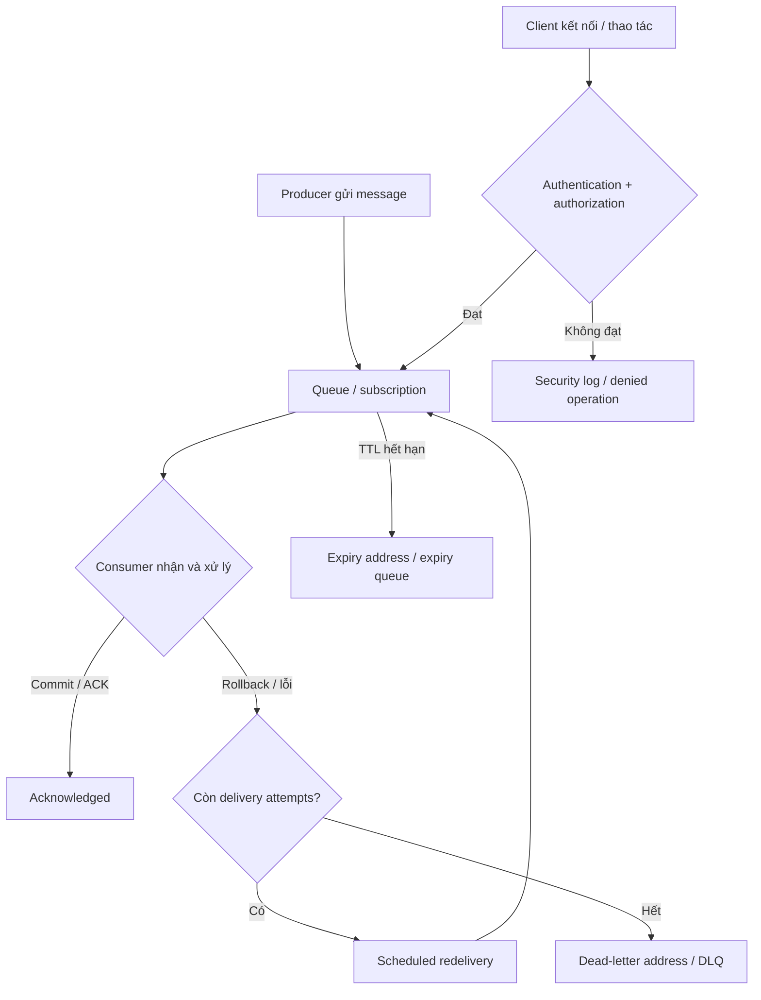

# Theo dõi redelivery, DLQ, expiry và lỗi xác thực

> **Chương:** Giám sát  
> **Phạm vi:** Quan sát vòng đời message và lỗi truy cập trong Apache ActiveMQ **Artemis** và **Classic**: delivery lại (redelivery), dead-letter queue (DLQ), message hết hạn (expiry) và authentication/authorization failures. Bài tập trung vào cách cấu hình broker, thu thập số liệu, instrument consumer Java/Spring, đặt cảnh báo và xử lý sự cố có bằng chứng.

## 1. Bốn nhóm tín hiệu phản ánh bốn vấn đề khác nhau

Một queue `orders.in` đang nhận 800 message/giây. Consumer xử lý 760 message/giây; một phần nhỏ rollback do Inventory API timeout. Sau vài phút, số message giao lại tăng, một số message vượt giới hạn delivery và chuyển sang DLQ. Một nhóm message khác hết TTL trước khi consumer đọc. Cùng lúc đó, log broker có lỗi xác thực vì một pod đang dùng secret cũ.

Nếu dashboard chỉ hiển thị queue depth, người vận hành sẽ thấy backlog tăng nhưng không biết do consumer chậm, retry loop, message hết hạn hay credentials sai. Cần theo dõi **từng nhóm sự kiện theo vòng đời**:

| Nhóm | Ý nghĩa | Dấu hiệu chính | Câu hỏi vận hành |
|---|---|---|---|
| **Redelivery** | Broker giao lại message vì lần giao trước không được hoàn tất/ACK theo cơ chế đang dùng | `JMSRedelivered`, `JMSXDeliveryCount`, rollback, delivery attempt | Consumer đang lỗi tạm thời hay poison message? |
| **DLQ** | Message được chuyển khỏi luồng chính sau khi vượt chính sách giao lại hoặc bị dead-letter theo thao tác/chính sách | DLQ message count, arrival rate, oldest age, source address/queue | Message nào không còn được xử lý tự động và ai phải điều tra? |
| **Expiry** | Message hết thời hạn sống (TTL/expiration) trước khi được xử lý | Expired count, expiry address/queue, age tại thời điểm hết hạn | SLA/TTL có quá ngắn, backlog có làm event lỗi thời? |
| **Authentication / authorization** | Client không xác thực được danh tính hoặc không đủ quyền thực hiện thao tác | Login failure, permission denied, TLS handshake, connection churn | Sai credentials, thiếu role, sai endpoint hay chứng thư? |

Các nhóm này có thể xuất hiện cùng lúc nhưng **không đồng nghĩa**:

- Redelivery không có nghĩa message chắc chắn đã thực hiện side effect trước đó. Consumer có thể chết ngay sau `receive()` mà chưa chạy nghiệp vụ.
- DLQ không phải expiry queue. Poison message vẫn còn giá trị nghiệp vụ nhưng không được xử lý tự động; expired message đã quá hạn xử lý theo contract.
- Authentication failure thường xảy ra trước khi consumer nhận message; authorization failure có thể xảy ra sau khi đã kết nối nhưng gửi/nhận vào destination bị cấm.
- Một message không xuất hiện trong queue ready có thể đang delivering, scheduled for redelivery, ở DLQ, expiry queue, hoặc đã ACK; cần truy vết đúng trạng thái.



## 2. Định nghĩa metric và event trước khi dựng dashboard

### 2.1. Đừng gộp “message count” thành một con số

Một queue có nhiều trạng thái:

- **Ready/message count:** message sẵn sàng được giao.
- **Delivering count:** broker đã giao cho consumer nhưng chưa được xác nhận hoàn tất.
- **Scheduled count:** message đang chờ thời điểm redelivery hoặc scheduled delivery.
- **Acknowledged:** message đã được xác nhận xử lý theo JMS/broker semantics.
- **Expired:** message đã hết thời hạn sống và được broker xử lý theo expiry policy.
- **Killed/dead-lettered:** message bị loại khỏi queue nguồn hoặc chuyển sang DLQ theo cơ chế tương ứng.

Với Artemis, Queue Control/JMX expose các thuộc tính thường dùng như `MessageCount`, `MessagesAdded`, `MessagesAcknowledged`, `MessagesExpired`, `MessagesKilled`, `DeliveringCount`, `ScheduledCount`, `ConsumerCount`. Tên và khả năng hiển thị phụ thuộc phiên bản, management interface và exporter. **Không cộng các counter khác đơn vị hoặc khác phạm vi** để tạo một “tổng message” không có ý nghĩa.

| Metric | Loại | Phạm vi/ý nghĩa |
|---|---|---|
| `MessagesAdded` | Counter | Tổng số message được thêm vào queue từ khi counter được khởi tạo/reset |
| `MessagesAcknowledged` | Counter | Tổng message được ACK trên queue |
| `MessagesExpired` | Counter | Số message hết hạn được xử lý ở queue |
| `MessagesKilled` | Counter | Số message bị kill/dead-letter/remove theo cơ chế broker |
| `MessageCount` | Gauge | Số message hiện còn trong queue theo cách broker tính |
| `DeliveringCount` | Gauge | Message hiện đang được giao cho consumers |
| `ScheduledCount` | Gauge | Message đang được lên lịch, gồm các trường hợp delay/redelivery tùy cơ chế |
| `ConsumerCount` | Gauge | Số consumer đang gắn với queue |

Counter broker thường là **cumulative** và có thể reset khi broker restart, queue được tạo lại hoặc counter bị reset. Dashboard phải xử lý reset, không tính delta âm như một đợt giảm message thần kỳ. Nếu HA chuyển active node, cần gắn metric với broker/node identity và thời gian failover.

### 2.2. Redelivery rate cần metric từ consumer

Không phải mọi broker/version đều có một counter tổng redelivery đủ chi tiết cho dashboard. Consumer có thể ghi nhận delivery count từ JMS:

- `JMSRedelivered`: provider đánh dấu đây là message đã từng được giao trước đó theo JMS semantics.
- `JMSXDeliveryCount`: property chuẩn JMS khi provider hỗ trợ; giá trị thường bắt đầu từ 1 và tăng theo delivery attempt.
- `eventId`: logical event ID do ứng dụng phát, giữ ổn định qua publisher retries.
- `JMSMessageID`: định danh lần gửi message vật lý do provider cấp, hữu ích để tra log nhưng không phải idempotency key.

Định nghĩa metric ở cấp consumer:

\[
\text{redelivery ratio} =
\frac{\text{delivery attempts có count}>1}
{\text{tổng delivery attempts}}
\]

Đây là tỷ lệ theo **attempts trong một cửa sổ thời gian**, không phải tỷ lệ event logic duy nhất bị trùng. Một message được giao 10 lần sẽ đóng góp nhiều attempts. Nếu cần đo số event logic lặp, dùng inbox/event ID dedup counter riêng.

### 2.3. DLQ và expiry cần đo cả số lượng lẫn tuổi message

Chỉ nhìn `DLQ message count` chưa đủ:

- DLQ tăng 1 message/giờ nhưng message cũ nhất đã nằm 10 ngày có thể là vấn đề nghiêm trọng hơn DLQ tăng 100 message trong một đợt lỗi vừa xảy ra.
- Expiry tăng có thể do consumer down, TTL không phù hợp, producer gửi timestamp sai hoặc backlog quá dài.
- DLQ giảm đột ngột có thể do replay thành công, nhưng cũng có thể do purge hoặc retention cleanup.

Nên có tối thiểu:

| Metric | Ý nghĩa |
|---|---|
| `dlq_messages` | Số message hiện còn trong từng DLQ |
| `dlq_arrivals_total` | Tổng message đi vào DLQ trong khoảng thời gian |
| `dlq_oldest_age_seconds` | Tuổi message cũ nhất trong DLQ |
| `dlq_replay_total` | Số message được replay theo runbook |
| `expired_total` | Message hết hạn theo queue/address |
| `expiry_queue_messages` | Message hiện còn ở expiry destination |
| `message_age_seconds` | Tuổi message tại lúc consumer nhận/quan sát |
| `expiry_ratio` | Expired delta trên tổng message eligible/processed trong cùng scope |

Tuổi message có thể tính từ `JMSTimestamp` hoặc property `occurredAt` do producer đặt, nhưng phải xác định rõ timezone/clock skew và semantics. Nếu producer retry tạo một message mới, `JMSTimestamp` mới không còn phản ánh tuổi event logic ban đầu; `occurredAt`/`eventCreatedAt` nên được giữ ổn định trong payload/property.

### 2.4. Authentication và authorization phải tách metric

| Loại lỗi | Ví dụ | Nơi quan sát |
|---|---|---|
| Authentication | Username/password sai, user bị disable, SASL mechanism không khớp | Broker security log, connection/authentication errors phía client |
| Authorization | Đã đăng nhập nhưng không có `send`, `consume`, `browse`, `manage` hoặc quyền tạo destination | Broker security log, JMS exception khi thao tác |
| TLS | Certificate hết hạn, CA không tin cậy, hostname mismatch, protocol/cipher không tương thích | TLS handshake logs phía broker/client, certificate monitoring |
| Endpoint/protocol | Client nói OpenWire tới Artemis Core acceptor hoặc ngược lại, sai host/port | Connection failure/handshake error |
| Credential rotation | Một nhóm pod còn dùng secret cũ, nhóm khác dùng secret mới | Failure rate theo application instance/secret version (không ghi secret value) |

**Login failure ≠ permission denied.** Khi client kết nối được nhưng gửi vào `payments.commands` bị cấm, sửa password không giải quyết được; cần xem ACL/role của principal trên đúng address/queue.

## 3. Artemis: cấu hình redelivery, DLQ và expiry

### 3.1. Provision source, DLQ và expiry queues

Ví dụ các phần tử được thêm vào khối `<addresses>` **đang tồn tại** trong `broker.xml`. Đây là cấu hình cho lab dùng ANYCAST:

```xml
<address name="orders.in">
    <anycast>
        <queue name="orders.in"/>
    </anycast>
</address>
<address name="DLQ">
    <anycast>
        <queue name="DLQ"/>
    </anycast>
</address>
<address name="ExpiryQueue">
    <anycast>
        <queue name="ExpiryQueue"/>
    </anycast>
</address>
```

Queue DLQ và expiry phải có binding phù hợp; chỉ khai báo `dead-letter-address`/`expiry-address` mà không có destination nhận đúng routing có thể khiến người vận hành không tìm thấy message ở nơi mong đợi. Trong production, cân nhắc DLQ theo domain/source address thay vì một queue chung cho mọi loại dữ liệu.

### 3.2. Address settings cho retry và expiry

Chèn vào `<address-settings>` hiện có:

```xml
<address-setting match="orders.#">
    <dead-letter-address>DLQ</dead-letter-address>
    <expiry-address>ExpiryQueue</expiry-address>

    <max-delivery-attempts>6</max-delivery-attempts>
    <redelivery-delay>2000</redelivery-delay>
    <redelivery-delay-multiplier>2.0</redelivery-delay-multiplier>
    <max-redelivery-delay>30000</max-redelivery-delay>
    <redelivery-collision-avoidance-factor>0.15</redelivery-collision-avoidance-factor>
</address-setting>
```

Ý nghĩa:

- `match="orders.#"` áp dụng cho các address khớp wildcard pattern theo cú pháp Artemis.
- `dead-letter-address` là address đích khi message bị dead-letter sau khi hết delivery attempts theo policy hoặc bị dead-letter bằng thao tác quản trị.
- `expiry-address` là address đích cho message hết hạn.
- `max-delivery-attempts` giới hạn delivery attempts; không nhầm với số lần retry **sau** lần giao đầu. Giá trị thực tế và delivery count cần được xác minh trên broker/client version đang chạy.
- `redelivery-delay`, `redelivery-delay-multiplier`, `max-redelivery-delay` tạo lịch trì hoãn tăng dần có trần.
- `redelivery-collision-avoidance-factor` thêm độ lệch để nhiều message không đồng loạt quay lại cùng thời điểm.

Với các giá trị trên, delay danh nghĩa minh họa là 2s, 4s, 8s, 16s, rồi tối đa 30s; thời gian thực có thể khác vì jitter, scheduling và tải broker. Không dùng delay này làm SLA chính xác từng mili giây.

### 3.3. TTL từ producer và expiry policy

Trong JMS, producer có thể đặt TTL:

```java
MessageProducer producer = session.createProducer(queue);
producer.setDeliveryMode(DeliveryMode.PERSISTENT);
producer.setTimeToLive(60_000L); // 60 giây
producer.send(message);
```

`timeToLive` tính từ thời điểm gửi theo provider/JMS semantics; broker lưu expiration timestamp. Khi message hết hạn trước khi được tiêu thụ, Artemis chuyển nó tới expiry address nếu cấu hình; nếu không có expiry address, message được xử lý theo hành vi expiry của broker.

Có thể dùng `expiry-delay` trong address setting để đặt expiration cho message không có expiration do producer cung cấp, nhưng đây là **quyết định policy toàn luồng**; không tự đặt TTL cho mọi message nếu nghiệp vụ có các deadline khác nhau. Các tham số `min-expiry-delay`/`max-expiry-delay` phụ thuộc phiên bản; chỉ thêm sau khi xác minh tài liệu/runtime đang dùng.

**Expiry không phải DLQ:** message đã quá hạn không nên được replay như một poison message thông thường. Nếu cần lưu dấu vết, giữ event ID, source address, original timestamp và lý do hết hạn để đối soát; chỉ replay khi nghiệp vụ cho phép và dữ liệu còn hợp lệ.

### 3.4. Metadata để truy vết message trong DLQ/expiry

Artemis thường gắn các property nguồn cho message được dead-letter, ví dụ:

- `_AMQ_ORIG_ADDRESS`
- `_AMQ_ORIG_QUEUE`
- `_AMQ_ORIG_MESSAGE_ID`
- `_AMQ_ORIG_ROUTING_TYPE`

Các property này hữu ích để xác định message đến từ đâu. Chúng là metadata broker-specific; đừng dùng thay cho `eventId`, `orderId`, `sagaId` của ứng dụng. Khi replay, giữ nguyên **logical event ID** và lưu lại audit record gồm người thao tác, lý do, source/destination và thời điểm.

## 4. Instrument consumer: đo delivery, lỗi và tuổi message

### 4.1. Consumer nên ghi những trường nào?

Một log delivery có ích cho điều tra nên có:

- `destination`, `consumerGroup` hoặc tên logical consumer.
- `eventId`/`correlationId` để đối chiếu publisher, inbox và business record.
- `JMSMessageID` để tìm physical message trong broker logs khi cần.
- `JMSRedelivered`, `JMSXDeliveryCount` nếu provider hỗ trợ.
- `JMSTimestamp` và `eventCreatedAt` để tính tuổi event.
- `outcome`: `processed`, `duplicate`, `rolled_back`, `invalid`, `expired` (chỉ dùng nhãn có nghĩa rõ).
- Exception class/type đã được phân loại; không log payload nhạy cảm hoặc credential.

Không đưa `eventId`, `orderId`, username, raw exception message hoặc `JMSMessageID` thành **metric label**. Chúng có cardinality rất cao; dùng structured log hoặc trace attribute có kiểm soát.

### 4.2. Project Spring Boot và consumer instrument đầy đủ

Dependencies cần có trong project Spring Boot 3.x:

```xml
<dependency>
    <groupId>org.springframework.boot</groupId>
    <artifactId>spring-boot-starter-artemis</artifactId>
</dependency>
<dependency>
    <groupId>org.springframework.boot</groupId>
    <artifactId>spring-boot-starter-actuator</artifactId>
</dependency>
<dependency>
    <groupId>io.micrometer</groupId>
    <artifactId>micrometer-registry-prometheus</artifactId>
</dependency>
```

Đây là các dependency trong `pom.xml` có Spring Boot BOM/parent tương ứng. Ví dụ cấu hình:

```yaml
spring:
  artemis:
    mode: native
    broker-url: ${ARTEMIS_URL:tcp://localhost:61616}
    user: ${ARTEMIS_USER}
    password: ${ARTEMIS_PASSWORD}
  jms:
    listener:
      auto-startup: true

management:
  endpoints:
    web:
      exposure:
        include: health,info,prometheus
```

Tạo `MonitoredOrdersConsumer.java`:

```java
package lab.monitoring;

import io.micrometer.core.instrument.Counter;
import io.micrometer.core.instrument.MeterRegistry;
import io.micrometer.core.instrument.Timer;
import jakarta.jms.JMSException;
import jakarta.jms.Message;
import org.slf4j.Logger;
import org.slf4j.LoggerFactory;
import org.springframework.jms.annotation.JmsListener;
import org.springframework.stereotype.Component;

import java.util.concurrent.TimeUnit;

@Component
public class MonitoredOrdersConsumer {
    private static final Logger log =
            LoggerFactory.getLogger(MonitoredOrdersConsumer.class);

    private final Counter deliveries;
    private final Counter redeliveries;
    private final Counter missingTimestamp;
    private final Timer processing;
    private final Timer messageAge;

    public MonitoredOrdersConsumer(MeterRegistry registry) {
        this.deliveries = Counter.builder("jms.consumer.deliveries")
                .description("Total JMS delivery attempts observed")
                .tag("destination", "orders.in")
                .register(registry);
        this.redeliveries = Counter.builder("jms.consumer.redeliveries")
                .description("JMS delivery attempts marked as redelivered")
                .tag("destination", "orders.in")
                .register(registry);
        this.missingTimestamp = Counter.builder(
                "jms.consumer.invalid_event_timestamp")
                .tag("destination", "orders.in")
                .register(registry);
        this.processing = Timer.builder("jms.consumer.processing")
                .description("Business processing duration")
                .tag("destination", "orders.in")
                .register(registry);
        this.messageAge = Timer.builder("jms.consumer.message.age")
                .description("Age of event when consumed")
                .tag("destination", "orders.in")
                .register(registry);
    }

    @JmsListener(destination = "orders.in")
    public void onMessage(Message message) throws JMSException {
        deliveries.increment();

        boolean redelivered = message.getJMSRedelivered();
        int deliveryCount = message.propertyExists("JMSXDeliveryCount")
                ? message.getIntProperty("JMSXDeliveryCount") : -1;
        if (redelivered || deliveryCount > 1) {
            redeliveries.increment();
        }

        String eventId = message.getStringProperty("eventId");
        log.info(
            "JMS_DELIVERY destination=orders.in eventId={} messageId={} " +
            "redelivered={} deliveryCount={}",
            eventId, message.getJMSMessageID(), redelivered, deliveryCount);

        long started = System.nanoTime();
        try {
            processBusinessMessage(message);
        } finally {
            processing.record(
                    System.nanoTime() - started, TimeUnit.NANOSECONDS);
        }

        if (message.propertyExists("eventCreatedAt")) {
            long createdAt = message.getLongProperty("eventCreatedAt");
            long ageMillis = Math.max(
                    0L, System.currentTimeMillis() - createdAt);
            messageAge.record(ageMillis, TimeUnit.MILLISECONDS);
        } else {
            missingTimestamp.increment();
        }
    }

    private void processBusinessMessage(Message message)
            throws JMSException {
        // Production delegates to an idempotent service/inbox transaction.
        String eventId = message.getStringProperty("eventId");
        if (eventId == null || eventId.isBlank()) {
            throw new IllegalArgumentException("Missing eventId");
        }
    }
}
```

`/actuator/prometheus` xuất metric ứng dụng qua Micrometer. Nó không tự động biến mọi Artemis queue JMX attributes thành Prometheus metrics; broker metrics cần được thu thập riêng qua JMX exporter, Artemis metrics plugin hoặc hệ thống management/monitoring đã triển khai.

Để listener rollback delivery khi handler ném exception, cấu hình container factory dùng JMS transacted session:

```java
import jakarta.jms.ConnectionFactory;
import org.springframework.boot.autoconfigure.jms.DefaultJmsListenerContainerFactoryConfigurer;
import org.springframework.context.annotation.Bean;
import org.springframework.context.annotation.Configuration;
import org.springframework.jms.config.DefaultJmsListenerContainerFactory;

@Configuration
public class JmsMonitoringConfig {
    @Bean(name = "jmsListenerContainerFactory")
    DefaultJmsListenerContainerFactory jmsListenerContainerFactory(
            ConnectionFactory connectionFactory,
            DefaultJmsListenerContainerFactoryConfigurer configurer) {
        var factory = new DefaultJmsListenerContainerFactory();
        configurer.configure(factory, connectionFactory);
        factory.setSessionTransacted(true);
        factory.setConcurrency("2-8");
        return factory;
    }
}
```

Exception phải thoát khỏi method listener để container rollback. Nếu code bắt exception rồi log và return, listener có thể hoàn tất transaction và ACK message; redelivery metrics khi đó không tăng như kỳ vọng. Endpoint Prometheus/Actuator cần được bảo vệ bằng authentication/network policy; không mở metrics hoặc management broker ra internet công khai.

### 4.3. Đọc counter và tính redelivery ratio

Consumer class ở mục 4.2 tăng `jms.consumer.deliveries` cho mỗi lần giao và `jms.consumer.redeliveries` khi provider đánh dấu message đã được giao trước đó. Trong một cửa sổ thời gian:

\[
\text{redelivery ratio} =
\frac{\Delta \text{redeliveries}}
{\max(\Delta \text{deliveries}, 1)}
\]

Đây là tỷ lệ theo **delivery attempts**, không phải số event logic duy nhất bị lặp. Một event giao 10 lần sẽ đóng góp 10 attempts. Nếu cần đo event ID trùng về nghiệp vụ, tăng một counter riêng khi inbox phát hiện duplicate; không dùng event ID làm label.

Timer `jms.consumer.processing` đo thời gian thực thi handler. Timer `jms.consumer.message.age` đo độ tuổi event khi consumer nhận, dựa trên `eventCreatedAt` do producer ghi. Chỉ record tuổi khi property tồn tại và được quy ước là epoch milliseconds UTC; nếu thiếu/sai, tăng `jms.consumer.invalid_event_timestamp`. Exception xử lý vẫn phải truyền ra khỏi listener để container transaction rollback khi cần.

### 4.4. Xử lý duplicate vẫn là một outcome thành công

Với consumer dùng transactional inbox:

1. Nhận message và đọc `eventId`.
2. Trong một DB transaction, `INSERT inbox ... ON CONFLICT DO NOTHING`.
3. Nếu row mới, thực hiện side effect và commit; nếu đã tồn tại, bỏ qua side effect.
4. Chỉ sau khi DB transaction hoàn tất, listener mới return để JMS transaction commit/ACK.

Nên ghi `outcome=duplicate` để biết redelivery/replay đang diễn ra, nhưng không tăng business failure counter cho duplicate đã được xử lý an toàn. Nếu duplicate xuất hiện đột biến, điều tra publisher retry/ACK ambiguity/HA event replay.

## 5. DLQ: theo dõi backlog, nguồn gốc và vòng đời xử lý

### 5.1. DLQ là hàng đợi điều tra, không phải thùng rác

Message vào DLQ cần được phân loại:

| Nhóm | Ví dụ | Hành động |
|---|---|---|
| Poison payload | JSON/schema không hợp lệ, thiếu field bắt buộc | Lưu mẫu an toàn, sửa producer/consumer contract rồi replay có chọn lọc |
| Business invariant | Order đã hủy, reservation không tồn tại | Xác định trạng thái nghiệp vụ; có thể cần compensation thay vì replay |
| Dependency outage vượt retry budget | DB/downstream lỗi kéo dài | Xác nhận dependency đã phục hồi, replay có rate limit |
| Authorization/configuration | Consumer thiếu quyền hoặc secret sai | Sửa ACL/secret trước; replay sau khi consumer có thể xử lý |
| Version incompatibility | Producer gửi schema version consumer chưa hỗ trợ | Deploy tương thích hoặc chuyển đổi message theo quy trình có audit |

DLQ tăng không phải lúc nào cũng do code lỗi. Nếu toàn bộ consumer không xác thực được, message vẫn có thể tích tụ ở source queue; nếu consumer kết nối được nhưng rollback liên tục, message có thể redeliver rồi vào DLQ. Cần đối chiếu security failures, consumer count, delivery count và DLQ arrivals theo thời gian.

### 5.2. Quy trình replay có kiểm soát

1. Browse DLQ, lấy metadata nguồn, event ID, schema version và lý do dead-letter; không ACK/xóa khi chỉ đang điều tra.
2. Xác định source address/queue và owner của message.
3. Kiểm tra inbox/business DB để biết side effect đã commit chưa. Đặc biệt với crash sau DB commit nhưng trước JMS ACK, message có thể đã được xử lý dù vẫn được replay/redeliver.
4. Sửa nguyên nhân (code, schema, permission, dependency) và thử trên một bản sao/nhóm nhỏ.
5. Replay giữ nguyên logical `eventId`/`commandId`; ghi audit ai replay, lúc nào, từ đâu tới đâu, lý do và batch ID.
6. Giới hạn tốc độ replay, theo dõi redelivery/DLQ/expiry/consumer latency và dừng nếu lỗi tăng lại.
7. Chỉ cleanup message DLQ sau khi kết quả nghiệp vụ đã được đối soát và retention cho phép.

**Không tự động replay toàn bộ DLQ theo lịch** khi chưa sửa nguyên nhân. Nếu poison message vẫn lỗi, nó sẽ quay lại source queue, tiêu thụ retry budget rồi vào DLQ lần nữa; hệ thống tạo vòng lặp quản trị mà không giải quyết được sự cố.

### 5.3. Những metric nên đặt cho DLQ

| Metric | Alert gợi ý | Cách diễn giải |
|---|---|---|
| DLQ current count | `> 0` cho luồng tài chính/đơn hàng, hoặc vượt ngưỡng theo domain | Có message cần owner triage |
| DLQ arrival rate | Tăng đột biến trong 5 phút | Một deployment/dependency có thể làm consumer rollback |
| DLQ oldest age | Vượt SLA xử lý DLQ | Công việc điều tra bị tồn đọng |
| DLQ replay rate | Replay vượt rate limit đã duyệt | Nguy cơ tạo tải hoặc duplicate side effect |
| DLQ source distribution | Một source queue chiếm phần lớn arrivals | Khoanh vùng consumer/service lỗi |

Alert theo **queue/domain**, không chỉ một DLQ chung. Nếu dùng một DLQ cho nhiều domain, giữ `_AMQ_ORIG_ADDRESS`/`_AMQ_ORIG_QUEUE` và event metadata để phân loại; dashboard phải thể hiện nguồn message.

## 6. Expiry: đo message đã hết hạn và lý do hết hạn

### 6.1. Expiry tăng có thể là dấu hiệu SLA bị phá vỡ

Một message có TTL 60 giây nhưng queue backlog khiến consumer chỉ nhận sau 90 giây. Broker đã hết hạn message; consumer không nhìn thấy event đó trong queue ready. Điều này có thể là hành vi đúng theo contract (event quá cũ không còn hữu ích), hoặc là sự cố capacity cần xử lý.

Các câu hỏi:

- TTL được producer đặt theo loại event hay mọi message dùng một giá trị mặc định?
- Event có cần xử lý ngay cả khi quá hạn (ví dụ settlement/audit), hay được phép loại?
- `eventCreatedAt` có bị lệch đồng hồ giữa các producer?
- Backlog tăng do consumer throughput, broker paging, outage hay consumer authorization?
- Expiry address có đang nhận message và có retention/owner không?

### 6.2. Tách expiry khỏi DLQ trong dashboard

Không gộp `Expired` và `DeadLettered` thành `Failed`:

- **Expired:** quá deadline/TTL, có thể đã không còn giá trị xử lý.
- **Dead-lettered:** không xử lý thành công sau retry policy hoặc bị quản trị chuyển đi; vẫn có thể cần sửa và replay.

Nếu expiry address không được cấu hình, message hết hạn có thể bị loại theo broker behavior; vì vậy `MessagesExpired` counter và application-side event counts vẫn cần được quan sát. Không giả định expiry queue luôn có sẵn chỉ vì TTL được đặt ở producer.

### 6.3. Ví dụ TTL theo deadline nghiệp vụ

Producer có thể đặt TTL dựa trên deadline còn lại:

```java
long remainingMillis =
        Math.max(0L, Duration.between(Instant.now(), deadline).toMillis());
producer.setTimeToLive(remainingMillis);
producer.send(message);
```

Nếu `remainingMillis == 0`, ứng dụng nên quyết định rõ: từ chối phát event, lưu trạng thái expired/pending review, hay gửi một event có semantics khác. Đừng gửi message TTL 0 mà không hiểu JMS semantics: **TTL 0 thường biểu thị không đặt expiration**, không phải “hết hạn ngay”.

Với event bắt buộc lưu dấu vết, có thể để message hết hạn khỏi luồng xử lý chính nhưng ghi outbox/audit record trong DB. Không dựa vào expiry queue làm kho lưu trữ audit dài hạn.

## 7. Authentication và authorization: theo dõi từ kết nối đến thao tác

### 7.1. Bật security và giới hạn quyền theo address

Trong Artemis, security phải được bật và user/role được quản lý bằng cơ chế cấu hình/realm phù hợp. Ví dụ phần `<security-settings>` trong `broker.xml`:

Trong khối `<core>`, xác nhận `<security-enabled>true</security-enabled>` đang bật. Security settings chỉ ánh xạ role/permission; nó không tự tạo user hay gán secret.

```xml
<security-setting match="orders.#">
    <permission type="send" roles="order-producer"/>
    <permission type="consume" roles="order-consumer"/>
    <permission type="browse" roles="ops-monitor"/>
    <permission type="manage" roles="ops-admin"/>
</security-setting>
```

Đây là minh họa quyền theo address pattern. Trong triển khai thật:

- Tạo role và gán user vào role bằng user store/JAAS/LDAP/identity provider đã chọn; không đặt mật khẩu production vào `broker.xml`.
- Producer chỉ cần `send` vào address liên quan; consumer chỉ cần `consume`; monitor có quyền browse/read metrics cần thiết; admin mới có `manage`.
- Nếu ứng dụng cần durable subscription hoặc tạo queue động, cấp đúng quyền `createDurableQueue`/`createNonDurableQueue` và delete tương ứng theo nhu cầu. Tốt hơn là provision destination trước và không cấp quyền create/delete rộng.
- Xem xét pattern cụ thể hơn cho `payments.#`, `inventory.#`, `orders.#`; không dùng `match="#"` với quyền rộng cho toàn bộ application users.
- Kiểm tra wildcard matching và security settings hiệu lực trên broker version đang chạy.

### 7.2. Authentication failure và authorization denial

| Bước | Lỗi | Ví dụ |
|---|---|---|
| TLS handshake | Client không thiết lập được kênh TLS | CA/hostname/certificate không hợp lệ |
| SASL/login | Broker không chấp nhận danh tính | User/password sai, user disabled, mechanism mismatch |
| Connection/session | Client đã xác thực nhưng session/resource creation thất bại | Broker không cho tạo resource hoặc client protocol không tương thích |
| Send | Không có quyền gửi vào address | Role thiếu `send` |
| Consume | Không có quyền nhận từ queue | Role thiếu `consume` |
| Browse/manage | Không có quyền giám sát/quản trị | Role thiếu `browse`/`manage` |

Một số provider chỉ báo lỗi khi thực hiện operation cụ thể. Vì vậy health check chỉ tạo connection có thể **không phát hiện thiếu quyền consume**; cần kiểm tra quyền theo vai trò trên destination lab hoặc qua broker management.

### 7.3. Rotation secret không làm gián đoạn đồng loạt

Quy trình rotation an toàn:

1. Tạo credential/secret version mới và cấp đúng role trước.
2. Deploy một nhóm nhỏ consumer với secret mới; xác nhận authentication success và consumer count.
3. Chuyển dần toàn bộ instances; theo dõi lỗi login/permission denied và reconnect churn.
4. Thu hồi secret cũ sau khi không còn client sử dụng.
5. Không log giá trị secret, token, URI chứa password hoặc full environment variables.

Nếu secret mới kết nối được nhưng `send`/`consume` bị từ chối, kiểm tra role mapping và address pattern; không rollback secret chỉ để che lỗi ACL. Nếu TLS certificate thay đổi, xác minh truststore/hostname/chain trước khi chuyển toàn bộ clients.

## 8. Thu thập metric từ Artemis: queue controls, JMX và exporter

### 8.1. Chọn đúng nguồn metric

Artemis cung cấp management API/JMX cho broker, address và queue. Một hệ thống monitoring có thể lấy thuộc tính queue control như:

| Thuộc tính quản trị | Dùng trong dashboard |
|---|---|
| `MessageCount` | Backlog hiện tại theo queue |
| `MessagesAdded` | Tốc độ message đi vào |
| `MessagesAcknowledged` | Tốc độ xử lý/ACK thành công |
| `MessagesExpired` | Tốc độ hết hạn |
| `MessagesKilled` | Message bị kill/dead-letter/remove theo semantics broker |
| `DeliveringCount` | Message đang in-flight |
| `ScheduledCount` | Message chờ scheduled/redelivery |
| `ConsumerCount` | Số consumers hiện gắn |

Các nguồn có thể dùng:

1. **Artemis management console/JMX:** điều tra theo broker, address, queue và xem attributes/operations.
2. **JMX exporter:** scrape MBeans từ broker hoặc management endpoint được bảo vệ; mapping tên MBean/attribute thành metric cần được kiểm tra sau khi nâng cấp broker.
3. **Artemis metrics plugin/Prometheus integration:** nếu phiên bản và deployment hỗ trợ, cấu hình exporter theo tài liệu đúng version.
4. **Application Micrometer:** đo delivery attempts, redelivery, processing latency, event age và business outcomes ở consumer.

**Không nhầm `/actuator/prometheus` của Spring Boot với metrics broker.** Endpoint đó chỉ xuất metric ứng dụng đã đăng ký/được bind. Nếu muốn xem `MessagesExpired` hay `DeliveringCount`, cần scrape broker management/JMX hoặc plugin tương ứng.

### 8.2. Counter và gauge cần dashboard hóa đúng

- Với counter cumulative, dùng rate/delta trong cửa sổ; xử lý reset khi broker restart hoặc queue recreate.
- Với gauge, dùng giá trị hiện tại; không lấy rate của gauge như counter.
- Gắn nhãn `broker`, `address`, `queue`, `routing_type`, `environment` ở mức cardinality kiểm soát.
- Không gắn `eventId`, `JMSMessageID`, username, client IP ngẫu nhiên hoặc exception text vào metric labels.
- Trong HA, ghi node/role để biết metric đang đến từ primary nào và không cộng double cả primary lẫn backup nếu exporter scrape cả hai.

Ví dụ dashboard nên có các panel:

| Panel | Biểu đồ | Mục đích |
|---|---|---|
| Queue flow | `rate(MessagesAdded)` và `rate(MessagesAcknowledged)` | Xác định ingress có vượt throughput |
| Queue state | `MessageCount`, `DeliveringCount`, `ScheduledCount` | Phân biệt ready/in-flight/scheduled |
| Redelivery | `rate(jms.consumer.redeliveries)` và redelivery ratio | Phát hiện rollback loop |
| DLQ | Count, arrivals, oldest age theo source | Tìm message cần triage |
| Expiry | Expired rate, expiry queue count, event age | Phát hiện SLA/TTL không phù hợp |
| Security | Authentication failures, authorization denials, TLS errors | Phát hiện secret/ACL/certificate issue |
| Runtime | Consumer count, processing p95/p99, reconnects | Đánh giá consumer và broker stability |

### 8.3. Ví dụ PromQL ở tầng ứng dụng

Tên metric Prometheus thường được Micrometer chuẩn hóa thành dạng có hậu tố `_total` với Counter; tên thực tế cần xác nhận ở endpoint `/actuator/prometheus`.

```promql
# Redelivery ratio trong 5 phút.
sum(rate(jms_consumer_redeliveries_total[5m]))
/
clamp_min(sum(rate(jms_consumer_deliveries_total[5m])), 1e-9)

# Tổng số attempt redelivery theo destination.
sum by (destination) (
  increase(jms_consumer_redeliveries_total[15m])
)

# Processing p95 nếu Timer được export thành histogram.
histogram_quantile(
  0.95,
  sum by (le, destination) (
    rate(jms_consumer_processing_seconds_bucket[5m])
  )
)
```

Tên metric trong ví dụ là **quy ước theo tên Counter/Timer đã khai báo**, không phải tên mặc định của Artemis. Kiểm tra scrape output để điều chỉnh. `clamp_min` tránh chia cho 0 nhưng khi denominator gần 0, ratio có thể không mang ý nghĩa; alert cần thêm điều kiện có lưu lượng tối thiểu.

### 8.4. Alert theo ngưỡng và theo tốc độ thay đổi

Ví dụ rule logic (ngưỡng cần điều chỉnh theo SLA của hệ thống):

| Alert | Điều kiện gợi ý | Mức độ |
|---|---|---|
| `OrdersRedeliveryHigh` | Redelivery ratio > 5% trong 10 phút **và** delivery rate vượt lưu lượng tối thiểu | Warning |
| `OrdersRedeliveryCritical` | Redelivery ratio > 25% liên tục 5 phút, throughput ACK giảm | Critical |
| `OrdersDLQNotEmpty` | DLQ của orders có message mới | Warning/Critical tùy domain |
| `OrdersDLQOldestTooOld` | Tuổi message DLQ vượt SLA triage | Critical |
| `OrdersExpirySpike` | Expired rate vượt baseline và event age/backlog tăng | Warning |
| `BrokerAuthFailures` | Login/permission failures vượt baseline hoặc xuất hiện từ nhiều instance | Warning/Critical |
| `ConsumerMissing` | Consumer count = 0 trong khi queue có backlog | Critical |
| `BrokerDiskPressure` | Paging/storage disk usage tiến gần quota/volume limit | Critical |

Không đặt alert redelivery ratio đơn lẻ mà thiếu throughput: một message retry hai lần trong một giờ lưu lượng rất thấp có thể tạo ratio 50% nhưng chưa chắc là outage. Kết hợp **absolute count, rate, age, business impact và thời gian kéo dài**.

## 9. Classic: theo dõi redelivery, DLQ và expiry theo cơ chế riêng

ActiveMQ Classic có các cơ chế client/broker khác Artemis. Cấu hình redelivery thường gặp ở JMS client qua `RedeliveryPolicy`; poison message được xử lý qua dead-letter strategy của broker. Đừng áp dụng trực tiếp `address-setting`, `dead-letter-address` hay Artemis JMX queue attributes cho Classic.

### 9.1. Ví dụ Dead Letter Strategy của Classic

Đoạn dưới đây là fragment của `destinationPolicy` trong `activemq.xml` hiện có:

```xml
<destinationPolicy>
    <policyMap>
        <policyEntries>
            <policyEntry queue=">">
                <deadLetterStrategy>
                    <individualDeadLetterStrategy
                        queuePrefix="DLQ."
                        useQueueForQueueMessages="true"/>
                </deadLetterStrategy>
            </policyEntry>
        </policyEntries>
    </policyMap>
</destinationPolicy>
```

Với individual dead-letter strategy, message từ queue `orders.in` thường được chuyển tới DLQ tương ứng có prefix, ví dụ `DLQ.orders.in` theo cấu hình. Cần tạo/provision và phân quyền phù hợp; không mặc định mọi message đều nằm trong `ActiveMQ.DLQ` khi đã chọn individual strategy.

### 9.2. Client RedeliveryPolicy

Ví dụ Classic JMS client:

```java
import org.apache.activemq.ActiveMQConnectionFactory;
import org.apache.activemq.RedeliveryPolicy;

ActiveMQConnectionFactory factory =
        new ActiveMQConnectionFactory("tcp://localhost:61616");
RedeliveryPolicy policy = factory.getRedeliveryPolicy();
policy.setInitialRedeliveryDelay(2000L);
policy.setUseExponentialBackOff(true);
policy.setBackOffMultiplier(2.0);
policy.setMaximumRedeliveryDelay(30000L);
policy.setMaximumRedeliveries(5);
policy.setUseCollisionAvoidance(true);
policy.setCollisionAvoidancePercent((short) 15);
```

`maximumRedeliveries` là số lần **giao lại** trong Classic client policy; không sao chép số `max-delivery-attempts` của Artemis mà không đổi cách đếm. Khi hết lượt, client/provider gửi poison acknowledgment để broker dead-letter theo strategy.

### 9.3. Expired messages và DLQ của Classic

Classic xử lý expired message theo broker policy và dead-letter strategy; có tùy chọn `processExpired` để điều khiển có đưa expired message vào DLQ hay không. Cần quyết định rõ:

- Nếu expired event không còn giá trị, tránh trộn với poison messages cần replay.
- Nếu cần audit expired events, cấu hình destination/quy trình lưu riêng và kiểm soát retention.
- Quan sát expired count và DLQ arrivals bằng broker JMX/management hoặc exporter tương thích Classic.

**Không giả định** `processExpired` có cùng ý nghĩa với Artemis `expiry-address`. Xác minh cú pháp, mặc định và hành vi của đúng phiên bản Classic đang dùng.

### 9.4. Classic JMX và authorization

Classic thường cung cấp các thuộc tính queue/topic qua JMX như enqueue/dequeue/dispatch counts, queue size, in-flight count, expired count, consumer/producer count và enqueue time. Tên MBean/attribute cần xác nhận trên đúng version và cấu hình JMX; khi export Prometheus, tránh scrape cả broker replicas rồi cộng trùng.

Ví dụ fragment authorization cho Classic (cấu hình trong plugin/authorization map phù hợp của broker):

```xml
<authorizationEntry queue="orders.>"
    read="order-consumer"
    write="order-producer"
    admin="ops-admin"/>
```

Quyền `read`/`write`/`admin` của Classic không phải tên permission Artemis `consume`/`send`/`manage`. Authentication plugin/JAAS/LDAP và authorization map phải được cấu hình đúng; log broker giúp phân biệt user không hợp lệ với user đã login nhưng thiếu quyền.

## 10. Runbook: xử lý redelivery, DLQ, expiry và auth failures

### 10.1. Khi redelivery tăng đột biến

1. Xác định source queue/address, consumer group, event type và thời điểm bắt đầu; so với release/deployment gần nhất.
2. So redelivery attempts với tổng deliveries, ACK throughput, processing p95/p99, rollback rate và downstream errors.
3. Chọn một số event ID đại diện, kiểm tra delivery count, exception class, inbox DB và business side effects.
4. Phân loại lỗi transient (timeout/503), permanent (schema invalid), authorization/configuration hoặc business invariant.
5. Với outage diện rộng, giảm/pause consumer có kiểm soát hoặc giới hạn concurrency; không để mọi replica retry đồng loạt.
6. Xác minh backoff/max attempts/DLQ policy thực sự áp dụng cho address/queue đó.
7. Sau khi dependency/code hồi phục, mở consumer dần và theo dõi backlog age, redelivery ratio và DLQ arrivals.

### 10.2. Khi DLQ có message mới

1. Ghi nhận DLQ count/arrival rate/oldest age và nguồn `_AMQ_ORIG_ADDRESS`, `_AMQ_ORIG_QUEUE` (Artemis) hoặc metadata tương ứng (Classic).
2. Browse có giới hạn, không ACK/purge trong bước điều tra.
3. Dùng event ID tìm log/traces, inbox row, database state và lần xử lý cuối.
4. Xác định message là poison payload, lỗi dependency, auth, business rejection hay phiên bản schema.
5. Sửa nguyên nhân; replay một message/lô nhỏ với tốc độ giới hạn và giữ event ID logic.
6. Đối chiếu số event replay với số side effects, không chỉ thấy DLQ giảm là tuyên bố thành công.

### 10.3. Khi expiry tăng

1. Đối chiếu TTL theo event type, `eventCreatedAt`, `JMSTimestamp`, clock skew và backlog age.
2. Xem consumer count/throughput, scheduled deliveries, paging/disk và thời gian outage.
3. Phân biệt event đã hết giá trị với event bắt buộc audit/settlement.
4. Nếu TTL quá ngắn, sửa contract/producer deadline có kiểm soát; không tăng TTL đại trà để che backlog.
5. Nếu consumer capacity thấp, xử lý throughput/scale hoặc pause ingress; tăng TTL một mình chỉ dời thời điểm hết hạn.
6. Lưu audit/expiry event theo retention; chỉ replay expired event khi domain owner xác nhận còn hợp lệ.

### 10.4. Khi authentication/authorization failures tăng

1. Phân loại TLS handshake, SASL/login, permission denied và protocol/endpoint mismatch.
2. Phân nhóm theo app, pod, broker node, credential version và destination; không ghi password/token.
3. Kiểm tra secret rotation, role membership, wildcard security match, connector/acceptor, truststore và certificate expiry.
4. Kiểm thử bằng một client với **đúng principal của ứng dụng**, không dùng admin account để chứng minh app có quyền.
5. Khôi phục theo từng nhóm instance; theo dõi login success, consumer count và denied operations.
6. Không tăng quyền `manage` hoặc quyền create/delete destination rộng để chữa lỗi thiếu `consume`/`send`.

## 11. Bài lab: quan sát đủ bốn loại sự kiện

Lab dùng một Artemis instance có queue `orders.in`, `DLQ`, `ExpiryQueue`, policy ở mục 3, và một ứng dụng Spring Boot 3 có consumer transacted ở mục 4. Chỉ dùng dữ liệu giả lập; không chạy trên broker production.

### 11.1. Kiểm tra redelivery và DLQ

Tạo một message có property `eventId` và payload đánh dấu lỗi:

```java
TextMessage message = session.createTextMessage("LAB_POISON");
message.setStringProperty("eventId", UUID.randomUUID().toString());
message.setBooleanProperty("forceFailure", true);
producer.send(message);
```

Trong listener lab, ném exception khi `forceFailure=true`:

```java
if (message.getBooleanProperty("forceFailure")) {
    throw new IllegalStateException("LAB poison message");
}
```

Với listener container `sessionTransacted=true`, exception thoát khỏi method sẽ rollback JMS session. Theo dõi:

- Consumer log: `JMSRedelivered`, `JMSXDeliveryCount`, `eventId`.
- Broker queue control: `DeliveringCount`, `ScheduledCount`, `MessagesAcknowledged`.
- Sau khi hết delivery attempts: DLQ `MessageCount`/`MessagesAdded` tăng, metadata source address/queue được giữ.
- Consumer không được nuốt exception rồi return, vì như vậy có thể ACK message và lab không tạo redelivery như mong đợi.

### 11.2. Kiểm tra expiry

Gửi một message persistent với TTL ngắn:

```java
TextMessage expiring = session.createTextMessage("LAB_EXPIRES");
expiring.setStringProperty("eventId", UUID.randomUUID().toString());
producer.setDeliveryMode(DeliveryMode.PERSISTENT);
producer.setTimeToLive(2_000L);
producer.send(expiring);
```

Tạm dừng consumer lab lâu hơn TTL, sau đó xem `ExpiryQueue`/`MessagesExpired`. Nếu consumer nhận trước khi hết hạn, thử nghiệm chưa chứng minh expiry; cần đảm bảo consumer dừng và không có instance khác nhận queue.

### 11.3. Kiểm tra authentication và authorization

Tạo hai principal lab:

- `orders-publisher`: chỉ được `send` vào `orders.in`.
- `orders-consumer`: chỉ được `consume` từ `orders.in`.

Kiểm tra:

1. Password sai → authentication failure.
2. `orders-publisher` mở producer và send → thành công.
3. `orders-publisher` cố consume → authorization denial.
4. `orders-consumer` mở consumer → thành công.
5. `orders-consumer` cố send → authorization denial.

Ghi nhận broker security logs và phía client exception class; không dùng admin role cho test vì quyền quá rộng sẽ che lỗi ACL.

### 11.4. Bảng kết quả mong đợi

| Test | Counter/log mong đợi | Trạng thái cuối |
|---|---|---|
| Poison message rollback | Deliveries tăng, redelivery attempts tăng, ACK chưa tăng tương ứng | Message vào DLQ sau budget |
| Message TTL hết hạn | `MessagesExpired` tăng, expiry destination nhận message nếu đã cấu hình | Không còn ở source queue ready |
| Password sai | Broker log authentication failure, client connection error | Không có consumer/session hoạt động |
| Đúng login, thiếu `consume` | Authentication thành công nhưng operation bị từ chối | Không mở consumer hợp lệ |
| Replay DLQ có kiểm soát | DLQ giảm, source/consumer activity tăng, inbox dedup được quan sát | Business side effect đúng một lần |

**Không yêu cầu số counter tuyệt đối bằng số message đã gửi trong mọi trường hợp.** Transaction batching, concurrent consumers, counter reset, message expiry trước delivery và broker management semantics có thể ảnh hưởng số đo. Dùng event ID và trạng thái queue/inbox để đối chiếu.

## 12. Anti-pattern trong giám sát và vận hành

| Anti-pattern | Hậu quả | Cách sửa |
|---|---|---|
| Chỉ xem queue ready count | Bỏ sót scheduled, delivering, DLQ và expiry | Ghép queue controls, DLQ/expiry metrics và consumer logs |
| Gộp DLQ với expiry | Replay message đã hết hạn hoặc bỏ sót poison message | Tách destination, counter, retention và owner |
| Coi `JMSRedelivered` là idempotency key | Producer resend cùng event có thể tạo message vật lý mới | Dùng stable `eventId` và inbox/business unique key |
| Chỉ log exception message | Thiếu correlation và dễ lộ payload/secret | Log exception class, event ID, destination và trace ID đã sanitize |
| Đưa event ID vào Prometheus label | Cardinality tăng theo từng message, metrics backend quá tải | Giữ ID trong logs/traces; labels chỉ dùng domain/destination/outcome |
| Replay toàn bộ DLQ ngay sau deploy | Tạo retry storm và side effect lặp | Replay batch nhỏ, rate limit, kiểm tra inbox trước |
| Tăng max delivery attempts để DLQ giảm | Kéo dài poison loop, không sửa nguyên nhân | Phân loại lỗi, backoff/cap và budget phù hợp |
| Tăng TTL để expiry không còn tăng | Che backlog và phá SLA event age | Sửa throughput/consumer outage hoặc deadline contract |
| Dùng admin account làm health check | Che thiếu quyền của principal thật | Kiểm tra bằng service identity tối thiểu |
| Ghi password/token vào security log | Lộ credential, tăng phạm vi sự cố | Log username/role/secret version, không log secret value |
| Coi HTTP health UP là broker OK | Không xác nhận destination/ACL/consumer | Health theo dependency và queue consumer metrics |
| Cộng metric của primary và backup | Double count hoặc làm sai rate | Gắn broker role/node; chỉ tổng hợp active owner đúng cách |

## 13. Bài tập và tiêu chí hoàn thành

**Bài 1 — Redelivery ratio:** Tạo một message, cố tình rollback ba lần rồi commit lần tiếp theo. Ghi `JMSXDeliveryCount`, `JMSRedelivered`, tổng deliveries và redeliveries. Giải thích vì sao ratio theo attempts khác số event logic duy nhất bị lặp.

**Bài 2 — DLQ nguồn gốc:** Cấu hình hai source queues dùng chung DLQ. Tạo poison message từ mỗi queue, rồi browse DLQ và phân loại theo `_AMQ_ORIG_ADDRESS`/`_AMQ_ORIG_QUEUE`. Thiết kế dashboard cho DLQ theo source.

**Bài 3 — Expiry:** Gửi hai event cùng queue với TTL khác nhau; cố tình làm consumer chậm. Đối chiếu `MessagesExpired`, expiry queue count, `eventCreatedAt` và backlog age. Giải thích khi nào tăng TTL là sai hướng.

**Bài 4 — Authentication vs authorization:** Dùng user sai password, user chỉ có `send`, user chỉ có `consume`. So sánh broker security logs và client exception. Vì sao kết nối thành công không chứng minh user có quyền consume?

**Bài 5 — Secret rotation:** Thay credentials cho một replica trước, quan sát login failures và consumer count; sau đó rollout phần còn lại. Xây dựng alert không cần ghi secret vào log.

**Bài 6 — Classic vs Artemis:** Cấu hình Classic individual DLQ và `RedeliveryPolicy`; so sánh `maximumRedeliveries` với Artemis `max-delivery-attempts`. Kiểm tra expiry behavior và JMX metrics trên hai broker.

**Bài 7 — Dashboard thực tế:** Xây các panel queue flow, scheduled/delivering, redelivery ratio, DLQ oldest age, expiry rate, auth failures, consumer count và disk/paging pressure. Đặt alert có lưu lượng tối thiểu và thời gian kéo dài.

### Checklist nghiệm thu

- [ ] Phân biệt được redelivery, dead-letter, expiry, authentication và authorization.
- [ ] Đọc được queue metrics `MessageCount`, `MessagesAdded`, `MessagesAcknowledged`, `MessagesExpired`, `DeliveringCount`, `ScheduledCount`, `ConsumerCount`.
- [ ] Instrument consumer với `JMSRedelivered`, `JMSXDeliveryCount`, `eventId` và processing/message-age metrics.
- [ ] Cấu hình Artemis `dead-letter-address`, `expiry-address`, delivery attempts và backoff; xác minh DLQ/expiry bindings tồn tại.
- [ ] Replay DLQ theo batch có audit, giữ logical event ID và kiểm tra inbox/business state.
- [ ] Đo expiry riêng, đối chiếu TTL với event age và SLA.
- [ ] Phân biệt login failure, permission denial, TLS và protocol mismatch; kiểm tra bằng principal thật.
- [ ] Không đưa ID/secret có cardinality cao hoặc nhạy cảm vào metric labels/logs.
- [ ] Biết sự khác nhau của Artemis address settings và Classic RedeliveryPolicy/dead-letter strategy.

**Kết luận:** giám sát messaging đáng tin cậy cần nối được **broker counters, consumer delivery metadata, DLQ/expiry backlog và security logs**. Redelivery cho biết delivery chưa hoàn tất, DLQ cô lập message cần điều tra, expiry phản ánh deadline đã trôi qua, còn authentication/authorization chỉ ra client có vào được broker và có quyền làm đúng việc hay không. Khi bốn nhóm tín hiệu được đo riêng, gắn với event ID và xử lý theo runbook, đội vận hành có thể xác định nguyên nhân thay vì chỉ nhìn queue depth rồi restart consumer.
