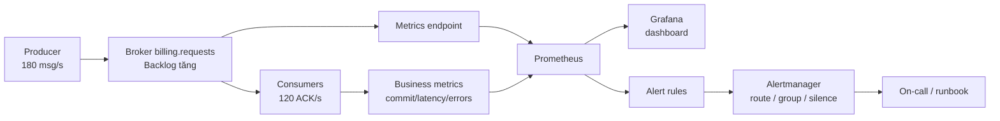
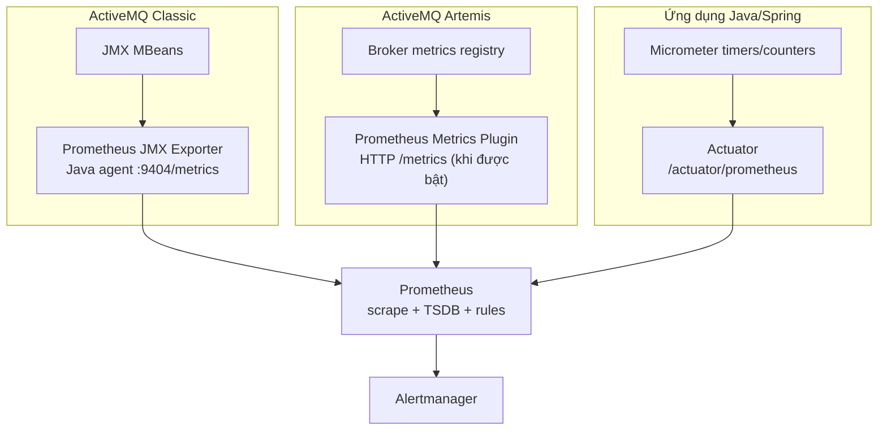

# Thu thập metrics, tích hợp Prometheus và thiết kế cảnh báo

> **Chương:** Giám sát  
> **Ngữ cảnh:** Apache ActiveMQ Classic 5.x và ActiveMQ Artemis làm broker JMS cho các ứng dụng Java. Bài tập trung vào **đường thu thập metrics → chuẩn hóa → truy vấn PromQL → cảnh báo có hành động**, kết hợp tín hiệu của broker với kết quả xử lý nghiệp vụ. Ví dụ gồm JMX Exporter cho Classic, Prometheus metrics plugin cho Artemis, Prometheus/Alertmanager và Micrometer của ứng dụng Spring Boot.

## 1. Bài toán: queue vẫn hoạt động nhưng SLA xử lý đang hỏng

Queue `billing.requests` có producer ghi 180 message/giây, consumer chỉ hoàn tất 120 message/giây. Broker còn nhiều dung lượng, cổng JMS vẫn kết nối được và health check trả về thành công. Nhưng backlog tăng khoảng 60 message/giây; các hóa đơn ngày càng phải chờ lâu.



Một hệ thống giám sát đáng tin cậy phải trả lời **đồng thời**:

1. **Broker có sẵn sàng?** Target scrape được, transport và store hoạt động, không cạn tài nguyên.
2. **Luồng message có tiến triển?** Enqueue/dequeue rate, pending, in-flight, consumer count, redelivery và DLQ.
3. **Nghiệp vụ có hoàn tất đúng hạn?** Số event thực sự commit DB thành công, thời gian end-to-end, tỷ lệ lỗi.
4. **Ai phải làm gì?** Cảnh báo phân biệt sự cố mất telemetry với sự cố xử lý, có ngưỡng, thời gian duy trì và runbook.

**Lưu ý phạm vi:** Metric “broker đã dequeue” **không luôn tương đương** “hóa đơn đã commit database thành công”. Đừng chỉ dựa vào một counter của broker để kết luận business success.

## 2. Chọn đúng loại metric trước khi viết PromQL

### 2.1. Gauge, counter và histogram

| Loại | Ví dụ | Cách hỏi đúng | Cách hỏi sai |
|---|---|---|---|
| **Gauge** | Queue depth, in-flight, consumer count, % sử dụng store | Giá trị hiện tại, xu hướng và ngưỡng | `rate(queue_depth[5m])` như thể đó là counter sự kiện |
| **Counter** | Tổng enqueue/dequeue/expired từ khi counter bắt đầu | `rate(...[5m])` và `increase(...[1h])` | Lấy chênh số tuyệt đối qua broker restart mà không xét reset |
| **Histogram** | Thời gian xử lý nghiệp vụ | `histogram_quantile(0.95, sum by(le,...)(rate(..._bucket[5m])))` | Lấy trung bình rồi kết luận p95 |

Metric từ broker có thể là **counter nội bộ reset khi broker restart**, destination được tạo lại hoặc thống kê bị reset. `rate()` và `increase()` nhận diện phần lớn reset counter thường gặp, nhưng không khôi phục lịch sử đã không được scrape. Đừng dùng `irate()` cho những alert nhạy với nhiễu khi message rate thấp.

### 2.2. Bảng tín hiệu cần có ở mỗi queue

| Tín hiệu | Classic (JMX, tên attribute phổ biến) | Artemis (management/native metrics) | Ý nghĩa/cảnh báo |
|---|---|---|---|
| **Backlog** | `QueueSize` | `MessageCount` / metric queue message count | Bao nhiêu message còn thuộc queue theo định nghĩa provider |
| **In-flight** | `InFlightCount` | `DeliveringCount` / delivering-message metric | Message đã dispatch tới consumer nhưng chưa hoàn tất |
| **Producer enqueue** | `EnqueueCount` | `MessagesAdded` | Lượng message được nhận vào queue theo provider |
| **Consumer/dequeue** | `DequeueCount` | `MessagesAcknowledged` | Lượng message rời trạng thái chờ/được ACK; **không phải** business commit tuyệt đối |
| **Consumers** | `ConsumerCount` | `ConsumerCount` | Số consumer/subscription được thấy tại queue |
| **Expired / killed** | `ExpiredCount` và thống kê liên quan | Expired/killed metrics | Message rời luồng không qua thành công nghiệp vụ |
| **DLQ** | Queue `ActiveMQ.DLQ` hoặc DLQ được cấu hình | Queue tại dead-letter-address được cấu hình | Lỗi không xử lý được, cần kiểm tra theo destination thực |
| **Store** | `StorePercentUsage`, memory/temp usage ở broker | Address size, paging, disk/store metrics | Áp lực tài nguyên ảnh hưởng độ trễ và khả năng gửi |
| **Thời gian chờ thực tế** | Có thể cần thống kê destination/ứng dụng | Tùy queue metrics/provider | Cần định nghĩa tuổi message, thời gian từ accepted đến business commit |

**Không suy diễn:**

- `QueueSize + InFlightCount` có thể **đếm trùng** nếu provider đã bao gồm delivery chưa ACK trong message count. Phải đọc định nghĩa của version đang chạy.
- Topic có nhiều durable subscriptions thì **mỗi subscription queue/backlog có thể khác nhau**; không nên thay thế bằng một số liệu tổng “topic size”.
- Network of Brokers Classic có thể giữ cùng event qua các broker khác nhau ở các chặng; **cộng EnqueueCount của mọi broker** sẽ đếm nhiều lần một event nghiệp vụ.
- Consumer count > 0 không bảo đảm có consumer **khỏe** hoặc đủ throughput; có thể là network consumer, listener bị kẹt hoặc downstream DB đang lỗi.
- Giá trị `DequeueCount` không tự chứng minh bản ghi DB tương ứng đã commit. Cần instrument nghiệp vụ.

### 2.3. Định nghĩa bộ SLI trước khi triển khai exporter

Đối với `billing.requests`, chọn:

```text
Messaging availability SLI:
  broker target scrape được và có thể send/receive probe khi cần

Queue throughput SLI:
  admitted messages / s, dequeued messages / s

Backlog SLI:
  queue depth, in-flight, tốc độ tăng backlog

Business success SLI:
  số eventId có side effect DB commit thành công / s

Latency SLI:
  p95 elapsed time từ event được nhận/accept tới business commit

Reliability SLI:
  DLQ arrival, expired count, duplicate business event count
```

Đặt mục tiêu rõ ràng, ví dụ **p95 business latency dưới 30 giây trong 15 phút**, thay vì “queue phải luôn nhỏ hơn 1000” khi workload có burst hợp lệ.

## 3. Kiến trúc thu thập: broker metrics và application metrics là hai nguồn khác nhau



Prometheus áp dụng **pull model**: nó chủ động gọi HTTP endpoint của broker/ứng dụng theo `scrape_interval`. Nếu exporter down hoặc network bị chặn, Prometheus sẽ không có sample mới; điều đó **khác** queue thực sự rỗng hay message rate bằng 0.

**Ba loại lỗi cần phân biệt:**

- **Broker không hoạt động:** producer/consumer cũng có thể lỗi, exporter có thể mất theo broker.
- **Exporter/metrics endpoint lỗi:** ứng dụng có thể vẫn xử lý message, nhưng dashboard thiếu telemetry.
- **Prometheus/Alertmanager lỗi:** các broker có thể vẫn khỏe; lỗi nằm ở hệ giám sát.

Vì vậy cần giám sát **chính pipeline monitoring** (`up`, scrape errors, rule evaluation, Alertmanager delivery).

## 4. ActiveMQ Classic: xuất queue JMX metrics qua Prometheus JMX Exporter

Classic cung cấp các MBean thuộc domain `org.apache.activemq` nếu JMX được bật. Cách phù hợp khi muốn Prometheus scrape mà không mở remote JMX/RMI là gắn **JMX Exporter Java Agent vào JVM của broker**.

### 4.1. Bật JMX ở broker

Trong phần tử `<broker>` hiện hữu của Classic `activemq.xml`:

```xml
<broker xmlns="http://activemq.apache.org/schema/core"
        brokerName="classic-a"
        useJmx="true"
        persistent="true">
  <!-- Những cấu hình broker khác đang dùng -->
</broker>
```

**Chỉ là fragment**: không tạo thêm một `<broker>` mới nếu file đã có. JMX management có thể đã được bật sẵn; cần kiểm tra chính JVM broker và các MBean bằng công cụ quản trị của môi trường.

Đặt JAR `jmx_prometheus_javaagent` **tương thích với JVM/broker**, cấu hình exporter YAML ở đường dẫn được cấp quyền. Các tệp đường dẫn trong ví dụ là **tham chiếu vận hành**, bài này không tạo/sửa chúng.

Ví dụ JVM argument:

```text
-javaagent:/opt/metrics/jmx_prometheus_javaagent.jar=9404:/etc/activemq/jmx-exporter.yml
```

Arg này phải nằm trong **JVM chạy ActiveMQ Classic** (qua cơ chế env/service wrapper/container entrypoint tương ứng), không thêm vào JVM của một producer Java. Agent sẽ mở HTTP metrics endpoint trên cổng 9404 theo cấu hình/phiên bản.

Nếu exporter dùng HTTP không xác thực, **không công khai cổng ra Internet**: giới hạn truy cập bằng loopback/sidecar network hoặc network policy/firewall, dùng TLS/auth tại reverse proxy nếu kiến trúc cần. Không mở remote JMX/RMI chỉ để Prometheus scrape.

### 4.2. Cấu hình JMX Exporter minh họa

```yaml
# /etc/activemq/jmx-exporter.yml
startDelaySeconds: 0
lowercaseOutputName: true
lowercaseOutputLabelNames: true

rules:
  - pattern: 'org\.apache\.activemq<(?=[^>]*brokerName=([^,>]+))(?=[^>]*destinationType=Queue)(?=[^>]*destinationName=([^,>]+))[^>]*><>QueueSize'
    name: amq_classic_queue_depth
    type: GAUGE
    labels:
      broker: "$1"
      queue: "$2"

  - pattern: 'org\.apache\.activemq<(?=[^>]*brokerName=([^,>]+))(?=[^>]*destinationType=Queue)(?=[^>]*destinationName=([^,>]+))[^>]*><>InFlightCount'
    name: amq_classic_queue_inflight
    type: GAUGE
    labels:
      broker: "$1"
      queue: "$2"

  - pattern: 'org\.apache\.activemq<(?=[^>]*brokerName=([^,>]+))(?=[^>]*destinationType=Queue)(?=[^>]*destinationName=([^,>]+))[^>]*><>ConsumerCount'
    name: amq_classic_queue_consumers
    type: GAUGE
    labels:
      broker: "$1"
      queue: "$2"

  - pattern: 'org\.apache\.activemq<(?=[^>]*brokerName=([^,>]+))(?=[^>]*destinationType=Queue)(?=[^>]*destinationName=([^,>]+))[^>]*><>EnqueueCount'
    name: amq_classic_queue_enqueued_total
    type: COUNTER
    labels:
      broker: "$1"
      queue: "$2"

  - pattern: 'org\.apache\.activemq<(?=[^>]*brokerName=([^,>]+))(?=[^>]*destinationType=Queue)(?=[^>]*destinationName=([^,>]+))[^>]*><>DequeueCount'
    name: amq_classic_queue_dequeued_total
    type: COUNTER
    labels:
      broker: "$1"
      queue: "$2"

  - pattern: 'org\.apache\.activemq<(?=[^>]*brokerName=([^,>]+))(?=[^>]*type=Broker)(?![^>]*destinationName=)[^>]*><>StorePercentUsage'
    name: amq_classic_broker_store_percent
    type: GAUGE
    labels:
      broker: "$1"
```

Các pattern dùng **lookahead** để tìm property trong ObjectName bất kể thứ tự khóa, nhưng **MBean format và exporter version vẫn cần được xác minh trực tiếp**. Một vài lưu ý:

- `QueueSize` là gauge, còn `EnqueueCount`/`DequeueCount` là counter.
- Tên metric kết thúc `_total` theo quy ước Prometheus counter. Kiểm tra exposition thực tế vì các phiên bản exporter có thể chuẩn hóa tên counter khác nhau.
- `destinationName` được dùng làm label `queue`; tên destination tạo theo UUID/customer ID có thể gây **high cardinality**.
- Ví dụ chỉ xuất một tập metric hữu ích, **không export tất cả MBeans** hoặc toàn bộ destination động không giới hạn.
- Nếu các pattern không khớp do ObjectName/config/provider version, exporter có thể vẫn trả HTTP 200 nhưng **không có** `amq_classic_queue_depth`. Đây phải được coi là **lỗi instrument**, không phải queue depth bằng 0.
- Dùng tên metrics mẫu như một **hợp đồng nội bộ sau khi kiểm tra endpoint**, không giả định mọi broker đều có các tên này mặc định.

### 4.3. Kiểm tra endpoint và type ngay tại broker test

```bash
curl --fail --silent http://classic-a:9404/metrics \
  | grep -E '^(amq_classic_queue_depth|amq_classic_queue_enqueued_total|amq_classic_queue_dequeued_total)'

# Kiểm tra HELP/TYPE và label thực tế.
curl --fail --silent http://classic-a:9404/metrics \
  | grep -E '^# (HELP|TYPE) amq_classic_'
```

Đây là **lệnh hướng dẫn kiểm tra**, không chạy trong bài học này. Trong môi trường thực, có thể cần HTTPS/reverse proxy/đường mạng scrape riêng. Nếu Prometheus không thấy queue metric, kiểm tra MBean ObjectNames, rule match, queue đã tồn tại, permissions và agent startup logs.

## 5. ActiveMQ Artemis: metrics plugin và endpoint riêng

Artemis có hệ metrics riêng. Tùy phiên bản/phân phối, có thể dùng **Prometheus Metrics Plugin** tích hợp với broker web endpoint hoặc một đường JMX Exporter đã chuẩn hóa. Không nên ép các pattern MBean của Classic vào Artemis: **domain, ObjectName và thuộc tính quản lý khác nhau**.

### 5.1. Cấu hình Artemis Prometheus Metrics Plugin

Trong `etc/broker.xml` của Artemis, mẫu cho dòng phiên bản hỗ trợ metrics plugin:

```xml
<metrics>
  <jvm-memory>true</jvm-memory>
  <jvm-gc>true</jvm-gc>
  <jvm-threads>true</jvm-threads>
  <netty-pool>true</netty-pool>
  <file-descriptors>true</file-descriptors>
  <processor>true</processor>
  <uptime>true</uptime>
  <plugin class-name="org.apache.activemq.artemis.core.server.metrics.plugins.ArtemisPrometheusMetricsPlugin"/>
</metrics>
```

**Điều kiện quan trọng:**

- Đây là fragment bên trong phần cấu hình broker tương ứng của `broker.xml`, không phải file XML độc lập. Chỉ thêm một phần `<metrics>` nếu broker chưa có hoặc hợp nhất vào phần sẵn có.
- Bản phân phối Artemis phải chứa **plugin implementation và các dependency** mà broker yêu cầu. Một số cài đặt cần bổ sung artifact plugin vào classpath broker; không chỉ đặt class-name là đủ.
- Prometheus scrape endpoint phụ thuộc **web server/console bootstrap** đang được bật và version; ở nhiều triển khai là `http://broker:8161/metrics`. Phải xác nhận bằng `curl` chứ không suy ra từ cổng JMS `61616`.
- Nếu dùng Artemis qua Docker/Kubernetes, kiểm tra network/service port được công bố; đừng mở console quản trị chỉ để tiện scrape metrics.
- Một số metric **không được thu thập nếu component liên quan chưa tạo** hoặc nếu plugin/version không phát ra series đó.
- Cấu hình JVM metrics chỉ bật một số nhóm JVM; không thay thế metric message/address/queue của broker.

### 5.2. Kiểm tra metric thực tế trước khi viết rule

```bash
curl --fail --silent http://artemis-a:8161/metrics \
  | grep -E '^artemis_.*(message|consumer|address|paging)'

# Xem tên metric và nhãn đúng theo plugin/version:
curl --fail --silent http://artemis-a:8161/metrics \
  | grep -E '^# (HELP|TYPE) artemis_'
```

Các tên thường cần ánh xạ gồm queue message count, delivering count, messages added, messages acknowledged, expired/killed và address size/paging. **Tên series, hậu tố `_total` và labels cụ thể là giao diện của exporter/version đang chạy.** Ví dụ ở phần alert sẽ dùng **metric Classic đã map rõ ở mục 4**, rồi hướng dẫn ánh xạ Artemis tương đương — không đưa một tên Artemis đoán mò vào rule production.

### 5.3. Cân nhắc topology Artemis

- `ANYCAST queue` là đơn vị đếm pending/delivering rõ ràng.
- Một `MULTICAST address` có nhiều subscription queues với backlog riêng.
- Address có thể đang paging, journal/disk tăng dù queue count không tăng cùng tốc độ dự đoán.
- Cặp primary/backup HA có thể khiến endpoint scrape thay đổi vai trò. Nếu scrape cả backup standby và primary, tránh cộng hai series như thể hai broker cùng nhận nghiệp vụ.

Đánh dấu nhãn `cluster`/`broker`/`role` nhất quán ở Prometheus khi quan sát cluster/HA; không lấy label chứa PID, session ID hoặc message ID thay cho identity ổn định của broker.

## 6. Prometheus scrape configuration: gắn đúng endpoint với đúng nhãn

Ví dụ trong `prometheus.yml` ở môi trường lab. Production có thể dùng service discovery, ServiceMonitor hoặc cơ chế quản trị cấu hình tương đương; không hardcode IP nếu node được tạo/hủy động.

```yaml
global:
  scrape_interval: 15s
  evaluation_interval: 15s

scrape_configs:
  - job_name: activemq-classic
    metrics_path: /metrics
    static_configs:
      - targets:
          - classic-a:9404
          - classic-b:9404
        labels:
          environment: staging
          messaging_system: classic

  - job_name: activemq-artemis
    metrics_path: /metrics
    static_configs:
      - targets:
          - artemis-a:8161
        labels:
          environment: staging
          messaging_system: artemis

  - job_name: checkout-app
    metrics_path: /actuator/prometheus
    static_configs:
      - targets:
          - checkout-app:8080
        labels:
          environment: staging
          service: checkout

rule_files:
  - /etc/prometheus/rules/activemq-alerts.yml
```

`static_configs` cố định phù hợp lab nhưng không tự phát hiện broker mới. `scrape_interval=15s` cho độ phân giải phù hợp nhiều cảnh báo vận hành; chọn ngắn hơn tăng network/TSDB load, chọn quá dài làm mất spike ngắn. Cần phân biệt **scrape interval** và `evaluation_interval`; `for: 5m` trong alert tính khoảng thời gian biểu thức đúng liên tục qua những lần đánh giá.

### 6.1. Xác minh kết nối tới cả ba nguồn

Trong Prometheus:

```promql
up{job="activemq-classic"}
up{job="activemq-artemis"}
up{job="checkout-app"}
```

- `up=1`: endpoint HTTP scrape thành công; **không** chứng minh queue hoặc business khỏe.
- `up=0`: scrape lỗi; xem exporter, DNS, TLS, network và target.
- **Không có series `up`:** target có thể bị xóa khỏi discovery, đổi label/job hoặc Prometheus không tải cấu hình. Cần giám sát số target kỳ vọng và health của chính Prometheus.

Khi dùng Java agent trên broker, endpoint có thể chết cùng broker. Để phân biệt “mất exporter riêng” với “broker không sống”, kết hợp process metrics, broker TCP/JMS probe, event logs và hạ tầng monitoring.

### 6.2. Bảo mật metrics endpoint

Metrics có thể tiết lộ tên queue, cấu trúc nghiệp vụ, backlog và sơ đồ hệ thống. Vì vậy:

- Dùng mạng riêng, firewall/NetworkPolicy và mTLS hoặc reverse proxy theo yêu cầu tổ chức.
- Không expose `9404/metrics` hoặc `8161/metrics` công khai.
- Không để credentials trong URL, Prometheus labels hoặc log.
- Giới hạn truy cập Prometheus/Alertmanager/Grafana; audit các thao tác silence, sửa rule và truy vấn nhạy cảm.
- Nếu cần nhiều tenant, tách đường scrape và nhãn truy cập theo chính sách, không giả định label tự cung cấp cô lập bảo mật.

## 7. PromQL: từ metric thô tới câu hỏi vận hành

Các truy vấn sau dùng **metric Classic do JMX Exporter ở mục 4 tạo ra**. Nếu exporter của bạn xuất tên khác, **điều chỉnh mapping trước khi dùng query**. Với Artemis, nên tạo recording rules cùng ngữ nghĩa từ các raw series đã được xác minh.

### 7.1. Backlog hiện tại theo broker và queue

```promql
amq_classic_queue_depth{queue="billing.requests"}
```

Nếu muốn tập hợp nhiều instance **vẫn thuộc cùng một broker logic** và có thể trùng series do scrape hai endpoint, phải xử lý duplicate target trước; không cộng tự động. Trong Network of Brokers, `sum by(queue)` qua A/B/C là phép đo **tổng số message pending trên các store theo snapshot**, không phải số business event duy nhất qua mọi hop.

### 7.2. Tốc độ enqueue/dequeue

```promql
rate(amq_classic_queue_enqueued_total{
  queue="billing.requests"
}[5m])
```

```promql
rate(amq_classic_queue_dequeued_total{
  queue="billing.requests"
}[5m])
```

Vì dùng counter, `rate` có thể xử lý reset thường gặp. Một queue rất ít traffic cần khoảng đo dài hơn, ví dụ `[15m]`, để tránh cảnh báo từ sample quá thưa.

### 7.3. Tốc độ thay đổi backlog xấp xỉ

Trong điều kiện không có luồng expiry, purge và DLQ bất thường:

\[
\frac{dB}{dt}\approx\lambda_{\mathrm{enqueue}}-\mu_{\mathrm{dequeue}}
\]

```promql
rate(amq_classic_queue_enqueued_total[10m])
-
rate(amq_classic_queue_dequeued_total[10m])
```

Với cùng labels `broker, queue`, toán tử trừ ghép đúng series. Kết quả **dương kéo dài** là backlog tăng. Công thức chỉ là xấp xỉ, vì queue counters có thể hạch toán nhiều dạng chuyển trạng thái; **đừng** coi chênh lệch này là số business transaction chưa xử lý chính xác tuyệt đối.

### 7.4. Ước lượng thời gian xả backlog, có điều kiện

Giả sử sau đợt tăng tải, producer còn `60/s` và consumer vẫn hoàn tất `100/s`, backlog `90.000` message:

\[
T_{\mathrm{drain}}\approx
\frac{90\,000}{100-60}=2\,250\text{ giây}
\]

Chỉ hiển thị ETA khi **dequeue rate lớn hơn enqueue rate**, và công việc/consumer rate đủ ổn định. Nếu tốc độ xả ròng `\le 0`, hiển thị **“không thể xả với mức tải hiện tại”**, không lấy `clamp_min(..., 1)` rồi đưa ra ETA giả.

**Tuổi backlog:** queue depth 5.000 không nói message cũ nhất đã chờ 10 giây hay 2 giờ. Nếu broker không cung cấp metric tuổi message trực tiếp, đo từ **timestamp đáng tin cậy của producer/consumer** hoặc exporter được kiểm chứng. Không lấy `JMSMessageID` hay chênh đồng hồ hai host không đồng bộ làm bằng chứng độ trễ chuẩn.

### 7.5. In-flight cao, ACK rate thấp

```promql
amq_classic_queue_inflight{queue="billing.requests"}
```

Kết hợp với dequeue rate và business duration. Nếu in-flight cao, dequeue gần 0 và consumer count > 0, có thể consumer đang:

- Bị kẹt DB/API downstream.
- Giữ message do prefetch lớn và không ACK.
- Đang rollback/retry liên tục.
- Thực hiện một batch transaction quá lâu.

Không kết luận nguyên nhân chỉ từ in-flight; phải có metrics handler và log correlation ID.

## 8. Chuẩn hóa metrics giữa Classic và Artemis

**Không nên tạo một dashboard/alert dùng lẫn `QueueSize` của Classic và `MessageCount` của Artemis mà không xác nhận semantics.** Chọn một bộ tên nội bộ:

| Metric nội bộ | Kiểu | Ý nghĩa cần thống nhất |
|---|---|---|
| `messaging_queue_messages` | Gauge | Outstanding messages theo định nghĩa queue được ghi rõ |
| `messaging_queue_inflight` | Gauge | Delivery đã cấp nhưng chưa ACK |
| `messaging_queue_consumers` | Gauge | Consumer đang đăng ký vào queue |
| `messaging_queue_enqueued_total` | Counter | Message được enqueue theo provider |
| `messaging_queue_dequeued_total` | Counter | Message được dequeue/ack theo provider |
| `messaging_broker_store_usage_percent` | Gauge | % broker store usage, đơn vị 0–100 |
| `messaging_business_commits_total` | Counter của ứng dụng | Side effect thực sự commit thành công |
| `messaging_business_latency_seconds` | Histogram của ứng dụng | Thời gian trong phạm vi nghiệp vụ đã định nghĩa |

Nhãn chuẩn nên gồm `environment`, `provider`, `broker`, `queue` và khi cần `service`. **Không** thêm `eventId`, `JMSMessageID`, `requestId`, user/tenant ID ngẫu nhiên làm Prometheus label: số series sẽ tăng không kiểm soát.

### 8.1. Recording rule cho Classic

Sau khi xác minh metric nguồn ở mục 4, có thể map:

```yaml
groups:
  - name: messaging-classic-normalization
    rules:
      - record: messaging_queue_messages
        expr: amq_classic_queue_depth
        labels:
          provider: classic

      - record: messaging_queue_inflight
        expr: amq_classic_queue_inflight
        labels:
          provider: classic

      - record: messaging_queue_consumers
        expr: amq_classic_queue_consumers
        labels:
          provider: classic

      - record: messaging_queue_enqueued_total
        expr: amq_classic_queue_enqueued_total
        labels:
          provider: classic

      - record: messaging_queue_dequeued_total
        expr: amq_classic_queue_dequeued_total
        labels:
          provider: classic
```

Đây là **file recording rules minh họa**, cần đưa vào `rule_files` của Prometheus nếu muốn dùng. Với Artemis, tạo **bộ rule riêng** ánh xạ từ các tên raw của plugin đã xem tại `/metrics`, đồng thời gắn `provider: artemis`. Nếu provider dùng thuộc tính khác nghĩa (ví dụ message count có/không gồm delivering), không nên che khác biệt bằng tên giống nhau; đổi tên metric hoặc bổ sung tài liệu semantic.

## 9. Thiết kế cảnh báo: triệu chứng, thời gian duy trì và hành động

Không nên tạo một alert “QueueSize > 1000” cho mọi queue. Ngưỡng nên theo **queue/SLO**, tốc độ xử lý, thời gian chờ tối đa, khả năng replay và criticality.

Mẫu ưu tiên:

1. **Mất quan sát**: `up=0`, exporter/Prometheus không còn sample.
2. **Không xử lý**: queue có backlog, consumer count = 0 quá lâu.
3. **Tăng backlog kéo dài**: enqueue rate > dequeue rate và queue depth đã đáng kể.
4. **Gần hết tài nguyên**: store usage vượt ngưỡng, disk hoặc paging tăng.
5. **Lỗi không xử lý được**: DLQ backlog/arrival tăng.
6. **Vi phạm SLO nghiệp vụ**: p95 business latency cao, completion rate thấp.

### 9.1. Prometheus alert rules hoàn chỉnh cho Classic

```yaml
# /etc/prometheus/rules/activemq-alerts.yml
groups:
  - name: activemq-classic-operations
    interval: 30s
    rules:
      - alert: ActiveMQExporterUnavailable
        expr: up{job="activemq-classic"} == 0
        for: 2m
        labels:
          severity: warning
          team: messaging
        annotations:
          summary: "Mất scrape metrics ActiveMQ tại {{ $labels.instance }}"
          description: "Kiểm tra broker process, exporter, DNS và network; up=0 chưa chứng minh broker chết."

      - alert: ActiveMQQueueHasNoConsumers
        expr: |
          (amq_classic_queue_depth{queue="billing.requests"} > 100)
          and on (broker, queue)
          (amq_classic_queue_consumers{queue="billing.requests"} == 0)
        for: 5m
        labels:
          severity: critical
          team: billing
        annotations:
          summary: "Queue {{ $labels.queue }} tại {{ $labels.broker }} không có consumer"
          description: "Kiểm tra listener, auth/TLS, deployment và subscription; có backlog nhưng consumer=0 trong 5 phút."

      - alert: ActiveMQQueueBacklogGrowing
        expr: |
          (
            rate(amq_classic_queue_enqueued_total{queue="billing.requests"}[10m])
            -
            rate(amq_classic_queue_dequeued_total{queue="billing.requests"}[10m])
          ) > 20
          and on (broker, queue)
          (amq_classic_queue_depth{queue="billing.requests"} > 2000)
        for: 10m
        labels:
          severity: warning
          team: billing
        annotations:
          summary: "Backlog {{ $labels.queue }} tăng kéo dài"
          description: "Enqueue vượt dequeue >20 msg/s trong 10 phút; kiểm tra downstream và năng lực consumer."

      - alert: ActiveMQStoreUsageHigh
        expr: amq_classic_broker_store_percent > 85
        for: 5m
        labels:
          severity: critical
          team: messaging
        annotations:
          summary: "Store usage cao tại {{ $labels.broker }}"
          description: "StorePercentUsage >85%; đối chiếu free disk, backlog và producer flow control."

      - alert: ActiveMQDeadLetterQueueHasMessages
        expr: amq_classic_queue_depth{queue="ActiveMQ.DLQ"} > 0
        for: 10m
        labels:
          severity: warning
          team: messaging
        annotations:
          summary: "DLQ {{ $labels.queue }} còn message chưa xử lý"
          description: "Phân loại lỗi, xác định eventId và quy trình redrive; không purge tự động."
```

**Các ngưỡng 100, 2.000, 20/s, 85% và các `for` chỉ là giá trị lab**, phải điều chỉnh theo baseline/SLO thật. Với queue không được phép backlog hoặc một dead-letter mới cũng nghiêm trọng, chọn rule riêng thay vì dùng ngưỡng chung.

**Cẩn trọng về vector matching:** hai biểu thức ở alert đều dùng nhãn `broker,queue` nên `and on (broker, queue)` chọn đúng series tại broker tương ứng. Nếu scrape nhiều môi trường/broker có **cùng brokerName**, hãy bảo toàn `environment`/`instance` trong label set hoặc bổ sung vào `on(...)` để không ghép nhầm series giữa các cụm.

### 9.2. Vì sao cần `for`?

Một burst ngắn có thể làm queue depth nhảy lên 3.000 rồi xả hết sau 10 giây. Cảnh báo lập tức sẽ tạo nhiễu. `for: 10m` yêu cầu **điều kiện giữ đúng liên tục**, phù hợp hiện tượng backlog không tự phục hồi.

Ngược lại, với **broker mất hẳn** hoặc **store sắp cạn**, thời gian `for` quá dài có thể khiến hệ thống hỏng trước khi ai đó phản ứng. Chọn `for` dựa trên tốc độ cạn tài nguyên và độ tin cậy scrape.

### 9.3. Dead-letter queue không nhất thiết là `ActiveMQ.DLQ`

Classic cho phép destination-specific DLQ và individual DLQ strategies. Artemis dùng dead-letter-address và queue/binding cấu hình. Do vậy rule `ActiveMQ.DLQ` ở trên **chỉ đúng khi môi trường thực sự dùng tên này**. Khi DLQ per destination, cần match các queue cụ thể và đội sở hữu tương ứng; không đặt cảnh báo vào một tên queue không tồn tại.

**Không tự động redrive toàn bộ DLQ khi alert firing.** Phải tìm lỗi payload/schema, business constraints và downstream; replay không kiểm soát có thể lặp lỗi hoặc gây side effect trùng.

### 9.4. Từ Prometheus tới Alertmanager

Prometheus đánh giá biểu thức và gửi active alerts sang Alertmanager; Alertmanager thực hiện grouping, deduplication, routing, silences và notification. Ví dụ **routing tối thiểu**:

```yaml
route:
  receiver: messaging-oncall
  group_by: [alertname, environment, broker]
  group_wait: 30s
  group_interval: 5m
  repeat_interval: 4h

receivers:
  - name: messaging-oncall
    # Bổ sung integration thực tế (email, webhook, pager)
    # và secret management theo hệ thống tổ chức.
```

Đây là **skeleton**, chưa gửi thông báo đi đâu khi chưa thêm cấu hình receiver thật; không coi là pipeline cảnh báo đã hoạt động. Trong production, cần quản lý silence có ngày hết hạn, escalation và quy tắc chống bão cảnh báo khi cùng một dependency làm nhiều queue suy giảm.

## 10. Metric nghiệp vụ từ Java: Micrometer và `@JmsListener`

Broker chỉ biết message được dispatch/dequeue. Ứng dụng mới biết nghiệp vụ tính tiền, ghi DB hay gọi service ngoài **đã thực sự hoàn thành**. Ví dụ Spring Boot 3.x dùng Micrometer và Actuator.

### 10.1. Maven dependencies

```xml
<dependencies>
  <dependency>
    <groupId>org.springframework.boot</groupId>
    <artifactId>spring-boot-starter-actuator</artifactId>
  </dependency>
  <dependency>
    <groupId>io.micrometer</groupId>
    <artifactId>micrometer-registry-prometheus</artifactId>
  </dependency>
  <dependency>
    <groupId>org.springframework.boot</groupId>
    <artifactId>spring-boot-starter-artemis</artifactId>
  </dependency>
</dependencies>
```

Ví dụ giả định project dùng Spring Boot BOM quản lý version và có listener container được bật. Với Classic, thay Artemis starter bằng starter/client Classic **tương thích Jakarta JMS** của phiên bản Boot được chọn. Nếu project không dùng Spring Boot, vẫn có thể dùng Micrometer trực tiếp với registry phù hợp.

```yaml
management:
  endpoints:
    web:
      exposure:
        include: health,info,prometheus
  metrics:
    tags:
      application: billing-worker
```

Endpoint mặc định là `/actuator/prometheus` trên cổng HTTP ứng dụng, nếu không đổi management base path/port. **Bảo vệ endpoint** bằng network policy/auth phù hợp, không mở public một cách vô ý.

### 10.2. Instrument thời gian xử lý và kết quả callback

```java
import java.util.concurrent.TimeUnit;

import io.micrometer.core.instrument.Counter;
import io.micrometer.core.instrument.MeterRegistry;
import io.micrometer.core.instrument.Timer;
import org.springframework.jms.annotation.JmsListener;
import org.springframework.stereotype.Component;

@Component
public final class BillingMetricsListener {
    private final BillingService billingService;
    private final Timer handlerTime;
    private final Counter handlerSuccess;
    private final Counter handlerFailure;

    public BillingMetricsListener(
            BillingService billingService,
            MeterRegistry registry) {
        this.billingService = billingService;

        this.handlerTime = Timer.builder("jms.business.processing")
            .description("Thời gian callback xử lý business message")
            .tag("destination", "billing.requests")
            .publishPercentileHistogram()
            .register(registry);

        this.handlerSuccess = Counter.builder("jms.business.handled")
            .description("Số callback business theo kết quả")
            .tag("destination", "billing.requests")
            .tag("result", "success")
            .register(registry);

        this.handlerFailure = Counter.builder("jms.business.handled")
            .description("Số callback business theo kết quả")
            .tag("destination", "billing.requests")
            .tag("result", "failure")
            .register(registry);
    }

    @JmsListener(
        destination = "billing.requests",
        containerFactory = "billingTxListenerFactory"
    )
    public void onMessage(String payload) {
        long start = System.nanoTime();
        try {
            // Service phải commit DB trước khi return nếu nghiệp vụ
            // cần consistency với JMS ACK sau callback.
            billingService.applyOnce(payload);
            handlerSuccess.increment();
        } catch (RuntimeException e) {
            handlerFailure.increment();
            throw e; // Giữ semantics rollback của JMS transacted listener.
        } finally {
            handlerTime.record(
                System.nanoTime() - start, TimeUnit.NANOSECONDS);
        }
    }
}
```

**Phạm vi chính xác của metric này:**

- `jms.business.handled{result="success"}` nghĩa là **method business đã trả về thành công**; nó **không chứng minh JMS Session đã commit ACK**, vì container thường commit sau khi callback return.
- `jms.business.handled{result="failure"}` đếm exception bị bắt và ném lại; không đếm lỗi nằm ngoài callback như connection error/container failure.
- `jms.business.processing` đo **handler latency** theo monotonic clock, không đo toàn bộ thời gian queue waiting từ producer đến consumer.
- `billingTxListenerFactory` là bean listener container phải thực sự có `sessionTransacted=true` hoặc JMS transaction manager tương ứng. Đây là prerequisite của cấu hình dự án, không được code metric tự tạo.
- `BillingService.applyOnce` là API nghiệp vụ minh họa và cần idempotency/inbox. Không dùng business metric thay thế transaction DB audit.

### 10.3. Truy vấn histogram p95

Với Micrometer Prometheus registry, một Timer có histogram sẽ xuất các bucket seconds với tên được chuẩn hóa tương tự `jms_business_processing_seconds_bucket`. **Xem tên thực tế tại `/actuator/prometheus`**:

```promql
histogram_quantile(
  0.95,
  sum by (le, destination) (
    rate(jms_business_processing_seconds_bucket[5m])
  )
)
```

Đừng kết luận p95 nghiệp vụ cuối-đầu từ biểu thức này: histogram chỉ đo callback. Nếu cần **end-to-end latency**, instrument mốc được broker/ứng dụng chấp nhận và mốc DB commit; tránh dùng chênh timestamp của hai host không đồng bộ như số liệu tuyệt đối.

Đặt label như `destination`, `result` có tập giá trị hữu hạn. **Không** thêm `eventId`, `invoiceId` hoặc nội dung payload làm tag: Prometheus không phải kho truy vết message-level. Dùng log/tracing có correlation ID cho drill-down.

## 11. Tạo dashboard có khả năng trả lời câu hỏi vận hành

Một dashboard cho từng broker và từng queue nên có:

| Panel | Truy vấn/nguồn | Câu hỏi |
|---|---|---|
| **Scrape health** | `up` và scrape duration | Broker/exporter có đang gửi telemetry? |
| **Queue backlog** | Gauge depth theo broker/queue | Message đang tồn tại ở đâu? |
| **Enqueue vs dequeue rate** | Hai counter rate | Nguồn vào có vượt năng lực ra không? |
| **Backlog growth** | Enqueue rate − dequeue rate | Queue đang tiến gần tình trạng quá tải? |
| **In-flight vs consumers** | InFlightCount + ConsumerCount | Có consumer nhưng không ACK? |
| **DLQ backlog & arrival** | DLQ depth/received rate | Lỗi không xử lý được tăng ở queue nào? |
| **Store/memory/temp** | Usage ratio/% + disk free | Bao lâu nữa chạm ngưỡng tài nguyên? |
| **Handler success/failure** | Micrometer counters | Business commit có tiến triển? |
| **p95 handler/business latency** | Histogram Timer | Vi phạm latency SLO ở lớp nào? |
| **Deploy/failover timeline** | Annotations, process uptime | Thay đổi hạ tầng có tương quan đột biến không? |

Cần có bộ lọc `environment`, `broker`, `queue`, `service`. Tránh dashboard chỉ hiển thị tổng toàn bộ cluster vì một broker trung gian có thể giữ backlog trong khi broker nguồn trống.

### 11.1. Truy vấn phải hiểu “không có dữ liệu”

Khi queue metric không xuất hiện, có ít nhất ba khả năng:

1. Queue thật sự chưa được tạo/đã xóa.
2. Exporter pattern không khớp ObjectName, metric bị lọc.
3. Exporter/broker/prometheus scrape lỗi.

**Không dùng `or vector(0)` một cách mù quáng** để biến tất cả “no data” thành queue depth 0; điều đó có thể che giấu mất observability. Dashboard nên có panel `up` và validation “metric expected but absent”.

### 11.2. Ước lượng tương lai theo tốc độ hiện tại, nhưng không hứa chắc

Nếu queue đang tăng 50 msg/s, và còn capacity cho 100.000 message, phép chia cho kết quả **~2.000 giây** trước ngưỡng đó *nếu tốc độ giữ nguyên*. Đó chỉ là ước lượng, vì message size, disk paging, retry, traffic burst và consumer capacity thay đổi. Khi alert hướng tới nguy cơ hết disk, phải kết hợp byte store usage và tốc độ tăng byte, không chỉ số lượng message.

## 12. Kiểm thử pipeline, rule và cảnh báo có thực sự hoạt động

### 12.1. Kiểm tra cấu hình trước khi rollout

```bash
# Chỉ kiểm tra cú pháp/khả năng nạp config.
promtool check config /etc/prometheus/prometheus.yml

# Kiểm tra alert + recording rule files.
promtool check rules /etc/prometheus/rules/activemq-alerts.yml

# Kiểm tra metric đang được scrape.
curl --fail http://classic-a:9404/metrics
curl --fail http://artemis-a:8161/metrics
curl --fail http://checkout-app:8080/actuator/prometheus
```

Các lệnh trên là **hướng dẫn thao tác**, không chạy trong workflow viết bài này. `promtool check` phát hiện lỗi cú pháp/rules, **không** chứng minh ngưỡng hay label matching đúng trong vận hành. Cần kiểm tra query trực tiếp trên Prometheus và thực hiện alert integration test.

### 12.2. Ma trận diễn tập có kiểm soát

| Ca thử | Cách mô phỏng trong staging | Điều phải thấy |
|---|---|---|
| **Exporter down** | Ngắt scrape endpoint, không tắt broker nếu có thể | `up=0`; alert mất telemetry, không gọi nhầm là queue rỗng |
| **Broker down** | Stop broker test | Target down + JMS probe lỗi, phân biệt với exporter-only |
| **Backlog tăng** | Producer nhanh hơn consumer một thời gian | Depth và enqueue−dequeue rate tăng; alert chỉ firing sau `for` |
| **No consumers** | Dừng consumer của queue test nhưng vẫn gửi | ConsumerCount về 0, depth vượt ngưỡng, alert firing |
| **Consumer chậm** | Giảm business processing throughput | In-flight/age tăng, p95 handler tăng, dequeue giảm |
| **DLQ** | Gửi poison message test với retry/DLQ policy riêng | DLQ count tăng, alert gửi đúng team |
| **Store pressure** | Chạm ngưỡng test an toàn (không làm đầy disk thật) | Usage metric và alert đúng; producer flow control có thể xuất hiện |
| **Counter reset** | Restart broker test | `rate` không tạo spike giả kéo dài |
| **Queue biến mất** | Xóa queue test theo quyền và quy trình | Metric series mất; dashboard không hiển thị sai là 0 |
| **Rule severity/routing** | Dùng test alert hợp lệ | Alertmanager route đúng team, grouping/silence đúng |
| **Artemis HA failover** | Chuyển active trong lab | Series target/role thay đổi, không double count standby |
| **Multi-broker** | Backlog dừng ở broker B | Dashboard từng broker phát hiện, không bị tổng A/C che giấu |

**Với metric từ môi trường nhiều broker**, một sự kiện có thể bị forward qua nhiều node. Test số lượng event **duy nhất** phải dựa trên business event ID hoặc một ledger nghiệp vụ, không cộng `EnqueueCount` toàn cluster.

### 12.3. Cách xác nhận alert không chỉ “đúng PromQL”

Một alert đạt yêu cầu khi:

1. Metric nguồn có mặt, đúng đơn vị và labels.
2. Biểu thức chuyển sang **pending** khi điều kiện phát sinh.
3. Qua `for`, alert chuyển **firing**.
4. Alertmanager route đúng receiver/team, không lặp thông báo vô hạn.
5. Có runbook xác định ai trực, nguyên nhân ưu tiên kiểm tra và thao tác an toàn.
6. Khi hệ phục hồi, alert **resolved** trong khoảng thời gian phù hợp.
7. Không có false positive đáng kể khi queue idle, deploy có kế hoạch, broker backup standby hoặc một lần scrape mất ngắn.

## 13. Những sai lầm dễ gây sự cố giám sát

| Sai lầm | Hậu quả | Cách sửa |
|---|---|---|
| Xem `up=1` là broker khỏe hoàn toàn | Broker sống nhưng queue backlog vô hạn | Kết hợp queue + business SLI |
| Coi `DequeueCount` là DB commit | Dashboard báo success dù nghiệp vụ lỗi ngoài broker | Thêm business commit metric |
| Dùng `rate` cho queue depth gauge | Số liệu không có nghĩa hoặc bị nhiễu | Dùng gauge trực tiếp; tính rate của event counters |
| Dùng ngưỡng queue size cho mọi queue | Nhiều false alarm hoặc bỏ sót SLO | Ngưỡng theo workload và message age |
| Cộng enqueue toàn Network of Brokers | Một event bị đếm qua nhiều hops | Quan sát từng broker, dùng eventId cho uniqueness |
| Gắn `eventId` vào Prometheus label | Bùng nổ cardinality/TSDB | Đưa ID vào logs/traces |
| Export mọi MBean không chọn lọc | Overhead lớn, dữ liệu khó hiểu | Whitelist metrics và destination labels |
| Mất exporter được hiểu là queue trống | Che outage telemetry | `up`, absent series, monitoring self-check |
| Artemis plugin không có nhưng vẫn scrape `/metrics` | Target 404/empty, báo sai broker | Xác minh JAR, web server và plugin/version |
| Cảnh báo ngay khi depth tăng một chút | Bão cảnh báo khi burst bình thường | Dùng `for`, tốc độ tăng và business SLO |
| DLQ alert không có quy trình xử lý | Alert lặp đi lặp lại không ai hành động | Runbook, owner, phân loại poison messages |
| Chỉ test syntax YAML, không test firing | Rule đẹp nhưng không tới on-call | Integration test Alertmanager receiver |
| Public metrics port không auth | Lộ topology và workload nội bộ | Private network/TLS/auth ở boundary |

## 14. Checklist và bài tập

### Checklist triển khai

- [ ] Đã định nghĩa metrics là gauge/counter/histogram và kiểm tra units/reset.
- [ ] Classic JMX và exporter hoạt động; `/metrics` có đúng queue series được mong đợi.
- [ ] Artemis plugin hoặc JMX exporter tương thích broker version; endpoint được kiểm chứng.
- [ ] Prometheus scrape đủ broker **và** ứng dụng xử lý nghiệp vụ.
- [ ] Dashboard theo từng `broker + queue`, có phân biệt in-flight, pending và DLQ.
- [ ] Không có label cardinality vô hạn; queue tên động được kiểm soát.
- [ ] PromQL dùng rate đúng cho counters, không cộng trùng per-hop.
- [ ] Cảnh báo có ngưỡng theo SLO, `for` và owner/runbook cụ thể.
- [ ] Đã kiểm thử mất metrics, broker down, tăng backlog, DLQ và failover.
- [ ] Prometheus/Alertmanager, quyền truy cập, retention và backup được vận hành như hệ quan trọng.

### Câu hỏi vận dụng

1. Producer gửi 180 msg/s, consumer ACK 120 msg/s trong 10 phút. Backlog tăng bao nhiêu nếu không có expiry/purge? Metric nào đo được hai tốc độ?
2. Queue có `ConsumerCount=4`, `InFlightCount=1000` nhưng dequeue rate ≈ 0. Nêu ít nhất ba nguyên nhân cần điều tra trước khi tăng số consumer.
3. Vì sao `rate(QueueSize[5m])` không tương đương `rate(EnqueueCount[5m])-rate(DequeueCount[5m])`?
4. Cùng event đi qua A→B→C trong Classic Network of Brokers. Tại sao không cộng toàn bộ `EnqueueCount` để tính số đơn hàng mới?
5. Artemis target `up=1` nhưng không xuất queue metric. Kết luận “queue rỗng” có hợp lý không? Cần kiểm tra gì?
6. Một message rơi vào `ActiveMQ.DLQ`. DLQ count tăng có chứng minh lỗi nghiệp vụ vĩnh viễn không? Cần phân loại thế nào?
7. Thiết kế alert phát hiện queue backlog tăng >20 msg/s, depth >2.000 trong 10 phút; giải thích `and on(broker,queue)` và `for`.
8. Một listener ghi metric success trước khi container JMS commit. Nếu JMS commit thất bại rồi redelivery, metric success có thể tăng thêm không? Làm sao đo business commit đúng?
9. Một queue có tên theo `userId` tạo hàng trăm nghìn destination. Tác hại với JMX Exporter/Prometheus và cách giảm cardinality?
10. Bạn sẽ chứng minh quy trình alert đi từ PromQL → firing → Alertmanager → on-call → resolved như thế nào?

## 15. Tài liệu tham khảo

- [Prometheus — Metric Types](https://prometheus.io/docs/concepts/metric_types/): gauge, counter, histogram và ý nghĩa của từng kiểu.
- [Prometheus — Querying](https://prometheus.io/docs/prometheus/latest/querying/basics/): PromQL vector matching và truy vấn dữ liệu.
- [Prometheus — Alerting Rules](https://prometheus.io/docs/prometheus/latest/configuration/alerting_rules/): biểu thức, `for`, labels và annotations.
- [Prometheus — Recording Rules](https://prometheus.io/docs/prometheus/latest/configuration/recording_rules/): chuẩn hóa/ghi trước các truy vấn dùng chung.
- [Prometheus JMX Exporter](https://prometheus.github.io/jmx_exporter/): Java agent, cấu hình rules và chuyển JMX metrics sang Prometheus.
- [Alertmanager — Configuration](https://prometheus.io/docs/alerting/latest/configuration/): grouping, routing, silences và receivers.
- [ActiveMQ Classic — JMX](https://activemq.apache.org/components/classic/documentation/jmx): MBeans của broker/destination.
- [ActiveMQ Artemis — Metrics](https://artemis.apache.org/components/artemis/documentation/latest/metrics.html): metrics plugin, JVM/broker/queue metrics.
- [Spring Boot — Metrics](https://docs.spring.io/spring-boot/reference/actuator/metrics.html): Micrometer, Actuator và Prometheus registry.

**Ghi nhớ:** Giám sát ActiveMQ không chỉ là scrape một cổng rồi vẽ queue size. Cần **xác minh ngữ nghĩa metric ở đúng Classic/Artemis version**, kết hợp **broker enqueue/dequeue/backlog** với **business success và latency**, và thiết kế alert theo **triệu chứng kéo dài, SLO, người chịu trách nhiệm và khả năng hành động**. Nếu metric mất, phải báo **mất quan sát** chứ không báo “queue bằng 0”; nếu broker vẫn khỏe nhưng nghiệp vụ chậm, dashboard và alert phải phát hiện được trước khi backlog trở thành sự cố dung lượng.
