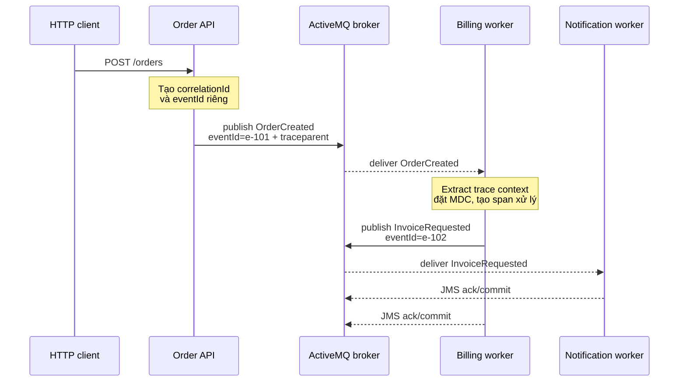
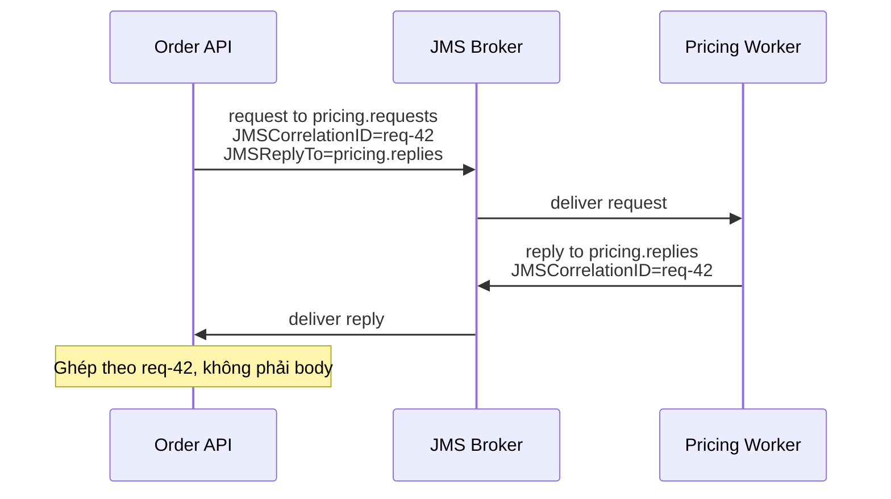
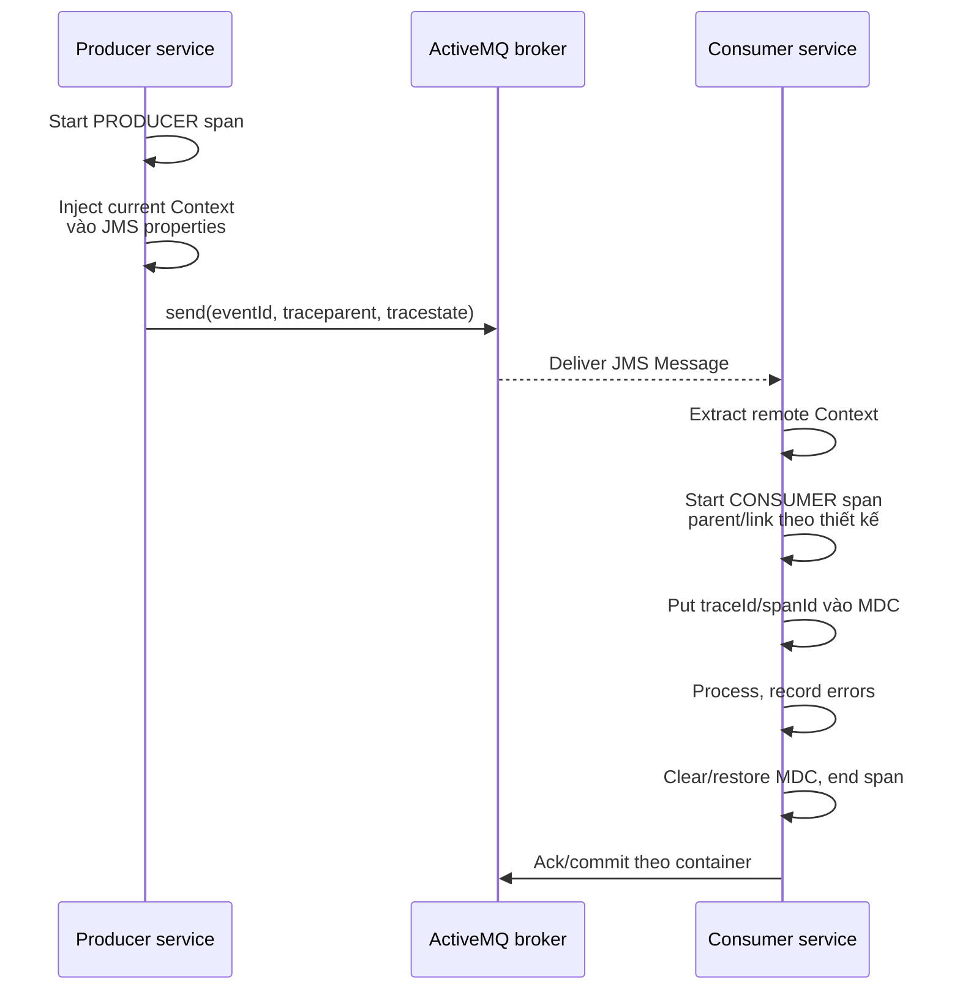

# Correlation ID, log có cấu trúc và truyền ngữ cảnh tracing

> **Chương:** Giám sát  
> **Phạm vi:** Apache ActiveMQ **Classic** và **Artemis** trong kiến trúc Java/JMS bất đồng bộ; Spring JMS, SLF4J/Logback và OpenTelemetry. Ví dụ dùng **Spring Boot 3.x / Jakarta Messaging** với JMS provider/client tương thích.  
> **Mục tiêu:** Thiết kế hợp đồng correlation ID ổn định, tạo log có cấu trúc để lần theo một message, truyền W3C Trace Context qua JMS properties, tái tạo tracing context đúng trong consumer, tránh rò rỉ MDC giữa các thread và chẩn đoán các tình huống redelivery, DLQ, retry, request/reply và broker failover.

## 1. Một yêu cầu HTTP tạo nhiều message: cần nối log thế nào?

Giả sử một API nhận `POST /orders`, lưu đơn hàng, gửi `OrderCreated` vào `orders.events`; consumer tạo hóa đơn, gửi `InvoiceRequested` vào queue khác rồi cuối cùng hoàn tất. Chuỗi xử lý có thể trải qua **nhiều JVM, queue và broker**, và giữa các bước có trễ vài giây hoặc vài phút.



Một log `"Invoice created"` không đủ cho incident response nếu không biết log thuộc message nào, request nào và lần nhận thứ mấy. Mặt khác, gắn **một ID duy nhất cho tất cả mục đích** cũng không ổn:

- Request/reply cần nhận diện **cuộc hội thoại**.
- Nghiệp vụ cần biết **cùng một sự kiện đã được xử lý chưa**, kể cả khi message được gửi lại.
- Distributed tracing cần nhận diện **trace và span** theo quan hệ nhân quả.
- JMS provider tự có **message ID cho từng lần gửi**.
- Lỗi redelivery cần biết **lần delivery**, nhưng đó không phải một business event mới.

**Nguyên tắc:** tách ID theo ý nghĩa, ghi chúng vào log/trace theo hợp đồng rõ ràng, và chỉ dùng ID phù hợp cho việc dedupe hoặc trả lời request.

## 2. Bốn loại ID và một bộ ngữ cảnh không được đánh đồng

| Trường | Sinh ở đâu? | Phạm vi | Giữ khi retry/redelivery? | Mục đích đúng |
|---|---|---|---|---|
| `eventId` (application property) | Ứng dụng khi tạo **logical event** | Một sự kiện nghiệp vụ | **Có** khi gửi lại cùng logical event | Idempotency, đối soát DB/outbox, DLQ redrive |
| `JMSCorrelationID` (JMS header) | Ứng dụng, thường lúc mở hội thoại | Request/reply hoặc workflow correlation | Theo contract ứng dụng; thường giữ trong reply | Ghép reply với request/chuỗi nghiệp vụ |
| `JMSMessageID` (JMS header) | JMS provider khi **send** | Một lần JMS send | Có thể khác khi republish một message mới | Chẩn đoán vận chuyển, audit một message instance |
| `traceId` (tracing context) | Tracing SDK tại root trace | Một trace/distributed operation | Có thể nối cùng trace hoặc dùng **link** khi retry/delay | Truy vết nhân quả, latency từng span |
| `spanId` và `traceparent` | Tracing SDK/propagator | Một đoạn xử lý và context liên tiến trình | **Không** tái dùng span ID cho span mới | Parent-child/link, sampling và context propagation |

### 2.1. Ví dụ cụ thể

```text
POST /orders
  correlationId = req-4f1c
  traceId       = 9c8d... (32 ký tự hex)
  spanId        = a31f... (16 ký tự hex)

Order API publish:
  eventId             = order-created:ORD-42:v1
  JMSCorrelationID    = req-4f1c
  JMSMessageID        = ID:broker-a-... (provider cấp sau send)
  traceparent         = 00-<trace-id>-<span-id>-<flags>

Billing worker nhận lại lần 2 sau rollback:
  eventId             = order-created:ORD-42:v1   (logical event cũ)
  JMSCorrelationID    = req-4f1c                   (header message cũ)
  JMSMessageID        = ID:broker-a-...             (cùng delivery lineage)
  JMSRedelivered      = true                       (provider đánh dấu)
  JMSXDeliveryCount   = có thể tăng nếu provider hỗ trợ
  current spanId      = một span ID MỚI cho lần xử lý này
```

`JMSMessageID` thường do provider tạo khi gửi, **không** lấy nó làm dedupe key vĩnh viễn: nếu producer nhận timeout và gửi lại cùng business event thành message mới, provider có thể cấp một JMSMessageID khác. Ngược lại, `traceId` và `spanId` **không** phải một khoá chính DB hoặc quyền truy cập.

### 2.2. “Correlation ID” trong hai ngữ cảnh

Nhiều đội gọi một trường application `correlationId` để gom mọi công việc thuộc một HTTP request. Trong JMS còn có **standard header `JMSCorrelationID`** dành cho liên hệ message với một message khác hoặc hội thoại.

Có thể chọn **cùng giá trị chuỗi** cho cả hai trong một hệ thống đã quy ước, nhưng cần tuyên bố chính xác:

- `JMSCorrelationID`: header JMS và contract request/reply.
- `businessCorrelationId`: application property khi một workflow kéo dài qua nhiều messages, nếu cần tách khỏi request/reply.
- `traceId`: do SDK quản lý; không nhét trace ID vào `JMSCorrelationID` để thay W3C propagation.

Một workflow có thể kéo dài nhiều ngày và phát message mới trong một trace mới. **Business correlation** vẫn có ích khi tracing backend đã hết retention hoặc trace bị sampling bỏ.

## 3. Hợp đồng metadata tối thiểu cho message

Với queue `orders.events` có payload JSON hoặc `TextMessage`, đề xuất một contract rõ ràng:

| Tên | Nơi lưu | Kiểu | Ví dụ | Bắt buộc? |
|---|---|---|---|---|
| `eventId` | JMS application property | String | `order-created:ORD-42:v1` | Có cho event cần idempotency |
| `eventType` | JMS application property | String | `OrderCreated` | Nên có |
| `schemaVersion` | JMS application property | int | `2` | Nên có |
| `publishedAtEpochMs` | JMS application property | long | Epoch UTC milliseconds | Nên có khi cần đo lag |
| `JMSCorrelationID` | JMS **header** | String hoặc byte[] theo JMS API | `req-4f1c` | Theo workflow/request-reply |
| `traceparent` | JMS application property | String | W3C Trace Context | Khi propagation được bật |
| `tracestate` | JMS application property | String | W3C vendor state | Tùy propagator, không tự chế |
| `baggage` | JMS application property | String | W3C baggage | Mặc định **không** truyền nếu chưa review privacy |
| `JMSMessageID` | JMS **header** | Provider-defined String | `ID:...` | Provider quản lý |
| `JMSRedelivered` | JMS **header** | boolean | `true` | Provider quản lý |

### 3.1. JMS property name phải hợp lệ

JMS application property name chịu quy tắc định danh kiểu Java identifier và các tên dành riêng, không phải arbitrary HTTP header name. Ví dụ:

```text
Đúng:
  traceparent
  tracestate
  eventId
  schemaVersion
  businessCorrelationId

Không dùng làm JMS property name:
  trace-parent      (chứa dấu gạch ngang)
  x-request-id      (chứa dấu gạch ngang)
  1eventId          (bắt đầu bằng chữ số)
  JMS_custom        (đụng namespace reserved của JMS)
```

W3C `traceparent` và `tracestate` **vốn đã là những tên phù hợp** với JMS property naming. Giá trị `traceparent` có dấu gạch ngang, điều này **hợp lệ vì chỉ tên property bị giới hạn**. Tên property là case-sensitive theo JMS; injector và extractor phải dùng cùng quy ước.

Không dùng `setStringProperty("JMSCorrelationID", value)` để đặt header JMS. Phải dùng:

```java
message.setJMSCorrelationID(correlationId);
```

Các tên `JMSX...` có ngữ nghĩa dành riêng cho JMS extensions/provider. Không ghi đè `JMSXDeliveryCount` để “giả lập retry”; đọc giá trị mà broker/provider cấp.

### 3.2. Giới hạn kích thước và dữ liệu nhạy cảm

Custom message properties làm tăng overhead broker, network, storage và index. Không nhét toàn bộ HTTP headers, JWT, email, cookie, access token hoặc profile người dùng vào tracing properties.

- `eventId`, `correlationId` nên ngắn, hợp lệ và có giới hạn độ dài.
- `traceparent` chỉ chứa trace IDs/flags, **không chứa PII** theo chuẩn.
- `tracestate` và đặc biệt `baggage` có thể bị lợi dụng chứa dữ liệu tùy ý; chỉ truyền khi đã có allowlist và chính sách tin cậy.
- Broker audit/logging không nên ghi body/secret chỉ để theo trace.
- Khi nhận một ID từ client không tin cậy, cần **validate/sanitize** trước khi dùng làm log field hoặc storage key.

## 4. `JMSCorrelationID` trong request/reply

Request/reply là tình huống kinh điển của header `JMSCorrelationID` và `JMSReplyTo`. Một producer gửi yêu cầu với `requestId` đã biết **trước khi send**, consumer trả lời bằng đúng correlation ID đó.



Java/Jakarta Messaging:

```java
// Hai Session hợp lệ, queue đã được provision; đóng producer khi xong.
String requestId = "req-" + java.util.UUID.randomUUID();

jakarta.jms.Queue requestQueue =
        session.createQueue("pricing.requests");
jakarta.jms.Queue replyQueue =
        session.createQueue("pricing.replies");

jakarta.jms.TextMessage request =
        session.createTextMessage("price-for-ORD-42");
request.setJMSCorrelationID(requestId);
request.setJMSReplyTo(replyQueue);

jakarta.jms.MessageProducer requestProducer =
        session.createProducer(requestQueue);
requestProducer.send(request); // Có JMSMessageID sau send.

// Responder nhận request qua consumer (Session khác hợp lệ).
jakarta.jms.Destination replyTo = inboundRequest.getJMSReplyTo();
if (replyTo == null) {
    throw new IllegalArgumentException("Missing JMSReplyTo");
}

jakarta.jms.TextMessage reply =
        responderSession.createTextMessage("amount=100000");
reply.setJMSCorrelationID(inboundRequest.getJMSCorrelationID());
jakarta.jms.MessageProducer replyProducer =
        responderSession.createProducer(null); // Gửi tới replyTo động.
replyProducer.send(replyTo, reply);
```

*Đoạn minh họa giả định `producer`, `session`, `inboundRequest`, `responderSession` và `replyProducer` có lifecycle JMS hợp lệ; đây không phải một class standalone.*

**Vì sao không lấy `JMSMessageID` làm correlation mặc định?** Một số mẫu request/reply đặt correlation của reply bằng JMSMessageID của request, nhưng producer chỉ biết ID đó **sau send**; phía reply và phía request phải thống nhất chính xác quy ước. Dùng một `requestId` do app sinh trước khi send thường đơn giản hơn khi muốn lưu mapping, timeout và retry.

### 4.1. Reply đến muộn và timeout

Khi caller timeout, worker có thể vẫn xử lý và gửi reply. Một reply muộn không nhất thiết là message sai:

- Giữ bảng request/reply state có TTL và `requestId`.
- Quy định late reply: bỏ qua có audit, reconcile hay lưu kết quả.
- Không coi JMS request timeout là bằng chứng worker chưa làm gì.
- Khi retry request nghiệp vụ, dùng `eventId`/request business key ổn định để tránh tạo thao tác trùng.
- Truyền tracing context cho **request và reply**, nhưng reply là một send mới với **span mới**; đừng copy nguyên một `traceparent` cũ rồi coi cùng span.

## 5. W3C Trace Context đi qua JMS như thế nào?

OpenTelemetry thường truyền context liên tiến trình theo W3C Trace Context:

```text
traceparent = 00-0123456789abcdef0123456789abcdef-89abcdef01234567-01
              ^^ ^------------------------------^ ^--------------^ ^^
           version          trace-id                  parent-id     flags
```

- `trace-id`: 16 byte biểu diễn thành **32 ký tự hex**.
- `parent-id`: 8 byte biểu diễn thành **16 ký tự hex**.
- `trace-flags`: 1 byte; bit sampled thường được biểu diễn trong giá trị.
- `tracestate`: optional, có thể chứa vendor-specific context.

**Không tự sinh `traceparent` bằng UUID, nối string hay copy từ log.** SDK/propagator phụ trách tạo/kiểm tra định dạng, sampling và context.

### 5.1. Các bước truyền qua broker



Broker Classic/Artemis **không cần giải mã span** để forward message; đối với broker, `traceparent` thường chỉ là application property. Nếu dùng broker bridge, DLQ, forwarding hoặc republish, phải kiểm tra **properties còn tồn tại và có được truyền đúng không**, không đoán.

### 5.2. Parent-child hay Span Link?

Nếu một consumer xử lý **một message ngay sau publish**, tạo `CONSUMER` span với parent được extract có thể là một lựa chọn hợp lý. Nhưng message broker là ranh giới bất đồng bộ:

- Với **batch nhiều messages** từ nhiều traces, một span không thể có nhiều parent: dùng **Span Links** tới từng message context.
- Với message **scheduled nhiều giờ/ngày**, DLQ redrive hoặc retry độc lập, có thể tạo **trace mới và link** tới context gốc thay vì kéo dài một trace rất lâu.
- Với fan-out tới nhiều subscribers, các consumer spans có thể là nhiều nhánh; sampling/retention cần được đo.
- Khi SDK dùng messaging semantic conventions hoặc OpenTelemetry Java agent, instrumentation có thể tự tạo spans theo **quy ước có version**. Không tự tạo lớp spans trùng lặp nếu auto instrumentation đã làm tương đương.

**Đừng đồng nhất trace duration với end-to-end business SLA.** Traces có thể bị sampling/retention bỏ; business ID và timestamp ở durable logs/DB vẫn là nguồn đối soát.

## 6. OpenTelemetry: adapter JMS để inject/extract context

Để minh họa manual instrumentation, dùng `io.opentelemetry.api.OpenTelemetry` cùng propagator đã cấu hình (thường W3C). `TextMapPropagator` hoạt động với carrier bất kỳ thông qua `TextMapSetter` và `TextMapGetter`; JMS `Message` là carrier ở đây.

Đoạn dưới đây dùng Jakarta Messaging và OpenTelemetry API, có thể đặt trong một class utility dùng chung.

```java
package example.observability;

import io.opentelemetry.context.propagation.TextMapGetter;
import io.opentelemetry.context.propagation.TextMapSetter;
import jakarta.jms.JMSException;
import jakarta.jms.Message;

import java.util.ArrayList;
import java.util.Enumeration;
import java.util.List;

public final class JmsTraceCarrier {

    private JmsTraceCarrier() {}

    public static final TextMapSetter<Message> SETTER =
        (carrier, key, value) -> {
            if (carrier == null || key == null || value == null) {
                return;
            }
            try {
                // Gọi TRƯỚC send(); property của message nhận có thể read-only.
                carrier.setStringProperty(key, value);
            } catch (JMSException e) {
                // Không im lặng làm mất context do lỗi provider.
                throw new IllegalStateException(
                    "Cannot inject JMS tracing property: " + key, e);
            }
        };

    public static final TextMapGetter<Message> GETTER =
        new TextMapGetter<>() {

            @Override
            public Iterable<String> keys(Message carrier) {
                if (carrier == null) {
                    return List.of();
                }
                try {
                    Enumeration<?> names = carrier.getPropertyNames();
                    List<String> result = new ArrayList<>();
                    while (names.hasMoreElements()) {
                        result.add(String.valueOf(names.nextElement()));
                    }
                    return result;
                } catch (JMSException e) {
                    // Hành vi degrade được chọn có chủ ý:
                    // Không thể đọc metadata -> coi như thiếu remote context.
                    return List.of();
                }
            }

            @Override
            public String get(Message carrier, String key) {
                if (carrier == null || key == null) {
                    return null;
                }
                try {
                    return carrier.getStringProperty(key);
                } catch (JMSException e) {
                    return null;
                }
            }
        };
}
```

**Điểm kỹ thuật quan trọng:**

1. `SETTER` ghi string properties `traceparent`/`tracestate` do propagator quyết định; không tạo header với dấu `-` trong tên.
2. `GETTER.keys(...)` cho biết property names có trên JMS Message, cho phép propagator đọc đúng carrier.
3. Vì `TextMapSetter` không khai báo `throws JMSException`, sample **wrap exception** thành runtime exception để publisher biết injection có lỗi. Không tiếp tục send như không có gì nếu tracing là contract bắt buộc.
4. `GETTER` ở đây chọn **degrade gracefully** nếu metadata không đọc được. Với hệ thống compliance yêu cầu context luôn có, thay bằng validation/log cảnh báo và quyết định reject/quarantine rõ ràng.
5. Propagator có thể inject nhiều keys tùy cấu hình. Không dựa vào assumption chỉ có `traceparent`; giữ allowlist nếu nhận từ trust boundary không đáng tin.
6. Nếu `OpenTelemetry` đang là no-op, hoặc propagators không được cấu hình W3C, inject có thể **không tạo property**. Cần integration test kiểm chứng.

### 6.1. Cấu hình W3C thực sự thuộc về SDK

`OpenTelemetry.getPropagators().getTextMapPropagator()` chỉ dùng được cấu hình đã đăng ký trong SDK/ứng dụng. Chỉ thêm dependency `opentelemetry-api` **không tự** sinh trace/export spans.

Những mảnh cần có trong một ứng dụng:

- API + Context;
- SDK TracerProvider (hoặc môi trường auto-instrumentation);
- Tracer/propagators được cấu hình;
- Exporter/collector nếu muốn xem traces ngoài process;
- Sampling và resource attributes như `service.name`.

Trong Spring Boot 3 có thể dùng **Micrometer Tracing với bridge OpenTelemetry** hoặc **OpenTelemetry Java agent**. Nếu dùng code manual như phần 7–8, cần cung cấp `OpenTelemetry` bean/object thực sự được cấu hình; không mặc định một ứng dụng Spring Boot tối thiểu đã có bean đó.

## 7. Producer Spring JMS: tạo PRODUCER span rồi inject

Với một `JmsTemplate` đã được cấu hình kết nối Classic/Artemis, ví dụ publish một logical business event:

```java
package example.observability;

import io.opentelemetry.api.OpenTelemetry;
import io.opentelemetry.api.trace.Span;
import io.opentelemetry.api.trace.SpanKind;
import io.opentelemetry.api.trace.StatusCode;
import io.opentelemetry.api.trace.Tracer;
import io.opentelemetry.context.Context;
import io.opentelemetry.context.Scope;
import jakarta.jms.TextMessage;
import org.springframework.jms.core.JmsTemplate;
import org.springframework.stereotype.Service;

@Service
public class TracedOrderPublisher {

    private final JmsTemplate jmsTemplate;
    private final OpenTelemetry telemetry;
    private final Tracer tracer;

    public TracedOrderPublisher(
            JmsTemplate jmsTemplate,
            OpenTelemetry telemetry) {
        this.jmsTemplate = jmsTemplate;
        this.telemetry = telemetry;
        this.tracer = telemetry.getTracer("example.jms");
    }

    public void publish(
            String eventId,
            String correlationId,
            String orderId) {

        Span span = tracer.spanBuilder("publish orders.events")
            .setSpanKind(SpanKind.PRODUCER)
            .startSpan();

        try (Scope ignored = span.makeCurrent()) {
            jmsTemplate.send("orders.events", session -> {
                TextMessage m = session.createTextMessage(orderId);
                m.setStringProperty("eventId", eventId);
                m.setStringProperty("eventType", "OrderCreated");
                m.setIntProperty("schemaVersion", 1);
                m.setLongProperty(
                    "publishedAtEpochMs", System.currentTimeMillis());
                m.setJMSCorrelationID(correlationId);

                telemetry.getPropagators()
                    .getTextMapPropagator()
                    .inject(Context.current(), m, JmsTraceCarrier.SETTER);

                return m;
            });

            // Chỉ đánh dấu thành công thao tác template send.
            // Nếu có transaction bên ngoài, commit có thể diễn ra sau.
            span.setAttribute("app.messaging.destination", "orders.events");
        } catch (RuntimeException failure) {
            span.recordException(failure);
            span.setStatus(StatusCode.ERROR);
            throw failure;
        } finally {
            span.end();
        }
    }
}
```

**Tại sao inject bên trong `MessageCreator`?** JMS message do `session` tạo phải được gắn property **trước khi `JmsTemplate` gửi**. `Span` được make current ở thread producer để `Context.current()` chứa span mong muốn, propagator tự đưa trace context vào JMS carrier.

### 7.1. Send span chưa đồng nghĩa transaction commit span

`JmsTemplate.send(...)` có thể chạy bên trong một Spring/JMS transaction bên ngoài. Lời gọi method trở về không đảm bảo transaction đã commit ngay. Nếu cần tracing cả **JMS commit/rollback**, phải instrument ở **transaction boundary** hoặc nhờ auto-instrumentation có support tương ứng; không đánh dấu business outcome `COMPLETED` chỉ vì span publish kết thúc.

### 7.2. Đặt `eventId` trước mỗi retry

`eventId` được tạo từ business/outbox **trước khi send**, không sinh lại trong `publish(...)` mỗi lần retry. Nếu producer mất kết nối khi broker đã commit mà response chưa tới, cùng event có thể được republish. Consumer dedupe theo eventId sẽ giảm double side effect; OpenTelemetry trace chỉ dùng điều tra, **không** tạo exactly-once.

### 7.3. Đừng kết hợp manual và auto instrumentation mà không kiểm tra

Khi chạy OpenTelemetry Java agent hoặc instrumentation của framework, lời gọi JMS `send` có thể đã được agent instrument và context được inject tự động. Manual producer span + manual injection có thể tạo **hai spans chồng nhau** hoặc ghi đè context trong cùng message.

Trước khi bật manual instrumentation, kiểm tra một message test:

- Có bao nhiêu producer spans thực tế?
- `traceparent` đến consumer là context của span nào?
- Span attributes và destination names có trùng/khác nhau?
- Thời điểm span end có tính commit hay không?
- Có phát sinh context propagation vòng lặp khi republish không?

Chọn **một owner rõ ràng** cho instrumentation của mỗi đường JMS.

## 8. Consumer Spring JMS: extract context, scope và cleanup MDC

Một consumer nhận message ở **thread khác** so với producer. Không có cơ chế tự động nào chuyển `ThreadLocal` hoặc SLF4J MDC qua broker. Consumer phải **extract context từ JMS properties**, tạo span mới và đặt log context cho đúng phạm vi xử lý.

Ví dụ dưới đây nhận raw `jakarta.jms.TextMessage`. Đảm bảo listener adapter/provider của Spring JMS version đang dùng hỗ trợ parameter này; nếu dự án dùng message conversion riêng, kiểm tra mapping và dùng `SessionAwareMessageListener`/container adapter khi cần truy cập raw carrier.

```java
package example.observability;

import io.opentelemetry.api.OpenTelemetry;
import io.opentelemetry.api.trace.Span;
import io.opentelemetry.api.trace.SpanKind;
import io.opentelemetry.api.trace.StatusCode;
import io.opentelemetry.api.trace.Tracer;
import io.opentelemetry.context.Context;
import io.opentelemetry.context.Scope;
import jakarta.jms.JMSException;
import jakarta.jms.TextMessage;
import org.slf4j.MDC;
import org.springframework.jms.annotation.JmsListener;
import org.springframework.stereotype.Component;

import java.util.Map;

@Component
public class TracedOrderListener {

    private final OpenTelemetry telemetry;
    private final Tracer tracer;
    private final OrderService orderService;

    public TracedOrderListener(
            OpenTelemetry telemetry,
            OrderService orderService) {
        this.telemetry = telemetry;
        this.tracer = telemetry.getTracer("example.jms");
        this.orderService = orderService;
    }

    @JmsListener(
        destination = "orders.events",
        containerFactory = "reliableJmsListenerFactory")
    public void onOrder(TextMessage message) throws JMSException {

        Context extracted = telemetry.getPropagators()
            .getTextMapPropagator()
            .extract(Context.current(), message, JmsTraceCarrier.GETTER);

        Span span = tracer.spanBuilder("process orders.events")
            .setSpanKind(SpanKind.CONSUMER)
            .setParent(extracted)
            .startSpan();

        Map<String, String> previousMdc = MDC.getCopyOfContextMap();

        try (Scope ignored = span.makeCurrent()) {
            String eventId = message.getStringProperty("eventId");
            String correlationId = message.getJMSCorrelationID();
            String jmsMessageId = message.getJMSMessageID();

            MDC.put("traceId", span.getSpanContext().getTraceId());
            MDC.put("spanId", span.getSpanContext().getSpanId());

            if (eventId != null) {
                MDC.put("eventId", safeLogId(eventId));
            }
            if (correlationId != null) {
                MDC.put("correlationId", safeLogId(correlationId));
            }
            if (jmsMessageId != null) {
                MDC.put("jmsMessageId", safeLogId(jmsMessageId));
            }
            MDC.put("destination", "orders.events");

            // Phải có transaction/idempotency trong lớp business.
            orderService.processOnce(eventId, message.getText());

        } catch (JMSException | RuntimeException failure) {
            span.recordException(failure);
            span.setStatus(StatusCode.ERROR);
            // Exception phải thoát khỏi listener để container rollback.
            throw failure;
        } finally {
            if (previousMdc == null) {
                MDC.clear();
            } else {
                MDC.setContextMap(previousMdc);
            }
            span.end();
        }
    }

    private static String safeLogId(String input) {
        // Giá trị header không tin cậy: giới hạn độ dài,
        // bỏ control characters/newline trước khi ghi log.
        String sanitized = input.replaceAll("[\\r\\n\\t]", "_");
        return sanitized.length() > 160
            ? sanitized.substring(0, 160)
            : sanitized;
    }
}
```

`OrderService` là service nghiệp vụ cần cung cấp ngoài đoạn minh họa, ví dụ xử lý idempotent theo `eventId` trong PostgreSQL. `safeLogId` là **bảo vệ log tối thiểu** (không phải chứng thực identity hoặc regex security toàn diện); application nên validate ID sớm theo schema và giới hạn payload từ nguồn ngoài.

### 8.1. Vì sao lưu `previousMdc` rồi restore?

Spring listener container sử dụng worker threads lâu dài. Nếu message A đặt `MDC["correlationId"]="req-A"` rồi callback kết thúc mà không cleanup, message B có thể chạy trên **chính thread đó** và vô tình mang `req-A` vào log.

Trong ví dụ:

1. Sao lưu MDC của thread trước listener.
2. Đặt `traceId/spanId/eventId/correlationId` chỉ trong phạm vi xử lý.
3. Dù thành công hay exception, `finally` khôi phục MDC trước đó.
4. `Scope.close()` của OpenTelemetry khôi phục tracing context đúng thread.

**Không gọi `MDC.clear()` tùy tiện ở bất kỳ đâu nếu thread có context quan trọng do framework thiết lập**; restore snapshot thường phù hợp hơn khi nhiều lớp cùng quản lý MDC.

### 8.2. Span của method chưa chắc bao trùm JMS commit

Với `@JmsListener` và `sessionTransacted=true`, container thường **commit sau khi method trả về**. Trong đoạn mẫu, `span.end()` diễn ra trong `finally` của method, **trước** bước commit container. Vì vậy span này đo **business callback**, không hứa đo toàn bộ consumer ack transaction.

Nếu `session.commit()` thất bại sau khi method thành công, span method có thể vẫn là success. Để quan sát tình huống này cần thêm container/transaction instrumentation, broker metrics hoặc tracing auto instrumentation có scope phù hợp. Không gọi `message.acknowledge()` hoặc `session.commit()` thủ công bên trong một `@JmsListener` đã có container transaction owner.

### 8.3. Không nuốt exception nếu muốn redelivery

```java
try {
    orderService.processOnce(eventId, payload);
} catch (Exception error) {
    logger.error("Cannot process", error);
    // Nếu return bình thường, transacted container có thể COMMIT.
}
```

Nếu message chưa xử lý thành công, phải **rethrow** hoặc áp policy chuyển/quarantine có transaction rõ ràng. Redelivery do **ack/rollback + provider policy** quyết định, không phải do có một log `ERROR`.

## 9. Cấu hình listener transaction và điểm quan sát lỗi

Một factory minh họa cho Spring Boot 3.x dùng `jakarta.jms.ConnectionFactory`:

```java
import jakarta.jms.ConnectionFactory;
import org.springframework.boot.autoconfigure.jms.DefaultJmsListenerContainerFactoryConfigurer;
import org.springframework.context.annotation.Bean;
import org.springframework.context.annotation.Configuration;
import org.springframework.jms.config.DefaultJmsListenerContainerFactory;
import org.springframework.util.ErrorHandler;

@Configuration
public class JmsListenerConfiguration {

    @Bean("reliableJmsListenerFactory")
    DefaultJmsListenerContainerFactory reliableJmsListenerFactory(
            ConnectionFactory connectionFactory,
            DefaultJmsListenerContainerFactoryConfigurer configurer) {

        DefaultJmsListenerContainerFactory factory =
            new DefaultJmsListenerContainerFactory();
        configurer.configure(factory, connectionFactory);
        factory.setSessionTransacted(true);
        factory.setConcurrency("2-4");

        factory.setErrorHandler((ErrorHandler) error -> {
            // Container failure hook: quan sát lỗi còn thoát ra.
            // Không có raw JMS Message trong chữ ký ErrorHandler.
            org.slf4j.LoggerFactory
                .getLogger(JmsListenerConfiguration.class)
                .error("JMS listener callback failed", error);
        });
        return factory;
    }
}
```

**Lưu ý:**

- `setSessionTransacted(true)` giúp container commit sau callback thành công và rollback khi exception thoát ra, trong mô hình local JMS transaction.
- Container `ErrorHandler` chỉ có `Throwable`, không có raw message/header; với lỗi ở converter/adapter **trước khi method chạy**, MDC đặt trong method ở phần 8 **chưa tồn tại**.
- Khi cần tracing cả conversion và ack, cân nhắc OpenTelemetry instrumentation ở tầng **listener container/receive loop**; không cố kéo span vào `ErrorHandler` rồi kết luận nó bao mọi giao thức.
- Với JTA/XA, không tự chọn local transaction config như trên nếu transaction owner khác đã được cấu hình.
- Nếu cấu hình broker redelivery delay/DLQ không đúng, `RuntimeException` thoát ra vẫn có thể dẫn đến poison loop hoặc message không được retry như kỳ vọng.

### 9.1. Classic và Artemis khác chỗ nào?

**Trong code Spring MDC/OpenTelemetry**, hai provider có thể dùng cùng API JMS. Nhưng policy redelivery/HA và header provider extension khác nhau:

| Mục | ActiveMQ Classic | ActiveMQ Artemis |
|---|---|---|
| Client/protocol | Chọn Classic client tương thích API `jakarta.jms`/`javax.jms`; OpenWire thường gặp | Artemis Core/JMS hoặc các protocol được cấu hình |
| Redelivery | Classic `RedeliveryPolicy` client, broker DLQ strategy | Artemis `address-settings`, `redelivery-delay`, `max-delivery-attempts`, `dead-letter-address` |
| Delivery count | Có thể có `JMSXDeliveryCount` theo provider | Có thể có `JMSXDeliveryCount` theo provider |
| Message ID | Provider gán `JMSMessageID` | Provider gán `JMSMessageID` |
| App properties | `eventId`, `traceparent`… | `eventId`, `traceparent`… |
| HA/failover | Classic failover transport với semantics riêng | Artemis HA client/topology với semantics riêng |

Không dùng `JMSXDeliveryCount` như một counter business attempt vĩnh viễn hoặc giả định nó **giữ cùng giá trị qua manual republish**. Khi provider không hỗ trợ một property optional, log giá trị thiếu thay vì crash chỉ vì telemetry.

## 10. Log có cấu trúc: một event log phải trả lời được câu hỏi nào?

Log dạng tự do:

```text
ERROR Failed to process order
```

không chỉ ra queue, message, trace, attempt hay nguyên nhân. Một **JSON structured log** chuẩn hóa:

```json
{
  "@timestamp": "2026-11-17T09:00:01.123Z",
  "level": "ERROR",
  "service.name": "billing-worker",
  "event.name": "messaging.process.failed",
  "traceId": "0123456789abcdef0123456789abcdef",
  "spanId": "89abcdef01234567",
  "correlationId": "req-4f1c",
  "eventId": "order-created:ORD-42:v1",
  "jmsMessageId": "ID:broker-1234",
  "destination": "orders.events",
  "provider": "artemis",
  "redelivered": true,
  "deliveryCount": 2,
  "exception.type": "java.sql.SQLTransientConnectionException",
  "retry.action": "rollback",
  "durationMs": 127
}
```

Đây là **schema log do ứng dụng tự thiết kế**, không phải Artemis/Classic tự sinh nguyên object. Log thực tế phải được quản lý theo data policy; tên field nhất quán giữa các services để có thể query.

### 10.1. Những field đáng có

| Nhóm | Trường hữu ích | Vì sao |
|---|---|---|
| Thời gian | `@timestamp` UTC, durationMs | Timeline và latency |
| Runtime | `service.name`, instance, environment, version | Xác định bản triển khai gặp lỗi |
| Messaging | broker alias, destination, routing type, subscription, `jmsMessageId` | Phân biệt nơi message bị kẹt |
| Correlation | `eventId`, `correlationId`, `traceId`, `spanId` | Join logs, traces và DB |
| Delivery | `redelivered`, `deliveryCount` nếu có | Nhận diện retry và poison |
| Outcome | stage, status, `retry.action`, error classification | Tại sao rollback/ack/DLQ |
| Reliability | `publishedAtEpochMs`, `processedAt`, elapsed lag | Đo message age, consumer latency |

Không đưa `eventId`, `JMSMessageID` hoặc `traceId` thành **metric labels** của Prometheus/Grafana: cardinality tăng theo từng message sẽ phá khả năng vận hành metrics. Chúng phù hợp trong **log fields/tracing attributes** với retention/sampling thích hợp.

### 10.2. Logback JSON trong Spring Boot

Từ **Spring Boot 3.4+**, Boot có hỗ trợ structured console logging dạng JSON. Một ví dụ được Boot version đó hỗ trợ:

```yaml
logging:
  structured:
    format:
      console: ecs
```

Spring Boot phiên bản khác có thể không hỗ trợ nhóm properties này. Với Boot cũ hoặc muốn schema tùy biến sâu, có thể dùng `logstash-logback-encoder` tương thích phiên bản Logback/Java:

```xml
<!-- logback-spring.xml: ví dụ tối thiểu với dependency
     net.logstash.logback:logstash-logback-encoder tương thích -->
<configuration>
    <appender name="JSON" class="ch.qos.logback.core.ConsoleAppender">
        <encoder class="net.logstash.logback.encoder.LogstashEncoder"/>
    </appender>
    <root level="INFO">
        <appender-ref ref="JSON"/>
    </root>
</configuration>
```

Encoder có thể đưa MDC fields vào JSON, nhưng **không tự biết correlation ID** nếu code không đưa nó vào MDC hoặc chưa có tracing integration. Nếu dùng ECS, tên field đầu ra như `trace.id`/`span.id` có thể khác key `traceId`/`spanId` trong MDC; hãy kiểm tra JSON thực tế và cấu hình mapping ở ingestion pipeline.

### 10.3. Log khi nào?

Tại consumer, nên có **ít nhất hai loại log**:

1. `message.process.started` — nhận logical event, metadata an toàn, delivery count.
2. `message.process.succeeded` hoặc `message.process.failed` — duration, error class, quyết định ack/rollback.

Nhưng tránh log body hoặc in stack trace ở cả method handler, container handler và broker hook cho cùng một lỗi. Có thể dùng **eventId + timestamp** để ghép nhiều log records, còn traceId giúp drill-down trong tracing backend.

### 10.4. Structured logging không thay business audit

Một outbox row và `processed_events` unique key giữ business state bền vững hơn một sample trace có thể mất vì sampling. Với thanh toán, cần audit record chứng minh đã xử lý; **log/trace là kênh quan sát**, không phải nguồn duy nhất để thực hiện reconciliation.

## 11. MDC, ThreadLocal và các tác vụ async sau listener

SLF4J MDC thường gắn với **thread context**, không được tự lan qua:

- JMS broker giữa producer/consumer;
- thread pool của listener container;
- `@Async` hoặc `CompletableFuture` sang executor khác;
- scheduled jobs chạy sau nhiều giờ;
- reactive/virtual-thread execution nếu instrumentation/framework không hỗ trợ tương ứng.

### 11.1. Bẫy rò rỉ giữa hai messages

```text
Thread jms-listener-1:
  Message A: MDC.correlationId = req-A
  Message A: handler exception, quên finally cleanup
  Message B: log "done" nhưng MDC vẫn = req-A

Kết quả: audit/tracing correlation SAI.
```

Dùng `try/finally` khôi phục MDC và close OTel `Scope`. Không lưu `MDC` trong một static global map để “chia sẻ” context.

### 11.2. Truyền context sang executor một cách có chủ đích

Nếu thật sự chạy task async **trong phạm vi xử lý**:

```java
import io.opentelemetry.context.Context;
import java.util.concurrent.ExecutorService;

Context captured = Context.current();

executor.submit(captured.wrap(() -> {
    // OpenTelemetry Context được restore trong task này.
    performWork();
}));
```

Nhưng **OTel Context propagation không tự truyền SLF4J MDC fields**. Muốn MDC ở task mới cần task decorator hoặc explicit copy/restore:

```java
Map<String, String> callerMdc = MDC.getCopyOfContextMap();
Context captured = Context.current();

executor.submit(captured.wrap(() -> {
    Map<String, String> previous = MDC.getCopyOfContextMap();
    try {
        if (callerMdc == null) {
            MDC.clear();
        } else {
            MDC.setContextMap(callerMdc);
        }
        performWork();
    } finally {
        if (previous == null) MDC.clear();
        else MDC.setContextMap(previous);
    }
}));
```

**Lưu ý đặc biệt:** Nếu listener tạo async task rồi **return trước khi task hoàn tất**, container có thể commit/ack JMS message trước khi business work chạy xong. Context propagation **không cứu được giao dịch đó**. Giữ xử lý đồng bộ cho tới khi side effect bền vững, hoặc ghi task bền vững vào DB/queue khác trước khi return.

### 11.3. MDC cleanup khi có lỗi bên ngoài method

Conversion error trước khi vào `@JmsListener` có thể không chạy `finally` của method. Khi dùng auto instrumentation/container-level interceptor, phải bảo đảm hook dọn context **trên mọi đường lỗi**, kể cả khi converter ném exception hoặc container reconnect.

## 12. Tracing và redelivery, DLQ, scheduled message

### 12.1. Một logical event có thể có nhiều process attempts

```text
OrderCreated (eventId=e-101)
  publish span p-1
     |
     +--> process attempt #1, DB timeout -> JMS rollback
     |
     +--> process attempt #2, timeout -> JMS rollback
     |
     +--> process attempt #3, success -> JMS commit
```

Mỗi attempt có thể là **span riêng**; nếu được liên kết theo parent-child/link hợp lý, người vận hành thấy lỗi và lần thành công. Nhưng metrics `message_process_attempts_total` không giống `message_events_total`.

Trường `JMSRedelivered` và `JMSXDeliveryCount` giúp diễn giải provider delivery, song một retry bằng **manual republish** có thể tạo JMSMessageID mới và reset delivery count. Business `eventId` nên giữ nguyên qua việc gửi lại **cùng logical event**.

### 12.2. DLQ là đầu mối điều tra, không phải nguồn trace đầy đủ

Khi broker dead-letter một message:

- Kiểm tra body/properties có còn `eventId`, `JMSCorrelationID`, `traceparent` không.
- Log `dlq.destination`, `original.destination` nếu metadata provider cung cấp; tên property chính xác phụ thuộc broker.
- Không giả định `JMSMessageID` giữ nguyên khi thông điệp được copy/republish/redrive.
- Nếu redrive sau nhiều ngày, tạo **trace mới** và dùng **Span Link** tới event context gốc khi còn hợp lệ, tránh coi cả hai là một span dài nhiều ngày.
- Đặt một `redriveAttemptId` hoặc audit ID riêng; **giữ `eventId`** nếu vẫn là cùng nghiệp vụ để dedupe.

Không auto-copy toàn bộ application properties khi redrive: những property đặc biệt của broker như scheduling/retry/duplicate detection có thể gây hành vi bất ngờ. Chỉ copy theo allowlist và quyết định rõ context propagation.

### 12.3. Scheduled message và thời gian

Một message được lên lịch sau 30 phút có thể mang `traceparent` của producer ban đầu. Nếu consumer attach trực tiếp vào trace cũ, tracing backend có thể có trace rất dài và chịu ảnh hưởng sampling/retention.

Phân biệt:

- `publishedAtEpochMs`: producer tạo/gửi event.
- `scheduledDueEpochMs`: thời điểm nghiệp vụ/broker dự kiến được phát.
- `consumerReceivedAt`: consumer nhận thực tế.
- `businessCompletedAt`: transaction nghiệp vụ thành công.

**Messaging latency** và **business SLA** cần các timestamps/metrics riêng, không suy hoàn toàn từ span duration hay một `JMSTimestamp`. Đồng hồ nhiều host có thể lệch; đo monotonic durations ở cùng process và đồng bộ UTC clocks khi tính cross-host.

## 13. Sampling, baggage và trust boundary

### 13.1. Sampling không được gây mất correlation nghiệp vụ

Một hệ thống sampling 10% traces có thể không có span cho chín trên mười events. Nhưng `eventId` và `correlationId` trong logs/DB vẫn phải đầy đủ để đối soát.

Ví dụ cấu hình **Spring Boot tracing** ở phiên bản có Micrometer Tracing integration:

```yaml
management:
  tracing:
    sampling:
      probability: 0.1
```

Giá trị trên quyết định sampling traces do hệ thống instrumentation sử dụng, **không** khiến JMS `eventId` biến mất. Với manual OpenTelemetry SDK, cấu hình sampler ở SDK tương ứng thay vì mong property Spring ở trên luôn áp dụng.

### 13.2. Baggage có thể lộ dữ liệu

W3C baggage cho phép metadata đi qua nhiều dịch vụ, nhưng:

- Có thể lộ trong JMS properties, broker persistence, DLQ, logs và bridges.
- Không đặt email, phone, JWT, tenant secret, API key hay thẻ thanh toán vào baggage.
- Chỉ truyền các keys đã allowlist, giới hạn tổng kích thước và retention.
- Không dùng baggage như cơ chế authentication/authorization; client có thể tự điền giá trị.
- Khi nhận `traceparent/tracestate` từ đối tác không tin cậy, định nghĩa rõ chấp nhận remote parent hay bắt đầu trace mới với link/audit.

### 13.3. Không tin correlation ID do client cung cấp để truy cập dữ liệu

`correlationId=req-42` là **metadata quan sát**, không phải một bằng chứng quyền sở hữu đơn hàng. Một client ác ý có thể cố gửi cùng ID với một tenant khác. Authorization, tenant isolation và idempotency phải dựa trên identity/authenticated context hoặc DB constraint phù hợp, không chỉ từ trường tracing.

### 13.4. Bảo vệ cardinality

| Nơi lưu | Có nên gắn `traceId/eventId` làm key? | Lý do |
|---|---|---|
| JSON log | Có, khi data policy cho phép | Search theo từng message |
| Span attribute | Có chọn lọc, nếu privacy policy cho phép | Drill-down vào event cụ thể |
| Prometheus label | **Không** | Cardinality nổ theo traffic |
| DB `processed_events` | `eventId` phù hợp | Dedupe bền vững |
| JMS selector | Chỉ khi có lý do nghiệp vụ | Selector là điều kiện lọc delivery, không là tracing backend |
| Authorization | **Không** | Correlation không phải danh tính bảo mật |

## 14. Giám sát thành công khác “thấy log”

Một quy trình xử lý có thể log `message.process.succeeded` nhưng JMS commit thất bại **sau khi method return**, hoặc broker reconnect làm result chưa rõ. Vì vậy cần ba lớp giám sát:

| Lớp | Sự kiện/metric nên quan sát | Chứng minh được gì? |
|---|---|---|
| **Application** | `eventId`, handler status, DB transaction result, error class | Nghiệp vụ xử lý đến bước nào |
| **JMS/container** | Session commit/rollback, redelivery, consumer connection/recovery | Delivery hoàn tất hay có thể lặp |
| **Broker** | enqueue/dequeue, queue pending, delivering, DLQ, expiry, scheduled jobs | Broker lưu/phát/ack message nào |
| **Tracing** | producer/consumer spans, links, sampling, exporter errors | Quan hệ nhân quả và latency quan sát được |
| **Infrastructure** | broker network, store I/O, reconnect, collector/OTLP health | Tại sao mất span hoặc xử lý trễ |

**Trace không thấy** có thể do sampling, exporter outage, SDK no-op hoặc propagation sai; không đồng nghĩa message chưa đến broker. **Log success** không phải xác nhận bền vững nếu JMS commit ở ngoài span/callback.

### 14.1. Sự kiện chuẩn để dashboard

Một hệ thống thực tế có thể tạo các counters/histograms **low cardinality**:

```text
messaging_publish_total{service,broker_type,destination,result}
messaging_process_total{service,destination,result}
messaging_redelivery_total{service,destination}
messaging_dlq_total{destination,reason_class}
messaging_process_duration_seconds_bucket{service,destination}
messaging_publish_to_consume_lag_seconds_bucket{destination}
```

Tên trên là **ví dụ metric do nhóm ứng dụng tự định nghĩa**, không mặc định có trong ActiveMQ hay Micrometer. Giữ số lượng `destination` labels có giới hạn; với dynamic queue name chứa tenant ID, normalize nhóm destination trước khi xuất metrics.

### 14.2. Chuỗi điều tra incident

Ví dụ alert `billing.commands DLQ > 0`:

1. Đọc một message DLQ được phân quyền, lấy `eventId`, `JMSCorrelationID` và original destination.
2. Tìm `eventId` trong logs của producer và consumer; xác định lần gửi/commit và lần nhận.
3. Dùng `traceId`/`traceparent` khi còn trace để mở spans; không bắt buộc trace vẫn còn.
4. Đối chiếu DB `processed_events`/outbox để biết business effect đã commit chưa.
5. Xem broker delivery attempts/redelivery policy, expiry, DLQ handling và queue age.
6. Quyết định sửa lỗi, skip có audit hay redrive idempotent bằng **cùng logical event ID**.

Không re-drive chỉ vì thấy exception trong log; trước tiên xác minh business state, nếu không có thể gây side effect lặp.

## 15. Bộ thí nghiệm kiểm chứng từ log đến trace

Dùng ActiveMQ Classic hoặc Artemis staging riêng, queue `orders.events` và service Spring JMS test; chọn **một provider** đúng Jakarta/Java dependencies. Có tracing SDK/exporter hoặc Java agent phù hợp, log JSON và consumer idempotency test. Tránh gửi payload PII hoặc crash broker production.

### Bài A — Phân biệt ba ID

1. Producer sinh `eventId=e-101` và `JMSCorrelationID=req-42` trước send.
2. Gửi persistent message và ghi `JMSMessageID` sau send/confirmation.
3. Consumer log ba giá trị kèm trace/span IDs.
4. Re-publish **cùng logical event** khi mô phỏng unknown send outcome, giữ `eventId`, đo `JMSMessageID` mới.
5. Xác nhận consumer dedupe theo `eventId`, không theo JMSMessageID.

**PASS:** mô tả được vai trò mỗi ID; cùng event có thể qua nhiều sends.

### Bài B — Traceparent round-trip

1. Bật OpenTelemetry SDK và W3C propagator thực sự.
2. Producer tạo PRODUCER span và gọi `JmsTraceCarrier.SETTER`.
3. Kiểm tra message có `traceparent` hợp lệ dạng `00-...-...-..`.
4. Consumer gọi `GETTER`, extract và tạo CONSUMER span.
5. Xem tracing backend: consumer span liên hệ đúng producer context hoặc theo link policy đã quyết định.

**PASS:** không tạo traceparent thủ công, không tạo span context mới không liên quan khi đã có remote context hợp lệ.

### Bài C — Không rò MDC giữa messages

1. Đặt `@JmsListener` chỉ một worker thread.
2. Gửi lần lượt A (`correlationId=req-A`) và B (`req-B`).
3. Cho A ném exception, listener đã có `finally` cleanup.
4. Quan sát log B chỉ mang `req-B`.
5. Tắt cleanup trong môi trường test riêng và so sánh kết quả, sau đó khôi phục.

**PASS:** không có log B nhận `traceId/eventId/correlationId` của A.

### Bài D — Consumer transacted rollback và retry

1. Bật `sessionTransacted=true`, broker/client có redelivery hữu hạn.
2. Handler cố tình throw ở lần đầu cho một `eventId`.
3. Quan sát listener span lỗi, log `redelivered`/deliveryCount nếu provider hỗ trợ.
4. Lần hai handler xử lý thành công, container commit.
5. Đối chiếu DB chỉ có một business side effect.

**PASS:** mỗi attempt quan sát được mà business identity vẫn ổn định; lỗi không bị nuốt.

### Bài E — DB commit trước JMS ack

1. Consumer ghi DB `processed_events` với unique eventId, commit.
2. Tiêm lỗi/crash trước khi container JMS commit.
3. Cho broker redeliver message.
4. Handler đọc DB và no-op duplicate, trả về để JMS commit.
5. Kiểm tra logs/traces thể hiện **hai deliveries, một business commit**.

**PASS:** correlation không bị dùng thay DB idempotency.

### Bài F — DLQ và redrive

1. Gửi poison message có `eventId`/`traceparent` và lỗi schema.
2. Để broker áp finite redelivery rồi chuyển DLQ.
3. Kiểm tra metadata còn đọc được và ACL bảo vệ DLQ.
4. Sửa dữ liệu, redrive message với một **new attempt ID**, giữ eventId và quyết định trace mới/link.
5. Xác minh business outcome và log correlation từ lần gốc tới redrive.

**PASS:** trace cũ không bị coi là một span dài ngày; eventId vẫn cho phép đối soát.

### Bài G — Tác vụ `@Async` và context cleanup

1. Trong listener có span current và MDC correlation.
2. Gửi một task sang executor dùng `Context.current().wrap(...)` và copy/restore MDC.
3. Quan sát traceId của task liên hệ đúng nếu task được thiết kế là con của work hiện tại.
4. Cho executor chạy lại với một message khác; xác nhận MDC không còn giá trị cũ.
5. Chứng minh listener **không return/ack trước khi side effect bền vững**, hoặc chuyển task sang outbox.

**PASS:** context truyền đúng giữa threads và JMS ack không bị “sớm” vì offload.

### Bài H — Auto instrumentation so với manual

1. Chạy với Java agent/auto instrumentation đã bật và **không** có manual spans.
2. Đếm producer/consumer spans và JMS properties được inject.
3. Bật manual code trong môi trường thử riêng.
4. Kiểm tra span trùng, context bị overwrite, exporter sample và naming.
5. Chọn một owner instrumentation, tắt đường dư và so sánh lại.

**PASS:** không có hai lớp span vô ý cho mỗi send/delivery; tracing có chi phí hợp lý.

### Bài I — Tracing backend mất kết nối

1. Gửi persistent JMS message với `eventId` và W3C properties.
2. Ngắt/giới hạn exporter hoặc collector trong staging.
3. Consumer vẫn xử lý theo JMS/DB semantics; trace có thể không được xuất.
4. Dùng log/DB để đối soát message mà không dựa vào trace.
5. Khôi phục collector, xác minh error/queue/buffer của exporter và alert.

**PASS:** tracing failure không được tự động làm mất nghiệp vụ hoặc gây retry vô hạn trừ khi contract đã quyết định rõ.

### Mẫu kết quả

| Case | eventId ổn định? | Correlation đúng? | Trace/link đúng? | MDC cleanup? | Delivery/business outcome | Kết quả |
|---|---|---|---|---|---|---|
| A | Có | Có | Theo instrumentation | Có | Retry không double DB effect | |
| B | Có | Có | Parent/link đúng | Có | Consumer xử lý | |
| C | Có | A/B tách biệt | Không leak | Có | A fail, B đúng ID | |
| D | Có | Có | Spans per attempt | Có | Rollback rồi commit | |
| E | Có | Có | Hai attempts | Có | Một DB commit | |
| F | Có | Có | Trace mới hoặc link | Có | DLQ/redrive có audit | |
| G | Có | Có | Async task đúng | Có | Không ack sớm | |
| H | Có | Có | Không double spans | Có | Không thay semantics JMS | |
| I | Có | Có | Có thể thiếu exporter | Có | Business vẫn đối soát | |

Ghi **broker/client version, trace SDK/agent version, propagator, Spring container transaction mode, log encoder, message ID, event ID, correlation ID, test timestamps, DLQ state và DB rows**. Không lấy một screenshot của tracing UI làm toàn bộ bằng chứng reliability.

## 16. Troubleshooting theo triệu chứng

| Triệu chứng | Nguyên nhân thường gặp | Cách kiểm tra |
|---|---|---|
| Producer có trace, consumer tạo trace hoàn toàn mới | Không inject/extract `traceparent`; SDK no-op; getter đọc sai property name | Đọc JMS properties ở staging, kiểm tra propagator/SDK |
| JMS exception “invalid property name” | Dùng `trace-parent`, `x-request-id` hoặc namespace reserved | Dùng `traceparent`, `tracestate` hợp lệ |
| Trace có hai consumer spans mỗi message | Auto instrumentation và manual span cùng bật | Xác định owner, so sánh agent/module configs |
| Log của message B mang ID message A | MDC không restore, worker thread được reuse | Đặt cleanup trong `finally`, test A fail rồi B success |
| Log thành công nhưng JMS message bị redeliver | Method success trước khi container commit/ack, commit outcome lỗi | Đo transaction boundary, idempotent DB |
| Reply không match request | Hai bên không thống nhất `JMSCorrelationID` contract, reply muộn | Kiểm tra requestId, JMSReplyTo, timeout state |
| Trace mất sau một giờ chờ scheduled message | Sampling/retention/trace lifetime; không có link policy | Dùng business ID, timestamps, new trace + Span Link |
| `JMSXDeliveryCount` không tồn tại | Provider không cung cấp optional property hoặc adapter làm mất | Đọc có điều kiện, không phụ thuộc duy nhất vào count |
| Consumer logs thiếu correlation khi lỗi conversion | Lỗi trước annotated method nên MDC chưa được đặt | Instrument listener adapter/container path |
| Sau DLQ redrive không nối được trace cũ | Trace hết retention hoặc republish không giữ metadata | Audit eventId, new span/trace + link khi còn context |
| Metrics quá nhiều series | Dùng traceId/eventId/tenantId động làm labels | Dùng low-cardinality labels và logs để search |
| Context bị rò sang `@Async` task khác | Không copy/restore MDC hoặc OTel Scope | Dùng task decorator/Context.wrap và cleanup |
| `traceparent` có nhưng trace không export | SDK no-op, exporter error, sampling, collector outage | Resource config, logs exporter, sampling |
| Span consumer success nhưng DB đã rollback | Span kết thúc trước transaction boundary khác, error not recorded | Instrument DB/JMS transaction status riêng |
| Correlation ID có ký tự xuống dòng trong log | Header do bên ngoài cung cấp, log injection | Sanitize, giới hạn độ dài, validation theo contract |
| Client tracing kéo theo bí mật trong DLQ | Baggage/headers copy toàn bộ không kiểm soát | Allowlist, privacy review, log redaction |

## 17. Checklist production và nguồn tra cứu

### Checklist

- [ ] Có `eventId` ổn định cho logical event; không dùng `JMSMessageID`/`traceId` làm DB dedupe key.
- [ ] `JMSCorrelationID` có contract rõ cho request/reply hoặc workflow; reply copy đúng giá trị đã chọn.
- [ ] W3C `traceparent`/`tracestate` được inject/extract qua **tên JMS properties hợp lệ**.
- [ ] Đã chọn một owner instrumentation: Java agent/Micrometer/manual, không double spans vô ý.
- [ ] Consumer tạo span riêng, parent/link đúng mô hình async; không tái dùng span ID.
- [ ] MDC `traceId/spanId/eventId/correlationId` được restore trong `finally`, kể cả exception.
- [ ] `@Async`/executor có context propagation và không ack JMS trước side effect bền vững.
- [ ] Spring listener transaction mode và error propagation được test; hiểu span end có thể trước JMS commit.
- [ ] Redelivery/DLQ được liên hệ bằng eventId và logging; không kỳ vọng trace còn vô hạn.
- [ ] Log JSON có timestamp UTC, service/destination, outcome, delivery count và safe IDs.
- [ ] Không log payload bí mật, password, access token, PII/baggage chưa được phê duyệt.
- [ ] Sampling/exporter outage không làm mất kênh audit/idempotency của nghiệp vụ.
- [ ] Metric labels giữ low cardinality; không dùng per-message IDs.
- [ ] Logs, traces và broker/DB state được đối chiếu trong các bài test crash/retry.
- [ ] Có runbook tìm `eventId` từ DLQ → producer/consumer logs → trace → DB.
- [ ] Classic và Artemis được kiểm chứng đúng client/API namespace, redelivery và headers.

### Nguồn tham khảo chính

1. [Jakarta Messaging Specification](https://jakarta.ee/specifications/messaging/3.1/): `JMSCorrelationID`, `JMSMessageID`, custom properties, delivery/acknowledgment và transaction.
2. [Spring Framework — JMS Integration](https://docs.spring.io/spring-framework/reference/integration/jms.html): `JmsTemplate`, `@JmsListener`, listener containers, transaction và exception handling.
3. [OpenTelemetry — Context Propagation](https://opentelemetry.io/docs/concepts/context-propagation/): inject/extract context giữa process/service.
4. [OpenTelemetry Java — Manual Instrumentation](https://opentelemetry.io/docs/languages/java/instrumentation/): tracer, spans, scope và context.
5. [W3C Trace Context Recommendation](https://www.w3.org/TR/trace-context/): `traceparent`/`tracestate` và định dạng IDs.
6. [Spring Boot — Structured Logging](https://docs.spring.io/spring-boot/reference/features/logging.html#features.logging.structured): JSON console logging trong các bản Boot hỗ trợ.
7. [OpenTelemetry — Semantic Conventions for Messaging](https://opentelemetry.io/docs/specs/semconv/messaging/messaging-spans/): cách biểu diễn producer/consumer spans và links tùy instrumentation version.
8. [ActiveMQ Classic — Message Redelivery and DLQ Handling](https://activemq.apache.org/components/classic/documentation/message-redelivery-and-dlq-handling) và [Artemis — Undelivered Messages](https://artemis.apache.org/components/artemis/documentation/latest/undelivered-messages.html): redelivery/DLQ phía provider/broker.

> **Ghi nhớ:** `JMSCorrelationID` trả lời **“message này thuộc cuộc hội thoại nào?”**, `eventId` trả lời **“đây là sự kiện nghiệp vụ nào, đã xử lý chưa?”**, `JMSMessageID` trả lời **“provider gán ID gì cho lần gửi?”**, còn `traceparent`/`traceId` trả lời **“các spans liên quan với nhau thế nào?”**. Dùng contract ID rõ ràng, log JSON có cấu trúc, W3C context propagation qua JMS properties và MDC cleanup trong `finally`. Chỉ khi kết hợp thêm transaction, idempotency, broker metrics và DLQ, ta mới phân biệt được một **trace bị thiếu** với một **message thực sự bị mất hoặc xử lý trùng**.
