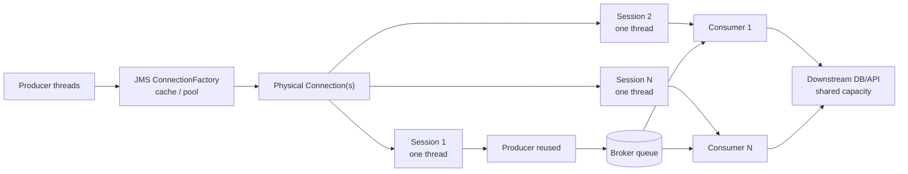

# Điều chỉnh số connection, session, producer và consumer

> **Chương:** Hiệu năng  
> **Phạm vi:** Tối ưu vòng đời và số lượng đối tượng JMS trên **ActiveMQ Classic** (OpenWire) và **ActiveMQ Artemis** (CORE), với Java 17+, Jakarta Messaging và Spring Boot 3.x. Mục tiêu là đạt throughput/latency cần thiết nhưng không làm tăng connection churn, cạnh tranh session, consumer prefetch hoặc áp lực broker quá mức. Các con số bên dưới là **điểm bắt đầu thử nghiệm**, không phải cấu hình tối ưu chung.

## 1. Vì sao “tăng consumer” có thể làm hệ thống chậm hơn?

Giả sử dịch vụ xử lý đơn hàng có 3 replicas, broker Artemis, một queue `orders.work` và downstream database chỉ cho phép **16 truy vấn đồng thời**. Mỗi pod cấu hình 16 listeners, tổng cộng tới **48 consumers**. Khi backlog tăng, mọi consumer cùng lấy message nhưng phần lớn chờ DB connection. Hệ quả: latency cao, nhiều message đang *delivering*, bộ nhớ client bị chiếm bởi prefetch và consumer bị timeout/retry.

Vấn đề ở đây không phải broker không đủ mạnh; **số consumer vượt khả năng xử lý thực tế của downstream**.



Đúng thứ tự tuning là:

1. **Giữ lại các JMS resources thay vì tạo/xóa liên tục.**
2. **Tuân thủ một-thread-mỗi-session** khi dùng JMS API trực tiếp.
3. **Tăng concurrency có kiểm soát**, dựa trên tốc độ xử lý thực của DB/API/CPU.
4. **Điều chỉnh prefetch/window** theo thời gian xử lý và phân phối công bằng.
5. **Đo end-to-end throughput, latency, queue age, broker CPU/disk và số message đang giao**, rồi mới tăng tiếp.

Tăng từ 4 lên 32 consumers mà không đo `p95` hoặc `DeliveringCount` có thể chỉ chuyển backlog từ **broker queue** sang **client buffers/in-flight**.

## 2. Phân biệt bốn loại resource và ràng buộc threading

| Resource | Tạo bởi | Có thể tái sử dụng thế nào? | Tác động khi tăng |
| --- | --- | --- | --- |
| `Connection` | `ConnectionFactory.createConnection()` | Có thể chứa nhiều sessions; giữ lâu hoặc pool connection | Socket, TLS/authentication, heartbeat, broker connection state |
| `Session` | `Connection.createSession(...)` | Tái dùng **tuần tự trong một thread**; mỗi worker thường có session riêng | Transaction/ack context và broker/session resources |
| `MessageProducer` | `Session.createProducer(...)` | Tái dùng cùng session; có thể gửi nhiều messages | Đỡ chi phí tạo producer; phụ thuộc session/thread |
| `MessageConsumer` | `Session.createConsumer(...)` | Consumer sống lâu, gắn vào session/queue/subscription | Prefetch/credit buffer, broker dispatch, in-flight messages |

**JMS Session là bối cảnh đơn luồng.** Không share một `Session` hoặc `JMSContext` dùng chung giữa nhiều worker threads, kể cả khi mọi thread chỉ gửi. Theo Jakarta Messaging, muốn các listener xử lý đồng thời thì tạo **nhiều sessions**, mỗi session tự tuần tự hóa listener callbacks. `close()` là ngoại lệ được quy định trong mô hình threading khi cần đóng từ thread khác.

```java
// SAI: nhiều tasks cùng dùng một Session và MessageProducer.
Session sharedSession = connection.createSession(false,
        Session.AUTO_ACKNOWLEDGE);
MessageProducer sharedProducer =
        sharedSession.createProducer(queue);

ExecutorService executor = Executors.newFixedThreadPool(8);
for (int i = 0; i < 8; i++) {
    executor.submit(() -> {
        // Sai: provider không bảo đảm Session concurrent use.
        sharedProducer.send(sharedSession.createTextMessage("hello"));
    });
}
```

Đây là **anti-pattern minh họa, không chạy**. Cả `createTextMessage` lẫn `send` liên quan tới cùng session; khóa `synchronized` quanh toàn bộ đoạn gửi có thể ngăn race nhưng cũng **tuần tự hóa toàn bộ throughput**, không đạt mục tiêu concurrency.

**Mẫu đúng:** nhiều worker threads có **Session + Producer hoặc Consumer riêng**, có thể **chung một JMS Connection** nếu provider cho phép nhiều sessions/đã benchmark. Nếu dùng connection pool, trả resource về pool sau khi hoàn tất và không giữ session trong singleton do nhiều threads truy cập.

### Connection ≠ Session ≠ Consumer

Ví dụ **một** physical connection, **8** sessions, **8** consumers là hoàn toàn có thể. Một `Connection` không bắt buộc gắn đúng một socket riêng cho **mỗi** session. Ngược lại, một consumer có thể có nhiều messages **in-flight** do prefetch, không phải đã xử lý xong.

**Không dùng “số pod × consumer concurrency” như công thức số TCP connections.** Cần kiểm tra wrapper `CachingConnectionFactory`, pool, listener container, provider implementation và đo **active connections thực tế trên broker**.

## 3. Lập ngân sách concurrency từ tải và thời gian xử lý

Tại mức ổn định, có thể ước lượng số workers cần thiết bằng quan hệ công suất:

\[
N_{\mathrm{concurrent}}\ \gtrsim\ \lambda \times W
\]

Trong đó:

- `λ`: throughput mục tiêu (messages/s).
- `W`: thời gian xử lý trung bình **một message tại consumer** (giây), gồm DB/API và transaction.
- `N`: concurrency tối thiểu để duy trì throughput nếu workload có thể song song hóa.

**Ví dụ:** mục tiêu 600 msg/s, mỗi message xử lý trung bình 20 ms, vậy `600 × 0,020 = 12` workers đang bận. Thử **12–16** consumers rồi đo, **không** mặc định 64 sẽ nhanh hơn. Nếu database pool chỉ có 10 connections và mỗi message cần 1 DB connection suốt quá trình xử lý, **10** có thể là giới hạn hữu hiệu trước khi thiết kế lại batching/DB pool.

Đây là **ước lượng**, không phải công thức bảo đảm. Nếu service time có đuôi dài, CPU saturation, lock contention, ordering constraint, message lớn hoặc broker paging, cần đo `p95/p99` thay vì chỉ dùng trung bình.

### Bảng ngân sách trước khi scale

| Biến | Giá trị minh họa | Cần xác minh |
| --- | ---: | --- |
| `replicas` | 3 | Có auto-scaling nhanh không? |
| `minConsumersPerPod` | 2 | Chi phí idle và độ trễ khi burst |
| `maxConsumersPerPod` | 6 | Tổng đỉnh lên **18** queue consumers |
| DB pool mỗi pod | 6 | Tổng DB connections được server cho phép |
| HTTP downstream concurrency toàn hệ thống | 16 | Có rate limit chung hay không? |
| Physical JMS connections dự kiến | 1–3/pod | Cache/pool có tạo connection thêm khi scale? |
| Prefetch/window | Đặt theo tốc độ xử lý | Bao nhiêu messages/bytes nằm tại client? |

**Trần hữu dụng** thường là min của: downstream capacity, CPU hiệu dụng, DB pool, broker dispatch, giới hạn queue max-consumers và budget kết nối. Khi nâng số workers mà ack rate **không tăng** nhưng `DeliveringCount`, GC, DB waits tăng, đã vượt “điểm gối” của đường cong throughput.

## 4. Connection: ưu tiên tái sử dụng hơn tạo kết nối cho từng message

### 4.1. Vì sao connection churn đắt?

`ConnectionFactory.createConnection` có thể cần socket connect, SSL/TLS handshake, login, phiên giao tiếp provider, failover/reconnect và broker-side resource allocation. Tạo một connection cho từng message làm tăng:

- Number of open/closing sockets, TIME_WAIT, file descriptors.
- Authentication/TLS CPU và traffic điều khiển.
- Broker connection events, management objects, cleanup.
- Độ trễ gửi mà không giúp parallelize công việc DB phía consumer.

**Đừng benchmark message throughput bằng vòng lặp mở/đóng connection** nếu production dùng connection sống lâu; kết quả đó đo handshake chứ không đo JMS send.

### 4.2. Một connection dùng nhiều sessions: khi nào phù hợp?

Trong nhiều client JMS, **một connection sống lâu** là baseline hiệu quả cho một producer service. Tạo một session cho từng worker thread có thể đạt concurrency mà không cần N socket.

Nhưng một connection cũng là **shared failure/transport bottleneck**: khi đường socket tắc nghẽn, nhiều sessions chịu ảnh hưởng. Khi throughput/tốc độ serialize đã chạm trần trên một connection, thử **2–4 connections** theo pool, đo rõ trước khi tăng tiếp. Không mặc định một connection = một CPU core hoặc một consumer.

### 4.3. Connection pool khác Spring caching

| Cơ chế | Bản chất | Dùng khi |
| --- | --- | --- |
| **Long-lived Connection + Sessions riêng** | Bạn tự quản vòng đời resources | Java JMS thuần, cần kiểm soát chính xác |
| `CachingConnectionFactory` | Spring cache connection/session/producers (tùy options) để giảm tạo lại | Spring `JmsTemplate` với lượng gửi tương đối ổn định |
| `JmsPoolConnectionFactory` (`pooled-jms`) | Pool physical connections, sessions và producers với giới hạn cấp phát | Nhiều producer threads, burst, cần cap rõ ràng |
| `DefaultMessageListenerContainer` | Listener sống lâu, mỗi invoker dùng session/consumer riêng, có caching theo lifecycle | Consumer service dùng `@JmsListener` |

**Không bật đồng thời nhiều lớp cache/pool tùy tiện.** `CachingConnectionFactory` với `cacheConsumers=true` có thể giữ prefetched messages ở một consumer không còn được sử dụng, nhất là khi dùng `receive` ngắn hạn; hầu hết hệ thống nên **không cache consumer theo kiểu pool tự do**. `DefaultMessageListenerContainer` với `CACHE_CONSUMER` khác: consumer được **gắn với listener invoker lâu dài**, không phải trả về một pool bất kỳ sau mỗi lời gọi receive.

### 4.4. Spring Boot 3.x — chỉ bật pooling khi có nhu cầu

Baseline Artemis native CORE (không bật `pooled-jms`):

```yaml
spring:
  artemis:
    mode: native
    broker-url: "tcp://localhost:61616"
    user: ${ARTEMIS_USER}
    password: ${ARTEMIS_PASSWORD}
  jms:
    cache:
      enabled: true
      session-cache-size: 5
      producers: true
      consumers: false
```

`session-cache-size=5` là **cache session resources** của Spring, **không** có nghĩa broker sẽ thấy 5 connections hay 5 consumers. Đo resource thực tế khi nhiều threads yêu cầu sessions.

Nếu tải producer đồng thời cao và muốn cap physical connections, cấu hình **thay thế** sau chỉ khi đã thêm dependency `org.messaginghub:pooled-jms` (để BOM quản lý version khi có):

```xml
<dependency>
    <groupId>org.messaginghub</groupId>
    <artifactId>pooled-jms</artifactId>
</dependency>
```

```yaml
spring:
  artemis:
    mode: native
    broker-url: "tcp://localhost:61616"
    user: ${ARTEMIS_USER}
    password: ${ARTEMIS_PASSWORD}
    pool:
      enabled: true
      max-connections: 3
      max-sessions-per-connection: 16
      block-if-full: true
      block-if-full-timeout: 2s
  jms:
    cache:
      enabled: false
```

`max-connections` là trần physical connections **của pool instance**, **không** phải quota toàn bộ application fleet và không phải số consumers. Với 4 pods có pool cap 3, riêng nhóm pool này có thể mở tới 12 connections, còn listener/admin khác có thể dùng connections riêng.

**Đừng coi pool size 3 là throughput tối đa 3 message đồng thời.** Mỗi connection có thể phục vụ nhiều sessions, còn số sessions bị giới hạn bởi `max-sessions-per-connection`, provider semantics và cách pool cấp phát. Kiểm tra behavior `block-if-full-timeout` thực tế của library/version khi pool cạn.

Nếu dùng Classic OpenWire, thay starter và `spring.artemis.*` bằng `spring.activemq.*`; Spring Boot hỗ trợ namespace `spring.activemq.pool.*` với cùng ý tưởng. **Không kéo cả Classic và Artemis starters** vào một build chỉ để thử performance.

## 5. Session: đơn vị concurrency thực tế của JMS

### 5.1. Một session có thể chứa nhiều producers/consumers nhưng vẫn tuần tự

`Session` là phạm vi:

- Factory tạo `Message`, `Producer`, `Consumer`.
- Chuỗi xử lý tuần tự trên session và giao dịch local JMS.
- Nhận và ACK/commit theo session.
- Callback `MessageListener` được tuần tự hóa theo session.

Nếu một session có **3 consumers** nhận qua callbacks, chúng không tự tạo 3 threads xử lý song song. Tăng số consumers nhưng để tất cả trên cùng session có thể **không tăng throughput handler**; muốn parallel delivery tạo nhiều sessions.

### 5.2. Transaction batch size cũng tác động throughput

Ví dụ mỗi worker session gửi 1.000 persistent messages:

- Commit **mỗi 1 message** có thể chịu nhiều network/storage round trips.
- Commit **mỗi 50 messages** có thể tăng throughput do giảm overhead.
- Commit **mỗi 1.000** tăng số message cùng một transaction, lượng state cần recover và rủi ro redelivery cả batch khi lỗi.

Mục tiêu là tìm batch size đủ lớn để tránh overhead nhưng đủ nhỏ để hạn chế latency, lock duration và duplicate surface. Đo `commit latency p95` và số rollback/replay, không chọn theo một bảng mặc định.

**Ranh giới mất mát:** tăng throughput bằng cách tắt durability, bỏ ACK hoặc dùng async send **thay đổi bảo đảm giao hàng**; không được coi các thử nghiệm đó cùng nhóm benchmark với persistent + transacted configuration.

## 6. Producer: tái dùng theo session, không tạo cho mỗi send

Trong Java JMS trực tiếp, một `MessageProducer` có thể được tạo một lần trên session và gửi nhiều message. Có hai lựa chọn:

- **Producer gắn destination:** `session.createProducer(queue)` rồi `producer.send(message)` — rõ destination, tốt cho luồng cố định.
- **Anonymous producer:** `session.createProducer(null)` rồi `producer.send(queue, message)` — tái dùng cho nhiều destinations nếu producer/session phù hợp.

Producer **kế thừa ràng buộc threading của session**. Không phải vì object producer có thể tồn tại lâu mà đưa nó vào singleton shared giữa 20 threads trên cùng session.

### 6.1. Ví dụ Java 17 Artemis: 1 connection, 4 sessions, 4 producers

**Điều kiện:** Broker Artemis CORE test có queue anycast `perf.orders`. Maven:

```xml
<dependency>
    <groupId>org.apache.artemis</groupId>
    <artifactId>artemis-jakarta-client</artifactId>
    <version>2.57.0</version>
</dependency>
```

> Từ Artemis **2.50.0**, Maven groupId chính thức là `org.apache.artemis`; mã dùng bản **2.57.0** làm ví dụ. Chọn phiên bản tương thích với broker và BOM dự án; không phối hợp nhiều dòng client khác phiên bản trên cùng classpath.

File `ProducerConcurrencyProbe.java` (Java 17):

```java
import java.util.ArrayList;
import java.util.List;
import java.util.concurrent.ExecutorService;
import java.util.concurrent.Executors;
import java.util.concurrent.Future;
import java.util.concurrent.TimeUnit;

import jakarta.jms.Connection;
import jakarta.jms.DeliveryMode;
import jakarta.jms.JMSException;
import jakarta.jms.MessageProducer;
import jakarta.jms.Queue;
import jakarta.jms.Session;
import jakarta.jms.TextMessage;

import org.apache.activemq.artemis.jms.client.ActiveMQConnectionFactory;

public final class ProducerConcurrencyProbe {
    private static final int WORKERS = 4;
    private static final int MESSAGES_PER_WORKER = 2_000;
    private static final int COMMIT_EVERY = 50;

    public static void main(String[] args) throws Exception {
        ActiveMQConnectionFactory factory =
                new ActiveMQConnectionFactory(required("ARTEMIS_URL"));
        ExecutorService executor =
                Executors.newFixedThreadPool(WORKERS);

        try (Connection connection = factory.createConnection(
                required("ARTEMIS_USER"), required("ARTEMIS_PASSWORD"))) {
            // Producer-only: không cần connection.start().
            long begin = System.nanoTime();

            List<Future<Integer>> futures = new ArrayList<>();
            for (int worker = 0; worker < WORKERS; worker++) {
                final int workerId = worker;
                futures.add(executor.submit(
                        () -> publishWorker(connection, workerId)));
            }

            int sent = 0;
            for (Future<Integer> future : futures) {
                sent += future.get(); // Ném lỗi khi một worker thất bại.
            }

            double seconds =
                    (System.nanoTime() - begin) / 1_000_000_000.0;
            System.out.printf(
                    "committed=%d time=%.3fs throughput=%.1f msg/s%n",
                    sent, seconds, sent / seconds);
        } finally {
            executor.shutdownNow();
            executor.awaitTermination(10, TimeUnit.SECONDS);
        }
    }

    private static int publishWorker(Connection connection, int id)
            throws JMSException {
        // Session + producer thuộc duy nhất worker thread hiện tại.
        try (Session session = connection.createSession(
                     true, Session.SESSION_TRANSACTED);
             MessageProducer producer = session.createProducer(
                     session.createQueue("perf.orders"))) {
            producer.setDeliveryMode(DeliveryMode.PERSISTENT);

            int pending = 0;
            try {
                for (int n = 0; n < MESSAGES_PER_WORKER; n++) {
                    String eventId = id + "-" + n;
                    TextMessage message =
                            session.createTextMessage("order-" + eventId);
                    message.setStringProperty("eventId", eventId);
                    producer.send(message);
                    pending++;

                    if (pending == COMMIT_EVERY) {
                        session.commit();
                        pending = 0;
                    }
                }
                if (pending > 0) {
                    session.commit();
                }
                return MESSAGES_PER_WORKER;
            } catch (JMSException | RuntimeException failure) {
                try {
                    session.rollback();
                } catch (JMSException rollbackFailure) {
                    failure.addSuppressed(rollbackFailure);
                }
                throw failure;
            }
        }
    }

    private static String required(String key) {
        String value = System.getenv(key);
        if (value == null || value.isBlank()) {
            throw new IllegalStateException("Missing " + key);
        }
        return value;
    }
}
```

**Chính xác về cấu trúc:**

1. `ExecutorService` có **4 threads**, mỗi thread tạo **một Session** và **một Producer** riêng.
2. Tất cả sessions cùng dùng một `Connection`; phần nào thực sự chạy song song phụ thuộc client transport, broker, journal và CPU.
3. `Session.SESSION_TRANSACTED` + `session.commit()` làm message persistent được gửi theo từng batch 50.
4. `Future.get()` buộc caller quan sát exception; nếu một worker lỗi thì tổng số message **không được báo thành công**. Khi commit outcome không chắc chắn sau mất connection, phải đối chiếu eventId thay vì mặc định toàn bộ batch rollback.
5. Đây là **producer throughput probe**, không chứng minh consumer drain tốc độ tương đương. Khi chạy không có consumer, backlog sẽ tích ở broker; giới hạn số message/backup và dọn theo runbook lab.

**Lưu ý Maven:** groupId `org.apache.activemq` của Artemis trước 2.50.0 đã được chuyển sang `org.apache.artemis`. Dùng tọa độ chính thức và kiểm tra BOM/phiên bản client–broker tương thích, không ghép nhiều client versions chỉ vì tên thư viện tương tự.

### 6.2. Thử các cấu hình đúng một biến mỗi lần

| Thử nghiệm | Giữ nguyên | Thay đổi |
| --- | --- | --- |
| A | Một connection, payload/commit mode | `WORKERS` 1, 2, 4, 8 |
| B | `WORKERS=4`, payload | Connections 1, 2, 4 bằng pool/partition workers |
| C | `WORKERS=4`, 1 connection | `COMMIT_EVERY` 1, 10, 50, 100 |
| D | `WORKERS=4`, batch 50 | Payload 1 KiB, 32 KiB, 256 KiB |
| E | Broker/client không đổi | Consumer chạy đồng thời và queue depth ổn định |

Ghi **broker CPU/disk IOPS, journal fsync, producer latency, queue growth, GC** cho từng case. Nếu tăng worker mà throughput không tăng, vấn đề có thể là broker journal hoặc flow control; mở thêm 100 connections không giải quyết được.

## 7. Consumer: tăng song song nhưng kiểm soát prefetch/window và thứ tự

### 7.1. Queue khác Topic

- Với **queue**, nhiều consumers là **competing consumers**, mỗi message thông thường đến một consumer. Tăng consumer giúp song song hóa khi công việc độc lập.
- Với **topic**, thêm một non-shared subscription thường tạo **bản sao message cho subscription khác**, không phải chia chung một luồng. Không dùng công thức `concurrency=8` của queue cho topic nếu không có thiết kế **shared subscription** và provider support.
- Nếu cần ordering theo key/aggregate, tăng consumer có thể phá thứ tự tổng thể. Xem `JMSXGroupID` và affinity theo group nếu broker hỗ trợ, nhưng vẫn cần đo hot key.

### 7.2. ActiveMQ Classic: prefetch tính bằng số **message**

Classic OpenWire client thường dùng queue prefetch mặc định **1000 messages**. Một consumer chậm có thể nhận trước rất nhiều messages, khiến consumer nhanh mới khởi động **không có việc** dù queue có backlog đã dispatch.

Ví dụ cấu hình client Classic dành cho công việc xử lý chậm, dùng query parameter riêng của **OpenWire**:

```text
tcp://localhost:61616?jms.prefetchPolicy.queuePrefetch=10
```

Đặt bằng Java Classic client cũng có thể:

```java
// ActiveMQ Classic client, phiên bản tương thích với JMS API của app.
ActiveMQConnectionFactory factory =
        new ActiveMQConnectionFactory("tcp://localhost:61616");
factory.getPrefetchPolicy().setQueuePrefetch(10);
```

Ở đây `ActiveMQConnectionFactory` là `org.apache.activemq.ActiveMQConnectionFactory`, không phải factory Artemis.

| `queuePrefetch` | Phù hợp | Rủi ro |
| --- | --- | --- |
| `1` | Handler chậm, cần phân phối công bằng giữa consumers | Nhiều lần round-trip, throughput có thể giảm |
| `10–50` | Handler trung bình, cần cân bằng throughput/fairness | Cần benchmark theo payload và latency |
| `1000` | Handler rất nhanh/batch, chấp nhận nhiều buffer | Consumer chậm có thể giữ hàng trăm/1.000 messages |
| `0` | Pull/poll từng message trong Classic | Có thể giảm hiệu quả push/độ trễ khi throughput cao |

**Không mặc định 1000 luôn sai**: với tiny messages và consumer xử lý rất nhanh, prefetch lớn giảm overhead. Nhưng trong hệ thống xử lý DB mất 200 ms/message, nó có thể khiến hàng chục nghìn message nằm rải rác trong client buffers của nhiều consumers.

### 7.3. Artemis CORE: consumer window tính bằng **byte**

Artemis client dùng `consumerWindowSize`, không phải `queuePrefetch`. Tài liệu Core nêu mặc định **1 MiB buffer cho mỗi consumer** trừ khi override.

Ví dụ URI Artemis:

```text
tcp://localhost:61616?consumerWindowSize=65536
```

Giá trị `65536` là **64 KiB**. Với message 8 KiB, về mặt kích thước tương đương khoảng tám message trong window nhưng **không có bảo đảm đúng tám** vì framing, credits và định dạng nội bộ.

| `consumerWindowSize` | Ý nghĩa | Tình huống |
| --- | --- | --- |
| `0` | Không buffer message trước ở client | Handler chậm, muốn công bằng hơn |
| `65536` | Window khoảng 64 KiB | Cân bằng nhỏ cho message vừa |
| `1048576` | Khoảng 1 MiB (thường là mặc định) | Throughput phổ thông |
| `-1` | Không giới hạn buffering phía client | Chỉ benchmark khi consumer rất nhanh; nguy cơ memory cao |

**Không dùng `queuePrefetch=10` của Classic cho URI Artemis CORE**. Hai tham số thuộc hai client protocols khác nhau và đơn vị cũng khác nhau.

### 7.4. Ước lượng buffer ở client

Nếu có 24 consumers:

- Classic prefetch `1000`, message trung bình 20 KiB: upper-bound thô `24 × 1000 × 20 KiB ≈ 469 MiB` dữ liệu có thể được dispatch/preload, **không tính object overhead**.
- Artemis window `64 KiB`/consumer: budget thô `24 × 64 KiB = 1,5 MiB`, nhưng một large message, protocol overhead và provider buffering có thể vượt ước lượng đơn giản.

**Đây không phải hard heap cap.** Số messages delivered/unacked và flow-control credits mới là bằng chứng; không suy chỉ từ Java heap profiler một lần chạy.

## 8. Consumer Java: nhiều sessions riêng, một connection chung

Ví dụ `ConsumerConcurrencyProbe.java`, dùng cùng Maven Artemis Jakarta JMS dependency với phần producer. Chạy trên queue `perf.orders` của **broker test**, sau khi đã tạo backlog hữu hạn.

```java
import java.util.ArrayList;
import java.util.List;
import java.util.concurrent.ExecutorService;
import java.util.concurrent.Executors;
import java.util.concurrent.Future;
import java.util.concurrent.TimeUnit;

import jakarta.jms.Connection;
import jakarta.jms.JMSException;
import jakarta.jms.Message;
import jakarta.jms.MessageConsumer;
import jakarta.jms.Queue;
import jakarta.jms.Session;

import org.apache.activemq.artemis.jms.client.ActiveMQConnectionFactory;

public final class ConsumerConcurrencyProbe {
    private static final int WORKERS = 4;
    private static final long DURATION_MS = 20_000L;

    public static void main(String[] args) throws Exception {
        ActiveMQConnectionFactory factory =
                new ActiveMQConnectionFactory(required("ARTEMIS_URL"));
        ExecutorService executor =
                Executors.newFixedThreadPool(WORKERS);

        try (Connection connection = factory.createConnection(
                required("ARTEMIS_USER"), required("ARTEMIS_PASSWORD"))) {
            connection.start(); // Receive cần started connection.

            long start = System.nanoTime();
            long deadline = start +
                    TimeUnit.MILLISECONDS.toNanos(DURATION_MS);

            List<Future<Integer>> futures = new ArrayList<>();
            for (int i = 0; i < WORKERS; i++) {
                futures.add(executor.submit(
                        () -> drainWorker(connection, deadline)));
            }

            int acked = 0;
            for (Future<Integer> future : futures) {
                acked += future.get();
            }

            double seconds =
                    (System.nanoTime() - start) / 1_000_000_000.0;
            System.out.printf(
                    "acked=%d duration=%.2fs rate=%.1f msg/s%n",
                    acked, seconds, acked / seconds);
        } finally {
            executor.shutdownNow();
            executor.awaitTermination(10, TimeUnit.SECONDS);
        }
    }

    private static int drainWorker(
            Connection connection, long deadlineNs) throws JMSException {
        try (Session session = connection.createSession(
                     true, Session.SESSION_TRANSACTED)) {
            Queue queue = session.createQueue("perf.orders");
            try (MessageConsumer consumer = session.createConsumer(queue)) {
                int count = 0;

                while (System.nanoTime() < deadlineNs
                        && !Thread.currentThread().isInterrupted()) {
                    Message message = consumer.receive(250L);
                    if (message == null) {
                        continue;
                    }

                    try {
                        // Chỉ lab: production cần validate + ghi DB
                        // trước khi session.commit().
                        String eventId =
                                message.getStringProperty("eventId");
                        if (eventId == null) {
                            throw new JMSException("Missing eventId");
                        }

                        session.commit(); // ACK cho message này.
                        count++;
                    } catch (JMSException | RuntimeException failure) {
                        try {
                            session.rollback();
                        } catch (JMSException rollbackFailure) {
                            failure.addSuppressed(rollbackFailure);
                        }
                        throw failure;
                    }
                }
                return count;
            }
        }
    }

    private static String required(String name) {
        String value = System.getenv(name);
        if (value == null || value.isBlank()) {
            throw new IllegalStateException("Missing " + name);
        }
        return value;
    }
}
```

**Tính chất của probe:**

- Một connection nhận và **4 sessions/consumers** đang hoạt động song song; mỗi session chỉ được dùng bởi thread của nó.
- Mỗi message được commit riêng để đo số message ACK tương đối dễ; production có thể chọn batch khác sau khi kiểm thử reliability.
- `consumer.receive(250L)` là thời hạn chờ nhận, **không** phải prefetch/window size.
- Probe không làm side effect ngoài broker, nên nó có thể xử lý nhanh hơn **rất nhiều** so với handler DB thật. Đừng dùng kết quả probe này để dự đoán production throughput một cách trực tiếp.
- Nếu `Future.get()` ném lỗi, **không** kết luận mọi message đã rollback; kiểm tra queue/transactions trên broker.
- Chạy trên queue test vì `receive` + `commit` **tiêu thụ và xóa message khỏi queue**, không phải xem thử như QueueBrowser.

Để đánh giá số consumer, chạy lần lượt `WORKERS=1,2,4,8` với **tập dữ liệu mới** và một mức backlog có kiểm soát, không so sánh 8 workers đã nhận gần hết queue với 1 worker nhận lúc backlog đầy.

## 9. Spring JMS: điều chỉnh listener concurrency đúng phạm vi

Trong Spring Boot, `@JmsListener` thường dựa trên `DefaultMessageListenerContainer`, cho phép nhiều consumer invokers hoạt động theo khoảng concurrency.

### 9.1. Cấu hình toàn app bằng properties

```yaml
spring:
  jms:
    listener:
      min-concurrency: 2
      max-concurrency: 6
      session:
        transacted: true
    cache:
      consumers: false
```

Các thuộc tính này đặt concurrency **cho default listener container factory**, không phải giới hạn tổng consumers của toàn fleet.

- `min-concurrency=2`: mỗi listener container giữ tối thiểu 2 consumers.
- `max-concurrency=6`: container có thể tăng theo tải đến 6 consumers, không nhất thiết luôn chạy 6.
- `session.transacted=true` dùng local JMS session transaction để ACK sau handler thành công; không đồng nghĩa database transaction được gộp atomically với JMS.
- `cache.consumers=false` ở Spring caching factory giúp tránh giữ consumer không còn sử dụng. Listener container có cơ chế reuse consumer **riêng** và không bị hiểu nhầm với một generic consumer pool.

Nếu có **2 `@JmsListener` endpoints** trên **3 pods**, mỗi endpoint có max 6, tổng lý thuyết có thể lên tới **2 × 3 × 6 = 36 consumers**. Đừng nhìn mỗi property 6 rồi coi cả hệ thống có tối đa 6.

### 9.2. Tùy chỉnh một listener cụ thể

```java
import org.springframework.jms.annotation.JmsListener;
import org.springframework.stereotype.Component;

@Component
public class OrderListener {
    @JmsListener(
        destination = "orders.work",
        concurrency = "2-6")
    public void handle(String payload) {
        // Phải validate, xử lý DB/API và chống duplicate tại đây.
        // Không spawn task async rồi return trước khi task hoàn tất
        // nếu JMS ACK/commit đi theo lúc method kết thúc.
    }
}
```

`concurrency="2-6"` trên annotation là thiết lập riêng endpoint, có thể override cấu hình default container. Đối với topic subscription **không shared**, đừng tăng concurrency theo cách này nếu muốn mỗi publication chỉ được xử lý một lần; với queue mới là mô hình competing consumers thông thường.

### 9.3. CachingConnectionFactory và listener container

Có hai lớp dễ gây hiểu nhầm:

- Spring Boot thường cache resources của `JmsTemplate` qua `CachingConnectionFactory`.
- `DefaultMessageListenerContainer` có **cache levels** riêng (`CACHE_CONNECTION`, `CACHE_SESSION`, `CACHE_CONSUMER`); consumer được giữ cho vòng đời của listener invoker.

Không bật `spring.jms.cache.consumers=true` rồi dùng các lời gọi `receiveAndConvert` trong hàng chục HTTP threads mà nghĩ rằng bạn đang có một *consumer pool* an toàn. Consumer có buffer prefetch riêng; một consumer trả về cache có thể tiếp tục giữ message chưa xử lý.

Nếu dùng XA/JTA, việc giữ sessions/consumers trong cache có thể ảnh hưởng enlistment và recovery; hãy thiết kế theo transaction manager thay vì áp `CACHE_CONSUMER` mặc định cho mọi môi trường.

## 10. Producer vs consumer: bảng tuning theo nút nghẽn

| Quan sát | Tăng gì trước? | Đừng làm gì |
| --- | --- | --- |
| Producer latency cao do mở connection liên tục | Reuse connection, session/producers; cache/pool có cap | Tạo `Connection` mới cho mỗi message |
| Producer throughput tăng khi thêm workers rồi dừng | Đo journal, credits, broker CPU, locks | Tăng tiếp tới hàng trăm sessions mà không đo |
| Queue backlog tăng, consumer CPU nhàn, DB còn headroom | Tăng consumers/sessions có kiểm soát | Tăng connection count trước khi biết bottleneck |
| Consumer CPU/DB đã bão hòa | Batch/optimize handler, tăng downstream capacity | Mở thêm consumers chỉ để tăng `DeliveringCount` |
| Một consumer chiếm hết prefetched messages | Giảm Classic `queuePrefetch` hoặc Artemis `consumerWindowSize` | Đổi `receiveTimeout` rồi tưởng đã sửa fairness |
| Consumer thread chờ external API lâu | Timeout/circuit breaker, bound concurrency | Tạo thread không giới hạn |
| Topic nhận mỗi event nhiều lần sau tăng concurrency | Xem semantics shared/non-shared subscription | Dùng queue tuning cho topic |
| Ordering theo orderId bị đảo | Consumer group/partition/`JMSXGroupID` theo provider | Tăng consumer rồi hứa thứ tự toàn queue |
| Broker chạm connection cap | Đếm physical sockets, reuse/pool đúng cách | Tăng `maximumConnections`/`connectionsAllowed` vô hạn |
| Pool chờ session lâu | Đo pool saturation, worker count và session lifetime | Bật hai lớp pool và cache rồi tăng số tối đa |
| Throughput cao nhưng p99 latency xấu | Hạ batch/prefetch, giảm saturation; đo queue age | Chỉ tối đa hóa msg/s mà bỏ SLO |

**Với ActiveMQ Classic:** xem dispatch prefetch/cursor, broker memory/store usage và queue consumers. **Với Artemis:** xem consumer credits/window, delivering count, address size, paging và journal I/O. Tên metric khác nhau, nhưng câu hỏi năng lực tương đương.

## 11. Thiết kế benchmark để không tự đánh lừa mình

### 11.1. Biến độc lập và điều kiện giữ cố định

Chọn workload đại diện, ví dụ:

```text
Broker:            Artemis CORE, journal persistent bật
Queue:             perf.orders (được tạo trước)
Producer:          persistent TextMessage, 1 KiB payload
Consumer:          transacted, mô phỏng DB xử lý 10 ms/message
Warm-up:           60 s
Measurement:       180 s
Replicas:          3
Concurrency sweep: 1, 2, 4, 8 consumers/pod
Window sweep:      0, 64 KiB, 1 MiB
```

Không so sánh một lần chạy `NON_PERSISTENT + AUTO_ACK` với `PERSISTENT + TRANSACTED` rồi kết luận số producer tối ưu; **đó là hai hợp đồng durability khác nhau**. Giữ message size, routing, connection factory config, machine load, CPU quota, disk persistence và số producer message/s ổn định.

Cần ít nhất hai chế độ:

1. **Open-loop controlled ingress:** producer phát ở rate cố định, đo liệu consumer giữ backlog ổn định hay tăng. Tốt để kiểm tra capacity dưới peak.
2. **Saturated throughput:** producer đẩy đến khi một thành phần bão hòa, đo throughput tối đa và mức độ ảnh hưởng latency. Không dùng nó làm thước đo duy nhất cho SLO.

### 11.2. Bộ metric bắt buộc

| Metric | Cách hiểu |
| --- | --- |
| `enqueue/s` và `ack/s` | Ingress và hoàn thành xử lý theo JMS |
| End-to-end `p50/p95/p99 latency` | Thời gian từ tạo event đến business commit; nhớ đồng bộ clock hoặc đo cùng timebase |
| Queue depth và **oldest message age** | Backlog có được drain không? |
| `ConsumerCount`, `DeliveringCount` | Có bao nhiêu consumer, bao nhiêu message bị giao nhưng chưa ACK |
| Active broker connections/sessions | Pool/caching có tạo connection leak? |
| Client JVM heap/GC and threads | Buffer/prefetch và session object gây overhead thế nào? |
| Broker CPU, disk IOPS, journal fsync | Bottleneck có thật ở message store? |
| DB/API pool wait, error/timeout rate | Downstream đang giới hạn throughput? |
| Redelivery/rollback/DLQ | Throughput tăng nhưng lỗi tăng có thể là regression |

### 11.3. Ví dụ bảng kết quả **giả lập**, không phải benchmark đã chạy

| Consumers/pod × 3 pods | ACK/s | p99 latency | DB pool wait p95 | Nhận định |
| ---: | ---: | ---: | ---: | --- |
| 1 × 3 = 3 | 210 | 1.100 ms | 0 ms | Thiếu concurrency |
| 2 × 3 = 6 | 405 | 620 ms | 3 ms | Còn headroom |
| 4 × 3 = 12 | 598 | 410 ms | 12 ms | Gần điểm tốt |
| 8 × 3 = 24 | 601 | 1.450 ms | 310 ms | DB đã bão hòa, nhiều queueing |

**Không chọn 24** chỉ vì ACK/s là 601 so với 598: mức tăng không đáng kể nhưng p99 tệ hơn nhiều. Với dữ liệu giả lập này, 12 consumers toàn fleet là ứng viên tốt hơn, sau đó kiểm tra độ ổn định qua thời gian, error rate và thời điểm burst.

### 11.4. Phương pháp thay đổi an toàn

1. Ghi baseline ít nhất một chu kỳ tải đại diện.
2. Thay **một biến**: consumers, sessions, connections, producer reuse, prefetch hoặc batch commit.
3. Đợi warm-up và sự ổn định của connection/consumer count trước khi đo.
4. Đo đủ throughput, p95/p99, queue age, broker/DB resources và errors.
5. Lặp lại nhiều lần (ít nhất 3 trên môi trường lab) và chọn mức có độ lệch nhỏ.
6. Canary production với giới hạn backlog và rollback plan; đừng scale toàn bộ pod cùng lúc.
7. Lưu lại giá trị chọn cùng điều kiện đo để lần nâng cấp broker/client có baseline so sánh.

## 12. Thực hành chẩn đoán các anti-pattern phổ biến

### Lab A — Một session bị chia sẻ giữa nhiều threads

1. Đọc đoạn **SAI** ở mục 2, xác định thread nào có thể đồng thời gọi `createTextMessage`/`send` cùng session.
2. Sửa thành một session + producer **mỗi worker**, hoặc dùng `JmsTemplate` với ConnectionFactory caching/pooling được cấu hình.
3. Đảm bảo producer/session đóng trong `finally` hoặc try-with-resources, tránh close connection trước khi workers hoàn thành.

**PASS:** không còn đường chạy đồng thời dùng cùng session; có giới hạn số workers rõ ràng.

### Lab B — Tăng producer workers

1. Với `ProducerConcurrencyProbe`, chạy `WORKERS=1,2,4,8`; giữ batch=50, payload cố định.
2. Ghi elapsed time, messages committed, connections/sessions/producers theo broker metrics.
3. Kiểm chứng với 1 physical connection số sessions tăng nhưng số connections không tăng tương ứng.
4. Nếu throughput đứng yên mà broker journal/CPU cao, không tăng workers vô hạn.

**PASS:** có đường cong throughput và bằng chứng physical connection vs session count.

### Lab C — Consumer fairness khi prefetch quá lớn

1. Classic test: khởi động consumer A với queue prefetch=1000, gửi 100 messages rồi mới mở consumer B; quan sát B có thể không nhận message do A đã prefetch.
2. Đặt queuePrefetch=1 hoặc 10, restart consumers và lặp lại workload; so sánh phân phối và throughput.
3. Artemis test: so sánh `consumerWindowSize=1048576` với `0`/`65536` khi hai consumers có tốc độ xử lý khác nhau.
4. Ghi `DeliveringCount`, queue age và số message xử lý trên từng consumer, không chỉ tổng ACK/s.

**PASS:** chứng minh buffering có thể giữ message ở client chậm; phân biệt đơn vị message (Classic) và byte (Artemis).

### Lab D — Spring listener concurrency

1. Với `@JmsListener(concurrency="2-6")` trên 3 pods, kiểm tra số consumers thực qua Artemis Console/JMX.
2. Thử tăng trên cùng queue; đảm bảo queue `max-consumers` (nếu có) và DB pool đủ headroom.
3. So sánh p95/p99 business latency và DB wait khi dùng 2,4,6 max consumers/pod.
4. Thêm `@JmsListener` thứ hai cho queue khác và tính lại tổng số consumers toàn pod.
5. Kiểm thử topic riêng: chỉ tăng concurrency khi đã xác minh shared subscription semantics.

**PASS:** tính đúng tổng consumers theo endpoints × pods và tìm điểm throughput không còn tăng.

### Lab E — Caching/pooling

1. Đo baseline Spring Boot `CachingConnectionFactory` với `session-cache-size=5`.
2. Sang cấu hình `pooled-jms` **thay thế**, thử `max-connections=3`, `max-sessions-per-connection=16` và không bật lớp cache ngoài.
3. Dùng burst producer threads vượt khả năng pool; quan sát thời gian chờ, timeout, lỗi pool exhausted và số physical connections thực.
4. Đảm bảo không có connection/session leak sau hàng nghìn lượt gửi.
5. Phân biệt `JmsTemplate` send với `@JmsListener` receive; không cố gắng “pool” JMS consumer tùy tiện.

**PASS:** resource counts không tăng vô hạn; throughput/latency so với baseline được đo cùng workload.

## 13. Checklist chọn thông số trước production

- [ ] Có SLO throughput và **p95/p99 end-to-end latency**; đo cả lỗi/duplicate.
- [ ] Phân biệt connection, session, producer và consumer; **Session/JMSContext là single-threaded**.
- [ ] Không tạo/đóng connection/session/producer cho từng message trong đường hot path.
- [ ] Chọn số producer workers theo CPU, journal, broker flow control và service demands.
- [ ] Chỉ tăng physical connections khi đã đo một connection thật sự trở thành bottleneck.
- [ ] Dùng session + producer riêng cho mỗi worker, không chia sẻ mutable JMS resources sai threading.
- [ ] Tính consumer concurrency theo throughput mục tiêu, thời gian xử lý và **downstream pool limit**.
- [ ] Nhân concurrency theo **số pods và listener endpoints**, không chỉ một annotation.
- [ ] Queue competition và topic subscriptions được thiết kế riêng; kiểm soát ordering/message groups.
- [ ] Classic điều chỉnh `queuePrefetch` theo **số message**; Artemis `consumerWindowSize` theo **byte**.
- [ ] Không để prefetch/window đẩy phần lớn backlog sang client memory rồi tưởng queue đã hết nghẽn.
- [ ] Phân biệt caching với pooling; không bật nested cache/pool không đo.
- [ ] Không hy sinh persistence, ACK hoặc transaction chỉ để có benchmark msg/s đẹp.
- [ ] Theo dõi broker/client connections, sessions, consumers, inflight/delivering, heap/GC, disk/DB latency.
- [ ] Có bảng sweep 1/2/4/8 consumers hoặc producers, baseline và rollback plan.
- [ ] Tải lớn được kiểm chứng trên broker test, không áp dụng thông số ví dụ nguyên xi vào production.

## Tài liệu tham khảo

1. [Jakarta Messaging 3.1 — Session](https://jakarta.ee/specifications/messaging/3.1/apidocs/jakarta.messaging/jakarta/jms/session): single-threaded context, producer/consumer và threading.
2. [Jakarta Messaging 3.1 — Specification](https://jakarta.ee/specifications/messaging/3.1/jakarta-messaging-spec-3.1.html): restrictions của `Session`/`JMSContext` và callback concurrency.
3. [ActiveMQ Classic — Performance Tuning](https://activemq.apache.org/components/classic/documentation/performance-tuning): prefetch và tối ưu producer/consumer.
4. [ActiveMQ Classic — What is the Prefetch Limit For?](https://activemq.apache.org/components/classic/documentation/what-is-the-prefetch-limit-for): queue prefetch, fairness và lưu ý pooling consumer.
5. [ActiveMQ Artemis — Performance Tuning](https://artemis.apache.org/components/artemis/documentation/latest/perf-tuning.html): tái dùng Connection/Session/Producer/Consumer và throughput trade-offs.
6. [ActiveMQ Artemis — Flow Control](https://artemis.apache.org/components/artemis/documentation/latest/flow-control.html): `consumerWindowSize`, `producerWindowSize` và client-side buffering.
7. [Spring Boot — JMS Messaging](https://docs.spring.io/spring-boot/reference/messaging/jms.html): `CachingConnectionFactory` và `pooled-jms` cho Classic/Artemis.
8. [Spring Boot — Application Properties](https://docs.spring.io/spring-boot/appendix/application-properties/): `spring.jms.listener.*`, `spring.jms.cache.*` và `spring.artemis.pool.*`.
9. [Spring Framework — Using Spring JMS](https://docs.spring.io/spring-framework/reference/6.2/integration/jms/using.html): listener containers, caching và transactions.
