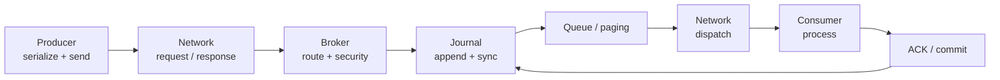

# Đo chi phí journal, đĩa, mạng, CPU, heap và GC

> **Chương:** Hiệu năng  
> **Mô-đun:** `INTEGRATION_MESSAGING_MESSAGE_BROKER_ACTIVEMQ` — tìm hiểu Apache ActiveMQ Classic và Artemis trong giao tiếp bất đồng bộ bằng queue, topic, routing và JMS; thực hành producer/consumer Java, acknowledgment, transaction, redelivery, DLQ, bảo mật và vận hành broker đáng tin cậy.  
> **Mục tiêu:** Xây phép đo có thể lặp lại để biết mỗi message tiêu tốn bao nhiêu thời gian, I/O, CPU, bộ nhớ và băng thông; tìm đúng nút nghẽn ở journal, disk, network, CPU, heap hoặc GC; đọc số liệu đúng ở cả Artemis và Classic mà không đánh đổi durability chỉ để có benchmark đẹp.

## 1. Định nghĩa chi phí trước khi tối ưu

Một con số `messages/s` không đủ để kết luận broker có hiệu năng tốt. Broker có thể đạt throughput cao nhờ gom nhiều message vào một transaction lớn, nhưng p99 commit latency tăng; hoặc consumer ACK nhanh nhưng queue age vẫn tăng vì producer gửi nhanh hơn năng lực xử lý.

Với `N` message được xử lý trong `T` giây, ghi tối thiểu:

- **Throughput:** `N / T` message/giây.
- **Payload throughput:** `N × payloadBytes / T` byte/giây.
- **CPU cost/message:** `delta process CPU seconds / N`.
- **Disk write amplification (ước lượng):** `delta physical bytes written / (N × payloadBytes)`.

Chỉ số cuối dùng để so sánh tương đối. Physical bytes written còn gồm journal record, metadata, transaction, ACK, index, compaction, paging, log và ghi nền của hệ điều hành; nó không phải hệ số cố định của broker.

### 1.1. Bộ chỉ số phải đo cùng nhau

| Nhóm | Chỉ số | Câu hỏi |
| --- | --- | --- |
| Ứng dụng/JMS | `send()` p50/p95/p99, `commit()` p50/p95/p99 | Client chờ broker bao lâu? |
| Messaging | Enqueue/s, ACK/s, queue depth, queue age, delivering/in-flight, redelivery | Broker đang xử lý hay đang tích lũy backlog? |
| Journal/disk | IOPS, read/write throughput, await, queue depth, bytes written | Storage có theo kịp journal sync và ACK không? |
| Network | RTT, throughput, retransmit, packet drop, socket queue | Client–broker có bị giới hạn bởi round trip không? |
| CPU | Process CPU, system CPU, run queue, context switches, cycles/message | CPU bão hòa hay đang chờ I/O? |
| Heap/GC | Heap after GC, allocation rate, pause p95/p99, promotion, full GC | Broker cấp phát quá nhiều hoặc bị dừng bởi GC? |
| Native memory | Direct buffers, Netty allocator, thread stacks, RSS | JVM heap ổn nhưng process/container vẫn thiếu RAM? |

**Phải phân biệt latency của từng lớp.** Trong transacted producer, `send()` có thể chỉ đưa message vào buffer phía client; `commit()` mới là điểm client chờ xác nhận transaction. Chỉ đo `send()` có thể khiến ta tưởng broker ghi bền rất nhanh trong khi chi phí journal sync nằm ở commit.



Một persistent message có thể tạo nhiều journal records: lưu message, cập nhật queue reference, transaction commit và ACK khi consumer hoàn tất. Chi tiết phụ thuộc broker version, delivery mode, transaction mode, persistence adapter và batching. Không lấy payload size làm đại diện cho bytes journal thực tế.

## 2. Thiết kế benchmark có thể tái lập

Trước khi chạy, ghi một phiếu thử nghiệm:

| Biến phải cố định | Giá trị cần ghi |
| --- | --- |
| Broker | Artemis/Classic, version, broker config hash |
| JVM | Vendor/version, heap flags, GC, JFR/GC logging |
| Client | JMS namespace, client version, host và JVM flags |
| Hạ tầng | CPU/vCPU, RAM, disk/volume, filesystem, network, cloud/AZ |
| Message | Payload 256 B / 1 KiB / 16 KiB / 256 KiB, headers, properties |
| Delivery | PERSISTENT hay NON_PERSISTENT, TTL, priority |
| Transaction | Transacted hay auto-ack, batch size, XA hay local |
| Topology | Queue/topic, số producer/consumer, prefetch/window |
| Security | Authentication, authorization, TLS, cipher |
| Workload | Warm-up, thời gian đo, producer rate, burst, consumer delay |

**Ma trận tối thiểu:**

1. **Persistent producer-only:** gửi vào queue chưa có consumer, để backlog tăng có kiểm soát; đo journal append/sync và producer commit.
2. **Persistent consumer-only:** tạo backlog trước rồi drain; đo đọc store, dispatch, ACK và cập nhật journal.
3. **Steady state:** producer và consumer chạy đồng thời, ACK/s gần enqueue/s; đo latency ổn định và utilization.
4. **Non-persistent đối chứng:** cùng payload/batch/concurrency nhưng delivery mode NON_PERSISTENT; dùng để ước lượng chi phí durability, không thay cấu hình production nếu nghiệp vụ cần persistent.
5. **Payload sweep:** lặp nhiều message sizes để thấy overhead cố định/message và chi phí theo byte.
6. **Batch sweep:** thử transaction batch 1, 10, 100, 500; đo throughput và p99 commit latency cùng lúc.

**Chỉ thay một biến mỗi lượt.** Nếu cùng lúc đổi journal type, batch, consumer count, prefetch, TLS và heap, ta không biết biến nào tạo ra kết quả.

### 2.1. Quy trình đo một lượt

- Khởi động broker/client; chờ warm-up (JIT, cache, file allocation, connection pool).
- Ghi baseline OS, JVM và broker metrics trong 1–2 phút khi chưa có tải.
- Chạy workload cố định; loại warm-up khỏi thống kê chính.
- Thu latency histogram, không chỉ log trung bình.
- Ghi broker counters ở đầu/cuối cửa sổ; tính throughput từ delta.
- Chụp disk/network/CPU/GC trong cùng cửa sổ workload.
- Drain backlog và xác nhận queue depth/delivering về trạng thái dự kiến.
- Lặp ít nhất ba lần; báo median và độ biến thiên.
- Khi đổi một tham số, giữ nguyên các điều kiện còn lại.

Không chạy benchmark I/O phá hoại trên volume chứa journal thật. Nếu cần đo giới hạn thiết bị bằng `fio`, dùng volume lab riêng; công cụ này tự tạo I/O và sẽ tranh IOPS với broker nếu chạy cùng disk.

## 3. Journal: đo đúng chi phí durability

### 3.1. Artemis file journal là append-only

Artemis mặc định dùng file journal cho persistence. Journal gồm các file kích thước cố định; broker append record khi thêm, cập nhật hoặc xóa message. Khi file đầy, broker chuyển sang file tiếp theo. Garbage collection và compaction thu hồi file/không gian khi record cũ không còn cần thiết.

Ba hệ quả khi đo:

- **Disk usage không đồng nghĩa dữ liệu sống:** journal files được pre-create/pad và tái sử dụng; kích thước thư mục không thể hiện trực tiếp số message còn tồn tại.
- **Write throughput không chỉ là payload bytes:** journal còn chứa record metadata, transaction, ACK, index và compaction.
- **Disk dùng chung làm mất lợi thế append-only:** journal, database, paging và large messages cùng ghi trên một volume có thể tranh chấp I/O.

Artemis hỗ trợ ba loại journal:

| Loại | Cơ chế | Phù hợp |
| --- | --- | --- |
| `NIO` | Java NIO | Baseline đa nền tảng |
| `ASYNCIO` | Linux native asynchronous I/O, cần `libaio` | Linux phù hợp; thường scale I/O tốt |
| `MAPPED` | Memory-mapped file và OS page cache | Cần đánh giá kỹ durability và page cache |

Nếu chọn ASYNCIO nhưng môi trường thiếu điều kiện Linux/libaio/filesystem, Artemis có thể fallback về NIO. **Ghi nhận journal type thực tế trong startup log**, không chỉ đọc XML rồi giả định broker đang dùng AIO.

### 3.2. Artemis: baseline giữ durability

Đoạn dưới đây đặt bên trong `<core>` **đã có** của `broker.xml` trên broker lab:

```xml
<core>
    <!-- Các cấu hình acceptor, address, security hiện có giữ nguyên. -->

    <journal-type>ASYNCIO</journal-type>
    <journal-directory>/var/lib/artemis/data/journal</journal-directory>
    <bindings-directory>/var/lib/artemis/data/bindings</bindings-directory>
    <paging-directory>/var/lib/artemis/data/paging</paging-directory>
    <large-messages-directory>/var/lib/artemis/data/large-messages</large-messages-directory>

    <journal-sync-transactional>true</journal-sync-transactional>
    <journal-sync-non-transactional>true</journal-sync-non-transactional>
    <journal-datasync>true</journal-datasync>

    <!-- Giá trị baseline cho ASYNCIO; không sao chép sang NIO máy móc. -->
    <journal-buffer-timeout>500000</journal-buffer-timeout>
    <journal-max-io>500</journal-max-io>
</core>
```

Đây là **trích đoạn để gộp**, không tạo thêm `<core>`. Các đường dẫn là ví dụ; production cần volume/mount riêng và quyền filesystem phù hợp.

- `journal-sync-transactional=true`: flush transaction data tại commit/prepare/rollback. Đổi thành `false` có thể tăng throughput nhưng thay đổi bảo đảm khi sự cố.
- `journal-sync-non-transactional=true`: đồng bộ persistent send/ACK non-transactional theo chính sách journal. Đổi thành `false` có thể mất durable message khi broker/máy gặp lỗi.
- `journal-datasync=true`: dùng cơ chế đồng bộ dữ liệu xuống filesystem, đặc biệt quan trọng với NIO/MAPPED để hướng tới durability khi mất điện. Tắt nó dựa nhiều hơn vào OS page cache.
- `journal-buffer-timeout` tính bằng nanosecond. Với ASYNCIO, `500000` tương đương 0,5 ms; tăng timeout có thể gom nhiều write và tăng throughput, đổi lại commit latency có thể tăng.
- `journal-max-io` giới hạn write request được xếp chờ. Mặc định thường là 500 với ASYNCIO và **1 với NIO**. Không thay tham số này khi dùng NIO.
- `journal-min-files` đặt số file tối thiểu pre-create; `journal-pool-files` đặt mức pool khi reclaim. Chọn theo dữ liệu bền vững và tốc độ ghi, không lấy con số tùy ý.

**Không dùng `journal-sync-transactional=false` hoặc `journal-datasync=false` như “tối ưu miễn phí”.** Chỉ thử trên môi trường chấp nhận mức RPO/durability thấp hơn, có kế hoạch khôi phục và được phê duyệt.

### 3.3. So sánh NIO và ASYNCIO có kiểm soát

| Lượt | journal type | journal max I/O | Cần xác minh |
| --- | --- | --- | --- |
| A | `NIO` | Giữ mặc định 1 | NIO thực sự được dùng, sync latency và throughput |
| B | `ASYNCIO` | Giữ mặc định 500 trước | libaio có sẵn, broker xác nhận AIO, disk/CPU/commit p99 |

Chạy trên cùng máy, volume, message size, batch, producer/consumer và sync semantics. Không kết luận ASYNCIO luôn nhanh hơn: SSD/NVMe, filesystem, kernel, VM hypervisor, storage network và cấu hình flush có thể làm kết quả khác nhau. Nếu ASYNCIO fallback về NIO, phép so sánh A/B không hợp lệ.

### 3.4. Classic: KahaDB journal và disk sync strategy

ActiveMQ Classic dùng KahaDB làm persistence adapter phổ biến. KahaDB có journal dữ liệu và index; journal sync strategy ảnh hưởng trực tiếp đến trade-off độ bền/throughput.

Ví dụ baseline trong `<broker>` hiện có của `activemq.xml`:

```xml
<persistenceAdapter>
    <kahaDB
        directory="/var/lib/activemq/data/kahadb"
        journalMaxFileLength="32mb"
        journalDiskSyncStrategy="always"/>
</persistenceAdapter>
```

`journalDiskSyncStrategy` trong các phiên bản Classic hỗ trợ thuộc tính này có các lựa chọn:

| Strategy | Hành vi | Đánh đổi |
| --- | --- | --- |
| `always` | Sync sau mỗi journal write | An toàn nhất trong ba lựa chọn, thường chậm nhất |
| `periodic` | Sync theo chu kỳ nếu có write và khi journal rollover | Tăng throughput; write chưa sync có thể mất khi broker/máy hỏng |
| `never` | Không chủ động gọi sync | Có thể nhanh hơn nhưng rủi ro mất dữ liệu cao nhất |

Với `periodic`, `journalDiskSyncInterval` mặc định khoảng 1000 ms theo tài liệu KahaDB. Đây không phải cam kết mọi message chỉ có thể mất đúng tối đa một giây trong mọi loại sự cố; cần xem OS, thiết bị và thời điểm crash. `never` không phù hợp với queue cần durability production.

Không dùng `enableJournalDiskSyncs` trong cấu hình mới nếu version đã hỗ trợ `journalDiskSyncStrategy`; thuộc tính cũ đã deprecated từ Classic 5.14.0.

### 3.5. Đọc kết quả journal

- `commit()` p95 tăng, disk await tăng, CPU còn dư: nghi storage sync/queue depth.
- `commit()` p95 tăng, disk latency ổn định nhưng network RTT tăng: nghi network round trip hoặc broker/client backpressure.
- Throughput tăng khi batch tăng nhưng p99 commit tăng: chi phí round trip chia cho nhiều message, đổi lại batch chờ lâu hơn và transaction lớn hơn.
- Journal directory tăng nhanh nhưng queue depth ổn định: xem ACK journal, compaction, file pool và workload nền; không kết luận ngay có message leak.
- NIO/AIO thay đổi throughput nhưng CPU tăng mạnh: kiểm tra process CPU và system CPU để xem chi phí I/O completion, copy hoặc kernel path.

## 4. Đo đĩa: IOPS, throughput, latency và queue depth

### 4.1. Map directory tới đúng thiết bị

Xác định journal, paging, large messages, KahaDB và filesystem nằm trên thiết bị nào:

```bash
lsblk -o NAME,TYPE,SIZE,ROTA,MOUNTPOINTS
df -hT /var/lib/artemis/data/journal
findmnt /var/lib/artemis/data/journal
```

Nếu journal và paging cùng volume, burst backlog có thể làm paging I/O tranh với journal sync. Với workload persistent, nên đo riêng volume journal; paging và large-message directories nên tách volume nếu workload/hạ tầng cho phép.

### 4.2. Lệnh đo Linux

```bash
# Theo dõi từng block device mỗi giây
iostat -xz 1

# I/O gắn với tiến trình broker
pidstat -d -p "$BROKER_PID" 1

# Tổng quan memory, run queue và swap
vmstat 1

# Disk utilization theo thiết bị
sar -d 1
```

| Trường iostat | Ý nghĩa | Cách diễn giải |
| --- | --- | --- |
| `r/s`, `w/s` | Read/write requests mỗi giây | IOPS theo thiết bị |
| `rkB/s`, `wkB/s` | Throughput đọc/ghi | Có đạt giới hạn băng thông không? |
| `await` | Thời gian trung bình request chờ và phục vụ (ms) | Tăng cùng commit p99 thường là dấu hiệu storage latency |
| `aqu-sz` | Độ dài queue I/O trung bình | Request đang xếp chờ thiết bị |
| `%util` | Thời gian thiết bị có I/O outstanding | Hữu ích nhưng không phải thước đo bão hòa duy nhất trên NVMe/RAID |

**Không đọc `%util=100%` như quy luật duy nhất cho mọi SSD/NVMe.** Thiết bị nhiều queue có thể xử lý song song; xem thêm await, aqu-sz, IOPS, throughput và application latency.

`pidstat -d` cho thấy tiến trình broker đọc/ghi bao nhiêu, nhưng OS page cache và writeback có thể khiến bytes ghi vật lý xuất hiện trễ hoặc không hoàn toàn gắn với PID ở đúng giây quan sát. Để so sánh, lấy delta thiết bị trước/sau cùng cửa sổ workload và giữ ổn định hoạt động nền.

### 4.3. Kích thước journal không phải bytes thực sự ghi

Artemis pre-create journal files; KahaDB cũng quản lý data logs và index. Do đó:

- `du -sh journal/` có thể phản ánh file preallocation/pool hơn là số message sống.
- `df -h` phản ánh không gian filesystem đã dùng, không phản ánh tốc độ ghi.
- `wkB/s` đo thiết bị trong cửa sổ, không cho biết riêng byte payload.
- Compaction, file rollover, index update, page store và ACK làm write amplification thay đổi theo giai đoạn.

Cách so sánh có ích: ghi số message đã commit, tổng payload byte, bytes ghi thiết bị trong cửa sổ, IOPS, await, commit p95/p99. Lặp lại và ghi trạng thái queue/journal trước khi đo.

## 5. Đo mạng: throughput, RTT, retransmit và round trip JMS

### 5.1. Các phần tạo nên chi phí mạng

Mỗi message có payload, JMS headers/properties, protocol framing và TLS record; kích thước trên wire lớn hơn payload thô. Ngoài ra còn có:

- Producer send/commit request và response.
- Consumer dispatch, ACK/commit.
- Heartbeat, reconnect, topology và security handshake.
- Replication traffic giữa HA primary/backup hoặc cluster forwarding.
- TLS encryption/decryption và context switch của Netty/event loop.

Nếu producer và broker ở khác AZ/data center, RTT tăng có thể khiến transaction nhỏ bị giới hạn bởi round trip. Batching giảm số lần commit round trip trên mỗi message, nhưng làm transaction lớn hơn và latency chờ batch tăng.

### 5.2. Đo Linux

```bash
# NIC throughput, TCP retransmit và lỗi
sar -n DEV,TCP,ETCP 1

# Byte/error/drop counters của interface
ip -s link

# RTT cơ bản tới broker
ping -c 20 broker.internal.example

# TCP state/RTT/retransmission của socket
ss -ti dst broker.internal.example
```

`ping` là chỉ báo RTT ICMP, không nhất thiết giống RTT TCP/TLS/JMS. Kết hợp `ss -ti`, broker/client logs và `send()/commit()` latency. Nếu retransmit/drop tăng đồng thời, kiểm tra NIC, MTU, route, firewall, congestion và network virtualization.

### 5.3. Bandwidth-delay product (BDP)

Một ước lượng lượng dữ liệu cần “đang bay” để tận dụng link:

`BDP = bandwidth (byte/s) × RTT (s)`

Ví dụ link 1 Gbit/s tương đương khoảng 125 MB/s, RTT 20 ms:

`BDP ≈ 125 × 0.020 = 2.5 MB`

Đây là ước lượng lý thuyết, không phải giá trị nên đặt ngay cho socket buffer. Artemis transport mặc định thường có TCP send/receive buffer 32 KiB; tài liệu khuyến nghị điều chỉnh theo băng thông và RTT, nhưng Linux hiện đại có TCP autotuning. Ghi lại giá trị thực trước khi thay buffer, vì đặt thủ công sai có thể vô hiệu lợi ích autotuning.

**Không tăng TCP buffer chỉ vì throughput thấp.** Nếu disk journal đã bão hòa, buffer lớn hơn chỉ làm thêm dữ liệu chờ trong socket/Netty.

### 5.4. So sánh network path

Giữ cùng broker, queue, payload, persistence, batch và số producer; chạy hai trường hợp:

- Client và broker cùng host/loopback.
- Client ở host khác qua đúng route production-like.

Nếu loopback nhanh nhưng remote chậm, xem RTT, TLS, NIC và network congestion. Nếu cả hai đều chậm, nghi broker journal, CPU hoặc client serialization. Khi test TLS, so sánh có/không TLS **trên lab** và giữ cipher/certificate giống nhau; không tắt TLS trên production để lấy benchmark.

## 6. CPU: phân biệt broker bận với broker đang chờ

### 6.1. Đo process và từng core

```bash
# CPU, memory, disk I/O và context switch theo PID
pidstat -u -r -d -w -p "$BROKER_PID" 1

# CPU từng core và run queue
mpstat -P ALL 1

# Threads của process
top -H -p "$BROKER_PID"

# Counters CPU trong một khoảng 60 giây
perf stat -p "$BROKER_PID" \
  -e task-clock,cycles,instructions,context-switches,cache-misses \
  -- sleep 60
```

`perf` có thể cần quyền kernel/perf phù hợp; không tự thay đổi policy bảo mật máy chủ chỉ để chạy benchmark.

### 6.2. Đọc CPU theo dấu hiệu

| Quan sát | Giả thuyết | Phép kiểm chứng |
| --- | --- | --- |
| Process CPU gần hết quota, disk/network còn dư | Serialization, routing, security, protocol, GC hoặc thread contention | JFR CPU profile, perf, thread dump |
| System CPU cao, process CPU không cao | Kernel I/O, networking, softirq, filesystem | mpstat, sar network, disk metrics |
| `commit()` p99 cao, disk await cao, CPU còn dư | Broker đang chờ storage sync | iostat, journal type, sync strategy |
| `commit()` p99 cao, RTT cao | Network round trip/packet retransmit | ss -ti, sar TCP |
| CPU tăng nhưng ACK/s không tăng khi tăng consumers | Contention, context switch, downstream lock | pidstat -w, DB pool, per-consumer metrics |
| Một core bão hòa, các core khác rảnh | Hot event loop, lock hoặc xử lý tuần tự | top -H, JFR, perf top |

### 6.3. CPU cost/message

Nếu OS cung cấp process CPU time, lấy chênh lệch CPU seconds trong cùng khoảng đo rồi chia cho số message đã ACK. Ví dụ process dùng 24 CPU-seconds để hoàn tất 120.000 message:

`CPU/message = 24 / 120000 = 0.0002 CPU-second`

Tức khoảng **0,2 ms CPU trên mỗi message**; không đồng nghĩa wall-clock latency 0,2 ms. Phải đo cả broker và client; nếu chỉ đo broker mà producer/consumer chạy chung máy, attribution có thể sai.

## 7. Heap, native memory và GC

### 7.1. Heap không phải toàn bộ RAM broker

JVM process có nhiều vùng bộ nhớ:

- **Java heap:** message objects, routing metadata, collections, temporary objects.
- **Direct/native buffers:** Netty, socket buffers, native AIO và thư viện hệ thống.
- **Metaspace/code cache/thread stacks:** class metadata, JIT code, thread stack.
- **OS page cache:** filesystem cache của journal/page files; không nằm trong Java heap nhưng vẫn dùng RAM máy.
- **Container/cgroup overhead:** memory accounting có thể tính page cache/direct memory vào limit container.

`-Xmx` không được bằng toàn bộ RAM node. Broker cần khoảng trống cho OS page cache, direct memory, native libraries, thread stacks và hệ điều hành.

### 7.2. JVM flags để đo GC

Trên JDK 17, bật unified GC/safepoint logging bằng:

```bash
-Xms4g
-Xmx4g
-Xlog:gc*,safepoint:file=/var/log/artemis/gc-%t.log:time,uptime,level,tags:filecount=5,filesize=20M
```

`-Xms`/`-Xmx` trong ví dụ bằng nhau để tránh heap resize trong phép đo; `4g` chỉ là giá trị minh họa, phải sizing theo workload và RAM thực. Không áp dụng nguyên xi lên máy/container nhỏ.

Đọc:

- GC pause p50/p95/p99 và tổng thời gian ứng dụng bị dừng.
- Allocation rate (bytes/s) và promotion rate.
- Old generation/live heap sau các chu kỳ GC.
- Số lần concurrent/full GC, thời gian safepoint.
- Heap tăng liên tục sau khi tải kết thúc hay giảm về mức ổn định.

**Heap cao chưa chắc là leak:** JVM có thể giữ heap đã commit để tái sử dụng. Dấu hiệu đáng điều tra là live data sau GC tăng qua nhiều chu kỳ khi workload/queue depth không tăng, hoặc old generation không trở về baseline.

### 7.3. Công cụ JDK 17

```bash
# PID Java broker
jcmd -l

# Heap summary
jcmd "$BROKER_PID" GC.heap_info

# JFR profile trong 5 phút
jcmd "$BROKER_PID" JFR.start \
  name=broker-perf settings=profile duration=5m \
  filename=/tmp/broker-perf.jfr
```

Có thể mở `broker-perf.jfr` bằng Java Mission Control để xem CPU hotspots, allocation, GC, thread contention, socket/I/O events tùy JFR event configuration.

Nếu cần Native Memory Tracking, phải khởi động JVM với `-XX:NativeMemoryTracking=summary` (hoặc detail); sau đó mới dùng:

```bash
jcmd "$BROKER_PID" VM.native_memory summary
```

NMT có overhead và không bật ngược được cho JVM đã chạy. Heap dump/GC full có thể tạo pause và tốn disk; chỉ thực hiện khi có kế hoạch, không đưa vào vòng benchmark throughput thông thường.

### 7.4. Artemis metrics cho JVM và broker

Artemis có Micrometer integration. Trong `<metrics>` **hiện có** của `broker.xml`, có thể bật nhóm metric bổ sung:

```xml
<metrics>
    <jvm-memory>true</jvm-memory>
    <jvm-gc>true</jvm-gc>
    <jvm-threads>true</jvm-threads>
    <netty-pool>true</netty-pool>
    <file-descriptors>true</file-descriptors>
    <processor>true</processor>
</metrics>
```

Đây là block cấu hình metrics trong `<core>` hiện có; không tạo block `<metrics>` thứ hai. Một số nhóm như JVM GC, threads, Netty pool, file descriptors và processor bị tắt mặc định. Metrics broker/queue tiêu biểu:

| Metric | Phạm vi | Dùng để đọc |
| --- | --- | --- |
| `artemis.connection.count` | Broker | Connection hiện tại |
| `artemis.disk.store.usage` | Broker | Dung lượng store sử dụng |
| `artemis.address.memory.usage` | Address | Memory usage theo address |
| `message.count` | Queue | Backlog |
| `persistent.size` | Queue | Dung lượng persistent message |
| `delivering.message.count` | Queue | Message đang delivering |
| `messages.added` | Queue | Tổng message được thêm |
| `messages.acknowledged` | Queue | Tổng message được ACK |
| `consumer.count` | Queue | Consumer hiện tại |
| JVM GC/memory gauges | JVM | Heap/memory pools, GC pause/allocation theo registry |

Tên series cuối cùng phụ thuộc Micrometer registry/exporter và cách chuẩn hóa metric name. **Artemis không tự biến LoggingMetricsPlugin thành Prometheus endpoint.** Plugin mặc định ghi log hoặc lưu in-memory dùng demo/test; muốn scrape production cần `ActiveMQMetricsPlugin` tạo `MeterRegistry` phù hợp.

### 7.5. Classic: đối chiếu JMX và JVM

Classic cung cấp JMX MBeans để xem broker/destination:

| MBean scope | Thuộc tính hữu ích |
| --- | --- |
| Broker | `MemoryPercentUsage`, `StorePercentUsage`, `TempPercentUsage`, `CurrentConnectionsCount`, `TotalEnqueueCount`, `TotalDequeueCount` |
| Destination | `EnqueueCount`, `DequeueCount`, `DispatchCount`, `InFlightCount`, `QueueSize`, `AverageEnqueueTime`, `MemoryPercentUsage` |
| Persistence adapter | `Size`, `Transactions` tùy adapter/version |

Classic JMX giúp nhìn resource pressure và queue behavior, nhưng không cung cấp mọi chỉ số disk syscall latency hay GC pause. Ghép JMX với OS `iostat`/`pidstat` và JDK GC/JFR. Không bật remote JMX thiếu authentication/TLS chỉ để thu số liệu.

## 8. Mã Java/JMS tạo workload đo được

Ví dụ dùng **Java 17, Jakarta JMS và Artemis client**. Mục đích là giữ ổn định payload, delivery mode, transaction batch; đo riêng `send()` và `commit()` ở producer, ACK commit ở consumer.

### 8.1. Queue lab

Trong phần `<addresses>` đã tồn tại của Artemis `broker.xml`, provision queue ANYCAST durable:

```xml
<addresses>
    <address name="lab.performance.messages">
        <anycast>
            <queue name="lab.performance.messages">
                <durable>true</durable>
            </queue>
        </anycast>
    </address>
</addresses>
```

Đây là trích đoạn để gộp; không tạo `<addresses>` thứ hai. Dùng broker lab có persistence bật. Đảm bảo user có quyền SEND/CONSUME và queue không chứa dữ liệu nghiệp vụ. Khi so sánh nhiều lượt, drain queue trước hoặc dùng destination riêng cho mỗi lượt.

### 8.2. Maven

```xml
<!-- pom.xml -->
<project xmlns="http://maven.apache.org/POM/4.0.0"
         xmlns:xsi="http://www.w3.org/2001/XMLSchema-instance"
         xsi:schemaLocation="http://maven.apache.org/POM/4.0.0 https://maven.apache.org/xsd/maven-4.0.0.xsd">
    <modelVersion>4.0.0</modelVersion>
    <groupId>example.messaging</groupId>
    <artifactId>artemis-performance-probe</artifactId>
    <version>1.0.0</version>
    <properties>
        <maven.compiler.release>17</maven.compiler.release>
    </properties>
    <dependencies>
        <dependency>
            <groupId>org.apache.activemq</groupId>
            <artifactId>artemis-jakarta-client</artifactId>
            <version>2.38.0</version>
        </dependency>
    </dependencies>
    <build>
        <plugins>
            <plugin>
                <groupId>org.apache.maven.plugins</groupId>
                <artifactId>maven-compiler-plugin</artifactId>
                <version>3.13.0</version>
            </plugin>
            <plugin>
                <groupId>org.codehaus.mojo</groupId>
                <artifactId>exec-maven-plugin</artifactId>
                <version>3.5.0</version>
            </plugin>
        </plugins>
    </build>
</project>
```

`2.38.0` là phiên bản cố định cho ví dụ; chọn client tương thích broker version đang vận hành. Client dùng `jakarta.jms`, không trộn với `javax.jms` của ActiveMQ Classic 5.x.

### 8.3. `JournalBench.java`

Tạo `src/main/java/example/messaging/JournalBench.java`:

```java
package example.messaging;

import java.util.Arrays;

import jakarta.jms.BytesMessage;
import jakarta.jms.ConnectionFactory;
import jakarta.jms.DeliveryMode;
import jakarta.jms.JMSConsumer;
import jakarta.jms.JMSContext;
import jakarta.jms.JMSRuntimeException;
import jakarta.jms.Message;
import jakarta.jms.Queue;

import org.apache.activemq.artemis.jms.client.ActiveMQConnectionFactory;

public final class JournalBench {
    private static final String QUEUE = "lab.performance.messages";

    private JournalBench() {}

    public static void main(String[] args) throws Exception {
        if (args.length < 1) {
            throw new IllegalArgumentException(
                "Usage: send <count> <payloadBytes> <batch> persistent|nonpersistent"
                + " | drain <maxCount> <batch>");
        }

        String url = System.getenv().getOrDefault(
                "BROKER_URL", "tcp://127.0.0.1:61616");
        String user = required("BROKER_USER");
        String password = required("BROKER_PASSWORD");

        try (ActiveMQConnectionFactory factory =
                     new ActiveMQConnectionFactory(url)) {
            switch (args[0]) {
                case "send" -> {
                    if (args.length != 5) {
                        throw new IllegalArgumentException(
                            "send <count> <payloadBytes> <batch> persistent|nonpersistent");
                    }
                    int count = Integer.parseInt(args[1]);
                    int bytes = Integer.parseInt(args[2]);
                    int batch = Integer.parseInt(args[3]);
                    boolean persistent = switch (args[4]) {
                        case "persistent" -> true;
                        case "nonpersistent" -> false;
                        default -> throw new IllegalArgumentException(
                                "delivery mode must be persistent|nonpersistent");
                    };
                    validate(count, bytes, batch);
                    send(factory, user, password, count, bytes,
                         batch, persistent);
                }
                case "drain" -> {
                    if (args.length != 3) {
                        throw new IllegalArgumentException(
                                "drain <maxCount> <batch>");
                    }
                    int max = Integer.parseInt(args[1]);
                    int batch = Integer.parseInt(args[2]);
                    validate(max, 1, batch);
                    drain(factory, user, password, max, batch);
                }
                default -> throw new IllegalArgumentException(
                        "Unknown mode: " + args[0]);
            }
        }
    }

    private static void validate(int count, int bytes, int batch) {
        if (count < 1 || count > 1_000_000
                || bytes < 1 || bytes > 1_048_576
                || batch < 1 || batch > 10_000) {
            throw new IllegalArgumentException("Invalid benchmark bounds");
        }
    }

    private static String required(String key) {
        String value = System.getenv(key);
        if (value == null || value.isBlank()) {
            throw new IllegalStateException("Missing environment: " + key);
        }
        return value;
    }

    private static void send(ConnectionFactory factory, String user,
                             String password, int count, int bytes,
                             int batch, boolean persistent) {
        try (JMSContext context = factory.createContext(
                user, password, JMSContext.SESSION_TRANSACTED)) {
            Queue queue = context.createQueue(QUEUE);
            var producer = context.createProducer();
            producer.setDeliveryMode(
                    persistent ? DeliveryMode.PERSISTENT
                               : DeliveryMode.NON_PERSISTENT);

            byte[] payload = new byte[bytes];
            Arrays.fill(payload, (byte) 'x');

            long[] sendLatency = new long[count];
            long[] commitLatency = new long[(count + batch - 1) / batch];
            int commitSamples = 0;
            long started = System.nanoTime();

            try {
                for (int i = 0; i < count; i++) {
                    BytesMessage message = context.createBytesMessage();
                    message.writeBytes(payload);
                    message.setIntProperty("sequence", i);

                    long sendStart = System.nanoTime();
                    producer.send(queue, message);
                    sendLatency[i] = System.nanoTime() - sendStart;

                    if ((i + 1) % batch == 0) {
                        long commitStart = System.nanoTime();
                        context.commit();
                        commitLatency[commitSamples++] =
                                System.nanoTime() - commitStart;
                    }
                }

                if (count % batch != 0) {
                    long commitStart = System.nanoTime();
                    context.commit();
                    commitLatency[commitSamples++] =
                            System.nanoTime() - commitStart;
                }
            } catch (RuntimeException failure) {
                try {
                    context.rollback();
                } catch (JMSRuntimeException rollbackError) {
                    failure.addSuppressed(rollbackError);
                }
                throw failure;
            }

            double elapsed = (System.nanoTime() - started) / 1_000_000_000.0;
            double rate = count / elapsed;
            double mibPerSecond =
                    (count * (double) bytes) / elapsed / (1024.0 * 1024.0);

            System.out.printf(
                "SEND count=%d payloadBytes=%d batch=%d persistent=%s "
                + "elapsed=%.3fs throughput=%.1f msg/s payload=%.2f MiB/s commits=%d%n",
                count, bytes, batch, persistent, elapsed, rate,
                mibPerSecond, commitSamples);

            printPercentiles("producer send()", sendLatency, sendLatency.length);
            printPercentiles("producer commit()", commitLatency, commitSamples);
        }
    }

    private static void drain(ConnectionFactory factory, String user,
                              String password, int maxCount, int batch) {
        try (JMSContext context = factory.createContext(
                user, password, JMSContext.SESSION_TRANSACTED);
             JMSConsumer consumer =
                context.createConsumer(context.createQueue(QUEUE))) {

            long[] commitLatency = new long[(maxCount + batch - 1) / batch];
            int commitSamples = 0;
            int received = 0;
            int pending = 0;
            long started = System.nanoTime();

            try {
                while (received < maxCount) {
                    Message message = consumer.receive(2000);
                    if (message == null) {
                        break;
                    }
                    if (!(message instanceof BytesMessage bytesMessage)) {
                        throw new IllegalStateException(
                                "Expected BytesMessage");
                    }

                    byte[] buffer = new byte[8192];
                    while (bytesMessage.readBytes(buffer) != -1) {
                        // Đọc hết body để bao gồm chi phí materialization.
                    }

                    received++;
                    pending++;

                    if (pending == batch) {
                        long commitStart = System.nanoTime();
                        context.commit();
                        commitLatency[commitSamples++] =
                                System.nanoTime() - commitStart;
                        pending = 0;
                    }
                }

                if (pending > 0) {
                    long commitStart = System.nanoTime();
                    context.commit();
                    commitLatency[commitSamples++] =
                            System.nanoTime() - commitStart;
                }
            } catch (RuntimeException failure) {
                try {
                    context.rollback();
                } catch (JMSRuntimeException rollbackError) {
                    failure.addSuppressed(rollbackError);
                }
                throw failure;
            }

            double elapsed = (System.nanoTime() - started) / 1_000_000_000.0;
            double rate = received / Math.max(elapsed, 0.000001);

            System.out.printf(
                "DRAIN received=%d batch=%d elapsed=%.3fs ackRate=%.1f msg/s commits=%d%n",
                received, batch, elapsed, rate, commitSamples);
            printPercentiles("consumer commit()", commitLatency, commitSamples);
        }
    }

    private static void printPercentiles(String label, long[] samples,
                                         int length) {
        if (length == 0) {
            System.out.println(label + ": no samples");
            return;
        }
        long[] sorted = Arrays.copyOf(samples, length);
        Arrays.sort(sorted);
        System.out.printf(
            "%s: n=%d p50=%.3fms p95=%.3fms p99=%.3fms%n",
            label, length,
            percentileMs(sorted, 50),
            percentileMs(sorted, 95),
            percentileMs(sorted, 99));
    }

    private static double percentileMs(long[] sorted, int percentile) {
        int index = (int) Math.ceil(sorted.length * percentile / 100.0) - 1;
        index = Math.max(0, Math.min(index, sorted.length - 1));
        return sorted[index] / 1_000_000.0;
    }
}
```

### 8.4. Code đo gì và không đo gì?

- `send()` latency trong transaction **không phải** thời gian journal durable cho từng message; các send có thể được client gom trước khi commit.
- `commit()` latency đo thời gian hoàn tất batch ở góc nhìn client, gồm network, broker processing và persistence/ACK theo semantics provider.
- `send()` throughput ở code bao gồm cả thời gian commit cuối cùng; payload MiB/s dùng payload thô, không phải bytes trên wire hoặc bytes journal.
- Consumer drain đọc hết `BytesMessage` rồi commit theo batch. ACK/s tính theo số message consumer nhận và commit, không phải tốc độ `receive()` đơn thuần.
- `System.nanoTime()` chỉ dùng đo duration trong cùng JVM; không so timestamp monotonic giữa hai máy.
- Code giữ sample array trong heap, phù hợp lab có giới hạn `count`. Benchmark dài nên thay bằng histogram bounded (ví dụ HdrHistogram/Micrometer) để không tự làm méo heap/GC.
- Mỗi producer/consumer process dùng một JMSContext transacted; muốn nhiều producer/consumer, chạy nhiều process hoặc mở rộng code có Session riêng cho mỗi worker. Không chia sẻ một JMSContext cho nhiều thread.
- Nếu commit ném exception do network/failover, kết quả transaction có thể không rõ; đây là benchmark lab không có business side effect. Ứng dụng thật cần stable eventId và idempotency.

## 9. Chạy workload và thu số liệu đồng bộ

### 9.1. Chuẩn bị môi trường

Đặt environment `BROKER_USER`, `BROKER_PASSWORD` và `BROKER_URL` cho broker lab. Đảm bảo queue `lab.performance.messages` rỗng trước lượt mới hoặc dùng queue riêng. Ví dụ broker URL:

```text
tcp://127.0.0.1:61616
```

Build project:

```bash
mvn -q package
```

Lệnh build ở đây là hướng dẫn người học chạy project benchmark mẫu; **không phải báo cáo rằng worker đã build/test trong repository bài học**.

### 9.2. Lượt A — persistent producer-only

```bash
mvn -q exec:java -Dexec.mainClass=example.messaging.JournalBench -Dexec.args="send 100000 1024 100 persistent"
```

Ghi producer throughput và payload MiB/s; `send()`/`commit()` p50/p95/p99; disk write IOPS/throughput/await; broker `messages.added` delta, queue persistent size và disk store usage. Consumer chưa chạy nên queue backlog tăng; không để volume đầy.

### 9.3. Lượt B — drain persistent queue

```bash
mvn -q exec:java -Dexec.mainClass=example.messaging.JournalBench -Dexec.args="drain 100000 100"
```

Ghi ACK/s, consumer commit p95/p99, disk read/write, CPU và queue delivering/message count. Sau drain, xác nhận queue còn 0 message theo trạng thái lab, không có consumer khác hoặc scheduled messages.

### 9.4. Lượt C — non-persistent đối chứng

Dùng queue lab trống và chạy cùng payload/batch:

```bash
mvn -q exec:java -Dexec.mainClass=example.messaging.JournalBench -Dexec.args="send 100000 1024 100 nonpersistent"
```

Chênh lệch persistent/non-persistent giúp thấy chi phí persistence trong workload đó. **Không coi kết quả non-persistent là hiệu năng tương đương durability.** Ghi rõ delivery mode, transaction và queue state trong báo cáo.

### 9.5. Lượt D — batch sweep

Lặp persistent workload với batch `1`, `10`, `100`, `500`; giữ count/payload/producer/volume cố định:

| Batch | msg/s | send p95 | commit p95 | commit p99 | disk await | CPU/msg | Ghi chú |
| ---: | ---: | ---: | ---: | ---: | ---: | ---: | --- |
| 1 | — | — | — | — | — | — | Một transaction mỗi message |
| 10 | — | — | — | — | — | — | |
| 100 | — | — | — | — | — | — | |
| 500 | — | — | — | — | — | — | |

Batch lớn có thể tăng throughput vì chia chi phí round trip/sync cho nhiều message; nhưng transaction lớn làm tăng thời gian chờ, kích thước rollback và cửa sổ redelivery. Chọn batch theo **p99/SLO và recovery**, không theo msg/s tối đa.

### 9.6. Thu đồng thời broker, OS và JVM

```text
Broker:
  messages.added / messages.acknowledged
  message.count / delivering.message.count
  persistent.size / disk.store.usage

Operating system:
  iostat -xz 1
  pidstat -u -r -d -w -p BROKER_PID 1
  sar -n DEV,TCP,ETCP 1

JVM:
  GC unified logs
  jcmd PID GC.heap_info
  JFR recording
```

Đồng bộ timestamp của các công cụ bằng cùng clock/timezone; ghi mốc start/end từng lượt. Nếu broker chạy container, lấy PID/metrics trong đúng host/cgroup namespace và đo disk volume bên dưới container, không chỉ filesystem overlay.

## 10. Đọc kết quả bằng tương quan

| Triệu chứng | Khả năng cao | Kiểm tra tiếp |
| --- | --- | --- |
| Commit p99 tăng cùng `await` và `aqu-sz` | Journal disk latency/queue depth | Volume riêng, sync strategy, journal type, storage QoS |
| Commit p99 tăng nhưng disk ổn, RTT/retransmit tăng | Network round trip hoặc packet loss | `ss -ti`, `sar -n TCP,ETCP`, route client/broker |
| CPU broker gần 100%, disk/network còn dư | Routing/serialization/security/GC/lock contention | JFR CPU profile, `perf`, thread dump |
| CPU thấp, disk await cao | Broker chờ journal/paging I/O | `iostat`, queue depth, volume contention |
| Heap sau GC tăng liên tục và GC pause tăng | Retained objects/leak hoặc backlog lớn trong memory | JFR allocation, heap histogram có kiểm soát, queue memory/paging |
| Heap ổn nhưng RSS/container memory cao | Direct buffers, Netty, thread stacks, page cache/native | NMT, Netty pool metrics, cgroup memory |
| Producer throughput cao nhưng queue age tăng | Consumer ACK rate thấp hơn enqueue | `messages.added` vs `messages.acknowledged`, consumer processing, prefetch |
| Batch tăng làm throughput tăng nhưng p99 commit xấu | Transaction batching đổi latency/throughput | Chọn batch theo SLO, không lấy peak msg/s |
| Directory journal tăng nhưng device writes không cao | Preallocation/pool/compaction hoặc quan sát sai volume | `df`, `du`, file pool và block-device counters |
| Disk/network/CPU đều thấp nhưng send bị block | Flow control/quota/producer window hoặc broker resource limits | Artemis address-full policy, Classic producer flow control, quota/logs |

### 10.1. Ví dụ tính CPU cost/message và disk amplification

Một lượt chạy 120.000 message payload 1 KiB trong 30 giây:

- Throughput: `120000 / 30 = 4000 message/s`.
- Payload throughput: `120000 × 1024 / 30` ≈ **3,91 MiB/s**.
- Process CPU tăng 18 giây: `18 / 120000` = **0,15 ms CPU/message**.
- Thiết bị ghi tăng 180 MiB: `180 / (120000 KiB)` ≈ **1,54 byte disk ghi cho mỗi byte payload**.

Các số này chỉ là ví dụ cách tính; disk amplification phụ thuộc metadata, ACK, compaction, filesystem và workload nền. Báo cáo phải ghi rõ cửa sổ đo, device, process, queue, delivery mode và batch.

## 11. Những thay đổi thường làm benchmark sai

1. **Tắt durability để tăng tốc:** kết quả không còn đại diện persistent messaging. Giữ sync semantics như production khi so cấu hình.
2. **Producer send async nhưng so với producer sync:** send latency không còn cùng ý nghĩa. Ghi rõ send mode và commit/ack guarantee.
3. **Chạy disk benchmark cùng volume journal:** hai workload tranh I/O, làm kết quả không đại diện broker độc lập.
4. **Đo `du` rồi kết luận journal chứa từng ấy message:** journal preallocation/pool và compaction làm phép suy luận sai.
5. **Chỉ nhìn CPU toàn máy:** một core/event loop có thể bão hòa khi tổng CPU còn thấp.
6. **Chỉ nhìn heap:** bỏ sót direct memory, Netty buffers, native AIO và OS page cache.
7. **Chỉ nhìn average latency:** tail latency p99 có thể vi phạm SLA dù average đẹp.
8. **Không drain queue giữa các lượt:** lượt sau bị trộn backlog và disk state của lượt trước.
9. **Thay nhiều biến cùng lúc:** không thể quy nguyên nhân cho journal, batch, prefetch hay network.
10. **Dùng broker load test cùng business traffic:** số liệu nhiễu và có thể làm đầy disk/queue.
11. **Tắt security/TLS để benchmark production-like:** kết quả không phản ánh CPU/network cost thật và làm sai mô hình bảo mật.
12. **Chỉ so persistent và non-persistent bằng msg/s:** phải so thêm p99 commit, disk writes, queue durability và failure guarantees.

## 12. Bài tập kiểm chứng

### Bài tập A — Journal sync là bottleneck?

Persistent producer có `commit p99=80 ms`, disk await 60 ms, CPU broker 25%, RTT 2 ms. Consumer không chạy.

**Yêu cầu:** Nêu giả thuyết ưu tiên và ba số đo tiếp theo cần thu.

*Định hướng:* Storage/journal sync là nghi vấn chính. Đo IOPS, `aqu-sz`, write throughput theo đúng volume; xác minh journal type, sync flags và tiến trình khác tranh disk không.

### Bài tập B — Batch 1 hay batch 100?

Batch 1 đạt 1.000 msg/s với commit p99 4 ms; batch 100 đạt 9.000 msg/s nhưng commit p99 75 ms.

**Yêu cầu:** Chọn batch theo hai SLO khác nhau và nêu rủi ro transaction lớn.

*Định hướng:* Nếu cần latency thấp, batch 1 hoặc nhỏ có thể phù hợp; nếu throughput ưu tiên và 75 ms nằm trong SLA, batch 100 có thể chấp nhận. Đánh giá rollback/redelivery, memory in-flight và recovery.

### Bài tập C — CPU thấp nhưng throughput thấp

Broker CPU 20%, disk await 3 ms, network RTT 90 ms, client và broker khác vùng địa lý.

**Yêu cầu:** Vì sao thêm CPU không giúp nhiều? Thử nghiệm nào phân biệt network và broker?

*Định hướng:* Round trip/RTT có thể giới hạn transaction nhỏ. Chạy cùng workload loopback và remote, đo commit p95, retransmit, socket RTT; thử batch sweep có kiểm soát.

### Bài tập D — Heap tăng hay page cache tăng?

Process RSS tăng 3 GiB nhưng Java heap after GC chỉ tăng 100 MiB; host Cached tăng 2 GiB.

**Yêu cầu:** Có thể kết luận heap leak không? Cần đo gì?

*Định hướng:* Chưa thể. Kiểm tra direct/native memory, Netty allocator, NMT (nếu bật), page cache/cgroup; xem GC live set và JFR allocation.

### Bài tập E — Artemis AIO không nhanh hơn NIO

Cấu hình `journal-type=ASYNCIO` nhưng log cho biết fallback NIO; `journal-max-io=500` vẫn có trong XML.

**Yêu cầu:** Vì sao benchmark không phải AIO? Sửa phép thử thế nào?

*Định hướng:* Môi trường thiếu Linux/libaio/điều kiện filesystem nên broker fallback. Xác minh log và cài đúng dependency trên lab hoặc chạy NIO baseline; không dùng `journal-max-io=500` cho NIO.

### Bài tập F — Classic KahaDB periodic sync

KahaDB chuyển `journalDiskSyncStrategy` từ `always` sang `periodic`, throughput tăng 2 lần. Đúng lúc mất điện có một số message cuối không tồn tại sau restart.

**Yêu cầu:** Vì sao kết quả không bất thường? Cần ghi gì khi báo cáo?

*Định hướng:* Periodic sync có thể để lại writes chưa flush; throughput tăng nhờ giảm sync. Ghi strategy, interval, delivery mode, transaction semantics và mức RPO đã chấp nhận; không gọi hai cấu hình tương đương durability.

### Bài tập G — Disk amplification

Payload tổng 500 MiB, volume journal ghi 1,4 GiB trong cửa sổ đo, consumer ACK toàn bộ message.

**Yêu cầu:** Tính tỷ lệ ghi/payload và giải thích vì sao không thể gán toàn bộ 1,4 GiB cho message body.

*Định hướng:* Khoảng 2,8×. Bao gồm journal records, metadata, transaction, ACK, index, compaction và writeback; cần workload nền và delta thiết bị để ước lượng.

### Bài tập H — Viết báo cáo benchmark

So sánh Artemis NIO và ASYNCIO trên cùng thiết bị với persistent message, batch 100, payload 1 KiB. Thu throughput, commit p95/p99, IOPS, await, CPU/message, heap after GC và ACK/s.

**Yêu cầu:** Viết kết luận gồm bottleneck, mức cải thiện, đánh đổi latency/durability và cấu hình đề xuất.

*Định hướng:* Chỉ kết luận nếu broker xác nhận journal type thật, sync semantics giống nhau, workload và baseline tương đương; chọn cấu hình đạt SLO/reliability, không chỉ cấu hình có msg/s cao nhất.

## 13. Checklist báo cáo đo hiệu năng

- [ ] Broker/client version, JVM, OS/kernel và hardware được ghi rõ.
- [ ] Journal type/persistence adapter, sync strategy và durability mode được ghi rõ.
- [ ] Payload size, message rate, transaction batch, consumer count và prefetch/window cố định.
- [ ] Có warm-up, thời gian đo, số lần lặp và queue baseline.
- [ ] Có throughput, payload MiB/s, p50/p95/p99 send/commit/ACK.
- [ ] Có disk IOPS/throughput/await/queue depth và volume chính xác.
- [ ] Có RTT, NIC throughput, retransmit/drop và TLS mode.
- [ ] Có process CPU, system CPU, CPU/message và context switch.
- [ ] Có heap after GC, allocation, GC pause, direct/native memory và cgroup usage.
- [ ] Có broker metrics messages.added, messages.acknowledged, queue depth, delivering, paging/store usage.
- [ ] Có ghi nhận lỗi, redelivery, DLQ và trạng thái queue sau khi drain.
- [ ] Có giải thích trade-off reliability/SLO và lý do chọn cấu hình.

## 14. Tài liệu tham khảo chính thức

1. Apache ActiveMQ Artemis — [Performance Tuning](https://artemis.apache.org/components/artemis/documentation/latest/perf-tuning.html): journal, batching, JMS, transport, heap, anti-patterns.
2. Apache ActiveMQ Artemis — [Persistence](https://artemis.apache.org/components/artemis/documentation/latest/persistence.html): file journal, NIO/ASYNCIO/MAPPED, sync semantics, journal files và JDBC store.
3. Apache ActiveMQ Artemis — [Metrics](https://artemis.apache.org/components/artemis/documentation/latest/metrics.html): Micrometer plugin, broker/queue/JVM metrics và exporter integration.
4. Apache ActiveMQ Artemis — [Paging](https://artemis.apache.org/components/artemis/documentation/latest/paging.html): address memory limits, global max size và address-full policy.
5. Apache ActiveMQ Artemis — [Configuring Transports](https://artemis.apache.org/components/artemis/documentation/latest/configuring-transports.html): TCP send/receive buffers, bandwidth-delay product và transport options.
6. Apache ActiveMQ Classic — [Performance Tuning](https://activemq.apache.org/components/classic/documentation/performance-tuning): persistent/async publishing, prefetch, optimized ACK và file persistence.
7. Apache ActiveMQ Classic — [KahaDB](https://activemq.apache.org/components/classic/documentation/kahadb): journal files, `journalDiskSyncStrategy`, index và preallocation.
8. Apache ActiveMQ Classic — [JMX](https://activemq.apache.org/components/classic/documentation/jmx): Broker/Destination MBeans và resource metrics.
9. Oracle — [Java 17 java command](https://docs.oracle.com/en/java/javase/17/docs/specs/man/java.html): unified logging và GC log syntax.
10. Oracle — [Java 17 jcmd command](https://docs.oracle.com/en/java/javase/17/docs/specs/man/jcmd.html): `JFR.start`, heap/native memory và diagnostic commands.
11. Linux sysstat — [iostat manual](https://man7.org/linux/man-pages/man1/iostat.1.html), [pidstat manual](https://man7.org/linux/man-pages/man1/pidstat.1.html), [sar manual](https://man7.org/linux/man-pages/man1/sar.1.html): disk, process và network measurements.

> **Ghi nhớ:** Đo hiệu năng broker là phép đo **end-to-end có đối chứng**. Journal sync, disk latency, network RTT, CPU, heap, native memory và GC tác động lẫn nhau; không thể kết luận từ một con số throughput. Giữ durability và workload cố định, thu p95/p99 cùng IOPS/await/retransmit/CPU/GC, rồi chỉ thay một biến mỗi lần. Cấu hình tốt là cấu hình đạt SLA với **bảo đảm message và khả năng phục hồi mà nghiệp vụ yêu cầu**, không phải cấu hình benchmark có số msg/s cao nhất.
