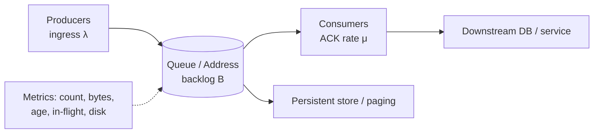

# Ước lượng dung lượng backlog, tốc độ phục hồi và thời gian cạn queue

> **Chương:** Hiệu năng  
> **Phạm vi:** Định lượng backlog message/bytes, năng lực tiêu thụ, thời gian drain sau sự cố và thời điểm broker chạm giới hạn memory/store/disk trên **Apache ActiveMQ Classic** và **ActiveMQ Artemis**. Bài tập trung vào mô hình đo, công thức sizing, load probe có giới hạn, dashboard và quyết định vận hành. Các con số cấu hình là ví dụ; capacity thực tế phải đo bằng message profile, persistence mode, transaction, consumer và storage của môi trường đích.

## 1. Backlog là một đại lượng có tốc độ thay đổi

Queue có 100.000 message chưa đủ để kết luận broker sắp đầy. Nếu mỗi message chỉ vài trăm byte và consumer xử lý nhanh hơn producer, backlog có thể an toàn. Ngược lại, 2.000 message đính kèm payload vài MiB có thể chiếm nhiều disk và tạo thời gian drain dài.

Để đánh giá đúng, cần nhìn đồng thời:

- **Message backlog:** số message đang chờ được xử lý/ACK.
- **Byte backlog:** tổng dung lượng payload và overhead mà broker phải giữ.
- **Ingress rate (λ):** tốc độ message được enqueue/accepted.
- **Egress/ACK rate (μ):** tốc độ message được xử lý và xác nhận hoàn tất.
- **Oldest-message age:** tuổi của message cũ nhất; phản ánh độ trễ tích lũy.
- **In-flight/delivering:** message đã giao cho consumer nhưng chưa ACK/commit.
- **Capacity còn lại:** dung lượng broker/store/page/filesystem có thể dùng an toàn.



Nếu `λ > μ` trong một khoảng thời gian, backlog tăng. Nếu `μ > λ`, backlog giảm. Nếu hai tốc độ gần bằng nhau, queue có thể trông ổn định trong vài phút nhưng không có đủ headroom để phục hồi sau một đợt outage.

**Đừng dùng QueueSize một mình để sizing.** Queue count không phản ánh kích thước payload, message đang in-flight, DLQ, durable topic subscriptions hoặc journal/page overhead. Cần biết cả **số lượng, byte, tốc độ và thời gian**.

## 2. Mô hình toán học cho backlog

### 2.1 Backlog message khi consumer dừng

Gọi:

- `B0`: số message đang pending tại thời điểm bắt đầu.
- `λ`: ingress rate, đơn vị message/giây.
- `μ`: ACK rate, đơn vị message/giây.
- `T`: khoảng thời gian đo, giây.

Trong cửa sổ mà các rate tương đối ổn định:

```text
ΔB = (λ - μ) × T
B(T) = max(0, B0 + ΔB)
```

Nếu consumer dừng hoàn toàn, `μ = 0`:

```text
B_after_outage = B0 + λ × T_outage
```

Ví dụ: queue đang có 20.000 message; producer tiếp tục gửi 350 msg/s trong lúc consumer ngừng 12 phút. Backlog mới xấp xỉ:

```text
T = 12 × 60 = 720 s
B = 20,000 + 350 × 720
  = 272,000 messages
```

Đây là ước lượng tuyến tính. Nếu producer bị flow control, có rate limit, hoặc upstream ngừng gửi, ingress thực tế sẽ khác. Khi consumer còn hoạt động ở một phần công suất, thay `μ=0` bằng ACK rate thực tế trong outage.

### 2.2 Backlog bytes và kích thước message

Gọi `Savg` là kích thước message trung bình đo ở broker hoặc ước lượng theo wire/persisted representation. Byte backlog xấp xỉ:

```text
B_bytes ≈ B_messages × Savg
growth_bytes_per_sec ≈ λ × S_in - μ × S_out
```

Trong đó `S_in` là kích thước trung bình của message mới; `S_out` là kích thước trung bình của message được ACK. Không nên mặc định hai giá trị bằng nhau: consumer có thể xử lý loại message lớn/chậm trước, còn producer đang gửi message nhỏ hơn hoặc ngược lại.

Ví dụ với 272.000 message và payload trung bình 4 KiB:

```text
Payload backlog ≈ 272,000 × 4,096
                = 1,114,112,000 bytes
                ≈ 1.04 GiB
```

Đây mới là **payload estimate**. Store thực tế còn có message headers/properties, journal records, index, transaction metadata, page/segment overhead, replication và file allocation. Cần đo hệ số lưu trữ trên chính workload:

```text
storage_factor = measured_store_growth_bytes
                 / acknowledged_or_pending_payload_bytes

estimated_store_bytes = payload_backlog_bytes × storage_factor
```

Đo hệ số qua nhiều lô message và nhiều payload size; không lấy một hệ số chung cho mọi broker, persistence adapter hay protocol.

### 2.3 Topic fan-out và subscription backlog

Với topic, một publication có thể được giữ cho nhiều durable subscriptions. Nếu một event được giữ bởi `N` subscription độc lập, dung lượng logic có thể tăng theo tổng backlog của các subscription:

```text
topic_retained_backlog_bytes
  ≈ Σ(subscription_i_pending_messages
      × subscription_i_avg_message_bytes)
```

Không nhân message count của topic với số subscriber đang online một cách máy móc. Chỉ tính các queue/subscription thực sự giữ bản sao hoặc reference theo semantics broker, bao gồm durable subscribers offline. Kiểm queue/address mapping, subscription backlog và storage implementation để tránh đếm trùng.

### 2.4 In-flight không phải pending, nhưng vẫn là công việc chưa hoàn tất

Consumer có thể nhận message trước khi ACK/commit. Broker thường báo riêng `InFlightCount` (Classic) hoặc delivering count (Artemis). Nếu chỉ nhìn pending queue size, backlog có thể trông giảm trong khi nhiều message vẫn đang xử lý và có thể redeliver khi consumer chết.

Đối với capacity và SLA xử lý, nên theo dõi:

```text
work_not_completed
  = pending_messages + in_flight_or_delivering_messages
```

Với transaction dài hoặc prefetch lớn, in-flight có thể đáng kể. Không cộng in-flight vào disk backlog như thể tất cả đều còn nằm trong queue journal theo cùng một cách; dùng nó để ước lượng **khối lượng công việc chưa hoàn tất** và rủi ro redelivery.

## 3. Tính thời gian phục hồi sau outage

### 3.1 Drain time khi consumer trở lại

Khi broker/consumer phục hồi, consumer không chỉ xử lý message mới mà còn phải drain backlog cũ. Nếu:

- `Bpeak` là backlog khi outage kết thúc.
- `λnormal` là ingress rate tiếp tục trong giai đoạn phục hồi.
- `μrecovered` là ACK rate thực tế sau khi phục hồi.

Thời gian drain gần đúng:

```text
net_drain_rate = μrecovered - λnormal

if net_drain_rate <= 0:
    backlog không giảm
else:
    T_drain ≈ Bpeak / net_drain_rate
```

Ví dụ: backlog 272.000 message; ingress bình thường 350 msg/s; consumer sau phục hồi ACK được 900 msg/s:

```text
net_drain_rate = 900 - 350 = 550 msg/s
T_drain ≈ 272,000 / 550
        ≈ 494.5 s
        ≈ 8.24 phút
```

Nếu consumer chỉ đạt 300 msg/s thì `μrecovered < λnormal`; queue tiếp tục tăng dù service đã “UP”. Đây là lý do phải đặt mục tiêu **recovery throughput cao hơn ingress**, không chỉ yêu cầu process khởi động lại thành công.

### 3.2 Tính năng lực cần có để drain trong deadline

Nếu muốn xóa backlog `Bpeak` trong `Ttarget` giây trong khi ingress vẫn tiếp tục `λnormal`:

```text
μ_required >= λnormal + (Bpeak / Ttarget)
```

Ví dụ muốn drain 272.000 message trong 10 phút (600 giây) khi ingress vẫn 350 msg/s:

```text
μ_required >= 350 + (272,000 / 600)
           >= 803.34 msg/s
```

Nên dùng **ACK rate đo được dưới tải thực** và có safety margin; không lấy throughput benchmark của một producer đơn lẻ làm năng lực consumer production. DB/API downstream, lock contention, batch size, transaction commit, prefetch, message size và ordering key đều có thể giảm `μrecovered`.

### 3.3 Consumer concurrency không tăng tuyến tính mãi

Một ước lượng sơ bộ:

```text
μ_total ≈ N_effective_consumers × μ_per_consumer
```

Nhưng `N_effective_consumers` có thể nhỏ hơn số process/pod:

- Một queue chỉ có một consumer hoạt động hữu hiệu do cấu hình/lock/order constraint.
- Database connection pool hoặc downstream rate limit là bottleneck.
- Consumer prefetch cao làm tăng in-flight và memory, nhưng không tăng tốc độ xử lý.
- Thêm consumer gây tranh chấp DB, CPU, storage hoặc làm ordering semantics thay đổi.
- Topic subscriptions có backlog riêng, không được drain chỉ bằng tăng consumer của queue khác.

Benchmark theo từng mức concurrency (1, 2, 4, 8…) và đo ACK rate, p95/p99 latency, DB saturation, in-flight và redelivery. Chọn điểm có **net drain rate lớn nhất mà downstream vẫn ổn định**.

### 3.4 Recovery phải tính cả thời gian khởi động và reconnect

Tổng thời gian phục hồi không chỉ là drain:

```text
T_recovery_total
  = T_detect
  + T_promote_or_restart
  + T_client_reconnect
  + T_consumer_warmup
  + T_drain
```

Đo từng thành phần để tìm bottleneck. Nếu broker promote mất 8 giây nhưng client reconnect/backoff mất 90 giây, tối ưu journal recovery không giải quyết phần lớn RTO.

## 4. Ước lượng thời gian cạn queue/store/disk

### 4.1 Capacity không chỉ là configured limit

Dung lượng an toàn phải trừ phần dự phòng cho file journal đang hoạt động, compaction/checkpoint, log, backup, metadata, page files và các workload khác trên cùng volume.

```text
physical_usable_bytes
  = filesystem_capacity_bytes
    - reserved_free_bytes
    - other_workload_bytes

usable_store_capacity_bytes
  = min(broker_store_limit_bytes, physical_usable_bytes)
    # only when the broker has a store limit with matching semantics

remaining_capacity_bytes
  = usable_capacity_bytes - current_usage_bytes
```

Trong đó:

- `broker_store_limit_bytes`: giới hạn persistent store như `storeUsage` của Classic, nếu được cấu hình. **Không lấy `max-size-bytes` hoặc `page-size-bytes` của Artemis làm giới hạn disk**; chúng kiểm soát memory/page behavior của address, không phải quota filesystem.
- `filesystem_capacity_bytes`: dung lượng filesystem thực sự mount cho store/paging.
- `reserved_free_bytes`: headroom tối thiểu do vận hành xác định để broker recovery, rotate journal, compaction và xử lý sự cố.
- `other_workload_bytes`: log, backup, snapshot, file ngoài broker hoặc dữ liệu khác trên cùng volume.

`usable_store_capacity_bytes` chỉ có ý nghĩa khi broker limit và physical store đang đo cùng một phạm vi. Nếu không có broker store limit tương ứng (ví dụ Artemis paging filesystem), dùng `physical_usable_bytes` và theo dõi address memory policy riêng. Nếu broker store và paging nằm trên **hai volume riêng**, tính riêng từng volume. Nếu dùng shared filesystem/replication, tính theo node và tài nguyên chia sẻ; không cộng dung lượng hai bản replica như thể chúng là một pool ghi chung.

### 4.2 Time-to-exhaustion

Khi byte usage tăng với tốc độ dương ổn định `g`:

```text
time_to_exhaustion_seconds
  = remaining_capacity_bytes / g_bytes_per_second
```

Nếu backlog bytes tăng theo ingress và egress:

```text
g_bytes_per_second
  ≈ λ × S_in × storage_factor_in
    - μ × S_out × reclaim_factor
```

Đây là mô hình xấp xỉ. Thực tế storage reclaim có độ trễ theo journal segment, checkpoint, paging/depage và ACK cleanup. Để alert đáng tin, **đo trực tiếp độ dốc disk/store/page usage** theo cửa sổ thời gian, sau đó so sánh với mô hình rate để giải thích.

Ví dụ volume còn 120 GiB usable; usage đang tăng 180 MiB/s:

```text
remaining = 120 × 1024 = 122,880 MiB
time_to_exhaustion = 122,880 / 180
                   ≈ 682.7 seconds
                   ≈ 11.4 minutes
```

Đây là cảnh báo khẩn nếu thời gian cấp disk/giảm ingress/khôi phục consumer lớn hơn 11 phút. Không đợi usage đạt 100% mới gọi incident.

### 4.3 Không ngoại suy từ một khoảng đo ngắn

Growth rate có thể thay đổi theo:

- Batch commit, journal rotation, checkpoint và compaction.
- Consumer drain hoặc backlog bị chuyển sang DLQ.
- Message size phân bố lệch (một số payload lớn).
- Durable subscriptions offline và topic fan-out.
- Backup/snapshot hoặc log rotation cùng volume.
- Paging/depage và cache làm disk I/O/bytes dao động.

Dùng nhiều cửa sổ đo (ví dụ 5 phút, 30 phút, 2 giờ), cùng khung giờ nếu workload theo chu kỳ; alert dùng **ước lượng bảo thủ** từ cửa sổ đại diện và kiểm tra trend. Khi rate âm hoặc gần 0, không báo time-to-full là một cam kết vô hạn.

### 4.4 Sizing volume từ outage budget

Nếu hệ thống phải chịu outage consumer `Toutage`, ingress `λ` và payload average `Savg`:

```text
backlog_payload_bytes
  ≈ λ × Toutage × Savg

required_store_bytes
  ≈ backlog_payload_bytes × storage_factor
     + baseline_store_bytes
     + safety_reserve_bytes
```

Đối với nhiều queue/address, tính từng luồng theo profile rồi cộng các backlog cùng volume; thêm DLQ, durable subscriptions, in-flight/recovery overhead và backup nếu cùng filesystem. Sizing phải bao gồm **khả năng drain**: volume đủ chứa backlog không có nghĩa consumer có thể xử lý hết trong SLA.

## 5. Đo thực tế thay vì đoán storage factor và throughput

### 5.1 Baseline cần ghi trước khi load test

Ghi các giá trị sau ở broker rỗng hoặc trạng thái ổn định:

| Nhóm | Giá trị baseline |
|---|---|
| Broker | Product/version, persistence adapter, address/queue policy, HA mode |
| JVM/OS | Heap max/used, RSS, container limit, CPU, thread count |
| Storage | Store/page/temp path, filesystem size/free, inode, I/O latency |
| Destination | Queue/address size/count, consumer count, durable subscriptions |
| Message | Delivery mode, payload size distribution, header/property profile |
| Producer | Number of clients, send rate, transaction batch, retry behavior |
| Consumer | Concurrency, prefetch, batch/transaction, downstream latency |
| Metrics | Enqueue/dequeue/ACK rate, pending/in-flight, oldest age, store/page growth |

Một benchmark chỉ có message nhỏ, non-persistent và một consumer local không thể dự báo capacity của workload persistent có payload lớn và DB commit.

### 5.2 Ước lượng storage factor

Trên broker lab riêng:

1. Ghi baseline bytes của đúng store/page volume.
2. Gửi một batch có số message và payload size đã biết, dùng cùng delivery mode và transaction batch dự kiến production.
3. Đợi broker hoàn tất persistence/flush theo semantics của workload và đo folder/volume growth.
4. Tính `storage_factor` theo **bytes tăng thêm / payload bytes gửi**.
5. Lặp với vài payload size (ví dụ 1 KiB, 16 KiB, 256 KiB), batch size và consumer state khác nhau.
6. Drain message, đợi cleanup/compaction, ghi riêng **peak allocated bytes** và **steady-state retained bytes**.

Không dùng dung lượng file journal sau khi ACK ngay lập tức làm storage factor; segment có thể còn record không liên quan hoặc chờ cleanup.

### 5.3 Ước lượng consumer ACK rate

Chạy consumer với cùng:

- Số consumer/session và prefetch.
- Transaction batch size và commit frequency.
- Message payload distribution.
- DB/API latency, index/lock và connection pool.
- Retry/redelivery và ordering constraint.

Đo `ACK rate = committed_messages / elapsed_seconds`, không dùng số lần `receive()` làm throughput hoàn tất. Nếu session transacted, chỉ tính message sau `Session.commit()` thành công. Nếu downstream DB commit trước JMS ACK, đo cả business commit và JMS commit để nhận diện duplicate window.

### 5.4 Burst và steady-state là hai bài test khác nhau

**Steady-state:** `λ` nhỏ hơn `μ` một khoảng đủ để xử lý biến động; queue không tăng dài hạn.

**Burst:** `λ` tạm thời vượt `μ`; cần biết peak backlog và thời gian drain sau burst.

**Outage:** `μ=0` hoặc giảm mạnh; cần sizing cho thời gian mất consumer và reconnect.

**Recovery:** consumer tăng năng lực để `μrecovered > λnormal`; đo net drain rate, không chỉ tổng ACK rate.

Một hệ thống có steady-state tốt vẫn có thể thất bại khi burst/outage làm disk cạn trước khi consumer kịp phục hồi.

## 6. Classic và Artemis: lấy số liệu ở đúng lớp

### 6.1 ActiveMQ Classic

Với Classic, theo dõi broker-level Usage Manager cùng destination-level backlog:

| MBean/nhóm | Thuộc tính thường dùng | Đơn vị/ý nghĩa |
|---|---|---|
| BrokerView | `MemoryPercentUsage` | % của broker memory usage manager |
| BrokerView | `StorePercentUsage` | % của store usage manager |
| BrokerView | `TempPercentUsage` | % của temporary usage manager |
| BrokerView | `CurrentConnectionsCount` | Kết nối client hiện tại |
| QueueView | `QueueSize` | Message pending theo queue view |
| QueueView | `InFlightCount` | Message đã dispatch nhưng chưa ACK |
| QueueView | `EnqueueCount` / `DequeueCount` | Counter tích lũy; lấy delta theo thời gian để tính rate |
| QueueView | `ConsumerCount` | Consumer đang gắn vào queue |

Tên ObjectName/attribute và phạm vi thống kê có thể khác giữa Classic releases và plugin JMX/exporter. Xác minh MBean trên đúng broker; đừng lấy một metric queue rồi gắn nhãn là toàn bộ broker. `EnqueueCount` là counter tích lũy, **không phải msg/s**; tính delta chia elapsed time.

Kết hợp JMX với:

- Thư mục KahaDB thực tế và dung lượng filesystem.
- Disk write latency, free bytes/inodes.
- Send latency/blocked producer và consumer ACK rate.
- Queue age, pending/in-flight, DLQ và durable subscriptions.

`StorePercentUsage` phản ánh usage manager so với store limit; nó **không cho biết** còn bao nhiêu byte vật lý trên volume nếu volume có log/backup khác hoặc cấu hình limit khác dung lượng thực.

### 6.2 ActiveMQ Artemis

Artemis tách address và queue, nên lấy số liệu ở cả hai cấp:

| Đối tượng | Chỉ số cần dùng | Câu hỏi |
|---|---|---|
| Broker | Global memory usage/limit, connection count, disk/HA state | Broker còn headroom tổng không? |
| Address | Address size, message count, page count/bytes | Address nào đang paging và tăng nhanh? |
| Queue | Message count, delivering count, consumer count, added/acknowledged | Consumer nào không theo kịp? |
| Journal | File count/bytes, I/O latency, recovery/compaction | Persistence có đang bottleneck hoặc tăng bất thường? |
| Large-message store | File count/bytes | Payload lớn có giữ disk sau ACK? |
| Filesystem | Free bytes/inodes, latency, errors | Còn bao nhiêu capacity vật lý? |

Management API/JMX attribute và metrics plugin thay đổi theo version. Dùng broker management interface hoặc exporter tương thích; chuẩn hóa metric name/unit ở lớp quan sát để dashboard không trộn bytes với count hoặc percent. Với topic/MULTICAST, lấy **từng subscription queue** chứ không chỉ address tổng nếu cần tính backlog của consumer.

### 6.3 Chú ý khi so sánh Classic và Artemis

| Câu hỏi | Classic | Artemis |
|---|---|---|
| Broker memory pressure | SystemUsage memory | Global/address memory policy |
| Persistent capacity | StoreUsage + persistence adapter + filesystem | Journal, paging, large-message store + filesystem |
| Temporary pressure | TempUsage/cursor behavior | Queue/address lifecycle, memory/paging; không có TempUsage tương đương |
| Backlog count | QueueSize, InFlightCount | Queue message count, delivering count |
| Topic backlog | Durable subscription destinations | Multicast subscription queues |
| Backpressure | Producer flow control/resource limits | PAGE/BLOCK/FAIL/DROP address full policy |

Không so sánh `StorePercentUsage=80%` với `address size=80 MiB` như cùng một đại lượng. Một bên là phần trăm usage manager; bên kia là kích thước address. Chuyển dashboard giữa hai broker phải giữ **ý nghĩa và đơn vị**, không chỉ đổi tên metric.

### 6.4 Cấu hình giới hạn và policy để đối chiếu metric

Classic: phần sau nằm trong `<broker>` của `activemq.xml`; hợp nhất với `<systemUsage>` hiện có, không tạo hai block cùng chức năng:

```xml
<systemUsage>
    <systemUsage>
        <memoryUsage>
            <memoryUsage limit="512 mb"/>
        </memoryUsage>
        <storeUsage>
            <storeUsage limit="80 gb"/>
        </storeUsage>
        <tempUsage>
            <tempUsage limit="20 gb"/>
        </tempUsage>
    </systemUsage>
</systemUsage>
```

Các giá trị chỉ minh họa. `storeUsage limit` cần nhỏ hơn capacity filesystem sau khi trừ log, index, backup và reserve. `memoryUsage limit` không phải `-Xmx`; phải để heap headroom cho broker object/GC và phần JVM khác. Với Classic, quan sát ba Usage Manager song song cùng queue counters; không lấy một giá trị thay cho các giá trị còn lại.

Artemis: ví dụ address policy trong `<core>` của `broker.xml`:

```xml
<global-max-size>536870912</global-max-size>

<address-settings>
    <address-setting match="orders.#">
        <max-size-bytes>67108864</max-size-bytes>
        <page-size-bytes>10485760</page-size-bytes>
        <address-full-policy>PAGE</address-full-policy>
    </address-setting>
</address-settings>
```

`global-max-size` là giới hạn memory toàn broker; `max-size-bytes` và `page-size-bytes` áp cho address match. `PAGE` cho phép broker chuyển message sang paging store khi address vượt memory threshold, nhưng **không đặt trần dung lượng paging filesystem**. Nếu dùng `BLOCK`/`FAIL`, ứng dụng phải xử lý send block/exception; không chuyển sang `DROP` nếu không có quyết định chấp nhận mất message.

### 6.5 Đọc rate từ counter đúng cách

Với counter tích lũy được scrape tại hai thời điểm:

```text
enqueue_rate = (enqueue_count_t2 - enqueue_count_t1) / (t2 - t1)
ack_rate     = (ack_or_dequeue_count_t2 - ack_or_dequeue_count_t1)
               / (t2 - t1)
```

Nếu counter reset do broker restart, process restart hoặc exporter reset, phải phát hiện reset trước khi tính delta. Không lấy counter hiện tại chia cho uptime nếu workload có burst hoặc counter đã rollover.

## 7. Lab: load generator có giới hạn và consumer drain probe

Mục tiêu là đo ingress rate, ACK rate và byte growth trên một queue riêng, không làm đầy broker. Ví dụ dùng **ActiveMQ Classic 5.x, Java 17, Gradle 8.x và `javax.jms`**. Với Artemis/Spring Boot 3, phải dùng Artemis Jakarta JMS client và protocol phù hợp; không thay broker URL trong khi giữ nguyên Classic client.

### 7.1 Cấu trúc dự án và dependency

`settings.gradle`:

```groovy
rootProject.name = 'activemq-backlog-probe'
```

`build.gradle`:

```groovy
plugins {
    id 'java'
    id 'application'
}

repositories {
    mavenCentral()
}

java {
    toolchain {
        languageVersion = JavaLanguageVersion.of(17)
    }
}

dependencies {
    implementation 'org.apache.activemq:activemq-client:5.18.3'
    runtimeOnly 'org.slf4j:slf4j-simple:1.7.36'
}

application {
    mainClass = 'lab.BacklogProbe'
}
```

Version là mốc API minh họa, không phải tuyên bố bản mới nhất/đã được duyệt production. Queue `lab.capacity.probe` cần được tạo sẵn; broker lab cần đủ dung lượng, có JMX/metrics và không chứa dữ liệu thật.

### 7.2 Java probe gửi persistent message theo tốc độ giới hạn

Tạo `src/main/java/lab/BacklogProbe.java`:

```java
package lab;

import java.time.Instant;
import java.util.concurrent.locks.LockSupport;
import javax.jms.Connection;
import javax.jms.DeliveryMode;
import javax.jms.JMSException;
import javax.jms.Message;
import javax.jms.MessageConsumer;
import javax.jms.MessageProducer;
import javax.jms.Queue;
import javax.jms.Session;
import javax.jms.TextMessage;
import org.apache.activemq.ActiveMQConnectionFactory;

public final class BacklogProbe {
    private static final String QUEUE = "lab.capacity.probe";
    private static final int COMMIT_BATCH = 100;

    private BacklogProbe() { }

    public static void main(String[] args) throws Exception {
        if (args.length == 0
                || ("send".equals(args[0]) && args.length != 4)
                || ("drain".equals(args[0]) && args.length != 2)
                || (!"send".equals(args[0]) && !"drain".equals(args[0]))) {
            usage();
            return;
        }

        String mode = args[0];
        String url = env("BROKER_URL", "tcp://127.0.0.1:61616");
        String user = System.getenv("BROKER_USER");
        String password = System.getenv("BROKER_PASSWORD");
        ActiveMQConnectionFactory factory =
                new ActiveMQConnectionFactory(url);

        Connection connection = user == null || user.isBlank()
                ? factory.createConnection()
                : factory.createConnection(user, password);
        try {
            connection.start();
            Session session = connection.createSession(
                    true, Session.SESSION_TRANSACTED);
            try {
                Queue queue = session.createQueue(QUEUE);
                if ("send".equals(mode)) {
                    send(session, queue,
                            Integer.parseInt(args[1]),
                            Integer.parseInt(args[2]),
                            Double.parseDouble(args[3]));
                } else {
                    drain(session, queue, Integer.parseInt(args[1]));
                }
            } finally {
                session.close();
            }
        } finally {
            connection.close();
        }
    }

    private static void send(
            Session session, Queue queue, int count,
            int payloadBytes, double targetRate) throws Exception {
        if (count < 1 || count > 50_000
                || payloadBytes < 1 || payloadBytes > 256 * 1024
                || targetRate < 0.1 || targetRate > 10_000) {
            throw new IllegalArgumentException(
                    "count=1..50000, payloadBytes=1..262144, "
                    + "rate=0.1..10000 msg/s");
        }

        MessageProducer producer = session.createProducer(queue);
        producer.setDeliveryMode(DeliveryMode.PERSISTENT);
        // ASCII payload: số ký tự xấp xỉ số byte UTF-8 của phần body.
        String body = "x".repeat(payloadBytes);
        long intervalNanos = (long) (1_000_000_000d / targetRate);
        long nextSendAt = System.nanoTime();
        int pending = 0;
        long started = System.nanoTime();

        try {
            for (int sequence = 1; sequence <= count; sequence++) {
                TextMessage message = session.createTextMessage(body);
                message.setStringProperty("probeRun", "capacity-lab");
                message.setIntProperty("sequence", sequence);
                message.setLongProperty("createdAtEpochMs",
                        System.currentTimeMillis());
                producer.send(message);
                pending++;

                if (pending == COMMIT_BATCH || sequence == count) {
                    try {
                        session.commit();
                        pending = 0;
                    } catch (JMSException uncertain) {
                        System.err.println(
                                "SEND_COMMIT_OUTCOME_UNKNOWN sequence="
                                + sequence);
                        throw uncertain;
                    }
                }

                nextSendAt += intervalNanos;
                long waitNanos = nextSendAt - System.nanoTime();
                if (waitNanos > 0) {
                    LockSupport.parkNanos(waitNanos);
                } else {
                    // Không tạo burst bù khi broker/commit chậm.
                    nextSendAt = System.nanoTime();
                }

                if (sequence % 1000 == 0 || sequence == count) {
                    double elapsed =
                            (System.nanoTime() - started) / 1_000_000_000d;
                    System.out.printf(
                            "%s SENT committedUpTo=%d avgRate=%.1f msg/s%n",
                            Instant.now(), sequence, sequence / elapsed);
                }
            }
        } finally {
            producer.close();
        }
    }

    private static void drain(
            Session session, Queue queue, int maxMessages)
            throws JMSException {
        if (maxMessages < 0 || maxMessages > 1_000_000) {
            throw new IllegalArgumentException(
                    "maxMessages=0..1000000; zero means until idle");
        }
        MessageConsumer consumer = session.createConsumer(queue);
        long started = System.nanoTime();
        long committed = 0;
        int pending = 0;
        try {
            while (maxMessages == 0 || committed + pending < maxMessages) {
                Message message = consumer.receive(1000);
                if (message == null) {
                    if (pending > 0) {
                        session.commit();
                        committed += pending;
                        pending = 0;
                    }
                    // Queue đã idle: đây là giới hạn tự nhiên của một lần drain.
                    break;
                }

                pending++;
                if (pending == COMMIT_BATCH
                        || committed + pending == maxMessages) {
                    session.commit();
                    committed += pending;
                    pending = 0;
                    double elapsed =
                            (System.nanoTime() - started) / 1_000_000_000d;
                    System.out.printf(
                            "%s ACK_COMMITTED total=%d rate=%.1f msg/s%n",
                            Instant.now(), committed, committed / elapsed);
                }
            }
            if (pending > 0) {
                session.commit();
                committed += pending;
            }
            double elapsed =
                    (System.nanoTime() - started) / 1_000_000_000d;
            System.out.printf(
                    "DRAIN COMPLETE committed=%d elapsed=%.2fs rate=%.1f%n",
                    committed, elapsed, committed / Math.max(elapsed, 0.001));
        } finally {
            consumer.close();
        }
    }

    private static String env(String name, String fallback) {
        String value = System.getenv(name);
        return value == null || value.isBlank() ? fallback : value;
    }

    private static void usage() {
        System.out.println("send <count> <payloadBytes> <targetMsgPerSec>");
        System.out.println("drain <maxMessages>; 0 means drain until idle");
    }
}
```

Code dùng local JMS transaction, gửi persistent message và commit theo batch. Rate là **mục tiêu giới hạn**, không bảo đảm đạt được nếu broker/commit chậm. `payloadBytes` là số ký tự ASCII trong body, không phải kích thước record thực trên disk; headers, journal, index và broker overhead phải đo riêng.

### 7.3 Chạy load test có kiểm soát

```bash
# Tạo wrapper và build một lần.
gradle wrapper --gradle-version 8.10.2
./gradlew installDist

# Gửi 5.000 message, body 4 KiB, tối đa 200 msg/s.
./build/install/activemq-backlog-probe/bin/activemq-backlog-probe send 5000 4096 200

# Quan sát JMX: QueueSize, InFlightCount, EnqueueCount/DequeueCount,
# MemoryPercentUsage, StorePercentUsage, TempPercentUsage.

# Drain tối đa 5.000 message, transaction ACK theo batch.
./build/install/activemq-backlog-probe/bin/activemq-backlog-probe drain 5000
```

Trên Windows dùng `.\gradlew.bat` và script trong `build\install\activemq-backlog-probe\bin`. Đặt `BROKER_URL`/credential qua environment nếu cần; không ghi password vào source hoặc command line. Chạy trên queue lab trống, bắt đầu với rate thấp, theo dõi disk free và dừng trước ngưỡng an toàn.

### 7.4 Đo ingress, egress và storage factor

Trong lúc gửi:

- Tính ingress từ delta `EnqueueCount` chia thời gian, so sánh với số message producer đã commit.
- Tính egress từ delta `DequeueCount`/ACK committed, không dùng số lần receive.
- Ghi `QueueSize` và `InFlightCount` theo chu kỳ; khi transacted consumer nhận nhưng chưa commit, in-flight có thể tăng.
- Đo store folder/volume bytes trước và sau lô persistent message.
- Tính `storage_factor` từ byte growth thực chia payload bytes; lặp nhiều payload size/batch.

Sau drain, đợi cleanup/checkpoint theo broker lifecycle rồi đo lại. Ghi riêng peak disk và steady-state disk; journal segment có thể không được thu hồi ngay khi queue đã hết.

## 8. Worked example: từ outage đến sizing và recovery target

Giả sử workload đo được:

| Tham số | Giá trị |
|---|---:|
| Backlog ban đầu `B0` | 25.000 msg |
| Ingress bình thường `λ` | 420 msg/s |
| Consumer ngừng | 900 s (15 phút) |
| Payload trung bình | 6 KiB/msg |
| Storage factor đo trong lab | 1,7 |
| ACK rate sau phục hồi `μrecovered` | 950 msg/s |

### 8.1 Backlog ở cuối outage

```text
Bpeak = B0 + λ × Toutage
      = 25,000 + 420 × 900
      = 403,000 messages
```

### 8.2 Payload và store capacity ước lượng

```text
payload_bytes = 403,000 × 6 × 1,024
              = 2,476,032,000 bytes
              ≈ 2.31 GiB

estimated_store_growth
  = 2.31 GiB × 1.7
  ≈ 3.93 GiB
```

Nếu store hiện có baseline 28 GiB và safety reserve 12 GiB, cần tối thiểu khoảng `28 + 3.93 + 12 = 43.93 GiB` capacity usable cho kịch bản này, chưa tính workload khác cùng volume, DLQ/durable subscriptions và growth sau outage. Làm tròn capacity theo chính sách hạ tầng, không provision đúng sát con số lý thuyết.

### 8.3 Thời gian drain

```text
net_drain_rate = 950 - 420 = 530 msg/s
T_drain = 403,000 / 530
        ≈ 760.4 s
        ≈ 12.7 phút
```

Nếu SLO yêu cầu drain trong 10 phút:

```text
μ_required >= 420 + 403,000 / 600
           >= 1,091.7 msg/s
```

Consumer hiện tại 950 msg/s **không đạt** target 10 phút. Cần tăng năng lực consumer/downstream hoặc giảm ingress trong recovery window. Đừng tuyên bố “đã HA” chỉ vì broker active lại sau 20 giây; backlog còn có thể mất hơn 12 phút để xử lý.

## 9. Alert, dashboard và SLO

### 9.1 Bộ chỉ số tối thiểu

| Nhóm | Metric | Dùng để |
|---|---|---|
| Backlog | Pending message count + bytes | Định lượng công việc còn lại |
| Delivery | In-flight/delivering | Đo message đã giao nhưng chưa hoàn tất |
| Rate | Enqueue/s, ACK/dequeue/s | Tính net growth/drain |
| Age | Oldest pending message age | Phát hiện SLA latency |
| Capacity | Store/page usage, filesystem free bytes | Dự báo thời điểm cạn |
| Consumer | Consumer count, processing latency, commit rate | Phân biệt consumer chết với downstream chậm |
| Failure | Redelivery, expired, DLQ rate | Nhận diện poison message/retry loop |
| JVM/OS | Heap, RSS, GC, CPU, disk I/O | Tìm bottleneck ngoài queue count |

### 9.2 Cảnh báo nên dựa vào thời gian còn lại

Ví dụ normalized metrics do đội vận hành/exporter chuẩn hóa:

- `broker_store_used_bytes`
- `broker_store_usable_bytes`
- `broker_disk_free_bytes`
- `broker_disk_growth_bytes_per_second`
- `queue_pending_messages`
- `queue_inflight_messages`
- `queue_enqueue_rate_per_second`
- `queue_ack_rate_per_second`

Đây là **tên metric nội bộ minh họa**, không khẳng định exporter Classic/Artemis phát đúng tên này. Đặt alert:

```text
store_ratio = broker_store_used_bytes / broker_store_usable_bytes
store_remaining = broker_store_usable_bytes - broker_store_used_bytes
time_to_store_limit = store_remaining / positive_store_growth_rate

backlog_work = queue_pending_messages + queue_inflight_messages
net_growth = queue_enqueue_rate_per_second
             - queue_ack_rate_per_second
```

Ví dụ phân cấp:

| Alert | Điều kiện gợi ý | Hành động |
|---|---|---|
| Backlog growing | `net_growth > 0` duy trì trong cửa sổ nhiều phút | Xác định producer burst hay consumer lag |
| Drain impossible | `μrecovered <= λnormal` | Không có net recovery; giảm ingress/tăng capacity |
| Recovery SLO risk | `estimated_drain_time > recovery_deadline` | Bật recovery capacity hoặc giảm ingress có kiểm soát |
| Store exhaustion risk | `time_to_store_limit < incident_response_time` | Kích hoạt storage/backlog runbook |
| Disk exhaustion risk | `time_to_disk_full < disk_expansion_time` | Mở rộng volume/giảm growth trước khi đầy |
| Old message SLA | `oldest_message_age > business_SLA` | Kiểm downstream, retry loop và consumer concurrency |

Không đặt ngưỡng phần trăm chung cho mọi broker. Cần có hysteresis, thời gian duy trì, safety reserve và người chịu trách nhiệm. Cảnh báo `store_ratio` mà không đo filesystem free có thể bỏ sót disk bị log/backup chiếm; alert disk free mà không đo broker store có thể không giải thích được backlog nào đang tăng.

### 9.3 Dashboard cần giữ chiều thời gian và phân vùng

Tách dashboard theo:

1. **Broker/node:** heap/RSS/GC, memory/store/temp hoặc global memory, filesystem và HA state.
2. **Queue/address:** pending count/bytes, in-flight, oldest age, enqueue/ACK rate, consumer count.
3. **Subscription:** durable backlog riêng, subscriber offline age và fan-out.
4. **Storage path:** journal, paging, large message, temp, log/backup trên từng mount.
5. **Service:** producer send latency, consumer processing/commit latency, DB saturation và retry.

Không lấy trung bình tất cả queue hoặc broker để giấu một destination đang tăng backlog nhanh. Dùng top-N theo bytes growth, oldest age và time-to-exhaustion.

## 10. Runbook khi backlog tăng hoặc queue sắp cạn capacity

### 10.1 Xác định nguyên nhân

1. **Backlog count tăng, bytes ổn:** có thể nhiều message nhỏ hoặc ACK rate giảm; kiểm consumer concurrency và downstream latency.
2. **Bytes tăng nhanh hơn count:** payload size tăng, large messages, headers/properties hoặc fan-out; kiểm size distribution.
3. **Pending ổn, in-flight cao:** consumer đã nhận nhưng xử lý/commit chậm, prefetch cao hoặc transaction dài.
4. **Enqueue tăng, ACK gần 0:** consumer chết, auth/ACL lỗi, destination không có consumer hoặc downstream unavailable.
5. **ACK rate cao nhưng oldest age không giảm:** có thể message mới xử lý trước, poison/priority/ordering hoặc backlog nằm ở subscription khác.
6. **Store/page tăng nhưng queue count không tăng tương ứng:** journal/index/large message/other destinations hoặc cleanup chưa thu hồi.

### 10.2 Hành động theo thứ tự

- Giảm producer ingress/burst bằng rate limit hoặc upstream backpressure; giữ business event ID để retry an toàn.
- Khôi phục consumer và downstream trước khi scale; không làm DB quá tải thêm.
- Tăng concurrency từng bước, đo net drain rate và p95/p99; bảo toàn ordering/partition semantics.
- Nếu gần disk limit, mở rộng đúng volume hoặc drain backlog theo workflow; không xóa journal/page file.
- Xử lý DLQ/poison messages theo quy trình, không replay hàng loạt mà không idempotency.
- Với Artemis PAGE, quan sát depage và disk; với BLOCK/FAIL, theo dõi producer wait/error; không đổi sang DROP cho queue cần bảo toàn dữ liệu.
- Cập nhật dự báo time-to-exhaustion sau mỗi thay đổi để xác nhận còn đủ thời gian xử lý.

### 10.3 Quyết định khi backlog vượt capacity dự báo

Nếu `time_to_exhaustion` nhỏ hơn thời gian phản ứng:

1. Báo incident và chỉ định một người điều phối.
2. Tạm giảm hoặc dừng ingress không thiết yếu theo ưu tiên nghiệp vụ.
3. Xác minh consumer/downstream có thể tăng tải an toàn.
4. Mở rộng volume hoặc điều chỉnh capacity theo quy trình đã duyệt.
5. Không restart broker liên tục; restart không tự làm mất backlog persistent.
6. Theo dõi queue, DLQ, disk và commit outcome tới khi growth âm hoặc ổn định trong giới hạn.

**Không dùng purge queue làm biện pháp giải phóng capacity mặc định.** Purge là mất message theo nghiệp vụ; chỉ được thực hiện khi owner dữ liệu chấp thuận, có snapshot/evidence và có quy trình khôi phục nếu cần.

## 11. Những lỗi ước lượng thường gặp

| Sai lầm | Vì sao sai | Cách sửa |
|---|---|---|
| Dùng message count thay byte backlog | Message size biến thiên | Đo payload distribution và storage factor |
| Dùng producer send rate thay ingress accepted rate | Send có thể block/reject/rollback | Dùng broker enqueue counter delta và commit |
| Dùng receive count thay ACK rate | Receive chưa chắc đã commit | Tính message sau ACK/transaction commit |
| Giả sử consumer dừng thì producer cũng dừng | Upstream có thể tiếp tục gửi | Mô hình outage với λ thực đo |
| Drain time = backlog / tổng consumer rate | Producer vẫn tiếp tục ingress | Dùng μ - λ |
| Cộng queue depth và in-flight rồi coi tất cả đều là disk bytes | In-flight có semantics khác pending | Tách work-not-completed và storage accounting |
| Dùng một storage factor cho mọi payload | Overhead phụ thuộc size/batch/store | Đo nhiều size và transaction mode |
| Coi Artemis PAGE là capacity vô hạn | Page files vẫn tiêu thụ disk | Tính filesystem time-to-full |
| Coi Classic StorePercentUsage là disk free | Usage manager và filesystem khác nhau | Theo dõi cả hai |
| Bỏ qua durable topic subscriptions | Offline subscriber có backlog riêng | Tính từng subscription/queue |
| Không tính DLQ và large-message store | Payload lỗi/lớn vẫn giữ disk | Đo retention và bytes riêng |
| Dùng rate trung bình ngắn hạn để dự báo dài hạn | Workload có burst/seasonality | Nhiều cửa sổ, peak và safety margin |

## 12. Bài tập định lượng và checklist nghiệm thu

### Bài tập

1. Queue có 18.000 message, ingress 240 msg/s, consumer ACK 190 msg/s. Sau 25 phút, backlog ước lượng bao nhiêu nếu các rate không đổi?
2. Trong outage 8 phút, consumer dừng hoàn toàn và producer gửi 500 msg/s. Backlog tăng bao nhiêu message?
3. Backlog 150.000 message, ingress 200 msg/s, recovered consumer ACK 700 msg/s. Thời gian drain gần đúng?
4. Muốn drain cùng backlog trong 5 phút khi ingress tiếp tục 200 msg/s, cần ACK rate tối thiểu bao nhiêu?
5. 80.000 message, payload trung bình 12 KiB, storage factor đo được 1,9. Store growth ước lượng bao nhiêu GiB?
6. Store usable còn 35 GiB, usage tăng 95 MiB/s. Time-to-exhaustion gần đúng bao lâu?
7. Vì sao một queue pending count giảm không bảo đảm topic durable subscription backlog cũng giảm?
8. Classic StorePercentUsage tăng nhưng filesystem free gần như không đổi. Những nguyên nhân cấu hình/measurement nào cần xem?
9. Artemis PAGE policy đang hoạt động; queue count ổn định nhưng paging bytes tăng. Điều gì có thể giải thích hiện tượng?
10. Sau outage, ACK rate đạt 900 msg/s nhưng ingress là 920 msg/s. Vì sao không có recovery dù consumer đã chạy?

### Checklist trước khi công bố capacity

- [ ] Có ingress rate và ACK rate đo bằng counter/commit delta, không chỉ log ứng dụng.
- [ ] Có backlog count, bytes, in-flight và oldest-message age.
- [ ] Có message size distribution và storage factor đo trên broker/version/persistence mode thực tế.
- [ ] Đã tính outage duration, burst, DLQ, durable subscriptions và large messages.
- [ ] Drain time dùng net rate `μ - λ`; nếu không dương thì ghi rõ không thể drain.
- [ ] Store capacity trừ reserved free bytes, other workloads và journal/page overhead.
- [ ] Time-to-exhaustion dựa trên trend nhiều cửa sổ, có safety reserve.
- [ ] Classic đo riêng memory/store/temp; Artemis đo global/address/page/journal/filesystem.
- [ ] Consumer throughput benchmark có downstream DB/API và transaction semantics thực.
- [ ] Có runbook giảm ingress, tăng consumer, mở rộng storage và xử lý DLQ.
- [ ] Có alert theo time-to-limit và recovery deadline, không chỉ phần trăm usage.
- [ ] Không purge message hoặc xóa journal/page file để làm đẹp metric.

**Kết luận:** Sizing backlog cần kết hợp **λ, μ, thời gian outage, payload bytes và storage factor**. Khi consumer ngừng, backlog tăng xấp xỉ `λ × T`; khi phục hồi, backlog chỉ giảm nếu `μrecovered > λnormal`, với thời gian drain `Bpeak/(μrecovered-λnormal)`. Thời gian cạn store/disk phải dựa vào **capacity usable còn lại và tốc độ byte growth thực đo**, có dự phòng cho journal, paging, DLQ, subscription và workload khác. Classic cần theo dõi Usage Manager/KahaDB cùng queue counters; Artemis cần theo dõi address/queue/page/journal cùng filesystem. Một kế hoạch hiệu năng đáng tin phải chứng minh được cả **khả năng chứa backlog** lẫn **khả năng drain nó trong deadline**, thay vì chỉ chứng minh broker còn mở cổng.
