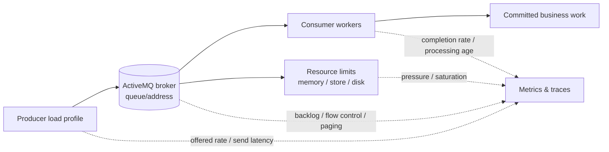

# Đánh giá tải ổn định, tải đột biến và quá tải kéo dài

> **Chương:** Hiệu năng  
> **Module:** `INTEGRATION_MESSAGING_MESSAGE_BROKER_ACTIVEMQ` — tìm hiểu Apache ActiveMQ Classic và Artemis trong giao tiếp bất đồng bộ với queue, topic, routing và JMS; thực hành Java producer/consumer, acknowledgment, transaction, redelivery, DLQ, bảo mật và vận hành broker đáng tin cậy.  
> **Trọng tâm:** Thiết kế bài **load test có hình dạng tải xác định**: tải ổn định, burst ngắn và quá tải kéo dài. Đo offered/accepted/committed rate, backlog, latency, broker resource pressure và thời gian drain; cấu hình backpressure/paging cho Classic và Artemis; quyết định hệ thống có đủ capacity và headroom hay không.

## 1. Vì sao một con số throughput đỉnh chưa chứng minh hệ thống chịu tải tốt?

Một broker xử lý được 20.000 message trong 10 giây ở một lần benchmark **chưa đủ** để kết luận có thể chạy production với 2.000 message/giây. Phép đo đó chưa trả lời:

- Sau 10 giây burst, backlog cần bao lâu để drain?
- Nếu producer gửi nhanh hơn consumer trong 20 phút, disk/journal sẽ tăng tới đâu?
- Broker có backpressure producer hay để queue phình tới khi hết tài nguyên?
- Khi producer bị block, ứng dụng có timeout/retry đúng cách hay tạo retry storm?
- Persistent message và transaction có giữ nguyên khi đo hay benchmark đã vô tình tắt durability?
- Latency p95 có ổn nhưng một số message bị giữ nhiều phút không?
- Khi tải trở về bình thường, hệ thống có phục hồi backlog mà không ảnh hưởng workload mới?

Một bài kiểm thử có ích phải tạo được **ba hình dạng tải khác nhau** và quan sát cả phía producer, broker lẫn consumer.



**Nguyên tắc đánh giá:** đo **tốc độ công việc được hoàn tất bền vững** và **độ trễ khi hệ thống chịu tải**, không chỉ số lần gọi `send()` thành công hoặc tốc độ socket.

## 2. Ba hình dạng tải và mô hình toán học

Ký hiệu:

- `λ`: tốc độ message producer **đưa vào hệ thống**, đơn vị message/giây.
- `μ`: năng lực xử lý **đã commit** của consumer, đơn vị message/giây.
- `N`: số worker hoạt động; nếu mỗi worker có service rate `μ_i` thì năng lực lý tưởng `μ_total = Σ μ_i`.
- `B(t)`: backlog chưa hoàn tất tại thời điểm `t`.
- `S`: kích thước trung bình message tính theo bytes trên wire/store, không chỉ body JSON.
- `T`: thời lượng của một pha tải.

Trong mô hình đơn giản, bỏ qua redelivery, expiry và thay đổi số worker:

```text
dB/dt ≈ λ - μ

Nếu λ < μ:
  backlog có xu hướng giảm hoặc ổn định

Nếu λ = μ:
  hệ thống không có headroom để drain backlog cũ

Nếu λ > μ:
  backlog tăng gần tuyến tính cho tới khi có backpressure,
  paging, reject, drop hoặc hết tài nguyên
```

### 2.1. Tải ổn định (steady state)

Producer phát với tốc độ gần như không đổi và **thấp hơn năng lực xử lý đã đo**:

```text
λ = 20 msg/s
μ = 40 msg/s
ρ = λ / μ = 0.5

Bình quân consumer có headroom để xử lý dao động,
retry và những message xử lý lâu bất thường.
```

Trong trạng thái ổn định, queue depth thường dao động quanh một mức có thể kiểm soát. Queue không nhất thiết luôn bằng 0: batch commit, scheduler, prefetch, transaction và thời gian xử lý tạo dao động tự nhiên.

Đừng thiết kế production ở `ρ=1` chỉ vì benchmark một lần đạt đúng throughput. Khi `λ` chỉ vừa bằng `μ`, hệ thống **không có năng lực dư** để drain bất kỳ backlog nào, hấp thụ burst hoặc phục hồi sau consumer downtime. Headroom phải được chọn theo độ biến động thực tế của workload, SLO và mức rủi ro chấp nhận được.

### 2.2. Tải đột biến (burst)

Trong một khoảng ngắn, `λ_burst > μ`; sau đó producer trở về mức bình thường hoặc dừng:

```text
Backlog tăng thêm trong burst:
  ΔB ≈ max(0, λ_burst - μ) × T_burst

Thời gian drain khi producer dừng:
  T_drain ≈ B / μ

Thời gian drain khi producer trở lại λ_normal < μ:
  T_drain ≈ B / (μ - λ_normal)
```

Ví dụ:

- Một consumer xử lý thực tế khoảng 40 msg/s.
- Producer bình thường gửi 20 msg/s.
- Burst gửi 100 msg/s trong 15 giây.
- Backlog tăng xấp xỉ `(100 - 40) × 15 = 900` messages.
- Nếu producer dừng hẳn, cần khoảng `900/40 = 22,5` giây để drain trong mô hình lý tưởng.
- Nếu producer trở lại 20 msg/s, phần capacity còn lại chỉ là 20 msg/s, nên drain khoảng `900/(40 - 20) = 45` giây.

**Burst không tự động là sự cố.** Hệ thống có thể chấp nhận burst nếu buffer/disk đủ, oldest-message age không vượt deadline và backlog được drain trong thời gian cam kết.

### 2.3. Quá tải kéo dài (sustained overload)

Nếu `λ > μ` trong thời gian dài, backlog tăng liên tục:

```text
λ = 100 msg/s
μ = 40 msg/s
T = 60 s

Backlog lý thuyết tăng:
  (100 - 40) × 60 = 3.600 messages
```

Trong thực tế, broker không nhất thiết tiếp tục nhận 100 msg/s vô hạn. Chính sách broker có thể:

- **BLOCK:** producer bị backpressure, tốc độ gửi được điều tiết.
- **PAGE:** message tiếp tục được nhận nhưng chuyển một phần dữ liệu xuống disk.
- **FAIL:** producer nhận exception khi address/destination đầy.
- **DROP:** message bị bỏ; với `DROP`, producer có thể không biết message đã bị mất nếu policy không phát lỗi.

Sustained overload là bài kiểm tra **cơ chế bảo vệ và khả năng suy giảm có kiểm soát**. Hệ thống tốt không nhất thiết giữ producer rate ở mức ban đầu bằng mọi giá; nó phải bảo vệ broker, bảo toàn semantics và đưa tín hiệu rõ để upstream điều chỉnh.

### 2.4. Little’s Law: liên hệ backlog và thời gian chờ

Trong hệ thống ổn định, có thể dùng:

```text
L = λ × W

L: số message trung bình trong hệ thống
λ: throughput trung bình (message/giây)
W: thời gian trung bình trong hệ thống (giây)
```

Nếu một queue ổn định có trung bình 200 messages và consumer hoàn tất 40 msg/s, thời gian lưu trú trung bình theo mô hình là `W = 200/40 = 5` giây.

**Không áp dụng Little’s Law máy móc trong pha burst hoặc overload không ổn định.** Khi backlog đang tăng, hệ thống chưa ở trạng thái steady-state. Ngoài ra phải xác định `L` gồm pending, in-flight hay cả app-side buffer; không trộn queue depth với end-to-end latency rồi coi đó là cùng một tập quan sát.

## 3. Định nghĩa workload trước khi chạy benchmark

Một con số “10.000 messages” không đủ mô tả tải. Trước khi chạy, ghi rõ:

| Thuộc tính | Câu hỏi phải trả lời |
|---|---|
| Offered rate | Producer dự kiến gửi bao nhiêu msg/s? Rate cố định hay tăng dần? |
| Payload size | Body trung bình, p95/p99 và header/property overhead là bao nhiêu? |
| Delivery mode | Persistent hay non-persistent? |
| Destination | Queue competing consumers, topic subscribers hay nhiều address? |
| Producer concurrency | Một producer hay nhiều producers/connection/session? |
| Consumer concurrency | Bao nhiêu processes, sessions, consumers và threads? |
| Processing time | Phân phối service time: constant, random, heavy-tail hay gọi DB/API? |
| Transaction | Commit mỗi message hay batch N messages? |
| Ack mode | AUTO, CLIENT hay transacted? |
| Prefetch/window | Buffer mỗi consumer bao nhiêu message/bytes? |
| TTL/delay | Message có expiry hoặc scheduled delivery không? |
| Failure behavior | Broker block, page, fail, redelivery hay DLQ khi quá tải? |
| Warm-up | JVM, JIT, connection pool và broker journal đã warm chưa? |
| Duration | Bao lâu để đo steady state, burst, overload và drain? |

### 3.1. Offered load khác accepted load và completed load

Đây là ba tốc độ không được gộp:

- **Offered rate:** tốc độ load generator định gửi theo lịch.
- **Accepted/committed send rate:** số message broker đã nhận/commit theo semantics producer test; báo cáo hai đại lượng này cùng offered rate khi flow control làm send/commit chậm.
- **Completed rate:** số message consumer xử lý và commit thành công.

Khi broker backpressure, offered rate có thể là 100 msg/s nhưng accepted rate chỉ còn 42 msg/s. Khi consumer bị chậm, accepted rate có thể vẫn là 100 msg/s trong khi completed rate chỉ 40 msg/s; phần chênh trở thành backlog.

```text
offered:    100 msg/s  ──────────────────────────►
accepted:    42 msg/s  ───────────► (producer BLOCK)
completed:   40 msg/s  ──────────► (consumer capacity)
backlog:      tăng chậm / bounded tùy policy
```

Một load generator **closed-loop** gửi message tiếp theo sau khi lần send trước trả về. Khi broker chậm, generator tự giảm tốc và có thể che mất mức tải ứng dụng dự kiến.

Một generator **open-loop/paced** lên lịch arrival theo thời gian độc lập với thời gian xử lý trước đó. Nó cho biết hệ thống phản ứng thế nào khi upstream thực sự muốn gửi một rate cố định. Tuy nhiên, khi `send()` bị block bởi flow control, generator không thể giả vờ các lần gửi đã được broker nhận; phải ghi **send latency, missed schedule slots và committed sends**. Không phát dồn toàn bộ slot bị lỡ ngay sau khi broker unblock, vì sẽ tạo một burst nhân tạo.

### 3.2. Dùng cùng workload khi so sánh hai broker

Muốn so sánh Classic và Artemis, giữ nguyên:

- Message payload và encoding.
- Persistent/non-persistent semantics.
- Batch size và transaction boundaries.
- Số producers, consumers, concurrency và service time.
- TLS/authentication, network RTT và host resources.
- Durability/persistence guarantees được yêu cầu.
- Warm-up, duration, ramp-up và cách thu metrics.

**Không** so Classic persistent sync send với Artemis non-blocking send rồi kết luận broker A nhanh hơn broker B. Khi thay một yếu tố như batch size, ghi rõ đó là một thí nghiệm khác.

## 4. Chỉ số phải thu trong cả ba pha

| Nhóm | Metric | Ý nghĩa |
|---|---|---|
| Producer | `offered_messages_total` | Số slot tải dự kiến |
| Producer | `send_completed_total` | Send call trả về thành công |
| Producer | `send_latency_seconds` | Thời gian send, đặc biệt khi flow control |
| Producer | `producer_commit_latency_seconds` | Thời gian commit batch |
| Producer | `missed_schedule_slots_total` | Offered slots bị lỡ vì generator hoặc send bị chậm |
| Broker | `queue_message_count` | Backlog theo semantics broker |
| Broker | `delivering/inflight` | Message đã dispatch nhưng chưa ack |
| Broker | `scheduled_count` | Message chưa đủ điều kiện delivery |
| Broker | `memory/store/disk usage` | Áp lực resource |
| Broker | `blocked_producer_count/time` | Backpressure đang kích hoạt bao lâu |
| Broker | `paged_bytes` | Lượng dữ liệu chuyển sang paging/store |
| Consumer | `completed_messages_total` | Message đã xử lý/commit |
| Consumer | `handler_latency_seconds` | Thời gian nghiệp vụ |
| Consumer | `message_age_seconds` | Tuổi message khi xử lý/commit |
| Consumer | `redelivery_total` | Delivery lặp |
| Consumer | `rollback_total` | Transaction rollback |
| Outcome | `oldest_outstanding_age_seconds` | Tuổi nghĩa vụ chưa hoàn tất lâu nhất |
| Outcome | `dlq_depth` / `expired_total` | Message không đi theo đường hoàn tất bình thường |

**Đừng chỉ đo queue depth.** Nếu consumer prefetch cao, nhiều messages đã được dispatch vào client buffer; queue pending có thể thấp trong khi công việc vẫn đang chờ. Đo thêm in-flight, consumer progress và end-to-end age.

### 4.1. Latency cần phân phối, không chỉ average

Ghi tối thiểu:

- p50: trải nghiệm điển hình.
- p95: tail latency thường xuyên.
- p99: outlier quan trọng.
- max/oldest outstanding: phát hiện một message bị kẹt rất lâu.

Average có thể che giấu tail. Histogram chỉ ghi những message đã hoàn tất cũng có survivorship bias: message kẹt chưa hoàn tất **chưa đóng góp sample**. Vì vậy cần đồng thời có latency histogram và gauge oldest outstanding.

### 4.2. Tách producer blocking khỏi consumer service time

Nếu `send()` mất 1,5 giây, chưa chắc broker chậm xử lý disk. Có thể producer bị BLOCK vì address đầy và consumer không giải phóng đủ capacity. Ngược lại, producer send nhanh nhưng consumer commit chậm có thể khiến backlog phình ra.

Khi phân tích, vẽ timeline:

```text
producer scheduled → send() begin → send() return → producer commit
                                         broker enqueue
broker dispatch → consumer receive → handler start → business commit → JMS commit
```

Tất cả mốc cross-process cần timestamp đáng tin cậy và clock sync. Dùng `System.nanoTime()` đo duration trong cùng process; dùng epoch UTC/event metadata cho mốc giữa producer và consumer.

## 5. ActiveMQ Classic: flow control và resource limits

Classic điều tiết producer khi memory của destination hoặc broker-wide memory/store/temp limits đã vượt ngưỡng. Với synchronous sends, đặc biệt persistent messages, producer thường đợi broker acknowledgment; khi tài nguyên chưa có chỗ, `send()` có thể **block**. Điều này thường bị hiểu nhầm là producer treo.

### 5.1. Giới hạn theo destination và toàn broker

Fragment minh họa trong `conf/activemq.xml` hiện hữu:

```xml
<destinationPolicy>
  <policyMap>
    <policyEntries>
      <policyEntry queue="lab.load.>"
                   producerFlowControl="true"
                   memoryLimit="2 mb"/>
    </policyEntries>
  </policyMap>
</destinationPolicy>

<systemUsage>
  <systemUsage sendFailIfNoSpaceAfterTimeout="3000">
    <memoryUsage>
      <memoryUsage limit="64 mb"/>
    </memoryUsage>
    <storeUsage>
      <storeUsage limit="20 gb"/>
    </storeUsage>
    <tempUsage>
      <tempUsage limit="5 gb"/>
    </tempUsage>
  </systemUsage>
</systemUsage>
```

- `memoryLimit` trong `policyEntry` giới hạn phần memory cursor của destination; nó **phụ thuộc** global `systemUsage/memoryUsage`.
- `memoryUsage` bảo vệ broker khỏi dùng quá nhiều heap cho message memory.
- `storeUsage` giới hạn dung lượng persistent store theo policy.
- `tempUsage` giới hạn temporary store.
- `producerFlowControl=true` cho phép broker điều tiết producer khi resource cạn.
- `sendFailIfNoSpaceAfterTimeout=3000` yêu cầu send chờ tối đa khoảng 3 giây trước khi nhận exception do không có chỗ; client cần phân loại `ResourceAllocationException`/`JMSException` và áp dụng retry/backoff có giới hạn.

**Đây là cấu hình lab có giới hạn nhỏ để nhìn thấy flow control.** Không chép nguyên 2 MB/64 MB/20 GB sang production; xác định heap, persistent store, temp disk và dung lượng partition thực tế trước khi đặt ngưỡng. Khi sửa broker config, gộp fragment vào phần tử tương ứng đã có; không tạo hai `destinationPolicy` hoặc `systemUsage` cạnh tranh.

### 5.2. Producer async và ProducerWindowSize

Classic non-persistent sends thường được thực hiện asynchronous. Producer có thể không chờ broker acknowledgment ở từng message; do đó app không nhất thiết nhận tín hiệu giới hạn resource ngay khi gửi.

Nếu dùng async sends nhưng vẫn cần producer flow control theo cửa sổ bytes, cấu hình `ProducerWindowSize` hoặc dùng `alwaysSyncSend` tùy yêu cầu. Ví dụ client-side:

```java
import org.apache.activemq.ActiveMQConnectionFactory;

ActiveMQConnectionFactory factory =
        new ActiveMQConnectionFactory(
                "tcp://127.0.0.1:61616");

factory.setProducerWindowSize(1024 * 1024);
// Cửa sổ 1 MiB dữ liệu trước khi client chờ producer ACK.
```

`ProducerWindowSize` là **cửa sổ bytes đang bay**, không phải số message trong queue và không phải memory limit broker. Nếu chỉ cần độ tin cậy rõ ràng trong benchmark, dùng persistent synchronous sends hoặc transaction semantics đã định nghĩa; không bật `useAsyncSend` mà bỏ qua cách xác nhận send.

### 5.3. Khi nào không nên tắt producer flow control?

Đặt `producerFlowControl=false` có thể khiến broker tiếp tục ghi message vào store thay vì block producer ở ngưỡng memory destination. Điều này **không tạo thêm disk capacity**. Khi store/temp partition chạm giới hạn, producer vẫn có thể bị chặn hoặc nhận lỗi.

Với workload business-critical, tắt flow control để benchmark throughput thường chỉ đo khả năng đẩy backlog xuống disk, không chứng minh hệ thống xử lý bền vững. Chỉ thử trong lab riêng, có giới hạn store/disk và cleanup rõ ràng.

### 5.4. Classic persistence và throughput

Persistent messages, store sync, cursor, disk latency và transaction batching ảnh hưởng mạnh tới kết quả. Nếu benchmark production dùng persistent messages, giữ persistence bật và dùng cùng storage class. Không chuyển sang non-persistent chỉ để tăng throughput rồi lấy con số đó làm capacity của luồng yêu cầu durability.

Tài liệu Classic performance tuning cũng nhấn mạnh đánh đổi giữa sync/async publishing, prefetch và optimized acknowledge. Những thay đổi này có thể làm throughput tăng nhưng cũng đổi latency, memory footprint và delivery guarantees; hãy benchmark từng thay đổi riêng.

## 6. Artemis: PAGE, BLOCK, FAIL và DROP là bốn hành vi khác nhau

Artemis đặt `max-size-bytes` theo **address**. Khi address đầy, `address-full-policy` quyết định cách broker xử lý producer tiếp theo.

| Policy | Khi address đạt ngưỡng | Hành vi producer | Dùng khi |
|---|---|---|---|
| `PAGE` | Ghi message tiếp vào page files trên disk | Thường tiếp tục gửi; disk usage tăng | Muốn hấp thụ backlog hữu hạn, có disk headroom |
| `BLOCK` | Không cấp thêm producer credits khi hết chỗ | Producer block cho tới khi có space | Muốn backpressure upstream và bảo vệ broker |
| `FAIL` | Reject message khi address đầy | Client nhận exception | Muốn lỗi rõ để upstream quyết định retry/reject |
| `DROP` | Bỏ message vượt ngưỡng | Có thể không có exception cho producer | Chỉ cho telemetry/best-effort đã chấp nhận mất |

**`PAGE` không đồng nghĩa broker đã xử lý backlog.** Nó chuyển dữ liệu khỏi memory sang disk. Nếu consumer vẫn chậm, page files tăng và cuối cùng phải áp dụng disk/page limits. Với `BLOCK`, producer bị làm chậm nhưng backlog vẫn có thể chờ trong queue; backpressure chỉ giúp giới hạn tốc độ nhận thêm.

### 6.1. Cấu hình Artemis BLOCK cho queue lab

Fragment bên trong `etc/broker.xml` hiện hữu:

```xml
<address-settings>
  <address-setting match="lab.load.#">
    <max-size-bytes>2097152</max-size-bytes>
    <address-full-policy>BLOCK</address-full-policy>
  </address-setting>
</address-settings>
```

- `max-size-bytes=2097152`: khoảng 2 MiB cho **mỗi address** khớp pattern.
- `address-full-policy=BLOCK`: producer bị block khi address đầy và sẽ được mở lại khi message được consume/space giải phóng.
- Một address có thể có nhiều queues; giới hạn là cho **address**, không phải tự động là tổng memory toàn broker.
- Nếu muốn giới hạn tổng address/broker, xem global max-size settings và resource/disk limits tương ứng.
- Nhiều producer có thể được cấp credits đồng thời; tổng cấp phát có thể vượt ngưỡng xấp xỉ theo số producer × `producerWindowSize`. Cần headroom khi sizing.

Nếu muốn so sánh `PAGE`, chỉ đổi một biến:

```xml
<address-setting match="lab.load.#">
  <max-size-bytes>2097152</max-size-bytes>
  <page-size-bytes>1048576</page-size-bytes>
  <address-full-policy>PAGE</address-full-policy>
  <page-limit-bytes>10G</page-limit-bytes>
  <page-full-policy>FAIL</page-full-policy>
</address-setting>
```

`page-limit-bytes` và `page-full-policy` là giới hạn riêng cho lượng dữ liệu paging; nó ngăn một address chiếm hết disk. `page-full-policy=FAIL` có thể làm producer nhận exception khi giới hạn paging đạt tới. Đảm bảo `page-limit-bytes` ít nhất bằng `page-size-bytes`, nếu không paging có thể bị block ngay.

**Không chọn `DROP` cho command/event cần bảo toàn.** Với `DROP`, một bài benchmark có thể trông rất nhanh vì broker loại bỏ message; phải đối chiếu `messagesAdded`, `messagesAcknowledged`, `messagesKilled/expired` và business IDs để phát hiện mất dữ liệu.

### 6.2. Producer và consumer windows của Artemis

Artemis Core client có flow control theo **byte credits**:

- `producerWindowSize`: số bytes producer có thể gửi đang bay trước khi cần thêm credits.
- `consumerWindowSize`: giới hạn bytes message được prefetch vào buffer mỗi consumer.
- `consumerWindowSize=0`: không buffer message ở client; hữu ích khi có slow consumers và muốn message còn trên broker để consumer nhanh khác nhận.
- `consumerWindowSize=-1`: buffer không giới hạn; chỉ phù hợp trường hợp kiểm soát được memory và consumer thật sự nhanh.
- Giá trị dương: buffer hữu hạn, ví dụ 1 MiB.

URI ví dụ cho native Artemis client:

```text
tcp://127.0.0.1:61616?producerWindowSize=1048576&consumerWindowSize=1048576
```

Đây là **cấu hình client Core/JMS native của Artemis**. Nếu ứng dụng đang dùng ActiveMQ Classic OpenWire client kết nối Artemis, hãy dùng option/semantics của Classic client tương ứng, không giả định URI Artemis native được hiểu bởi Classic `ActiveMQConnectionFactory`.

### 6.3. Paging và BLOCK giải quyết hai mục tiêu khác nhau

- `PAGE`: tiếp nhận tải lớn trong một khoảng thời gian bằng cách sử dụng disk; hữu ích nếu muốn broker hấp thụ burst và có disk reserve.
- `BLOCK`: giới hạn ingress theo khả năng drain; hữu ích khi upstream phải điều tiết theo capacity thực.
- Cả hai đều cần disk/memory monitoring. `PAGE` cần theo dõi page files; `BLOCK` cần theo dõi producer wait/credits và latency upstream.
- Nếu chọn `PAGE` nhưng không đặt page/disk limits, queue backlog có thể chuyển thành vấn đề disk-full.
- Nếu chọn `BLOCK` nhưng upstream có hàng nghìn request threads đồng bộ gọi `send()`, các thread đó có thể bị giữ lâu; cần bounded concurrency, timeout và queue/outbox ở tầng ứng dụng.

## 7. Lab Java: tạo steady, burst và sustained overload

Lab sử dụng **Java 17, Maven 3.9+ và ActiveMQ Classic 5.19.12 client (`javax.jms`)** qua OpenWire. Có thể chạy với broker Classic hoặc Artemis đã bật OpenWire acceptor, nhưng phép đo broker-side phải dùng metrics phù hợp từng broker.

Lab tạo queue riêng `lab.load.<runId>` cho mỗi lượt thử. Producer gửi persistent `TextMessage` theo lịch paced; consumer xử lý tuần tự và commit từng message. Producer có batch commit để người học thay đổi transaction overhead.

### 7.1. Maven `pom.xml`

```xml
<project xmlns="http://maven.apache.org/POM/4.0.0"
         xmlns:xsi="http://www.w3.org/2001/XMLSchema-instance"
         xsi:schemaLocation="http://maven.apache.org/POM/4.0.0
                             https://maven.apache.org/xsd/maven-4.0.0.xsd">
  <modelVersion>4.0.0</modelVersion>
  <groupId>demo.activemq</groupId>
  <artifactId>load-shape-lab</artifactId>
  <version>1.0-SNAPSHOT</version>
  <properties>
    <maven.compiler.release>17</maven.compiler.release>
    <project.build.sourceEncoding>UTF-8</project.build.sourceEncoding>
  </properties>
  <dependencies>
    <dependency>
      <groupId>org.apache.activemq</groupId>
      <artifactId>activemq-client</artifactId>
      <version>5.19.12</version>
    </dependency>
  </dependencies>
  <build>
    <plugins>
      <plugin>
        <groupId>org.apache.maven.plugins</groupId>
        <artifactId>maven-compiler-plugin</artifactId>
        <version>3.14.1</version>
      </plugin>
      <plugin>
        <groupId>org.codehaus.mojo</groupId>
        <artifactId>exec-maven-plugin</artifactId>
        <version>3.5.1</version>
      </plugin>
    </plugins>
  </build>
</project>
```

### 7.2. Java `LoadShapeLab.java`

Tạo `src/main/java/demo/LoadShapeLab.java`:

```java
package demo;

import org.apache.activemq.ActiveMQConnectionFactory;

import javax.jms.Connection;
import javax.jms.DeliveryMode;
import javax.jms.JMSException;
import javax.jms.Message;
import javax.jms.MessageConsumer;
import javax.jms.MessageProducer;
import javax.jms.Queue;
import javax.jms.Session;
import javax.jms.TextMessage;

import java.util.concurrent.TimeUnit;
import java.util.concurrent.locks.LockSupport;

public final class LoadShapeLab {
    private static final String PREFIX = "lab.load.";

    public static void main(String[] args) throws Exception {
        if (args.length == 0) {
            usage();
            return;
        }

        String mode = args[0];
        if ("produce".equals(mode) && args.length != 6) {
            usage();
            return;
        }
        if ("consume".equals(mode) && args.length != 5) {
            usage();
            return;
        }
        if (!"produce".equals(mode) && !"consume".equals(mode)) {
            usage();
            return;
        }

        String runId = validateName(args[1]);
        String queueName = PREFIX + runId;

        String url = System.getenv().getOrDefault(
                "BROKER_URL", "tcp://127.0.0.1:61616");
        String user = System.getenv("BROKER_USER");
        String password = System.getenv("BROKER_PASSWORD");

        ActiveMQConnectionFactory factory =
                new ActiveMQConnectionFactory(url);

        Connection connection;
        if (user == null || user.isBlank()) {
            connection = factory.createConnection();
        } else {
            if (password == null) {
                throw new IllegalArgumentException(
                        "BROKER_PASSWORD required with BROKER_USER");
            }
            connection = factory.createConnection(user, password);
        }

        try {
            connection.start();
            if ("produce".equals(mode)) {
                produce(
                        connection,
                        queueName,
                        parseRange(args[2], "ratePerSec", 1, 10000),
                        parseRange(args[3], "durationSec", 1, 300),
                        parseRange(args[4], "payloadBytes", 0, 65536),
                        parseRange(args[5], "batchSize", 1, 500));
            } else {
                consume(
                        connection,
                        queueName,
                        validateName(args[2]),
                        parseRange(args[3], "processMs", 0, 10000),
                        parseRange(args[4], "durationSec", 1, 600));
            }
        } finally {
            connection.close();
        }
    }

    private static void produce(Connection connection,
                                String queueName,
                                int ratePerSec,
                                int durationSec,
                                int payloadBytes,
                                int batchSize) throws Exception {
        Session session = connection.createSession(
                true, Session.SESSION_TRANSACTED);
        Queue queue = session.createQueue(queueName);
        MessageProducer producer = session.createProducer(queue);
        producer.setDeliveryMode(DeliveryMode.PERSISTENT);

        String payload = "x".repeat(payloadBytes);
        long periodNs = 1_000_000_000L / ratePerSec;
        long durationNs = TimeUnit.SECONDS.toNanos(durationSec);
        long startNs = System.nanoTime();

        long slot = 0L;
        long missedSlots = 0L;
        long sent = 0L;
        long committed = 0L;
        int pendingInTransaction = 0;

        long sendTotalNs = 0L;
        long sendMaxNs = 0L;
        long commitTotalNs = 0L;
        long commitMaxNs = 0L;
        long commitCount = 0L;

        try {
            while (System.nanoTime() - startNs < durationNs) {
                long dueNs = startNs + slot * periodNs;
                long nowNs = System.nanoTime();

                // Skip missed slots instead of sending a catch-up burst.
                if (nowNs > dueNs) {
                    long lateSlots = (nowNs - dueNs) / periodNs;
                    if (lateSlots > 0L) {
                        slot += lateSlots;
                        missedSlots += lateSlots;
                        dueNs = startNs + slot * periodNs;
                    }
                }

                sleepUntil(dueNs);
                if (System.nanoTime() - startNs >= durationNs) {
                    break;
                }

                long createdAtMs = System.currentTimeMillis();
                TextMessage message =
                        session.createTextMessage(payload);
                message.setStringProperty(
                        "runId", queueName.substring(PREFIX.length()));
                message.setLongProperty("sequence", slot + 1L);
                message.setLongProperty("createdAtMs", createdAtMs);
                message.setIntProperty("payloadBytes", payloadBytes);

                long sendStartNs = System.nanoTime();
                producer.send(message,
                        DeliveryMode.PERSISTENT, 4, 0L);
                long sendElapsedNs = System.nanoTime() - sendStartNs;

                sent++;
                pendingInTransaction++;
                sendTotalNs += sendElapsedNs;
                sendMaxNs = Math.max(sendMaxNs, sendElapsedNs);

                if (pendingInTransaction >= batchSize) {
                    long commitStartNs = System.nanoTime();
                    try {
                        session.commit();
                    } catch (JMSException commitFailure) {
                        System.err.println(
                                "COMMIT_OUTCOME_UNKNOWN pending="
                                + pendingInTransaction
                                + " detail=" + commitFailure.getMessage());
                        throw commitFailure;
                    }
                    long commitElapsedNs =
                            System.nanoTime() - commitStartNs;

                    committed += pendingInTransaction;
                    pendingInTransaction = 0;
                    commitCount++;
                    commitTotalNs += commitElapsedNs;
                    commitMaxNs = Math.max(
                            commitMaxNs, commitElapsedNs);
                }

                slot++;
            }

            if (pendingInTransaction > 0) {
                long commitStartNs = System.nanoTime();
                try {
                    session.commit();
                } catch (JMSException commitFailure) {
                    System.err.println(
                            "FINAL_COMMIT_OUTCOME_UNKNOWN pending="
                            + pendingInTransaction);
                    throw commitFailure;
                }
                long commitElapsedNs = System.nanoTime() - commitStartNs;
                committed += pendingInTransaction;
                commitCount++;
                commitTotalNs += commitElapsedNs;
                commitMaxNs = Math.max(commitMaxNs, commitElapsedNs);
            }

            long expectedSlots = (long) ratePerSec * durationSec;
            if (slot < expectedSlots) {
                missedSlots += expectedSlots - slot;
            }

            double elapsedSec =
                    (System.nanoTime() - startNs) / 1_000_000_000.0;
            System.out.printf(
                    "PRODUCER_SUMMARY queue=%s offeredRate=%d/s "
                    + "elapsedSec=%.2f sent=%d committed=%d "
                    + "missedSlots=%d avgSendMs=%.3f maxSendMs=%.3f "
                    + "avgCommitMs=%.3f maxCommitMs=%.3f commits=%d%n",
                    queueName, ratePerSec, elapsedSec, sent, committed,
                    missedSlots,
                    toMsAverage(sendTotalNs, sent),
                    toMs(sendMaxNs),
                    toMsAverage(commitTotalNs, commitCount),
                    toMs(commitMaxNs), commitCount);
        } finally {
            producer.close();
            session.close();
        }
    }

    private static void consume(Connection connection,
                                String queueName,
                                String workerId,
                                int processMs,
                                int durationSec) throws Exception {
        Session session = connection.createSession(
                true, Session.SESSION_TRANSACTED);
        MessageConsumer consumer = session.createConsumer(
                session.createQueue(queueName));

        long deadlineNs = System.nanoTime()
                + TimeUnit.SECONDS.toNanos(durationSec);

        long received = 0L;
        long committed = 0L;
        long redelivered = 0L;
        long invalidTimestamp = 0L;
        long totalAgeMs = 0L;
        long maxAgeMs = 0L;
        long totalHandlerNs = 0L;
        long maxHandlerNs = 0L;
        long totalCommitNs = 0L;
        long maxCommitNs = 0L;

        try {
            while (System.nanoTime() < deadlineNs) {
                Message message = consumer.receive(250L);
                if (message == null) {
                    continue;
                }
                received++;

                if (!(message instanceof TextMessage)) {
                    throw new IllegalStateException(
                            "Expected TextMessage on " + queueName);
                }
                if (!message.propertyExists("createdAtMs")) {
                    throw new IllegalStateException(
                            "Missing createdAtMs on message");
                }

                long createdAtMs =
                        message.getLongProperty("createdAtMs");
                boolean wasRedelivered = message.getJMSRedelivered();
                if (wasRedelivered) {
                    redelivered++;
                }

                long handlerStartNs = System.nanoTime();
                sleepNanos(TimeUnit.MILLISECONDS.toNanos(processMs));
                long handlerElapsedNs =
                        System.nanoTime() - handlerStartNs;

                long commitStartNs = System.nanoTime();
                try {
                    session.commit();
                } catch (JMSException commitFailure) {
                    System.err.println(
                            "CONSUMER_COMMIT_OUTCOME_UNKNOWN worker="
                            + workerId + " detail="
                            + commitFailure.getMessage());
                    throw commitFailure;
                }
                long commitElapsedNs =
                        System.nanoTime() - commitStartNs;
                long committedAtMs = System.currentTimeMillis();

                committed++;
                totalHandlerNs += handlerElapsedNs;
                maxHandlerNs = Math.max(maxHandlerNs, handlerElapsedNs);
                totalCommitNs += commitElapsedNs;
                maxCommitNs = Math.max(maxCommitNs, commitElapsedNs);

                long ageMs = committedAtMs - createdAtMs;
                if (createdAtMs <= 0L || ageMs < 0L) {
                    invalidTimestamp++;
                } else {
                    totalAgeMs += ageMs;
                    maxAgeMs = Math.max(maxAgeMs, ageMs);
                }
            }

            long validAgeSamples = committed - invalidTimestamp;
            double avgAgeMs = validAgeSamples == 0L
                    ? 0.0 : (double) totalAgeMs / validAgeSamples;

            System.out.printf(
                    "CONSUMER_SUMMARY queue=%s worker=%s "
                    + "received=%d committed=%d redelivered=%d "
                    + "invalidTimestamp=%d avgAgeMs=%.1f maxAgeMs=%d "
                    + "avgHandlerMs=%.3f maxHandlerMs=%.3f "
                    + "avgCommitMs=%.3f maxCommitMs=%.3f%n",
                    queueName, workerId, received, committed,
                    redelivered, invalidTimestamp, avgAgeMs, maxAgeMs,
                    toMsAverage(totalHandlerNs, committed),
                    toMs(maxHandlerNs),
                    toMsAverage(totalCommitNs, committed),
                    toMs(maxCommitNs));
        } catch (Exception failure) {
            try {
                session.rollback();
            } catch (JMSException rollbackFailure) {
                failure.addSuppressed(rollbackFailure);
            }
            throw failure;
        } finally {
            consumer.close();
            session.close();
        }
    }

    private static double toMsAverage(long totalNs, long count) {
        return count == 0L
                ? 0.0
                : totalNs / 1_000_000.0 / count;
    }

    private static double toMs(long nanos) {
        return nanos / 1_000_000.0;
    }

    private static int parseRange(String text, String name,
                                  int min, int max) {
        int value = Integer.parseInt(text);
        if (value < min || value > max) {
            throw new IllegalArgumentException(
                    name + " must be " + min + ".." + max);
        }
        return value;
    }

    private static String validateName(String value) {
        if (!value.matches("[A-Za-z0-9_-]{1,40}")) {
            throw new IllegalArgumentException(
                    "Use 1..40 letters/digits/_/- only");
        }
        return value;
    }

    private static void sleepUntil(long deadlineNs)
            throws InterruptedException {
        while (true) {
            long remaining = deadlineNs - System.nanoTime();
            if (remaining <= 0L) {
                return;
            }
            LockSupport.parkNanos(remaining);
            if (Thread.interrupted()) {
                throw new InterruptedException();
            }
        }
    }

    private static void sleepNanos(long nanos)
            throws InterruptedException {
        long deadlineNs = System.nanoTime() + nanos;
        while (true) {
            long remaining = deadlineNs - System.nanoTime();
            if (remaining <= 0L) {
                return;
            }
            LockSupport.parkNanos(remaining);
            if (Thread.interrupted()) {
                throw new InterruptedException();
            }
        }
    }

    private static void usage() {
        System.out.println(
                "produce <runId> <ratePerSec:1..10000>"
                + " <durationSec:1..300> <payloadBytes:0..65536>"
                + " <batchSize:1..500>");
        System.out.println(
                "consume <runId> <workerId> <processMs:0..10000>"
                + " <durationSec:1..600>");
    }
}
```

### 7.3. Những điểm cần hiểu trong code

- Producer dùng **lịch paced theo `System.nanoTime()`**. Khi `send()` bị block, các slot đã lỡ được đếm trong `missedSlots`; chương trình không gửi dồn bù sau khi broker mở lại.
- `createdAtMs` được đặt **ngay trước send attempt**. Consumer age vì vậy bao gồm thời gian send bị block, chờ ở broker, dispatch và xử lý.
- Producer gửi `PERSISTENT` và commit theo `batchSize`. `committed` chỉ tăng sau khi `session.commit()` trả thành công.
- Nếu commit ném exception, code ghi `COMMIT_OUTCOME_UNKNOWN` và dừng. **Không tự retry cùng batch với ID mới**, vì kết quả commit có thể chưa xác định.
- Consumer commit từng message để dễ đọc service rate. Khi đổi batch ack, đó là một thí nghiệm mới vì transaction overhead và redelivery window thay đổi.
- `avgAgeMs` là trung bình tuổi của messages có timestamp hợp lệ đã commit; `maxAgeMs` là max trong mẫu consumer đã xử lý. Nó **không** phải oldest pending/in-flight toàn queue.
- `processMs` mô phỏng xử lý tuần tự, không gọi DB thật. Khi benchmark production-like, thay bằng workload đại diện nhưng giữ side effects idempotent.
- Lab dùng một consumer process mỗi worker; để tăng worker count, mở nhiều terminal với cùng `runId` và `workerId` khác nhau. Các consumers cạnh tranh trên cùng queue.
- Timestamps dùng epoch milliseconds giữa processes nên đồng hồ máy phải đồng bộ. Duration nội bộ dùng monotonic `nanoTime`.

### 7.4. Chạy producer và consumer

Bash:

```bash
export BROKER_URL='tcp://127.0.0.1:61616'
export BROKER_USER='labuser'
export BROKER_PASSWORD='lab-only-password'

mvn -q compile exec:java \
  '-Dexec.mainClass=demo.LoadShapeLab' \
  '-Dexec.args=consume steadyA worker1 25 120'
```

PowerShell:

```powershell
$env:BROKER_URL = 'tcp://127.0.0.1:61616'
$env:BROKER_USER = 'labuser'
$env:BROKER_PASSWORD = 'lab-only-password'

mvn -q compile exec:java '-Dexec.mainClass=demo.LoadShapeLab' '-Dexec.args=consume steadyA worker1 25 120'
```

Khởi động consumer trước, sau đó chạy producer ở terminal khác:

```bash
mvn -q compile exec:java '-Dexec.mainClass=demo.LoadShapeLab' '-Dexec.args=produce steadyA 20 30 512 10'
```

Nếu broker lab cho phép anonymous, bỏ `BROKER_USER` và `BROKER_PASSWORD`. Không lưu credential production trong source hoặc command history.

## 8. Kịch bản A — Tải ổn định

### 8.1. Mục tiêu

Xác định baseline khi offered rate **thấp hơn service capacity đã đo**, đồng thời xác nhận backlog và latency không tăng dần.

Dùng một queue mới `steadyA`, một worker với `processMs=25`. Service capacity lý tưởng từ sleep là 40 msg/s; năng lực thực tế thấp hơn vì receive/commit/JMS overhead.

Terminal consumer:

```bash
mvn -q compile exec:java '-Dexec.mainClass=demo.LoadShapeLab' '-Dexec.args=consume steadyA worker1 25 120'
```

Terminal producer:

```bash
mvn -q compile exec:java '-Dexec.mainClass=demo.LoadShapeLab' '-Dexec.args=produce steadyA 20 30 512 10'
```

Kỳ vọng:

- Producer gửi khoảng 600 messages trong 30 giây nếu không bị broker/host chặn đáng kể.
- Consumer có năng lực lý tưởng cao hơn 20 msg/s nên queue không tăng liên tục.
- `missedSlots` gần 0; `sendLatency`/`commitLatency` ổn định.
- `avgAgeMs` có thể gồm batch transaction, queue wait và consumer processing; không ép phải bằng 25 ms.

### 8.2. Lặp lại với nhiều producer/consumer

Thử cùng workload nhưng:

1. Một producer, một consumer.
2. Hai producers, một consumer.
3. Một producer, hai consumers.
4. Hai producers, hai consumers.

Ghi `committed/s`, oldest age, CPU, memory, store/disk và send latency. Nếu tăng consumers không tăng completed rate, bottleneck có thể ở producer, journal, disk, network, DB hoặc serialization. Nếu tăng producers làm send latency tăng nhưng completed rate đứng yên, hệ thống đã chạm capacity ở downstream.

**Không kết luận hai consumers phải xử lý đúng gấp đôi.** Chia sẻ disk, transaction commits, prefetch, CPU, broker dispatch và external services có thể làm scaling không tuyến tính.

## 9. Kịch bản B — Burst ngắn và thời gian drain

### 9.1. Tạo nền ổn định rồi burst

Khởi chạy một consumer đủ lâu:

```bash
mvn -q compile exec:java '-Dexec.mainClass=demo.LoadShapeLab' '-Dexec.args=consume burstB worker1 25 120'
```

Gửi steady 20 msg/s trong 30 giây:

```bash
mvn -q compile exec:java '-Dexec.mainClass=demo.LoadShapeLab' '-Dexec.args=produce burstB 20 30 512 10'
```

Sau đó gửi burst 100 msg/s trong 15 giây:

```bash
mvn -q compile exec:java '-Dexec.mainClass=demo.LoadShapeLab' '-Dexec.args=produce burstB 100 15 512 10'
```

Với μ lý tưởng 40 msg/s, burst tạo backlog lý thuyết khoảng 900 messages. Consumer tiếp tục chạy sau khi producer kết thúc và drain phần backlog. Quan sát:

- Queue depth tăng trong burst rồi giảm.
- `maxAgeMs` tăng khi backlog hình thành.
- Khi producer dừng, completed rate lớn hơn ingress và backlog giảm.
- `oldest outstanding age` trở lại vùng SLO sau thời gian drain.

### 9.2. Đo drain time đúng cách

Lưu snapshot ngay khi burst kết thúc:

```text
B0 = backlog tại thời điểm burst kết thúc
lambda_normal = ingress bình thường trong giai đoạn drain
mu = completed rate đo được khi queue có backlog

T_drain ≈ B0 / (mu - lambda_normal)
```

Nếu producer vẫn gửi 20 msg/s và consumer hoàn tất 40 msg/s, drain capacity chỉ là 20 msg/s. Nếu producer dừng hoàn toàn, drain capacity là 40 msg/s.

**Thời gian drain thực tế** có thể dài hơn do service-time tail, transaction batch, retry delay, paging I/O và consumers mới phải warm up. Hãy đo từ lúc burst kết thúc tới khi backlog/oldest age trở lại ngưỡng đã định, không chỉ dựa trên công thức.

### 9.3. Kiểm tra buffer có đủ không

Nếu burst tạo 900 messages và message size thực tế trung bình 1,5 KiB sau overhead, dữ liệu backlog bậc độ lớn:

```text
900 × 1.5 KiB ≈ 1.32 MiB
```

Đây là ước lượng payload/storage sơ bộ; broker journal/page files, indexes, headers và replication có overhead riêng. Dùng disk metrics thực tế và p95/p99 message size để sizing. Không dùng body length đơn lẻ làm giới hạn storage chính xác.

## 10. Kịch bản C — Quá tải kéo dài và backpressure

### 10.1. Tạo overload hữu hạn trong môi trường lab

Khởi động consumer một worker, xử lý 25 ms/message, chạy đủ 140 giây:

```bash
mvn -q compile exec:java '-Dexec.mainClass=demo.LoadShapeLab' '-Dexec.args=consume overloadC worker1 25 140'
```

Gửi 100 msg/s trong 60 giây, payload 1 KiB:

```bash
mvn -q compile exec:java '-Dexec.mainClass=demo.LoadShapeLab' '-Dexec.args=produce overloadC 100 60 1024 10'
```

Nếu consumer đạt khoảng 40 msg/s, backlog lý thuyết tăng tới 3.600 messages (chưa tính producer backpressure). Dùng policy BLOCK đã cấu hình ở Classic hoặc Artemis để quan sát:

- Producer `send()` hoặc transaction commit bắt đầu chậm.
- `missedSlots` tăng do paced generator bỏ các slot không còn khả năng gửi đúng lịch.
- Accepted/committed producer rate giảm so với offered rate.
- Consumer vẫn tiến gần service capacity.
- Backlog bị giới hạn quanh ngưỡng broker/policy, thay vì tiếp tục tăng vô hạn.

Nếu dùng `PAGE`, producer có thể tiếp tục gửi trong khi broker paging ra disk; thay vì send block, bạn sẽ thấy page/disk usage tăng. Nếu disk/page limit chạm ngưỡng, policy tiếp theo quyết định producer block/fail/drop.

### 10.2. So sánh BLOCK với PAGE

Chạy lại cùng run trong queue mới và chỉ đổi policy:

| Quan sát | `BLOCK` | `PAGE` |
|---|---|---|
| Producer send latency | Tăng khi address đầy | Có thể tiếp tục thấp hơn tới khi disk/I/O thành bottleneck |
| Offered vs accepted rate | Chênh lệch; producer bị điều tiết | Có thể gần nhau lâu hơn |
| Memory/address usage | Bị giới hạn quanh ngưỡng (có thể có overshoot theo credits) | Giữ memory có giới hạn, message spill xuống disk |
| Disk/page usage | Tăng theo persistent backlog nhưng không nhất thiết paging toàn bộ | Tăng rõ do page files |
| Consumer chậm kéo dài | Producer chờ space | Broker giữ backlog trên storage |
| Rủi ro cuối cùng | Upstream threads/requests bị block nếu không có timeout | Disk đầy, page limit, I/O saturation |

Không có policy “tốt nhất” cho mọi queue. `BLOCK` phù hợp khi upstream có thể chịu backpressure. `PAGE` phù hợp khi cần hấp thụ burst và có giới hạn disk rõ. `FAIL` phù hợp khi caller có cơ chế xử lý exception và admission control. `DROP` chỉ phù hợp khi mất message đã được chấp nhận rõ trong contract.

### 10.3. Đừng nhầm overload có kiểm soát với năng lực capacity cao

Khi broker BLOCK, producer committed rate có thể giảm về gần consumer capacity. Queue depth ổn định **không có nghĩa hệ thống có thể phục vụ offered rate**; nó có nghĩa broker đã chuyển áp lực ngược về producer.

Một báo cáo đúng phải ghi cả:

```text
offered_rate       = 100 msg/s
producer_accepted  = 42 msg/s
consumer_committed = 40 msg/s
producer_blocked   = 58% schedule slots / send wait elevated
queue_depth        = bounded
```

Nếu chỉ báo “queue depth không tăng”, người đọc có thể nhầm rằng hệ thống đáp ứng 100 msg/s. Trong thực tế, producer đang bị throttled và request latency có thể đã tăng.

## 11. Tính capacity và headroom

### 11.1. Đo service rate thay vì lấy thời gian sleep làm capacity

Với `N` workers:

```text
mu_total_measured =
  (số messages commit thành công trong cửa sổ đo)
  / (thời lượng cửa sổ tính bằng giây)
```

Không dùng `1 / processMs` làm service capacity production. Thời gian handler chỉ là một phần; còn receive/dispatch, serialization, DB/API, commit, GC và contention.

### 11.2. Headroom theo tải bình thường và burst

Ví dụ:

- Peak steady ingress 500 msg/s.
- Measured sustainable completion 800 msg/s.
- Utilization `ρ=500/800=0.625`.
- Headroom lý thuyết 300 msg/s, tương đương 37,5% capacity.

Đây là **điểm bắt đầu**. Cần thử service-time tail, consumer restart, broker failover, daily peak và external dependency slowdown. Không đặt một ngưỡng utilization cứng cho mọi hệ thống.

### 11.3. Sizing burst buffer

Với burst rate `λ_burst`, service rate `μ`, thời lượng `T`, message storage size trung bình `S`:

```text
B_required ≈ max(0, λ_burst - μ) × T

Bytes_required ≈ B_required × S × safety_factor
```

`safety_factor` phải bao gồm headers/indexes, journal/page overhead, replication, message-size distribution và backlog có sẵn trước burst. Dùng p95/p99 size và đo trên broker thật. Không đặt safety factor chỉ bằng 1,0.

### 11.4. Capacity còn phải xét consumer recovery

Nếu consumer downtime `D` giây, producer vẫn gửi `λ` msg/s:

```text
B_downtime ≈ λ × D

Sau khi consumer phục hồi:
T_drain ≈ B_downtime / (μ - λ_normal)
```

Nếu `μ <= λ_normal` thì backlog **không bao giờ drain** trong điều kiện tải nền đó, dù consumer đã online trở lại. Phải tăng capacity, giảm ingress, partition workload hoặc thay đổi SLO/admission policy.

## 12. Tuning phải có thứ tự và giữ semantics

Một vòng benchmark nên thay đổi từng nhóm:

1. **Workload:** payload size, producer rate, service time và số workers.
2. **Transaction:** batch send/ack size, commit frequency.
3. **Consumer buffering:** Classic prefetch hoặc Artemis `consumerWindowSize`.
4. **Producer flow control:** Classic producer window/sync behavior hoặc Artemis `producerWindowSize`.
5. **Broker storage:** Classic cursor/systemUsage; Artemis journal/paging/address policy.
6. **Persistence:** journal/store sync, storage class và delivery mode.
7. **Transport:** TLS, RTT, TCP buffers, connection/session reuse.

Sau mỗi thay đổi, chạy lại **steady, burst, sustained overload và drain**. Nếu chỉ chạy steady throughput, có thể bỏ lỡ việc memory tăng vô hạn hoặc backlog không thể phục hồi.

### 12.1. Transaction batch size

Batch commit giúp giảm round trips nhưng tạo trade-off:

- Batch lớn có thể tăng throughput.
- Producer/consumer phải chờ đủ batch hoặc hết timeout.
- Message trong transaction chưa commit chưa được bảo đảm theo cùng semantics với batch đã commit.
- Khi lỗi, nhiều messages cùng rollback/redelivery.
- Tail latency của message đầu batch tăng khi phải đợi message cuối.

Thử `batchSize=1`, `10`, `50`, `100` trong lab và ghi throughput + p95/p99 age. Đừng chỉ chọn batch cho throughput cao nhất.

### 12.2. Consumer prefetch/window

Classic queue prefetch và Artemis `consumerWindowSize` quyết định lượng message broker push/buffer trước ở client. Buffer lớn có thể tăng throughput do giảm network round trips, nhưng slow consumer có thể giữ nhiều messages và làm worker nhanh khác idle.

Khi benchmark, giữ prefetch/window cố định giữa các lần chạy. Nếu muốn đánh giá fairness hoặc slow consumer, đó là một biến độc lập. Với Artemis native, `consumerWindowSize=0` không buffer ở client; với Classic, chỉnh `ActiveMQPrefetchPolicy` của đúng client.

### 12.3. Persistence và storage

Persistent messages, store sync, cursor, disk latency và transaction batching ảnh hưởng mạnh tới kết quả. Artemis khuyến nghị đặt message journal trên volume có I/O phù hợp, tách volume paging/large messages nếu cần, và cân nhắc journal type/timeout dựa trên hệ điều hành và yêu cầu durability.

Không tắt `journal-datasync`, `journal-sync-transactional` hoặc persistence để làm benchmark “đẹp” nếu production yêu cầu power-failure durability. Nếu thay đổi durability mode, phải ghi rõ đó là **một profile độ tin cậy khác**, không so trực tiếp với profile ban đầu.

## 13. Đọc kết quả và nhận diện bottleneck

| Dấu hiệu | Bottleneck có thể ở | Kiểm tra tiếp |
|---|---|---|
| Producer send latency cao, queue depth gần ngưỡng | Broker flow control/address full | Memory, store, page, producer credits |
| Producer gửi nhanh, queue depth tăng đều | Consumer capacity < ingress | Completion rate, service time, worker count |
| Queue depth thấp, in-flight cao, completion thấp | Consumer prefetch/handler/transaction bị kẹt | Per-consumer in-flight, handler progress, commit |
| CPU broker cao, disk thấp | Dispatch, serialization, filters, network, management overhead | CPU profiles, message size, selectors |
| CPU thấp, disk latency cao | Journal/paging/storage bottleneck | Disk IOPS/latency, volume contention |
| Throughput không tăng khi thêm workers | Shared downstream bottleneck hoặc broker cap | DB pool, API rate, lock contention, journal |
| p50 tốt nhưng p99/oldest tăng | Heavy-tail, poison messages, groups, retry | Per-event latency, redelivery, oldest outstanding |
| PAGE chạy nhanh lúc đầu rồi chậm dần | Paging/disk I/O saturation | Page files, disk throughput, page limits |
| BLOCK giữ queue ổn định nhưng API upstream timeout | Backpressure không được truyền đúng qua app | Thread pools, bounded queues, request timeout |
| Producer retries tăng mạnh sau FAIL | Retry storm | Exponential backoff, jitter, admission control |
| Disk/temp tăng dù consumer có chạy | Consumer chưa drain đủ, retention hoặc message size lớn | Persistent backlog, expiry, paging, cursor |
| Queue source giảm nhưng DLQ tăng | Message được dead-letter, chưa hoàn tất | DLQ age/depth và business reconciliation |

### 13.1. Dấu hiệu một bài benchmark không hợp lệ

- Chạy producer/consumer trên cùng laptop trong khi CPU/JVM của load generator bão hòa.
- Chỉ đo `send()` calls mà không đo consumer commit.
- So sánh hai broker với payload/durability/transaction khác nhau.
- Không warm up JVM, không ghi GC pauses.
- Bỏ qua message expiry hoặc DLQ, khiến backlog trông như đã drain.
- Producer closed-loop tự giảm rate khi broker chậm nhưng báo offered rate ban đầu.
- Dùng `DROP` rồi chỉ đếm message producer đã gửi.
- Dùng một lần chạy duy nhất, không lặp lại và không ghi variance.
- Không quan sát disk usage khi dùng PAGE hoặc persistent messages.
- Không đo thời gian drain sau khi ngừng burst.

## 14. Runbook khi hệ thống quá tải kéo dài

1. **Xác định ingress và completion:** so offered, accepted/committed producer rate với consumer completion rate.
2. **Xác định backlog nằm đâu:** pending queue, in-flight/prefetch, scheduled, paging, upstream outbox hay DLQ.
3. **Kiểm tra tài nguyên:** broker heap, store/temp, journal/page disk, CPU, network, file handles và downstream DB/API.
4. **Giữ backpressure:** xác minh BLOCK/producer flow control đang hoạt động; tránh tắt flow control để “làm queue chạy tiếp”.
5. **Giới hạn ingress upstream:** rate limit/admission control/bounded concurrency; không tạo hàng nghìn threads đồng bộ chờ send.
6. **Tăng consumer capacity có kiểm soát:** chỉ tăng worker nếu bottleneck không nằm ở DB/API/journal và side effects idempotent.
7. **Ưu tiên backlog có deadline:** phân biệt command cần xử lý đúng hạn với telemetry/best-effort; không đổi priority tùy tiện nếu contract không cho phép.
8. **Theo dõi drain:** oldest outstanding age và completed rate phải quay lại SLO sau khi tải giảm.
9. **Đối soát message mất/hết hạn/DLQ:** không coi dequeue/purge là business completion.
10. **Ghi capacity mới:** sau khi xử lý sự cố, lặp lại steady/burst/overload trong staging để cập nhật giới hạn thực tế.

## 15. Bài tập tự kiểm chứng

### Bài 1 — Tải ổn định

Một worker hoàn tất 50 msg/s. Producer gửi 30 msg/s trong 10 phút. Hệ thống có thể drain backlog cũ không?

**Đáp án:** Có, nếu năng lực đo thực sự là 50 msg/s và không có bottleneck khác. Drain capacity còn 20 msg/s trong khi producer tiếp tục. Nếu queue có 600 messages, drain lý tưởng khoảng 30 giây.

### Bài 2 — Burst 20 giây

`λ_burst=150 msg/s`, `μ=90 msg/s`, burst kéo dài 20 giây. Backlog tăng khoảng bao nhiêu?

**Đáp án:** `(150-90)×20=1.200` messages, chưa tính backlog ban đầu và biến động service time.

### Bài 3 — Drain khi ingress trở lại

Sau burst còn 1.200 messages. Producer trở về 40 msg/s, consumer hoàn tất 100 msg/s. Thời gian drain lý tưởng?

**Đáp án:** `1.200/(100-40)=20` giây. Không chia cho 100 vì producer vẫn tiếp tục tạo message.

### Bài 4 — Sustained overload

Producer duy trì 120 msg/s, consumer chỉ hoàn tất 80 msg/s. Có thể giải quyết bằng cách tăng `max-size-bytes` gấp đôi?

**Đáp án:** Không giải quyết nguyên nhân. Nó chỉ tăng lượng backlog có thể giữ hoặc trì hoãn thời điểm backpressure/disk-full. Cần tăng consumer capacity, giảm ingress hoặc thay đổi contract/admission policy.

### Bài 5 — PAGE so với BLOCK

Broker Artemis dùng `PAGE`; producer vẫn gửi 100 msg/s, consumer 40 msg/s, disk tăng. Đây có phải flow control đã hoạt động tốt?

**Đáp án:** PAGE là paging, không block producer ở address-full threshold. Broker đang hấp thụ backlog vào disk. Cần đặt page/disk limits và cân nhắc BLOCK nếu upstream có thể chịu backpressure.

### Bài 6 — Queue depth ổn định trong BLOCK

Producer offered 100 msg/s, broker BLOCK, producer accepted 42 msg/s, consumer completed 40 msg/s. Hệ thống có capacity 100 msg/s?

**Đáp án:** Không. Offered rate là 100; accepted/completed chỉ khoảng 40. Queue depth bounded vì backpressure điều tiết producer. Phải báo upstream latency/blocking và capacity thực tế.

### Bài 7 — Consumer thêm gấp đôi nhưng throughput không đổi

Hai workers thành bốn workers, completion rate vẫn 80 msg/s, DB connection pool luôn đầy.

**Đáp án:** Bottleneck nằm ở DB hoặc resource dùng chung. Tăng workers chỉ tăng cạnh tranh, không tăng service capacity. Cần đo DB latency/pool và giới hạn concurrency hợp lý.

### Bài 8 — Benchmark không persistent

Bài benchmark dùng non-persistent async send đạt 100.000 msg/s; production yêu cầu persistent messages và transaction commit. Có thể dùng con số đó làm SLO capacity?

**Đáp án:** Không. Hai profile có semantics durability/ack khác nhau. Chạy lại với persistent, transaction và storage production-like.

### Bài 9 — Batch lớn

Batch size tăng từ 1 lên 100 làm throughput tăng 2 lần nhưng oldest message age p99 tăng 4 lần. Có nên chọn batch 100?

**Đáp án:** Chỉ khi SLO cho phép tail latency đó và failure/replay window được chấp nhận. Tuning phải cân bằng throughput, latency và số messages rollback khi transaction lỗi.

### Bài 10 — Producer send block

Classic persistent producer block ở `send()`, broker memory/store gần limit, consumer completion thấp. Có nên đặt `producerFlowControl=false`?

**Đáp án:** Không phải biện pháp đầu tiên. Xác định vì sao consumer không drain, kiểm tra store/temp và capacity, sau đó scale/reduce ingress. Tắt flow control có thể đẩy vấn đề sang disk exhaustion.

## 16. Checklist nghiệm thu bài load test

- [ ] Tôi mô tả được steady state, burst và sustained overload bằng offered rate, service rate và duration.
- [ ] Tôi đo riêng offered, producer send/commit và consumer completed rate.
- [ ] Tôi biết tính backlog tăng trong burst và thời gian drain khi producer tiếp tục ingress.
- [ ] Tôi dùng Little’s Law chỉ trong trạng thái ổn định với tập metric nhất quán.
- [ ] Tôi đo p50/p95/p99 cùng oldest outstanding; không chỉ average hoặc queue depth.
- [ ] Tôi dùng paced/open-loop load và đếm missed slots khi producer bị block.
- [ ] Tôi giữ delivery mode, transaction, payload, concurrency và network giống nhau khi so broker.
- [ ] Tôi hiểu Classic `producerFlowControl`, `systemUsage`, `ProducerWindowSize` và synchronous/asynchronous send.
- [ ] Tôi phân biệt Artemis `PAGE`, `BLOCK`, `FAIL`, `DROP`, page limits và producer credits.
- [ ] Tôi biết `consumerWindowSize` và Classic prefetch tác động tới buffer consumer, không phải toàn bộ broker capacity.
- [ ] Tôi đo memory, store, paging/disk, producer wait, consumer commit và DLQ/expiry.
- [ ] Tôi không tắt persistence/security/sync durability trong benchmark production-like.
- [ ] Tôi chạy drain phase sau burst/overload và xác nhận oldest age trở lại SLO.
- [ ] Tôi có giới hạn an toàn, runId/queue riêng và cleanup lab được phê duyệt.
- [ ] Tôi báo cáo capacity bằng completed throughput và headroom, không bằng số send attempts.

## 17. Tóm tắt quyết định kỹ thuật

- **Steady load:** chứng minh hệ thống xử lý ingress bình thường với backlog/latency ổn định và có headroom.
- **Burst:** chứng minh buffer hấp thụ chênh lệch ingress–service trong thời gian hữu hạn và backlog drain trước deadline.
- **Sustained overload:** chứng minh hệ thống bảo vệ tài nguyên bằng BLOCK/PAGE/FAIL phù hợp, upstream nhận backpressure hoặc lỗi rõ, và không âm thầm mất message.
- **Classic:** theo dõi destination `memoryLimit`, broker `systemUsage`, `producerFlowControl`, synchronous/async send và producer window.
- **Artemis:** chọn `address-full-policy` theo contract, đặt `max-size-bytes`, page/disk limits và producer/consumer windows đúng mục đích.
- **Capacity:** tính từ **completed rate đã đo**; kiểm tra backlog, tail latency, resource saturation và drain time. Khi producer bị block, queue ổn định không có nghĩa offered rate đã được đáp ứng.

## 18. Tài liệu tham khảo chính thức

1. [ActiveMQ Classic — Producer Flow Control](https://activemq.apache.org/components/classic/documentation/producer-flow-control) — per-producer flow control, `ProducerWindowSize`, `sendFailIfNoSpace`, `systemUsage`.
2. [ActiveMQ Classic — Performance Tuning](https://activemq.apache.org/components/classic/documentation/performance-tuning) — async publishing, consumer prefetch, optimized acknowledge và persistence.
3. [ActiveMQ Classic — Per Destination Policies](https://activemq.apache.org/components/classic/documentation/per-destination-policies) — `producerFlowControl`, `memoryLimit`, cursor và store usage.
4. [ActiveMQ Artemis 2.57 — Flow Control](https://artemis.apache.org/components/artemis/documentation/latest/flow-control.html) — consumer/producer windows, byte credits và BLOCK.
5. [ActiveMQ Artemis 2.57 — Paging](https://artemis.apache.org/components/artemis/documentation/latest/paging.html) — `max-size-bytes`, `address-full-policy`, page limits và disk.
6. [ActiveMQ Artemis 2.57 — Address Settings](https://artemis.apache.org/components/artemis/documentation/latest/address-settings.html) — wildcard address settings, `max-size-bytes`, policies và slow-consumer settings.
7. [ActiveMQ Artemis 2.57 — Performance Tuning](https://artemis.apache.org/components/artemis/documentation/latest/perf-tuning.html) — journal/storage, transaction batching, JMS and transport tuning.
