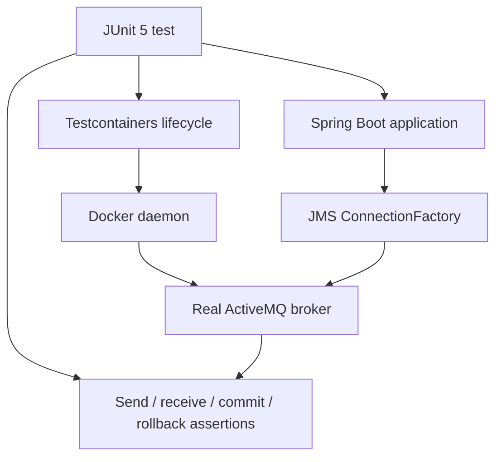

# Dựng broker thật bằng Testcontainers hoặc container theo vòng đời kiểm thử

> **Chương:** Kiểm thử  
> **Phạm vi:** Kiểm thử tích hợp Java/JMS với Apache ActiveMQ Artemis và ActiveMQ Classic bằng broker chạy thật trong Docker. Trọng tâm là **vòng đời container**, cấp phát endpoint động, chờ broker sẵn sàng, nối cấu hình Spring Boot vào container và dọn tài nguyên sau test. Các ví dụ dùng JUnit 5, Testcontainers và Spring Boot 3.x/Jakarta Messaging.

## 1. Vì sao integration test cần broker thật?

Unit test có thể mock `JmsTemplate` hoặc một interface publisher để xác nhận service gọi đúng phương thức. Nó không kiểm tra được:

- Broker có chấp nhận kết nối, xác thực user và protocol không?
- Queue có được tạo/resolve đúng không?
- Message persistent có được lưu và đọc lại không?
- Transaction JMS rollback có khiến message được redeliver không?
- Header, selector, delivery mode và provider-specific behavior có đúng với broker đang dùng không?
- Client có thực sự tương thích phiên bản Classic/Artemis trong môi trường triển khai không?

Một broker thật cho phép kiểm tra **giao thức và semantics giữa client với server**. Tuy nhiên, integration test không thay thế unit test: test nghiệp vụ thuần vẫn nên chạy nhanh với mock/fake ở ranh giới thích hợp.



**Nguyên tắc:** test phải sở hữu vòng đời broker mà nó phụ thuộc, hoặc có một hợp đồng rõ ràng với container bên ngoài. Không để test âm thầm dùng broker developer đang chạy ở `localhost:61616`; kết quả khi đó phụ thuộc trạng thái máy cá nhân.

## 2. Chọn cách quản lý container

| Cách | Vòng đời | Phù hợp khi | Rủi ro cần quản lý |
|---|---|---|---|
| **Testcontainers `@Container` static** | Một container cho cả test class; extension tự start/stop | Phần lớn integration test Spring/JUnit | Spring context cache có thể giữ ConnectionFactory trỏ tới container đã dừng |
| **Testcontainers `@Container` instance** | Một container cho mỗi test method | Test cần trạng thái broker hoàn toàn tách biệt | Khởi động chậm, tiêu thụ CPU/RAM |
| **`GenericContainer.start()/stop()` thủ công** | Test tự điều khiển thời điểm start/stop | Test không dùng Spring Test Context hoặc cần lifecycle đặc biệt | Phải bảo đảm cleanup kể cả khi assertion/test thất bại |
| **Docker Compose/container do CI quản lý** | Pipeline khởi động trước test và teardown sau test | Cần dựng nhiều service hoặc môi trường giống staging | Test không sở hữu container; phải chờ readiness và dọn tài nguyên rõ ràng |

Với một broker cho một lớp test, **static `@Container`** thường là lựa chọn gọn. Nếu test cần kiểm tra restart/persistence hoặc failover, thiết kế container và storage/network riêng cho bài kiểm tra đó; đừng coi lifecycle mặc định của `@Container` là môi trường HA.

### 2.1. Phân biệt vòng đời container và vòng đời broker

- **Container start:** Docker tạo và chạy container process.
- **Broker ready:** broker đã khởi tạo journal/store, acceptor và security policy; chỉ mở cổng TCP chưa chắc đã sẵn sàng.
- **JMS connection ready:** client thật tạo được connection/session với protocol và credential đúng.
- **Test complete:** assertion đã hoàn tất; Testcontainers mới dọn container theo lifecycle.

`Wait.forListeningPort()` chỉ kiểm tra cổng đã listen. **Phép kết nối JMS đầu tiên trong test mới xác nhận được broker và client giao tiếp thành công.** Nếu image có health check hoặc log readiness ổn định theo version, có thể thêm wait strategy tương ứng; tránh hard-code chuỗi log mà không khóa version image.

## 3. Chuẩn bị dependency cho Spring Boot 3.x và Testcontainers

Ví dụ Maven dùng dependency management của Spring Boot và Testcontainers BOM. Version Testcontainers được pin để test reproducible; dự án có thể nâng version đồng bộ theo chính sách dependency.

```xml
<dependencyManagement>
  <dependencies>
    <dependency>
      <groupId>org.testcontainers</groupId>
      <artifactId>testcontainers-bom</artifactId>
      <version>1.20.4</version>
      <type>pom</type>
      <scope>import</scope>
    </dependency>
  </dependencies>
</dependencyManagement>

<dependencies>
  <!-- Chọn provider mà ứng dụng thực sự sử dụng. -->
  <dependency>
    <groupId>org.springframework.boot</groupId>
    <artifactId>spring-boot-starter-artemis</artifactId>
  </dependency>

  <dependency>
    <groupId>org.springframework.boot</groupId>
    <artifactId>spring-boot-starter-test</artifactId>
    <scope>test</scope>
  </dependency>

  <dependency>
    <groupId>org.testcontainers</groupId>
    <artifactId>testcontainers</artifactId>
    <scope>test</scope>
  </dependency>

  <dependency>
    <groupId>org.testcontainers</groupId>
    <artifactId>junit-jupiter</artifactId>
    <scope>test</scope>
  </dependency>
</dependencies>
```

Với Gradle Kotlin DSL:

```kotlin
dependencies {
    testImplementation(platform("org.testcontainers:testcontainers-bom:1.20.4"))
    testImplementation("org.testcontainers:testcontainers")
    testImplementation("org.testcontainers:junit-jupiter")
    testImplementation("org.springframework.boot:spring-boot-starter-test")

    implementation("org.springframework.boot:spring-boot-starter-artemis")
}
```

**Chỉ chọn một provider cho test profile thông thường.** Nếu classpath đồng thời có Classic và Artemis starter, Spring Boot có thể có nhiều auto-configuration candidates; khi thật sự cần kiểm thử cả hai provider, tách test module/profile hoặc cấu hình từng `ConnectionFactory` tường minh. Spring Boot 3.x dùng `jakarta.jms`; không ghép client `javax.jms` cũ vào cùng ví dụ.

## 4. Dựng Artemis container với `GenericContainer`

Ví dụ sử dụng image Artemis có version cố định. Image tag là một phần của test fixture: khi nâng broker, hãy nâng có chủ đích và chạy lại integration suite.

### 4.1. Container lifecycle theo test class

```java
import java.time.Duration;
import java.util.UUID;

import jakarta.jms.Connection;
import jakarta.jms.ConnectionFactory;
import jakarta.jms.DeliveryMode;
import jakarta.jms.JMSConsumer;
import jakarta.jms.JMSContext;
import jakarta.jms.JMSProducer;
import jakarta.jms.Message;
import jakarta.jms.Queue;
import jakarta.jms.TextMessage;

import org.junit.jupiter.api.Test;
import org.springframework.boot.test.context.SpringBootTest;
import org.springframework.beans.factory.annotation.Autowired;
import org.springframework.test.context.DynamicPropertyRegistry;
import org.springframework.test.context.DynamicPropertySource;

import org.testcontainers.containers.GenericContainer;
import org.testcontainers.containers.wait.strategy.Wait;
import org.testcontainers.junit.jupiter.Container;
import org.testcontainers.junit.jupiter.Testcontainers;
import org.testcontainers.utility.DockerImageName;

import static org.junit.jupiter.api.Assertions.*;

@Testcontainers
@SpringBootTest
class ArtemisMessagingIT {

    private static final String USER = "it_user";
    private static final String PASSWORD = "it_password";

    @Container
    static final GenericContainer<?> artemis =
        new GenericContainer<>(
            DockerImageName.parse("apache/activemq-artemis:2.37.0"))
            .withEnv("ARTEMIS_USER", USER)
            .withEnv("ARTEMIS_PASSWORD", PASSWORD)
            .withEnv("ANONYMOUS_LOGIN", "false")
            .withExposedPorts(61616)
            .waitingFor(Wait.forListeningPort())
            .withStartupTimeout(Duration.ofMinutes(2));

    @DynamicPropertySource
    static void brokerProperties(DynamicPropertyRegistry registry) {
        registry.add("spring.artemis.mode", () -> "native");
        registry.add("spring.artemis.broker-url",
            () -> "tcp://" + artemis.getHost()
                + ":" + artemis.getMappedPort(61616));
        registry.add("spring.artemis.user", () -> USER);
        registry.add("spring.artemis.password", () -> PASSWORD);
    }

    @Autowired
    ConnectionFactory connectionFactory;

    // Test methods are added below.
}
```

**Giải thích lifecycle:**

- `@Testcontainers` đăng ký JUnit 5 extension để quản lý các field `@Container`.
- `static @Container` khởi động một broker trước test class và dừng sau class; mọi test trong class dùng chung container.
- `withExposedPorts(61616)` yêu cầu Docker publish cổng broker. Testcontainers ánh xạ sang **host port động**, không giả định host luôn là `61616`.
- `getHost()` và `getMappedPort(61616)` tạo endpoint mà JVM chạy test có thể truy cập, kể cả CI dùng Docker host từ xa.
- `@DynamicPropertySource` đưa URL/user/password vào Spring Environment **trước khi application context tạo ConnectionFactory**.
- `withStartupTimeout` giới hạn thời gian khởi động; nếu broker không mở cổng, test thất bại thay vì treo vô hạn.

Image Artemis chính thức thường dùng `ARTEMIS_USER` và `ARTEMIS_PASSWORD` để tạo thông tin đăng nhập; cần khóa image tag và kiểm tra hợp đồng biến môi trường của đúng image đang dùng. Nếu tổ chức dùng image nội bộ, thay phần image/env theo fixture đã được kiểm soát.

### 4.2. Vì sao không hard-code `localhost:61616`?

Docker thường ánh xạ cổng container 61616 sang một host port ngẫu nhiên để tránh xung đột:

```text
Container port: 61616
Host:           127.0.0.1
Mapped port:    32791 (ví dụ, không cố định)
Broker URL:     tcp://127.0.0.1:32791
```

Nếu cấu hình test vẫn trỏ `tcp://localhost:61616`, test có thể vô tình nối tới broker local khác, hoặc thất bại khi cổng đó không được publish. Dùng `getHost()`/`getMappedPort()` là cách lấy endpoint do Docker cấp.

**Không publish web console 8161 nếu test không cần.** Chỉ mở các cổng test thực sự sử dụng để giảm bề mặt truy cập.

### 4.3. Readiness phải kiểm tra đúng lớp

```java
// Thêm method này vào class ArtemisMessagingIT ở mục 4.1.
@Test
void canCreateRealJmsConnection() throws Exception {
    try (Connection connection = connectionFactory.createConnection()) {
        assertNotNull(connection);
        // Tạo connection thành công là smoke check của JMS protocol.
    }
}
```

Đây là **method bổ sung trong class `ArtemisMessagingIT` ở mục 4.1**; không tạo test class con thứ hai. Cùng một container và Spring context được dùng cho cả smoke test lẫn test message.

Một TCP port mở không chứng minh credential, protocol, broker security hoặc queue policy đã đúng. Nếu `createConnection()` thất bại, kiểm tra container logs, user/password, protocol acceptor và endpoint đã ánh xạ.

## 5. Kiểm thử send/receive và rollback trên broker thật

Một test có giá trị nên đi qua provider client thật, dùng destination riêng và xác nhận kết quả từ broker. Ví dụ sau sử dụng `jakarta.jms.JMSContext` với **một transacted session**.

### 5.1. Test message persistent và redelivery

```java
// Thêm method này vào class ArtemisMessagingIT ở mục 4.1.
@Test
void persistentMessageIsRedeliveredAfterRollback() throws Exception {
    String queueName = "it.orders."
        + UUID.randomUUID().toString().replace("-", "");
    String body = "order-42";

    try (JMSContext context =
             connectionFactory.createContext(
                 JMSContext.SESSION_TRANSACTED)) {

        Queue queue = context.createQueue(queueName);
        JMSProducer producer = context.createProducer()
            .setDeliveryMode(DeliveryMode.PERSISTENT);
        JMSConsumer consumer = context.createConsumer(queue);

        context.start();

        producer.send(queue, body);
        context.commit(); // Commit transaction gửi.

        Message first = consumer.receive(5_000L);
        assertNotNull(first, "Broker did not deliver the message");
        assertInstanceOf(TextMessage.class, first);
        assertEquals(body, ((TextMessage) first).getText());

        context.rollback(); // Không ACK delivery đầu tiên.

        Message redelivered = consumer.receive(5_000L);
        assertNotNull(redelivered, "Expected redelivery after rollback");
        assertTrue(redelivered.getJMSRedelivered());
        assertEquals(body, ((TextMessage) redelivered).getText());

        context.commit(); // Xác nhận delivery thứ hai.
    }
}
```

**Đọc test theo đúng thứ tự:**

1. Tạo queue name duy nhất để các test không đọc nhầm message của lần chạy trước.
2. Tạo JMS context ở chế độ `SESSION_TRANSACTED`.
3. Producer gửi message persistent rồi commit transaction gửi.
4. Consumer nhận message nhưng test gọi rollback, do đó delivery chưa được xác nhận.
5. Consumer nhận lại message; `JMSRedelivered` phải thể hiện đây là lần giao lại.
6. Commit lần nhận thứ hai để queue không còn message của test.

`createQueue()` tạo đối tượng destination phía client; việc **queue vật lý có được tạo tự động** hay không phụ thuộc policy của broker. Test fixture phải provision queue trước hoặc bật auto-create phù hợp trong cấu hình broker test. Không mặc định môi trường production cũng bật auto-create.

### 5.2. Một lưu ý về assertion redelivery

JMS định nghĩa cờ `JMSRedelivered` để báo delivery đã được giao trước đó nhưng chưa được xác nhận thành công. Nếu test chỉ kiểm tra body giống nhau mà không kiểm tra cờ này, nó chứng minh receive được message lần nữa nhưng chưa xác minh rõ semantics redelivery.

`JMSXDeliveryCount` có thể bổ sung bằng chứng về số lần giao theo provider/JMS version, nhưng không nên dựa vào nó nếu broker/client đang dùng không cung cấp đúng property đó. Hãy kiểm tra provider thực tế và giới hạn retry để tránh poison-message loop.

### 5.3. Test phải cô lập destination

Các cách cô lập:

- Queue name có prefix `it.` và suffix UUID cho từng test.
- Mỗi test class có broker riêng nếu trạng thái test ảnh hưởng lẫn nhau.
- Nếu dùng queue cố định, drain message và xác minh queue rỗng trước/sau test.
- Nếu auto-create queue, đặt giới hạn tài nguyên và có quy trình xóa queue test qua management API phù hợp; không purge queue nghiệp vụ.
- Dùng `runId`/`eventId` trong body/property để đối chiếu log khi test timeout.

Không dùng một queue dùng chung cho nhiều test chạy song song nếu không có cơ chế phân biệt message. Nếu làm vậy, test có thể nhận message của test khác và tạo false positive.

## 6. Biến thể cho ActiveMQ Classic

Classic và Artemis đều hỗ trợ JMS nhưng dùng client/protocol và cấu hình broker khác nhau. Testcontainers `GenericContainer` có thể chạy image Classic, sau đó đưa endpoint động vào Spring Boot.

### 6.1. Container Classic

```java
@Container
static final GenericContainer<?> classic =
    new GenericContainer<>(
        DockerImageName.parse("apache/activemq-classic:5.18.5"))
        .withExposedPorts(61616)
        .waitingFor(Wait.forListeningPort())
        .withStartupTimeout(Duration.ofMinutes(2));
```

Property Spring Boot cho Classic:

```java
@DynamicPropertySource
static void classicProperties(DynamicPropertyRegistry registry) {
    registry.add("spring.activemq.broker-url",
        () -> "tcp://" + classic.getHost()
            + ":" + classic.getMappedPort(61616));
    // Đăng ký user/password theo security fixture của image test.
}
```

Dependency ứng dụng dùng `spring-boot-starter-activemq` thay cho `spring-boot-starter-artemis`. Chọn client Classic **tương thích namespace Jakarta JMS của Spring Boot 3.x**; không đưa `javax.jms` client Classic cũ vào cùng context. Broker Classic 5.x có thể giao tiếp qua OpenWire với client phù hợp, nhưng cần kiểm thử version matrix thay vì chỉ dựa trên việc TCP port mở.

**Thông tin xác thực:** user mặc định và biến môi trường tạo user khác nhau tùy image tag/entrypoint. Không sao chép `admin/admin` hoặc tên biến môi trường từ một image sang image khác mà không kiểm tra cấu hình fixture. Tạo credential test riêng, quyền tối thiểu cần thiết và không dùng password production.

### 6.2. Khi nào tách test theo provider?

| Mục tiêu | Fixture nên dùng |
|---|---|
| Kiểm tra ứng dụng chạy trên Artemis | Artemis image + Artemis client + `spring.artemis.*` |
| Kiểm tra ứng dụng chạy trên Classic | Classic image + Classic-compatible client + `spring.activemq.*` |
| So sánh cùng một contract JMS trên cả hai | Hai test profile/CI job riêng, cùng test contract nhưng provider fixture khác |
| Kiểm tra Network of Brokers Classic | Nhiều Classic containers với connector config và network riêng |
| Kiểm tra Artemis HA/replication | Primary/backup containers, network, storage và fault injection đúng mô hình HA |

Không bật cả hai starter rồi để auto-configuration tự đoán broker nào cần kết nối. Nếu cần hai provider trong cùng JVM, khai báo `ConnectionFactory` và `JmsTemplate` có tên/qualifier rõ ràng; test riêng thường dễ chẩn đoán hơn.

## 7. Container theo vòng đời thủ công

Không phải mọi test đều cần `@Testcontainers`. Với test JUnit thuần, có thể tự start/stop `GenericContainer`:

```java
import java.time.Duration;

import org.junit.jupiter.api.AfterAll;
import org.junit.jupiter.api.BeforeAll;
import org.testcontainers.containers.GenericContainer;
import org.testcontainers.containers.wait.strategy.Wait;
import org.testcontainers.utility.DockerImageName;

class ManualArtemisLifecycleTest {

    private static GenericContainer<?> broker;

    @BeforeAll
    static void startBroker() {
        broker = new GenericContainer<>(
            DockerImageName.parse("apache/activemq-artemis:2.37.0"))
            .withEnv("ARTEMIS_USER", "it_user")
            .withEnv("ARTEMIS_PASSWORD", "it_password")
            .withEnv("ANONYMOUS_LOGIN", "false")
            .withExposedPorts(61616)
            .waitingFor(Wait.forListeningPort())
            .withStartupTimeout(Duration.ofMinutes(2));

        broker.start();
    }

    @AfterAll
    static void stopBroker() {
        if (broker != null) {
            broker.stop();
        }
    }

    // Tạo ConnectionFactory sau startBroker(), dùng getHost()
    // và getMappedPort(61616) để kết nối trong test.
}
```

`@BeforeAll`/`@AfterAll` giúp nhìn rõ lifecycle, nhưng test phải bảo đảm `stop()` được gọi ngay cả khi setup hoặc assertion lỗi. Testcontainers JUnit extension thường quản lý cleanup an toàn hơn; dùng manual lifecycle khi có lý do cụ thể.

**Không dùng pattern trên nguyên xi với `@SpringBootTest` nếu Spring context khởi tạo trước khi `@BeforeAll` chạy.** Spring cần broker endpoint khi nạp cấu hình; khi đó dùng static `@Container` kết hợp `@DynamicPropertySource`, hoặc tự quản lý thứ tự bootstrap context một cách tường minh.

### 7.1. Container cho mỗi test method

Nếu mỗi test phải bắt đầu từ một broker mới, khai báo `@Container` là **instance field**:

```java
@Testcontainers
class IsolatedBrokerTest {

    @Container
    GenericContainer<?> broker =
        new GenericContainer<>(
            DockerImageName.parse("apache/activemq-artemis:2.37.0"))
            .withEnv("ARTEMIS_USER", "it_user")
            .withEnv("ARTEMIS_PASSWORD", "it_password")
            .withExposedPorts(61616)
            .waitingFor(Wait.forListeningPort());

    @Test
    void testOne() {
        // Container mới cho test method này.
    }

    @Test
    void testTwo() {
        // Container khác; không chia sẻ broker state với testOne.
    }
}
```

Cách này tăng isolation nhưng tốn thời gian khởi động broker. Chỉ chọn khi state của test không thể dọn an toàn hoặc test đang cố ý xác minh bootstrap từ trạng thái trống.

## 8. Spring Test Context cache và container đã dừng

Spring TestContext có thể **cache ApplicationContext** để tái sử dụng giữa test classes có cấu hình tương đương. Testcontainers static container lại dừng khi test class kết thúc. Hai vòng đời không luôn trùng nhau:

```text
Test class A:
  Container A start
  Spring context A tạo ConnectionFactory trỏ hostPort A
  Test chạy
  Container A stop

Test class B:
  Spring có thể tái sử dụng context A
  ConnectionFactory vẫn trỏ hostPort A đã hết hiệu lực
  Test B thất bại khi connect
```

Có ba hướng xử lý:

1. **Một singleton container cho cả suite:** phù hợp khi các test dùng chung một broker fixture; tự quản lý lifecycle ở base test class và chỉ dừng sau toàn bộ suite.
2. **Context riêng cho mỗi test class:** dùng `@DirtiesContext(classMode = DirtiesContext.ClassMode.AFTER_CLASS)` khi cần đóng context sau class, tránh tái sử dụng ConnectionFactory trỏ container đã dừng.
3. **Tách profile/configuration:** khi provider, port hoặc broker topology khác nhau, để Spring tạo context riêng theo property/configuration khác biệt.

`@DirtiesContext` đóng Spring context, **không** tự xóa broker data hoặc thay thế Testcontainers cleanup. Ngược lại, Testcontainers dừng broker nhưng không tự làm mới mọi Spring bean đã cache.

Không bật Testcontainers reusable containers một cách mặc định trong CI. Reuse có thể giữ state giữa các lần chạy và làm test phụ thuộc dữ liệu cũ; nếu dùng cho local development, cần tách rõ khỏi test xác nhận tính cô lập.

## 9. Container networking, ports và broker topology

### 9.1. Host port và container port là hai khái niệm

Khi JVM test chạy trên host:

```java
String brokerUrl = "tcp://" + broker.getHost()
    + ":" + broker.getMappedPort(61616);
```

Khi một container ứng dụng kết nối broker **cùng Docker network**, không dùng host-mapped port. Tạo network và alias:

```java
import org.testcontainers.containers.Network;

static final Network network = Network.newNetwork();

static final GenericContainer<?> broker =
    new GenericContainer<>(
        DockerImageName.parse("apache/activemq-artemis:2.37.0"))
        .withNetwork(network)
        .withNetworkAliases("artemis")
        .withExposedPorts(61616);
```

Container khác trong cùng network có thể kết nối tới:

```text
tcp://artemis:61616
```

Đây là **địa chỉ nội bộ Docker network**, không phải endpoint cho JVM host. Nếu dùng `getMappedPort()` trong container khác, route có thể không như dự kiến. Cần quyết định rõ test client chạy trên host hay chạy trong container.

### 9.2. HA test cần nhiều container và fault model thật

Một broker container đủ cho send/receive, selector, transaction và redelivery. Nó **không đủ** để kiểm chứng:

- ActiveMQ Classic shared-store master/standby hoặc Network of Brokers.
- Artemis primary/backup shared-store hoặc replication.
- Client failover khi node active bị kill.
- Split-brain, quorum, storage outage và recovery RTO/RPO.

Những bài test đó cần nhiều broker containers, cấu hình connector/HA, network/storage riêng, health checks và fault injection có kiểm soát. Không gắn nhãn “HA test PASS” chỉ vì một broker container khởi động thành công.

## 10. Persistence và restart: dữ liệu container có được giữ không?

Container mặc định thường dùng filesystem layer riêng. Khi container bị xóa, dữ liệu trong writable layer cũng mất. Vì vậy, test container **không tự chứng minh persistence qua việc tạo container mới**.

Phân biệt:

- **Restart process trong cùng container:** dữ liệu trong data directory có thể còn, nếu broker shutdown/restart đúng cách.
- **Stop/start cùng container object:** cần kiểm tra hành vi Testcontainers/Docker và data path của image; không suy ra storage đã được giữ chỉ từ việc gọi `start()`.
- **Remove rồi tạo container mới:** cần volume/bind mount chứa đúng persistent data directory và broker config tương thích.
- **Backup/restore:** phải kiểm thử snapshot/backup được tạo theo quy trình thực tế, không thay bằng việc mount thư mục live đang ghi.

Nếu mục tiêu là durability, trước hết xác định **data directory thật của image/version**, mount named volume hoặc host directory vào đúng đường dẫn, rồi kiểm tra quyền sở hữu file và quy trình shutdown/recovery. Không mount một thư mục đoán mò; sai mount path có thể làm broker tiếp tục ghi vào filesystem tạm mà test vẫn tưởng dữ liệu đã bền vững.

### 10.1. Khi nào cần volume?

| Loại test | Volume có cần không? | Điều chứng minh |
|---|---|---|
| Send/receive trong một lần chạy | Thường không | Protocol và routing cơ bản |
| Commit/rollback/redelivery | Thường không | JMS transaction behavior của broker đang chạy |
| Restart broker process trong cùng container | Có thể không, nếu data directory còn nguyên | Recovery sau process restart |
| Recreate container và giữ message | **Có** | Persistence qua container replacement |
| Backup/restore hoặc node migration | **Có**, cùng quy trình snapshot/restore | Khả năng phục hồi storage thực tế |

Volume không biến một broker đơn lẻ thành HA. Nếu cần thử replication, phải có topology và storage riêng cho từng node theo HA policy.

## 11. Chạy test trong CI và xử lý lỗi khởi động

### 11.1. Điều kiện runner

CI runner phải có Docker daemon hoặc môi trường tương thích Testcontainers. Trước khi debug code, kiểm tra:

- Docker daemon đang chạy và user test có quyền truy cập.
- Runner có thể pull image registry và đúng architecture.
- Network/pull rate limit/proxy cho phép tải image.
- Cổng ngẫu nhiên được Docker publish có thể truy cập từ JVM test.
- RAM/CPU đủ để chạy broker và ứng dụng đồng thời.
- Container logs được lưu khi job fail.

Không bỏ qua toàn bộ integration test chỉ vì runner không có Docker trong pipeline release. Nếu test được định nghĩa là **bắt buộc**, pipeline phải cung cấp Docker; profile skip chỉ nên dùng cho tác vụ local có ghi nhận rõ.

### 11.2. Ví dụ pipeline theo trình tự

```yaml
steps:
  - name: Verify Docker
    run: docker info

  - name: Run unit and integration tests
    run: ./mvnw verify

  # Testcontainers tự dừng container do test tạo.
  # Giữ lại test reports và logs nếu bước verify thất bại.
```

Đây là **mảnh trình tự pipeline minh họa**, cú pháp `steps` và `run` phải được đặt trong cấu hình CI tương ứng (GitHub Actions, GitLab CI hoặc hệ thống nội bộ). Không chép thành một file YAML độc lập rồi kỳ vọng CI tự hiểu.

### 11.3. Ghi log container khi test thất bại

Testcontainers có thể cung cấp logs từ container để chẩn đoán. Ví dụ trong teardown hoặc failure hook:

```java
String brokerLogs = broker.getLogs();
System.err.println(brokerLogs);
```

Không in credentials hoặc dữ liệu message nhạy cảm vào CI log. Có thể dùng log consumer/CI artifact để lưu có kiểm soát; tránh log toàn bộ traffic production-like.

### 11.4. Bảng lỗi thường gặp

| Triệu chứng | Nguyên nhân thường gặp | Cách xử lý |
|---|---|---|
| Docker environment not found | Docker daemon/socket không sẵn sàng | Kiểm tra runner, quyền socket và Docker context |
| Image pull timeout | Registry/proxy/rate limit | Pin image, cache image hợp lệ hoặc cấu hình mirror |
| Container started nhưng JMS connect fail | Port listen trước khi broker ready, credential/protocol sai | JMS smoke test, readiness log/healthcheck và kiểm tra logs |
| `Connection refused` | Dùng sai host port hoặc broker chưa listen | Dùng `getHost()`/`getMappedPort()` và startup timeout |
| Spring app vẫn nối port cũ | Context cache hoặc property không được override | Kiểm tra `@DynamicPropertySource`, context lifecycle |
| Queue không tồn tại | Auto-create bị tắt hoặc destination chưa provision | Provision queue trong fixture hoặc bật policy test phù hợp |
| Test nhận message cũ | Queue state dùng chung giữa test | Destination riêng, cleanup và eventId |
| Test pass local nhưng fail CI | Docker network, architecture, resource hoặc timing | Thu container logs, tăng timeout hợp lý và bỏ hard-coded ports |
| Test chập chờn khi chạy song song | Cùng queue/credential/state hoặc broker thiếu tài nguyên | Queue riêng, giới hạn concurrency và tránh shared mutable fixture |
| Restart test mất message | Container data layer bị xóa hoặc volume sai path | Mount đúng persistent data directory và kiểm tra recovery |

## 12. Những gì nên kiểm tra ở từng tầng

| Tầng | Assertion phù hợp | Không nên suy ra |
|---|---|---|
| **Container lifecycle** | Container start, port mapping, stop/cleanup | Broker đã sẵn sàng nghiệp vụ |
| **Broker readiness** | JMS connection/session tạo thành công | Queue policy và consumer xử lý đúng |
| **JMS protocol** | Send/receive, header, selector, persistent delivery | Side effect DB đã commit |
| **Transaction** | Commit/rollback, redelivery, ACK behavior | Exactly-once business processing |
| **Application** | Handler result, database state, idempotency | Broker HA hoặc RPO=0 |
| **HA/DR** | Failover nhiều node, data reconciliation, RTO/RPO | Mọi failure domain đều được bảo vệ |

Test càng gần hệ thống thật thì càng có giá trị cho integration contract, nhưng cũng chậm và khó cô lập hơn. Hãy giữ một bộ test nhỏ, ổn định cho mỗi PR và một bộ HA/fault-injection sâu hơn theo lịch hoặc pipeline chuyên biệt.

## 13. Checklist trước khi merge

- [ ] Test sử dụng image broker **được pin version/digest**, không dùng `latest`.
- [ ] Testcontainers JUnit extension quản lý start/stop, hoặc manual lifecycle có cleanup trong mọi đường thoát.
- [ ] Broker endpoint dùng host và mapped port động, không chiếm cổng cố định trên máy.
- [ ] Wait strategy có timeout; test đầu tiên xác nhận kết nối JMS thực sự.
- [ ] User/password là credential test riêng, không dùng secret production.
- [ ] Spring properties được nạp qua `@DynamicPropertySource` trước khi context tạo ConnectionFactory.
- [ ] Test destination có tính cô lập; queue auto-create/provisioning được xác định.
- [ ] Có test send/receive và ít nhất một semantics quan trọng như transaction rollback/redelivery.
- [ ] Test container lifecycle không xung đột Spring context cache.
- [ ] Container logs và test reports có thể xem khi CI thất bại.
- [ ] Docker daemon và image registry sẵn sàng trong CI bắt buộc.
- [ ] Test durability/restart có volume đúng data path; không nhầm container ephemeral với persistent store.
- [ ] Test HA dùng topology nhiều node và fault injection riêng, không suy từ single-broker test.

## 14. Bài tập vận dụng

1. Vì sao `@Container static` phù hợp khi một test class có nhiều test method, và khi nào nên dùng instance `@Container`?
2. Một test dùng `tcp://localhost:61616` chạy local nhưng fail trên CI. Giải thích host port mapping và sửa bằng `getHost()`/`getMappedPort()`.
3. `Wait.forListeningPort()` đã PASS nhưng `ConnectionFactory.createConnection()` thất bại. Nêu các lớp readiness cần kiểm tra.
4. Spring context được cache từ test class A, nhưng Testcontainers đã dừng broker A. Vì sao test class B có thể vẫn dùng URL cũ? Đưa ra hai cách khắc phục.
5. Bạn cần kiểm thử persistent message qua container replacement. Vì sao volume phải mount đúng data directory và cấu hình broker tương thích?
6. Một test send/receive chạy trên Artemis nhưng ứng dụng production dùng Classic. Test đó chứng minh được điều gì và chưa chứng minh điều gì?
7. Vì sao queue name dùng chung khiến integration tests chạy song song nhận nhầm message?
8. Test transaction rollback nhận lại message và `JMSRedelivered=true`. Kết quả này chứng minh semantics nào? Có chứng minh exactly-once không?
9. Khi nào nên dùng broker container do CI/Docker Compose quản lý thay vì `@Container`?
10. Muốn kiểm thử Artemis primary/backup failover, cần bổ sung những container, network, storage và phép đo nào ngoài một broker đơn lẻ?

## 15. Tài liệu tham khảo

- [Testcontainers — JUnit 5 Quickstart](https://java.testcontainers.org/test_framework_integration/junit_5/): annotation `@Testcontainers`, `@Container` và lifecycle.
- [Testcontainers — Generic Container](https://java.testcontainers.org/features/creating_container/): `GenericContainer`, exposed ports, wait strategy và startup timeout.
- [Testcontainers — Networking](https://java.testcontainers.org/features/networking/): mapped ports, host access và container network aliases.
- [Testcontainers — Lifecycle and Singleton Containers](https://java.testcontainers.org/test_framework_integration/manual_lifecycle_control/): quản lý container theo class/suite và manual lifecycle.
- [Spring Framework — DynamicPropertySource](https://docs.spring.io/spring-framework/reference/testing/testcontext-framework/ctx-management/dynamic-property-sources.html): inject endpoint động vào Spring Test Context.
- [Spring Boot — Artemis](https://docs.spring.io/spring-boot/reference/messaging/jms.html): Artemis starter và thuộc tính kết nối.
- [ActiveMQ Classic — Docker](https://activemq.apache.org/components/classic/documentation/docker-image): image và cách cấu hình broker Classic.
- [ActiveMQ Artemis — Docker](https://artemis.apache.org/components/artemis/documentation/latest/docker.html): image, environment và cách chạy Artemis container.
- [Jakarta Messaging Specification](https://jakarta.ee/specifications/messaging/): JMS context, transaction, delivery mode và redelivery semantics.

**Ghi nhớ:** Integration test phải kiểm tra **broker thật và client thật**, nhưng kết quả chỉ đáng tin khi container được quản lý theo vòng đời rõ ràng, endpoint động được truyền đúng vào Spring, broker readiness được xác minh bằng kết nối JMS và queue state được cô lập. `@Container` giúp tự động start/stop; volume chỉ cần khi bài test kiểm tra persistence qua restart/recreate; HA cần nhiều broker và fault model riêng.
