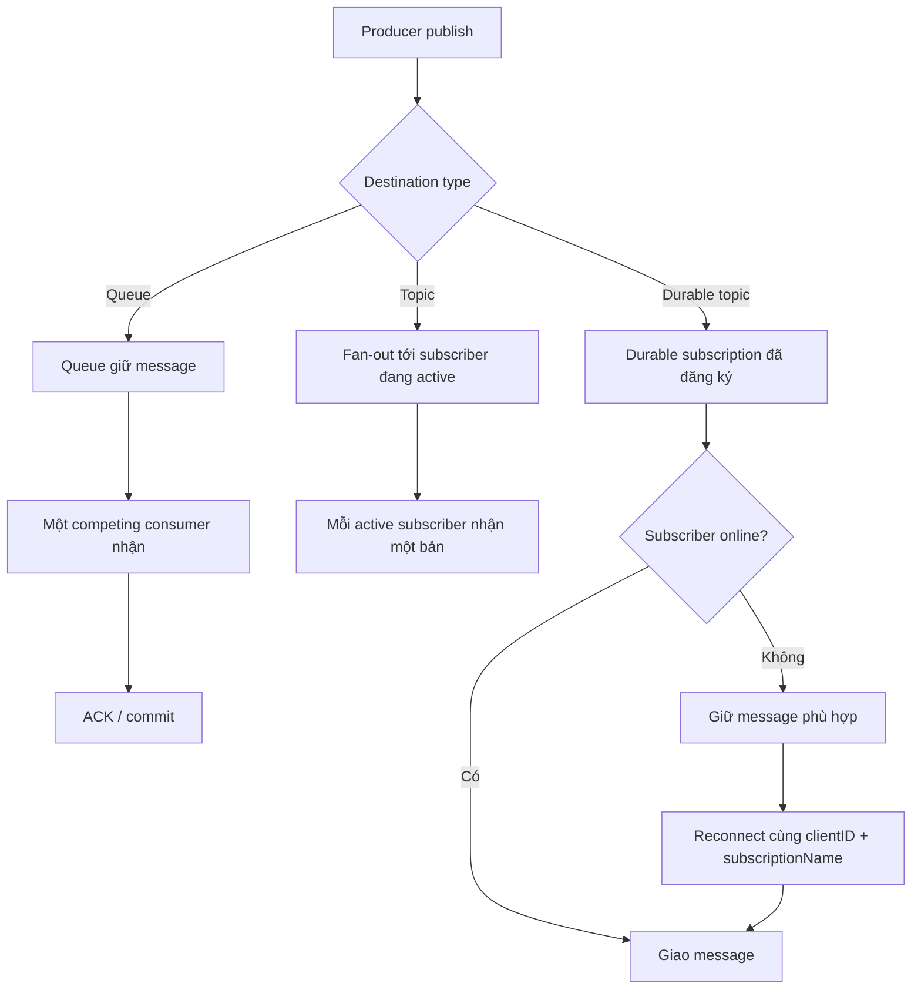

# Kiểm thử gửi nhận Queue, Topic và durable subscription

> **Chương:** Kiểm thử  
> **Phạm vi:** Kiểm thử tích hợp JMS với **ActiveMQ Classic** và **Artemis** cho ba hợp đồng nhận message: queue point-to-point, topic publish/subscribe và durable subscription. Trọng tâm là xác nhận **ai nhận message, message được giữ khi subscriber offline ra sao, ACK/rollback ảnh hưởng thế nào và test phải dọn tài nguyên gì**.

Một unit test gọi trực tiếp method `processOrder()` không chứng minh producer đã gửi tới đúng queue, topic subscriber có nhận bản sao, hay durable subscriber có lấy được message phát trong lúc offline. Những hành vi này phụ thuộc JMS provider và broker đang chạy; cần **integration test với broker thật** để xác nhận routing, delivery và subscription lifecycle.

Ba hợp đồng cần kiểm chứng:

| Kiểu đích | Hợp đồng nhận | Khi consumer/subscriber không hoạt động | Điều test phải chứng minh |
|---|---|---|---|
| **Queue** | Một message được phân phối cho một consumer trong nhóm competing consumers. | Message chờ trong queue theo retention/delivery mode và broker policy. | Gửi → nhận đúng payload; không giả định mọi consumer nhận cùng message. |
| **Topic non-durable** | Mỗi subscriber đang hoạt động tại thời điểm publish nhận một bản. | Subscriber không hoạt động thường bỏ lỡ message. | Tạo subscriber trước khi publish; xác nhận các subscriber đang active đều nhận. |
| **Durable topic subscription** | Một subscription có định danh bền vững nhận các message phù hợp. | Broker giữ message phù hợp khi durable subscriber offline, theo persistence/retention policy. | Tạo subscription → đóng consumer/connection → publish persistent message → kết nối lại bằng cùng client ID và subscription name → nhận được message. |

**Không dùng một test duy nhất để chứng minh cả ba hợp đồng.** Queue, topic và durable subscription có routing/lifecycle khác nhau; test phải tạo đúng loại consumer và đặt nó ở đúng thời điểm so với publish.

## 1. Mô hình vòng đời cần kiểm thử



Một queue thường có ít nhất hai tập trạng thái cần quan sát riêng:

1. **Pending messages:** broker giữ message nhưng chưa giao thành công cho consumer.
2. **Delivering messages:** broker đã dispatch, đang đợi consumer xác nhận. Message vẫn có thể redeliver nếu session rollback, consumer chết hoặc connection mất trước khi ACK được ghi nhận.

Do đó:

\[
\text{Outstanding} \approx \text{Pending} + \text{Delivering}
\]

Đây là phép cộng **chỉ dùng khi hai metric là hai tập không giao nhau**. Một số giao diện/adapter có thể báo queue size đã bao gồm một phần trạng thái khác; phải đọc semantics của attribute ở phiên bản broker trước khi cộng. Không cộng máy móc `QueueSize + InFlightCount` nếu `QueueSize` của exporter đã tính in-flight.

### 1.1. Các điểm thời gian quan trọng

Với topic non-durable, subscriber phải được tạo **trước khi producer publish**. Nếu publish trước rồi mới tạo subscriber, message cũ không phải backlog mà subscriber mới có quyền nhận.

Với durable subscription, thứ tự ngược lại là chủ đích:

1. Tạo durable subscription bằng `clientID` và `subscriptionName` cố định.
2. Đóng consumer và connection/context để subscription chuyển sang trạng thái offline.
3. Producer gửi **persistent messages** tới topic.
4. Tạo connection/context mới với **cùng `clientID`**, mở lại **cùng subscription name**.
5. Nhận các message được giữ lại, xác nhận và unsubscribe khi test kết thúc.

Nếu test chỉ tạo durable consumer rồi publish trong khi nó đang online, test đó **chưa chứng minh khả năng lưu message khi subscriber offline**.

### 1.2. Queue không phải topic có một subscriber

Một queue có thể có nhiều consumers cạnh tranh. Một message được giao cho một consumer tại một thời điểm; khi rollback hoặc mất connection trước ACK, message có thể được giao lại. Topic multicast có thể tạo một bản giao cho **mỗi subscription**. Durable subscription là một subscription topic có identity và trạng thái giữ message khi offline.

Khi test queue, không assert consumer A và consumer B đều nhận cùng một message. Khi test topic fan-out, phải tạo cả A và B trước lúc publish rồi assert **cả hai** nhận được bản tương ứng.

## 2. Chuẩn bị integration-test broker riêng

Các ví dụ chính dùng **Java 17, Jakarta JMS 3.x, JUnit 5 và Artemis 2.38.0**. Broker phải được khởi động riêng trong CI hoặc local test profile, không dùng broker production. Ví dụ dùng `tcp://127.0.0.1:61616`; thay bằng endpoint của môi trường kiểm thử.

### 2.1. Maven dependencies

```xml
<project xmlns="http://maven.apache.org/POM/4.0.0"
         xmlns:xsi="http://www.w3.org/2001/XMLSchema-instance"
         xsi:schemaLocation="http://maven.apache.org/POM/4.0.0
                             https://maven.apache.org/xsd/maven-4.0.0.xsd">
    <modelVersion>4.0.0</modelVersion>
    <groupId>lab.activemq</groupId>
    <artifactId>queue-topic-integration-tests</artifactId>
    <version>1.0-SNAPSHOT</version>

    <properties>
        <maven.compiler.release>17</maven.compiler.release>
        <project.build.sourceEncoding>UTF-8</project.build.sourceEncoding>
        <junit.version>5.10.5</junit.version>
    </properties>

    <dependencies>
        <dependency>
            <groupId>org.apache.activemq</groupId>
            <artifactId>artemis-jakarta-client</artifactId>
            <version>2.38.0</version>
            <scope>test</scope>
        </dependency>
        <dependency>
            <groupId>org.junit.jupiter</groupId>
            <artifactId>junit-jupiter</artifactId>
            <version>${junit.version}</version>
            <scope>test</scope>
        </dependency>
    </dependencies>

    <build>
        <plugins>
            <plugin>
                <groupId>org.apache.maven.plugins</groupId>
                <artifactId>maven-compiler-plugin</artifactId>
                <version>3.13.0</version>
            </plugin>
            <plugin>
                <groupId>org.apache.maven.plugins</groupId>
                <artifactId>maven-surefire-plugin</artifactId>
                <version>3.2.5</version>
            </plugin>
        </plugins>
    </build>
</project>
```

Đây là project test độc lập, không phải dependency list cần thêm nguyên xi vào ứng dụng Spring Boot. Nếu ứng dụng đang dùng Spring Boot, ưu tiên BOM của Boot để quản lý JUnit/Artemis client tương thích thay vì ghim nhiều version trùng nhau.

### 2.2. Cấu hình broker cho destination test

Với Artemis, đặt policy dưới `address-settings` trong `broker.xml` của **broker test**:

```xml
<address-setting match="it.#">
    <auto-create-addresses>true</auto-create-addresses>
    <auto-create-queues>true</auto-create-queues>
</address-setting>
```

Snippet cho phép test tạo destination động có prefix `it.`; đây là tiện ích cho **môi trường cô lập**. Production nên provision destinations bằng cấu hình/administration có kiểm soát, không bật auto-create rộng chỉ để test dễ chạy. Khi dùng Classic, dynamic destination có thể được tạo khi client truy cập tùy broker policy; vẫn phải kiểm tra quyền và cleanup.

### 2.3. Biến môi trường

```text
ARTEMIS_URL=tcp://127.0.0.1:61616
ARTEMIS_USER=integration-test
ARTEMIS_PASSWORD=<secret-from-test-environment>
```

Tạo tài khoản chỉ có quyền cần thiết cho namespace `it.#`; không nhúng mật khẩu vào source hoặc log. Nếu broker cho anonymous access trong lab, user/password có thể để trống theo cấu hình provider. Test phải **đợi broker sẵn sàng** trước khi khởi tạo test class; TCP port mở chưa đủ chứng minh address/queue policy và authentication đã hoạt động.

## 3. Fixture kết nối JMS cho Artemis

Dùng một factory cho cả test class, nhưng mỗi test tạo context riêng để cô lập session/consumer. `JMSContext` là API JMS 2.0/Jakarta JMS; nó không tương thích kiểu Java với client Classic cũ triển khai `javax.jms`.

```java
package lab.activemq;

import jakarta.jms.ConnectionFactory;
import jakarta.jms.JMSContext;
import org.apache.activemq.artemis.jms.client.ActiveMQConnectionFactory;

final class JmsTestSupport {
    private static final String DEFAULT_URL =
            "tcp://127.0.0.1:61616";

    private static final ConnectionFactory CONNECTION_FACTORY =
            new ActiveMQConnectionFactory(
                    System.getenv().getOrDefault(
                            "ARTEMIS_URL", DEFAULT_URL));

    private JmsTestSupport() {}

    static JMSContext context(int sessionMode) {
        String user = System.getenv("ARTEMIS_USER");
        String password = System.getenv("ARTEMIS_PASSWORD");
        return CONNECTION_FACTORY.createContext(
                user, password, sessionMode);
    }
}
```

`ConnectionFactory` giữ vai trò provider entry point. `JMSContext` phải được đóng sau mỗi test; không chia sẻ một context/session giữa các test chạy song song vì JMS session không thread-safe. Test suite nên dùng queue/topic names có prefix riêng và không đọc/xóa destination ngoài namespace test.

## 4. Kiểm thử Queue: gửi một lần, nhận một lần

Với bài test point-to-point, dùng `TemporaryQueue` để test tự dọn destination khi connection tạo nó đóng. Test xác nhận:

- Consumer được tạo trên queue.
- Producer gửi payload.
- Consumer nhận đúng message.
- Sau khi message đã ACK theo `AUTO_ACKNOWLEDGE`, consumer không nhận lại cùng message.

```java
package lab.activemq;

import static org.junit.jupiter.api.Assertions.assertEquals;
import static org.junit.jupiter.api.Assertions.assertNotNull;
import static org.junit.jupiter.api.Assertions.assertNull;

import jakarta.jms.DeliveryMode;
import jakarta.jms.JMSConsumer;
import jakarta.jms.JMSContext;
import jakarta.jms.Message;
import jakarta.jms.TemporaryQueue;
import jakarta.jms.TextMessage;
import org.junit.jupiter.api.Test;

class QueueTopicIntegrationTest {
    @Test
    void queueDeliversMessageToConsumer() throws Exception {
        try (JMSContext context =
                     JmsTestSupport.context(JMSContext.AUTO_ACKNOWLEDGE)) {
            TemporaryQueue queue = context.createTemporaryQueue();
            try (JMSConsumer consumer = context.createConsumer(queue)) {
                context.createProducer()
                        .setDeliveryMode(DeliveryMode.NON_PERSISTENT)
                        .send(queue, "ORDER|Q-101");

                Message received = consumer.receive(3_000);
                assertNotNull(received, "Queue không giao message");
                assertEquals("ORDER|Q-101",
                        ((TextMessage) received).getText());

                assertNull(consumer.receive(250),
                        "Message đã ACK không được giao lại");
            }
        }
    }
}
```

Đoạn trên là test cơ bản; có thể đặt trong class integration test dùng JUnit 5. `TemporaryQueue` phù hợp để cô lập routing, không chứng minh persistence qua broker restart. Nếu cần kiểm thử **persistent queue** hoặc khôi phục sau restart, phải dùng named durable queue được provision riêng, gửi `PERSISTENT`, dừng/khởi động broker test theo kịch bản và kiểm tra lại message state.

### 4.1. Test nhiều competing consumers

Với queue có hai consumers, test đúng nên assert **tổng tập message nhận được không mất/không trùng**; không assert mỗi consumer phải nhận đúng một nửa vì prefetch/dispatch policy có thể phân phối không đều.

Một cách kiểm thử ổn định là gửi N messages có ID duy nhất, nhận tổng N messages qua hai consumers, gom ID vào set và assert:

- Số ID duy nhất bằng N.
- Mọi ID mong đợi đều xuất hiện.
- Không có ID ngoài tập đã gửi.

Nếu muốn kiểm thử fairness, đó là một test riêng cần kiểm soát prefetch, consumer lifetime, số lượng message và policy provider. Không biến phân phối đều thành một giả định portable của JMS.

## 5. Kiểm thử Topic: fan-out tới các subscriber đang hoạt động

Tạo cả hai subscribers trước khi publish. Dùng `TemporaryTopic` để broker tự dọn topic tạm khi context đóng:

```java
import static org.junit.jupiter.api.Assertions.assertEquals;
import static org.junit.jupiter.api.Assertions.assertNotNull;

import jakarta.jms.JMSConsumer;
import jakarta.jms.JMSContext;
import jakarta.jms.TemporaryTopic;
import jakarta.jms.TextMessage;
import org.junit.jupiter.api.Test;

class TopicFanOutIntegrationTest {
    @Test
    void activeSubscribersEachReceivePublishedMessage()
            throws Exception {
        try (JMSContext context =
                     JmsTestSupport.context(JMSContext.AUTO_ACKNOWLEDGE)) {
            TemporaryTopic topic = context.createTemporaryTopic();

            try (JMSConsumer billing = context.createConsumer(topic);
                 JMSConsumer analytics = context.createConsumer(topic)) {
                context.createProducer().send(topic, "PAYMENT|P-501");

                TextMessage billingCopy =
                        (TextMessage) billing.receive(3_000);
                TextMessage analyticsCopy =
                        (TextMessage) analytics.receive(3_000);

                assertNotNull(billingCopy,
                        "Billing subscriber không nhận bản tin");
                assertNotNull(analyticsCopy,
                        "Analytics subscriber không nhận bản tin");
                assertEquals("PAYMENT|P-501", billingCopy.getText());
                assertEquals("PAYMENT|P-501", analyticsCopy.getText());
            }
        }
    }
}
```

Hai consumers ở đây là hai topic subscribers khác nhau, vì vậy cả hai nhận cùng payload. Nếu chuyển destination sang queue, test này sẽ không còn đúng: queue phân phối message giữa consumers chứ không fan-out cho mỗi consumer.

### 5.1. Kiểm thử subscriber offline của topic non-durable

Topic non-durable không giữ backlog cho một subscriber chưa tồn tại/đang offline. Test đối chứng phải dùng **named topic** (đã provision hoặc auto-create trong broker test), vì `TemporaryTopic` sẽ bị xóa khi connection sở hữu nó đóng:

1. Tạo named topic và consumer non-durable, sau đó đóng consumer/context.
2. Dùng publisher context khác gửi một event khi không còn subscriber active.
3. Tạo consumer non-durable mới trên **cùng named topic**.
4. Xác nhận consumer mới không nhận event cũ trong timeout hữu hạn.

Đây là hành vi mong đợi của non-durable subscription. Đừng dùng test này để kết luận broker mất message; producer đã publish tới topic mà không có durable subscription cần giữ message cho subscriber offline.

## 6. Kiểm thử durable subscription: publish trong lúc subscriber offline

Đây là test quan trọng nhất của bài. Nó phải đóng hoàn toàn context đã đăng ký subscription trước khi publish. Tạo `clientID` và `subscriptionName` duy nhất cho mỗi lần chạy để không đụng subscription còn sót từ test trước.

```java
package lab.activemq;

import static org.junit.jupiter.api.Assertions.assertEquals;
import static org.junit.jupiter.api.Assertions.assertNotNull;
import static org.junit.jupiter.api.Assertions.assertNull;

import jakarta.jms.DeliveryMode;
import jakarta.jms.JMSConsumer;
import jakarta.jms.JMSContext;
import jakarta.jms.Message;
import jakarta.jms.TextMessage;
import jakarta.jms.Topic;
import java.util.UUID;
import org.junit.jupiter.api.Test;

class DurableSubscriptionIntegrationTest {
    @Test
    void durableSubscriptionReceivesMessagePublishedWhileOffline()
            throws Exception {
        String topicName = "it.durable." + UUID.randomUUID();
        String clientId = "it-client-" + UUID.randomUUID();
        String subscriptionName = "orders-subscription";

        // Phase 1: đăng ký durable subscription rồi ngắt subscriber.
        try (JMSContext registration =
                     JmsTestSupport.context(JMSContext.AUTO_ACKNOWLEDGE)) {
            registration.setClientID(clientId);
            Topic topic = registration.createTopic(topicName);
            try (JMSConsumer ignored =
                         registration.createDurableConsumer(
                                 topic, subscriptionName)) {
                // Tạo subscription. Chưa publish khi consumer còn online.
            }
        }

        // Phase 2: subscriber offline; producer gửi persistent message.
        try (JMSContext publisher =
                     JmsTestSupport.context(JMSContext.AUTO_ACKNOWLEDGE)) {
            Topic topic = publisher.createTopic(topicName);
            publisher.createProducer()
                    .setDeliveryMode(DeliveryMode.PERSISTENT)
                    .send(topic, "OFFLINE-EVENT|D-101");
        }

        // Phase 3: reconnect bằng đúng clientID + subscription name.
        try (JMSContext resumed =
                     JmsTestSupport.context(JMSContext.AUTO_ACKNOWLEDGE)) {
            resumed.setClientID(clientId);
            Topic topic = resumed.createTopic(topicName);
            try {
                try (JMSConsumer durable =
                             resumed.createDurableConsumer(
                                     topic, subscriptionName)) {
                    Message received = durable.receive(5_000);
                    assertNotNull(received,
                            "Durable subscription không giữ message offline");
                    assertEquals("OFFLINE-EVENT|D-101",
                            ((TextMessage) received).getText());
                    assertNull(durable.receive(250),
                            "Message đã ACK không được giao lại");
                }
            } finally {
                // Unsubscribe sau khi consumer đã đóng.
                resumed.unsubscribe(subscriptionName);
            }
        }
    }
}
```

**Điều kiện để test có ý nghĩa:**

- `setClientID()` phải gọi trước khi tạo consumer hoặc dùng các API khác của context cho connection đó.
- Giai đoạn đăng ký và giai đoạn reconnect phải dùng **cùng client ID** và **cùng subscription name**.
- Producer gửi khi subscriber đã offline và dùng `DeliveryMode.PERSISTENT`.
- Không gọi `unsubscribe()` ở giai đoạn đầu; unsubscribe sẽ xóa subscription và message backlog của nó.
- Sau khi nhận xong, đóng consumer rồi unsubscribe để không để lại durable subscription trong broker test.

`createTopic()` chỉ tạo đối tượng destination phía client; việc tạo address/queue ở broker phụ thuộc auto-create policy hoặc provisioning. Nếu test timeout, xác minh broker có address và durable subscription queue trước khi kết luận lỗi nằm ở JMS client.

### 6.1. Durable subscription với selector

Một durable subscription có thể chỉ giữ các message phù hợp với JMS selector. Selector xét **message properties/headers**, không tự parse JSON body:

```java
String selector = "eventType = 'ORDER'";
JMSConsumer durable = context.createDurableConsumer(
        topic, subscriptionName, selector, false);
```

Producer phải tạo message rồi gắn property trước khi gửi:

```java
jakarta.jms.TextMessage order =
        context.createTextMessage("ORDER|D-102");
order.setStringProperty("eventType", "ORDER");
context.createProducer().send(topic, order);
```

Trong test selector, publish hai persistent messages khi subscriber offline:

| Body | Property | Kỳ vọng khi reconnect |
|---|---|---|
| `ORDER|D-102` | `eventType=ORDER` | Được giữ và giao. |
| `INVOICE|D-103` | `eventType=INVOICE` | Không thuộc subscription selector. |

Phải dùng **cùng selector** khi tạo lại durable subscription; thay selector trên một subscription đã tồn tại thường không được phép nếu selector definition khác. Muốn test selector mới, tạo `clientID`/subscription identity mới hoặc unsubscribe subscription cũ trước.

### 6.2. Durable subscription không đồng nghĩa mọi message đều được giữ

Message có thể không xuất hiện khi reconnect nếu:

- Producer gửi non-persistent message trong khi durable subscriber offline.
- Message hết TTL trước khi subscriber quay lại.
- Subscription đã bị unsubscribe hoặc broker xóa theo policy.
- Broker bị purge/retention giới hạn hoặc hết tài nguyên theo cấu hình.
- Selector không match message properties.
- Test vô tình dùng client ID hoặc subscription name khác.

## 7. Kiểm thử transaction và redelivery trên Queue

Queue test cũng cần chứng minh message chưa ACK có thể được giao lại sau rollback. Dùng `SESSION_TRANSACTED` để điều khiển ranh giới commit/rollback:

```java
import static org.junit.jupiter.api.Assertions.assertEquals;
import static org.junit.jupiter.api.Assertions.assertNotNull;
import static org.junit.jupiter.api.Assertions.assertTrue;

import jakarta.jms.JMSConsumer;
import jakarta.jms.JMSContext;
import jakarta.jms.Message;
import jakarta.jms.TemporaryQueue;
import jakarta.jms.TextMessage;
import org.junit.jupiter.api.Test;

class QueueTransactionIntegrationTest {
    @Test
    void rollbackMakesUnacknowledgedMessageAvailableAgain()
            throws Exception {
        try (JMSContext context =
                     JmsTestSupport.context(JMSContext.SESSION_TRANSACTED)) {
            TemporaryQueue queue = context.createTemporaryQueue();
            try (JMSConsumer consumer = context.createConsumer(queue)) {
                context.createProducer().send(queue, "TX|Q-201");
                context.commit(); // Commit thao tác send trước khi receive.

                Message first = consumer.receive(3_000);
                assertNotNull(first);
                assertEquals("TX|Q-201",
                        ((TextMessage) first).getText());

                context.rollback(); // Delivery đầu chưa được commit.

                Message redelivered = consumer.receive(3_000);
                assertNotNull(redelivered,
                        "Message phải khả dụng lại sau rollback");
                assertEquals("TX|Q-201",
                        ((TextMessage) redelivered).getText());
                assertTrue(redelivered.getJMSRedelivered(),
                        "Provider phải đánh dấu delivery lại");

                context.commit(); // Xác nhận lần nhận thứ hai.
            }
        }
    }
}
```

Đây là kiểm thử **JMS local transaction**, không chứng minh database transaction được commit cùng JMS. `JMSRedelivered` là cờ cho biết provider đánh dấu message đã được giao trước đó; nếu test dùng client/provider khác, kiểm tra semantics/phiên bản cụ thể. Với poison message và DLQ, thêm test riêng cho broker policy, vì test rollback một lần chưa chứng minh max delivery attempts.

### 7.1. Kiểm thử ACK mode khác nhau

Không dùng một assertion chung cho mọi acknowledgement mode:

| Mode | Khi nào xác nhận? | Test nên kiểm tra |
|---|---|---|
| `AUTO_ACKNOWLEDGE` | Provider tự ACK theo semantics của synchronous receive/asynchronous listener sau khi callback/receive thành công. | Message không còn giao lại sau successful receive. |
| `CLIENT_ACKNOWLEDGE` | Client gọi `message.acknowledge()`; với JMS Session, ACK có thể xác nhận các messages đã nhận trong session. | Đóng session/connection trước ACK để quan sát redelivery; sau ACK không giao lại. |
| `SESSION_TRANSACTED` | `commit()` xác nhận send/receive trong transaction; `rollback()` hủy transaction và có thể redeliver receive. | Cố ý rollback, nhận lại, sau đó commit. |

Nếu kiểm thử `CLIENT_ACKNOWLEDGE`, đừng giả định ACK chỉ tác động đúng một message khi nhiều messages đã được nhận trong cùng session. Muốn xác minh semantics, tạo session/consumer riêng và gửi từng message có ID riêng.

## 8. Tương thích ActiveMQ Classic: `javax.jms` và durable subscriber JMS 1.1

Ví dụ chính dùng Artemis Jakarta JMS 2.0 (`jakarta.jms.JMSContext`). Các phiên bản ActiveMQ Classic 5.x thường gặp trong hệ thống cũ dùng **`javax.jms` và JMS 1.1**, vì vậy không thể import class `JMSContext` từ ví dụ Artemis rồi thay `ConnectionFactory` Classic vào.

Với Classic JMS 1.1, durable subscription được tạo bằng `Connection.setClientID()` và `Session.createDurableSubscriber()`:

```java
import javax.jms.Connection;
import javax.jms.DeliveryMode;
import javax.jms.JMSException;
import javax.jms.Message;
import javax.jms.MessageConsumer;
import javax.jms.MessageProducer;
import javax.jms.Session;
import javax.jms.TextMessage;
import javax.jms.Topic;
import org.apache.activemq.ActiveMQConnectionFactory;

public final class ClassicDurableSubscriptionProbe {
    private ClassicDurableSubscriptionProbe() {}

    public static void main(String[] args) throws JMSException {
        String brokerUrl = "tcp://127.0.0.1:61616";
        String clientId = "classic-it-client-101";
        String subscriptionName = "orders-durable";
        String topicName = "it.classic.orders";

        ActiveMQConnectionFactory factory =
                new ActiveMQConnectionFactory(brokerUrl);

        // 1. Đăng ký durable subscription, sau đó đóng connection.
        Connection registration = factory.createConnection();
        try {
            registration.setClientID(clientId);
            Session session = registration.createSession(
                    false, Session.AUTO_ACKNOWLEDGE);
            try {
                Topic topic = session.createTopic(topicName);
                MessageConsumer durable =
                        session.createDurableSubscriber(
                                topic, subscriptionName);
                durable.close(); // Giữ subscription, đóng consumer.
            } finally {
                session.close();
            }
        } finally {
            registration.close();
        }

        // 2. Publish khi durable subscriber offline.
        Connection publisherConnection = factory.createConnection();
        try {
            Session publisherSession = publisherConnection.createSession(
                    false, Session.AUTO_ACKNOWLEDGE);
            try {
                Topic topic = publisherSession.createTopic(topicName);
                MessageProducer producer =
                        publisherSession.createProducer(topic);
                try {
                    producer.setDeliveryMode(DeliveryMode.PERSISTENT);
                    TextMessage message =
                            publisherSession.createTextMessage(
                                    "OFFLINE|CLASSIC-101");
                    producer.send(message);
                } finally {
                    producer.close();
                }
            } finally {
                publisherSession.close();
            }
        } finally {
            publisherConnection.close();
        }

        // 3. Reconnect với cùng clientID và subscriptionName.
        Connection resumed = factory.createConnection();
        try {
            resumed.setClientID(clientId);
            Session session = resumed.createSession(
                    false, Session.AUTO_ACKNOWLEDGE);
            try {
                Topic topic = session.createTopic(topicName);
                MessageConsumer durable =
                        session.createDurableSubscriber(
                                topic, subscriptionName);
                try {
                    resumed.start();
                    Message received = durable.receive(5_000);
                    if (received == null) {
                        throw new AssertionError(
                                "Không nhận được persistent offline message");
                    }
                    String body = ((TextMessage) received).getText();
                    if (!"OFFLINE|CLASSIC-101".equals(body)) {
                        throw new AssertionError("Payload không đúng: " + body);
                    }
                } finally {
                    durable.close();
                    session.unsubscribe(subscriptionName);
                }
            } finally {
                session.close();
            }
        } finally {
            resumed.close();
        }
    }
}
```

Ví dụ dùng API Classic `javax.jms` và chủ ý gọi `start()` trước khi nhận message. `setClientID()` phải được gọi trước khi tạo session/consumer trên connection đó. Trong code production/test framework, nên dùng `try/finally` hoặc helper đóng resource theo thứ tự consumer → session → connection; không giả định các đối tượng JMS 1.1 đều hỗ trợ `AutoCloseable`.

**Chạy Classic test trong project/profile riêng** với `org.apache.activemq:activemq-client` tương thích broker. Không đưa đồng thời `javax.jms` Classic 5.x và `jakarta.jms` Artemis client vào một test source set rồi ép kiểu qua lại. Dùng cùng test cases ở mức ý nghĩa, nhưng compile từng suite với namespace tương ứng.

Dependency tối thiểu cho project Classic JMS 1.1 riêng:

```xml
<dependency>
    <groupId>org.apache.activemq</groupId>
    <artifactId>activemq-client</artifactId>
    <version>5.18.4</version>
    <scope>test</scope>
</dependency>
```

Version này là ví dụ cho nhánh Classic 5.x dùng `javax.jms`; khi chạy với broker/client khác, chọn đúng release đã được kiểm tra tương thích và cập nhật security fixes.

## 9. Kiểm thử non-durable topic khi không có subscriber

Để tránh dùng nhầm `TemporaryTopic` sau khi connection chủ sở hữu đã đóng, test này tạo **named topic** có tên riêng:

```java
import static org.junit.jupiter.api.Assertions.assertNull;

import jakarta.jms.JMSConsumer;
import jakarta.jms.JMSContext;
import jakarta.jms.Topic;
import java.util.UUID;
import org.junit.jupiter.api.Test;

class NonDurableTopicOfflineIntegrationTest {
    @Test
    void nonDurableSubscriberDoesNotReceiveOfflinePublication()
            throws Exception {
        String topicName = "it.nondurable." + UUID.randomUUID();

        // Tạo address/topic trong broker test rồi đóng subscriber.
        try (JMSContext initial =
                     JmsTestSupport.context(JMSContext.AUTO_ACKNOWLEDGE)) {
            Topic topic = initial.createTopic(topicName);
            try (JMSConsumer ignored = initial.createConsumer(topic)) {
                // Consumer active để provider tạo subscription tạm.
            }
        }

        // Publish sau khi không còn subscriber active.
        try (JMSContext publisher =
                     JmsTestSupport.context(JMSContext.AUTO_ACKNOWLEDGE)) {
            Topic topic = publisher.createTopic(topicName);
            publisher.createProducer().send(topic, "MISSED|N-101");
        }

        // Subscriber mới không có backlog của non-durable subscription cũ.
        try (JMSContext later =
                     JmsTestSupport.context(JMSContext.AUTO_ACKNOWLEDGE)) {
            Topic topic = later.createTopic(topicName);
            try (JMSConsumer consumer = later.createConsumer(topic)) {
                assertNull(consumer.receive(300),
                        "Non-durable subscriber mới không nhận event offline");
            }
        }
    }
}
```

Test này cần named topic còn tồn tại giữa các contexts. Broker test phải provision hoặc cho phép auto-create address; test không dùng temporary topic. Queue subscription tạm của subscriber đầu bị xóa khi connection đóng, do đó publication trong phase 2 không có subscriber nhận.

## 10. Cô lập test và dọn subscription/destination

Integration test thường thất bại không phải do JMS routing sai mà do **state của lần chạy trước còn sót**. Các nguyên tắc sau giúp suite có thể chạy lặp và chạy song song:

| Tài nguyên | Cách cô lập | Cleanup |
|---|---|---|
| Temporary queue/topic | Tạo bằng context riêng cho test. | Đóng context sở hữu temporary destination. |
| Named queue | Prefix namespace test và suffix UUID; hoặc provision queue cố định cho một suite chạy tuần tự. | Dùng management API/admin fixture xóa đúng queue test sau khi xác nhận rỗng. |
| Durable subscription | `clientID` và subscription name duy nhất theo test. | Đóng consumer, gọi `unsubscribe(subscriptionName)` trên connection cùng client ID. |
| Named topic/address | Prefix `it.` và định danh riêng. | Xóa address/queue qua management fixture nếu broker test không tự dọn; hoặc dùng broker disposable theo test run. |
| JMS connection/context | Một context cho mỗi test/phase; không chia sẻ session giữa threads. | Đóng consumer trước context/connection. |

**Không purge queue dùng chung** để dọn một test. Purge có thể xóa message của test khác hoặc của người dùng khác. Nếu dùng destination cố định, chạy test suite tuần tự và dọn bằng admin API giới hạn namespace; nếu muốn chạy parallel, ưu tiên tên duy nhất và broker riêng.

### 10.1. Vì sao phải unsubscribe durable subscription?

Đóng durable consumer chỉ làm subscription **offline**; nó không xóa subscription. Broker vẫn giữ identity và backlog phù hợp cho lần reconnect tiếp theo. Nếu mỗi test dùng một client ID mới nhưng không unsubscribe, broker tích lũy durable queues/subscriptions rác.

Trong test teardown, phải:

1. Đóng durable consumer.
2. Trên context có cùng client ID, gọi `unsubscribe(subscriptionName)`.
3. Đóng context.
4. Nếu test tạo named topic/address, dọn bằng management fixture hoặc reset broker test.

Không gọi unsubscribe trước khi assert backlog; thao tác đó xóa subscription và khiến test mất chính dữ liệu cần kiểm chứng.

### 10.2. Test chạy song song

- Dùng UUID cho `clientID`, topic name và durable subscription name.
- Không tái sử dụng một `clientID` đồng thời ở hai tests; provider có thể từ chối connection thứ hai.
- Không share một JMSContext hoặc JMS Session qua threads.
- Nếu test dùng broker singleton và một named queue chung, tắt parallel execution hoặc chuyển sang destination duy nhất.
- Chỉ tổng hợp kết quả sau khi biết chính xác queue/topic/subscription nào thuộc test nào.

## 11. Làm test ổn định: timeout, readiness và assertions

### 11.1. Dùng timeout có giới hạn thay vì sleep

Với synchronous consumer, dùng `receive(timeoutMillis)` và assert kết quả. Với asynchronous `MessageListener`, dùng `CountDownLatch.await(timeout, unit)` hoặc Awaitility; không dùng `Thread.sleep(5000)` như một cách đoán rằng broker đã giao message.

Một pattern cho asynchronous callback:

```java
CountDownLatch received = new CountDownLatch(1);
AtomicReference<String> body = new AtomicReference<>();

consumer.setMessageListener(message -> {
    try {
        body.set(((TextMessage) message).getText());
        received.countDown();
    } catch (JMSException error) {
        throw new IllegalStateException(error);
    }
});

producer.send(topic, "EVENT|ASYNC-1");
assertTrue(received.await(5, TimeUnit.SECONDS));
assertEquals("EVENT|ASYNC-1", body.get());
```

Đoạn này là snippet cho JMS 1.1/Jakarta `MessageConsumer` có listener và cần import `CountDownLatch`, `AtomicReference`, `TimeUnit`, `JMSException`, `TextMessage`. Trong test thật, nếu callback chạy ở provider thread, lưu exception vào `AtomicReference<Throwable>` để main test thread assert sau khi latch mở; không để assertion exception bị nuốt trong callback.

### 11.2. Readiness phải kiểm tra giao thức và quyền

Một broker process có thể mở port nhưng chưa load xong address settings hoặc chưa sẵn sàng xác thực. Fixture nên tạo connection/context thật, tạo temporary destination, gửi và nhận một message probe rồi mới chạy suite; hoặc dùng health/readiness endpoint được cấu hình cho broker.

Nếu test fail ở `createDurableConsumer`, kiểm tra:

- Broker có cho phép durable subscriptions không?
- Client ID có bị trùng với connection khác?
- User có quyền tạo/consume durable subscription queue?
- Topic address và routing type có đúng?
- Subscription có còn tồn tại với selector khác từ lần chạy trước?

### 11.3. Assertions nên kiểm tra cả payload lẫn metadata

Với từng loại test, tối thiểu assert:

| Loại test | Payload | Metadata/behavior |
|---|---|---|
| Queue | Body đúng, correlation/business ID đúng. | ACK xong không nhận lại; rollback thì `JMSRedelivered` đúng. |
| Topic fan-out | Mỗi subscriber nhận cùng event ID. | Subscriber được tạo trước publish; số subscriber active đúng. |
| Durable offline | Nhận đúng persistent event đã publish lúc offline. | Cùng client ID/subscription name; selector match; không tạo subscription mới vô tình. |
| Durable selector | Chỉ nhận message property match. | Message không match không được lưu trong subscription. |

Không nên dùng `JMSMessageID` làm assertion nghiệp vụ chính giữa các subscriber topic. **Trong một lần publish tới topic, các subscription nhận các bản sao của cùng logical message**, nhưng test nên assert business event ID/correlation ID và body thay vì phụ thuộc vào header provider không nằm trong hợp đồng nghiệp vụ.

## 12. Ma trận kiểm thử cho Queue, Topic và durable subscription

Một suite thực tế nên có các trường hợp sau:

| ID | Setup | Hành động | Kết quả cần xác nhận |
|---|---|---|---|
| Q-01 | Queue + một consumer | Gửi một message. | Consumer nhận đúng body/property. |
| Q-02 | Queue + hai competing consumers | Gửi N IDs duy nhất. | Tổng N messages được nhận; không assert phân phối 50/50. |
| Q-03 | Queue transacted | Nhận message rồi rollback. | Message được redeliver; sau commit không nhận thêm. |
| Q-04 | Queue persistent | Gửi persistent, restart broker test theo kịch bản. | Message phục hồi theo persistence guarantee đã cấu hình. |
| T-01 | Topic + hai non-durable subscribers active | Publish một event. | Cả hai subscribers nhận một bản. |
| T-02 | Named topic không có subscriber | Publish rồi tạo subscriber mới. | Subscriber non-durable mới không nhận message cũ. |
| D-01 | Durable subscription đã tạo rồi offline | Publish persistent message, reconnect. | Subscriber nhận được message trong lúc offline. |
| D-02 | Durable selector | Offline, publish message match và non-match. | Chỉ message match được giữ/giao. |
| D-03 | Durable subscription cleanup | Nhận message rồi unsubscribe. | Subscription biến mất; lần test sau không đọc backlog cũ. |
| D-04 | Durable subscription TTL | Offline lâu hơn TTL. | Message hết hạn theo policy, không giả định durable giữ vô thời hạn. |

### 12.1. Phân biệt test broker contract và test ứng dụng

- **Broker contract test:** dùng JMS client trực tiếp để xác nhận queue/topic/durable semantics, transaction và broker policy.
- **Application integration test:** khởi động service thật (Spring listener, Camel route hoặc Spring Integration flow), gửi message qua broker rồi assert side effect nghiệp vụ.
- **End-to-end test:** kiểm tra cả producer service, broker, consumer service và persistence; dùng business ID để đối soát duplicate/missing.

Nếu test JMS client trực tiếp đã pass nhưng application listener không nhận, lỗi có thể ở cấu hình framework, bean lifecycle, selector, converter, transaction manager hoặc destination name. Nếu broker contract test fail, đừng che lỗi bằng mock listener.

## 13. Chẩn đoán test fail theo đúng hợp đồng JMS

| Triệu chứng | Nguyên nhân thường gặp | Cách xác minh |
|---|---|---|
| Queue `receive()` timeout | Consumer chưa tạo, destination chưa provision, sai broker URL/ACL hoặc producer gửi sang queue khác. | Log broker, destination name, user permission và message count. |
| Queue test nhận message nhưng body sai | Producer dùng converter khác, payload type khác hoặc test đọc nhầm message. | Assert `instanceof TextMessage`, property/correlation ID và encoding. |
| Hai queue consumers đều nhận cùng business ID | Producer gửi trùng hoặc consumer rollback khiến redelivery. | Ghi JMS message ID, business ID, redelivered flag và transaction outcome. |
| Topic subscriber thứ hai không nhận | Subscriber được tạo sau publish, consumer không active hoặc topic routing/address sai. | Tạo cả subscribers trước publish; kiểm tra subscription count và routing type. |
| Durable subscriber không nhận message offline | Subscription chưa được tạo trước khi disconnect, sai client ID/name, message non-persistent, selector không match hoặc TTL hết. | Xác minh identity, delivery mode, selector, expiry và durable queue backlog. |
| `setClientID()` báo lỗi | Client ID đã được set hoặc gọi sau khi context/connection đã tạo session/consumer; ID đang được connection khác sử dụng. | Dùng ID duy nhất và gọi trước mọi thao tác JMS khác trên connection. |
| `createDurableConsumer()` báo subscription conflict | Durable subscription cũ còn tồn tại với selector khác hoặc identity đang active ở connection khác. | Unsubscribe đúng subscription, kiểm tra broker management và test cleanup. |
| `unsubscribe()` báo subscription đang dùng | Consumer chưa đóng hoặc connection khác vẫn giữ durable subscription active. | Đóng consumer trước, chỉ một connection sở hữu client ID/subscription tại một thời điểm. |
| Message offline mất sau broker restart | Broker persistence không bật/không hoạt động, delivery mode không persistent hoặc store không bền. | Kiểm tra persistence config, journal/store health và delivery mode. |
| Message xuất hiện hai lần sau rollback | Redelivery đúng semantics; handler đã side effect trước khi rollback. | Assert `JMSRedelivered`, delivery count nếu provider expose và idempotency ở nghiệp vụ. |
| Test pass riêng nhưng fail khi chạy song song | Trùng client ID, destination cố định, queue state dùng chung hoặc test cleanup đua nhau. | UUID cho identity, broker/destination cô lập, tắt parallel nếu cần. |
| Test timeout ngẫu nhiên trên CI | Broker readiness chậm, timeout quá ngắn, CPU/disk tải cao hoặc test dựa vào `sleep`. | Health check JMS thật, bounded receive phù hợp và latch/awaitility cho async. |
| Classic test compile lỗi `jakarta.jms` | Client/API namespace không khớp. | Tách source set/project Classic `javax.jms` và Artemis `jakarta.jms`. |

### 13.1. Kiểm tra durable subscription bằng broker management

Khi durable test timeout, đừng chỉ tăng `receive(5000)` lên 60 giây. Kiểm tra theo thứ tự:

1. Subscription có được tạo trong phase 1 không?
2. Consumer/context phase 1 đã đóng hoàn toàn trước khi producer gửi chưa?
3. Producer đã gửi persistent message tới đúng topic chưa?
4. Broker có queue/subscription dành cho đúng `clientID` và subscription name không?
5. Selector có match message property không?
6. Subscription có bị unsubscribe/expire/purge hoặc bị giới hạn storage không?
7. Phase reconnect có dùng đúng identity và có bị một connection khác chiếm không?

Nếu broker management cho thấy subscription queue không có message sau phase 2, lỗi nằm ở setup/publish/selector/retention; nếu queue có message nhưng `receive()` timeout, kiểm tra reconnect identity, consumer creation, routing và authorization.

### 13.2. Shared durable subscription là một hợp đồng khác

JMS 2.0 có shared durable subscription qua API như `createSharedDurableConsumer()`. Nó cho phép nhiều consumers cùng chia một durable subscription theo semantics provider hỗ trợ. Không dùng test unshared durable ở mục 6 để suy ra behavior của shared durable; cần một test riêng cho:

- Hai consumers dùng cùng subscription identity theo API shared.
- Mỗi message được giao cho một consumer trong nhóm, không fan-out cho mọi consumer.
- Offline/reconnect của nhóm và message pending.
- Selector, ACK/rollback và subscription cleanup.

Classic client/broker version cũ có thể không hỗ trợ cùng API JMS 2.0; kiểm tra compatibility trước khi viết test portable.

## 14. Chạy suite và checklist hoàn tất

Với project Artemis Jakarta JMS ở mục 2, khi broker test đã sẵn sàng và biến môi trường được đặt, chạy:

```bash
mvn test
```

Test chỉ được xem là ổn định khi có thể chạy lặp trên broker sạch, không dựa vào dữ liệu từ lần trước và cleanup đúng subscription. Không dùng cùng broker/destination với ứng dụng đang chạy hoặc môi trường production.

### 14.1. Checklist trước khi merge

- [ ] Test Queue xác nhận point-to-point delivery, payload và ACK.
- [ ] Test competing consumers chỉ assert tổng tập message, không giả định fairness 50/50.
- [ ] Test Topic tạo tất cả non-durable subscribers trước khi publish và xác nhận fan-out.
- [ ] Test non-durable offline dùng named topic, chứng minh subscriber mới không nhận publication cũ.
- [ ] Test Durable tạo subscription trước, đóng toàn bộ context, publish persistent message khi offline và reconnect bằng đúng client ID/name.
- [ ] Test Durable cleanup unsubscribe sau khi consumer đóng; không để subscription rác.
- [ ] Test selector xác nhận chỉ message properties match được giữ.
- [ ] Test transaction rollback xác nhận redelivery và commit kết thúc delivery.
- [ ] Test persistent queue/durable subscription sau broker restart nếu yêu cầu sản phẩm có bảo đảm persistence qua restart.
- [ ] Test dùng timeout/latch thay vì sleep cố định.
- [ ] Destination, client ID và subscription name được cô lập; suite chạy song song không tranh chấp.
- [ ] Classic và Artemis được compile/test theo đúng JMS namespace/client version.
- [ ] CI lưu log broker và test ID để điều tra timeout, duplicate và redelivery.

## 15. Ghi nhớ

Kiểm thử JMS phải kiểm chứng **thời điểm subscriber tồn tại, identity của durable subscription, delivery mode, ACK/rollback và trạng thái broker**. Queue test xác nhận một consumer nhận message; topic test xác nhận các subscribers đang active nhận bản sao; durable test xác nhận broker giữ persistent message phù hợp trong lúc subscriber offline rồi giao lại khi kết nối bằng đúng client ID và subscription name.

Với Artemis hiện đại, có thể dùng Jakarta JMS 2.0 (`JMSContext`, `createDurableConsumer`) và JUnit 5. Với nhiều hệ thống ActiveMQ Classic 5.x, test suite cần dùng API `javax.jms` JMS 1.1 (`Connection`, `Session`, `createDurableSubscriber`) trong project/profile tương thích. Giữ test destination cô lập, dùng timeout có giới hạn, cleanup durable subscriptions và phân biệt broker contract test với application integration test để kết quả có thể lặp lại và đáng tin cậy.
