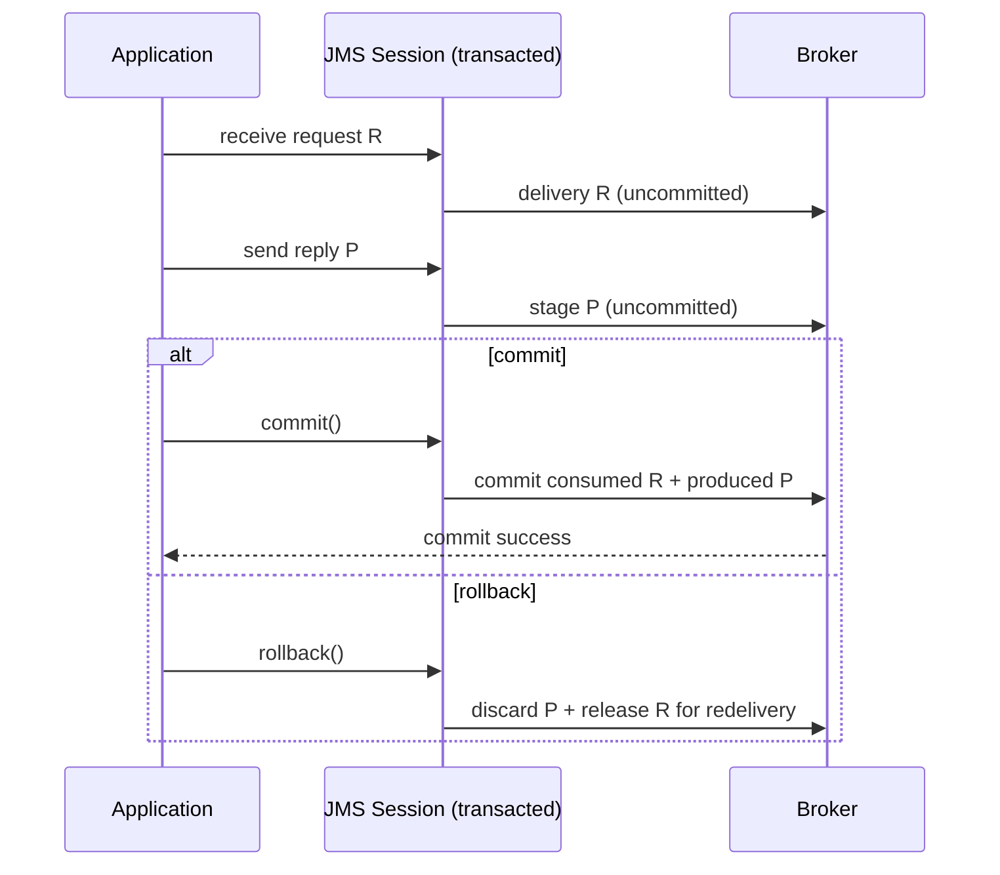
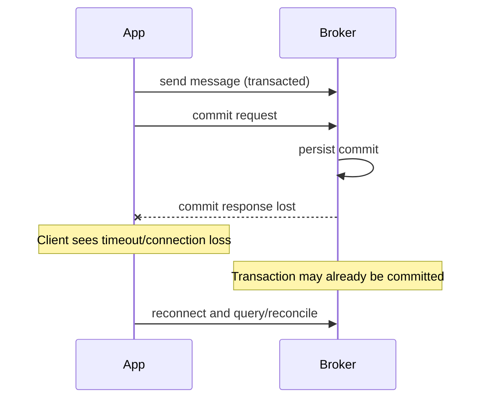

# Kiểm thử commit, rollback, recover và phạm vi xác nhận

> **Chương:** Kiểm thử  
> **Phạm vi:** Kiểm chứng ranh giới giao dịch và acknowledgment của JMS trên ActiveMQ Classic/Artemis: message nào được commit, message nào bị rollback, `Session.recover()` redeliver những gì và một lời gọi `acknowledge()` xác nhận phạm vi nào. Ví dụ Java dùng **Jakarta Messaging** với Artemis client; hành vi JMS được áp dụng tương đương cho Classic khi chọn đúng namespace/API client của phiên bản đang chạy.

## 1. Điều cần chứng minh trong một bài test giao dịch

Một test “producer gửi được message” chưa chứng minh message được commit. Một test “consumer nhận được message” cũng chưa chứng minh ACK đúng thời điểm. Khi test giao dịch, phải xác định rõ:

- **Transaction owner:** `Session` nào đang giữ giao dịch?
- **Operations in scope:** các lần send/receive nào thuộc transaction đó?
- **Commit point:** thời điểm broker xác nhận kết quả?
- **Rollback effect:** message đã nhận có được giao lại? Message đã gửi có bị loại khỏi transaction?
- **Acknowledgment scope:** một message, tất cả message đã nhận trong session, hay tất cả operations trong transaction?
- **Failure window:** lỗi xảy ra trước commit, trong lúc commit hay sau khi broker đã commit nhưng client chưa nhận được phản hồi?

Với JMS local transaction, phạm vi là **một Session**. Một connection có thể có nhiều sessions, nhưng transaction của session A không tự bao gồm operations của session B.



**Hai assertion cốt lõi:**

1. Nếu `commit()` trả về thành công, các send/receive thuộc transaction của session đã được commit theo semantics của provider.
2. Nếu `rollback()` thành công, message đã nhận trong transaction chưa được xác nhận và có thể được redeliver; message được gửi trong transaction bị rollback không trở thành message đã commit ở broker.

Đây là bảo đảm ở **ranh giới JMS resource**. Nó không tự rollback database, HTTP call, file write hoặc side effect bên ngoài.

## 2. Acknowledgment mode và phạm vi xác nhận

JMS có các acknowledgment modes phổ biến sau:

| Mode | Thời điểm/phạm vi xác nhận | Điều cần test |
| --- | --- | --- |
| `AUTO_ACKNOWLEDGE` | Với synchronous receive, message được ACK khi lời gọi receive trả message thành công; với listener, ACK sau khi callback hoàn tất bình thường | Caller không thể coi việc nhận object là một transaction bao trùm business DB |
| `CLIENT_ACKNOWLEDGE` | Gọi `Message.acknowledge()` sẽ ACK **tất cả messages đã được session đó nhận**, không chỉ message object đang gọi | ACK message thứ hai có thể xác nhận cả message thứ nhất |
| `DUPS_OK_ACKNOWLEDGE` | Provider được phép lazy acknowledge; ứng dụng phải chấp nhận duplicate delivery | Không dùng khi cần xác nhận từng message chính xác |
| `SESSION_TRANSACTED` | Không phải ack mode thông thường; commit/rollback của session xác nhận hoặc hoàn tác toàn bộ JMS operations trong transaction | Test cả send và receive trên cùng session |

### 2.1. AUTO_ACKNOWLEDGE

Với `MessageConsumer.receive()`, khi method trả về message, chế độ auto-ack đồng bộ xác nhận message theo quy tắc JMS. Vì vậy đoạn code sau có failure window:

```java
Message message = consumer.receive(2_000L);
if (message != null) {
    database.updateOrder(parse(message)); // Có thể ném exception.
}
```

Nếu DB lỗi sau khi receive đã hoàn tất, ứng dụng **không được giả định** broker sẽ redeliver message. Muốn gắn ACK với kết quả xử lý, dùng transacted session hoặc listener container có transaction phù hợp.

Với `MessageListener`, callback trả về bình thường là ranh giới để auto-ack. Nếu callback ném exception, hành vi retry/redelivery phụ thuộc provider và cấu hình; test trực tiếp trên broker/version triển khai.

### 2.2. CLIENT_ACKNOWLEDGE là ACK tích lũy theo session

Đây là lỗi thường gặp khi lập trình viên tưởng `message.acknowledge()` chỉ xác nhận đúng một message:

```java
Message first = consumer.receive(1_000L);
Message second = consumer.receive(1_000L);

// Gọi trên second nhưng xác nhận tất cả messages đã nhận
// trong cùng session kể từ lần acknowledge gần nhất.
second.acknowledge();
```

Sau lệnh trên, cả `first` và `second` đều thuộc phạm vi đã ACK. Nếu muốn ACK riêng từng message, `CLIENT_ACKNOWLEDGE` chuẩn JMS không cung cấp semantics đó; hãy thiết kế transaction/batch phù hợp hoặc dùng extension riêng của provider khi chấp nhận phụ thuộc vendor.

### 2.3. SESSION_TRANSACTED không dùng acknowledge thủ công

```java
Session session = connection.createSession(
        true, Session.SESSION_TRANSACTED);

// send/receive thuộc transaction của session này.
producer.send(message);
Message received = consumer.receive(1_000L);

session.commit();   // Chốt operations của session.
```

Khi `transacted=true`, tham số acknowledgment mode không được dùng như một mode ACK độc lập. Không gọi `message.acknowledge()` để thay thế `commit()`. `commit()` và `rollback()` chỉ hợp lệ với transacted session; `recover()` không phải cách rollback transaction.

## 3. Phân biệt commit(), rollback() và recover()

Ba thao tác có tên gần nhau nhưng ý nghĩa khác nhau:

| API | Dùng trên session | Tác động |
| --- | --- | --- |
| `Session.commit()` | Transacted session | Commit tất cả messages được gửi và xác nhận tất cả messages được nhận trong transaction hiện tại |
| `Session.rollback()` | Transacted session | Rollback các sends/receives của transaction; consumed messages đủ điều kiện redelivery |
| `Session.recover()` | Non-transacted session | Dừng delivery rồi khởi động lại từ message chưa ACK đầu tiên; các messages chưa ACK được redeliver |
| `XAResource.recover()` | XA resource, do transaction manager điều phối | Liệt kê XIDs đang ở trạng thái in-doubt để transaction manager phục hồi |

### 3.1. Rollback trong transacted session

- Message được **gửi** nhưng chưa commit sẽ không được coi là message đã commit.
- Message được **nhận** nhưng transaction chưa commit sẽ không được xác nhận; rollback khiến message có thể được giao lại.
- Nếu cùng một session vừa nhận request vừa gửi response, rollback có thể hoàn tác cả hai phía JMS trong cùng local transaction.
- Những thao tác trên một session khác, dù cùng connection, không tự rollback theo.

### 3.2. Recover trong non-transacted session

`Session.recover()` không hoàn tác producer send và không phải broker restart. Nó yêu cầu provider redeliver những messages đã được giao nhưng chưa được acknowledge trong session đó.

- Dùng trong non-transacted session, điển hình với `CLIENT_ACKNOWLEDGE`.
- Messages đã ACK trước đó không bị redeliver bởi lần recover sau.
- Không gọi `recover()` trên transacted session; dùng `rollback()`.
- Recover không thể “lấy lại” một message đã được auto-ack hoặc client-ack thành công.

### 3.3. Broker recovery và XA recovery là chuyện khác

Từ “recover” có ít nhất ba ngữ cảnh:

1. **JMS session recover:** yêu cầu redelivery của messages chưa ACK trong session non-transacted.
2. **Broker restart recovery:** broker khôi phục journal/persistent state và transaction records sau khi process/storage khởi động lại.
3. **XA transaction recovery:** transaction manager hỏi các XA resources về các XIDs đã prepare nhưng chưa hoàn tất, sau đó quyết định commit/rollback theo transaction log.

Một test gọi `session.recover()` không chứng minh broker restart recovery. Một broker restart thành công cũng không chứng minh XA in-doubt transactions được hoàn tất đúng.

## 4. Dựng môi trường kiểm thử Artemis Jakarta JMS

Ví dụ code dưới đây dùng Java 17+, Jakarta Messaging và Artemis Jakarta client. Queue test phải được provision trước hoặc broker lab phải bật auto-create phù hợp. Không chạy test trên queue nghiệp vụ đang có consumer khác.

Maven dependency:

```xml
<dependency>
    <groupId>org.apache.artemis</groupId>
    <artifactId>artemis-jakarta-client</artifactId>
    <version>2.57.0</version>
    <scope>test</scope>
</dependency>
<dependency>
    <groupId>org.junit.jupiter</groupId>
    <artifactId>junit-jupiter</artifactId>
    <scope>test</scope>
</dependency>
```

Cấu hình test lấy URL/credentials từ môi trường:

```text
ARTEMIS_URL=tcp://127.0.0.1:61616
ARTEMIS_USER=test-user
ARTEMIS_PASSWORD=<secret-from-test-environment>
```

Ví dụ factory helper:

```java
import org.apache.activemq.artemis.jms.client.ActiveMQConnectionFactory;

final class TestConnections {
    private TestConnections() {}

    static ActiveMQConnectionFactory createFactory() {
        String url = required("ARTEMIS_URL");
        return new ActiveMQConnectionFactory(url);
    }

    static String user() {
        return required("ARTEMIS_USER");
    }

    static String password() {
        return required("ARTEMIS_PASSWORD");
    }

    private static String required(String name) {
        String value = System.getenv(name);
        if (value == null || value.isBlank()) {
            throw new IllegalStateException("Missing env: " + name);
        }
        return value;
    }
}
```

Artemis Jakarta client dùng package `jakarta.jms`. ActiveMQ Classic có các dòng client/major version với namespace khác nhau; nếu dùng Classic 5.x `javax.jms`, phải đổi imports và dependency tương ứng. **Không trộn `javax.jms` và `jakarta.jms` trong cùng một code path Spring Boot 3.x.** Các assertion về transaction scope dưới đây vẫn là những semantics JMS cần kiểm chứng trên client/broker thực tế.

## 5. Test rollback send và redelivery khi rollback receive

Test này chứng minh hai hướng riêng:

- Producer gửi trong transacted session rồi rollback → message không được publish như một committed send.
- Consumer nhận message rồi rollback → message được redeliver, với `JMSRedelivered=true`.

Ví dụ JUnit 5:

```java
import static org.junit.jupiter.api.Assertions.*;

import java.util.UUID;

import jakarta.jms.Connection;
import jakarta.jms.Message;
import jakarta.jms.MessageConsumer;
import jakarta.jms.MessageProducer;
import jakarta.jms.Queue;
import jakarta.jms.Session;
import jakarta.jms.TextMessage;

import org.apache.activemq.artemis.jms.client.ActiveMQConnectionFactory;
import org.junit.jupiter.api.Test;

class JmsCommitRollbackIT {

    @Test
    void rollbackSendDiscardsAndRollbackReceiveRedelivers()
            throws Exception {
        String queueName = "lab.tx." + UUID.randomUUID();

        ActiveMQConnectionFactory factory =
                TestConnections.createFactory();

        try (Connection connection = factory.createConnection(
                TestConnections.user(), TestConnections.password())) {

            Session producerTx = connection.createSession(
                    true, Session.SESSION_TRANSACTED);
            Session consumerTx = connection.createSession(
                    true, Session.SESSION_TRANSACTED);

            try {
                Queue producerQueue = producerTx.createQueue(queueName);
                Queue consumerQueue = consumerTx.createQueue(queueName);

                try (MessageProducer producer =
                             producerTx.createProducer(producerQueue);
                     MessageConsumer consumer =
                             consumerTx.createConsumer(consumerQueue)) {

                    connection.start();

                    // 1. Send rồi rollback: message không được commit.
                    TextMessage discarded =
                            producerTx.createTextMessage("discard-me");
                    producer.send(discarded);
                    producerTx.rollback();

                    Message absent = consumer.receive(300L);
                    assertNull(absent,
                            "Rolled-back send must not become visible");

                    // 2. Send rồi commit: message trở nên có thể nhận.
                    TextMessage committed =
                            producerTx.createTextMessage("redeliver-me");
                    committed.setStringProperty("eventId", "evt-1001");
                    producer.send(committed);
                    producerTx.commit();

                    Message firstDelivery = consumer.receive(2_000L);
                    assertNotNull(firstDelivery);
                    assertEquals("evt-1001",
                            firstDelivery.getStringProperty("eventId"));
                    assertFalse(firstDelivery.getJMSRedelivered());

                    // 3. Consumer rollback: lần nhận này chưa được ACK.
                    consumerTx.rollback();

                    Message secondDelivery = consumer.receive(2_000L);
                    assertNotNull(secondDelivery);
                    assertEquals("evt-1001",
                            secondDelivery.getStringProperty("eventId"));
                    assertTrue(secondDelivery.getJMSRedelivered());

                    // Chốt lần nhận thứ hai để test không để lại inflight.
                    consumerTx.commit();
                }
            } finally {
                consumerTx.close();
                producerTx.close();
            }
        } finally {
            factory.close();
        }
    }
}
```

**Điều kiện để test có kết quả xác định:**

- Queue name duy nhất cho từng test; queue đã tồn tại hoặc auto-create được bật.
- Không có consumer thứ hai đọc cùng queue.
- Broker dùng cùng protocol/client API với test; không đổi acknowledgment mode giữa các lần nhận.
- Message persistent/durable nếu test cần kiểm chứng qua restart; test trên chỉ kiểm tra transaction trong phiên hoạt động.
- `receive(300)` là timeout chờ trong test, không phải cơ chế xác nhận message đã bị xóa vĩnh viễn. Queue test phải cô lập để không có message cũ.

`JMSRedelivered` là cờ chuẩn để nhận biết lần giao lại. Có thể đọc thêm property `JMSXDeliveryCount` nếu provider hỗ trợ để quan sát số lần giao; không nên dùng con số delivery count làm business idempotency key.

## 6. Kiểm thử phạm vi CLIENT_ACKNOWLEDGE và recover()

Bài test sau gửi ba messages, nhận hai messages rồi gọi `acknowledge()` trên message thứ hai. Assertion cần chứng minh **cả hai message đầu đã được ACK**. Message thứ ba được nhận nhưng chưa ACK; gọi `recover()` rồi nhận lại.

```java
import static org.junit.jupiter.api.Assertions.*;

import java.util.UUID;

import jakarta.jms.Connection;
import jakarta.jms.Message;
import jakarta.jms.MessageConsumer;
import jakarta.jms.MessageProducer;
import jakarta.jms.Queue;
import jakarta.jms.Session;
import jakarta.jms.TextMessage;

import org.apache.activemq.artemis.jms.client.ActiveMQConnectionFactory;
import org.junit.jupiter.api.Test;

class ClientAcknowledgeRecoverIT {

    @Test
    void acknowledgeIsSessionScopedAndRecoverRedeliversUnacked()
            throws Exception {
        String queueName = "lab.ack." + UUID.randomUUID();
        ActiveMQConnectionFactory factory =
                TestConnections.createFactory();

        try (Connection connection = factory.createConnection(
                TestConnections.user(), TestConnections.password())) {

            Session producerSession = connection.createSession(
                    false, Session.AUTO_ACKNOWLEDGE);
            Session clientAckSession = connection.createSession(
                    false, Session.CLIENT_ACKNOWLEDGE);

            try {
                Queue producerQueue =
                        producerSession.createQueue(queueName);
                Queue consumerQueue =
                        clientAckSession.createQueue(queueName);

                try (MessageProducer producer =
                             producerSession.createProducer(producerQueue);
                     MessageConsumer consumer =
                             clientAckSession.createConsumer(consumerQueue)) {

                    producer.send(producerSession.createTextMessage("one"));
                    producer.send(producerSession.createTextMessage("two"));
                    producer.send(producerSession.createTextMessage("three"));

                    connection.start();

                    Message one = consumer.receive(2_000L);
                    Message two = consumer.receive(2_000L);
                    assertNotNull(one);
                    assertNotNull(two);

                    // ACK tích lũy tất cả messages đã nhận trong session.
                    two.acknowledge();

                    Message three = consumer.receive(2_000L);
                    assertNotNull(three);
                    assertEquals("three", ((TextMessage) three).getText());

                    // Chỉ message chưa ACK (three) được redeliver.
                    clientAckSession.recover();

                    Message redelivered = consumer.receive(2_000L);
                    assertNotNull(redelivered);
                    assertEquals("three",
                            ((TextMessage) redelivered).getText());
                    assertTrue(redelivered.getJMSRedelivered());

                    redelivered.acknowledge();

                    // one và two không được xuất hiện lại.
                    assertNull(consumer.receive(300L));
                }
            } finally {
                clientAckSession.close();
                producerSession.close();
            }
        } finally {
            factory.close();
        }
    }
}
```

Test này phân biệt hai assertion:

- `two.acknowledge()` xác nhận **one và two**, vì cả hai được nhận bởi `clientAckSession` kể từ lần ACK trước.
- `clientAckSession.recover()` chỉ làm redeliver **three**, vì message đó chưa được acknowledge.

Không gọi `recover()` trên `SESSION_TRANSACTED`. Nếu test dùng `AUTO_ACKNOWLEDGE`, các synchronous receives đã được ACK khi trả về, nên không còn ba messages chưa ACK để recover.

## 7. Kiểm thử atomicity của receive request + send reply trong một session

Một mẫu tích hợp quan trọng là worker đọc request, gửi response rồi commit. Nếu reply send thất bại trước commit, rollback phải làm cho request đủ điều kiện redelivery và response chưa được commit.

```java
import jakarta.jms.Connection;
import jakarta.jms.Message;
import jakarta.jms.MessageConsumer;
import jakarta.jms.MessageProducer;
import jakarta.jms.Queue;
import jakarta.jms.Session;
import jakarta.jms.TextMessage;

public final class TransactionalReplyWorker {

    public static boolean processOne(Connection connection)
            throws Exception {
        Session tx = connection.createSession(
                true, Session.SESSION_TRANSACTED);

        try {
            Queue requests = tx.createQueue("lab.rpc.requests");
            Queue replies = tx.createQueue("lab.rpc.replies");

            try (MessageConsumer consumer = tx.createConsumer(requests);
                 MessageProducer producer = tx.createProducer(replies)) {

                Message incoming = consumer.receive(2_000L);
                if (incoming == null) {
                    return false;
                }

                try {
                    String correlationId =
                            incoming.getJMSCorrelationID();
                    if (correlationId == null) {
                        throw new IllegalArgumentException(
                                "Missing correlation ID");
                    }

                    TextMessage response = tx.createTextMessage("accepted");
                    response.setJMSCorrelationID(correlationId);
                    producer.send(response);

                    // Cùng session: ACK request + commit reply.
                    tx.commit();
                    return true;
                } catch (Exception failure) {
                    tx.rollback();
                    throw failure;
                }
            }
        } finally {
            tx.close();
        }
    }
}
```

**Giới hạn bảo đảm:** request receive và reply send nằm trong cùng một JMS session transaction nên broker có thể commit/rollback hai thao tác JMS cùng nhau. Nếu worker đồng thời cập nhật database bằng JDBC connection bình thường, database **không** tự tham gia transaction JMS. Muốn atomic giữa DB và broker cần XA/JTA hoặc thiết kế outbox/inbox.

## 8. Spring JMS: cấu hình listener transacted và test exception

Trong Spring, `DefaultMessageListenerContainer` có thể quản lý một transacted JMS session cho mỗi listener invoker. Cấu hình factory riêng giúp ý định rõ ràng:

```java
import jakarta.jms.ConnectionFactory;

import org.springframework.context.annotation.Bean;
import org.springframework.context.annotation.Configuration;
import org.springframework.jms.config.DefaultJmsListenerContainerFactory;

@Configuration
class TransactedListenerConfig {

    @Bean
    DefaultJmsListenerContainerFactory transactedJmsFactory(
            ConnectionFactory connectionFactory) {
        DefaultJmsListenerContainerFactory factory =
                new DefaultJmsListenerContainerFactory();
        factory.setConnectionFactory(connectionFactory);
        factory.setSessionTransacted(true);
        factory.setConcurrency("2-6");
        return factory;
    }
}
```

Listener:

```java
import org.springframework.jms.annotation.JmsListener;
import org.springframework.stereotype.Component;

@Component
class PaymentCommandListener {

    @JmsListener(
            destination = "lab.payment.commands",
            containerFactory = "transactedJmsFactory")
    public void onCommand(String body) {
        if (body.contains("force-failure")) {
            throw new IllegalStateException("Simulated handler failure");
        }

        // Khi handler hoàn tất bình thường, listener transaction commit.
        // Khi exception thoát ra, listener container rollback session.
        applyBusinessOperation(body);
    }

    private void applyBusinessOperation(String body) {
        // Ví dụ: validate và xử lý nghiệp vụ.
    }
}
```

**Assertion cho integration test:**

1. Gửi message `ok-1`; listener xử lý thành công, message được commit/ACK.
2. Gửi message `force-failure-1`; handler ném exception, session rollback và message có thể redeliver.
3. Quan sát `JMSRedelivered`/delivery count, redelivery delay và giới hạn retry của broker.
4. Sau số lần thử được cấu hình, kiểm tra message được xử lý theo policy dead-letter/poison-message của broker.

Exception không tự động bảo đảm retry vô hạn hay đưa message vào DLQ ngay lập tức. Số lần redelivery, delay và dead-letter address/queue do cấu hình broker/provider quyết định; test phải khớp policy đang dùng.

## 9. Spring JmsTransactionManager không phải XA

Nếu chỉ cần transaction trong **một JMS ConnectionFactory**, Spring có `JmsTransactionManager`:

```java
import jakarta.jms.ConnectionFactory;

import org.springframework.context.annotation.Bean;
import org.springframework.context.annotation.Configuration;
import org.springframework.jms.connection.JmsTransactionManager;
import org.springframework.transaction.PlatformTransactionManager;

@Configuration
class LocalJmsTransactionConfig {

    @Bean("jmsTransactionManager")
    PlatformTransactionManager jmsTransactionManager(
            ConnectionFactory connectionFactory) {
        return new JmsTransactionManager(connectionFactory);
    }
}
```

Sử dụng:

```java
import org.springframework.jms.core.JmsTemplate;
import org.springframework.stereotype.Service;
import org.springframework.transaction.annotation.Transactional;

@Service
class EventPublisher {
    private final JmsTemplate jmsTemplate;

    EventPublisher(JmsTemplate jmsTemplate) {
        this.jmsTemplate = jmsTemplate;
    }

    @Transactional(transactionManager = "jmsTransactionManager")
    public void publish(String eventId) {
        jmsTemplate.convertAndSend("lab.events",
                "event:" + eventId);
        // RuntimeException thoát khỏi method sẽ rollback local JMS tx.
    }
}
```

`JmsTransactionManager` ràng buộc một JMS connection/session vào thread hiện tại để `JmsTemplate` tham gia local JMS transaction. Nó **không** phối hợp atomic với một `DataSourceTransactionManager` riêng. Nếu method ghi database rồi gửi JMS, hai resource manager có thể commit ở các thời điểm khác nhau.

### 9.1. Khi nào cần XA/JTA?

Nếu yêu cầu một transaction atomic qua **JMS + XA-capable database**, cần:

- XA-capable JMS connection factory của provider.
- XA datasource cho database.
- JTA transaction manager (ví dụ transaction manager hỗ trợ XA) được cấu hình đúng.
- Transaction log/object store bền vững để phục hồi giao dịch in-doubt.
- Test crash ở các pha prepare/commit và kiểm tra recovery sau restart.

Ở XA two-phase commit, transaction manager điều phối các XA resources qua `prepare` rồi `commit`/`rollback`. Nếu process chết sau prepare, resource có thể giữ transaction in-doubt cho đến khi transaction manager khởi động lại và chạy XA recovery.

**Không** gọi `XAResource.recover()` tùy tiện từ business code để “thử redelivery”. Đây là API phục hồi transaction dành cho transaction manager; nó xử lý XIDs, không phải JMS message delivery.

Nếu không bắt buộc XA, transactional outbox thường đơn giản hơn: ghi business row và outbox row trong cùng DB transaction; publisher riêng chuyển outbox event sang broker, consumer idempotent theo event ID.

## 10. Kiểm thử failure window và commit outcome không rõ

Có ba thời điểm phải phân biệt:

| Điểm lỗi | Điều có thể kết luận | Cần kiểm thử |
| --- | --- | --- |
| Trước khi gọi commit | Transaction chưa được yêu cầu chốt; rollback/connection close có thể giải phóng state | Message không xuất hiện như committed send; consumed message đủ điều kiện redelivery |
| Broker đã nhận commit và trả thành công | Transaction đã commit theo session/provider contract | Message đã gửi có thể được nhận; consumed message đã xác nhận |
| Client mất kết nối trong lúc commit | **Outcome có thể không rõ với caller** | Đối chiếu eventId/transaction log; không retry mù bằng ID mới |

Ví dụ failure window:



Nếu ứng dụng retry bằng event ID mới, có thể tạo business duplicate dù lần commit đầu đã thành công. Dùng **stable eventId**, inbox/deduplication ở consumer hoặc đối soát trạng thái trước khi retry. Không suy ra “commit thất bại” chỉ từ exception phía client khi mất mạng đúng lúc commit.

## 11. Ma trận kiểm thử tối thiểu cho Classic và Artemis

| Ca kiểm thử | JMS setup | Assertion |
| --- | --- | --- |
| Commit producer send | Transacted producer session → send → commit | Consumer khác nhận được message |
| Rollback producer send | Transacted producer session → send → rollback | Message không xuất hiện như committed send |
| Commit consumer receive | Transacted consumer session → receive → commit | Message không bị redeliver |
| Rollback consumer receive | Transacted consumer session → receive → rollback | Message được redeliver, `JMSRedelivered=true` |
| Client ACK scope | Non-transacted `CLIENT_ACKNOWLEDGE`; nhận 2, ACK message 2 | Cả 2 message đã nhận đều được ACK |
| Recover non-transacted | Nhận message chưa ACK → `recover()` | Message chưa ACK được redeliver |
| Recover transacted | Gọi `recover()` trên transacted session | Bị từ chối; phải dùng `rollback()` |
| Atomic request/reply | Cùng transacted session nhận request + gửi reply | Commit chốt cả hai; rollback hoàn tác cả hai |
| Listener exception | Transacted listener ném exception | Rollback/redelivery theo broker policy |
| Broker restart | Persistent message và transaction test | Xác minh journal recovery, inflight/redelivery |
| XA in-doubt | XA/JTA, fault injection quanh prepare/commit | Transaction manager phục hồi XID đúng |

Chạy cùng assertion trên cả Classic và Artemis nhưng dùng **client artifacts/protocol tương thích** với từng broker. Không dùng một `javax.jms` binary rồi kết luận nó tương thích Jakarta chỉ vì tên class tương tự. Ghi lại broker version, client version, protocol, persistence mode và acknowledgment mode trong test report.

## 12. Checklist khi viết test commit/rollback/recover

- [ ] Mỗi test dùng queue riêng hoặc queue name duy nhất; không có competing consumer ngoài ý muốn.
- [ ] Xác định rõ session nào sở hữu producer/consumer và transaction.
- [ ] Không share một `Session` giữa nhiều threads.
- [ ] Test `commit()` cho cả send và receive, không chỉ kiểm tra method không ném exception.
- [ ] Test `rollback()` send và rollback receive bằng quan sát từ session/consumer khác.
- [ ] Dùng `JMSRedelivered` để kiểm tra redelivery; delivery count chỉ là tín hiệu bổ sung.
- [ ] Test `CLIENT_ACKNOWLEDGE` với hai message để chứng minh ACK tích lũy theo session.
- [ ] Chỉ dùng `Session.recover()` với non-transacted session; transacted session dùng `rollback()`.
- [ ] Phân biệt local JMS transaction với JDBC transaction và XA/JTA.
- [ ] Kiểm thử exception trong listener và policy redelivery/DLQ đang chạy.
- [ ] Có test crash/disconnect quanh commit để xử lý outcome không rõ và duplicate.
- [ ] Không dùng session recover để thay broker restart recovery hoặc XA recovery.
- [ ] Ghi rõ client namespace (`javax.jms` hay `jakarta.jms`) và protocol khi chạy trên Classic/Artemis.

## Tài liệu tham khảo

1. [Jakarta Messaging 3.1 Specification](https://jakarta.ee/specifications/messaging/3.1/jakarta-messaging-spec-3.1.html): transaction, acknowledgment modes, `Session.recover()` và message redelivery.
2. [Jakarta Messaging API — Session](https://jakarta.ee/specifications/messaging/3.1/apidocs/jakarta.messaging/jakarta/jms/session): `commit`, `rollback`, `recover`, transaction scope.
3. [Jakarta Messaging API — Message](https://jakarta.ee/specifications/messaging/3.1/apidocs/jakarta.messaging/jakarta/jms/message): `acknowledge`, `JMSRedelivered` và headers.
4. [Spring Framework — JMS Transactions](https://docs.spring.io/spring-framework/reference/integration/jms/receiving.html): listener container transaction behavior.
5. [Spring Framework — JmsTransactionManager API](https://docs.spring.io/spring-framework/docs/6.2.0/javadoc-api/org/springframework/jms/connection/JmsTransactionManager.html): local JMS transaction management.
6. [Apache ActiveMQ Artemis — Transactions](https://artemis.apache.org/components/artemis/documentation/latest/transactions.html): transaction semantics và recovery.
7. [Apache ActiveMQ Classic — Message Redelivery and DLQ](https://activemq.apache.org/components/classic/documentation/message-redelivery-and-dlq-handling): redelivery policy và poison ACK.
