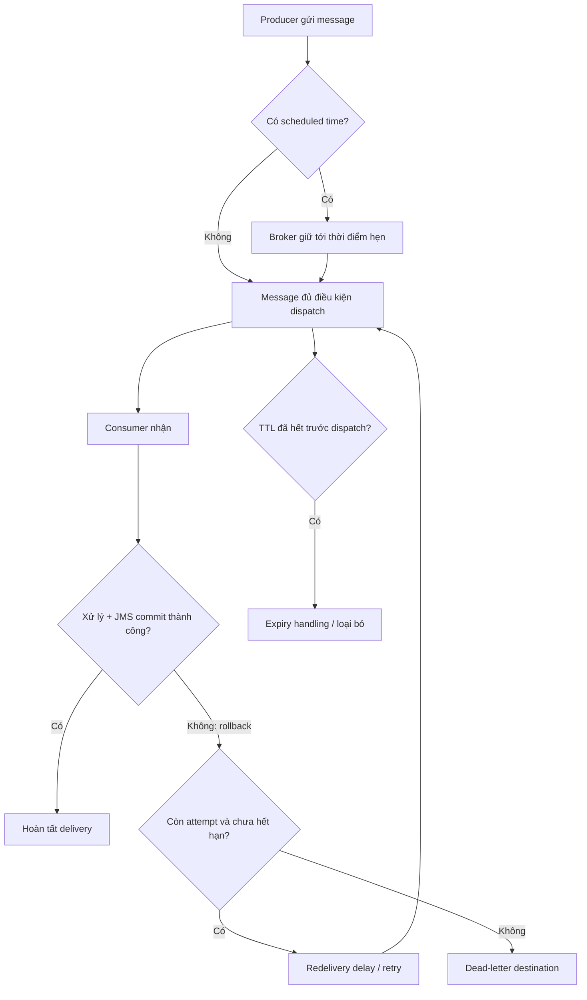

# Kiểm thử redelivery, DLQ, TTL và lịch giao thông điệp

> **Chương:** Kiểm thử  
> **Phạm vi:** ActiveMQ Classic và Artemis qua Java/JMS; kiểm tra giao nhận thất bại, dead-letter queue, hết hạn và scheduled delivery. Ví dụ dùng Jakarta Messaging khi client hỗ trợ; ứng dụng dùng `javax.jms` phải chọn dependency/import tương thích.  
> **Mục tiêu:** Xây được test lặp lại để chứng minh message được giao lại sau rollback, đi vào DLQ sau số lần thất bại hữu hạn, hết hạn theo TTL và chỉ được dispatch sau thời điểm hẹn; phân biệt policy phía client Classic với policy phía broker Artemis; kiểm chứng redrive mà không nhân đôi side effect.

## 1. Bốn cơ chế có thời điểm và ý nghĩa khác nhau

Một message có thể được gửi thành công nhưng consumer lỗi, được gửi lại sau rollback, bị chuyển sang DLQ, hết hạn trước khi consumer nhận, hoặc được giữ tới một thời điểm tương lai. Đây là **những trạng thái riêng**; kiểm thử phải tạo đúng điều kiện kích hoạt từng trạng thái.

| Cơ chế | Điều kiện bắt đầu | Ai quyết định? | Kết quả |
|---|---|---|---|
| **Redelivery** | Consumer không hoàn tất delivery: rollback/recover hoặc transaction thất bại | JMS transaction/acknowledgment và provider policy | Message có thể được giao lại sau delay |
| **DLQ** | Delivery thất bại vượt ngưỡng hoặc poison message bị từ chối | Broker/provider và client policy tùy sản phẩm | Message được route tới destination dành cho điều tra |
| **TTL / expiration** | Thời gian sống của message đã hết | Producer đặt TTL; broker kiểm tra expiration | Message không còn được dispatch bình thường; có thể đi tới expiry destination |
| **Scheduled delivery** | Thời điểm giao trong tương lai chưa tới | Producer đặt lịch; broker scheduler | Message vẫn chờ, chỉ đủ điều kiện dispatch từ thời điểm đã hẹn |

**Redelivery không phải scheduled delivery:** redelivery là lần giao lại sau một lần xử lý thất bại; scheduled delivery là lần giao đầu tiên được trì hoãn có chủ đích. **TTL không phải redelivery limit:** TTL giới hạn tuổi message theo thời gian, còn delivery attempts giới hạn số lần xử lý thất bại.



Sơ đồ là mô hình kiểm thử khái niệm; mỗi broker có chi tiết nội bộ khác nhau. Message hết hạn có thể được chuyển tới **expiry address/queue** nếu đã cấu hình, trong khi message poison vượt số lần giao có thể vào **DLQ**. Không gộp hai loại queue này.

## 2. Chuẩn bị test fixture có thể tái lập

Dùng broker test riêng và queue đã provision. Mỗi lượt test nên có destination hoặc `eventId` riêng để message tồn từ lượt chạy trước không làm sai kết quả.

Một bộ fixture nên ghi nhận:

- Broker và client version, protocol, namespace JMS (`jakarta.jms` hay `javax.jms`).
- Destination nguồn, DLQ, expiry destination và routing type (Queue/Anycast).
- Delivery mode, transaction mode và redelivery policy đang hiệu lực.
- `eventId`, `JMSMessageID`, `JMSCorrelationID`, `JMSRedelivered`, `JMSXDeliveryCount` nếu provider hỗ trợ.
- Thời điểm gửi, thời điểm dự kiến giao, TTL, số lần nhận, lần rollback/commit.
- Số message ở source queue, DLQ và expiry queue trước/sau test.

**Không tái sử dụng cùng queue test mà không dọn trạng thái.** Message DLQ từ test trước có thể khiến lần sau tưởng broker vừa dead-letter message mới.

### 2.1. Dùng transaction để tạo lỗi có chủ đích

Với consumer transacted, gọi `Session.rollback()` sau khi nhận message sẽ tạo điều kiện redelivery. Nếu listener chỉ ghi log exception rồi return bình thường, container có thể commit và message không được giao lại.

```java
import jakarta.jms.Connection;
import jakarta.jms.ConnectionFactory;
import jakarta.jms.Message;
import jakarta.jms.MessageConsumer;
import jakarta.jms.Queue;
import jakarta.jms.Session;

public final class RedeliveryProbe {

    public static void rollbackThenCommit(ConnectionFactory factory)
            throws Exception {
        try (Connection connection = factory.createConnection()) {
            Session session = connection.createSession(
                true, Session.SESSION_TRANSACTED);
            try {
                Queue queue = session.createQueue("orders.retry.test");
                MessageConsumer consumer = session.createConsumer(queue);
                try {
                    connection.start();

                    Message first = consumer.receive(5_000L);
                    if (first == null) {
                        throw new AssertionError("First delivery missing");
                    }

                    System.out.println(
                        "first: redelivered=" + first.getJMSRedelivered()
                        + ", deliveryCount=" + deliveryCount(first));

                    session.rollback(); // Giả lập lỗi xử lý.

                    Message second = consumer.receive(10_000L);
                    if (second == null) {
                        throw new AssertionError("Redelivery missing");
                    }
                    if (!second.getJMSRedelivered()) {
                        throw new AssertionError(
                            "Expected JMSRedelivered=true");
                    }

                    System.out.println(
                        "second: redelivered=" + second.getJMSRedelivered()
                        + ", deliveryCount=" + deliveryCount(second));

                    session.commit(); // Giả lập lần xử lý sau thành công.
                } finally {
                    consumer.close();
                }
            } finally {
                session.close();
            }
        }
    }

    private static int deliveryCount(Message message) throws Exception {
        return message.propertyExists("JMSXDeliveryCount")
            ? message.getIntProperty("JMSXDeliveryCount")
            : -1;
    }
}
```

Đây là probe đồng bộ, không phải test đầy đủ cho mọi broker. `JMSRedelivered` là cờ JMS cho biết message đã được giao trước đó; `JMSXDeliveryCount` phụ thuộc provider/version và có thể không có. Không làm test fail chỉ vì một extension property không được hỗ trợ.

### 2.2. Chọn transaction owner duy nhất

- Với `Session.SESSION_TRANSACTED`, test chủ động `commit()` hoặc `rollback()` trên Session.
- Với Spring `@JmsListener`, để listener container quản lý transaction; không gọi `Session.commit()` thủ công bên trong callback.
- Với JTA/XA, transaction manager điều phối global transaction; test phải kiểm tra đúng transaction manager và recovery log.
- Không trộn `CLIENT_ACKNOWLEDGE` với một local transaction đang được container quản lý.

## 3. Redelivery: đo cả số lần thử lẫn khoảng chờ

Một test redelivery tối thiểu cần chứng minh ba điều:

1. Lần đầu consumer nhận message.
2. Consumer rollback hoặc xử lý lỗi làm transaction không commit.
3. Broker/client giao lại message, sau đó một lần xử lý có thể commit thành công.

Chỉ thấy listener log exception không đủ. Cần quan sát `JMSRedelivered`, delivery count nếu có, queue state và transaction outcome.

### 3.1. Delay và backoff

Một retry policy thường có:

- **Initial delay:** khoảng chờ trước lần giao lại đầu tiên.
- **Redelivery delay:** khoảng chờ cơ sở giữa các lần.
- **Multiplier:** hệ số tăng delay theo số lần thất bại.
- **Maximum delay:** giới hạn trên để retry không tăng vô hạn.
- **Maximum attempts:** ngưỡng trước khi dead-letter hoặc poison acknowledgment.

Mô hình backoff minh họa:

\[
d_n = \min(d_{\max}, d_0 \times m^{n-1})
\]

Trong đó `d0` là delay cơ sở, `m` là multiplier, `n` là số thứ tự redelivery. Broker có thể áp jitter hoặc semantics đếm khác; **đo thời điểm thực tế** thay vì khẳng định công thức chính xác từng millisecond.

### 3.2. Đừng dùng `Thread.sleep()` trong listener để tạo retry

`Thread.sleep()` giữ worker thread và có thể giữ Session/consumer lâu hơn. Nó không thay thế broker redelivery delay, cũng không rollback transaction. Để thử delay, cấu hình policy provider/broker và đo thời gian từ lần rollback tới lần nhận tiếp theo.

## 4. ActiveMQ Classic: redelivery policy nằm ở client

Trong ActiveMQ Classic, `RedeliveryPolicy` thường được cấu hình ở **client connection factory**. Khi transacted Session rollback, client/provider áp policy redelivery; sau khi vượt giới hạn, client có thể gửi **Poison ACK** để broker dead-letter message.

```java
import org.apache.activemq.ActiveMQConnectionFactory;
import org.apache.activemq.RedeliveryPolicy;

ActiveMQConnectionFactory factory =
    new ActiveMQConnectionFactory("tcp://127.0.0.1:61616");

RedeliveryPolicy policy = factory.getRedeliveryPolicy();
policy.setInitialRedeliveryDelay(1_000L);
policy.setRedeliveryDelay(2_000L);
policy.setUseExponentialBackOff(true);
policy.setBackOffMultiplier(2.0);
policy.setMaximumRedeliveryDelay(30_000L);
policy.setMaximumRedeliveries(4);
```

Cấu hình minh họa delay tăng dần và giới hạn số lần redelivery. `maximumRedeliveries` là số lần **giao lại** sau lần giao đầu theo semantics Classic; khi kiểm thử, ghi rõ tổng callback đã quan sát và đối chiếu broker/client version. Đừng tự suy ra tổng attempts chỉ từ tên tham số.

**Lưu ý tương thích:** đoạn code dùng API Classic client. Ứng dụng Spring Boot 3/Jakarta phải chọn Classic client hỗ trợ namespace `jakarta.jms`; client legacy `javax.jms` không thể trộn trực tiếp với `jakarta.jms.ConnectionFactory`.

### 4.1. Classic DLQ: shared hay individual destination?

Classic thường dùng shared dead-letter destination `ActiveMQ.DLQ` nếu không cấu hình chiến lược riêng. Để tách DLQ theo queue gốc, có thể cấu hình individual strategy:

```xml
<!-- Fragment trong activemq.xml của ActiveMQ Classic -->
<destinationPolicy>
  <policyMap>
    <policyEntries>
      <policyEntry queue=">">
        <deadLetterStrategy>
          <individualDeadLetterStrategy
              queuePrefix="DLQ."
              useQueueForQueueMessages="true"
              processExpired="false"/>
        </deadLetterStrategy>
      </policyEntry>
    </policyEntries>
  </policyMap>
</destinationPolicy>
```

Với queue `orders.retry.test`, DLQ tương ứng có tên theo prefix, ví dụ `DLQ.orders.retry.test`. `processExpired="false"` làm rõ expired messages không được xử lý như poison messages trong DLQ strategy này. Nếu muốn expired messages đi DLQ, đó là quyết định riêng và phải kiểm tra tác động vận hành.

- **Shared DLQ:** dễ tập trung giám sát, nhưng cần metadata để biết queue gốc.
- **Individual DLQ:** dễ phân quyền và redrive theo queue gốc, nhưng số destination tăng.
- **Expired messages:** không mặc định là failed-delivery poison messages; thiết kế đường expiry riêng hoặc bật xử lý expired có chủ đích.

### 4.2. Classic scheduler phải được bật

Trong cấu hình root `<broker>` của `activemq.xml`, bật scheduler:

```xml
<broker brokerName="classic-test"
        persistent="true"
        schedulerSupport="true">
    <!-- transportConnectors, persistenceAdapter, plugins... -->
</broker>
```

Không đặt `schedulerSupport` vào `policyEntry`; đây là thuộc tính của broker. Scheduler lưu trạng thái lịch theo persistence store của Classic, nên test persistent/restart nếu workload phụ thuộc lịch giao.

### 4.3. Classic scheduled message

Classic dùng các property trong `org.apache.activemq.ScheduledMessage`. Ví dụ trì hoãn một message 5 giây:

```java
import org.apache.activemq.ScheduledMessage;

jakarta.jms.TextMessage message =
    session.createTextMessage("retry-after-maintenance");

message.setStringProperty("eventId", "evt-classic-42");
message.setLongProperty(
    ScheduledMessage.AMQ_SCHEDULED_DELAY, 5_000L);

producer.send(message);
```

`AMQ_SCHEDULED_DELAY` là extension riêng của Classic, không phải header JMS chuẩn. Classic còn hỗ trợ các thuộc tính scheduler khác như period/repeat/cron; chỉ dùng khi đã kiểm tra phiên bản, broker scheduler và semantics của từng thuộc tính.

## 5. Artemis: redelivery và DLQ được cấu hình tại broker

Artemis áp dụng policy theo address settings. Ví dụ fragment trong `<core>` của `broker.xml`:

```xml
<address-settings>
    <address-setting match="orders.#">
        <redelivery-delay>1000</redelivery-delay>
        <redelivery-delay-multiplier>2.0</redelivery-delay-multiplier>
        <max-redelivery-delay>30000</max-redelivery-delay>
        <max-delivery-attempts>4</max-delivery-attempts>
        <dead-letter-address>DLQ</dead-letter-address>
        <expiry-address>ExpiryQueue</expiry-address>
        <expiry-delay>60000</expiry-delay>
    </address-setting>
</address-settings>

<addresses>
    <address name="orders.retry.test">
        <anycast>
            <queue name="orders.retry.test" durable="true"/>
        </anycast>
    </address>

    <address name="DLQ">
        <anycast>
            <queue name="DLQ" durable="true"/>
        </anycast>
    </address>

    <address name="ExpiryQueue">
        <anycast>
            <queue name="ExpiryQueue" durable="true"/>
        </anycast>
    </address>
</addresses>
```

Các fragment thuộc `broker.xml` hiện có; ghép vào đúng phần tử, không tạo các khối `<address-settings>` hoặc `<addresses>` trùng lặp.

- `redelivery-delay`: delay cơ sở trước khi giao lại.
- `redelivery-delay-multiplier`: tăng delay theo số lần thất bại.
- `max-redelivery-delay`: chặn delay ở mức tối đa.
- `max-delivery-attempts`: giới hạn delivery attempts trước khi xử lý dead-letter; dùng giá trị tường minh, không dựa vào default.
- `dead-letter-address`: address nhận message vượt ngưỡng.
- `expiry-address`: address nhận message đã hết hạn.
- `expiry-delay`: default expiration cho message không có expiration riêng; không dùng nó để thay TTL producer khi message đã có expiration.

`match="orders.#"` là wildcard của **address settings**; khác với `<cluster-connection><address>...</address>` của Artemis cluster connection. Kiểm tra chính xác address thực tế để chắc policy áp vào queue test.

### 5.1. Phân biệt DLQ và expiry queue ở Artemis

- Message rollback vượt số lần delivery đi tới `dead-letter-address`.
- Message hết `JMSExpiration` được xử lý theo expiry policy; nếu có `expiry-address`, broker có thể route tới expiry destination.
- Hai destination có thể được giám sát, phân quyền và retention riêng.
- Nếu không provision expiry/DLQ queue và auto-create bị tắt, cấu hình address phải phù hợp với cách broker xử lý destination đó; không giả định message tự tạo queue luôn thành công.

### 5.2. Artemis scheduled delivery

Artemis dùng property provider-specific `_AMQ_SCHED_DELIVERY` chứa **thời điểm tuyệt đối theo epoch milliseconds**:

```java
long dueAt = System.currentTimeMillis() + 5_000L;

jakarta.jms.TextMessage message =
    session.createTextMessage("deliver-after-maintenance");

message.setStringProperty("eventId", "evt-artemis-42");
message.setLongProperty("_AMQ_SCHED_DELIVERY", dueAt);

producer.send(message);
```

Property `_AMQ_SCHED_DELIVERY` không phải JMS standard. Vì giá trị là thời điểm tuyệt đối, đồng hồ producer và broker cần được đồng bộ; sai lệch clock làm lịch đến sớm hoặc muộn. Dùng NTP/chrony hoặc cơ chế đồng bộ thời gian của nền tảng và kiểm tra bằng timestamp quan sát.

**Không dùng `AMQ_SCHEDULED_DELAY` của Classic cho Artemis**; hai provider có extension và semantics khác nhau.

## 6. TTL: message hết hạn dựa trên thời gian gửi

JMS producer nhận TTL theo **milliseconds**. Ví dụ gửi persistent message với TTL 10 giây:

```java
import jakarta.jms.DeliveryMode;
import jakarta.jms.Message;

long ttlMs = 10_000L;

producer.send(
    message,
    DeliveryMode.PERSISTENT,
    Message.DEFAULT_PRIORITY,
    ttlMs
);
```

Provider tính `JMSExpiration` theo thời điểm gửi và TTL. Ứng dụng đọc `getJMSExpiration()`; không tự đặt header này bằng `setJMSExpiration()` vì đây là header do provider quản lý.

- TTL bằng `0` nghĩa là **không hết hạn** theo JMS producer API.
- TTL dương tính bằng milliseconds.
- Khi đã hết hạn, message không còn đủ điều kiện dispatch bình thường.
- Thời điểm broker quét/di chuyển message có thể không đúng chính xác millisecond expiration.
- Expiry handling phụ thuộc broker config; kiểm tra expiry queue và metrics, không chỉ chờ consumer `receive()` trả về `null`.

### 6.1. TTL khác `expiry-delay`

- **Producer TTL:** thời gian sống của message cụ thể, có thể khác nhau theo từng message.
- **Artemis `expiry-delay`:** thời gian hết hạn mặc định broker áp cho message không có expiration được chỉ định.
- **Classic:** dead-letter strategy có option `processExpired`; đây không phải một expiry address tương đương Artemis.
- **Scheduled delivery:** đặt thời điểm đủ điều kiện giao, không tự kéo dài TTL.

Ví dụ message được schedule sau 30 giây nhưng TTL chỉ 10 giây: message có thể hết hạn **trước khi tới giờ dispatch**. Đây là test quan trọng để phát hiện nhầm giữa scheduled delay và time-to-live.

### 6.2. TTL cho từng message thay vì thay đổi producer dùng chung

Có thể gọi overload `send(message, deliveryMode, priority, timeToLive)` cho từng message. `producer.setTimeToLive(...)` đặt TTL mặc định cho các lần send qua producer đó; producer có thể được cache/reuse nên cần tránh thay đổi TTL mutable giữa các threads.

Với nhiều luồng nghiệp vụ, tạo send options theo từng message hoặc dùng overload per-send để tránh TTL của message A ảnh hưởng message B.

## 7. Scheduled delivery: hẹn giao, không phải hẹn xử lý lại

Scheduled delivery hữu ích cho:

- Gửi nhắc thanh toán sau một khoảng thời gian.
- Hẹn retry theo lịch nghiệp vụ đã xác định.
- Giữ message đến thời điểm mở cửa hoặc maintenance window.
- Delay message theo workflow có deadline.

Không dùng scheduler như cơ chế duy nhất cho retry lỗi transient. Retry sau rollback nên sử dụng redelivery policy vì broker cần biết delivery hiện tại chưa hoàn tất. Nếu listener đã commit rồi ứng dụng gửi một message mới có delay, đó là **một message nghiệp vụ mới**, không phải redelivery của message cũ.

### 7.1. Classic và Artemis có representation khác nhau

| Broker | Bật/cấu hình | Đặt lịch |
|---|---|---|
| ActiveMQ Classic | `schedulerSupport="true"` ở broker | `ScheduledMessage.AMQ_SCHEDULED_DELAY` (delay milliseconds) |
| Artemis | Scheduler có sẵn theo broker/version; kiểm tra persistence và address | `_AMQ_SCHED_DELIVERY` (absolute epoch milliseconds) |

Dù cả hai đều dùng JMS message properties, các property trên là **provider extension**, không portable giữa hai broker. Nếu ứng dụng cần portability, bọc scheduling trong adapter riêng theo provider hoặc quản lý thời điểm giao bằng application scheduler/outbox.

### 7.2. Thời gian hẹn và đồng hồ

Artemis `_AMQ_SCHED_DELIVERY` là epoch milliseconds. Nếu máy producer nhanh hơn broker 2 phút, message có thể được coi là tới hạn sớm hơn dự kiến. Ghi `scheduledAt`, `dueAt`, `publishedAt` và `receivedAt` trong log để chẩn đoán clock skew.

Không dùng `Thread.sleep()` trong test để khẳng định chính xác lịch giao; dùng deadline, poll và tolerance. Với môi trường CI chậm, đặt khoảng delay đủ lớn để phân biệt trước/sau thời điểm hẹn.

## 8. Test redelivery với số lần thử hữu hạn

Một bài test đầy đủ phải kiểm tra:

1. Message được nhận lần đầu.
2. Consumer rollback liên tiếp theo số lần được thiết kế.
3. Message không bị mất trong thời gian chờ retry.
4. Sau ngưỡng, message đi tới DLQ.
5. Message trong DLQ giữ được business metadata cần thiết.
6. Redrive sau khi sửa lỗi không gây side effect trùng.

### 8.1. Kiểm tra DLQ sau khi vượt ngưỡng

Probe dưới đây mô tả cách quan sát DLQ; số lần rollback cần khớp cấu hình Classic client hoặc Artemis broker đang test:

```java
import jakarta.jms.Connection;
import jakarta.jms.ConnectionFactory;
import jakarta.jms.MessageConsumer;
import jakarta.jms.Queue;
import jakarta.jms.Session;

public final class DlqProbe {

    public static void assertMessageInDlq(
            ConnectionFactory factory,
            String dlqName,
            String expectedEventId) throws Exception {

        try (Connection connection = factory.createConnection()) {
            Session session = connection.createSession(
                true, Session.SESSION_TRANSACTED);
            try {
                Queue dlq = session.createQueue(dlqName);
                MessageConsumer consumer = session.createConsumer(dlq);
                try {
                    connection.start();
                    jakarta.jms.Message message =
                        consumer.receive(10_000L);

                    if (message == null) {
                        throw new AssertionError("Expected DLQ message");
                    }

                    String actualEventId =
                        message.getStringProperty("eventId");
                    if (!expectedEventId.equals(actualEventId)) {
                        throw new AssertionError(
                            "Unexpected eventId: " + actualEventId);
                    }

                    session.commit();
                } finally {
                    consumer.close();
                }
            } finally {
                session.close();
            }
        }
    }
}
```

Classic individual DLQ trong ví dụ phần 4 sẽ dùng tên `DLQ.orders.retry.test`; Artemis ví dụ phần 5 dùng queue `DLQ`. Không hard-code một DLQ name dùng chung cho hai broker.

### 8.2. Delivery count không phải contract nghiệp vụ

`JMSRedelivered` là cờ hữu ích; `JMSXDeliveryCount` có thể cung cấp số lần giao theo provider. Nhưng:

- Một message có thể được gửi lại thủ công thành một message mới, làm provider ID/delivery count thay đổi.
- Một transaction rollback có thể làm lần nhận tiếp theo tăng delivery count.
- DLQ redrive có thể tạo delivery lineage mới.
- Broker/client version có thể khác cách cập nhật extension properties.

Business retry budget nếu cần phải được ghi rõ vào metadata/audit của ứng dụng; không chỉ dựa vào `JMSXDeliveryCount`.

## 9. Redrive từ DLQ mà không ack mất message

Redrive là thao tác có rủi ro: operator lấy message khỏi DLQ và gửi lại destination gốc sau khi sửa nguyên nhân. Cách an toàn hơn trong **cùng broker, cùng JMS transacted Session** là:

1. Receive message từ DLQ.
2. Tạo message mới cho destination gốc.
3. Copy **allowlist** các application properties cần thiết.
4. Giữ `eventId` để consumer dedupe, tạo `redriveId` và tăng `redriveAttempt`.
5. Send message mới.
6. Commit transaction để việc consume DLQ và send lại được hoàn tất cùng nhau.

Ví dụ với `TextMessage` và destination gốc đã được operator xác nhận:

```java
import jakarta.jms.Connection;
import jakarta.jms.ConnectionFactory;
import jakarta.jms.MessageConsumer;
import jakarta.jms.MessageProducer;
import jakarta.jms.Queue;
import jakarta.jms.Session;
import jakarta.jms.TextMessage;

import java.util.UUID;

public final class DlqRedriver {

    public static void redriveOne(
            ConnectionFactory factory,
            String dlqName,
            String originalQueueName) throws Exception {

        try (Connection connection = factory.createConnection()) {
            Session session = connection.createSession(
                true, Session.SESSION_TRANSACTED);
            try {
                Queue dlq = session.createQueue(dlqName);
                Queue target = session.createQueue(originalQueueName);

                MessageConsumer consumer = session.createConsumer(dlq);
                MessageProducer producer = session.createProducer(target);
                try {
                    connection.start();
                    TextMessage dead = (TextMessage) consumer.receive(5_000L);
                    if (dead == null) {
                        return;
                    }

                    TextMessage replay =
                        session.createTextMessage(dead.getText());

                    String eventId = dead.getStringProperty("eventId");
                    if (eventId != null) {
                        replay.setStringProperty("eventId", eventId);
                    }

                    String correlationId = dead.getJMSCorrelationID();
                    if (correlationId != null) {
                        replay.setJMSCorrelationID(correlationId);
                    }

                    replay.setStringProperty(
                        "redriveId", UUID.randomUUID().toString());
                    replay.setIntProperty("redriveAttempt", 1);

                    // Không copy JMSMessageID/JMSExpiration:
                    // provider cấp message ID mới, TTL phải được quyết định lại.
                    producer.send(replay);
                    session.commit();
                } catch (Exception failure) {
                    try {
                        session.rollback();
                    } catch (Exception rollbackFailure) {
                        failure.addSuppressed(rollbackFailure);
                    }
                    throw failure;
                } finally {
                    producer.close();
                    consumer.close();
                }
            } finally {
                session.close();
            }
        }
    }
}
```

Trong một JMS local transaction cùng broker, receive từ DLQ và send tới queue đích có thể commit/rollback cùng nhau. Nếu send thất bại trước commit, rollback giữ message DLQ; nếu commit response mất, outcome có thể chưa rõ nên consumer đích vẫn cần idempotency theo `eventId`.

**Giới hạn:** ví dụ chỉ xử lý `TextMessage`, dùng destination do operator cung cấp và đặt lại TTL theo chính sách mặc định. Với `BytesMessage`, `MapMessage`, `ObjectMessage` hoặc provider-specific message, cần converter/allowlist tương ứng. Không copy mù mọi property, đặc biệt property nội bộ về scheduling, delivery, routing hoặc expiration.

### 9.1. Redrive phải có phê duyệt và giới hạn

Không tự động re-drive toàn bộ DLQ mỗi vài giây: poison message có thể quay lại source queue rồi lập tức vào DLQ, tạo vòng lặp. Một runbook nên yêu cầu:

- Nguyên nhân gốc đã được khắc phục.
- Destination gốc và schema/version đã xác minh.
- Giới hạn batch và rate.
- `redriveId`, operator, thời điểm và lý do được audit.
- `eventId` giữ nguyên để chống duplicate side effects.
- Message tiếp tục thất bại được giữ lại hoặc route sang quarantine, không loop vô hạn.

## 10. Kiểm thử TTL và expiry

### 10.1. Gửi message có TTL ngắn

```java
jakarta.jms.TextMessage expiring =
    session.createTextMessage("temporary-status");

expiring.setStringProperty("eventId", "evt-ttl-1");

producer.send(
    expiring,
    jakarta.jms.DeliveryMode.PERSISTENT,
    jakarta.jms.Message.DEFAULT_PRIORITY,
    2_000L
);
```

Để consumer **chưa chạy** tới khi TTL hết. Sau đó:

- Source queue không được dispatch message đã hết hạn.
- Nếu Artemis `expiry-address` được cấu hình, kiểm tra message ở expiry queue.
- Với Classic, kiểm tra policy `processExpired` đã chọn; nếu false, expired message có thể bị loại bỏ thay vì đưa vào DLQ.
- Ghi nhận `JMSExpiration` trước/sau nếu message API cho phép đọc; không sửa trực tiếp header đó.

### 10.2. Đo TTL bằng deadline thay vì exact sleep

CI có thể pause hoặc scheduler broker có chu kỳ quét. Không assert message biến mất chính xác tại `2_000 ms`. Cách kiểm thử:

1. Ghi `sentAtNanos`/wall-clock và TTL đã gửi.
2. Đợi qua expiration deadline với tolerance đủ lớn.
3. Poll source/expiry destination trong một thời hạn hữu hạn.
4. Assert message không được dispatch từ source.
5. Assert expiry route nếu policy yêu cầu.
6. Nếu không xuất hiện ở expiry queue, kiểm tra broker expiry scan, address settings, queue auto-create và log trước khi kết luận mất message.

### 10.3. Scheduled message có thể hết hạn trước khi tới giờ

Ví dụ gửi message hẹn 5 giây nhưng TTL 2 giây. Expected: message hết hạn trước thời điểm scheduled delivery; consumer không nhận message bình thường. Đây là phép thử phân biệt **thời gian sống** và **thời điểm đủ điều kiện giao**.

## 11. Kiểm thử scheduled delivery

### 11.1. Artemis: thời điểm epoch milliseconds

```java
long delayMs = 3_000L;
long dueAt = System.currentTimeMillis() + delayMs;

jakarta.jms.TextMessage scheduled =
    session.createTextMessage("run-after-window");
scheduled.setStringProperty("eventId", "evt-schedule-artemis");
scheduled.setLongProperty("_AMQ_SCHED_DELIVERY", dueAt);

producer.send(scheduled);
```

Consumer có thể được start trước lúc send; `receive(500)` phải timeout trước due time nếu timing đủ rộng, rồi `receive(...)` sau due time mới nhận được message. Đo timestamp receive và so với dueAt theo tolerance.

### 11.2. Classic: delay tương đối

```java
import org.apache.activemq.ScheduledMessage;

jakarta.jms.TextMessage scheduled =
    session.createTextMessage("run-after-window");
scheduled.setStringProperty("eventId", "evt-schedule-classic");
scheduled.setLongProperty(
    ScheduledMessage.AMQ_SCHEDULED_DELAY, 3_000L);

producer.send(scheduled);
```

Broker Classic phải bật `schedulerSupport="true"`. Đây là property extension của Classic; test không nên gửi property này tới Artemis và mong nó có cùng ý nghĩa.

### 11.3. Điều kiện PASS cho lịch giao

- Message không xuất hiện trước thời điểm hẹn, trong phạm vi tolerance đã định.
- Message được nhận sau thời điểm hẹn khi consumer và broker hoạt động.
- `eventId` và application properties cần thiết vẫn còn.
- TTL không hết trước due time.
- Sau broker restart, kết quả phù hợp persistence/scheduler semantics của phiên bản và cấu hình đã chọn.

Không yêu cầu đúng millisecond; đo độ trễ thực tế và đặt SLA cho scheduled dispatch.

## 12. Test matrix: broker/provider phải có expected result riêng

| Test | Kích hoạt | Classic | Artemis | Bằng chứng |
|---|---|---|---|---|
| Redelivery | Transacted Session rollback | Client `RedeliveryPolicy` | Broker `address-settings` | `JMSRedelivered`, delivery count nếu có |
| Retry delay | Rollback liên tiếp | Initial/fixed/exponential client delay | `redelivery-delay` + multiplier/cap | Timestamp các lần receive |
| Exhausted attempts | Vượt ngưỡng redelivery | Poison ACK từ client rồi broker DLQ strategy | `max-delivery-attempts` và `dead-letter-address` | Message trong DLQ đúng `eventId` |
| Expiration | TTL hết | Expired-message/DLQ policy đã chọn | `expiry-address` nếu cấu hình | Source queue và expiry queue |
| Scheduled | Delay/due time | `schedulerSupport` + `AMQ_SCHEDULED_DELAY` | `_AMQ_SCHED_DELIVERY` | Không nhận trước due time |
| Schedule + TTL | TTL nhỏ hơn schedule delay | Expired trước dispatch | Expired trước dispatch | Không có normal delivery |
| Redrive | Receive DLQ + send source | Cùng transacted Session/broker | Cùng transacted Session/broker | Atomic commit, giữ `eventId` |
| Restart | Broker restart khi scheduled/pending | Theo persistence/scheduler store | Theo persistence/scheduled state | Event inventory sau recovery |

### 12.1. Ma trận kết quả chi tiết

| Case | Queue nguồn | DLQ | Expiry queue | Delivery count | Event ID | Kết quả |
|---|---:|---:|---:|---:|---|---|
| Rollback rồi commit | | | | | `evt-redeliver-1` | |
| Vượt retry limit | | | | | `evt-poison-1` | |
| TTL hết, expiry enabled | | | | | `evt-ttl-1` | |
| TTL hết, expiry disabled | | | | | `evt-ttl-2` | |
| Scheduled chưa tới giờ | | | | | `evt-sched-1` | |
| Scheduled sau due time | | | | | `evt-sched-1` | |
| Schedule > TTL | | | | | `evt-sched-ttl-1` | |
| DLQ redrive | | | | | `evt-redrive-1` | |

Khi so sánh Classic và Artemis, chạy **cùng kịch bản nghiệp vụ** nhưng dùng provider-specific configuration; không cố làm hai broker có cùng internal delivery count hoặc đúng cùng thời điểm retry.

## 13. Các lỗi test dễ dẫn tới kết luận sai

| Triệu chứng | Nguyên nhân có thể | Cách khắc phục |
|---|---|---|
| Rollback nhưng không thấy redelivery | Session không transacted, exception bị nuốt, auto-ack đã hoàn tất | Kiểm tra transaction owner và ack mode |
| Message vào DLQ ngay sau một lần nhận | Policy attempts nhỏ, client Poison ACK hoặc message bị reject khác | Đọc broker/client logs và count semantics |
| Retry delay không đúng giá trị cấu hình | Đang đọc nhầm Classic client policy với Artemis broker policy; backoff/jitter | Xác định provider, đo timestamp thực |
| Classic có redelivery nhưng không vào DLQ | DLQ strategy không áp dụng queue hoặc client không gửi Poison ACK theo policy | Kiểm tra destination policy và client factory |
| Artemis rollback vô hạn | `max-delivery-attempts` không áp đúng address hoặc DLQ address thiếu | Kiểm tra `match`, address và queue provision |
| Expired message xuất hiện trong DLQ | Classic `processExpired=true` hoặc policy khác | Tách expected expired handling khỏi poison handling |
| TTL test đôi lúc pass/fail ngẫu nhiên | Assert exact millisecond, broker expiry scan chưa chạy | Dùng deadline/poll và tolerance |
| Scheduled message đến ngay | Classic scheduler chưa bật/extension sai hoặc due time quá khứ | Kiểm tra broker scheduler và property |
| Artemis schedule sai vài phút | Producer/broker clock skew hoặc epoch unit sai | Đồng bộ clock, dùng milliseconds |
| Scheduled message không xuất hiện | Queue/consumer không tồn tại, scheduler state/persistence, property sai | Kiểm tra broker log và destination |
| DLQ redrive tạo duplicate | Event ID mới hoặc consume/send không cùng transaction | Giữ eventId, transacted Session và DB unique key |
| Redrive message mất sau lỗi | DLQ ack trước khi send/commit thành công | Consume + send trong một local JMS transaction |
| `JMSXDeliveryCount` thiếu | Provider/version không cung cấp extension | Dùng `JMSRedelivered`, logs và broker metrics |
| Consumer nhận message sau TTL | Message được nhận trước expiration; clock/timing test sai | So sánh expiration timestamp với receive time |
| DLQ chứa nhiều queue trộn lẫn | Shared DLQ strategy | Lưu original destination hoặc dùng individual DLQ |
| Test bị ảnh hưởng bởi message cũ | Queue không được cô lập/cleanup | Unique destination/eventId và kiểm tra depth trước test |

## 14. Checklist vận hành và nguồn tham khảo

### Checklist

- [ ] Consumer test dùng transaction/ack mode có chủ đích; rollback thực sự được thực thi.
- [ ] Phân biệt delivery lần đầu và redelivery qua `JMSRedelivered`, delivery count nếu có, logs.
- [ ] Classic `RedeliveryPolicy` được cấu hình trên đúng client factory; Artemis `address-settings` trên đúng broker address.
- [ ] Delay, multiplier, maximum delay và maximum attempts có giá trị tường minh.
- [ ] Poison message vượt ngưỡng được route tới DLQ đã provision và giám sát.
- [ ] Expired messages có policy riêng: expiry address, discard hoặc Classic `processExpired` theo quyết định.
- [ ] TTL được đặt bằng JMS send API theo milliseconds; không sửa `JMSExpiration` trực tiếp.
- [ ] Scheduled delivery dùng đúng provider extension và scheduler config.
- [ ] Schedule time lớn hơn TTL được test để xác nhận expiration xảy ra trước dispatch.
- [ ] Timing tests dùng deadline/poll/tolerance, không phụ thuộc một `Thread.sleep()` chính xác.
- [ ] DLQ redrive có audit, batch/rate limit, allowlist properties và giữ `eventId`.
- [ ] Receive từ DLQ và send lại source nằm trong cùng JMS transaction nếu cùng broker hỗ trợ.
- [ ] Consumer idempotent để chịu được duplicate/unknown commit outcome.
- [ ] Test restart/persistence cho scheduled và pending messages khi workload yêu cầu.
- [ ] Metrics phân biệt retry, DLQ, expiry, scheduled backlog, oldest message age.
- [ ] Classic và Artemis test theo cấu hình/provider version riêng; không trộn extensions.

### Tài liệu tham khảo

1. [ActiveMQ Classic — Message Redelivery and DLQ Handling](https://activemq.apache.org/components/classic/documentation/message-redelivery-and-dlq-handling): `RedeliveryPolicy`, Poison ACK, shared/individual dead-letter strategies.
2. [ActiveMQ Classic — Scheduler](https://activemq.apache.org/components/classic/documentation/delay-and-schedule-message-delivery): `schedulerSupport` và `AMQ_SCHEDULED_DELAY`/scheduled properties.
3. [ActiveMQ Artemis — Undelivered Messages](https://artemis.apache.org/components/artemis/documentation/latest/undelivered-messages.html): redelivery delay, max attempts và dead-letter address.
4. [ActiveMQ Artemis — Message Expiry](https://artemis.apache.org/components/artemis/documentation/latest/message-expiry.html): expiry address, expiry delay và expired-message handling.
5. [ActiveMQ Artemis — Scheduled Messages](https://artemis.apache.org/components/artemis/documentation/latest/scheduled-messages.html): `_AMQ_SCHED_DELIVERY` và scheduled dispatch.
6. [Jakarta Messaging Specification](https://jakarta.ee/specifications/messaging/3.1/): delivery mode, time-to-live, expiration header, transacted Session, acknowledgment và JMS headers.

> **Ghi nhớ:** rollback tạo điều kiện **redelivery**; vượt retry policy mới dẫn tới **DLQ**; TTL hết tạo **expiration**; scheduled property đặt **thời điểm dispatch**. Classic thường điều khiển redelivery bằng client `RedeliveryPolicy` và Poison ACK, còn Artemis áp `address-settings` ở broker. Muốn test đáng tin phải tách các đồng hồ này, dùng transacted Session, destination riêng, đo timestamp với tolerance, và giữ `eventId` ổn định khi retry/redrive để business consumer không tạo side effect trùng.
