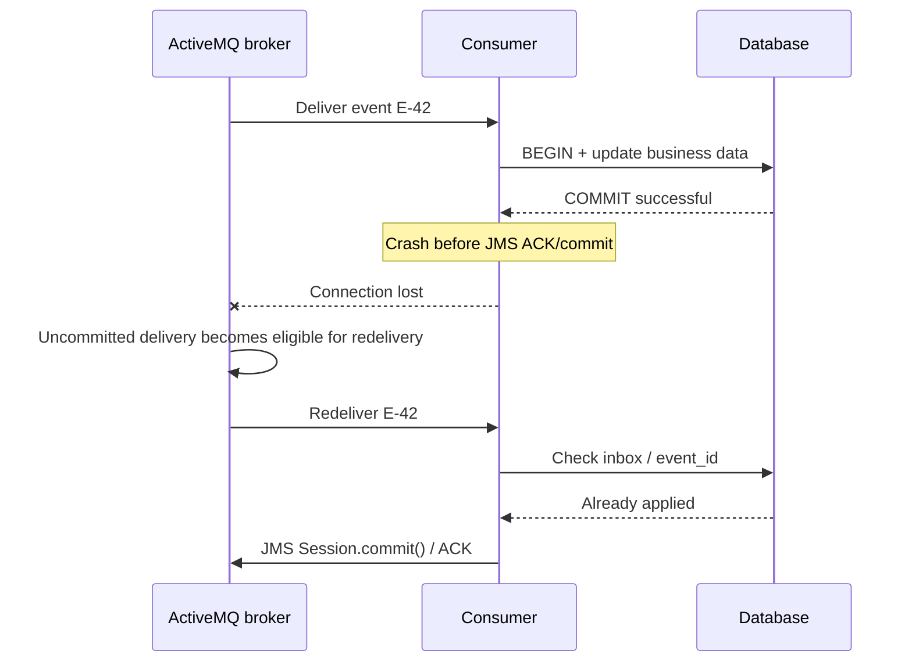
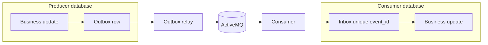

# Kiểm thử crash sau cập nhật dữ liệu nhưng trước xác nhận

> **Chương:** Kiểm thử  
> **Phạm vi:** Kiểm chứng failure window khi consumer đã commit cập nhật database nhưng broker chưa nhận JMS acknowledgement/transaction commit. Trọng tâm là redelivery, duplicate delivery, idempotent consumer, inbox/outbox, XA và fault injection trên **ActiveMQ Classic** và **ActiveMQ Artemis**. Lab dùng Classic 5.x, Java 17, `javax.jms` và PostgreSQL; nguyên tắc kiểm thử áp dụng cho Artemis với client `jakarta.jms` tương thích.

## 1. Failure window: dữ liệu đã đổi nhưng broker chưa nhận ACK

Một consumer thường thực hiện hai giao dịch ở hai hệ thống:

1. Nhận message từ broker.
2. Cập nhật database nghiệp vụ và commit DB.
3. Gửi xác nhận cho broker bằng `Session.commit()` (với transacted JMS session) hoặc `Message.acknowledge()` theo acknowledgement mode.

Nếu process chết **sau bước 2 nhưng trước bước 3**, database đã ghi nhận tác động, còn broker chưa nhận ACK. Khi connection/session biến mất, broker có thể giao lại message. Nếu consumer xử lý lại một cách mù quáng, tác động nghiệp vụ bị lặp.



Đây là **khoảng hở giữa hai transaction độc lập**. DB commit không tự commit JMS session; JMS acknowledgement cũng không tự rollback một DB transaction đã commit.

### 1.1 Các thời điểm crash có kết quả khác nhau

| Điểm crash | DB state | JMS state | Điều cần kiểm tra |
|---|---|---|---|
| Trước khi nhận message | Chưa thay đổi | Broker còn message | Message được giao sau khi consumer reconnect |
| Sau receive, trước DB begin | Chưa thay đổi | Chưa ACK | Redelivery |
| Trong DB transaction, trước DB commit | DB transaction rollback khi connection đóng | Chưa ACK | Redelivery và không có business effect |
| **Sau DB commit, trước JMS commit/ACK** | **Business effect đã tồn tại** | **Delivery chưa được xác nhận** | **Duplicate delivery; idempotency phải ngăn duplicate effect** |
| Sau JMS commit thành công | DB đã commit | Broker đã ACK theo session transaction | Không nên redeliver cùng delivery đã commit |
| JMS commit gửi đi nhưng client mất phản hồi | DB đã commit | Client không biết ACK đã được broker ghi nhận hay chưa | Unknown outcome; retry/reconnect phải an toàn |
| Sau JMS commit, trước application response | DB và JMS đã commit | Broker đã ACK | Caller có thể retry; API cần idempotency key |

**Không thể kết luận “message chưa được ACK” chỉ từ việc client không nhận được phản hồi.** Trong trường hợp timeout ngay lúc commit, broker có thể đã xử lý ACK nhưng phản hồi bị mất. Kiểm thử phải quan sát broker delivery/redelivery và DB state, không suy đoán từ một exception ở client.

### 1.2 “Xác nhận” có nhiều nghĩa

Trong bài này cần phân biệt:

- **JMS acknowledgement:** broker nhận xác nhận delivery. Với transacted session, `Session.commit()` chốt các message được nhận trong transaction.
- **Database commit:** thay đổi nghiệp vụ và inbox record đã được DB commit bền vững theo cấu hình DB.
- **Producer send commit:** với transacted producer session, message chỉ được chốt khi `Session.commit()` thành công.
- **Application confirmation:** HTTP response, callback, reply message hoặc event xác nhận cho hệ thống gọi.

Thứ tự thường dùng cho consumer độc lập DB/JMS là **DB transaction commit → JMS transaction commit → application confirmation**. Nếu gửi application confirmation trước khi DB commit, caller có thể tin một tác động chưa tồn tại. Nếu JMS ACK trước DB commit, crash có thể làm mất message trong khi dữ liệu chưa được ghi.

## 2. Redelivery là hành vi đúng; duplicate business effect mới là lỗi

Broker không biết một DB transaction bên ngoài đã commit hay chưa. Khi delivery không được ACK, broker cần giữ khả năng giao lại message để tránh mất công việc. Vì vậy:

- `JMSRedelivered` có thể được đặt `true` ở lần giao lại.
- `JMSXDeliveryCount` có thể giúp quan sát số lần giao theo provider/version.
- Consumer có thể nhận cùng một business event nhiều lần, kể cả khi broker persistent store hoạt động đúng.
- Idempotency phải dựa vào **business event ID ổn định**, không dựa vào connection ID, thread ID hoặc thời điểm nhận.

### 2.1 Phân biệt message ID và business event ID

`JMSMessageID` do provider/broker gán cho một message gửi cụ thể. `eventId` là định danh nghiệp vụ do producer tạo và giữ nguyên qua retry. Nếu producer gửi lại cùng một sự kiện nhưng tạo một JMS message mới, `JMSMessageID` có thể khác trong khi `eventId` vẫn phải giống nhau.

| Thuộc tính | Lần gửi đầu | Retry sau timeout |
|---|---|---|
| `JMSMessageID` | Provider gán ID A | Có thể là ID B |
| `eventId` | `payment-2026-00042` | `payment-2026-00042` |
| Business effect | Trừ tiền một lần | Không trừ lần thứ hai |

**Không dùng `JMSMessageID` thay cho idempotency key** nếu producer có thể tạo message mới cho cùng business event.

### 2.2 Redelivery policy và DLQ

Redelivery policy quyết định delay và số lần broker/client thử giao lại trước khi message bị đưa vào dead-letter destination hoặc xử lý theo policy tương ứng. Cần tách:

- **Redelivery:** cùng message được giao lại do rollback, session/connection chết hoặc ACK chưa được xác nhận.
- **Application retry:** ứng dụng tạo một message retry mới hoặc gửi lại event từ nguồn.
- **DLQ:** nơi giữ message đã vượt ngưỡng delivery/retry theo policy.

Không nên tăng vô hạn redelivery attempts để che lỗi dữ liệu. Một message gây lỗi deterministic có thể tạo vòng lặp nóng, chiếm consumer và làm backlog message hợp lệ tăng theo.

## 3. Thiết kế chống duplicate: inbox và transaction DB nguyên tử

### 3.1 Inbox record và business update phải cùng một DB transaction

Consumer idempotent ghi nhận event ID trong bảng inbox/processed events. **Insert inbox row và cập nhật dữ liệu nghiệp vụ phải nằm trong cùng một DB transaction**:

```sql
CREATE TABLE accounts (
    account_id  VARCHAR(80) PRIMARY KEY,
    balance     BIGINT NOT NULL
);

CREATE TABLE processed_events (
    event_id     VARCHAR(120) PRIMARY KEY,
    account_id   VARCHAR(80) NOT NULL,
    amount       BIGINT NOT NULL,
    processed_at TIMESTAMPTZ NOT NULL DEFAULT CURRENT_TIMESTAMP
);

INSERT INTO accounts(account_id, balance)
VALUES ('acct-001', 100000);
```

Khi nhận event:

1. Bắt đầu DB transaction.
2. Insert `event_id` vào `processed_events` bằng unique primary key.
3. Nếu insert thành công, cập nhật business row.
4. Nếu `event_id` đã tồn tại, xác minh payload identity không mâu thuẫn và bỏ qua business update.
5. Commit DB transaction.
6. Chỉ sau đó commit JMS session để ACK.

Nếu process chết sau bước 5, broker giao lại event; unique key khiến lần xử lý thứ hai nhận ra event đã áp dụng. Nếu process chết trước DB commit, cả inbox row và business update rollback cùng nhau, message được giao lại và xử lý bình thường.

### 3.2 Vì sao hai câu SQL phải nguyên tử?

Thiết kế sai:

```text
INSERT processed_events(event_id)
COMMIT
-- process crashes before UPDATE accounts
```

Khi redelivery, inbox row đã tồn tại nên consumer bỏ qua event; business update **không bao giờ xảy ra**. Thiết kế sai ngược lại — update account rồi commit trước khi insert inbox — có thể khiến lần giao lại update lần thứ hai.

Thiết kế đúng:

```sql
BEGIN;
INSERT INTO processed_events(event_id, account_id, amount)
VALUES (:event_id, :account_id, :amount)
ON CONFLICT (event_id) DO NOTHING;

-- Chỉ khi INSERT thực sự thêm một row:
UPDATE accounts
SET balance = balance + :amount
WHERE account_id = :account_id;
COMMIT;
```

Ví dụ SQL dùng cú pháp `ON CONFLICT` của PostgreSQL. Với DB khác, thay bằng cú pháp upsert/insert-ignore phù hợp, nhưng vẫn phải bảo đảm unique constraint và cùng transaction. Nếu event ID đã tồn tại, kiểm tra `account_id` và `amount` cũ có khớp payload retry; cùng ID nhưng nội dung khác phải là lỗi dữ liệu, không được âm thầm bỏ qua.

### 3.3 Inbox không thay thế validation và business constraint

Idempotency key chỉ ngăn một event được áp dụng nhiều lần. Consumer vẫn phải:

- Validate schema, version và chữ ký/nguồn gửi nếu có.
- Kiểm tra account/order/customer có tồn tại và đúng trạng thái.
- Áp dụng constraint nghiệp vụ trong cùng DB transaction.
- Xử lý event ID trùng nhưng payload khác như conflict cần điều tra.
- Lưu trạng thái xử lý và correlation/trace ID đủ để audit mà không log dữ liệu nhạy cảm.

Nếu business effect kéo dài qua nhiều hệ thống bên ngoài DB transaction (gửi email, gọi payment gateway, ghi file), inbox đơn thuần không làm side effect đó exactly-once. Cần idempotency key ở downstream hoặc workflow/outbox/saga phù hợp.

## 4. Outbox ở producer và inbox ở consumer giải quyết hai phía khác nhau

**Transactional outbox** giải quyết khoảng hở giữa cập nhật DB của producer và publish message:

1. Trong một DB transaction, producer ghi business data và outbox event.
2. Relay đọc outbox, publish message persistent tới broker với `eventId` ổn định.
3. Sau khi publish được xác nhận, relay đánh dấu outbox row đã gửi theo semantics phù hợp.
4. Nếu relay crash sau publish nhưng trước khi đánh dấu, event có thể được publish lại; consumer inbox xử lý idempotent.

**Inbox** giải quyết duplicate effect ở consumer. Hai pattern bổ sung cho nhau:



Outbox relay vẫn có thể publish trùng nếu mất phản hồi hoặc crash giữa publish và mark-sent. Vì vậy consumer inbox vẫn cần thiết. Không tuyên bố “outbox bảo đảm exactly-once end-to-end”; nó làm cho việc phát event không bị mất giữa DB commit và broker publish, đồng thời chấp nhận retry có kiểm soát.

## 5. XA/JTA: khi cần transaction xuyên DB và JMS

XA có thể enlist DB và JMS resource trong một global transaction do transaction manager điều phối. Two-phase commit gồm prepare và commit; nó giảm khoảng hở commit giữa hai resource khi cả hai resource, driver, broker và transaction manager hỗ trợ XA đúng cách.

| Phương án | Đảm bảo chính | Chi phí/giới hạn |
|---|---|---|
| DB transaction + JMS ACK riêng | At-least-once delivery; inbox/idempotency bảo vệ business effect | Phải thiết kế dedupe và xử lý unknown outcome |
| XA/JTA transaction | DB và JMS cùng tham gia global transaction | Cần XA datasource/connection factory, transaction manager, recovery log và vận hành in-doubt |
| Outbox + inbox | DB-local atomicity ở mỗi phía, retry event an toàn | Có thể publish/deliver trùng; cần relay và dedupe |

XA không tự làm các side effect ngoài resource XA trở nên atomic. Nếu transaction coordinator chết sau prepare, có thể tồn tại in-doubt transaction cần recovery. Chỉ dùng XA khi có yêu cầu nhất quán rõ ràng và đội vận hành quản lý được transaction manager/recovery; không bật XA chỉ để tránh viết inbox.

## 6. Hành vi cần kiểm chứng trên Classic và Artemis

### 6.1 ActiveMQ Classic

Với Classic, consumer dùng transacted JMS session:

```java
Session session = connection.createSession(
        true, Session.SESSION_TRANSACTED);
MessageConsumer consumer = session.createConsumer(queue);
Message message = consumer.receive(5000);

// Cập nhật DB transaction và commit DB trước.
applyDatabaseTransaction(message);

// Đây là điểm commit/ACK phía JMS.
session.commit();
```

Nếu process chết sau `applyDatabaseTransaction` nhưng trước `session.commit()`, broker có thể redeliver message sau khi nhận ra consumer connection đã mất. Classic client có `RedeliveryPolicy` để cấu hình delay/max redeliveries; broker-side dead-letter strategy quyết định destination DLQ. Phải test cùng phiên bản broker/client, persistence adapter và transport đang triển khai.

Ví dụ policy phía Classic client:

```java
import org.apache.activemq.ActiveMQConnectionFactory;
import org.apache.activemq.RedeliveryPolicy;

ActiveMQConnectionFactory factory =
        new ActiveMQConnectionFactory("tcp://127.0.0.1:61616");

RedeliveryPolicy policy = new RedeliveryPolicy();
policy.setInitialRedeliveryDelay(1000);
policy.setRedeliveryDelay(1000);
policy.setMaximumRedeliveries(5);
factory.setRedeliveryPolicy(policy);
```

Đây là **client-side redelivery policy** của Classic OpenWire client; không thay thế broker DLQ configuration. Nếu consumer có nhiều client khác nhau, phải quản lý policy nhất quán hoặc kiểm thử sự khác biệt. Không đặt maximum redeliveries quá thấp khiến một lỗi tạm thời đưa message hợp lệ vào DLQ ngay; cũng không để vô hạn khi poison message có thể lặp mãi.

### 6.2 ActiveMQ Artemis

Artemis quản lý redelivery theo address settings. Ví dụ cấu hình trong `<address-settings>` của `broker.xml`:

```xml
<address-settings>
    <address-setting match="lab.crash.#">
        <dead-letter-address>DLQ</dead-letter-address>
        <max-delivery-attempts>5</max-delivery-attempts>
        <redelivery-delay>1000</redelivery-delay>
        <redelivery-multiplier>1.0</redelivery-multiplier>
    </address-setting>
</address-settings>

<addresses>
    <address name="DLQ">
        <anycast>
            <queue name="DLQ"/>
        </anycast>
    </address>
</addresses>
```

Ghép các phần vào cấu trúc `<core>` hiện có và xác minh address thật mà JMS queue ánh xạ tới. Các setting áp theo address match; kiểm tra pattern cụ thể hơn/default policy và schema của Artemis version đang chạy. `max-delivery-attempts`/`redelivery-delay` điều khiển cách broker xử lý delivery lỗi; không thay thế consumer idempotency.

Trong cả hai broker, persistent delivery và persistent store giúp message tồn tại qua restart theo cấu hình durability. Tuy nhiên, **message tồn tại và business effect không bị lặp là hai điều kiện khác nhau**. Kiểm thử cần xác minh cả redelivery lẫn inbox state.

## 7. Lab fault injection: crash sau DB commit, trước JMS commit

Lab dùng ActiveMQ Classic 5.x, Java 17, PostgreSQL và Gradle. Nó tạo một event tăng balance của account. Consumer commit DB trước, sau đó có một công tắc làm JVM dừng đột ngột ngay trước `Session.commit()`. Khi chạy lại consumer, broker giao lại message và inbox table ngăn tăng balance lần hai.

### 7.1 Môi trường và schema

Tạo database lab và chạy SQL:

```sql
CREATE TABLE accounts (
    account_id VARCHAR(80) PRIMARY KEY,
    balance BIGINT NOT NULL
);

CREATE TABLE processed_events (
    event_id VARCHAR(120) PRIMARY KEY,
    account_id VARCHAR(80) NOT NULL,
    amount BIGINT NOT NULL,
    processed_at TIMESTAMPTZ NOT NULL DEFAULT CURRENT_TIMESTAMP
);

INSERT INTO accounts(account_id, balance)
VALUES ('acct-001', 100000)
ON CONFLICT (account_id) DO NOTHING;
```

Queue lab là `lab.crash.after-db-commit`. Broker phải bật persistence phù hợp và destination phải được provision/cấp quyền. Với Classic có thể dùng KahaDB mặc định của broker lab; không thay đổi persistence của môi trường production để chạy fault injection.

### 7.2 Gradle dependencies

`settings.gradle`:

```groovy
rootProject.name = 'crash-window-lab'
```

`build.gradle`:

```groovy
plugins {
    id 'java'
    id 'application'
}

repositories {
    mavenCentral()
}

java {
    toolchain {
        languageVersion = JavaLanguageVersion.of(17)
    }
}

dependencies {
    implementation 'org.apache.activemq:activemq-client:5.18.3'
    implementation 'org.postgresql:postgresql:42.7.4'
    runtimeOnly 'org.slf4j:slf4j-simple:1.7.36'
}

application {
    mainClass = 'lab.CrashWindowProbe'
}
```

Đây là dependency mốc để minh họa Classic `javax.jms`; không phải xác nhận version mới nhất hoặc khuyến nghị production. Với Artemis + Jakarta JMS, dùng client artifact/version tương thích và đổi import/API theo client đó.

### 7.3 Mã Java producer và consumer

Tạo `src/main/java/lab/CrashWindowProbe.java`:

```java
package lab;

import java.sql.DriverManager;
import java.sql.PreparedStatement;
import java.sql.ResultSet;
import java.sql.SQLException;
import javax.jms.Connection;
import javax.jms.DeliveryMode;
import javax.jms.JMSException;
import javax.jms.Message;
import javax.jms.MessageConsumer;
import javax.jms.MessageProducer;
import javax.jms.Queue;
import javax.jms.Session;
import javax.jms.TextMessage;
import org.apache.activemq.ActiveMQConnectionFactory;
import org.apache.activemq.RedeliveryPolicy;

public final class CrashWindowProbe {
    private static final String QUEUE = "lab.crash.after-db-commit";

    private CrashWindowProbe() { }

    public static void main(String[] args) throws Exception {
        if (args.length == 4 && "send".equals(args[0])) {
            send(args[1], args[2], Long.parseLong(args[3]));
        } else if (args.length == 2 && "consume".equals(args[0])) {
            consume(Integer.parseInt(args[1]));
        } else {
            usage();
        }
    }

    private static ActiveMQConnectionFactory factory() {
        String url = env("BROKER_URL", "tcp://127.0.0.1:61616");
        ActiveMQConnectionFactory factory =
                new ActiveMQConnectionFactory(url);
        RedeliveryPolicy policy = new RedeliveryPolicy();
        policy.setInitialRedeliveryDelay(1000);
        policy.setRedeliveryDelay(1000);
        policy.setMaximumRedeliveries(5);
        factory.setRedeliveryPolicy(policy);
        return factory;
    }

    private static Connection connect() throws JMSException {
        ActiveMQConnectionFactory factory = factory();
        String user = System.getenv("BROKER_USER");
        String password = System.getenv("BROKER_PASSWORD");
        return user == null || user.isBlank()
                ? factory.createConnection()
                : factory.createConnection(user, password);
    }

    private static void send(
            String eventId, String accountId, long amount)
            throws Exception {
        if (eventId.isBlank() || accountId.isBlank() || amount <= 0) {
            throw new IllegalArgumentException(
                    "eventId/accountId required; amount must be positive");
        }

        Connection connection = connect();
        try {
            Session session = connection.createSession(
                    true, Session.SESSION_TRANSACTED);
            try {
                Queue queue = session.createQueue(QUEUE);
                MessageProducer producer = session.createProducer(queue);
                try {
                    producer.setDeliveryMode(DeliveryMode.PERSISTENT);
                    TextMessage message = session.createTextMessage(
                            "account-credit:" + eventId);
                    message.setStringProperty("eventId", eventId);
                    message.setStringProperty("accountId", accountId);
                    message.setLongProperty("amount", amount);
                    producer.send(message);
                    session.commit();
                    System.out.println(
                            "PRODUCER_COMMITTED eventId=" + eventId);
                } finally {
                    producer.close();
                }
            } finally {
                session.close();
            }
        } finally {
            connection.close();
        }
    }

    private static void consume(int maxMessages) throws Exception {
        if (maxMessages < 0 || maxMessages > 1000) {
            throw new IllegalArgumentException(
                    "maxMessages must be 0..1000; zero means until idle");
        }

        Connection connection = connect();
        try {
            connection.start();
            Session session = connection.createSession(
                    true, Session.SESSION_TRANSACTED);
            try {
                Queue queue = session.createQueue(QUEUE);
                MessageConsumer consumer = session.createConsumer(queue);
                int committed = 0;
                try {
                    while (maxMessages == 0 || committed < maxMessages) {
                        Message message = consumer.receive(5000);
                        if (message == null) {
                            break;
                        }

                        String eventId =
                                message.getStringProperty("eventId");
                        String accountId =
                                message.getStringProperty("accountId");
                        long amount = message.getLongProperty("amount");
                        boolean redelivered = message.getJMSRedelivered();
                        int deliveryCount =
                                message.propertyExists("JMSXDeliveryCount")
                                ? message.getIntProperty("JMSXDeliveryCount")
                                : -1;

                        System.out.printf(
                                "RECEIVED eventId=%s redelivered=%s"
                                + " deliveryCount=%d%n",
                                eventId, redelivered, deliveryCount);

                        applyDatabaseTransaction(
                                eventId, accountId, amount);

                        // Fault injection: DB đã commit, JMS session chưa commit.
                        if (Boolean.parseBoolean(
                                env("CRASH_AFTER_DB_COMMIT", "false"))) {
                            System.err.println(
                                    "CRASH_WINDOW eventId=" + eventId);
                            Runtime.getRuntime().halt(73);
                        }

                        try {
                            session.commit();
                            committed++;
                            System.out.println(
                                    "JMS_ACK_COMMITTED eventId=" + eventId);
                        } catch (JMSException uncertain) {
                            System.err.println(
                                    "JMS_ACK_OUTCOME_UNKNOWN eventId="
                                    + eventId);
                            throw uncertain;
                        }
                    }
                } finally {
                    consumer.close();
                }
            } finally {
                session.close();
            }
        } finally {
            connection.close();
        }
    }

    private static void applyDatabaseTransaction(
            String eventId, String accountId, long amount)
            throws SQLException {
        String dbUrl = env(
                "DB_URL", "jdbc:postgresql://127.0.0.1:5432/activemq_lab");
        String dbUser = env("DB_USER", "postgres");
        String dbPassword = env("DB_PASSWORD", "");

        try (java.sql.Connection db =
                     DriverManager.getConnection(dbUrl, dbUser, dbPassword)) {
            db.setAutoCommit(false);
            try {
                int inserted;
                try (PreparedStatement inbox = db.prepareStatement(
                        "INSERT INTO processed_events"
                        + "(event_id, account_id, amount) VALUES (?, ?, ?) "
                        + "ON CONFLICT (event_id) DO NOTHING")) {
                    inbox.setString(1, eventId);
                    inbox.setString(2, accountId);
                    inbox.setLong(3, amount);
                    inserted = inbox.executeUpdate();
                }

                if (inserted == 1) {
                    try (PreparedStatement update = db.prepareStatement(
                            "UPDATE accounts SET balance = balance + ? "
                            + "WHERE account_id = ?")) {
                        update.setLong(1, amount);
                        update.setString(2, accountId);
                        if (update.executeUpdate() != 1) {
                            throw new SQLException(
                                    "Account not found: " + accountId);
                        }
                    }
                    System.out.println(
                            "DB_EFFECT_APPLIED eventId=" + eventId);
                } else {
                    verifyDuplicatePayload(
                            db, eventId, accountId, amount);
                    System.out.println(
                            "DB_DUPLICATE_SKIPPED eventId=" + eventId);
                }

                db.commit();
                System.out.println("DB_COMMITTED eventId=" + eventId);
            } catch (SQLException failure) {
                db.rollback();
                throw failure;
            }
        }
    }

    private static void verifyDuplicatePayload(
            java.sql.Connection db, String eventId,
            String accountId, long amount) throws SQLException {
        try (PreparedStatement query = db.prepareStatement(
                "SELECT account_id, amount FROM processed_events "
                + "WHERE event_id = ?")) {
            query.setString(1, eventId);
            try (ResultSet row = query.executeQuery()) {
                if (!row.next()
                        || !accountId.equals(row.getString("account_id"))
                        || amount != row.getLong("amount")) {
                    throw new SQLException(
                            "eventId reused with different payload: "
                            + eventId);
                }
            }
        }
    }

    private static String env(String key, String fallback) {
        String value = System.getenv(key);
        return value == null || value.isBlank() ? fallback : value;
    }

    private static void usage() {
        System.out.println("send <eventId> <accountId> <amount>");
        System.out.println(
                "consume <maxMessages>; 0 means receive until idle");
    }
}
```

Trong code, `processed_events` và `accounts` được cập nhật trong **cùng DB transaction**. `Runtime.halt(73)` cố ý dừng JVM không chạy shutdown hook để tạo crash window; chỉ dùng trong broker/database lab cô lập. Consumer commit JMS sau khi DB commit. Khi chạy lại, event trùng được nhận diện, payload được đối chiếu và business update không chạy lần hai.

## 8. Trình tự chạy lab và kết quả mong đợi

### 8.1 Baseline: không inject crash

Đảm bảo account `acct-001` có balance `100000`, bảng `processed_events` chưa có `evt-001`, queue lab rỗng. Chạy:

```bash
# Terminal producer
gradle run --args="send evt-001 acct-001 250"

# Terminal consumer
gradle run --args="consume 1"
```

Kết quả:

- `accounts.balance` tăng từ `100000` lên `100250`.
- `processed_events` có đúng một row `evt-001`.
- Consumer in `DB_EFFECT_APPLIED`, `DB_COMMITTED`, sau đó `JMS_ACK_COMMITTED`.
- Queue không còn message pending.

### 8.2 Crash sau DB commit, trước JMS commit

Dùng event ID mới `evt-002`. Gửi message rồi bật fault flag **chỉ ở process consumer**:

```powershell
# Gửi event mới
gradle run --args="send evt-002 acct-001 300"

# Terminal consumer: JVM sẽ halt ngay sau DB commit
$env:CRASH_AFTER_DB_COMMIT = "true"
gradle run --args="consume 1"
```

Process kết thúc với exit code `73` sau log `DB_COMMITTED eventId=evt-002` và `CRASH_WINDOW`. **Không có** log `JMS_ACK_COMMITTED` cho event đó.

Kiểm tra DB:

```sql
SELECT account_id, balance
FROM accounts
WHERE account_id = 'acct-001';

SELECT event_id, account_id, amount
FROM processed_events
WHERE event_id = 'evt-002';
```

Kỳ vọng balance đã tăng đúng 300 và inbox có một row `evt-002`, dù JMS chưa commit. Broker cần phát hiện connection chết; thời điểm phát hiện phụ thuộc transport failure detection/connection timeout.

### 8.3 Restart consumer và xác nhận redelivery không lặp business effect

Tắt biến fault injection, khởi động lại:

```powershell
$env:CRASH_AFTER_DB_COMMIT = "false"
gradle run --args="consume 1"
```

Kết quả mong đợi:

- Consumer nhận lại `evt-002`; `JMSRedelivered` thường là `true`, delivery count có thể lớn hơn 1 theo provider/version.
- `INSERT ... ON CONFLICT DO NOTHING` không thêm row mới.
- `verifyDuplicatePayload` xác nhận account/amount khớp.
- Consumer in `DB_DUPLICATE_SKIPPED`, commit JMS session và ACK message.
- Balance vẫn là `100550`, inbox vẫn chỉ có một row `evt-002`, queue pending giảm về 0.

**Không assert một con số delivery count cố định** trên mọi phiên bản hoặc sau mọi kiểu restart; dùng log/broker metric để xác nhận redelivery. Tiêu chí chính là business effect chỉ áp dụng một lần và delivery cuối cùng được ACK.

### 8.4 Đối chứng với consumer không idempotent

Trong một lab riêng, bỏ inbox unique check và chỉ chạy:

```sql
BEGIN;
UPDATE accounts
SET balance = balance + 300
WHERE account_id = 'acct-001';
COMMIT;
```

Sau crash trước JMS commit, message redeliver và câu UPDATE chạy lần nữa. Balance sẽ tăng thêm 300 lần thứ hai. Đối chứng này cho thấy broker redelivery là đúng semantics; lỗi nằm ở consumer không chống duplicate.

Không chạy đối chứng trên dữ liệu dùng chung. Reset account/queue trong lab bằng script setup có kiểm soát, không purge destination production.

## 9. Ma trận fault injection và bằng chứng cần thu

| Mã | Điểm gây lỗi | DB kỳ vọng | Broker/JMS kỳ vọng | Điều kiện PASS |
|---|---|---|---|---|
| F1 | Trước DB transaction | Không có inbox/business effect | Message còn hoặc redeliver | Event được xử lý sau reconnect |
| F2 | Giữa DB transaction, trước commit | Rollback cả inbox và business update | Redelivery | Chỉ một business effect sau retry |
| F3 | **Sau DB commit, trước JMS commit** | Inbox + business effect đã commit | Redelivery có thể xảy ra | Duplicate bị inbox chặn |
| F4 | JMS commit đã thành công | DB effect đã commit | Message được ACK | Không tạo duplicate delivery bình thường |
| F5 | JMS commit gửi đi, response bị mất | DB effect đã commit | Outcome phía client không rõ | Retry an toàn, đối soát được |
| F6 | Sau JMS commit, trước HTTP/reply confirmation | DB/JMS đã commit | Message đã ACK | Caller retry không tạo event mới |
| F7 | DB unavailable trước update | Không có DB commit | JMS rollback/connection retry | Message không bị ACK sớm |
| F8 | Cùng eventId được gửi hai lần | Một inbox row, một business effect | Hai deliveries/messages có thể xuất hiện | Duplicate được bỏ qua |
| F9 | Cùng eventId nhưng amount/account khác | Không ghi đè dữ liệu cũ | Có thể rollback/DLQ theo policy | Conflict được phát hiện và alert |
| F10 | Consumer chết nhiều lần | Không có duplicate effect | Delivery count tăng; có thể tới DLQ | Poison message không lặp vô hạn |
| F11 | Broker restart khi message persistent chưa ACK | DB state tùy điểm crash | Message được phục hồi theo persistence/HA policy | Không mất message đã commit trong giả định lưu trữ |
| F12 | Hai consumer cùng nhận event retry cạnh tranh | Unique constraint serialize hiệu quả | Một hoặc nhiều delivery attempt | Chỉ một transaction áp business effect |

### 9.1 Log và metric cần thu

Ghi các mốc có cùng `eventId` và trace ID:

- `RECEIVED`: consumer nhận message, kèm `JMSRedelivered` và delivery count nếu có.
- `DB_EFFECT_APPLIED`: inbox insert mới và business update đã thực hiện trong transaction.
- `DB_DUPLICATE_SKIPPED`: event đã tồn tại và payload trùng khớp.
- `DB_COMMITTED`: database commit trả thành công.
- `CRASH_WINDOW`: fault injection dừng process trước JMS commit.
- `JMS_ACK_COMMITTED`: JMS session commit trả thành công.
- `JMS_ACK_OUTCOME_UNKNOWN`: client mất kết quả commit; cần đối soát.

Broker-side cần xem queue pending, in-flight, enqueue/dequeue, redelivery, DLQ và connection close/reconnect. DB-side cần xem inbox row, business row, transaction commit/rollback và unique conflict. Không log password, token hoặc payload nhạy cảm.

### 9.2 Điều kiện PASS của ca crash window

Một ca F3 chỉ PASS khi đồng thời:

1. DB đã commit business effect và đúng một inbox row trước khi consumer chết.
2. JMS transaction chưa commit ở consumer cũ.
3. Broker giao lại message hoặc cung cấp bằng chứng delivery chưa được ACK.
4. Consumer chạy lại nhận cùng `eventId`.
5. Inbox unique key ngăn business update chạy lần thứ hai.
6. Payload trùng khớp; nếu khác payload thì test phải fail/alert, không silently skip.
7. Consumer commit JMS session sau khi DB đã được xác minh.
8. Cuối cùng queue pending/in-flight trở về trạng thái mong đợi và business balance chỉ tăng một lần.

Nếu process chỉ in log “crash” nhưng DB commit chưa thực sự xảy ra, đó không phải F3. Nếu broker không redeliver vì ACK đã commit trước khi crash, đó là một điểm crash khác và phải phân loại F4/F5.

## 10. Khác biệt khi chạy cùng kịch bản trên Artemis

Kịch bản failure window không đổi: DB commit đã thành công, JMS transaction chưa commit; sau khi consumer connection/session mất, message chưa ACK có thể được giao lại. Khác biệt nằm ở client namespace, broker configuration và cách quan sát management:

| Nội dung | Classic 5.x | Artemis |
|---|---|---|
| JMS API client | `javax.jms` | `jakarta.jms` với client tương thích |
| Consumer transaction | Transacted JMS `Session` | Transacted JMS `Session` |
| Redelivery configuration | Classic client `RedeliveryPolicy` và broker DLQ strategy | Address settings: redelivery delay/max attempts/DLQ |
| Destination model | Queue/topic destination | Address + queue, routing type |
| Quan sát | Classic JMX BrokerView/QueueView | Artemis management/JMX/metrics |
| Idempotency | DB inbox unique event ID | DB inbox unique event ID |

Khi chạy trên Artemis, bảo đảm JMS queue `lab.crash.after-db-commit` ánh xạ đúng address/queue, consumer có quyền consume và redelivery policy cho phép ít nhất một lần giao lại trong lab. Nếu max delivery attempts quá thấp, message có thể đi DLQ trước khi consumer recovery; đó là kết quả policy cần ghi nhận, không phải bằng chứng DB inbox không hoạt động.

## 11. Lỗi triển khai thường gặp

| Lỗi | Hậu quả | Cách khắc phục |
|---|---|---|
| Commit DB rồi ACK JMS bằng auto-ack trước khi xử lý | Crash có thể làm mất message khi DB chưa cập nhật | Dùng transaction/ack mode có thứ tự rõ |
| Update DB rồi insert inbox ở transaction khác | Crash giữa hai commit tạo duplicate hoặc mất effect | Inbox + business update cùng DB transaction |
| Tạo event ID mới mỗi lần retry | Inbox không nhận diện cùng business event | Giữ event ID từ nguồn qua mọi retry |
| Chỉ kiểm `JMSRedelivered` để dedupe | Cờ delivery không thay thế business identity | Unique inbox key |
| ACK message trước khi DB commit | Message bị xóa khỏi queue dù business update rollback | DB commit trước JMS commit |
| Retry message vô hạn | Poison message chiếm consumer và tạo backlog | Redelivery limit, DLQ và operator workflow |
| Gửi email/gọi API ngoài DB rồi mới ACK | Side effect ngoài DB có thể lặp | Idempotency key downstream hoặc outbox/workflow |
| Xem client timeout là commit chắc chắn thất bại | Gửi lại event mới và duplicate effect | Xử lý unknown outcome, retry cùng event ID |
| Xóa DLQ để làm sạch test | Mất bằng chứng message bị poison | Lưu test evidence, chỉ reset lab có kiểm soát |
| Không kiểm payload khi eventId trùng | Hai event khác nội dung bị coi là một | So sánh immutable payload identity/hash |

## 12. Checklist và câu hỏi tự kiểm tra

### Checklist nghiệm thu

- [ ] Producer gửi message persistent trong transacted session và commit trước khi test consumer.
- [ ] Consumer dùng transacted JMS session hoặc acknowledgement mode được mô tả rõ.
- [ ] DB inbox row và business update nằm trong cùng một DB transaction.
- [ ] Fault injection đặt chính xác sau DB commit và trước JMS commit.
- [ ] Consumer process dừng đột ngột, không chạy graceful rollback/shutdown hook.
- [ ] Broker redeliver message chưa ACK; thu log/metric để chứng minh.
- [ ] Retry cùng `eventId`, không tạo event ID mới.
- [ ] Duplicate không áp dụng business effect lần hai.
- [ ] Event ID trùng nhưng payload khác được phát hiện.
- [ ] Test riêng unknown JMS commit outcome và caller retry sau application response timeout.
- [ ] Redelivery limit, delay và DLQ được quan sát; poison message không lặp vô hạn.
- [ ] DB/broker evidence được đối chiếu bằng event ID; không chứa secret/PII.

### Câu hỏi

1. Vì sao DB commit thành công nhưng broker vẫn có quyền redeliver message?
2. Tại sao `JMSMessageID` không đủ làm idempotency key khi producer gửi lại cùng business event?
3. Nếu inbox row commit trước business update, crash có thể làm mất tác động như thế nào?
4. Nếu business update commit trước inbox row, crash có thể tạo duplicate ra sao?
5. Vì sao inbox insert và business update phải nằm trong cùng DB transaction?
6. Khi `Session.commit()` ném exception do mất kết nối, làm sao phân biệt ACK chưa được broker xử lý với response bị mất?
7. Outbox giải quyết failure window nào ở producer? Vì sao consumer vẫn cần inbox?
8. XA/JTA giải quyết điều gì và tạo thêm yêu cầu vận hành nào?
9. Khi nào một message redeliver nhiều lần cần vào DLQ thay vì tiếp tục retry?
10. Vì sao F3 phải kiểm tra cả DB state, broker delivery state và business effect?

**Kết luận:** Crash sau khi DB commit nhưng trước JMS acknowledgement là một failure window bình thường trong hệ thống dùng hai transaction resource độc lập. Broker redelivery bảo vệ message chưa được xác nhận; consumer phải dùng **inbox/event ID duy nhất và business update nguyên tử trong DB** để ngăn duplicate effect. Fault test đúng phải chứng minh DB đã commit, JMS chưa commit, message được giao lại và lần xử lý lại chỉ ACK mà không cập nhật nghiệp vụ lần hai. Outbox bảo vệ phía publish; XA/JTA là lựa chọn phối hợp transaction với chi phí recovery cao hơn. Dù dùng Classic hay Artemis, mục tiêu là **at-least-once delivery với business effect idempotent**, không tuyên bố exactly-once chỉ vì một lần chạy không gặp lỗi.
