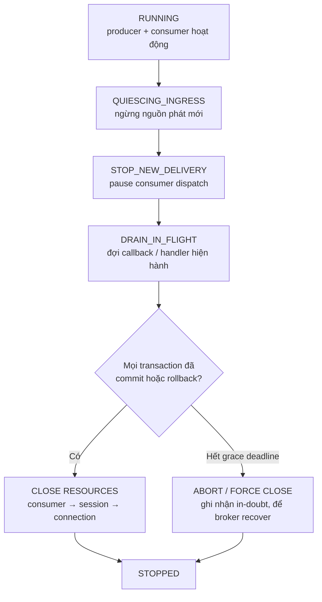

# Graceful shutdown, tạm dừng nhận và xử lý thông điệp đang giao

> **Chương:** Vận hành  
> **Module:** `INTEGRATION_MESSAGING_MESSAGE_BROKER_ACTIVEMQ` — tìm hiểu Apache ActiveMQ Classic và Artemis trong giao tiếp bất đồng bộ với queue, topic, routing và JMS; thực hành Java producer/consumer, acknowledgment, transaction, redelivery, DLQ, bảo mật và vận hành broker đáng tin cậy.  
> **Trọng tâm:** Điều phối shutdown theo từng lớp: ngừng nhận workload mới, dừng dispatch cho consumer, để callback đang chạy hoàn tất, commit/rollback đúng transaction, giải phóng JMS resources và dừng broker trong thời hạn vận hành. Bài phân biệt **JMS Connection.stop**, **consumer/session close**, **queue pause**, **address block**, **broker graceful shutdown** và cách kiểm chứng message không bị mất khi deploy/restart.

## 1. “Tắt ứng dụng” không đồng nghĩa “xử lý xong message”

Một worker nhận lệnh `CreateInvoice` từ queue `billing.invoice.jobs`. Khi tiến trình bị dừng đột ngột, có thể có ba trạng thái:

1. Message chưa được broker dispatch: vẫn nằm trong queue.
2. Message đã được dispatch hoặc đưa vào prefetch buffer nhưng callback chưa hoàn tất.
3. Callback đã ghi dữ liệu vào database nhưng JMS transaction chưa commit/ack.

Nếu đóng tiến trình ngay khi đang ở trạng thái 2 hoặc 3, message có thể được redeliver. Redelivery là hành vi cần thiết để bảo vệ delivery guarantee, nhưng nếu side effect đã được ghi trước lúc JMS commit thì nghiệp vụ có thể chạy hai lần.

**Graceful shutdown** phải xác định rõ ranh giới công việc nào được phép bắt đầu, công việc đang chạy được hoàn tất tới đâu và điều gì xảy ra với phần chưa commit khi hết thời hạn dừng.

### 1.1. Bốn mục tiêu phải đạt

- **Quiesce ingress:** ngừng nhận công việc mới từ upstream hoặc điều tiết producer.
- **Stop new delivery:** ngừng dispatch message mới tới worker đang chuẩn bị dừng.
- **Drain in-flight:** chờ các callback/handler đã bắt đầu kết thúc và chốt transaction.
- **Release resources:** đóng consumer, session, connection và cuối cùng broker theo đúng thứ tự.

Không phải thao tác nào cũng làm được cả bốn việc. Ví dụ `Connection.stop()` của JMS chỉ tạm dừng **delivery tới consumer của connection**; nó **không ngừng producer gửi message qua connection đó**. Artemis `QueueControl.pause()` ngừng giao message từ queue nhưng broker vẫn nhận/routing message mới. Broker graceful shutdown lại xử lý lifecycle của server và các client connection, không tự chứng minh business side effect đã hoàn tất.



### 1.2. Phạm vi của bài

Bài tập trung vào:

- JMS API portable cho `Connection`, `MessageConsumer`, `Session`, transaction và acknowledgment.
- Cách pause/resume queue trong ActiveMQ Classic và Artemis.
- Cách block ingress tại Artemis address.
- Graceful shutdown của broker và lệnh quản trị Classic.
- Spring `DefaultMessageListenerContainer` và thời hạn shutdown của ứng dụng.
- Kiểm thử rolling deployment, process termination, redelivery và message integrity.

## 2. Phân biệt các lớp “pause” và “stop”

| Thao tác | Ngừng producer gửi? | Ngừng broker dispatch? | Chờ listener đang chạy? | Tác động tới message chưa commit |
|---|---|---|---|---|
| `Connection.stop()` | **Không** | Có, với mọi consumer trên connection | **Có**: phải đợi listener hiện hành trả về | Session vẫn mở; ứng dụng có thể commit/rollback trước khi đóng |
| `MessageConsumer.close()` | Không | Đóng consumer đó | Có: đợi receive/listener đang chạy trên consumer hoàn tất | Không tự ack/rollback transaction của session |
| `Session.close()` | Không | Đóng các consumer thuộc session | Có: shutdown message processing có trật tự | **Transacted session rollback transaction đang dở** |
| `Connection.close()` | Đóng connection nên producer cũng ngừng dùng được | Đóng các session/consumer | Chờ xử lý đang chạy theo JMS contract | Transaction của transacted session đang dở bị rollback |
| Classic `QueueViewMBean.pause()` | Không | **Có**: pause dispatch queue | Không thay thế việc đếm/đợi business callback | Message pending vẫn ở queue; in-flight cần kiểm tra riêng |
| Artemis `QueueControl.pause()` | Không | **Có**: queue nhận nhưng không deliver | Không thay thế app-side drain counter | Message vẫn ở queue; in-flight phải đối chiếu riêng |
| Artemis `AddressControl.block()` | **Điều tiết producer**: không cấp thêm credits | Không tự pause consumer | Không | Existing queue có thể tiếp tục được consumer drain |
| Artemis `AddressControl.pause()` | Không; address vẫn nhận message | Pause delivery cho các queue bound vào address | Không tự đợi callback app | Message mới vẫn được nhận, chưa deliver |
| Broker graceful shutdown | Ngừng nhận connection mới theo broker policy | Khi server shutdown, resource bị dừng | Chờ clients disconnect theo cấu hình | Không tự xác nhận mọi business transaction đã hoàn tất |

**Một quy trình shutdown tốt thường kết hợp nhiều thao tác.** Ứng dụng điều phối ingress và listener lifecycle; broker cung cấp pause/block và server shutdown; JMS transaction quyết định message đã được xác nhận hay phải redeliver.

## 3. JMS portable: Connection.stop là điểm bắt đầu để ngừng delivery

Jakarta Messaging 3.1 định nghĩa `Connection.stop()` là thao tác tạm dừng việc giao message tới tất cả consumer của connection:

- Các lời gọi `receive()` đồng bộ bị chặn và không nhận message mới khi connection đang stopped.
- Message không được giao cho `MessageListener` trong lúc stopped.
- Lời gọi `stop()` không được trả về cho tới khi delivery đã tạm dừng.
- Nếu listener đang chạy, provider phải đợi listener đó trả về trước khi `stop()` trả về.
- Các dịch vụ của connection/session vẫn khả dụng cho listener đang hoàn tất.
- `Connection.stop()` **không ảnh hưởng khả năng send** qua connection.

Do đó, có thể gọi `stop()` từ một thread điều phối bên ngoài listener để ngăn callback mới và chờ callback hiện hành kết thúc.

### 3.1. Không gọi Connection.stop từ chính listener của connection

JMS specification cho phép provider hoặc ném `IllegalStateException`, hoặc dừng connection nhưng phải chờ các listener khác kết thúc. Vì hai hành vi được phép, code portable nên gọi `stop()` từ **lifecycle thread**, shutdown hook hoặc control thread khác.

Sai:

```java
consumer.setMessageListener(message -> {
    // Không làm vậy: gọi stop() trên chính connection
    // đang chạy callback này không portable.
    connection.stop();
});
```

Đúng về cấu trúc:

```java
// Thread điều phối shutdown:
connection.stop(); // đợi các callback đang chạy trả về

// Listener thread chỉ xử lý và commit/rollback message của nó.
```

### 3.2. stop không đóng connection và không ngừng producer

Sau khi gọi `connection.stop()`:

- Có thể gọi `connection.start()` để tiếp tục delivery.
- Producer trên cùng connection vẫn có thể gửi message.
- Broker vẫn có thể nhận message từ những producer khác.
- Queue tiếp tục tích lũy pending messages trong khi consumer bị pause.

Vì thế, nếu mục tiêu là bảo trì **cả broker hoặc destination**, cần dừng upstream producer hoặc áp dụng broker-level ingress control trước. Nếu chỉ muốn tạm ngừng một nhóm listener, `Connection.stop()` có thể đủ.

### 3.3. MessageConsumer.close và Session.close có semantics khác nhau

`MessageConsumer.close()`:

- Giải phóng consumer.
- Chờ lời gọi `receive()` đang chạy trên consumer hoàn tất.
- Nếu `MessageListener` đang chạy ở thread khác, chờ listener trả về.
- Không tự thay đổi acknowledgment hoặc transaction của session.

`Session.close()`:

- Dừng toàn bộ message processing của session theo trật tự.
- Chờ listener/receive đang chạy kết thúc.
- Nếu session là transacted, **rollback transaction đang dở**.
- Không cần đóng từng producer/consumer trước khi đóng session; đóng session đủ để provider giải phóng resource thuộc session.

`Connection.close()` đóng các session và resource liên quan. Nếu transaction của transacted session chưa commit, transaction đó phải rollback.

**Đừng dùng `consumer.close()` để thay cho `session.commit()`.** Consumer chỉ quản lý một subscription/consumer handle; acknowledgment và transaction thuộc session.

## 4. Acknowledgment quyết định message đang giao sẽ ra sao

Graceful shutdown phải biết worker đang dùng acknowledgment mode nào. Cùng một thao tác đóng connection có thể dẫn tới kết quả khác nhau tùy mode.

| Mode | Khi xử lý thành công | Khi listener/worker dừng giữa chừng | Khi đóng session/connection |
|---|---|---|---|
| `AUTO_ACKNOWLEDGE` | Provider tự ack theo quy tắc JMS khi listener hoàn tất hoặc receive sync hoàn tất | Nếu listener chưa hoàn tất, message có thể được redeliver khi connection mất; phải test provider path | Không ép ack message chưa hoàn tất; callback đang chạy được phép kết thúc theo contract |
| `CLIENT_ACKNOWLEDGE` | App gọi `message.acknowledge()` | Nếu chưa ack, message có thể redeliver | Close không tự force acknowledge |
| `DUPS_OK_ACKNOWLEDGE` | Provider được phép ack lười và duplicate có thể xảy ra | Message chưa ack có thể redeliver | Chấp nhận duplicate là một phần semantics |
| `SESSION_TRANSACTED` | App gọi `session.commit()` | Transaction chưa commit bị rollback/recover | Đóng transacted session rollback transaction đang dở |

### 4.1. Vì sao transaction phù hợp cho worker cần drain có kiểm soát?

Với transacted session, mỗi transaction nhóm các message receive và message send thành một đơn vị công việc. Khi commit:

- Input message thuộc transaction được acknowledge.
- Output message gửi trong cùng transaction được chốt.
- Broker có thể giải phóng message khỏi queue theo transaction semantics.

Khi rollback:

- Input được recover/redeliver.
- Output được gửi trong transaction bị hủy.

Một worker xử lý một message rồi commit có thể biểu diễn:

```java
Message message = consumer.receive(1000L);
if (message != null) {
    try {
        processBusinessOperation(message);
        session.commit();
    } catch (Exception failure) {
        session.rollback();
    }
}
```

Trong shutdown, listener hiện hành được phép hoàn tất phần xử lý và commit. Nếu hết grace deadline hoặc process bị kill trước commit, transaction chưa commit sẽ được broker recover khi connection/session bị đóng hoặc mất.

### 4.2. Database commit trước JMS commit có thể tạo duplicate

Ví dụ:

```text
1. Consumer nhận event E-100.
2. Database commit invoice E-100 thành công.
3. Process bị kill trước session.commit().
4. Broker redeliver E-100 cho worker khác.
5. Worker chạy lại nghiệp vụ.
```

JMS transaction không tự bao trùm database transaction cục bộ. Để shutdown/retry an toàn:

- Dùng `eventId` ổn định qua redelivery.
- Có inbox/unique constraint ở database theo business event key.
- Business operation idempotent.
- Nếu cần atomicity DB + broker, cân nhắc JTA/XA hoặc transactional outbox/inbox theo topology.
- Không tạo một business ID mới chỉ vì message được redeliver.

**Mục tiêu của graceful shutdown là hoàn tất công việc trong thời hạn; idempotency bảo vệ hệ thống khi không thể hoàn tất trong thời hạn đó.**

## 5. Java lab: listener transacted hoàn tất callback trước khi đóng

Lab dùng ActiveMQ Classic client 5.19.12, Java 17 và Maven. Ví dụ có thể chạy trên Classic broker qua OpenWire. Với Artemis, cùng semantics JMS áp dụng, nhưng project Jakarta native dùng `jakarta.jms` và client artifact phù hợp; không trộn `javax.jms` và `jakarta.jms` trong cùng source.

### 5.1. Maven pom.xml

```xml
<project xmlns="http://maven.apache.org/POM/4.0.0"
         xmlns:xsi="http://www.w3.org/2001/XMLSchema-instance"
         xsi:schemaLocation="http://maven.apache.org/POM/4.0.0
                             https://maven.apache.org/xsd/maven-4.0.0.xsd">
  <modelVersion>4.0.0</modelVersion>
  <groupId>demo.operations</groupId>
  <artifactId>graceful-jms-consumer</artifactId>
  <version>1.0-SNAPSHOT</version>

  <properties>
    <maven.compiler.release>17</maven.compiler.release>
    <project.build.sourceEncoding>UTF-8</project.build.sourceEncoding>
  </properties>

  <dependencies>
    <dependency>
      <groupId>org.apache.activemq</groupId>
      <artifactId>activemq-client</artifactId>
      <version>5.19.12</version>
    </dependency>
  </dependencies>

  <build>
    <plugins>
      <plugin>
        <groupId>org.apache.maven.plugins</groupId>
        <artifactId>maven-compiler-plugin</artifactId>
        <version>3.14.1</version>
      </plugin>
      <plugin>
        <groupId>org.codehaus.mojo</groupId>
        <artifactId>exec-maven-plugin</artifactId>
        <version>3.5.1</version>
      </plugin>
    </plugins>
  </build>
</project>
```

### 5.2. Java GracefulJmsConsumer.java

Tạo `src/main/java/demo/GracefulJmsConsumer.java`:

```java
package demo;

import org.apache.activemq.ActiveMQConnectionFactory;

import javax.jms.Connection;
import javax.jms.JMSException;
import javax.jms.Message;
import javax.jms.MessageConsumer;
import javax.jms.MessageListener;
import javax.jms.Queue;
import javax.jms.Session;
import javax.jms.TextMessage;

import java.time.Instant;
import java.util.concurrent.CountDownLatch;
import java.util.concurrent.atomic.AtomicBoolean;

public final class GracefulJmsConsumer {
    private static final String QUEUE = "lab.operations.work";

    public static void main(String[] args) throws Exception {
        String brokerUrl = System.getenv().getOrDefault(
                "BROKER_URL", "tcp://127.0.0.1:61616");
        String user = System.getenv("BROKER_USER");
        String password = System.getenv("BROKER_PASSWORD");

        ActiveMQConnectionFactory factory =
                new ActiveMQConnectionFactory(brokerUrl);

        Connection connection;
        if (user == null || user.isBlank()) {
            connection = factory.createConnection();
        } else {
            if (password == null) {
                throw new IllegalArgumentException(
                        "BROKER_PASSWORD is required with BROKER_USER");
            }
            connection = factory.createConnection(user, password);
        }

        Session session = connection.createSession(
                true, Session.SESSION_TRANSACTED);
        Queue queue = session.createQueue(QUEUE);
        MessageConsumer consumer = session.createConsumer(queue);

        CountDownLatch stopRequested = new CountDownLatch(1);
        AtomicBoolean closed = new AtomicBoolean(false);

        MessageListener listener = message -> {
            String eventId = safeEventId(message);
            try {
                process(message);
            } catch (Exception processingFailure) {
                try {
                    session.rollback();
                    System.err.println(
                            "ROLLED_BACK eventId=" + eventId
                            + " reason=" + processingFailure.getMessage());
                } catch (JMSException rollbackFailure) {
                    processingFailure.addSuppressed(rollbackFailure);
                    System.err.println(
                            "ROLLBACK_FAILED eventId=" + eventId
                            + " reason=" + rollbackFailure.getMessage());
                    stopRequested.countDown();
                }
                return;
            }

            try {
                session.commit();
                System.out.println(
                        "COMMITTED eventId=" + eventId
                        + " at=" + Instant.now());
            } catch (JMSException commitFailure) {
                // Kết quả commit có thể chưa xác định nếu response
                // bị mất sau khi broker đã xử lý transaction.
                System.err.println(
                        "COMMIT_OUTCOME_UNKNOWN eventId=" + eventId
                        + " reason=" + commitFailure.getMessage());
                stopRequested.countDown();
            }
        };

        consumer.setMessageListener(listener);

        Runtime.getRuntime().addShutdownHook(
                new Thread(stopRequested::countDown,
                        "graceful-shutdown-signal"));

        try {
            connection.start();
            System.out.println("LISTENER_STARTED queue=" + QUEUE);

            // Main/lifecycle thread chờ SIGTERM, Ctrl+C hoặc lỗi commit.
            stopRequested.await();

            System.out.println("STOP_REQUESTED at=" + Instant.now());

            // Phải gọi từ thread điều phối, không gọi trong onMessage.
            // stop() chặn delivery mới và đợi callback hiện hành kết thúc.
            connection.stop();

            // Sau stop() không còn listener callback đang chạy.
            consumer.close();
            session.close(); // transacted session: rollback nếu còn dở
            connection.close();
            closed.set(true);

            System.out.println("LISTENER_STOPPED at=" + Instant.now());
        } finally {
            if (!closed.get()) {
                closeQuietly(consumer);
                closeQuietly(session);
                closeQuietly(connection);
            }
        }
    }

    private static void process(Message message) throws Exception {
        if (!(message instanceof TextMessage textMessage)) {
            throw new IllegalArgumentException(
                    "Expected TextMessage, got "
                    + message.getClass().getName());
        }

        String eventId = message.getStringProperty("eventId");
        if (eventId == null || eventId.isBlank()) {
            throw new IllegalArgumentException("Missing eventId");
        }

        // Thay bằng nghiệp vụ thật. DB/API side effect cần idempotency
        // theo eventId vì DB commit và JMS commit không mặc định nguyên tử.
        System.out.println("PROCESSING eventId=" + eventId
                + " body=" + textMessage.getText());

        Thread.sleep(1500L);
    }

    private static String safeEventId(Message message) {
        try {
            String eventId = message.getStringProperty("eventId");
            return eventId == null ? "<missing>" : eventId;
        } catch (JMSException ignored) {
            return "<unreadable>";
        }
    }

    private static void closeQuietly(MessageConsumer consumer) {
        try {
            consumer.close();
        } catch (Exception ignored) {
            // Preserve the original shutdown failure.
        }
    }

    private static void closeQuietly(Session session) {
        try {
            session.close();
        } catch (Exception ignored) {
            // Closing a transacted session rolls back work in progress.
        }
    }

    private static void closeQuietly(Connection connection) {
        try {
            connection.close();
        } catch (Exception ignored) {
            // Broker will recover uncommitted work after connection loss.
        }
    }
}
```

### 5.3. Vì sao thứ tự trong code quan trọng?

1. Shutdown hook chỉ phát tín hiệu `stopRequested`; nó không trực tiếp gọi JMS methods.
2. Main thread gọi `connection.stop()` để dừng delivery và chờ listener đang chạy trả về.
3. Sau khi `stop()` trả về, callback hiện hành đã kết thúc; lúc đó mới đóng consumer/session/connection.
4. `session.close()` là lớp bảo vệ cuối: nếu transaction còn dở, JMS provider phải rollback.
5. `closed` tránh cleanup lặp; nó **không** thay thế transaction state hoặc idempotency.

### 5.4. Giới hạn thời gian shutdown

`Connection.stop()` không nhận tham số timeout. Nếu `process()` treo vô hạn hoặc đang đợi một dependency không có timeout, lời gọi stop có thể chờ vô hạn.

Trong production:

- Giới hạn timeout cho DB/API và mọi lời gọi bên ngoài.
- Có deadline nghiệp vụ cho một message.
- Đặt `terminationGracePeriodSeconds` của orchestrator lớn hơn thời gian drain dự kiến.
- Theo dõi số callback đang chạy và thời điểm callback bắt đầu.
- Khi hết grace deadline, cho phép process bị force-terminate theo policy; message chưa commit sẽ được broker recover/redeliver.
- Dùng idempotency cho trường hợp side effect đã hoàn tất nhưng JMS commit chưa được xác nhận.

Không tự ý gọi `Thread.stop()` để cưỡng bức ngắt callback. Nó có thể để lại lock/transaction/resource ở trạng thái không nhất quán.

## 6. Tạm dừng worker dùng synchronous receive

Một worker polling bằng `consumer.receive(timeout)` không có callback `onMessage`, nên cách phối hợp shutdown khác một chút.

Mẫu:

```java
while (!draining.get()) {
    Message message = consumer.receive(1000L);

    if (message == null) {
        continue;
    }

    try {
        process(message);
        session.commit();
    } catch (Exception failure) {
        session.rollback();
    }
}
```

Khi shutdown:

1. Set `draining=true` từ control thread.
2. Có thể gọi `connection.stop()` để ngừng delivery trên connection.
3. Vì `receive(1000)` có timeout hữu hạn, thread polling sẽ thoát vòng lặp sau khi receive trả `null` và thấy cờ drain.
4. Join worker thread để bảo đảm phần xử lý ngoài JMS API đã kết thúc.
5. Đóng consumer, session và connection.

Nếu gọi `consumer.close()` từ thread điều phối trong lúc một thread khác đang `receive()`, JMS provider phải đợi receive hiện hành hoàn tất; receive có thể trả `null` hoặc message tùy trạng thái lúc close. Vì thế worker vẫn phải xử lý đúng trường hợp `receive()` trả về message cuối cùng, rồi mới thoát. **Không coi `null` duy nhất là tín hiệu shutdown**, vì `null` cũng có thể là timeout bình thường.

## 7. Spring JMS: dừng listener container và chờ callback hoàn tất

Với Spring `DefaultMessageListenerContainer` (DMLC), lifecycle của listener đã được container quản lý. Không nên tự đóng `Connection` hoặc `Session` mà container đang sở hữu.

Ví dụ cấu hình Java:

```java
import jakarta.jms.ConnectionFactory;
import org.springframework.context.annotation.Bean;
import org.springframework.context.annotation.Configuration;
import org.springframework.jms.listener.DefaultMessageListenerContainer;
import org.springframework.jms.listener.SessionAwareMessageListener;

@Configuration
public class InvoiceListenerConfiguration {

    @Bean
    DefaultMessageListenerContainer invoiceListener(
            ConnectionFactory connectionFactory,
            SessionAwareMessageListener<?> invoiceHandler) {

        DefaultMessageListenerContainer container =
                new DefaultMessageListenerContainer();

        container.setConnectionFactory(connectionFactory);
        container.setDestinationName("billing.invoice.jobs");
        container.setMessageListener(invoiceHandler);
        container.setSessionTransacted(true);
        container.setConcurrentConsumers(4);
        container.setMaxConcurrentConsumers(4);
        container.setReceiveTimeout(1000L);
        container.setRecoveryInterval(5000L);

        return container;
    }
}
```

`SessionAwareMessageListener` ở ví dụ trên là dạng listener nhận thêm `Session` trong callback. Có thể dùng `MessageListener` thông thường nếu handler không cần gọi trực tiếp session; transaction vẫn do container quản lý.

Dừng container và chờ callback:

```java
import org.springframework.jms.listener.DefaultMessageListenerContainer;

import java.util.concurrent.CountDownLatch;
import java.util.concurrent.TimeUnit;

public final class ListenerShutdown {

    public static void stopAndAwait(
            DefaultMessageListenerContainer container,
            long timeoutSeconds) throws InterruptedException {

        CountDownLatch stopped = new CountDownLatch(1);

        container.stop(stopped::countDown);

        if (!stopped.await(timeoutSeconds, TimeUnit.SECONDS)) {
            throw new IllegalStateException(
                    "JMS listener did not stop within "
                    + timeoutSeconds + " seconds");
        }
    }
}
```

`stop(Runnable callback)` của Spring gọi callback khi listener processing đã thực sự dừng. Dùng callback để phối hợp shutdown theo lifecycle, sau đó để Spring context/container thực hiện bước destroy resource của nó.

### 7.1. Spring Boot shutdown timeout

Có thể cấu hình thời gian cho một lifecycle shutdown phase:

```yaml
spring:
  lifecycle:
    timeout-per-shutdown-phase: 45s
```

Giá trị này là timeout cho lifecycle phase do Spring quản lý; nó **không tự đặt timeout cho mọi DB call hoặc message handler**. Handler vẫn cần timeout riêng, và DMLC phải được quản lý đúng lifecycle.

`server.shutdown=graceful` chỉ nói về graceful shutdown của embedded web server. Không suy ra rằng mọi JMS listener, producer hay custom executor tự động drain đúng nghiệp vụ chỉ nhờ bật cấu hình web server đó.

### 7.2. Những điều cần tránh với DMLC

- Không gọi `connection.close()` trên connection do DMLC sở hữu.
- Không gọi `session.commit()` thủ công nếu transaction manager/container đang điều khiển session.
- Không dùng `container.stop()` từ chính callback đang chạy trên listener đó nếu có thể tránh; điều phối từ lifecycle thread.
- Không giả định `stop()` xóa queue hoặc xử lý hết backlog; nó chỉ dừng listener.
- Không dùng một `CachingConnectionFactory` bên ngoài làm cache độc lập nếu việc stop/restart DMLC phụ thuộc connection cache của container. Spring khuyến nghị để listener container quản lý resource caching phù hợp lifecycle.

## 8. ActiveMQ Classic: pause dispatch, dừng broker và failover

### 8.1. Pause/resume queue bằng JMX

Classic `QueueViewMBean` cung cấp:

- `pause()`: pause dispatch tới consumers.
- `resume()`: tiếp tục dispatch.
- `isPaused()`: kiểm tra trạng thái pause.

Ví dụ MBean queue:

```text
org.apache.activemq:
  type=Broker,
  brokerName=<brokerName>,
  destinationType=Queue,
  destinationName=<queueName>
```

Khi gọi `pause()`:

- Message pending vẫn nằm trong queue.
- Producer vẫn có thể gửi message mới.
- Consumer hiện tại có thể vẫn có message in-flight đã dispatch.
- Không được coi `pause()` là thao tác đợi callback nghiệp vụ hoàn tất.

Với queue cần bảo trì, dùng trình tự:

1. Ngừng upstream producer hoặc điều tiết ingress.
2. Gọi `QueueViewMBean.pause()` để ngừng dispatch message mới.
3. Chờ consumer application in-flight counter về 0.
4. Đối chiếu `InFlightCount`, `QueueSize`, transaction state và kết quả nghiệp vụ.
5. Đóng consumer hoặc tiến hành broker shutdown.
6. Khi bảo trì xong, gọi `resume()` nếu broker vẫn chạy và queue cần tiếp tục delivery.

**Classic `pause()` không phải producer block.** Nếu upstream vẫn gửi, queue vẫn có thể tăng backlog trong thời gian pause.

### 8.2. Ví dụ gọi QueueViewMBean qua JMX

Đoạn sau minh họa thao tác quản trị qua `MBeanServerConnection` đã kết nối và xác thực tới broker:

```java
import javax.management.MBeanServerConnection;
import javax.management.ObjectName;

static void pauseClassicQueue(
        MBeanServerConnection jmx,
        String brokerName,
        String queueName) throws Exception {

    ObjectName objectName = new ObjectName(
            "org.apache.activemq:type=Broker,"
            + "brokerName=" + ObjectName.quote(brokerName)
            + ",destinationType=Queue,"
            + "destinationName=" + ObjectName.quote(queueName));

    jmx.invoke(
            objectName,
            "pause",
            new Object[0],
            new String[0]);
}

static void resumeClassicQueue(
        MBeanServerConnection jmx,
        String brokerName,
        String queueName) throws Exception {

    ObjectName objectName = new ObjectName(
            "org.apache.activemq:type=Broker,"
            + "brokerName=" + ObjectName.quote(brokerName)
            + ",destinationType=Queue,"
            + "destinationName=" + ObjectName.quote(queueName));

    jmx.invoke(
            objectName,
            "resume",
            new Object[0],
            new String[0]);
}
```

`ObjectName.quote()` giúp escape broker/queue name khi chứa ký tự đặc biệt. JMX remote access phải được cấu hình bảo mật; không mở cổng JMX không xác thực ra mạng public.

### 8.3. BrokerService.stopGracefully là thao tác riêng cho broker network

ActiveMQ Classic có API:

```java
brokerService.stopGracefully(
        "openwire",
        "orders\\..*",
        60_000L,
        1_000L);
```

Tham số:

- `connectorName`: regex khớp connector mà client đang kết nối.
- `queueName`: regex khớp các queue cần theo dõi.
- `timeout`: thời gian tối đa chờ.
- `pollInterval`: khoảng thời gian giữa các lần kiểm tra.

Theo API Classic, phương thức này:

1. Dừng connector được chỉ định.
2. Kiểm tra message pending trên các queue khớp regex.
3. Giả định client có failover sang broker khác và message pending sẽ được forward.
4. Khi không còn pending message theo điều kiện kiểm tra, gọi stop broker.

Đây là cơ chế phù hợp cho một số topology network-of-brokers/failover. Nó **không phải** generic wait-for-all-business-callbacks của ứng dụng, không thay thế việc kiểm tra transaction/in-flight ở worker và không tự bảo đảm external DB side effect đã hoàn tất.

### 8.4. Lệnh dừng Classic bằng script

Với broker chạy nền, script Classic cung cấp:

```bash
bin/activemq stop
```

Script thử thực hiện shutdown task trước. Theo tài liệu shell script, nếu shutdown task không hoàn tất trong 30 giây (có thể cấu hình), script sẽ kill process. Vì vậy, lệnh này là **lệnh dừng tiến trình với fallback**, không phải một kế hoạch drain application đã được kiểm chứng.

Với broker chạy foreground, có thể gửi `Ctrl+C` để JVM thực hiện shutdown hook. Tránh dùng `kill -9` hoặc terminate process cưỡng bức như cách vận hành thường ngày; chỉ dùng force termination sau khi grace deadline đã hết và runbook đã ghi nhận trạng thái in-flight.

## 9. ActiveMQ Artemis: pause queue, block address và graceful server shutdown

Artemis cung cấp các control khác nhau ở cấp queue, address và server. Cần chọn đúng cấp.

### 9.1. QueueControl.pause và resume

`QueueControl.pause()`:

- Ngừng delivery của queue tới consumer.
- Queue vẫn nhận message được route tới nó.
- Khi `resume()`, delivery tiếp tục với các message đang chờ.

Phù hợp khi muốn **tạm ngừng dispatch** một queue trong lúc điều tra/bảo trì consumer. Vì producer vẫn gửi được, backlog có thể tăng trong thời gian pause.

MBean ObjectName có dạng:

```text
org.apache.activemq.artemis:
  broker=<brokerName>,
  component=addresses,
  address="<address>",
  subcomponent=queues,
  routing-type="anycast",
  queue="<queueName>"
```

MBean interface là `org.apache.activemq.artemis.api.core.management.QueueControl`. Quản trị viên có thể gọi operation `pause()`/`resume()` qua JMX, management message hoặc Web Console.

### 9.2. AddressControl.pause khác AddressControl.block

| Operation | Producer gửi message | Queue delivery | Phạm vi |
|---|---|---|---|
| `AddressControl.pause()` | Message vẫn được nhận/routing | Pause delivery tới các queue bound vào address | Tất cả queue bound vào address; queue mới tạo cũng pause cho tới resume |
| `AddressControl.block()` | Không cấp thêm producer credits cho producer hiện có và mới | Queue vẫn có thể tiếp tục delivery để drain | Ngăn ingress qua address theo credit flow control |
| `AddressControl.resume()` | Tiếp tục hoạt động address sau pause | Delivery tiếp tục | Resume address |
| `AddressControl.unblock()` | Cấp producer credits trở lại | Không phải thao tác resume queue pause | Resume producer flow |

**Muốn quiesce ingress và vẫn drain queue, `block()` là thao tác phù hợp hơn `pause()`.** Khi block, producer có thể bị chặn chờ credits; ứng dụng upstream cần timeout/backpressure và không được giữ vô hạn request threads.

### 9.3. Queue disable và enable

`QueueControl.disable()` ngăn message mới được route tới queue, nhưng consumer vẫn có thể hoạt động để điều tra message đã có. Khi `enable()`, queue tiếp tục nhận message route tới nó.

Dùng khi cần cô lập một queue khỏi routing để điều tra. Nó không giống queue pause:

- `pause`: vẫn nhận message, không deliver.
- `disable`: không nhận message được route vào queue.
- `block address`: ngừng cấp producer credits ở address.
- `resume`: tiếp tục delivery sau pause.

Đừng dùng disable để “tạm ngừng consumer” nếu producer vẫn cần queue nhận message trong thời gian bảo trì.

### 9.4. Cấu hình graceful shutdown của Artemis broker

Trong `etc/broker.xml`, thêm hoặc cập nhật hai thuộc tính trong phần tử `<core>` hiện hữu:

```xml
<core>
  <!-- Các cấu hình core hiện có -->

  <graceful-shutdown-enabled>true</graceful-shutdown-enabled>
  <graceful-shutdown-timeout>30000</graceful-shutdown-timeout>

  <!-- Các cấu hình core hiện có -->
</core>
```

Ý nghĩa:

- `graceful-shutdown-enabled=true`: khi broker được yêu cầu shutdown, nó ngăn client mới kết nối và chờ các connection hiện có được client đóng trước khi hoàn tất shutdown.
- `graceful-shutdown-timeout=30000`: chờ tối đa 30 giây trước khi force disconnect các client còn kết nối.
- Mặc định `graceful-shutdown-enabled=false`.
- Mặc định `graceful-shutdown-timeout=-1`, nghĩa là chờ vô hạn.

**Broker graceful shutdown chờ connection đóng, không chờ queue rỗng.** Nếu client đang giữ connection lâu nhưng không có lifecycle tự đóng, broker có thể chờ vô hạn khi timeout là `-1`. Ngược lại, đặt timeout quá ngắn có thể cắt connection khi listener còn đang chạy.

Một kế hoạch bảo trì đúng vẫn cần quiesce producer, drain consumer và đóng client connection trước khi yêu cầu broker shutdown.

## 10. Quy trình vận hành: rolling shutdown một consumer instance

Ví dụ có ba replicas xử lý queue `billing.invoice.jobs`. Mục tiêu là deploy một replica mới mà không tạo khoảng trống xử lý hoặc duplicate side effect.

### Bước 1 — Ngừng nhận request nghiệp vụ mới tại instance sắp dừng

- Đánh dấu instance là not-ready để load balancer không đưa request mới vào.
- Nếu HTTP endpoint tạo message, dừng nhận request mới hoặc chuyển sang replica khác.
- Đảm bảo outbox/producer nội bộ không tiếp tục phát event mới trong lúc shutdown nếu nó thuộc cùng instance.
- Đừng giả định `Connection.stop()` ngăn producer send; nó chỉ pause delivery tới consumers.

### Bước 2 — Dừng listener delivery

- Với JMS listener thuần: gọi `Connection.stop()` từ lifecycle thread.
- Với Spring DMLC: gọi `container.stop(callback)`.
- Với broker-managed maintenance: dùng queue pause nếu muốn tạm ngừng dispatch ở cấp queue.
- Không pause toàn queue nếu các replicas còn lại vẫn cần xử lý message từ queue đó.

### Bước 3 — Chờ in-flight callback

Theo dõi:

- Số handler đang chạy.
- Thời gian handler lâu nhất.
- Số transaction đang xử lý/chờ commit.
- Redelivery/rollback tăng bất thường.
- Database/API call còn pending.

Khi `Connection.stop()` hoặc DMLC callback báo listener đã dừng, xác minh application in-flight counter đã về 0.

### Bước 4 — Chốt transaction và đóng resource

- Callback thành công: commit transaction.
- Callback thất bại: rollback theo policy, ghi error/metrics.
- Commit exception: đánh dấu outcome unknown, dùng idempotency và đối chiếu business state.
- Đóng consumer/session/connection do application sở hữu; để Spring container tự quản lý resource do nó sở hữu.

### Bước 5 — Xác minh instance đã dừng

- Không còn active listener.
- Không còn in-flight business operation.
- Connection đã đóng.
- Queue vẫn còn message pending bình thường để replicas còn lại xử lý.
- Durable subscription không bị unsubscribe ngoài ý muốn.

### Bước 6 — Deploy/khởi động instance mới

Khi instance mới ready:

- Listener đăng ký lại queue/subscription.
- Consumer count tăng đúng dự kiến.
- Throughput/commit rate trở lại bình thường.
- Redelivery không tăng bất thường.
- Oldest outstanding age không vượt SLO.

## 11. Quy trình bảo trì broker: quiesce ingress rồi drain

### 11.1. Artemis

1. Đưa upstream producers về chế độ drain/maintenance.
2. Gọi `AddressControl.block()` trên address cần quiesce nếu cần chặn producer còn sót.
3. Giữ consumer chạy để drain backlog hiện tại.
4. Đợi queue depth, delivering count và business in-flight về ngưỡng chấp nhận.
5. Dừng listener/client connection có kiểm soát.
6. Yêu cầu broker shutdown với `graceful-shutdown-enabled=true`.
7. Xác minh process dừng, backup/HA node đã sẵn sàng và persistent data state phù hợp.

Nếu cần **tạm ngừng delivery** mà vẫn giữ broker nhận message, dùng queue/address pause thay vì block. Nếu cần chặn ingress nhưng vẫn drain, dùng address block.

### 11.2. Classic

1. Ngừng upstream producers hoặc điều phối producer failover.
2. Nếu cần pause dispatch một queue, gọi `QueueViewMBean.pause()`.
3. Chờ consumer application xử lý callback đang chạy, commit/rollback và xác minh `InFlightCount`.
4. Với network-of-brokers/failover có thiết kế forwarding, cân nhắc `BrokerService.stopGracefully(connectorName, queueNameRegex, timeout, pollInterval)`.
5. Dùng script/JMX stop broker sau khi drain condition đạt.
6. Xác minh persistent store và broker standby/backup theo HA design.

Không dùng `stopGracefully()` như một phép thay thế cho drain business transaction trong mọi topology. API này dựa vào connector/queue matching và cơ chế failover/forwarding cụ thể.

## 12. Grace deadline, timeout và force termination

Graceful shutdown không thể chờ vô hạn trong hệ thống orchestration. Cần đặt một deadline thống nhất.

Ví dụ:

```text
terminationGracePeriodSeconds = 90s

0s    : instance nhận SIGTERM / drain signal
0-5s  : readiness=false, ngừng ingress mới
5s    : pause consumer delivery
5-60s : callback hiện hành hoàn tất và commit/rollback
60s   : kiểm tra in-flight, close JMS resources
75s   : cleanup executor/HTTP/server
90s   : orchestrator có thể force kill process nếu chưa dừng
```

Các mốc là ví dụ; phải căn cứ vào p99 handler time, downstream timeout, broker response và số consumer concurrency.

### 12.1. Điều gì xảy ra khi grace deadline hết?

- Transaction đã commit: message được acknowledge theo transaction semantics.
- Transaction chưa commit: session/connection close hoặc mất kết nối sẽ khiến broker recover/redeliver.
- Callback đã commit DB nhưng chưa JMS commit: message có thể chạy lại; inbox/idempotency phải ngăn duplicate.
- Commit response bị mất: outcome có thể chưa xác định; cần đối chiếu eventId và business state.
- Process bị SIGKILL: không có shutdown hook cleanup; broker phát hiện connection mất và phục hồi message chưa ack.

**Không hứa exactly-once chỉ vì shutdown là graceful.** Exactly-once business effect cần thiết kế idempotency/transactional boundary riêng.

### 12.2. Timeout phải đặt ở từng lớp

| Timeout | Bảo vệ điều gì | Nếu quá ngắn | Nếu quá dài |
|---|---|---|---|
| Handler timeout | DB/API/business processing | Rollback khi công việc vẫn có thể thành công | Shutdown kéo dài |
| JMS send/receive timeout | Thread chờ broker | Exception sớm, retry cần kiểm soát | Thread bị giữ |
| Graceful listener timeout | Chờ callback hoàn tất | Force shutdown khi còn in-flight | Deployment treo |
| Artemis `graceful-shutdown-timeout` | Chờ client disconnect | Force disconnect client đang làm việc | Broker chờ quá lâu |
| Kubernetes termination grace | Thời gian process tự dừng | SIGKILL khi chưa cleanup | Rollout chậm, pod cũ tồn tại lâu |

Đừng đặt tất cả timeout cùng một con số. Grace deadline phải lớn hơn thời gian cần thiết cho listener stop + resource cleanup; handler timeout cần thấp hơn phần thời gian còn lại cho phép.

## 13. Topic và durable subscription khi consumer tạm dừng

Với queue, message chờ trong queue cho đến khi consumer nhận và ack. Với topic, cần quan tâm loại subscription:

- **Non-durable subscription:** subscriber offline có thể bỏ lỡ messages được publish trong thời gian offline.
- **Durable subscription:** broker giữ messages cho subscription theo policy, dù consumer tạm ngắt.
- **Shared durable subscription:** nhiều consumers có thể cùng xử lý một durable subscription tùy provider/JMS version.

Khi shutdown một durable subscriber:

- Đóng consumer/connection đúng cách.
- Giữ nguyên `clientID`/subscription identity theo cấu hình.
- Không gọi `unsubscribe(subscriptionName)` nếu mục tiêu chỉ là tạm dừng subscriber.
- Khi khởi động lại, tạo consumer lại trên durable subscription đó để nhận backlog.

`unsubscribe()` là thao tác xóa durable subscription, có thể xóa backlog đang chờ theo semantics provider. Không dùng nó trong routine graceful shutdown.

Với Classic Virtual Topic, mỗi consumer group có queue riêng; shutdown một group giữ backlog ở queue của group đó. Với Artemis multicast, mỗi subscription queue có backlog và lifecycle riêng. Hãy theo dõi từng subscription queue khi drain.

## 14. Observability: biết khi nào thực sự đã drain

Một log `Shutdown complete` không đủ. Cần metric và log cho từng phase.

| Metric/log | Ý nghĩa | Điều kiện hoàn tất |
|---|---|---|
| `shutdown_phase` | RUNNING/QUIESCING/DRAINING/CLOSING/STOPPED | Đạt STOPPED |
| `readiness` | Instance còn nhận request mới? | Not-ready trước khi stop listener |
| `listener_active_count` | Listener callbacks đang chạy | Về 0 |
| `inflight_business_count` | Business handlers đang xử lý | Về 0 |
| `jms_transaction_in_progress` | Transaction chưa commit/rollback | Về 0 |
| `jms_commit_total` | Số commit thành công | Không còn tăng sau stop |
| `jms_rollback_total` | Số rollback | Được phân loại theo lý do |
| `jms_commit_unknown_total` | Commit outcome chưa xác định | Được reconciliation |
| `queue_message_count` | Backlog broker | Phù hợp với mục tiêu shutdown |
| `queue_delivering_count` | Message đã dispatch chưa ack | Về 0 khi yêu cầu queue drain |
| `consumer_count` | Consumer còn đăng ký | Giảm đúng số instance |
| `redelivery_total` | Message được giao lại | Không tăng bất thường sau shutdown |
| `shutdown_duration_seconds` | Thời gian từ signal tới stop | Trong grace budget |
| `shutdown_deadline_exceeded_total` | Shutdown không kịp deadline | Có alert/runbook |

### 14.1. Không đánh đồng queue rỗng với business work đã xong

Queue có thể rỗng nhưng message đang nằm trong consumer prefetch/in-flight. Ngược lại, queue có backlog không nhất thiết là lỗi khi chỉ shutdown một consumer replica và các replicas khác vẫn tiếp tục xử lý.

Với Artemis, xem `QueueControl.getMessageCount()` cùng `getDeliveringCount()` và application in-flight metrics. Với Classic, xem `QueueSize` và `InFlightCount` của destination MBean, cùng handler metrics. Số broker chỉ là một phần; transaction DB/API cần metric riêng.

## 15. Failure injection: kiểm thử shutdown trước khi áp dụng production

Chạy các phép thử sau trong môi trường lab/staging riêng.

### Test 1 — Shutdown khi listener đang xử lý

1. Gửi message có handler delay 5 giây.
2. Khi log `PROCESSING` xuất hiện, gửi SIGTERM/Ctrl+C.
3. Quan sát `Connection.stop()` chờ callback.
4. Xác minh log `COMMITTED` xuất hiện trước `LISTENER_STOPPED`.
5. Xác minh message không bị redeliver nếu commit thành công.

### Test 2 — Shutdown khi transaction chưa commit

1. Gửi message.
2. Dừng process trước khi callback gọi `session.commit()`.
3. Khởi động consumer mới.
4. Xác minh message được redeliver và `JMSRedelivered`/delivery count phản ánh retry theo provider.
5. Xác minh business side effect idempotent.

### Test 3 — Pause queue trong lúc producer tiếp tục gửi

1. Gửi một batch message vào queue lab.
2. Gọi `QueueViewMBean.pause()` của Classic hoặc `QueueControl.pause()` của Artemis.
3. Producer tiếp tục gửi.
4. Xác minh delivery dừng, backlog tăng.
5. Gọi `resume()` và xác minh consumer tiếp tục nhận.
6. Xác minh không có message bị purge/discard.

### Test 4 — Artemis address block

1. Gửi message bình thường.
2. Gọi `AddressControl.block()`.
3. Thử publish từ producer hiện có và producer mới.
4. Quan sát producer bị chặn chờ credits theo cấu hình/client.
5. Cho consumer drain queue.
6. Gọi `unblock()` và xác minh producer gửi tiếp.
7. Xác minh upstream có timeout/backpressure phù hợp, không giữ request threads vô hạn.

### Test 5 — Artemis graceful shutdown timeout

1. Bật `graceful-shutdown-enabled=true`.
2. Giữ một client connection mở.
3. Yêu cầu broker shutdown.
4. Xác minh broker chờ client disconnect.
5. Thử với timeout hữu hạn và xác minh broker force disconnect sau deadline.
6. Kiểm tra message chưa ack được recover/redeliver.

### Test 6 — Spring DMLC stop callback

1. Chạy DMLC với 4 concurrent consumers.
2. Tạo 4 message có handler delay.
3. Gọi `stop(callback)`.
4. Xác minh callback chỉ chạy khi listener processing đã dừng.
5. Khởi động lại container trong lab và xác minh listener có thể đăng ký lại.
6. Khi shutdown application thật, để Spring context destroy resource theo lifecycle.

### Test 7 — Commit response bị mất

1. Gây network interruption gần thời điểm `session.commit()`.
2. Ghi lại `eventId`, JMS Message ID và DB business state.
3. Không tự retry với business ID mới.
4. Khởi động lại worker và đối chiếu inbox/idempotency.
5. Xác minh business effect chỉ được ghi một lần dù message có thể redeliver.

## 16. Bài tập tự kiểm chứng

### Bài 1 — Connection.stop có chặn producer không?

Một connection dùng chung producer và consumer. App gọi `connection.stop()` rồi producer tiếp tục `send()` message. Điều gì xảy ra?

**Đáp án:** `stop()` tạm dừng delivery tới consumers của connection; khả năng send không bị ảnh hưởng. Muốn chặn producer phải dừng producer/app hoặc dùng broker ingress control.

### Bài 2 — Đóng transacted session

Listener nhận message, thực hiện một phần xử lý rồi process đóng `Session` trước `commit()`. Message có bị ack không?

**Đáp án:** Không. Đóng transacted session phải rollback transaction đang dở; message có thể redeliver.

### Bài 3 — MessageConsumer.close có tự rollback không?

Consumer đang nhận message trong transacted session. App gọi `consumer.close()` từ thread quản lý. Có chắc transaction rollback?

**Đáp án:** Không. Consumer close giải phóng consumer và đợi receive/listener đang chạy hoàn tất; transaction thuộc session. App vẫn có thể commit/rollback theo semantics session. Đóng session transacted mới rollback transaction còn dở.

### Bài 4 — Artemis queue pause

`QueueControl.pause()` được gọi nhưng producer tiếp tục gửi message. Queue có nhận message mới không?

**Đáp án:** Có. Queue pause ngừng delivery, nhưng queue vẫn nhận message được route tới nó. Backlog có thể tăng.

### Bài 5 — Artemis address pause và block

Muốn chặn producer để drain queue, nên chọn `AddressControl.pause()` hay `AddressControl.block()`?

**Đáp án:** `block()` ngừng cấp producer credits cho producer hiện tại và mới; queue vẫn có thể tiếp tục deliver message để drain. `pause()` dừng delivery của các queue bound vào address nhưng vẫn nhận message.

### Bài 6 — Classic QueueViewMBean.pause

Queue đã pause dispatch, `QueueSize` vẫn tăng. Có phải pause bị lỗi?

**Đáp án:** Không. Classic pause chỉ pause dispatch tới consumers; producer vẫn có thể enqueue message mới.

### Bài 7 — Broker graceful shutdown Artemis

`graceful-shutdown-enabled=true`, `graceful-shutdown-timeout=-1`. Một client không bao giờ đóng connection. Broker có dừng không?

**Đáp án:** Có thể chờ vô hạn. `-1` là không giới hạn; đặt timeout hữu hạn nếu vận hành cần deadline.

### Bài 8 — Topic durable subscriber

App dừng durable subscriber và gọi `unsubscribe()`. Khi khởi động lại, backlog cũ còn không?

**Đáp án:** Không thể giả định còn; unsubscribe xóa durable subscription và backlog của subscription đó theo provider semantics. Routine pause/shutdown chỉ nên close consumer/connection, giữ subscription.

### Bài 9 — Queue rỗng nhưng handler còn chạy

Queue depth bằng 0, `InFlightCount=4`, app có 4 callback đang xử lý. Có thể tắt process ngay?

**Đáp án:** Không nếu muốn graceful drain. Phải chờ callbacks hoàn tất, commit/rollback và xác minh in-flight về 0 hoặc hết grace deadline.

### Bài 10 — Database commit thành công, JMS commit chưa rõ

Consumer ghi DB xong nhưng mất kết nối khi gọi `session.commit()`. Có thể kết luận message không redeliver?

**Đáp án:** Không. Commit outcome có thể chưa xác định; broker có thể redeliver nếu transaction chưa được commit. Dùng stable event ID và inbox/idempotency để tránh duplicate business effect.

## 17. Checklist vận hành

- [ ] Có trạng thái lifecycle rõ: RUNNING → QUIESCING → DRAINING → CLOSING → STOPPED.
- [ ] Đã ngừng ingress upstream trước khi kỳ vọng backlog drain.
- [ ] Hiểu `Connection.stop()` chỉ dừng delivery; producer send vẫn có thể hoạt động.
- [ ] Gọi `Connection.stop()` từ thread điều phối, không gọi từ listener của chính connection.
- [ ] Đặt timeout cho handler, DB/API và grace period.
- [ ] Listener commit transaction khi xử lý thành công và rollback khi lỗi có thể retry.
- [ ] Biết đóng transacted session sẽ rollback transaction chưa commit.
- [ ] Không đóng session/connection do Spring listener container sở hữu bằng code bên ngoài.
- [ ] Với Classic, phân biệt `QueueViewMBean.pause()` và `BrokerService.stopGracefully()`.
- [ ] Với Artemis, phân biệt `QueueControl.pause()`, `AddressControl.pause()`, `AddressControl.block()` và queue disable.
- [ ] Artemis `graceful-shutdown-timeout` có giá trị hữu hạn theo SLA, tránh mặc định chờ vô hạn trong môi trường cần deadline.
- [ ] Không unsubscribe durable subscription khi chỉ muốn tạm dừng consumer.
- [ ] Có metrics in-flight, transaction, redelivery, queue delivering, drain duration và deadline exceeded.
- [ ] Có idempotency/inbox cho side effect đã commit trước JMS ack.
- [ ] Đã chạy test shutdown trong callback, transaction chưa commit, producer block và broker restart ở staging.

## 18. Kết luận kỹ thuật

**Graceful shutdown là một giao thức điều phối giữa application, JMS client và broker.**

- Dừng ingress để không tạo thêm công việc mới.
- Dừng delivery để worker không bắt đầu thêm callback.
- Chờ callback hiện hành kết thúc và commit/rollback transaction.
- Đóng consumer/session/connection theo đúng quyền sở hữu.
- Chỉ dừng broker khi policy HA, backlog và connection lifecycle đã được kiểm tra.

Với **ActiveMQ Classic**, `QueueViewMBean.pause()` ngừng dispatch; `BrokerService.stopGracefully()` có logic dừng connector và đợi queue pending được forward theo topology failover cụ thể. Với **Artemis**, `QueueControl.pause()` dừng delivery, `AddressControl.block()` chặn producer credits để quiesce ingress, còn `graceful-shutdown-enabled` chờ client disconnect trước khi server dừng.

Trong mọi trường hợp, **không lấy queue depth bằng 0 hoặc log shutdown complete làm bằng chứng mọi nghiệp vụ đã hoàn tất**. Phải xác minh in-flight callback, transaction outcome, business state và redelivery sau restart.

## 19. Tài liệu tham khảo chính thức

1. [Jakarta Messaging 3.1 — Connection API](https://jakarta.ee/specifications/messaging/3.1/apidocs/jakarta.messaging/jakarta/jms/connection) — `Connection.stop()`, `start()`, `close()` và semantics pause delivery.
2. [Jakarta Messaging 3.1 — Session API](https://jakarta.ee/specifications/messaging/3.1/apidocs/jakarta.messaging/jakarta/jms/session) — transaction, commit/rollback và rollback khi close transacted session.
3. [Jakarta Messaging 3.1 — MessageConsumer API](https://jakarta.ee/specifications/messaging/3.1/apidocs/jakarta.messaging/jakarta/jms/messageconsumer) — `receive()`, `close()` và chờ receive/listener đang chạy.
4. [Jakarta Messaging 3.1 Specification — Closing a Connection and Session](https://jakarta.ee/specifications/messaging/3.1/jakarta-messaging-spec-3.1.html) — shutdown ordering, pending receive, listener completion và transaction rollback.
5. [Spring Framework 6.2 — DefaultMessageListenerContainer](https://docs.spring.io/spring-framework/docs/6.2.x/javadoc-api/org/springframework/jms/listener/DefaultMessageListenerContainer.html) — `stop(Runnable)`, callback sau khi listener processing dừng và lifecycle.
6. [ActiveMQ Classic — QueueViewMBean API](https://activemq.apache.org/components/classic/documentation/maven/apidocs/org/apache/activemq/broker/jmx/QueueViewMBean.html) — `pause()`, `resume()`, `isPaused()`.
7. [ActiveMQ Classic — BrokerService API](https://activemq.apache.org/components/classic/documentation/maven/apidocs/org/apache/activemq/broker/BrokerService.html) — `stopGracefully(connectorName, queueName, timeout, pollInterval)`.
8. [ActiveMQ Classic — Unix Shell Script](https://activemq.apache.org/components/classic/documentation/unix-shell-script) — `activemq stop`, shutdown task và process fallback timeout.
9. [ActiveMQ Artemis — Management API](https://artemis.apache.org/components/artemis/documentation/latest/management.html) — `QueueControl.pause/resume`, `AddressControl.pause/resume/block/unblock`, acceptor và broker management.
10. [ActiveMQ Artemis — Graceful Server Shutdown](https://artemis.apache.org/components/artemis/documentation/latest/graceful-shutdown.html) — `graceful-shutdown-enabled` và `graceful-shutdown-timeout`.
