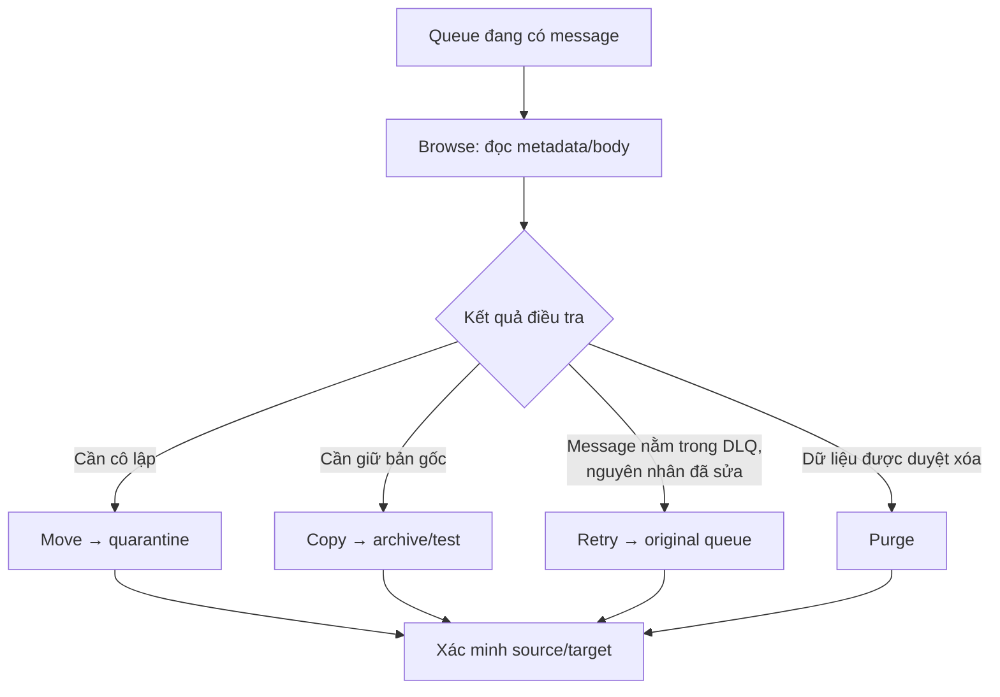

# Thao tác browse, move, retry, purge và điều kiện bảo vệ dữ liệu

> **Chương:** Vận hành  
> **Phạm vi:** Quy trình vận hành message đang nằm trong queue của **ActiveMQ Artemis** và **ActiveMQ Classic**. Bài phân biệt quan sát không tiêu thụ, di chuyển, sao chép, retry từ DLQ và xóa hàng loạt; tập trung vào điều kiện an toàn, quyền quản trị, kiểm soát phạm vi và xác minh sau thao tác.

## 1. Chọn đúng thao tác theo mục tiêu vận hành

Một queue **orders.incoming** có message lỗi schema. Operator cần xem payload, cô lập nhóm message lỗi, chạy lại những message đã sửa được và dọn dữ liệu thử nghiệm hết hạn. Bốn mục tiêu này cần bốn thao tác khác nhau; dùng nhầm **Purge** để “làm sạch queue” có thể xóa cả đơn hàng hợp lệ.

| Thao tác | Ý nghĩa | Queue nguồn sau thao tác | Trường hợp dùng |
| --- | --- | --- | --- |
| **Browse** | Xem message và metadata mà không nhận/ACK message | Giữ nguyên | Điều tra, xác minh selector, xem DLQ |
| **Move** | Chuyển message từ queue nguồn sang queue đích | Message đã chọn bị loại khỏi nguồn | Cô lập sang quarantine, chuyển backlog |
| **Copy** | Tạo bản sao ở queue đích nhưng giữ message nguồn | Giữ nguyên | Lưu bản sao điều tra hoặc thử xử lý |
| **Retry** | Đưa message trong DLQ trở lại destination ban đầu theo metadata broker | Message được lấy khỏi DLQ và gửi lại | Chạy lại sau khi sửa nguyên nhân lỗi |
| **Purge** | Xóa toàn bộ message đang chờ trong queue | Queue rỗng; queue resource vẫn còn | Dọn dữ liệu lab hoặc queue đã được duyệt |

Các thao tác này **không tương đương**:

- Browse không phải receive: browser không ACK và không lấy message ra khỏi queue. Tuy nhiên dữ liệu hiển thị vẫn có thể nhạy cảm.
- Move khác Copy: move chuyển message sang queue đích; copy giữ message nguồn và tạo thêm một bản để xử lý ở đích.
- Retry là redrive có hiểu biết về **queue gốc**; move từ DLQ sang một queue tùy chọn không tự khôi phục routing gốc.
- Purge chỉ xóa message trong queue được chọn; **Delete Queue** xóa cả tài nguyên queue. Nếu address có nhiều queue, purge một queue không đồng nghĩa purge các queue khác cùng address.



**Quy tắc quyết định:** browse trước, xác định đúng message và nguyên nhân, chọn thao tác hẹp nhất đáp ứng mục tiêu, sau đó đối chiếu số lượng và trạng thái hai queue. Không bắt đầu bằng thao tác xóa để “thử xem có hết lỗi không”.

## 2. Điều kiện an toàn trước mọi thao tác thay đổi dữ liệu

Một thao tác move/retry/purge có thể thay đổi dữ liệu producer đã gửi và broker đã lưu bền vững. Trước khi thực hiện, cần xác định phạm vi, owner nghiệp vụ, trạng thái consumers và khả năng phục hồi.

### 2.1. Preflight bắt buộc

| Kiểm tra | Câu hỏi phải trả lời | Bằng chứng cần lưu |
| --- | --- | --- |
| Broker/cluster | Đang thao tác đúng broker, node active và environment nào? | Broker name, node ID, URL, environment |
| Queue/address | Đúng queue hay chỉ đúng address? Routing type là anycast hay multicast? | Queue name, address, routing type |
| Owner | Ứng dụng/team nào sở hữu message? Ai phê duyệt? | Service owner, incident/change ticket |
| Scope | Selector khớp bao nhiêu message? Có message hợp lệ lẫn trong tập chọn không? | Selector nguyên văn, count preview, message IDs mẫu |
| In-flight | Có message đang giao cho consumer hoặc transaction chưa commit không? | Consumer count, delivering/in-flight count |
| Producers | Producer còn tiếp tục gửi vào queue không? | Tình trạng upstream, ingress pause/maintenance window |
| Target | Queue đích tồn tại, đúng loại, đủ dung lượng và có consumer phù hợp? | Queue config, storage headroom, ACL |
| Recovery | Có bản lưu/đường quay lui đã thử nghiệm? | Backup/export reference, restore evidence |
| Security | Người thao tác có đúng quyền cho hành động này? | Principal, role, audit trail |

**Đếm trước không khóa queue.** countMessages(selector) hoặc số liệu trên Console chỉ là snapshot. Nếu producer/consumer vẫn chạy, số lượng có thể đổi ngay sau preview. Với thao tác có phạm vi lớn, phải phối hợp freeze producer/consumer hoặc dùng maintenance window để ổn định tập message.

### 2.2. Xử lý in-flight messages

Queue có thể có message đang được dispatch nhưng chưa ACK. Thao tác quản trị trên message đang giao có thể không tìm thấy message, không xóa được hoặc kết quả thay đổi theo provider/version.

- Xem DeliveringCount (Artemis) hoặc InFlightCount (Classic) cùng ConsumerCount.
- Với xử lý nhạy cảm, tạm dừng luồng consumer theo runbook, chờ transaction đang mở kết thúc và xác nhận in-flight về mức dự kiến.
- Nếu chỉ pause queue, message mới vẫn có thể được route vào queue nhưng chưa dispatch. **Pause không phải chặn producer ingress**.
- Nếu cần ngừng tiếp nhận hoàn toàn, điều phối upstream hoặc dùng cơ chế disable/block/maintenance phù hợp topology; phải hiểu tác động với các queue khác cùng address.

Không đóng connection của worker hàng loạt khi chưa biết listener có transaction đang mở. Việc cưỡng bức đóng connection có thể làm message được redeliver và tạo duplicate business effects.

### 2.3. Selector là ranh giới dữ liệu

JMS selector lọc theo header và message properties có kiểu hỗ trợ; nó **không đọc trường JSON trong body**.

Ví dụ selector:

```sql
eventType = 'OrderCreated'
AND schemaVersion = 2
AND region = 'vn'
```

Trước khi dùng selector trên tập lớn:

1. Browse một vài message để xác nhận property có tồn tại và đúng kiểu.
2. Chạy count theo đúng selector.
3. Đối chiếu với tổng queue count và phân bố theo event type.
4. Kiểm tra selector có bỏ sót message do khác chữ hoa/thường hoặc kiểu số/chuỗi không.
5. Nếu có thể, dùng danh sách eventId/JMSMessageID đã được duyệt cho thao tác rất nhạy cảm.

**Cẩn thận dấu nháy:** không nối chuỗi do người dùng nhập trực tiếp vào selector. Giá trị có dấu nháy đơn phải được escape đúng cú pháp selector; ưu tiên ID do hệ thống sinh và đã xác thực. Một selector rỗng hoặc null có thể mang nghĩa **tất cả message**, tùy management operation.

## 3. Browse: xem message mà không tiêu thụ

### 3.1. Browse qua Console

Artemis Console hiển thị queue theo trang; có thể lọc bằng JMS selector, xem headers/properties và body khi định dạng hỗ trợ. Quy trình:

1. Chọn đúng broker và tab **Queues**.
2. Tìm đúng queue; đối chiếu address và routing type.
3. Mở **Browse** từ queue/message count.
4. Dùng selector hẹp, ví dụ **eventType = 'OrderCreated' AND schemaVersion = 2**.
5. Xem Message ID, Correlation ID, Timestamp, delivery metadata và properties trước khi mở body.
6. Chỉ mở body của số ít message cần điều tra; tránh tải toàn bộ payload lớn hoặc dữ liệu nhạy cảm về máy cá nhân.

Trong Artemis Console, browse được phân trang; thao tác browse lại có thể lấy trang mới từ broker khi thay đổi thứ tự hoặc bộ lọc. Vì queue vẫn có thể đang hoạt động, **message xuất hiện trong trang browse chưa chắc còn ở đó khi operator bấm Move/Delete**. Hãy xác minh lại message ID/count ngay trước mutation.

### 3.2. Browse bằng JMS QueueBrowser

Đây là cách quan sát portable trong Jakarta Messaging. Ví dụ Java 17+:

```java
import java.util.Enumeration;

import jakarta.jms.Connection;
import jakarta.jms.ConnectionFactory;
import jakarta.jms.Message;
import jakarta.jms.Queue;
import jakarta.jms.QueueBrowser;
import jakarta.jms.Session;
import jakarta.jms.TextMessage;

public final class QueueBrowseSample {

    public static void browse(
            ConnectionFactory factory,
            String queueName,
            String selector) throws Exception {

        try (Connection connection = factory.createConnection();
             Session session = connection.createSession(
                     false, Session.AUTO_ACKNOWLEDGE)) {

            Queue queue = session.createQueue(queueName);

            try (QueueBrowser browser =
                         session.createBrowser(queue, selector)) {
                connection.start();

                Enumeration<?> rows = browser.getEnumeration();
                int shown = 0;
                while (rows.hasMoreElements() && shown < 20) {
                    Message message = (Message) rows.nextElement();

                    String eventId = message.propertyExists("eventId")
                            ? message.getStringProperty("eventId")
                            : null;

                    String bodySummary =
                            message instanceof TextMessage text
                                    ? text.getText()
                                    : "<non-text body>";

                    System.out.printf(
                            "id=%s eventId=%s redelivered=%s body=%s%n",
                            message.getJMSMessageID(),
                            eventId,
                            message.getJMSRedelivered(),
                            bodySummary);
                    shown++;
                }
            }
        }
    }
}
```

Ví dụ chỉ in tối đa 20 messages để giới hạn lộ dữ liệu. Trong production, không log body nguyên bản; thay bằng độ dài, hash, event ID và một vài property đã được cho phép.

QueueBrowser:

- Không ACK message và không xóa message khỏi queue.
- Không tạo khóa độc quyền bảo vệ message khỏi consumer khác.
- Không đảm bảo kết quả browse là một snapshot bất biến trong suốt quá trình điều tra.
- Có thể tạo tải broker/client nếu browse queue rất lớn; giới hạn số dòng, dùng selector và đóng browser sau khi hoàn tất.

**Đừng thay QueueBrowser bằng MessageConsumer.receive() chỉ để xem thử.** receive() là thao tác tiêu thụ và acknowledgment mode có thể xác nhận message.

### 3.3. Giới hạn dữ liệu browse trong Artemis

Artemis có address settings để giới hạn số message trên một trang management và kích thước attributes lấy ra khi browse:

```xml
<address-settings>
    <address-setting match="orders.#">
        <management-browse-page-size>100</management-browse-page-size>
        <management-message-attribute-size-limit>512</management-message-attribute-size-limit>
    </address-setting>
</address-settings>
```

- management-browse-page-size giới hạn số message mà management resource browse trên một trang; tài liệu Artemis 2.57.0 ghi mặc định 200.
- management-message-attribute-size-limit giới hạn byte của message attributes được thu thập khi browse; mặc định 256 byte. Giá trị quá cao có thể làm tăng memory cần thiết cho những message đang hiển thị.
- Đây là giới hạn dữ liệu management browse, không thay thế giới hạn payload producer hoặc quyền truy cập body.

Pattern orders.# phải khớp address thực tế theo wildcard syntax của Artemis. Nếu queue dùng address khác tên queue, hãy cấu hình theo **address**, không mặc định queue name và address luôn giống nhau.

## 4. Move và Copy: chuyển hay nhân bản message?

### 4.1. Move

Move chuyển message khớp selector từ queue nguồn sang queue đích:

```text
orders.incoming
  ├─ eventId=evt-101, eventType=OrderCreated
  ├─ eventId=evt-102, eventType=OrderCreated
  └─ eventId=evt-103, eventType=LegacySchema

Move selector:
  eventType = 'OrderCreated'
Target:
  orders.replay

Sau thao tác:
  orders.incoming: message không khớp selector còn lại
  orders.replay:   evt-101, evt-102
```

Dùng move khi muốn:

- Cô lập message sai schema sang queue quarantine.
- Chuyển một nhóm message sang queue chuyên xử lý sau khi thay đổi consumer.
- Dời backlog khỏi queue đang gặp sự cố để khôi phục luồng ưu tiên.

Điều kiện:

- Queue đích phải tồn tại hoặc broker được phép tạo theo policy; production nên provision rõ ràng.
- Principal quản trị cần quyền phù hợp ở nguồn và quyền send/route vào đích.
- Queue đích phải có consumer, retention và schema contract phù hợp.
- Xác định rõ provider operation giữ những metadata nào; không giả định mọi header, priority, expiration và delivery metadata sẽ là bản sao byte-for-byte.
- Sau move, đối chiếu số message nguồn/đích và kiểm tra một số event ID.

### 4.2. Copy

Copy thêm bản sao vào queue đích nhưng giữ message gốc trong nguồn. Dùng cho:

- Tạo một bản sao phục vụ điều tra hoặc test parser.
- Giữ message nguồn trong queue gốc trong khi một nhóm khác chạy thử consumer.
- Chuyển một số message sang archive queue để xử lý theo retention riêng.

Copy có rủi ro **xử lý nghiệp vụ hai lần**. Nếu hai queue đều có consumer production, cả hai có thể tạo side effect từ cùng event. Queue archive không tự trở thành backup bất biến; nó vẫn là một queue có thể bị consumer hoặc operator thay đổi.

Nếu cần bằng chứng lâu dài, xuất/backup vào kho lưu trữ được kiểm soát, có retention, checksum, encryption và quy trình restore. Copy vào queue chỉ là bản sao vận hành.

### 4.3. Artemis Console: Move và Copy

Trong queue Browse view:

1. Chọn các message đã được đối chiếu.
2. Nhấn **Move** để chọn queue đích; Console sẽ xóa message khỏi nguồn và thêm vào đích.
3. Nhấn **Copy** nếu muốn giữ message nguồn và tạo thêm bản ở đích.
4. Xác nhận số lượng và target queue trước khi xác nhận thao tác.
5. Sau thao tác, refresh cả queue nguồn lẫn queue đích và kiểm tra message ID/event ID.

Console có thể xử lý nhiều message đã chọn, nhưng vẫn cần chia lô theo incident và capacity. Không chọn tất cả trang rồi lặp nhiều lần mà không tính số message thực tế.

### 4.4. Artemis Management API: move theo selector

Artemis QueueControl cung cấp countMessages(filter) và moveMessages(filter, otherQueueName, rejectDuplicates). Ví dụ sau minh họa management message API qua Core client. Chỉ dùng trên broker lab hoặc trong quy trình đã được phê duyệt.

Maven dependency cho Artemis Core client (chọn version tương thích broker):

```xml
<dependency>
    <groupId>org.apache.artemis</groupId>
    <artifactId>artemis-core-client</artifactId>
    <version>2.57.0</version>
</dependency>
```

Hàm nhận ClientSession và ClientRequestor đã được tạo; requestor được khởi tạo với management address activemq.management:

```java
import org.apache.activemq.artemis.api.core.client.ClientMessage;
import org.apache.activemq.artemis.api.core.client.ClientRequestor;
import org.apache.activemq.artemis.api.core.client.ClientSession;
import org.apache.activemq.artemis.api.core.management.ManagementHelper;
import org.apache.activemq.artemis.api.core.management.ResourceNames;

static int moveMatchingMessages(
        ClientSession session,
        ClientRequestor requestor,
        String sourceQueue,
        String selector,
        String targetQueue) throws Exception {

    if (selector == null || selector.isBlank()) {
        throw new IllegalArgumentException(
                "Refusing an empty selector");
    }

    ClientMessage request = session.createMessage(false);
    ManagementHelper.putOperationInvocation(
            request,
            ResourceNames.QUEUE + sourceQueue,
            "moveMessages",
            selector,
            targetQueue,
            false);

    ClientMessage reply = requestor.request(request, 5_000L);
    if (reply == null) {
        throw new IllegalStateException(
                "Management operation timed out");
    }
    if (!ManagementHelper.hasOperationSucceeded(reply)) {
        throw new IllegalStateException(
                "Move rejected: " + ManagementHelper.getResult(reply));
    }

    return ((Number) ManagementHelper.getResult(reply)).intValue();
}
```

Cách tạo requestor:

```java
ClientSession session = sessionFactory.createSession(
        username, password,
        false,  // xa
        true,   // autoCommitSends
        true,   // autoCommitAcks
        false,  // preAcknowledge
        0);

try (ClientRequestor requestor =
             new ClientRequestor(session, "activemq.management")) {
    session.start();

    int moved = moveMatchingMessages(
            session,
            requestor,
            "orders.incoming",
            "eventType = 'OrderCreated' AND schemaVersion = 2",
            "orders.replay");

    System.out.println("Moved messages: " + moved);
}
// ClientRequestor.close() đóng request/reply resources và session của nó.
```

ResourceNames.QUEUE + sourceQueue tạo resource name dạng queue.orders.incoming. Operation moveMessages nhận selector, tên queue đích và cờ rejectDuplicates. Đoạn code trên dùng false; nếu bật duplicate rejection, phải hiểu cơ chế duplicate detection của broker và cấu hình duplicate ID tương ứng.

**Quyền:** user cần quyền manage trên management address. Nếu bật fine-grained management message RBAC, operation thay đổi dữ liệu cần quyền edit; chỉ quyền view không đủ. Không cấp quyền quản trị này cho business producer/consumer thông thường.

**Race condition:** preview count và move là hai lần gọi riêng, không phải một transaction khóa queue. Nếu producer/consumer vẫn chạy, số thực tế có thể khác preview. Với thao tác lớn, ổn định ingress/consumer trước và xác minh kết quả sau.

### 4.5. ActiveMQ Classic: move/copy qua QueueViewMBean

ActiveMQ Classic cung cấp QueueViewMBean qua JMX. Ví dụ sau giả định đã có MBeanServerConnection từ một JMX connection được bảo vệ và broker name đúng là broker-a.

```java
import javax.management.JMX;
import javax.management.MBeanServerConnection;
import javax.management.ObjectName;

import org.apache.activemq.broker.jmx.QueueViewMBean;

public final class ClassicQueueOperations {

    public static int moveMatching(
            MBeanServerConnection mbeans,
            String brokerName,
            String sourceQueue,
            String selector,
            String targetQueue,
            int maxMessages) throws Exception {

        if (selector == null || selector.isBlank()) {
            throw new IllegalArgumentException(
                    "Refusing an empty selector");
        }
        if (maxMessages < 1) {
            throw new IllegalArgumentException(
                    "maxMessages must be positive");
        }

        ObjectName name = new ObjectName(
                "org.apache.activemq:type=Broker,brokerName="
                + ObjectName.quote(brokerName)
                + ",destinationType=Queue,destinationName="
                + ObjectName.quote(sourceQueue));

        QueueViewMBean queue = JMX.newMBeanProxy(
                mbeans, name, QueueViewMBean.class, true);

        return queue.moveMatchingMessagesTo(
                selector, targetQueue, maxMessages);
    }
}
```

Classic cũng có:

- copyMatchingMessagesTo(selector, targetQueue, maxMessages) để copy có giới hạn.
- moveMessageTo(messageId, targetQueue) và copyMessageTo(messageId, targetQueue) cho một message.
- removeMatchingMessages(selector, maxMessages) để xóa có lọc; đây là thao tác destructive.

MBean ObjectName phải khớp broker name và destination name thực tế. Nếu tên có ký tự đặc biệt, phải escape/quote đúng cú pháp ObjectName; không ghép tên người dùng tùy ý vào chuỗi JMX.

## 5. Retry: chỉ redrive message đã được phân loại phù hợp

### 5.1. Retry khác move từ DLQ

Dead Letter Queue (DLQ) chứa message đã vượt policy giao lại hoặc bị đưa vào dead-letter address theo cấu hình. Trước khi retry, cần hiểu **vì sao message tới DLQ**.

Retry của broker có ngữ nghĩa đặc biệt: đưa message về **queue ban đầu** theo metadata nguồn broker giữ. Move chỉ đưa message tới queue do operator chỉ định.

| Tình huống | Thao tác phù hợp | Vì sao |
| --- | --- | --- |
| Consumer lỗi do DB tạm thời, DB đã phục hồi | Retry có giới hạn | Có thể xử lý lại trên queue gốc |
| Consumer lỗi vì schema version không hỗ trợ | Cô lập/migrate payload trước | Retry ngay sẽ lặp lại lỗi |
| Message gửi nhầm destination | Move sang queue đúng sau khi xác minh | Original destination có thể không phải nơi mong muốn |
| Cần kiểm tra consumer mới mà vẫn giữ DLQ gốc | Copy một số message sang test queue | Không làm mất evidence ở DLQ |
| Message độc hại hoặc không hợp lệ vĩnh viễn | Giữ quarantine hoặc xóa theo retention/approval | Retry sẽ gây poison loop |

**Không retry cả DLQ chỉ vì đã deploy bản mới.** Trước tiên xác minh bản mới sửa đúng lỗi, destination gốc tồn tại, dependency phía sau hoạt động và consumer có idempotency.

### 5.2. Artemis: retry một message hoặc nhóm có filter

Artemis QueueControl có:

- retryMessage(messageID): retry một message DLQ về queue gốc.
- retryMessages(): retry tất cả messages trên DLQ về các queue gốc tương ứng.
- retryMessages(filter): retry các message khớp filter trên DLQ về queue gốc.

Các operation retry này **chỉ phù hợp với message trong DLQ**. Không gọi retryMessages trên queue nghiệp vụ bình thường với kỳ vọng nó hoạt động như một generic redelivery.

Filter nên dựa trên properties đã được xác minh khi browse. Ví dụ nếu ứng dụng đã ghi eventType và schemaVersion:

```sql
eventType = 'OrderCreated'
AND schemaVersion = 2
```

Trước khi retry, kiểm tra message có metadata destination gốc, event ID và delivery count. Nếu original queue đã bị xóa/đổi tên hoặc không còn phù hợp schema, không chạy bulk retry.

### 5.3. ActiveMQ Classic: retry qua QueueViewMBean

Classic QueueViewMBean có retryMessage(messageId) để chuyển một message DLQ về original destination và retryMessages() để retry các messages đã gửi vào DLQ.

Ví dụ một message:

```java
ObjectName dlqName = new ObjectName(
    "org.apache.activemq:type=Broker,brokerName="
    + ObjectName.quote("broker-a")
    + ",destinationType=Queue,destinationName="
    + ObjectName.quote("ActiveMQ.DLQ"));

QueueViewMBean dlq = JMX.newMBeanProxy(
        mbeanServerConnection,
        dlqName,
        QueueViewMBean.class,
        true);

boolean retried = dlq.retryMessage("ID:broker-a-12345-1:7:1:1");
if (!retried) {
    throw new IllegalStateException(
            "DLQ message was not retried");
}
```

retryMessages() trên Classic là thao tác bulk trên DLQ. Không gọi nó trong runbook thông thường nếu chưa có danh sách message, nguyên nhân lỗi và approval cho toàn bộ DLQ.

### 5.4. Kiểm soát retry để không tạo poison loop

Quy trình khuyến nghị:

1. Browse DLQ và phân loại theo error type, event type, schema version, thời điểm và original destination.
2. Xác nhận lỗi đã được sửa; ví dụ DB đã phục hồi, consumer mới hỗ trợ schema hoặc quyền destination đã được cập nhật.
3. Chọn **một message canary** có event ID rõ ràng.
4. Retry một message, theo dõi consumer logs, business result và queue gốc.
5. Nếu canary thành công, retry nhóm nhỏ theo filter đã được review.
6. Theo dõi số lần redelivery, DLQ ingress rate, queue age và duplicate business effects.
7. Dừng retry ngay khi message quay lại DLQ hoặc error rate tăng.

Retry không hoàn tác side effect đã xảy ra trước khi consumer crash. Nếu payment đã commit ở database nhưng ACK bị mất, message retry có thể chạy lại payment. Consumer phải idempotent theo business event ID.

### 5.5. Retry không tự sửa payload

Một message DLQ có body sai schema sẽ vẫn sai schema sau khi retry. Nếu cần sửa payload, thực hiện một workflow có kiểm soát:

- Copy sang queue lab/quarantine để thử transform.
- Chạy validator/schema migration trên bản sao và ghi lại mapping cũ–mới.
- Tạo message mới với event ID/lineage rõ ràng hoặc dùng cơ chế replay đã được ứng dụng hỗ trợ.
- Chỉ sau khi xác minh output mới quyết định retry/replay vào queue nghiệp vụ.

Không sửa trực tiếp payload trong Console rồi coi đó là một migration có thể tái lập. Console resend có thể tạo message mới từ dữ liệu đã chọn; nó không nhất thiết là bản sao nguyên vẹn của message cũ.

## 6. Purge: xóa message, không xóa queue

### 6.1. Phạm vi chính xác của purge

Purge xóa các message đang chờ trong **queue được chọn**. Queue resource vẫn tồn tại, cùng address binding và configuration.

| Thao tác | Message | Queue resource | Address |
| --- | --- | --- | --- |
| Artemis QueueControl.removeAllMessages() | Xóa tất cả message queue | Giữ | Giữ |
| Artemis removeMessages(filter) | Xóa message khớp filter | Giữ | Giữ |
| Artemis Console Purge | Xóa toàn bộ message queue | Giữ | Giữ |
| Classic QueueViewMBean.purge() | Xóa toàn bộ message queue | Giữ | Giữ |
| Delete Queue | Message thuộc queue bị loại cùng resource | Xóa | Có thể vẫn còn nếu còn queue binding khác |
| Delete Address | Ảnh hưởng các queue gắn address theo operation/policy | Có thể xóa nhiều queue | Xóa address |

Artemis management API định nghĩa null hoặc filter rỗng cho nhiều operation lọc là **áp dụng trên tất cả messages**. Ví dụ removeMessages("") có thể xóa toàn queue. Không truyền biến selector chưa được khởi tạo vào API destructive.

### 6.2. Điều kiện bắt buộc trước purge

Chỉ purge khi tất cả điều kiện sau đã được đáp ứng:

- Queue được xác định rõ là test/temporary hoặc owner nghiệp vụ đã xác nhận dữ liệu không còn giá trị.
- Producer ingress đã được dừng/điều phối để không phát sinh message mới trong lúc purge.
- Consumer và transaction in-flight đã được xử lý; số message đang giao được kiểm tra.
- Đã lưu bằng chứng cần thiết: message IDs, counts, event IDs, incident/ticket và lý do xóa.
- Nếu có yêu cầu retention, đã export/backup theo quy trình được kiểm chứng và có thể restore.
- Có approval riêng cho purge; người thực hiện có quyền đúng phạm vi.
- Sau thao tác, queue count được xác minh và producer/consumer được bật lại theo thứ tự.

**Purge không có undo.** Một snapshot tùy tiện của thư mục journal khi broker đang chạy không mặc nhiên là backup nhất quán. Dùng quy trình backup được hỗ trợ cho phiên bản broker và kiểm tra restore trong môi trường cô lập.

### 6.3. Artemis: API xóa có lọc và purge toàn queue

Với Artemis, ưu tiên operation theo selector cụ thể nếu chỉ cần dọn một nhóm message:

```java
// QueueControl.removeMessages(String filter) -> số message đã xóa.

String selector =
        "eventType = 'TestEvent' AND testRunId = 'run-2026-11-17'";

// Không gọi với null hoặc chuỗi rỗng.
if (selector == null || selector.isBlank()) {
    throw new IllegalArgumentException(
            "Refusing an unbounded delete");
}
```

QueueControl.removeMessages(selector) trả về số message bị xóa. Nếu muốn purge toàn bộ queue, Console có nút **Purge** hoặc API removeAllMessages(); thao tác đó phải nằm trong change có approval riêng.

### 6.4. Classic: purge qua JMX

```java
ObjectName queueName = new ObjectName(
    "org.apache.activemq:type=Broker,brokerName="
    + ObjectName.quote("broker-a")
    + ",destinationType=Queue,destinationName="
    + ObjectName.quote("LAB.TEST.QUEUE"));

QueueViewMBean queue = JMX.newMBeanProxy(
        mbeanServerConnection,
        queueName,
        QueueViewMBean.class,
        true);

// Chỉ chạy sau approval và preflight.
// queue.purge(); // Xóa tất cả messages đang chờ trong queue.
```

Để xóa có lọc, Classic cung cấp removeMatchingMessages(selector) và overload có maximumMessages. Dùng selector cụ thể, giới hạn số lượng và xác minh số message trả về; không dùng purge() để thay cho cleanup theo event type.

## 7. Quy trình vận hành an toàn theo từng loại thao tác

### 7.1. Browse/điều tra

1. Chọn đúng broker, queue/address và environment.
2. Đọc queue depth, consumer count, delivering/in-flight, oldest message age.
3. Browse bằng selector hẹp; chỉ mở body cần thiết.
4. Lưu message ID/event ID và metadata cần thiết vào incident record an toàn.
5. Xác định message là hợp lệ, lỗi schema, lỗi tạm thời hay dữ liệu không được xử lý.
6. Không ACK message trong lúc điều tra.

**Hoàn tất khi:** có bằng chứng message thuộc nhóm nào và quyết định tiếp theo được owner xác nhận.

### 7.2. Move sang quarantine

1. Tạo/kiểm tra queue quarantine có retention, quyền và consumer phù hợp.
2. Preview count bằng selector; browse một vài message để xác nhận tập chọn.
3. Dừng ingress hoặc ổn định queue nếu cần tính chính xác.
4. Move theo selector và batch nhỏ.
5. Ghi số message API báo đã chuyển.
6. Kiểm tra source giảm, quarantine tăng tương ứng; đối chiếu event ID mẫu.
7. Chỉ bật consumer quarantine sau khi policy xử lý dữ liệu được xác định.

**Hoàn tất khi:** message lỗi đã được cô lập và không còn bị business consumer xử lý ngoài ý muốn.

### 7.3. Retry từ DLQ

1. Browse DLQ và nhóm message theo original destination, error reason, schema version.
2. Xác minh original queue còn tồn tại, có consumer khỏe và hỗ trợ payload.
3. Sửa nguyên nhân lỗi và triển khai/canary consumer mới trước.
4. Retry một message; quan sát kết quả business, không chỉ queue count.
5. Retry nhóm nhỏ có filter; dừng khi DLQ ingress tăng hoặc duplicate xuất hiện.
6. Xác minh DLQ giảm, queue gốc nhận message, consumer ACK và business state đúng.

**Hoàn tất khi:** message được xử lý thành công ở nghiệp vụ, không chỉ được chuyển ra khỏi DLQ.

### 7.4. Purge queue test

1. Owner xác nhận queue thuộc test run và dữ liệu được phép xóa.
2. Dừng producer/consumer test; chờ in-flight bằng 0.
3. Lưu count và metadata cần thiết; kiểm tra queue name chính xác.
4. Thực hiện purge bằng Console hoặc JMX/management API trong broker lab.
5. Đọc lại queue count, xác nhận bằng 0.
6. Kiểm tra các queue khác cùng address không bị ảnh hưởng.
7. Lưu actor, thời điểm, ticket, broker, queue và kết quả vào audit log.

**Hoàn tất khi:** queue vẫn tồn tại đúng cấu hình, không còn message thuộc phạm vi purge và các queue khác không đổi ngoài dự kiến.

## 8. Bảo vệ dữ liệu và phân quyền quản trị

### 8.1. Tách quyền browse, move/retry và purge

Không cấp cùng một tài khoản admin rộng cho dashboard, người điều tra và người xóa dữ liệu.

| Vai trò | Quyền phù hợp | Không nên có |
| --- | --- | --- |
| **Observer** | Xem metrics, browse metadata theo phạm vi | Purge, delete queue, sửa cấu hình |
| **Incident analyst** | Browse body có kiểm soát, copy sang quarantine/test | Purge hàng loạt, quản trị broker |
| **Operator** | Move/retry trong queue được chỉ định, pause/resume theo runbook | Xóa mọi queue/address |
| **Data custodian** | Approve/export/retention, xác minh backup | Tự ý chạy business replay |
| **Broker admin** | Quản lý resource và quyền, destructive operations theo approval | Dùng credential admin trong ứng dụng business |

### 8.2. Artemis security

Artemis có permission riêng:

- browse: xem message trên queue gắn với address phù hợp.
- consume: nhận message từ queue.
- manage: gọi management operations qua management address.
- view và edit: phân tách management operation chỉ đọc và operation thay đổi dữ liệu khi fine-grained management RBAC được bật.

Ví dụ khung security setting (ghép vào security-settings hiện có của broker.xml):

```xml
<security-settings>
    <security-setting match="ops.quarantine.#">
        <permission type="browse" roles="ops-observer,ops-operator"/>
        <permission type="consume" roles="quarantine-worker"/>
        <permission type="send" roles="ops-operator"/>
        <permission type="manage" roles="ops-operator,broker-admin"/>
    </security-setting>
</security-settings>
```

Ví dụ trên chỉ minh họa quyền trên address quarantine. Nó không tự cấp quyền JMX/Console cho mọi MBean, và không phải toàn bộ cấu hình user/role. Nếu bật fine-grained management message RBAC, thao tác browse/list cần view, còn move/remove/retry cần edit cùng quyền manage trên management address theo cấu hình broker.

### 8.3. Classic authorization và JMX

Trong Classic, authorization cho destination thường dùng read, write, admin theo queue/topic. Đây là quyền truy cập destination; quyền gọi JMX QueueViewMBean.purge()/moveMessageTo() cần được bảo vệ riêng ở JMX management plane.

- Không mặc định user có read trên queue là được phép gọi JMX purge.
- Không expose remote JMX/RMI công khai.
- Dùng role JMX riêng cho operator, authentication/TLS/firewall và audit.
- Với Classic Web Console, hạn chế account và network path; không chia sẻ tài khoản quản trị trong script.

### 8.4. Bảo vệ nội dung message

Browse có thể lộ PII, access token, thông tin thanh toán hoặc dữ liệu định danh. Áp dụng các điều kiện:

- Không gửi screenshot/export message body vào ticket công khai hoặc chat không được phép.
- Chỉ truy cập body khi metadata không đủ để điều tra.
- Redact secret trước khi lưu evidence; giữ nguyên hash/event ID để đối chiếu.
- Hạn chế số message được browse và thời gian giữ bản sao.
- Archive/quarantine cần encryption, ACL, retention và owner rõ ràng.
- Audit ai đã xem/copy/move/retry/purge; không log credential hoặc body đầy đủ.

## 9. Kiểm tra kết quả và đối soát sau thao tác

Không chỉ nhìn thông báo “operation succeeded”. So sánh **trước–sau** ở cả nguồn, đích và business consumer.

| Chỉ số | Trước thao tác | Sau thao tác cần kiểm tra |
| --- | --- | --- |
| Source queue count | Snapshot trước mutation | Giảm đúng phạm vi đã chọn |
| Target queue count | Snapshot ban đầu | Tăng gần bằng số move/copy; tính cả consumer đang nhận |
| Delivering/in-flight | Có thể đang khác 0 | Không có message bị bỏ quên do consumer đang giữ |
| DLQ count | Baseline | Giảm khi retry thành công; có thể tăng lại nếu lỗi còn tồn tại |
| Messages acknowledged | Baseline counter | Tăng sau khi consumer xử lý, không chỉ sau move |
| Business event IDs | Danh sách đã chọn | Đã hoàn thành, bị từ chối hoặc còn pending rõ ràng |
| Duplicate effects | Baseline theo event ID | Không tăng ngoài mức được chấp nhận |
| Audit log | Ticket/actor/scope | Ghi số lượng thực tế và kết quả |

Move thành công chỉ chứng minh broker đã chuyển message; nó **không** chứng minh business consumer đã xử lý. Retry thành công chỉ chứng minh broker đã redrive message; nó **không** chứng minh nghiệp vụ đã commit.

Nếu source giảm 100 nhưng target chỉ tăng 90, đừng mặc định 10 message đã mất: có thể target consumer đã nhận ngay, duplicate rejection xảy ra hoặc các queue thay đổi đồng thời. Đối chiếu message IDs/event IDs, delivering count và application logs.

## 10. Bài thực hành trên broker lab

**Chuẩn bị:** một broker Classic hoặc Artemis test; queue lab.orders, queue lab.quarantine, DLQ test; producer gửi message có properties eventId, eventType, schemaVersion. Không dùng dữ liệu thật.

### Lab A — Browse không tiêu thụ

1. Gửi 5 message vào lab.orders.
2. Dùng Console Browse hoặc Java QueueBrowser với selector eventType = 'OrderCreated'.
3. Đọc message ID và event ID của 2 message.
4. Chạy browse lần nữa; queue count vẫn phải còn 5 nếu không có consumer khác.
5. Dùng receive() trong một test riêng để so sánh; xác minh receive là tiêu thụ.

**PASS:** hiểu browse không ACK, selector chỉ lọc header/property và kết quả browse có thể thay đổi nếu consumer chạy song song.

### Lab B — Move theo selector

1. Tạo 2 message schemaVersion=1 và 3 message schemaVersion=2.
2. Preview count eventType = 'OrderCreated' AND schemaVersion = 1.
3. Move đúng nhóm schema 1 sang lab.quarantine.
4. Kiểm tra source còn 3 message và target có 2 message (nếu chưa có consumer target).
5. Browse target và đối chiếu event IDs.

**PASS:** source giảm đúng tập chọn; target nhận đúng messages; không chuyển schema 2.

### Lab C — Copy và nguy cơ duplicate

1. Copy một message từ lab.orders sang queue test lab.copy.
2. Browse cả hai queue; xác nhận message gốc còn ở source.
3. Chạy consumer test trên cả hai queue để quan sát cùng event ID có thể được xử lý hai lần.
4. Dùng idempotency key/event ID để ngăn business side effect lặp.

**PASS:** phân biệt copy với move và hiểu vì sao hai queue cùng có consumer có thể tạo duplicate nghiệp vụ.

### Lab D — Retry một message DLQ

1. Tạo consumer test cố tình reject/rollback message để message tới DLQ theo policy lab.
2. Browse DLQ; ghi original destination, event ID, delivery metadata và nguyên nhân lỗi.
3. Sửa lỗi consumer rồi retry một message.
4. Xác minh message về queue gốc, consumer xử lý và business event hoàn tất.
5. Thử retry khi lỗi chưa sửa; quan sát message có thể quay lại DLQ.

**PASS:** retry chỉ sau khi đã sửa nguyên nhân; biết retry không đảm bảo side effect exactly-once.

### Lab E — Purge có phê duyệt

1. Tạo queue lab.purge chỉ chứa message test.
2. Dừng producer/consumer, xác nhận delivering/in-flight bằng 0.
3. Lưu queue count và danh sách event ID cần giữ evidence.
4. Chạy purge qua Console hoặc JMX/management API trong broker lab.
5. Xác nhận queue vẫn tồn tại nhưng message count bằng 0.
6. Kiểm tra queue khác cùng broker không bị ảnh hưởng.

**PASS:** phân biệt purge queue với delete queue/address; lưu audit evidence và thực hiện đúng scope.

## 11. Chẩn đoán lỗi thao tác

| Triệu chứng | Nguyên nhân thường gặp | Hướng xử lý |
| --- | --- | --- |
| Browse không thấy message dự kiến | Selector sai kiểu property, queue khác address hoặc consumer vừa lấy message | Xác minh queue, selector, consumer/in-flight và thời điểm browse |
| Move trả 0 message | Selector không khớp, message đã dispatch hoặc queue nguồn sai | Browse message ID/property, kiểm tra in-flight |
| Move báo target queue không tồn tại | Queue chưa provision hoặc sai tên | Tạo/kiểm tra target theo policy và ACL |
| Move thành công nhưng consumer không nhận | Target queue không có consumer, queue paused/disabled hoặc routing khác | Kiểm tra queue state, consumer và routing type |
| Copy khiến nghiệp vụ chạy hai lần | Cả source và target có consumer xử lý cùng event | Dừng một consumer, idempotency theo event ID |
| Retry không trả message về queue gốc | Không có original destination metadata, queue gốc đã đổi hoặc thao tác không chạy trên DLQ | Browse DLQ metadata, kiểm tra DLQ configuration và API/provider version |
| Retry xong message lại vào DLQ | Root cause chưa được sửa hoặc consumer mới vẫn lỗi | Dừng bulk retry, kiểm tra stack trace/schema/dependency |
| Purge không xóa hết message | Producer vẫn gửi, consumer/in-flight hoặc selector operation không bao phủ | Freeze ingress, kiểm tra delivering count và phạm vi API |
| Purge làm mất dữ liệu hợp lệ | Nhầm queue, filter rỗng/null hoặc không có approval | Dừng thao tác, đánh giá restore/backup và incident response |
| JMX operation bị từ chối | Thiếu JMX role hoặc sai ObjectName | Xác minh broker name, destination name, RBAC |
| Artemis management message bị denied | Thiếu manage, view/edit hoặc resource name sai | Kiểm tra security settings và ResourceNames |
| Count preview khác số đã move | Queue thay đổi trong lúc thao tác hoặc consumer xử lý đồng thời | Đối chiếu event IDs, freeze workload và chia batch |
| Console không browse được body | Message type không hỗ trợ render hoặc attribute limit thấp | Đọc metadata, dùng client phù hợp, không tắt giới hạn bừa bãi |

## 12. Checklist trước khi kết thúc incident/change

- [ ] Đúng broker, node, environment, address và queue.
- [ ] Đã xác nhận owner và mục tiêu: browse, move, copy, retry hay purge.
- [ ] Selector cụ thể, được preview và kiểm tra kiểu property.
- [ ] Đã xem consumer/in-flight, producer ingress và transaction đang mở.
- [ ] Queue đích đã provision, có quyền, capacity và consumer policy phù hợp.
- [ ] Move/copy/retry được giới hạn theo một nhóm nhỏ trước khi mở rộng.
- [ ] Retry chỉ áp dụng cho DLQ; original destination và nguyên nhân lỗi đã được xác minh.
- [ ] Purge có approval, backup/evidence, freeze ingress và xác nhận không còn in-flight.
- [ ] Không dùng filter null/rỗng ngoài kế hoạch purge toàn queue đã phê duyệt.
- [ ] Quyền browse tách khỏi quyền destructive; audit actor, selector, IDs và số lượng.
- [ ] Đã kiểm tra source/target/DLQ counts và event IDs sau thao tác.
- [ ] Consumer business đã xử lý thành công; không chỉ dựa vào operation return count.
- [ ] Duplicate/idempotency, PII và retention đã được xem xét.
- [ ] Có runbook rollback/restore nếu kết quả không như mong đợi.

## Tài liệu tham khảo

1. [Apache Artemis — Management API](https://artemis.apache.org/components/artemis/documentation/latest/management.html): QueueControl, browse, move, retry, remove và management messages.
2. [Apache Artemis — QueueControl Javadoc 2.57.0](https://artemis.apache.org/components/artemis/documentation/javadocs/javadoc-latest/org/apache/activemq/artemis/api/core/management/QueueControl.html): chữ ký moveMessages, retryMessage, retryMessages, removeMessages và browse.
3. [Apache Artemis Console — Browsing Messages](https://artemis.apache.org/components/artemis-console/documentation/latest/): Browse, filter, move, copy, resend, delete và purge.
4. [Apache Artemis — Address Settings](https://artemis.apache.org/components/artemis/documentation/latest/address-settings.html): management-browse-page-size và management-message-attribute-size-limit.
5. [Apache Artemis — Authentication & Authorization](https://artemis.apache.org/components/artemis/documentation/latest/security.html): browse, consume, manage, view và edit.
6. [ActiveMQ Classic 5.17 — QueueViewMBean API](https://activemq.apache.org/components/classic/documentation/maven/apidocs/org/apache/activemq/broker/jmx/QueueViewMBean.html): moveMessageTo, moveMatchingMessagesTo, retryMessage, retryMessages và purge.
7. [ActiveMQ Classic — JMX](https://activemq.apache.org/components/classic/documentation/jmx): MBean ObjectNames và quyền quản trị.
